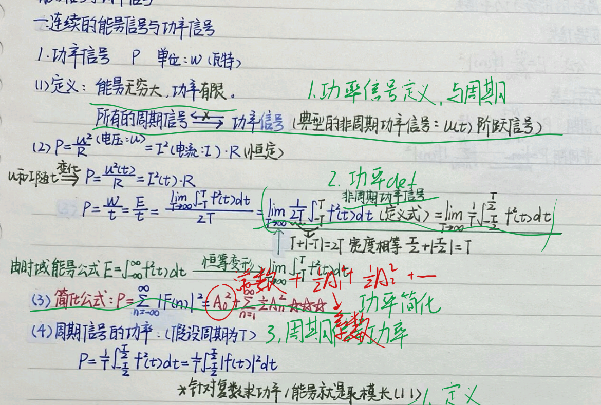
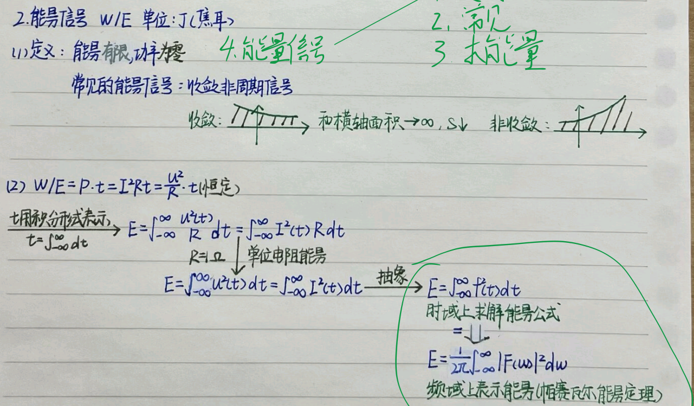
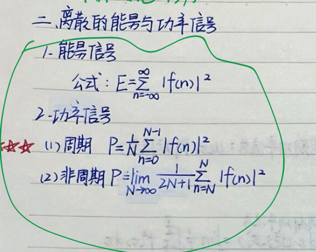

# 能量信号和功率信号｜墨墨记忆卡重组

来源：[墨墨记忆卡「信号与系统」](https://www.markji.com/deck/editor/67dd5988bbc6238121685de1)。本章共 3 张（总编号 043—045）。印刷体公式与文字已转写为 Markdown/LaTeX；手写内容按约定暂不转写，均已保留本地高清原图。

## 043 功率信号

**问：** 请写出功率信号的相关定义与计算公式。

**答：**

1. 描述性定义
2. 定义式
3. 简化公式
4. 周期信号的功率

（手写内容暂不转写，见原图）

## 044 能量信号

**问：** 请写出能量信号的相关定义与计算公式。

**答：**

1. 描述性定义
2. 常见能量信号
3. 时域频域能量公式
4. 复数能量

（手写内容暂不转写，见原图）

## 045 离散能量和功率信号计算

**问：** 请写出离散能量和功率信号的计算公式。

**答：**

（手写内容暂不转写，见原图）
