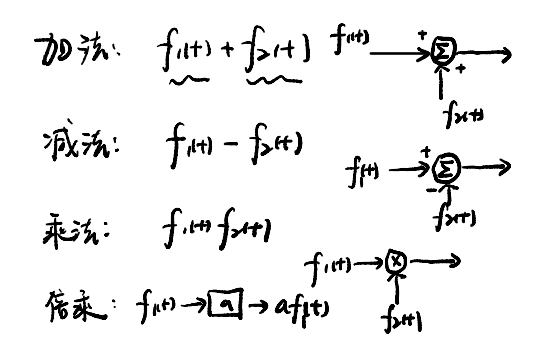
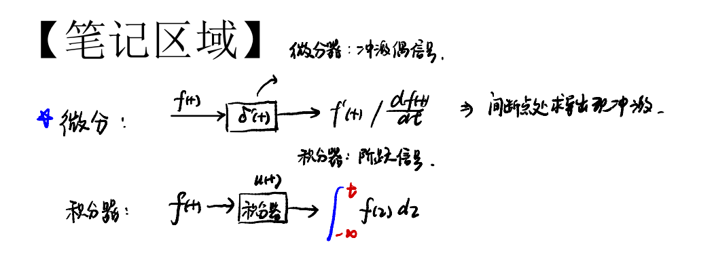
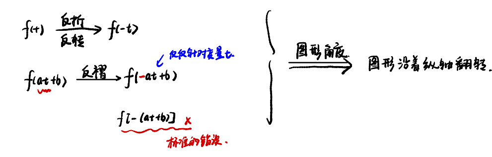
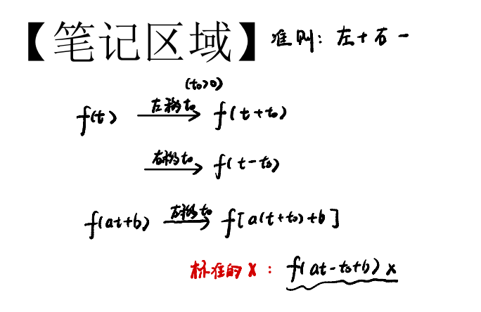
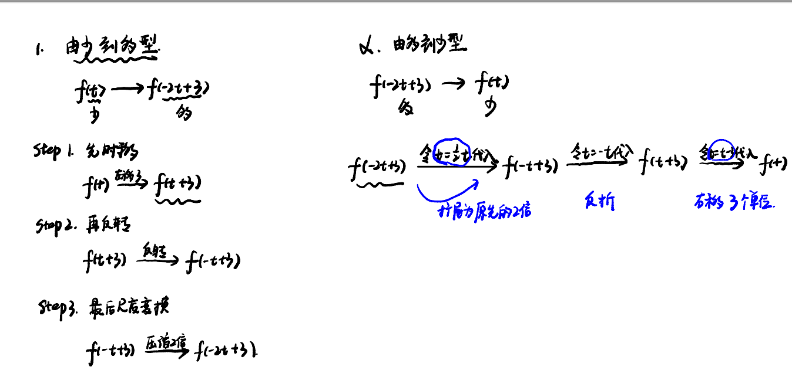

# 图形变换专题｜墨墨记忆卡重组

来源：[墨墨记忆卡「信号与系统」](https://www.markji.com/deck/editor/67dd5988bbc6238121685de1)。本章共 4 张（总编号 046—049）。印刷体公式与文字已转写为 Markdown/LaTeX；手写内容按约定暂不转写，均已保留本地高清原图。

## 046 加减乘倍乘运算

**问：** 请写出信号的加、减、乘、倍乘运算及其符号表示。

**答：**

符号表示：

（手写内容暂不转写，见原图）

## 047 微分积分运算

**问：** 请写出信号的微分与积分运算。

**答：**

【笔记区域】（手写内容暂不转写，见原图）

## 048 反折运算、时移运算、尺度运算

**问：** 请说明信号的反折运算、时移运算与尺度运算。

**答：**

仅针对 $t$

（手写内容暂不转写，见原图）

【笔记区域】（手写内容暂不转写，见原图）

## 049 图形变换运算顺序

**问：** 请说明图形变换的运算顺序。

**答：**

（手写内容暂不转写，见原图）
