# 系统六性判别｜墨墨记忆卡重组

来源：[墨墨记忆卡「信号与系统」](https://www.markji.com/deck/editor/67dd5988bbc6238121685de1)。本章共 15 张（总编号 050—064）。印刷体公式与文字已转写为 Markdown/LaTeX；手写内容按约定暂不转写，均已保留本地高清原图。

## 050 线性系统判定一

**问：** 请说明线性系统的判定方法（题型一）。

**答：**

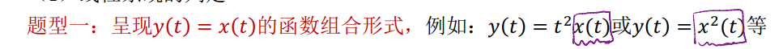

**题型一**：呈现 $y(t) = x(t)$ 的函数组合形式，例如：$y(t) = t^2 x(t)$ 或 $y(t) = x^2(t)$ 等

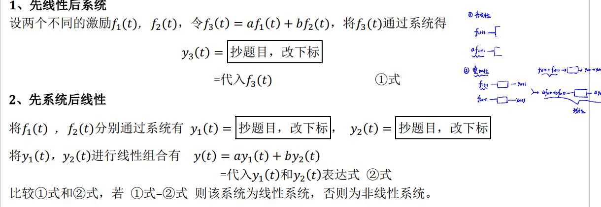

**1、先线性后系统**

设两个不同的激励 $f_1(t)$，$f_2(t)$，令 $f_3(t) = a f_1(t) + b f_2(t)$，将 $f_3(t)$ 通过系统得

$$y_3(t) = \boxed{\text{抄题目，改下标}} = \text{代入 } f_3(t) \qquad \text{①式}$$

**2、先系统后线性**

将 $f_1(t)$，$f_2(t)$ 分别通过系统有 $y_1(t) = \boxed{\text{抄题目，改下标}}$，$y_2(t) = \boxed{\text{抄题目，改下标}}$

将 $y_1(t)$，$y_2(t)$ 进行线性组合有

$$y(t) = a y_1(t) + b y_2(t) = \text{代入 } y_1(t) \text{ 和 } y_2(t) \text{ 表达式} \qquad \text{②式}$$

比较①式和②式，若 $\text{①式} = \text{②式}$ 则该系统为线性系统，否则为非线性系统。

（含手写批注，手写部分暂不转写，见原图）

## 051 线性系统判断二

**问：** 请说明线性系统的判定方法（题型二）。

**答：**

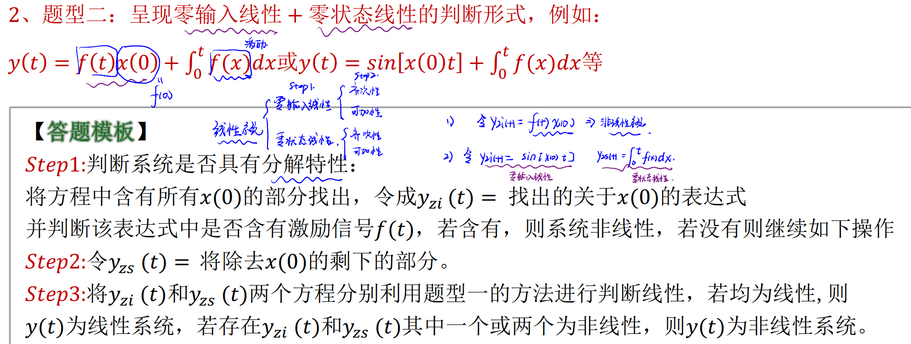

**2、题型二**：呈现零输入线性 $+$ 零状态线性的判断形式，例如：

$$y(t) = f(t)x(0) + \int_0^t f(x)\,\mathrm{d}x \quad \text{或} \quad y(t) = \sin[x(0)t] + \int_0^t f(x)\,\mathrm{d}x \text{ 等}$$

**【答题模板】**

- **Step 1**：判断系统是否具有分解特性：
  将方程中含有所有 $x(0)$ 的部分找出，令成 $y_{zi}(t) =$ 找出的关于 $x(0)$ 的表达式
  并判断该表达式中是否含有激励信号 $f(t)$，若含有，则系统非线性，若没有则继续如下操作
- **Step 2**：令 $y_{zs}(t) =$ 将除去 $x(0)$ 的剩下的部分。
- **Step 3**：将 $y_{zi}(t)$ 和 $y_{zs}(t)$ 两个方程分别利用题型一的方法进行判断线性，若均为线性，则 $y(t)$ 为线性系统，若存在 $y_{zi}(t)$ 和 $y_{zs}(t)$ 其中一个或两个为非线性，则 $y(t)$ 为非线性系统。

（含手写批注，手写部分暂不转写，见原图）

## 052 线性系统判断三

**问：** 请说明线性系统的判定方法（题型三）。

**答：**

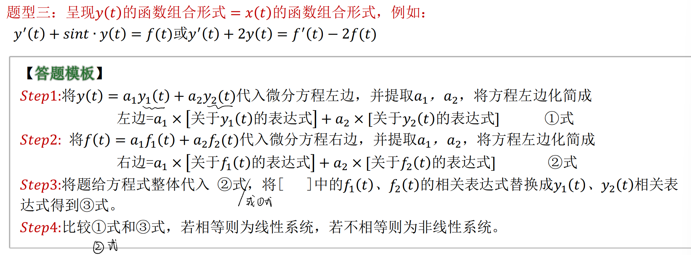

**题型三**：呈现 $y(t)$ 的函数组合形式 $= x(t)$ 的函数组合形式，例如：

$$y'(t) + \sin t \cdot y(t) = f(t) \quad \text{或} \quad y'(t) + 2y(t) = f'(t) - 2f(t)$$

**【答题模板】**

- **Step 1**：将 $y(t) = a_1 y_1(t) + a_2 y_2(t)$ 代入微分方程左边，并提取 $a_1$，$a_2$，将方程左边化简成

$$\text{左边} = a_1 \times [\text{关于 } y_1(t) \text{ 的表达式}] + a_2 \times [\text{关于 } y_2(t) \text{ 的表达式}] \qquad \text{①式}$$

- **Step 2**：将 $f(t) = a_1 f_1(t) + a_2 f_2(t)$ 代入微分方程右边，并提取 $a_1$，$a_2$，将方程左边化简成

$$\text{右边} = a_1 \times [\text{关于 } f_1(t) \text{ 的表达式}] + a_2 \times [\text{关于 } f_2(t) \text{ 的表达式}] \qquad \text{②式}$$

- **Step 3**：将题给方程整体代入②式，将 $[\quad]$ 中的 $f_1(t)$、$f_2(t)$ 的相关表达式替换成 $y_1(t)$、$y_2(t)$ 相关表达式得到③式。
- **Step 4**：比较①式和③式，若相等则为线性系统，若不相等则为非线性系统。

（含手写批注，手写部分暂不转写，见原图）

## 053 线性系统判断4（分段函数）

**问：** 请说明分段函数形式系统的线性判定方法与结论。

**答：**

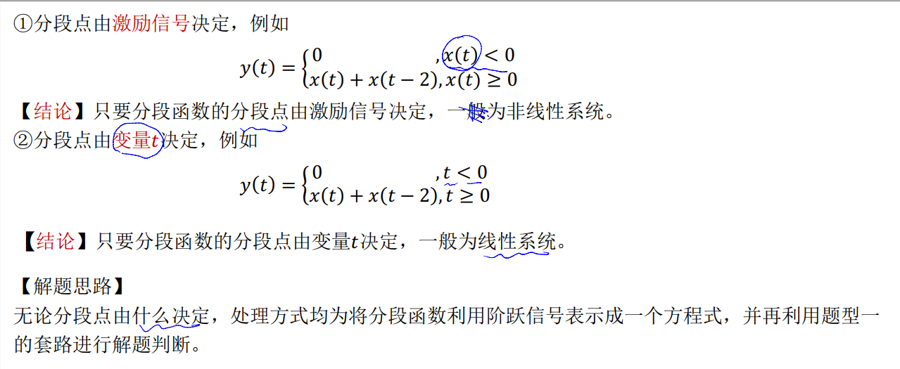

① 分段点由**激励信号**决定，例如

$$y(t) = \begin{cases} 0 &, x(t) < 0 \\ x(t) + x(t-2) &, x(t) \ge 0 \end{cases}$$

**【结论】** 只要分段函数的分段点由激励信号决定，一般为非线性系统。

② 分段点由**变量 $t$** 决定，例如

$$y(t) = \begin{cases} 0 &, t < 0 \\ x(t) + x(t-2) &, t \ge 0 \end{cases}$$

**【结论】** 只要分段函数的分段点由变量 $t$ 决定，一般为线性系统。

**【解题思路】**
无论分段点由什么决定，处理方式均为将分段函数利用阶跃信号表示成一个方程式，并再利用题型一的套路进行解题判断。

（含手写批注，手写部分暂不转写，见原图）

## 054 常见非线性元素

**问：** 请列举常见的非线性系统元素。

**答：**

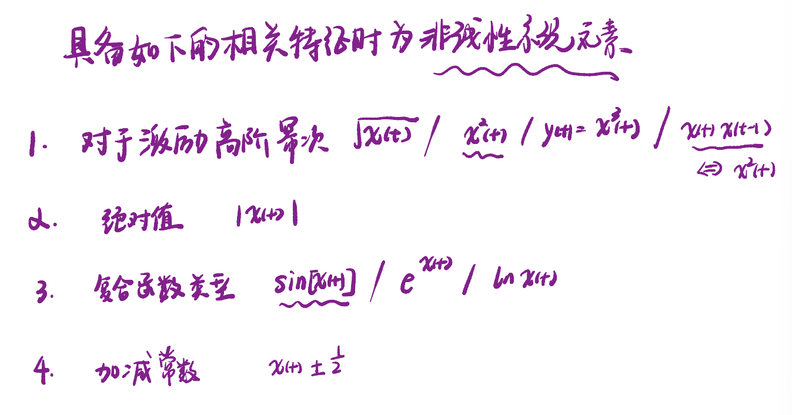

（手写内容暂不转写，见原图）

## 055 时不变系统判定一

**问：** 请说明时不变系统的判定方法（题型一及积分类型）。

**答：**

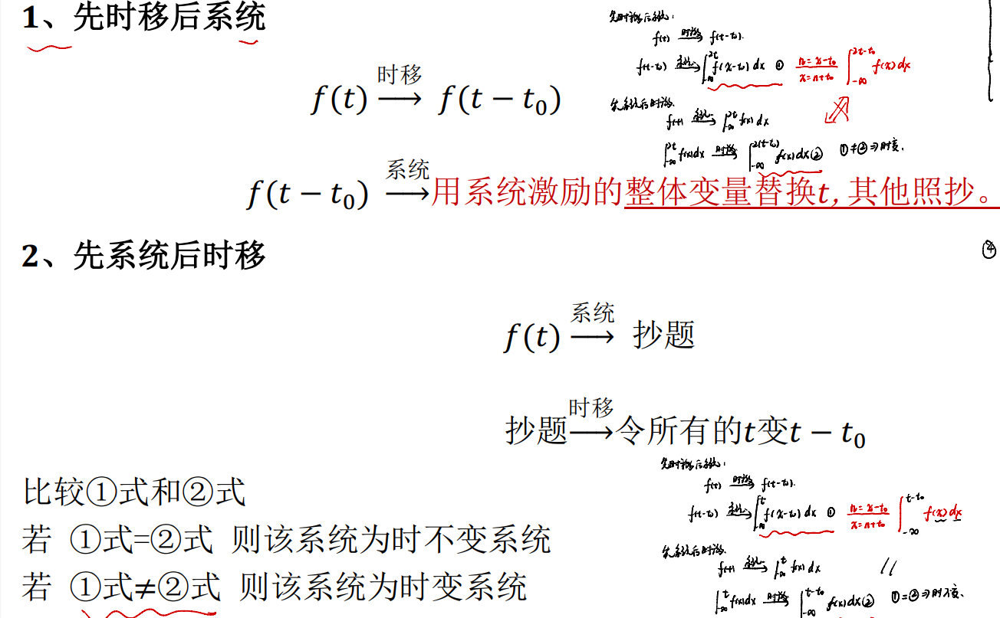

**1、先时移后系统**

$$f(t) \xrightarrow{\text{时移}} f(t - t_0)$$

$$f(t - t_0) \xrightarrow{\text{系统}} \text{用系统激励的}\underline{\text{整体变量替换 } t}\text{，其他照抄。}$$

**2、先系统后时移**

$$f(t) \xrightarrow{\text{系统}} \text{抄题}$$

$$\text{抄题} \xrightarrow{\text{时移}} \text{令所有的 } t \text{ 变 } t - t_0$$

比较①式和②式：
- 若 $\text{①式} = \text{②式}$ 则该系统为时不变系统
- 若 $\text{①式} \ne \text{②式}$ 则该系统为时变系统

（含手写批注，手写部分暂不转写，见原图）

**第一步是括号里的 $t$ 换成 $t-t_0$**

**积分类型**

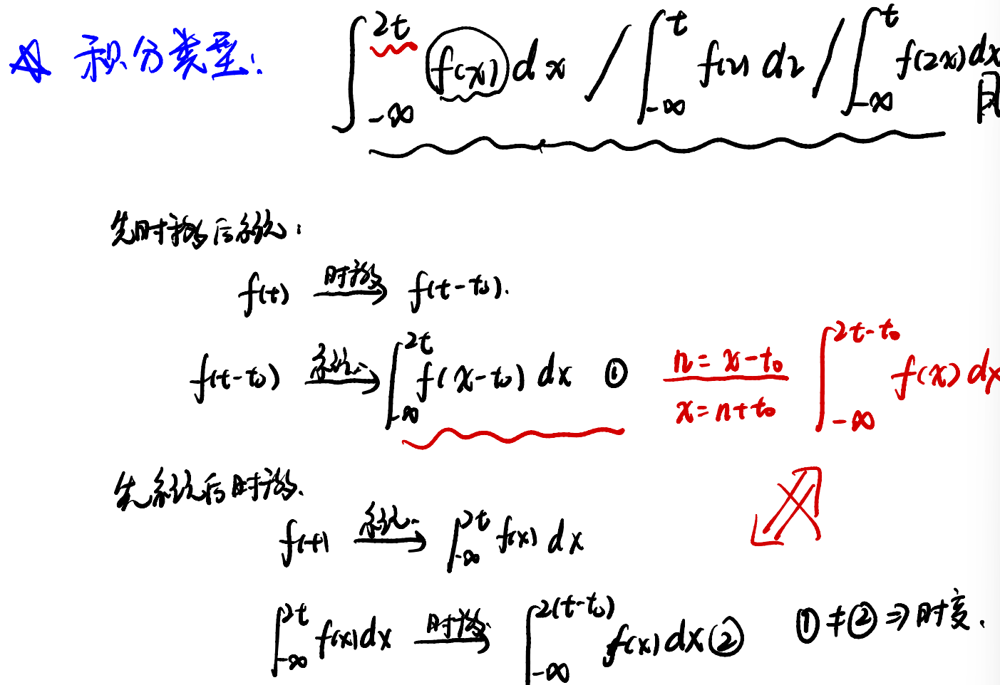

（手写内容暂不转写，见原图）

## 056 时不变系统判定二

**问：** 请说明时不变系统的判定方法（题型二）。

**答：**

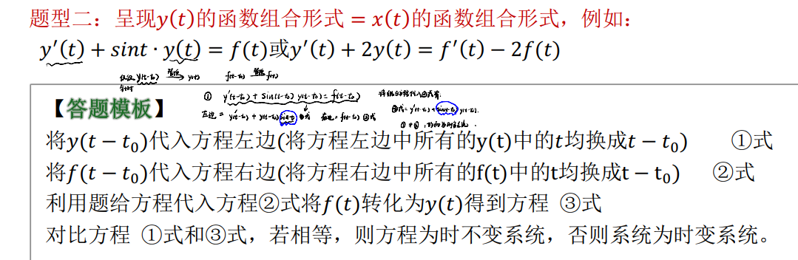

**题型二**：呈现 $y(t)$ 的函数组合形式 $= x(t)$ 的函数组合形式，例如：

$$y'(t) + \sin t \cdot y(t) = f(t) \quad \text{或} \quad y'(t) + 2y(t) = f'(t) - 2f(t)$$

**【答题模板】**

- 将 $y(t - t_0)$ 代入方程左边（将方程左边中所有的 $y(t)$ 中的 $t$ 均换成 $t - t_0$） $\qquad$ ①式
- 将 $f(t - t_0)$ 代入方程右边（将方程右边中所有的 $f(t)$ 中的 $t$ 均换成 $t - t_0$） $\qquad$ ②式
- 利用题给方程代入方程②式将 $f(t)$ 转化为 $y(t)$ 得到方程 ③式
- 对比方程①式和③式，若相等，则方程为时不变系统，否则系统为时变系统。

（含手写批注，手写部分暂不转写，见原图）

## 057 时不变系统判定三

**问：** 请说明分段函数形式系统的时不变性判定方法与结论（题型三）。

**答：**

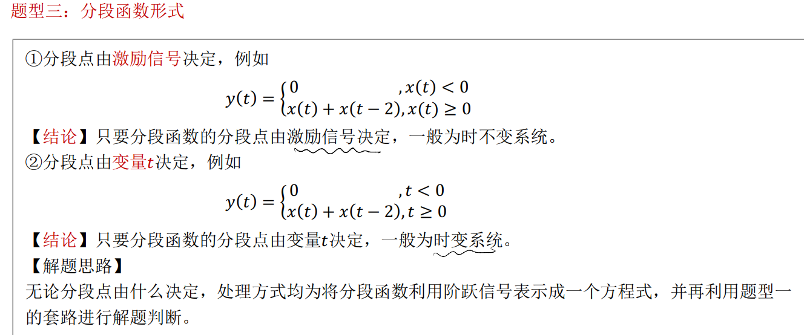

**题型三：分段函数形式**

① 分段点由**激励信号**决定，例如

$$y(t) = \begin{cases} 0 &, x(t) < 0 \\ x(t) + x(t-2) &, x(t) \ge 0 \end{cases}$$

**【结论】** 只要分段函数的分段点由激励信号决定，一般为时不变系统。

② 分段点由**变量 $t$** 决定，例如

$$y(t) = \begin{cases} 0 &, t < 0 \\ x(t) + x(t-2) &, t \ge 0 \end{cases}$$

**【结论】** 只要分段函数的分段点由变量 $t$ 决定，一般为时变系统。

**【解题思路】**
无论分段点由什么决定，处理方式均为将分段函数利用阶跃信号表示成一个方程式，并再利用题型一的套路进行解题判断。

（含手写批注，手写部分暂不转写，见原图）

## 058 时变元素

**问：** 请列举常见的时变因素（元素）。

**答：**

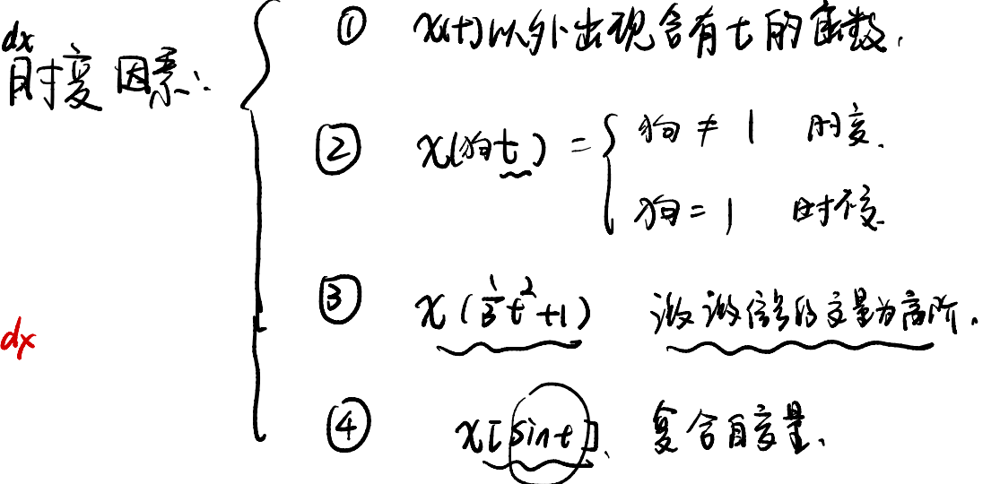

（手写内容暂不转写，见原图）

## 059 因果系统判定

**问：** 请说明因果系统的判定方法。

**答：**

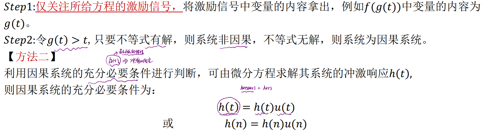

- **Step 1**：仅关注所给方程的激励信号，将激励信号中变量的内容拿出，例如 $f(g(t))$ 中变量的内容为 $g(t)$。
- **Step 2**：令 $g(t) > t$，只要不等式有解，则系统非因果，不等式无解，则系统为因果系统。

**【方法二】**
利用因果系统的充分必要条件进行判断，可由微分方程求解其系统的冲激响应 $h(t)$，则因果系统的充分必要条件为：

$$h(t) = h(t)u(t)$$

或

$$h(n) = h(n)u(n)$$

（含手写批注，手写部分暂不转写，见原图）

## 060 稳定系统两定义（判别）

**问：** 请写出稳定系统的两个判别角度（连续系统与离散系统）。

**答：**

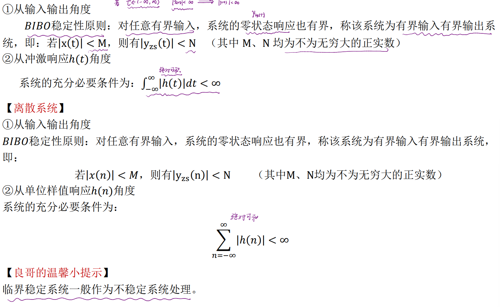

① 从输入输出角度

*BIBO 稳定性原则*：对任意有界输入，系统的零状态响应也有界，称该系统为有界输入有界输出系统，即：若 $|x(t)| < M$，则有 $|y_{zs}(t)| < N$ （其中 $M$、$N$ 均为不为无穷大的正实数）

② 从冲激响应 $h(t)$ 角度

系统的充分必要条件为：

$$\int_{-\infty}^{\infty} |h(t)|\,\mathrm{d}t < \infty$$

**【离散系统】**

① 从输入输出角度

*BIBO 稳定性原则*：对任意有界输入，系统的零状态响应也有界，称该系统为有界输入有界输出系统，即：

$$\text{若 } |x(n)| < M\text{，则有 } |y_{zs}(n)| < N \quad \text{（其中 } M\text{、}N \text{ 均为不为无穷大的正实数）}$$

② 从单位样值响应 $h(n)$ 角度

系统的充分必要条件为：

$$\sum_{n=-\infty}^{\infty} |h(n)| < \infty$$

**【良哥的温馨小提示】**

临界稳定系统一般作为不稳定系统处理。

（含手写批注，手写部分暂不转写，见原图）

## 061 可逆系统定义

**问：** 请写出可逆系统的定义。

**答：**

输出和输入为一一对应的关系，不存在多个输入对应一个输出的系统

## 062 连续可逆系统判别

**问：** 请说明连续系统的可逆性判别方法。

**答：**

**1.图像**

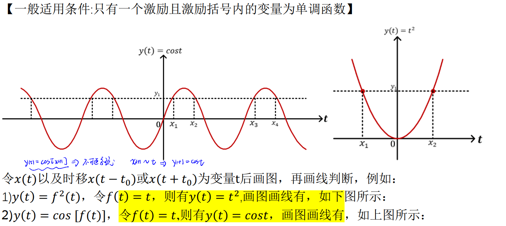

【一般适用条件：只有一个激励且激励括号内的变量为单调函数】

- 左图坐标轴与曲线：横轴 $t$（原点 $0$），纵轴 $y(t) = \cos t$；水平虚线 $y_1$ 与曲线交点对应的横坐标标有 $x_1, x_2, x_3, x_4$。
- 右图坐标轴与曲线：横轴 $t$（原点 $0$），纵轴 $y(t) = t^2$；水平虚线 $y_1$ 与曲线交点对应的横坐标标有 $x_1, x_2$。

令 $x(t)$ 以及时移 $x(t-t_0)$ 或 $x(t+t_0)$ 为变量 $t$ 后画图，再画线判断，例如：

1) $y(t) = f^2(t)$，**令 $f(t) = t$，则有 $y(t) = t^2$，画图画线有**，如下图所示：
2) $y(t) = \cos[f(t)]$，**令 $f(t) = t$，则有 $y(t) = \cos t$，画图画线有**，如上图所示：

（含手写批注，手写部分暂不转写，见原图）

**2.结论**

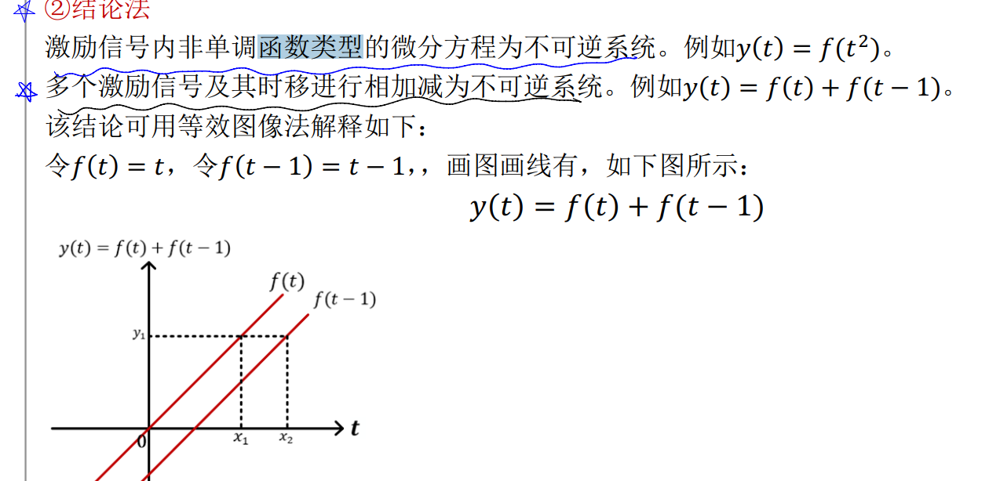

② 结论法

- 激励信号内非单调函数类型的微分方程为不可逆系统。例如 $y(t) = f(t^2)$。
- 多个激励信号及其时移进行相加减为不可逆系统。例如 $y(t) = f(t) + f(t-1)$。
- 该结论可用等效图像法解释如下：
  令 $f(t) = t$，令 $f(t-1) = t - 1$，画图画线有，如下图所示：
  $$y(t) = f(t) + f(t-1)$$
- 图像坐标轴与曲线：横轴 $t$（原点 $0$），纵轴 $y(t) = f(t) + f(t-1)$；两条直线分别标有 $f(t)$ 与 $f(t-1)$；水平虚线 $y_1$ 与两条直线交点对应的横坐标标有 $x_1, x_2$。

（含手写批注，手写部分暂不转写，见原图）

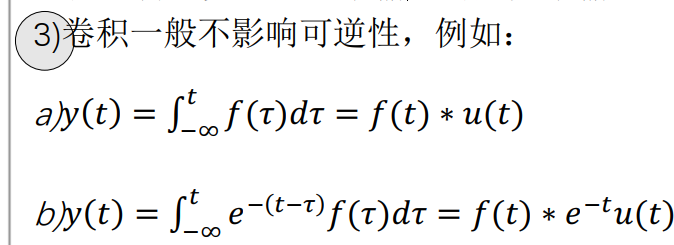

3) 卷积一般不影响可逆性，例如：

a) $y(t) = \int_{-\infty}^{t} f(\tau)\,d\tau = f(t) * u(t)$

b) $y(t) = \int_{-\infty}^{t} e^{-(t-\tau)} f(\tau)\,d\tau = f(t) * e^{-t} u(t)$

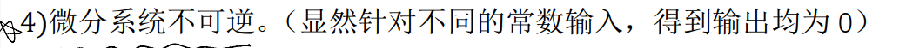

4) 微分系统不可逆。（显然针对不同的常数输入，得到输出均为 $0$）

（含手写批注，手写部分暂不转写，见原图）

## 063 离散系统可逆判别

**问：** 请说明离散系统的可逆性判别方法。

**答：**

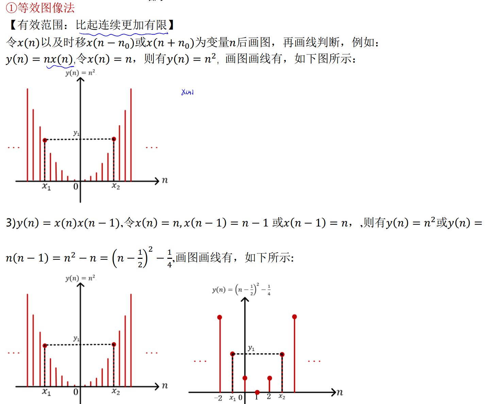

① 等效图像法

【有效范围：比起连续更加有限】

令 $x(n)$ 以及时移 $x(n-n_0)$ 或 $x(n+n_0)$ 为变量 $n$ 后画图，再画线判断，例如：

$y(n) = n x(n)$，令 $x(n) = n$，则有 $y(n) = n^2$，画图画线有，如下图所示：

- 上图坐标轴与序列：横轴 $n$（原点 $0$），纵轴 $y(n) = n^2$；水平虚线 $y_1$ 与序列交点对应的横坐标标有 $x_1, x_2$。

3) $y(n) = x(n)x(n-1)$，令 $x(n) = n$，$x(n-1) = n - 1$ 或 $x(n-1) = n$，则有 $y(n) = n^2$ 或 $y(n) = n(n-1) = n^2 - n = \left(n - \frac{1}{2}\right)^2 - \frac{1}{4}$，画图画线有，如下图所示：

- 下左图坐标轴与序列：横轴 $n$（原点 $0$），纵轴 $y(n) = n^2$；水平虚线 $y_1$ 对应交点横坐标标有 $x_1, x_2$。
- 下右图坐标轴与序列：横轴 $n$（标有 $-2, x_1, 0, 1, 2, x_2$），纵轴 $y(n) = \left(n - \frac{1}{2}\right)^2 - \frac{1}{4}$；水平虚线 $y_1$ 对应交点横坐标标有 $x_1, x_2$。

（含手写批注，手写部分暂不转写，见原图）

**2.结论**

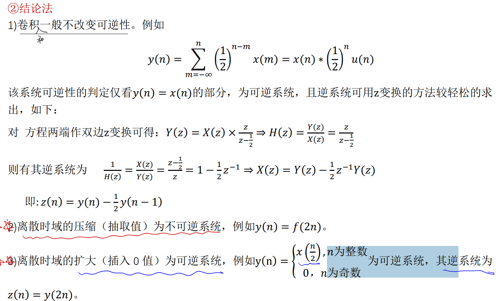

② 结论法

1) 卷积一般不改变可逆性。例如

$$y(n) = \sum_{m=-\infty}^{n} \left(\frac{1}{2}\right)^{n-m} x(m) = x(n) * \left(\frac{1}{2}\right)^n u(n)$$

该系统可逆性的判定仅看 $y(n) = x(n)$ 的部分，为可逆系统，且逆系统可用 $z$ 变换的方法较轻松的求出，如下：

对 方程两端作双边 $z$ 变换可得：$Y(z) = X(z) \times \frac{z}{z - \frac{1}{2}} \Rightarrow H(z) = \frac{Y(z)}{X(z)} = \frac{z}{z - \frac{1}{2}}$

则有其逆系统为 $\frac{1}{H(z)} = \frac{X(z)}{Y(z)} = \frac{z - \frac{1}{2}}{z} = 1 - \frac{1}{2}z^{-1} \Rightarrow X(z) = Y(z) - \frac{1}{2}z^{-1}Y(z)$

即：$z(n) = y(n) - \frac{1}{2}y(n-1)$

2) 离散时域的压缩（抽取值）为不可逆系统，例如 $y(n) = f(2n)$。

3) 离散时域的扩大（插入 $0$ 值）为可逆系统，例如
$$y(n) = \begin{cases} x\left(\dfrac{n}{2}\right), & n\text{ 为整数} \\ 0, & n\text{ 为奇数} \end{cases}$$
**为可逆系统，其逆系统为** $z(n) = y(2n)$。

（含手写批注，手写部分暂不转写，见原图）

## 064 即时系统的判定

**问：** 请说明即时系统的定义（如何判定即时系统）。

**答：**

**1.定义**

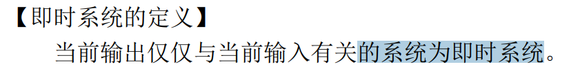

【即时系统的定义】

当前输出仅仅与当前输入有关**的系统为即时系统**。
