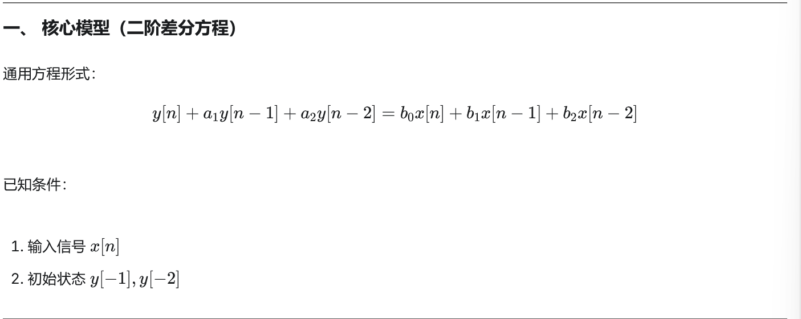
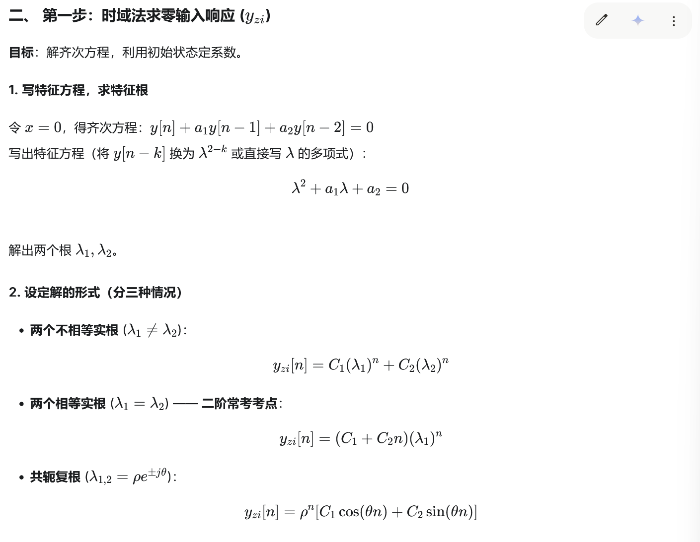
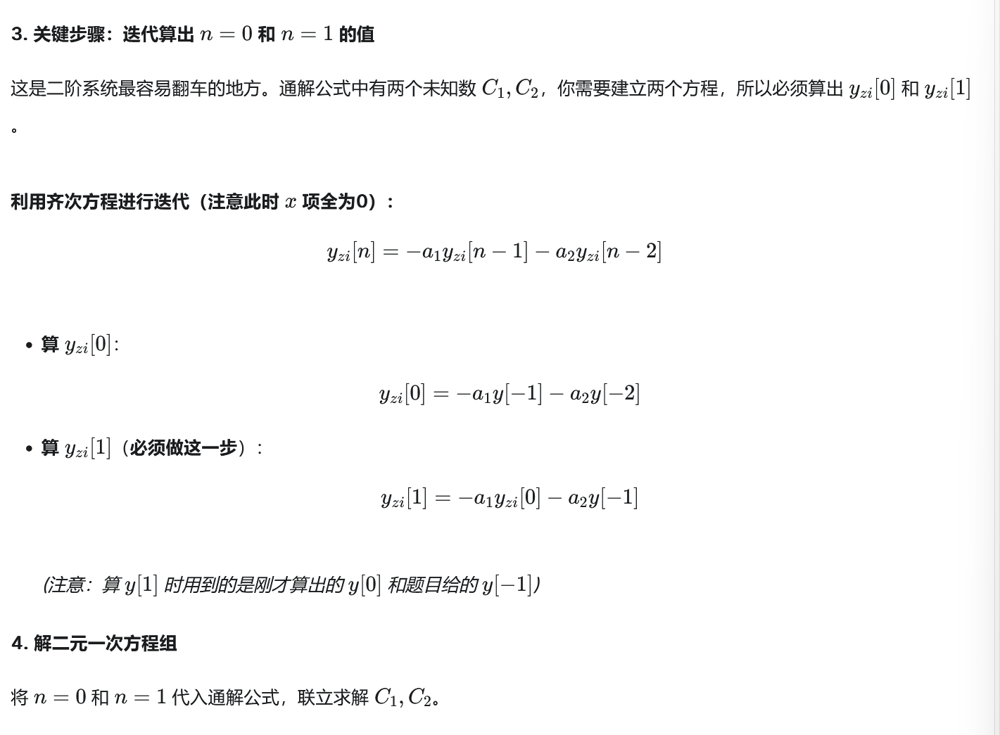
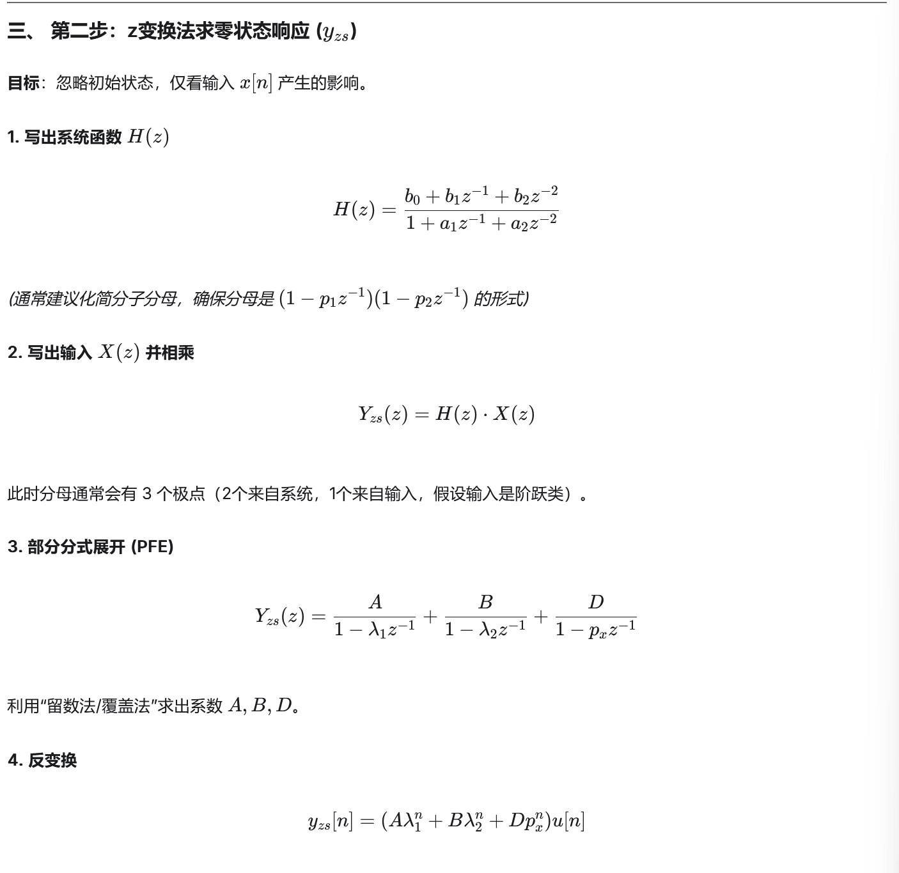
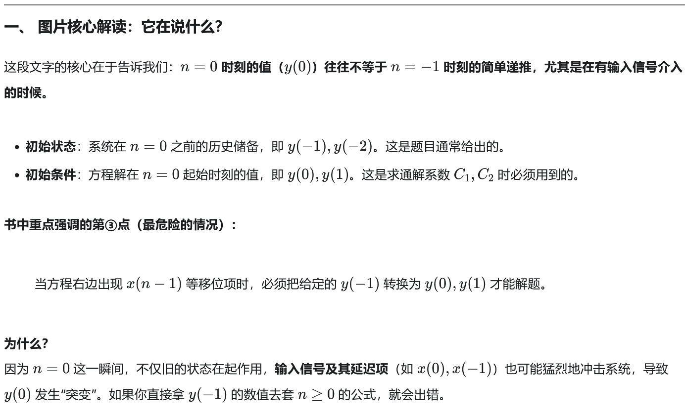
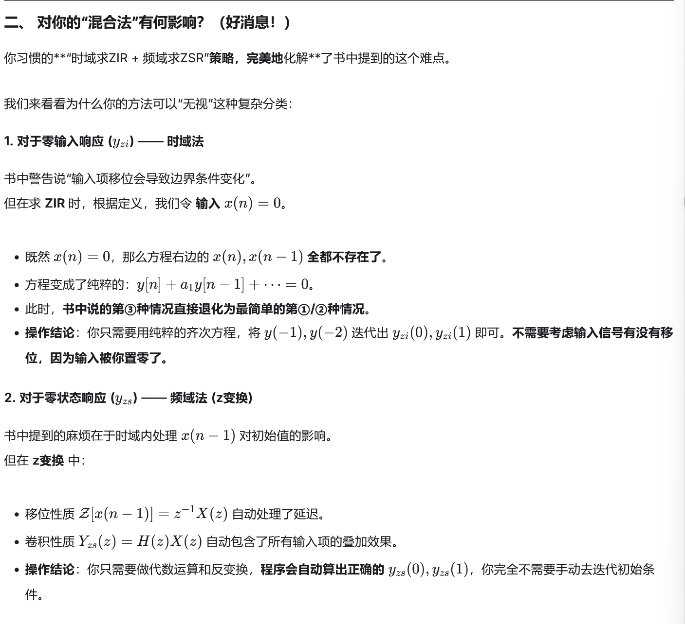
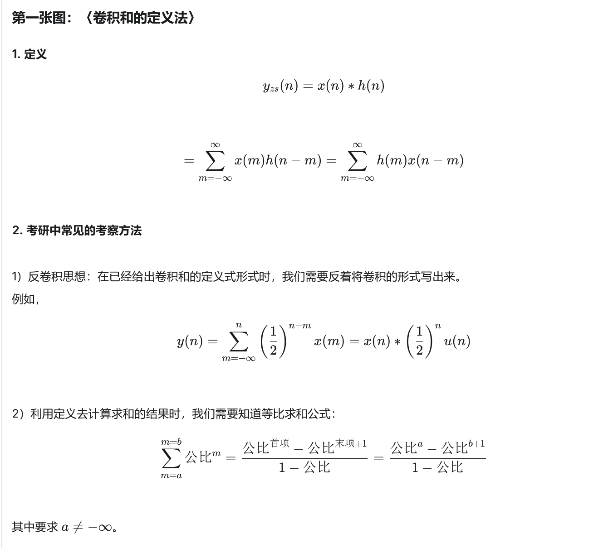
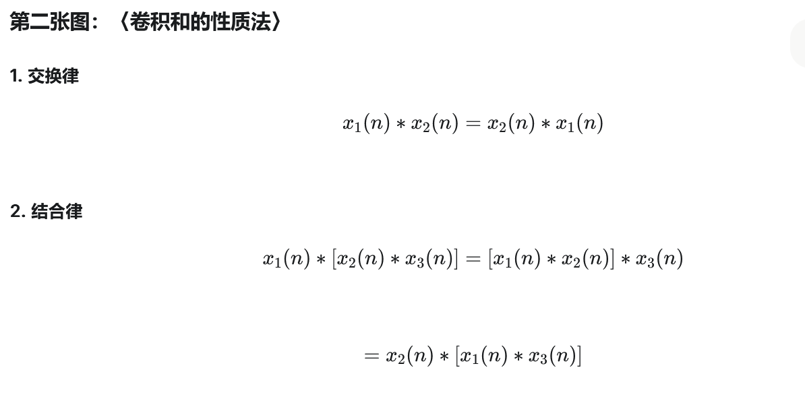
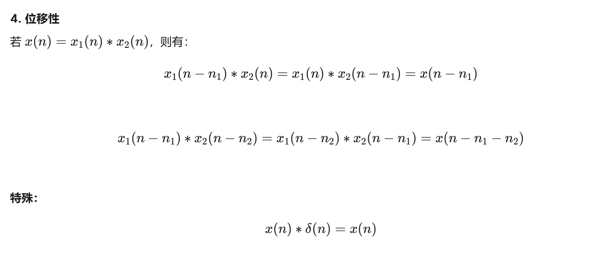
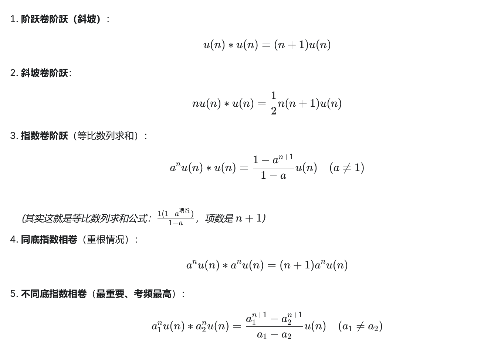

# 离散系统｜墨墨记忆卡重组

来源：[墨墨记忆卡「信号与系统」](https://www.markji.com/deck/editor/67dd5988bbc6238121685de1)。本章共 3 张（总编号 065—067）。印刷体公式与文字已转写为 Markdown/LaTeX；手写内容按约定暂不转写，均已保留本地高清原图。

## 065 差分系统求解

**问：** 请说明差分系统求解的方法与步骤（含二阶差分方程的零输入响应、零状态响应及初始状态与初始条件的关系）。

**答：**

### 一、核心模型（二阶差分方程）

通用方程形式：

$$y[n] + a_1 y[n-1] + a_2 y[n-2] = b_0 x[n] + b_1 x[n-1] + b_2 x[n-2]$$

已知条件：
1. 输入信号 $x[n]$
2. 初始状态 $y[-1], y[-2]$

### 二、第一步：时域法求零输入响应（$y_{zi}$）

**目标**：解齐次方程，利用初始状态定系数。

**1. 写特征方程，求特征根**

令 $x = 0$，得齐次方程：$y[n] + a_1 y[n-1] + a_2 y[n-2] = 0$

写出特征方程（将 $y[n-k]$ 换为 $\lambda^{2-k}$ 或直接写 $\lambda$ 的多项式）：

$$\lambda^2 + a_1 \lambda + a_2 = 0$$

解出两个根 $\lambda_1, \lambda_2$。

**2. 设定解的形式（分三种情况）**

- **两个不相等实根**（$\lambda_1 \neq \lambda_2$）：
  $$y_{zi}[n] = C_1 (\lambda_1)^n + C_2 (\lambda_2)^n$$
- **两个相等实根**（$\lambda_1 = \lambda_2$）—— **二阶常考点**：
  $$y_{zi}[n] = (C_1 + C_2 n)(\lambda_1)^n$$
- **共轭复根**（$\lambda_{1,2} = \rho e^{\pm j\theta}$）：
  $$y_{zi}[n] = \rho^n [C_1 \cos(\theta n) + C_2 \sin(\theta n)]$$

**3. 关键步骤：迭代算出 $n = 0$ 和 $n = 1$ 的值**

这是二阶系统最容易翻车的地方。通解公式中有两个未知数 $C_1, C_2$，你需要建立两个方程，所以必须算出 $y_{zi}[0]$ 和 $y_{zi}[1]$。

**利用齐次方程进行迭代（注意此时 $x$ 项全为 $0$）：**

$$y_{zi}[n] = -a_1 y_{zi}[n-1] - a_2 y_{zi}[n-2]$$

- 算 $y_{zi}[0]$：
  $$y_{zi}[0] = -a_1 y[-1] - a_2 y[-2]$$
- 算 $y_{zi}[1]$（**必须做这一步**）：
  $$y_{zi}[1] = -a_1 y_{zi}[0] - a_2 y[-1]$$

*（注意：算 $y[1]$ 时用到的是刚才算出的 $y[0]$ 和题目给的 $y[-1]$）*

**4. 解二元一次方程组**

将 $n = 0$ 和 $n = 1$ 代入通解公式，联立求解 $C_1, C_2$。

### 三、第二步：z 变换法求零状态响应（$y_{zs}$）

**目标**：忽略初始状态，仅看输入 $x[n]$ 产生的影响。

**1. 写出系统函数 $H(z)$**

$$H(z) = \frac{b_0 + b_1 z^{-1} + b_2 z^{-2}}{1 + a_1 z^{-1} + a_2 z^{-2}}$$

*（通常建议化简分子分母，确保分母是 $(1 - p_1 z^{-1})(1 - p_2 z^{-1})$ 的形式）*

**2. 写出输入 $X(z)$ 并相乘**

$$Y_{zs}(z) = H(z) \cdot X(z)$$

此时分母通常会有 3 个极点（2个来自系统，1个来自输入，假设输入是阶跃类）。

**3. 部分分式展开（PFE）**

$$Y_{zs}(z) = \frac{A}{1 - \lambda_1 z^{-1}} + \frac{B}{1 - \lambda_2 z^{-1}} + \frac{D}{1 - p_x z^{-1}}$$

利用“留数法/覆盖法”求出系数 $A, B, D$。

**4. 反变换**

$$y_{zs}[n] = (A \lambda_1^n + B \lambda_2^n + D p_x^n) u[n]$$

### 一、图片核心解读：它在说什么？

这段文字的核心在于告诉我们：$n = 0$ **时刻的值（$y(0)$）往往不等于 $n = -1$ 时刻的简单递推，尤其是在有输入信号介入的时候。**

- **初始状态**：系统在 $n = 0$ 之前的历史储备，即 $y(-1), y(-2)$。这是题目通常给出的。
- **初始条件**：方程解在 $n = 0$ 起始时刻的值，即 $y(0), y(1)$。这是求通解系数 $C_1, C_2$ 时必须用到的。

**书中重点强调的第③点（最危险的情况）：**

当方程右边出现 $x(n-1)$ 等移位项时，必须把给定的 $y(-1)$ 转换为 $y(0), y(1)$ 才能解题。

**为什么？**

因为 $n = 0$ 这一瞬间，不仅旧的状态在起作用，**输入信号及其延迟项**（如 $x(0), x(-1)$）也可能猛烈地冲击系统，导致 $y(0)$ 发生“突变”。如果你直接拿 $y(-1)$ 的数值去套 $n \ge 0$ 的公式，就会出错。

### 二、对你的“混合法”有何影响？（好消息！）

你习惯的**“时域求ZIR + 频域求ZSR”策略，完美地化解**了书中提到的这个难点。

我们来看看为什么你的方法可以“无视”这种复杂分类：

**1. 对于零输入响应（$y_{zi}$）—— 时域法**

书中警告说“输入项移位会导致边界条件变化”。

但在求 ZIR 时，根据定义，我们令 **输入 $x(n) = 0$**。

- 既然 $x(n) = 0$，那么方程右边的 $x(n), x(n-1)$ **全都不存在了**。
- 方程变成了纯粹的：$y[n] + a_1 y[n-1] + \cdots = 0$。
- 此时，**书中说的第③种情况直接退化为最简单的第①/②种情况。**
- **操作结论**：你只需要用纯粹的齐次方程，将 $y(-1), y(-2)$ 迭代出 $y_{zi}(0), y_{zi}(1)$ 即可。**不需要考虑输入信号有没有移位，因为输入被你置零了。**

**2. 对于零状态响应（$y_{zs}$）—— 频域法（z变换）**

书中提到的麻烦在于时域内处理 $x(n-1)$ 对初始值的影响。

但在 **z变换** 中：

- 移位性质 $\mathcal{Z}[x(n-1)] = z^{-1} X(z)$ 自动处理了延迟。
- 卷积性质 $Y_{zs}(z) = H(z) X(z)$ 自动包含了所有输入项的叠加效果。
- **操作结论**：你只需要做代数运算和反变换，**程序会自动算出正确的 $y_{zs}(0), y_{zs}(1)$**，你完全不需要手动去迭代初始条件。

## 066 卷积和计算

**问：** 请写出卷积和计算的定义、性质及重要形式。

**答：**

### 1. 定义

**第一张图：《卷积和的定义法》**

**1. 定义**

$$y_{zs}(n) = x(n) * h(n)$$

$$= \sum_{m=-\infty}^{\infty} x(m) h(n-m) = \sum_{m=-\infty}^{\infty} h(m) x(n-m)$$

**2. 考研中常见的考察方法**

1) 反卷积思想：在已经给出卷积和的定义式形式时，我们需要反着将卷积的形式写出来。

例如，

$$y(n) = \sum_{m=-\infty}^{n} \left(\frac{1}{2}\right)^{n-m} x(m) = x(n) * \left(\frac{1}{2}\right)^n u(n)$$

2) 利用定义去计算求和的结果时，我们需要知道等比求和公式：

$$\sum_{m=a}^{m=b} \text{公比}^m = \frac{\text{公比}^{\text{首项}} - \text{公比}^{\text{末项}+1}}{1 - \text{公比}} = \frac{\text{公比}^a - \text{公比}^{b+1}}{1 - \text{公比}}$$

其中要求 $a \neq -\infty$。

### 2. 性质

**第二张图：《卷积和的性质法》**

**1. 交换律**

$$x_1(n) * x_2(n) = x_2(n) * x_1(n)$$

**2. 结合律**

$$x_1(n) * [x_2(n) * x_3(n)] = [x_1(n) * x_2(n)] * x_3(n)$$

$$= x_2(n) * [x_1(n) * x_3(n)]$$

**4. 位移性**

若 $x(n) = x_1(n) * x_2(n)$，则有：

$$x_1(n - n_1) * x_2(n) = x_1(n) * x_2(n - n_1) = x(n - n_1)$$

$$x_1(n - n_1) * x_2(n - n_2) = x_1(n - n_2) * x_2(n - n_1) = x(n - n_1 - n_2)$$

**特殊：**

$$x(n) * \delta(n) = x(n)$$

### 3. 重要形式

**7. 非常重要的二级结论**

$$x(n) * u(n) = \sum_{k=-\infty}^{\infty} x(k) u(n-k) = \sum_{k=-\infty}^{n} x(k)$$

## 067 卷积的常用公式

**问：** 请写出离散卷积和的常用公式。

**答：**

1. **阶跃卷阶跃（斜坡）**：
   $$u(n) * u(n) = (n+1) u(n)$$

2. **斜坡卷阶跃**：
   $$n u(n) * u(n) = \frac{1}{2} n(n+1) u(n)$$

3. **指数卷阶跃**（等比数列求和）：
   $$a^n u(n) * u(n) = \frac{1 - a^{n+1}}{1 - a} u(n) \quad (a \neq 1)$$
   *（其实这就是等比数列求和公式：$\frac{1(1 - a^{\text{项数}})}{1 - a}$，项数是 $n + 1$）*

4. **同底指数相卷**（重根情况）：
   $$a^n u(n) * a^n u(n) = (n+1) a^n u(n)$$

5. **不同底指数相卷（最重要、考频最高）**：
   $$a_1^n u(n) * a_2^n u(n) = \frac{a_1^{n+1} - a_2^{n+1}}{a_1 - a_2} u(n) \quad (a_1 \neq a_2)$$
