# 微分方程解法｜墨墨记忆卡重组

来源：[墨墨记忆卡「信号与系统」](https://www.markji.com/deck/editor/67dd5988bbc6238121685de1)。本章共 19 张（总编号 068—086）。印刷体公式与文字已转写为 Markdown/LaTeX；手写内容按约定暂不转写，均已保留本地高清原图。

## 068 特征根对应齐次解表格

**问：** 请写出特征根对应的齐次解表格。

**答：**

| 特征根 $\lambda$ | 齐次解 $y_h(t)$ |
| --- | --- |
| $1$ 个单实根 $\lambda = \alpha$ | （手写内容暂不转写） |
| $2$ 个单实根 $\lambda_1 = \alpha_1, \lambda_2 = \alpha_2$ | （手写内容暂不转写） |
| $2$ 重实根 $\lambda_1 = \lambda_2 = \alpha$ | （手写内容暂不转写） |
| $2$ 重实根 $\lambda_1 = \lambda_2 = \alpha_1 +$ 单实根 $\lambda_3 = \alpha_2$ | （手写内容暂不转写） |
| $3$ 重实根 $\lambda_1 = \lambda_2 = \lambda_3 = \alpha$ | （手写内容暂不转写） |
| 一对共轭复根 $\lambda_{1,2} = \alpha \pm j\beta$ | （手写内容暂不转写） |

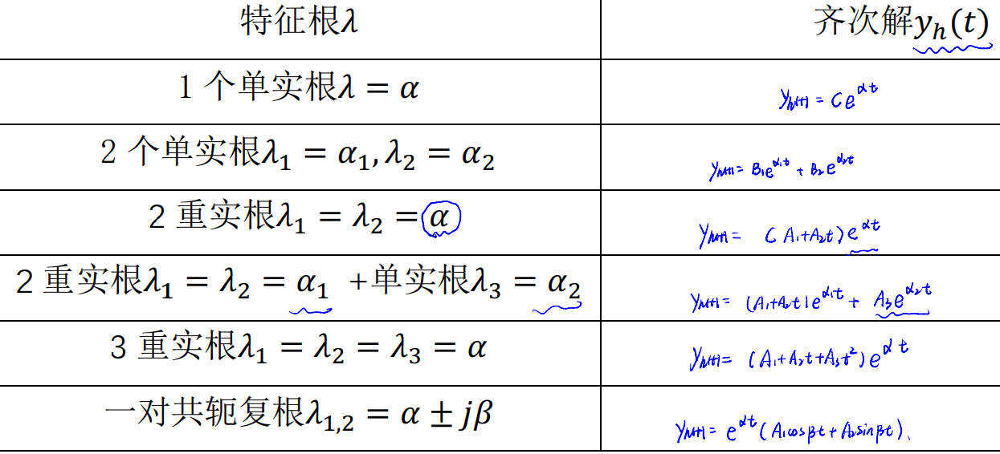

（表中右栏齐次解及批注为手写内容，暂不转写，见原图）

## 069 不同激励对应线性微分方程特解

**问：** 请写出不同激励对应的线性微分方程特解表格。

**答：**

| 激励 $f(t)$ | 特解 $y_p(t)$ |
| --- | --- |
| $E$ | （手写内容暂不转写） |
| $t$ | （手写内容暂不转写） |
| $t^2$ | （手写内容暂不转写） |
| 激励为 $t^2$ 有 $L$ 个特征根为 $0$ | （手写内容暂不转写） |
| $e^{\alpha t}$（$\alpha$ 不是特征根） | （手写内容暂不转写） |
| $e^{\alpha t}$（$\alpha$ 为特征单根） | （手写内容暂不转写） |
| $e^{\alpha t}$（$\alpha$ 为特征二重根） | （手写内容暂不转写） |
| $\cos(wt)$ 或 $\sin(wt)$ | （手写内容暂不转写） |

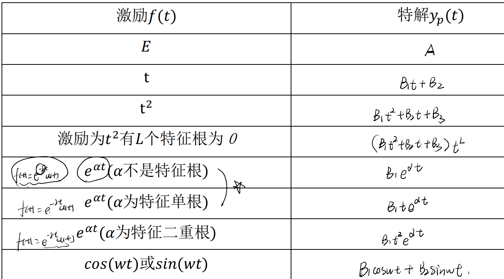

（表中右栏特解及左侧批注为手写内容，暂不转写，见原图）

## 070 概念集合（齐次解、特征根、响应分类等）

**问：**

请解释以下概念：
1. 齐次解
2. 特征根
3. 初始条件、初始状态
4. 全解
5. 自由响应
6. 暂态响应
7. 稳态响应
8. 零输入响应和零状态响应

**答：**

**1. 齐次解**
系统在没有外部输入时，仅由其自身结构决定的自然响应形式。

**2. 特征根**
决定齐次解具体形态（如衰减、振荡、稳定与否）的关键参数。

**3. 初始状态**
系统在外部激励施加前一瞬间 ($t=0^-$) 的物理状态，它反映了系统的“历史”且其本身不会跳变。

**初始条件**
为求解微分方程所需的、在 $t=0^+$ 时刻的输出函数及其各阶导数的值，它可能因冲激信号的输入而发生跳变。

**4. 全解**
描述系统在初始条件和外部输入共同作用下完整行为的解，等于齐次解与特解之和。

**5. 自由响应**
仅由系统自身特性（特征根）决定的那部分响应，其形式与外部输入无关。

**6. 暂态响应**
全响应中随着时间推移最终会衰减到零的“过渡”部分。

**7. 稳态响应**
暂态响应消失后，系统中剩下的、形式由外部输入决定的“最终”部分。

**8. 零输入响应和零状态响应**
零输入响应是仅由初始状态引起的响应，而零状态响应是仅由外部输入引起的响应；根据叠加原理，全响应等于这两者之和。

## 071 冲激响应、阶跃响应定义及关系

**问：** 请写出冲激响应、阶跃响应的定义及二者的关系。

**答：**

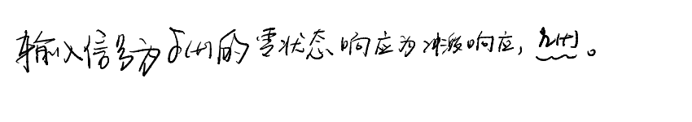

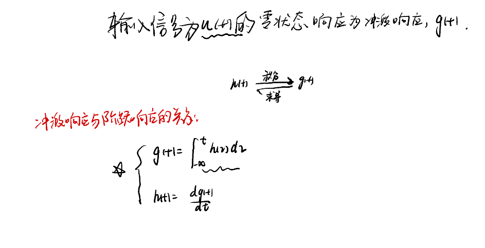

（手写内容暂不转写，见原图）

## 072 卷积定义

**问：** 请写出卷积的定义（表达式、注意事项、交换律及计算步骤和意义）。

**答：**

**1. 表达式**

**2. 注意**

**3. 交换律**

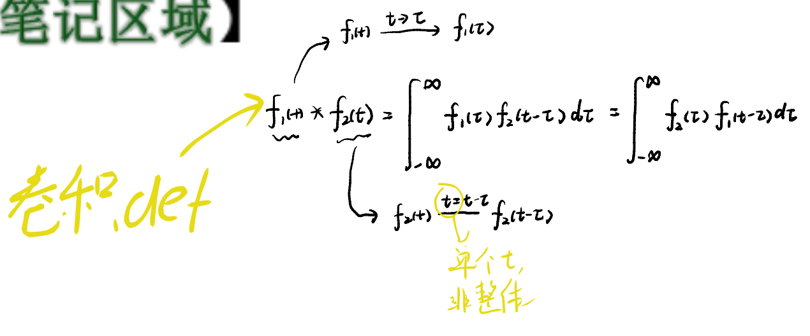

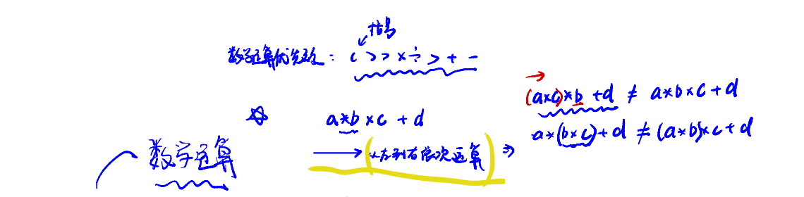

**4. 计算步骤和意义**

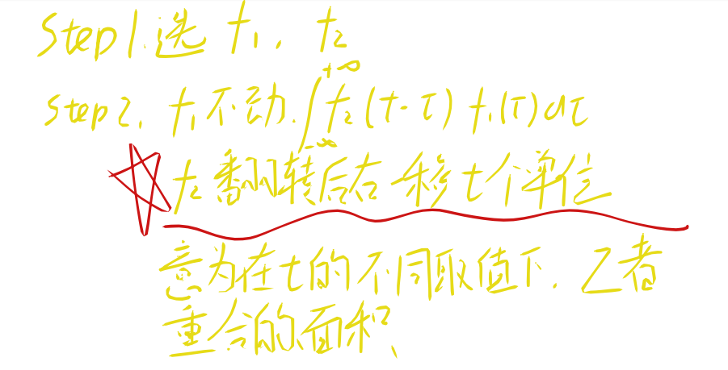

（手写内容暂不转写，见原图）

## 073 卷积和零状态响应

**问：** 请说明卷积与零状态响应的关系。

**答：**

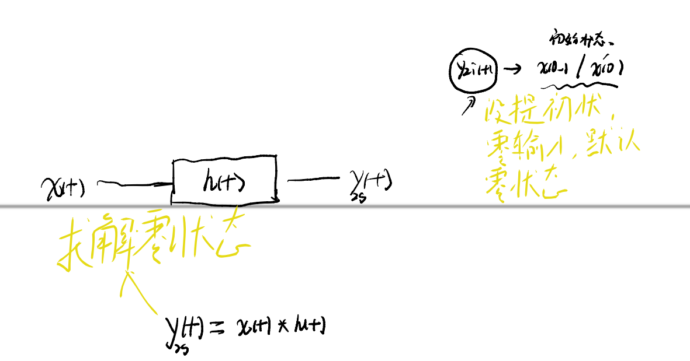

（手写内容暂不转写，见原图）

## 074 卷积定义法范式一

**问：** 请写出卷积定义法范式一的相关内容。

**答：**

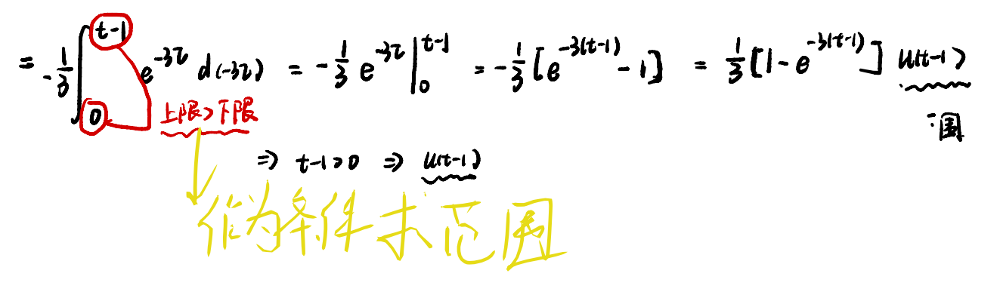

（手写内容暂不转写，见原图）

## 075 卷积定义法范式二：逆向

**问：** 请写出卷积定义法范式二（逆向）的例题与解答。

**答：**

2、（南京邮电大学 2003 年）某线性时不变系统的零状态响应 $y(t)$ 与输入 $x(t)$ 的关系为

$$y(t) = \int_{t-1}^{\infty} e^{-2(t-\tau)} x(\tau - 2) d\tau$$

试求该系统的冲激响应 $h(t)$。

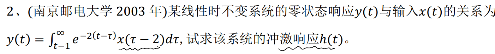

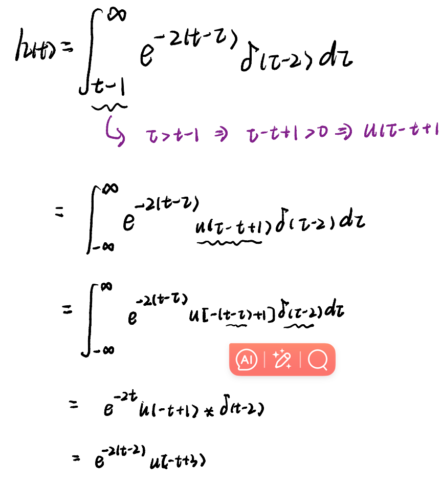

（含手写批注及手写解答过程，手写部分暂不转写，见原图）

## 076 卷积图解法

**问：** 请写出卷积图解法的步骤与理解。

**答：**

**1. 步骤**

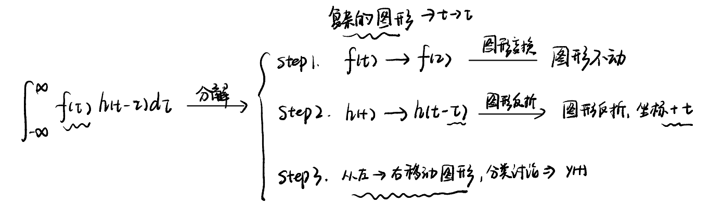

（手写内容暂不转写，见原图）

**2. 理解**

移动 $t$ 的过程中，图形面积是 $t$ 的函数，在各个阶段求解面积函数

## 077 卷积性质之微分性质

**问：** 请写出卷积的微分性质及其重要应用。

**答：**

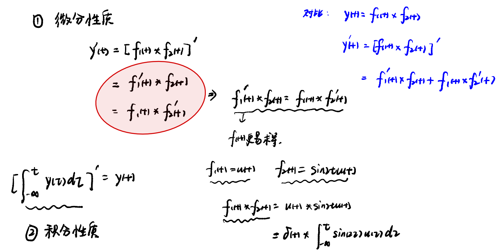

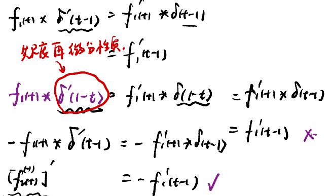

（手写内容暂不转写，见原图）

**重要应用：**
1. 换项求导
2. 对于冲激信号，先化成标准形式

## 078 卷积性质之积分性质

**问：** 请写出卷积的积分性质。

**答：**

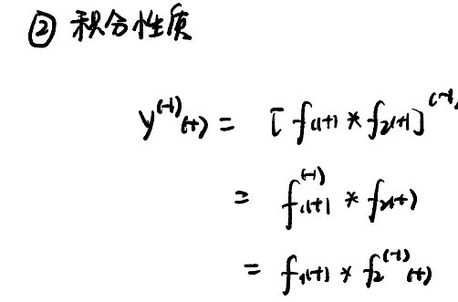

（手写内容暂不转写，见原图）

## 079 卷积基本性质

**问：** 请写出卷积的基本性质。

**答：**

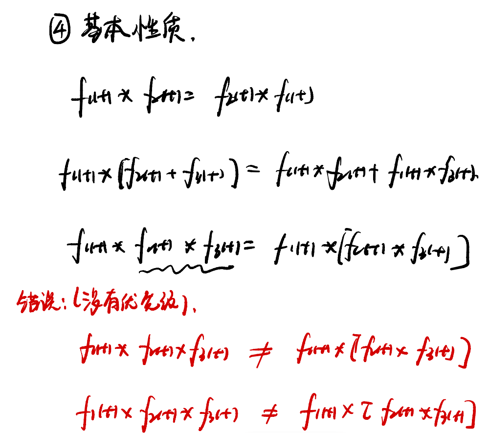

（手写内容暂不转写，见原图）

## 080 卷积结论

**问：** 请写出常用卷积结论。

**答：**

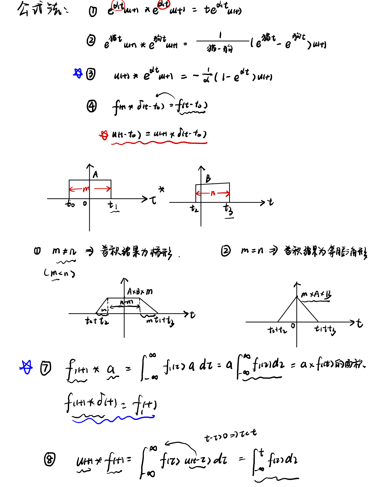

（手写内容暂不转写，见原图）

## 081 微分方程响应和解的关系

**问：** 请说明微分方程响应和解的关系。

**答：**

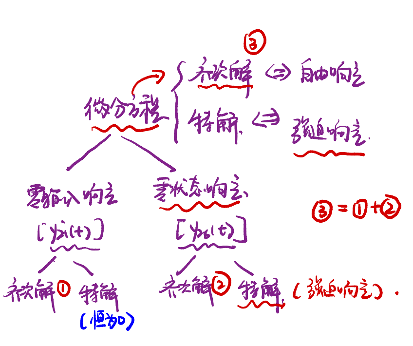

（手写内容暂不转写，见原图）

## 082 初始状态和初始条件、自由项

**问：** 请说明初始状态和初始条件、自由项的关系。

**答：**

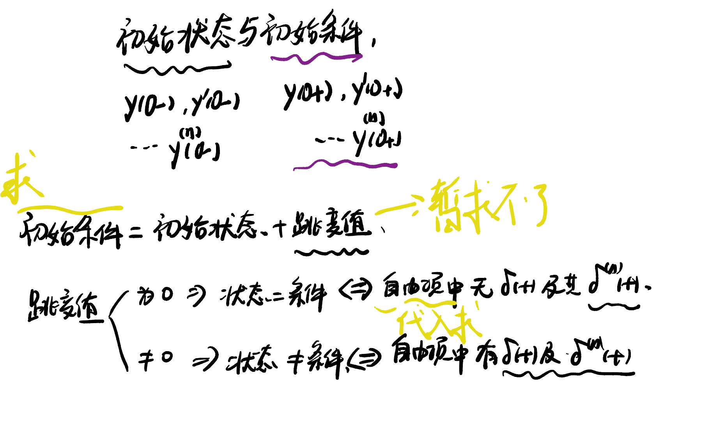

（手写内容暂不转写，见原图）

## 083 冲激函数匹配法

**问：** 请写出冲激函数匹配法的步骤。

**答：**

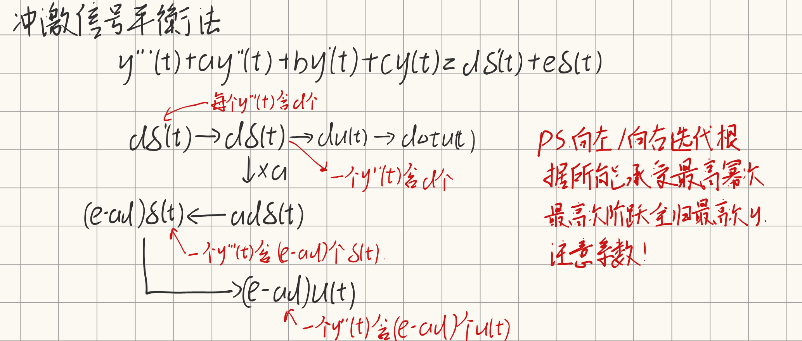

（手写内容暂不转写，见原图）

**1. 根据最高阶设出方程**

**2. 逐项积分，系数关系不变**

**3. 用零阶一阶代入求未知数**

## 084 求零输入响应流程

**问：** 请写出求零输入响应的流程。

**答：**

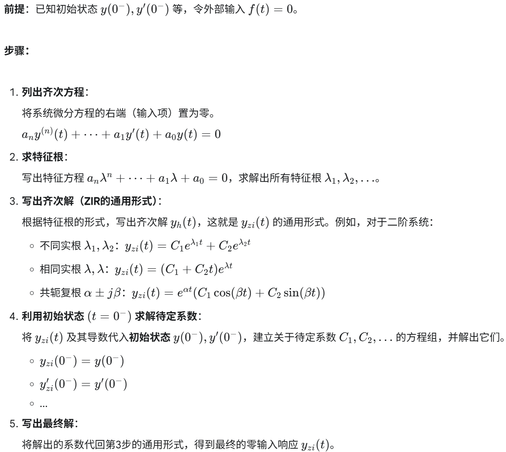

**前提：** 已知初始状态 $y(0^-), y'(0^-)$ 等，令外部输入 $f(t) = 0$。

**步骤：**

1. **列出齐次方程：**
   将系统微分方程的右端（输入项）置为零。
   $$a_n y^{(n)}(t) + \cdots + a_1 y'(t) + a_0 y(t) = 0$$

2. **求特征根：**
   写出特征方程 $a_n \lambda^n + \cdots + a_1 \lambda + a_0 = 0$，求解出所有特征根 $\lambda_1, \lambda_2, \dots$。

3. **写出齐次解（ZIR的通用形式）：**
   根据特征根的形式，写出齐次解 $y_h(t)$，这就是 $y_{zi}(t)$ 的通用形式。例如，对于二阶系统：
   - 不同实根 $\lambda_1, \lambda_2$：$y_{zi}(t) = C_1 e^{\lambda_1 t} + C_2 e^{\lambda_2 t}$
   - 相同实根 $\lambda, \lambda$：$y_{zi}(t) = (C_1 + C_2 t)e^{\lambda t}$
   - 共轭复根 $\alpha \pm j\beta$：$y_{zi}(t) = e^{\alpha t}(C_1 \cos(\beta t) + C_2 \sin(\beta t))$

4. **利用初始状态（$t = 0^-$）求解待定系数：**
   将 $y_{zi}(t)$ 及其导数代入**初始状态** $y(0^-), y'(0^-)$，建立关于待定系数 $C_1, C_2, \dots$ 的方程组，并解出它们。
   - $y_{zi}(0^-) = y(0^-)$
   - $y'_{zi}(0^-) = y'(0^-)$
   - $\dots$

5. **写出最终解：**
   将解出的系数代回第3步的通用形式，得到最终的零输入响应 $y_{zi}(t)$。

## 085 零状态响应

**问：** 请写出求零状态响应的步骤。

**答：**

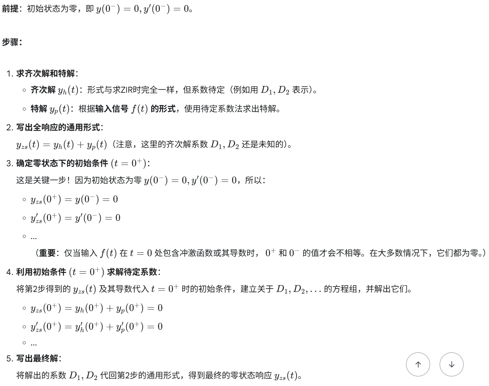

**前提：** 初始状态为零，即 $y(0^-) = 0, y'(0^-) = 0$。

**步骤：**

1. **求齐次解和特解：**
   - **齐次解 $y_h(t)$：** 形式与求ZIR时完全一样，但系数待定（例如用 $D_1, D_2$ 表示）。
   - **特解 $y_p(t)$：** 根据**输入信号 $f(t)$** 的形式，使用待定系数法求出特解。

2. **写出全响应的通用形式：**
   $y_{zs}(t) = y_h(t) + y_p(t)$（注意，这里的齐次解系数 $D_1, D_2$ 还是未知的）。

3. **确定零状态下的初始条件（$t = 0^+$）：**
   这是关键一步！因为初始状态为零 $y(0^-) = 0, y'(0^-) = 0$，所以：
   - $y_{zs}(0^+) = y(0^-) = 0$
   - $y'_{zs}(0^+) = y'(0^-) = 0$
   - $\dots$
   （**重要：** 仅当输入 $f(t)$ 在 $t = 0$ 处包含冲激函数或其导数时，$0^+$ 和 $0^-$ 的值才会不相等。在大多数情况下，它们都为零。）

4. **利用初始条件（$t = 0^+$）求解待定系数：**
   将第2步得到的 $y_{zs}(t)$ 及其导数代入 $t = 0^+$ 时的初始条件，建立关于 $D_1, D_2, \dots$ 的方程组，并解出它们。
   - $y_{zs}(0^+) = y_h(0^+) + y_p(0^+) = 0$
   - $y'_{zs}(0^+) = y'_h(0^+) + y'_p(0^+) = 0$
   - $\dots$

5. **写出最终解：**
   将解出的系数 $D_1, D_2$ 代回第2步的通用形式，得到最终的零状态响应 $y_{zs}(t)$。

## 086 微分方程全响应过程

**问：** 请写出微分方程全响应的求解过程。

**答：**

**1. 右端代入输入信号，求出自由项**

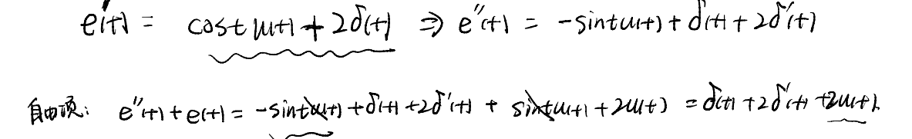

（手写内容暂不转写，见原图）

**2. 令 $t > 0$，设出特解代入方程解出特解（解出的特解要带范围）**

**3. 特征方程求特征根，设齐次解**

**4. 冲激平衡求初始条件（不带 $u(t)$）**

**5. 全解 = 齐次解（带未知数）+ 特解，代入初始条件求解**

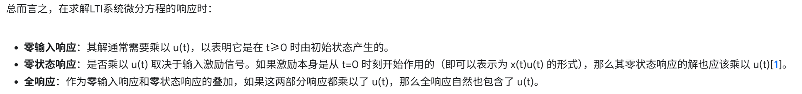

总而言之，在求解LTI系统微分方程的响应时：

- **零输入响应**：其解通常需要乘以 $u(t)$，以表明它是在 $t \geqslant 0$ 时由初始状态产生的。
- **零状态响应**：是否乘以 $u(t)$ 取决于输入激励信号。如果激励本身是从 $t=0$ 时刻开始作用的（即可以表示为 $x(t)u(t)$ 的形式），那么其零状态响应的解也应该乘以 $u(t)$ [1]。
- **全响应**：作为零输入响应和零状态响应的叠加，如果这两部分响应都乘以了 $u(t)$，那么全响应自然也包含了 $u(t)$。
