# 傅里叶级数｜墨墨记忆卡重组

来源：[墨墨记忆卡「信号与系统」](https://www.markji.com/deck/editor/67dd5988bbc6238121685de1)。本章共 21 张（总编号 087—107）。印刷体公式与文字已转写为 Markdown/LaTeX；手写内容按约定暂不转写，均已保留本地高清原图。

## 087 正交函数的概念

**问：** 请简述正交函数的概念。

**答：**

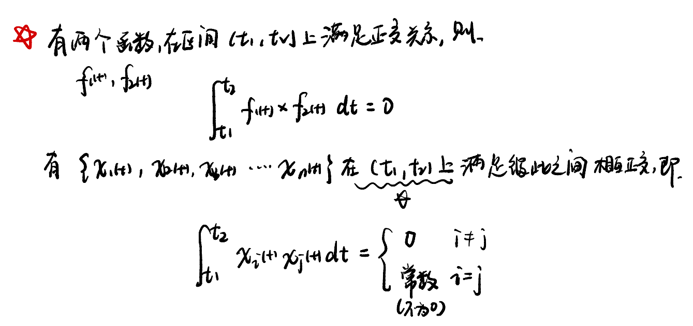

（手写内容暂不转写，见原图）

## 088 完备正交函数集的定义和两个理论

**问：** 请写出完备正交函数集的定义和两个重要理论。

**答：**

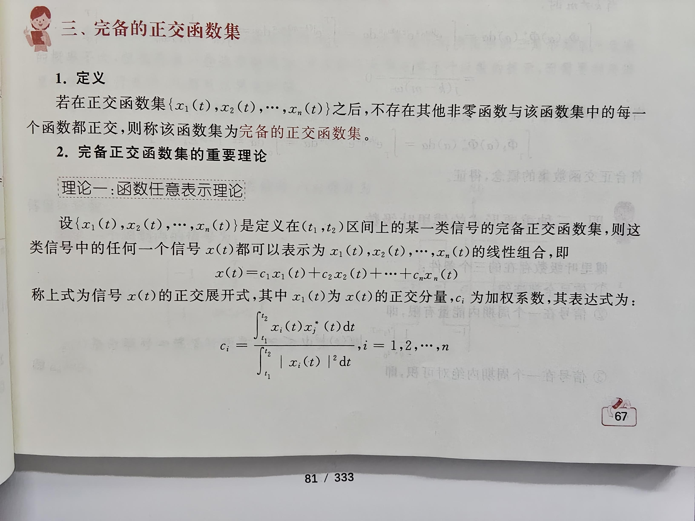

### 三、完备的正交函数集

**1. 定义**

若在正交函数集 $\{x_1(t), x_2(t), \cdots, x_n(t)\}$ 之后，不存在其他非零函数与该函数集中的每一个函数都正交，则称该函数集为完备的正交函数集。

**2. 完备正交函数集的重要理论**

**理论一：函数任意表示理论**

设 $\{x_1(t), x_2(t), \cdots, x_n(t)\}$ 是定义在 $(t_1, t_2)$ 区间上的某一类信号的完备正交函数集，则这类信号中的任何一个信号 $x(t)$ 都可以表示为 $x_1(t), x_2(t), \cdots, x_n(t)$ 的线性组合，即

$$x(t) = c_1 x_1(t) + c_2 x_2(t) + \cdots + c_n x_n(t)$$

称上式为信号 $x(t)$ 的正交展开式，其中 $x_1(t)$ 为 $x(t)$ 的正交分量，$c_i$ 为加权系数，其表达式为：

$$c_i = \frac{\int_{t_1}^{t_2} x_i(t) x_j^*(t)\,\mathrm{d}t}{\int_{t_1}^{t_2} |x_i(t)|^2\,\mathrm{d}t}, \quad i = 1, 2, \cdots, n$$

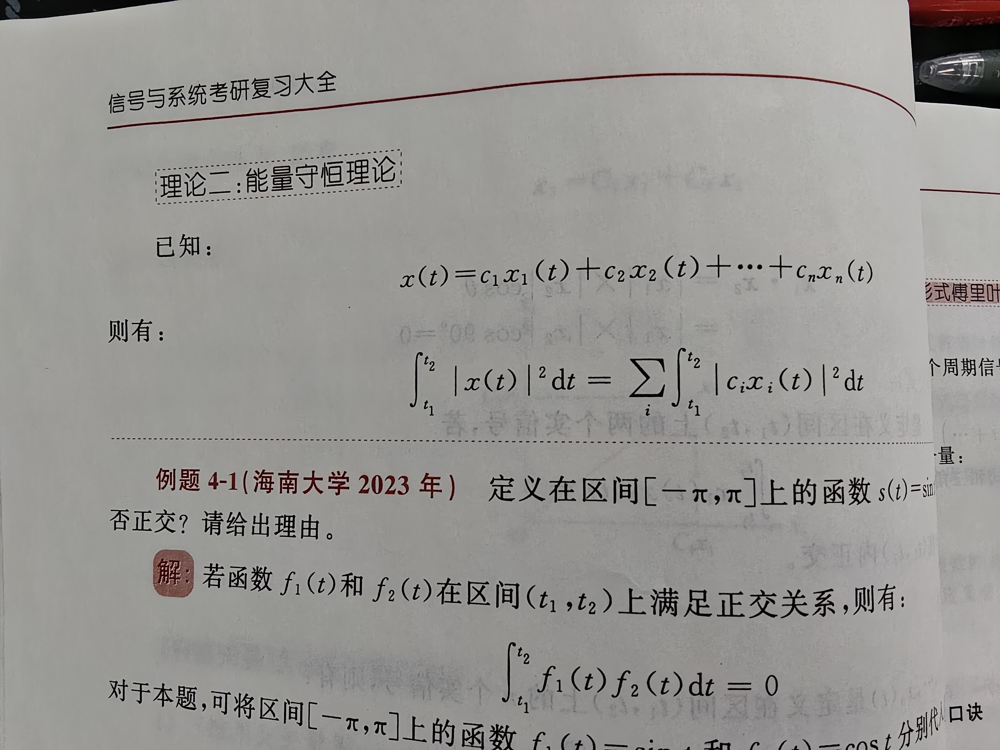

**理论二：能量守恒理论**

已知：

$$x(t) = c_1 x_1(t) + c_2 x_2(t) + \cdots + c_n x_n(t)$$

则有：

$$\int_{t_1}^{t_2} |x(t)|^2\,\mathrm{d}t = \sum_i \int_{t_1}^{t_2} |c_i x_i(t)|^2\,\mathrm{d}t$$

> 注：图 2 下方另附“例题 4-1（海南大学 2023 年）”，因右缘与下缘有裁剪，完整内容见原图。
>
> **例题 4-1（海南大学 2023 年）** 定义在区间 $[-\pi, \pi]$ 上的函数 $s(t)=\sin\dots$（右缘裁剪）否正交？请给出理由。
>
> **解**：若函数 $f_1(t)$ 和 $f_2(t)$ 在区间 $(t_1, t_2)$ 上满足正交关系，则有：
> $$\int_{t_1}^{t_2} f_1(t) f_2(t)\,\mathrm{d}t = 0$$
> 对于本题，可将区间 $[-\pi, \pi]$ 上的函数……（下缘裁剪，见原图）

## 089 三角形式傅里叶级数

**问：** 请写出三角形式傅里叶级数的总公式、分公式及直流分量第二表达和理解。

**答：**

**总公式**

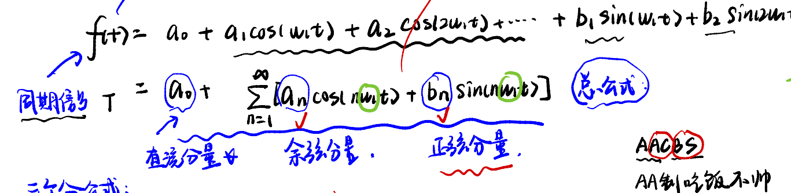

**分公式**

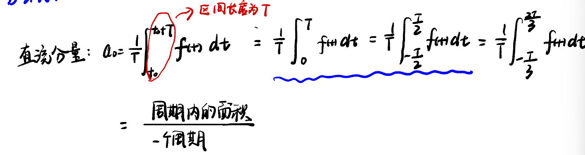

**直流分量第二表达和理解**

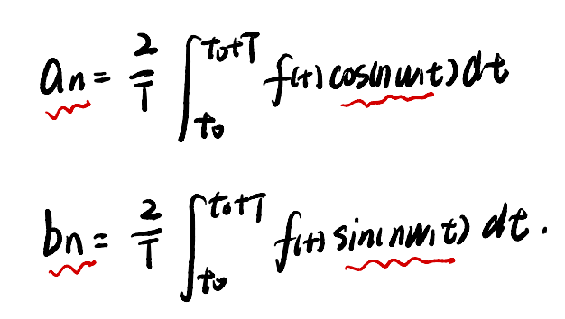

（手写内容暂不转写，见原图）

## 090 傅里叶级数奇偶性

**问：** 请写出傅里叶级数的奇偶性结论。

**答：**

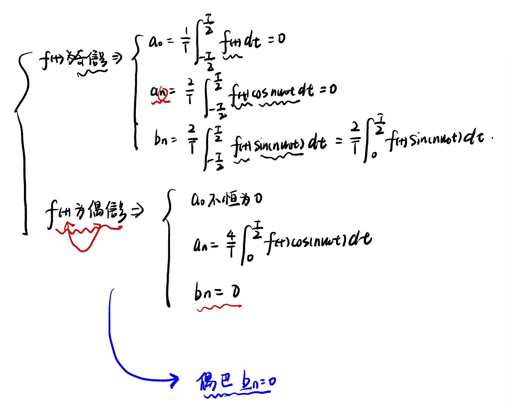

（手写内容暂不转写，见原图）

## 091 指数形式傅里叶级数

**问：** 请写出指数形式傅里叶级数的公式。

**答：**

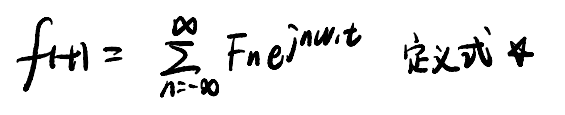

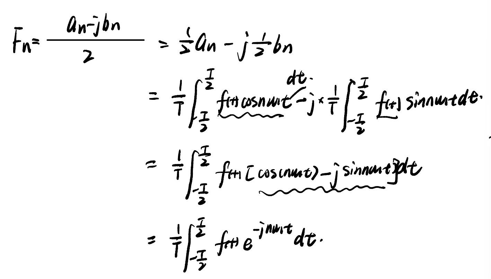

（手写内容暂不转写，见原图）

## 092 谐波形式傅里叶级数

**问：** 请写出谐波形式傅里叶级数的定义及谐波分量的概念。

**答：**

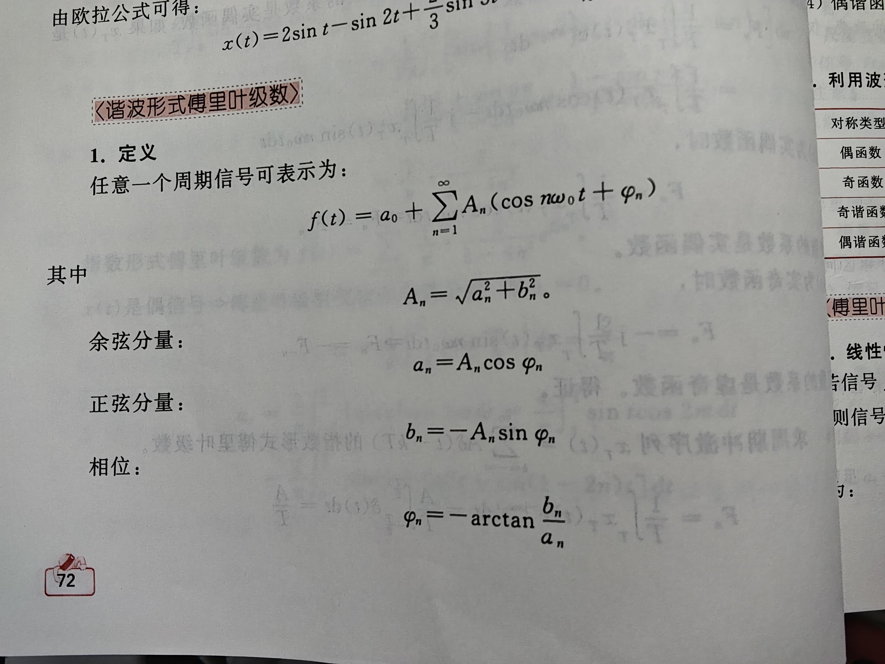

### 谐波形式傅里叶级数

**1. 定义**

任意一个周期信号可表示为：

$$f(t) = a_0 + \sum_{n=1}^{\infty} A_n(\cos n\omega_0 t + \varphi_n)$$

其中

$$A_n = \sqrt{a_n^2 + b_n^2}\text{。}$$

余弦分量：

$$a_n = A_n \cos \varphi_n$$

正弦分量：

$$b_n = -A_n \sin \varphi_n$$

相位：

$$\varphi_n = -\arctan \frac{b_n}{a_n}$$

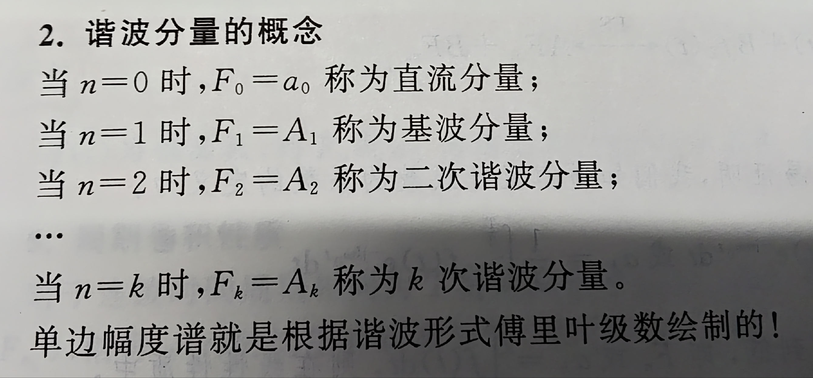

**2. 谐波分量的概念**

- 当 $n = 0$ 时，$F_0 = a_0$ 称为直流分量；
- 当 $n = 1$ 时，$F_1 = A_1$ 称为基波分量；
- 当 $n = 2$ 时，$F_2 = A_2$ 称为二次谐波分量；
- $\cdots$
- 当 $n = k$ 时，$F_k = A_k$ 称为 $k$ 次谐波分量。

单边幅度谱就是根据谐波形式傅里叶级数绘制的！

## 093 傅里叶级数波形对称性

**问：** 请写出傅里叶级数的波形对称性（奇谐函数、偶谐函数定义及对称性结论）。

**答：**

**奇谐、偶谐定义、对称性结论**

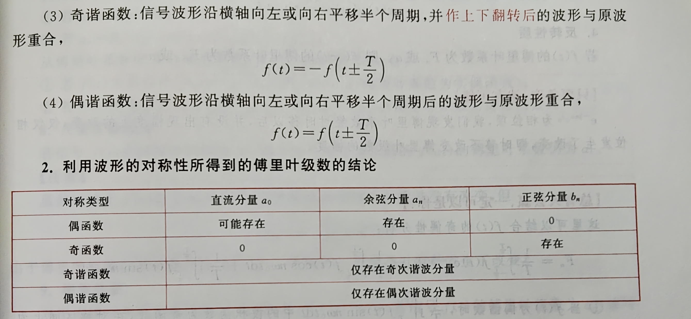

（3）奇谐函数：信号波形沿横轴向左或向右平移半个周期，并作上下翻转后的波形与原波形重合，

$$f(t) = -f\left(t \pm \frac{T}{2}\right)$$

（4）偶谐函数：信号波形沿横轴向左或向右平移半个周期后的波形与原波形重合，

$$f(t) = f\left(t \pm \frac{T}{2}\right)$$

**2. 利用波形的对称性所得到的傅里叶级数的结论**

| 对称类型 | 直流分量 $a_0$ | 余弦分量 $a_n$ | 正弦分量 $b_n$ |
| :--- | :---: | :---: | :---: |
| 偶函数 | 可能存在 | 存在 | $0$ |
| 奇函数 | $0$ | $0$ | 存在 |
| 奇谐函数 | 仅存在奇次谐波分量 | 仅存在奇次谐波分量 | 仅存在奇次谐波分量 |
| 偶谐函数 | 仅存在偶次谐波分量 | 仅存在偶次谐波分量 | 仅存在偶次谐波分量 |

（注：原表中“奇谐函数”和“偶谐函数”两行的后三列为合并单元格，分别统一标为“仅存在奇次谐波分量”和“仅存在偶次谐波分量”。）

**PLUS判断奇谐消直流**

## 094 傅里叶级数线性性质

**问：** 请写出傅里叶级数的线性性质。

**答：**

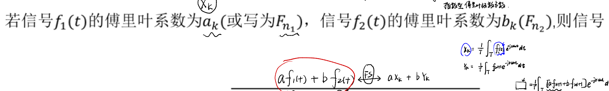

若信号 $f_1(t)$ 的傅里叶系数为 $a_k$（或写为 $F_{n_1}$），信号 $f_2(t)$ 的傅里叶系数为 $b_k(F_{n_2})$，则信号……

（含手写批注与推导，手写部分暂不转写，见原图）

## 095 傅里叶级数时移性质

**问：** 请写出傅里叶级数的时移性质。

**答：**

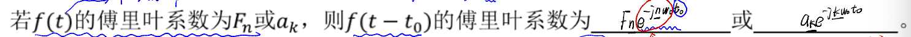

若 $f(t)$ 的傅里叶系数为 $F_n$ 或 $a_k$，则 $f(t - t_0)$ 的傅里叶系数为 \_\_\_\_\_\_ 或 \_\_\_\_\_\_。

（含手写填空与批注，手写部分暂不转写，见原图）

## 096 傅里叶级数反转性质

**问：** 请写出傅里叶级数的反转性质。

**答：**

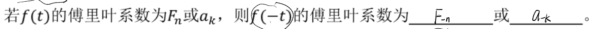

若 $f(t)$ 的傅里叶系数为 $F_n$ 或 $a_k$，则 $f(-t)$ 的傅里叶系数为 \_\_\_\_\_\_ 或 \_\_\_\_\_\_。

（含手写填空与批注，手写部分暂不转写，见原图）

## 097 傅里叶级数周期卷积性质

**问：** 请写出傅里叶级数的周期卷积性质。

**答：**

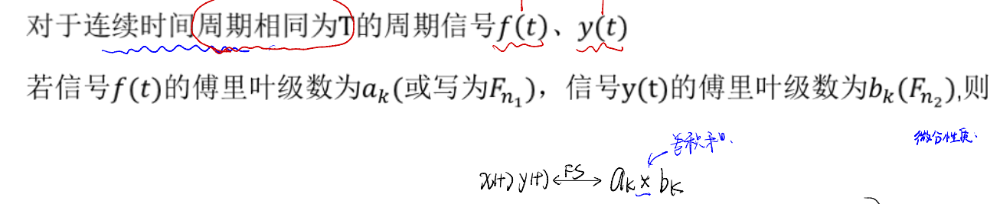

对于连续时间周期相同为 $T$ 的周期信号 $f(t)$、$y(t)$

若信号 $f(t)$ 的傅里叶级数为 $a_k$（或写为 $F_{n_1}$），信号 $y(t)$ 的傅里叶级数为 $b_k(F_{n_2})$，则……

（含手写批注与公式，手写部分暂不转写，见原图）

## 098 帕塞瓦尔定理

**问：** 请写出帕塞瓦尔定理。

**答：**

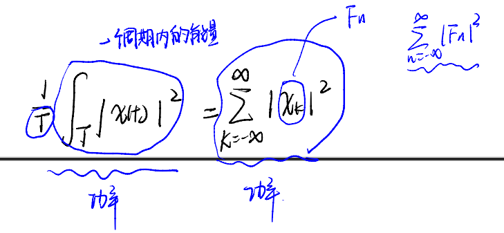

（手写内容暂不转写，见原图）

## 099 傅里叶级数频移性质

**问：** 请写出傅里叶级数频移性质。

**答：**

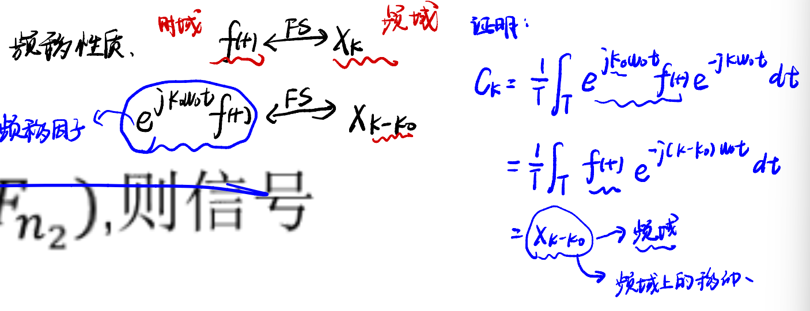

（手写内容暂不转写，见原图）

## 100 傅里叶级数微分性质

**问：** 请写出傅里叶级数微分性质。

**答：**

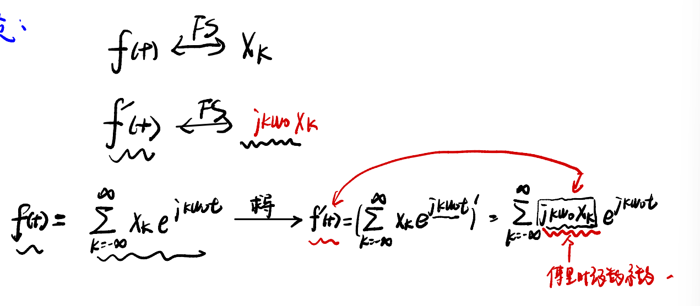

（手写内容暂不转写，见原图）

## 101 单边频谱图画法

**问：** 请说明单边频谱图的画法。

**答：**

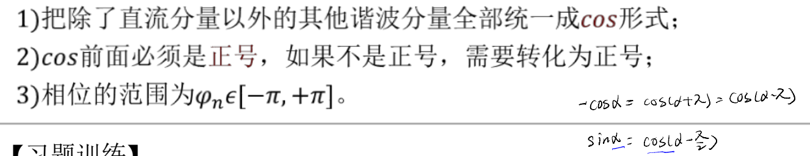

1) 把除了直流分量以外的其他谐波分量全部统一成 $\cos$ 形式；
2) $\cos$ 前面必须是正号，如果不是正号，需要转化为正号；
3) 相位的范围为 $\varphi_n \in [-\pi, +\pi]$。

（含手写批注，手写部分暂不转写，见原图）

**重点：用诱导公式转化正弦和正负号**

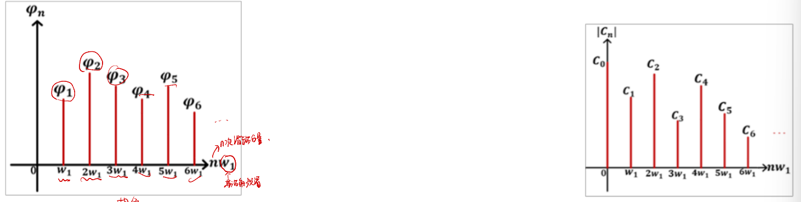

- **左图（单边相位谱）**：纵轴为 $\varphi_n$，横轴为 $n\omega_1$（原点为 $0$），在 $\omega_1, 2\omega_1, 3\omega_1, 4\omega_1, 5\omega_1, 6\omega_1$ 处对应相位分别为 $\varphi_1, \varphi_2, \varphi_3, \varphi_4, \varphi_5, \varphi_6$（后接 $\cdots$）。
- **右图（单边幅度谱）**：纵轴为 $|C_n|$，横轴为 $n\omega_1$，在 $0, \omega_1, 2\omega_1, 3\omega_1, 4\omega_1, 5\omega_1, 6\omega_1$ 处对应幅度分别为 $C_0, C_1, C_2, C_3, C_4, C_5, C_6$（后接 $\cdots$）。

（含手写批注，手写部分暂不转写，见原图）

## 102 相位辨析

**问：** 请辨析瞬时相位与相位谱中的初始相位。

**答：**

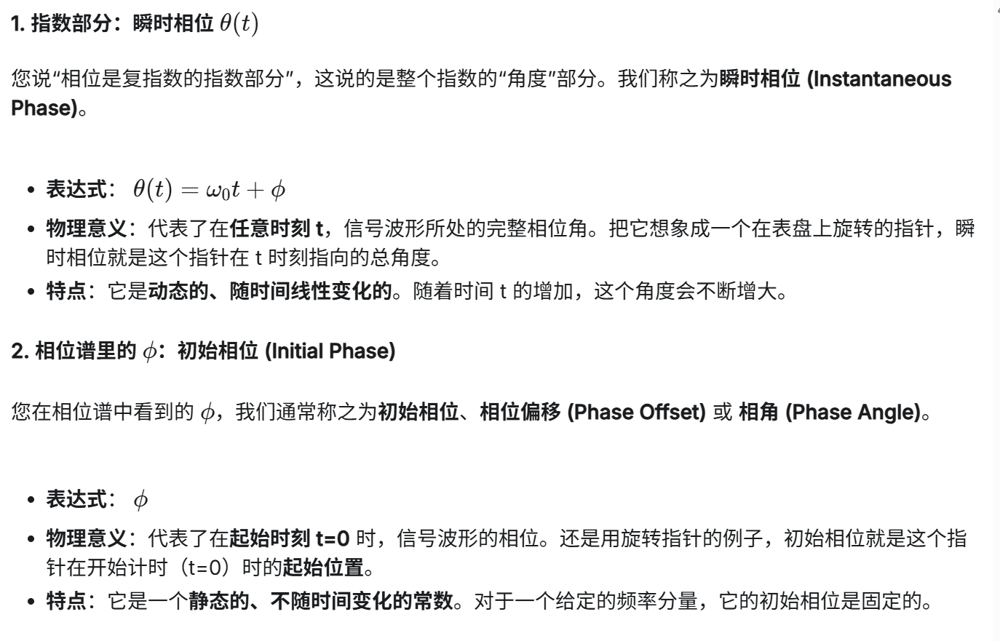

**1. 指数部分：瞬时相位 $\theta(t)$**

您说“相位是复指数的指数部分”，这说的是整个指数的“角度”部分。我们称之为**瞬时相位 (Instantaneous Phase)**。

- **表达式**：$\theta(t) = \omega_0 t + \phi$
- **物理意义**：代表了在**任意时刻 $t$**，信号波形所处的完整相位角。把它想象成一个在表盘上旋转的指针，瞬时相位就是这个指针在 $t$ 时刻指向的总角度。
- **特点**：它是**动态的、随时间线性变化的**。随着时间 $t$ 的增加，这个角度会不断增大。

**2. 相位谱里的 $\phi$：初始相位 (Initial Phase)**

您在相位谱中看到的 $\phi$，我们通常称之为**初始相位**、**相位偏移 (Phase Offset)** 或 **相角 (Phase Angle)**。

- **表达式**：$\phi$
- **物理意义**：代表了在**起始时刻 $t=0$** 时，信号波形的相位。还是用旋转指针的例子，初始相位就是这个指针在开始计时（$t=0$）时的**起始位置**。
- **特点**：它是一个**静态的、不随时间变化的常数**。对于一个给定的频率分量，它的初始相位是固定的。

## 103 双边幅度谱相位谱特征

**问：** 请说明双边幅度谱与双边相位谱的特征。

**答：**

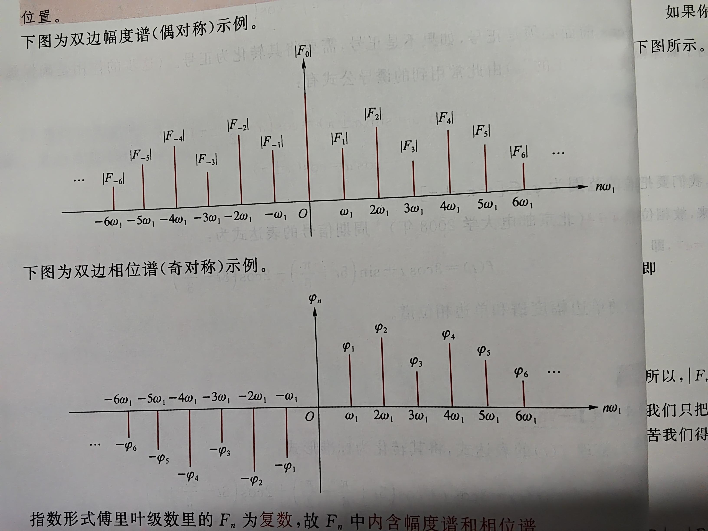

- **双边幅度谱（偶对称）示例**：
  - 纵轴为 $|F_0|$（原点 $O$ 处谱线为 $|F_0|$），横轴为 $n\omega_1$。
  - 负半轴频率 $-6\omega_1, -5\omega_1, -4\omega_1, -3\omega_1, -2\omega_1, -\omega_1$ 处对应 $|F_{-6}|, |F_{-5}|, |F_{-4}|, |F_{-3}|, |F_{-2}|, |F_{-1}|$（左侧有 $\cdots$）。
  - 正半轴频率 $\omega_1, 2\omega_1, 3\omega_1, 4\omega_1, 5\omega_1, 6\omega_1$ 处对应 $|F_1|, |F_2|, |F_3|, |F_4|, |F_5|, |F_6|$（右侧有 $\cdots$）。
- **双边相位谱（奇对称）示例**：
  - 纵轴为 $\varphi_n$，横轴为 $n\omega_1$，原点为 $O$。
  - 负半轴频率 $-6\omega_1, -5\omega_1, -4\omega_1, -3\omega_1, -2\omega_1, -\omega_1$ 处对应 $-\varphi_6, -\varphi_5, -\varphi_4, -\varphi_3, -\varphi_2, -\varphi_1$（左侧有 $\cdots$）。
  - 正半轴频率 $\omega_1, 2\omega_1, 3\omega_1, 4\omega_1, 5\omega_1, 6\omega_1$ 处对应 $\varphi_1, \varphi_2, \varphi_3, \varphi_4, \varphi_5, \varphi_6$（右侧有 $\cdots$）。

指数形式傅里叶级数里的 $F_n$ 为复数，故 $F_n$ 中内含幅度谱和相位谱。

## 104 根据指数形式傅里叶级数提取幅度谱和相位谱

**问：** 如何根据指数形式傅里叶级数提取幅度谱和相位谱？

**答：**

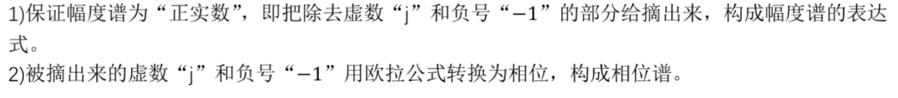

1) 保证幅度谱为“正实数”，即把除去虚数“$\mathrm{j}$”和负号“$-1$”的部分给摘出来，构成幅度谱的表达式。
2) 被摘出来的虚数“$\mathrm{j}$”和负号“$-1$”用欧拉公式转换为相位，构成相位谱。

注意正负变化的信号提取-1

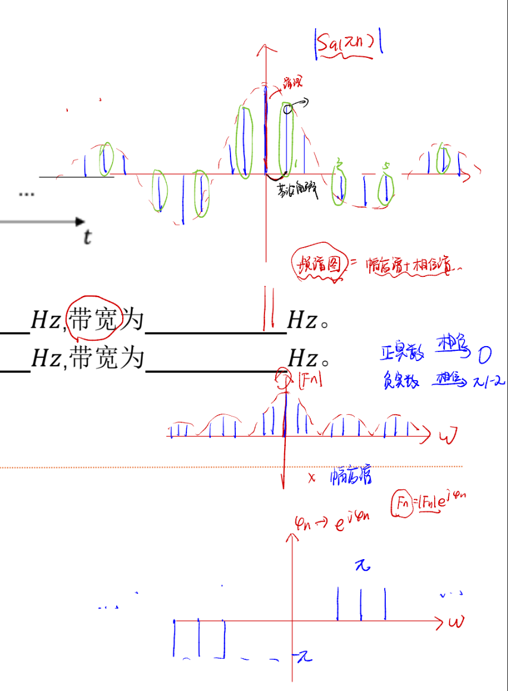

（含手写批注与图示，手写部分暂不转写，见原图）

**由此图可见，能从直角系中描绘出的一定是实数（相位为零），相位仅取决于正负号**

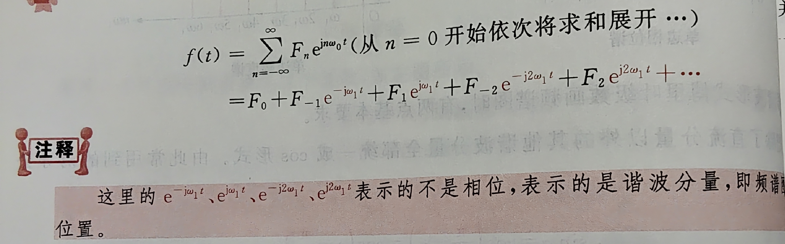

$$f(t) = \sum_{n=-\infty}^{\infty} F_n \mathrm{e}^{\mathrm{j}n\omega_0 t} \text{（从 } n=0 \text{ 开始依次将求和展开 } \cdots \text{）}$$

$$= F_0 + F_{-1}\mathrm{e}^{-\mathrm{j}\omega_1 t} + F_1\mathrm{e}^{\mathrm{j}\omega_1 t} + F_{-2}\mathrm{e}^{-\mathrm{j}2\omega_1 t} + F_2\mathrm{e}^{\mathrm{j}2\omega_1 t} + \cdots$$

**注释**：这里的 $\mathrm{e}^{-\mathrm{j}\omega_1 t}$、$\mathrm{e}^{\mathrm{j}\omega_1 t}$、$\mathrm{e}^{-\mathrm{j}2\omega_1 t}$、$\mathrm{e}^{\mathrm{j}2\omega_1 t}$ 表示的不是相位，表示的是谐波分量，即频谱图位置。

## 105 双边谱对称性从何而来

**问：** 请说明双边谱的对称性从何而来。

**答：**

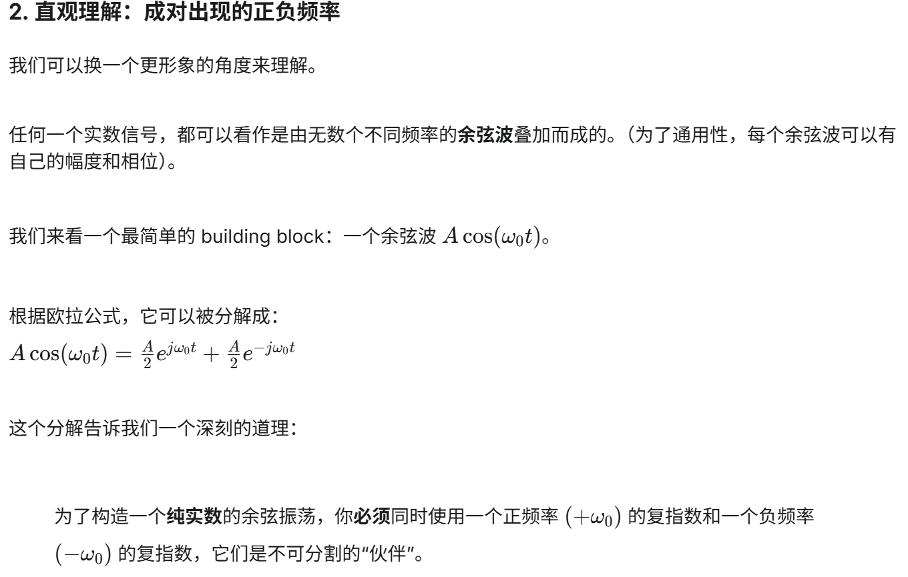

**2. 直观理解：成对出现的正负频率**

我们可以换一个更形象的角度来理解。

任何一个实数信号，都可以看作是由无数个不同频率的**余弦波**叠加而成的。（为了通用性，每个余弦波可以有自己的幅度和相位）。

我们来看一个最简单的 building block：一个余弦波 $A\cos(\omega_0 t)$。

根据欧拉公式，它可以被分解成：

$$A\cos(\omega_0 t) = \frac{A}{2}e^{j\omega_0 t} + \frac{A}{2}e^{-j\omega_0 t}$$

这个分解告诉我们一个深刻的道理：

为了构造一个**纯实数**的余弦振荡，你**必须**同时使用一个正频率（$+\omega_0$）的复指数和一个负频率（$-\omega_0$）的复指数，它们是不可分割的“伙伴”。

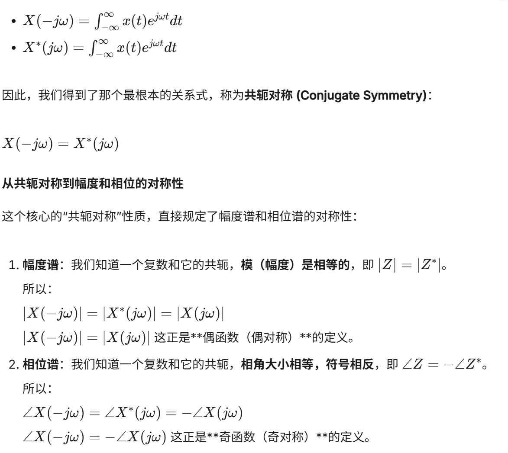

- $X(-j\omega) = \int_{-\infty}^{\infty} x(t)e^{j\omega t}dt$
- $X^*(j\omega) = \int_{-\infty}^{\infty} x(t)e^{j\omega t}dt$

因此，我们得到了那个最根本的关系式，称为**共轭对称 (Conjugate Symmetry)**：

$$X(-j\omega) = X^*(j\omega)$$

**从共轭对称到幅度和相位的对称性**

这个核心的“共轭对称”性质，直接规定了幅度谱和相位谱的对称性：

1. **幅度谱**：我们知道一个复数和它的共轭，**模（幅度）是相等的**，即 $|Z| = |Z^*|$。
   所以：
   $$|X(-j\omega)| = |X^*(j\omega)| = |X(j\omega)|$$
   $|X(-j\omega)| = |X(j\omega)|$ 这正是 **偶函数（偶对称）** 的定义。
2. **相位谱**：我们知道一个复数和它的共轭，**相角大小相等，符号相反**，即 $\angle Z = -\angle Z^*$。
   所以：
   $$\angle X(-j\omega) = \angle X^*(j\omega) = -\angle X(j\omega)$$
   $\angle X(-j\omega) = -\angle X(j\omega)$ 这正是 **奇函数（奇对称）** 的定义。

## 106 傅里叶级数二级公式

**问：** 请写出傅里叶级数中时域与频域的对称关系（二级公式）。

**答：**

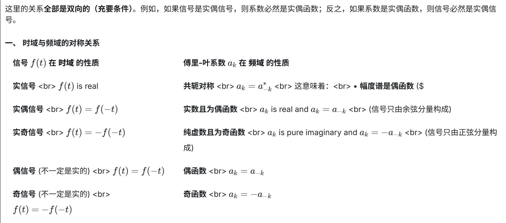

这里的关系**全部是双向的（充要条件）**。例如，如果信号是实偶信号，则系数必然是实偶函数；反之，如果系数是实偶函数，则信号必然是实偶信号。

**一、 时域与频域的对称关系**

| 信号 $f(t)$ 在 **时域** 的性质 | 傅里叶系数 $a_k$ 在 **频域** 的性质 |
| :--- | :--- |
| **实信号** $f(t)$ is real | **共轭对称** $a_k = a_{-k}^*$ 这意味着： • 幅度谱是偶函数（原图右侧此处截断） |
| **实偶信号** $f(t) = f(-t)$ | **实数且为偶函数** $a_k$ is real and $a_k = a_{-k}$ （信号只由余弦分量构成） |
| **实奇信号** $f(t) = -f(-t)$ | **纯虚数且为奇函数** $a_k$ is pure imaginary and $a_k = -a_{-k}$ （信号只由正弦分量构成） |
| **偶信号**（不一定是实的） $f(t) = f(-t)$ | **偶函数** $a_k = a_{-k}$ |
| **奇信号**（不一定是实的） $f(t) = -f(-t)$ | **奇函数** $a_k = -a_{-k}$ |

## 107 傅里叶级数尺度变换性质和相乘

**问：** 请写出傅里叶级数的尺度变换性质和相乘性质。

**答：**

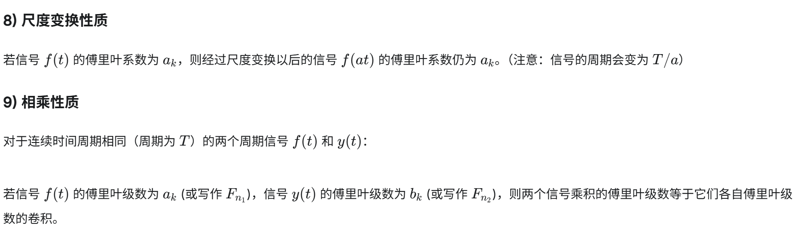

**8) 尺度变换性质**

若信号 $f(t)$ 的傅里叶系数为 $a_k$，则经过尺度变换以后的信号 $f(at)$ 的傅里叶系数仍为 $a_k$。（注意：信号的周期会变为 $T/a$）

**9) 相乘性质**

对于连续时间周期相同（周期为 $T$）的两个周期信号 $f(t)$ 和 $y(t)$：

若信号 $f(t)$ 的傅里叶级数为 $a_k$（或写作 $F_{n_1}$），信号 $y(t)$ 的傅里叶级数为 $b_k$（或写作 $F_{n_2}$），则两个信号乘积的傅里叶级数等于它们各自傅里叶级数的卷积。
