# 第五章｜墨墨记忆卡重组

来源：[墨墨记忆卡「信号与系统」](https://www.markji.com/deck/editor/67dd5988bbc6238121685de1)。本章共 8 张（总编号 150—157）。印刷体公式与文字已转写为 Markdown/LaTeX；手写内容按约定暂不转写，均已保留本地高清原图。

## 150 拉普拉斯变换对

**问：** 请写出常见的单边拉普拉斯变换对及其收敛域 (ROC)。

**答：**

| 序号 | 信号名称 | 时域信号 $f(t)$ | 拉普拉斯变换 $F(s)$ 与收敛域 (ROC) |
| :---: | :---: | :---: | :--- |
| 1. | 冲激信号 | $\delta(t)$ | $1, \quad \text{收敛域为全平面}$ |
| 2. | 冲激信号的导数 | $\delta^{(n)}(t)$ | $s^n, \quad \text{收敛域为全平面}$ |
| 3. | 阶跃信号 | $u(t)$ | $\frac{1}{s}, \quad \text{Re}[s]>0$ |
| 4. | 单边指数信号 | $e^{-at}u(t)$ | $\frac{1}{s+a}, \quad \text{Re}[s]>-a$ |
| 5. | 单边正弦信号 | $\sin(\omega_0 t)u(t)$ | $\frac{\omega_0}{s^2+\omega_0^2}, \quad \text{Re}[s]>0$ |
| 6. | 单边余弦信号 | $\cos(\omega_0 t)u(t)$ | $\frac{s}{s^2+\omega_0^2}, \quad \text{Re}[s]>0$ |
| 7. | 衰减的余弦信号 | $e^{-at}\cos(\omega_0 t)u(t)$ | $\frac{s+a}{(s+a)^2+\omega_0^2}, \quad \text{Re}[s]>-a$ |
| 8. | 衰减的正弦信号 | $e^{-at}\sin(\omega_0 t)u(t)$ | $\frac{\omega_0}{(s+a)^2+\omega_0^2}, \quad \text{Re}[s]>-a$ |
| 9. | 斜坡信号 | $tu(t)$ | $\frac{1}{s^2}, \quad \text{Re}[s]>0$ |
| 10. | 幂指数信号 | $t^n u(t)$ ($n$为正整数) | $\frac{n!}{s^{n+1}}, \quad \text{Re}[s]>0$ |
| 11. | 单边周期冲激串 | $\sum_{n=0}^{\infty} \delta(t-nT)$ | $\frac{1}{1-e^{-sT}}, \quad \text{Re}[s]>0$ |

## 151 拉普拉斯变换性质

**问：** 请写出拉普拉斯变换的主要性质（公式与收敛域 ROC）。

**答：**

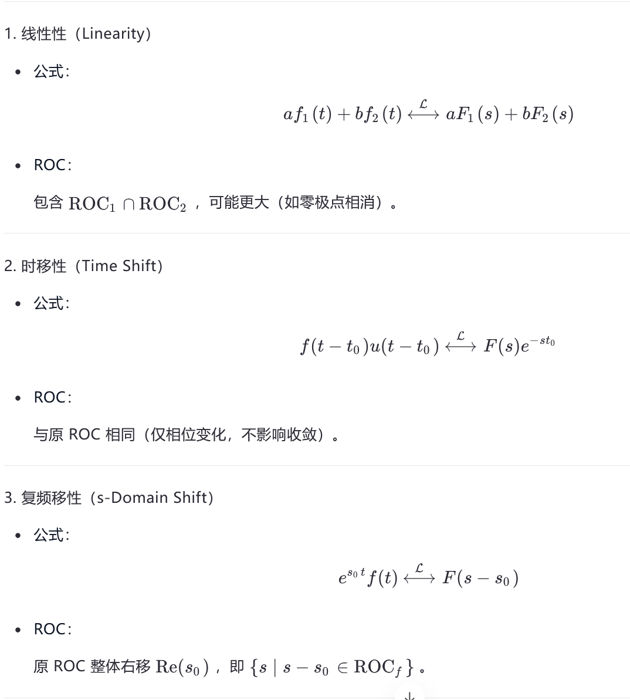

1. 线性（Linearity）
   - 公式：
     $$a f_1(t) + b f_2(t) \stackrel{\mathcal{L}}{\longleftrightarrow} a F_1(s) + b F_2(s)$$
   - ROC：
     包含 $\mathrm{ROC}_1 \cap \mathrm{ROC}_2$，可能更大（如零极点相消）。

2. 时移性（Time Shift）
   - 公式：
     $$f(t - t_0)u(t - t_0) \stackrel{\mathcal{L}}{\longleftrightarrow} F(s)e^{-st_0}$$
   - ROC：
     与原 $\mathrm{ROC}$ 相同（仅相位变化，不影响收敛）。

3. 复频移性（$s$-Domain Shift）
   - 公式：
     $$e^{s_0 t} f(t) \stackrel{\mathcal{L}}{\longleftrightarrow} F(s - s_0)$$
   - ROC：
     原 $\mathrm{ROC}$ 整体右移 $\mathrm{Re}(s_0)$，即 $\{s \mid s - s_0 \in \mathrm{ROC}_f\}$。

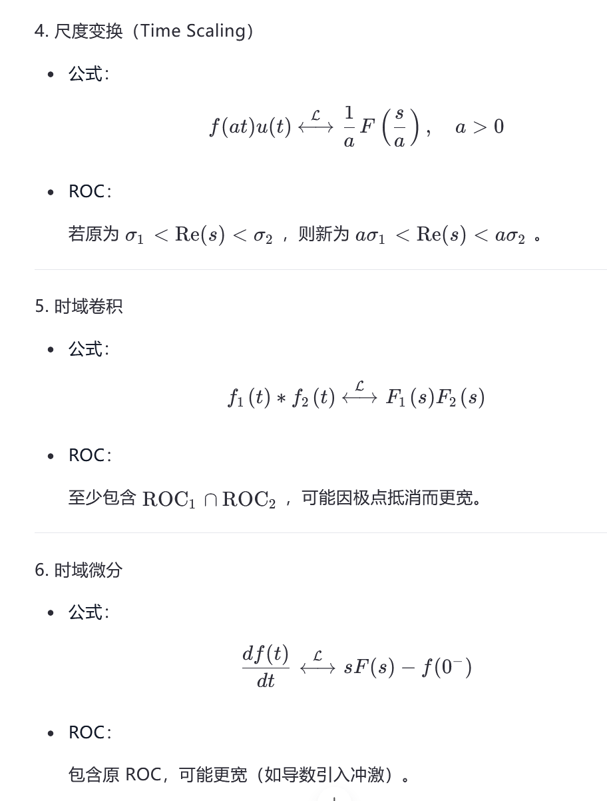

4. 尺度变换（Time Scaling）
   - 公式：
     $$f(at)u(t) \stackrel{\mathcal{L}}{\longleftrightarrow} \frac{1}{a} F\left(\frac{s}{a}\right), \quad a > 0$$
   - ROC：
     若原为 $\sigma_1 < \mathrm{Re}(s) < \sigma_2$，则新为 $a\sigma_1 < \mathrm{Re}(s) < a\sigma_2$。

5. 时域卷积
   - 公式：
     $$f_1(t) * f_2(t) \stackrel{\mathcal{L}}{\longleftrightarrow} F_1(s)F_2(s)$$
   - ROC：
     至少包含 $\mathrm{ROC}_1 \cap \mathrm{ROC}_2$，可能因极点抵消而更宽。

6. 时域微分
   - 公式：
     $$\frac{df(t)}{dt} \stackrel{\mathcal{L}}{\longleftrightarrow} sF(s) - f(0^-)$$
   - ROC：
     包含原 $\mathrm{ROC}$，可能更宽（如导数引入冲激）。

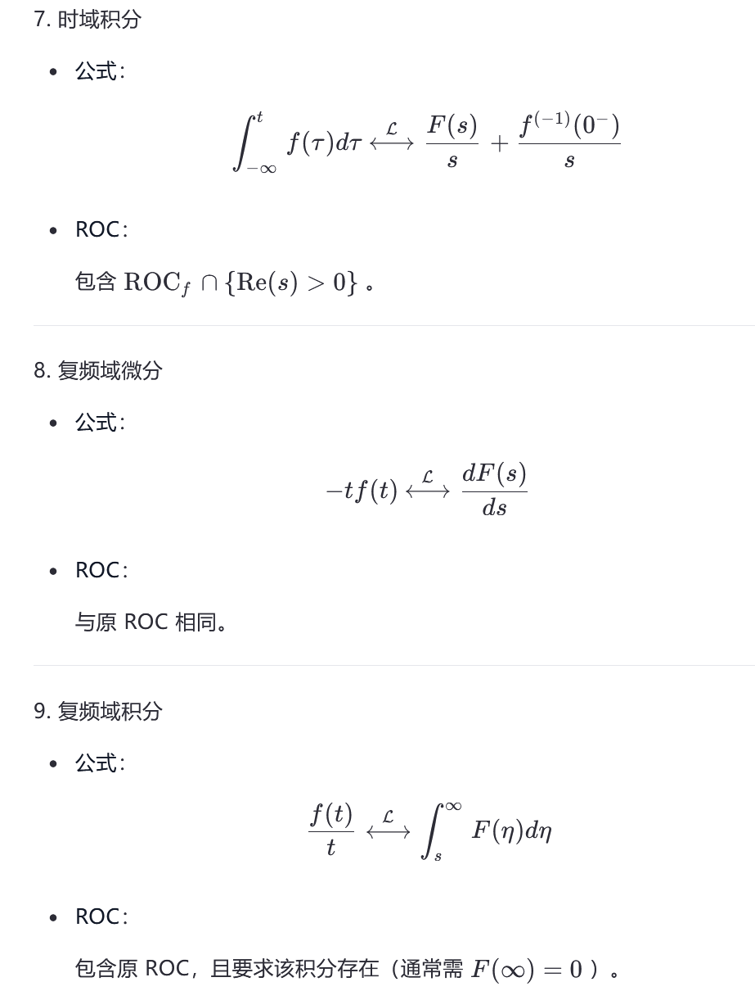

7. 时域积分
   - 公式：
     $$\int_{-\infty}^{t} f(\tau)d\tau \stackrel{\mathcal{L}}{\longleftrightarrow} \frac{F(s)}{s} + \frac{f^{(-1)}(0^-)}{s}$$
   - ROC：
     包含 $\mathrm{ROC}_f \cap \{\mathrm{Re}(s) > 0\}$。

8. 复频域微分
   - 公式：
     $$-t f(t) \stackrel{\mathcal{L}}{\longleftrightarrow} \frac{dF(s)}{ds}$$
   - ROC：
     与原 $\mathrm{ROC}$ 相同。

9. 复频域积分
   - 公式：
     $$\frac{f(t)}{t} \stackrel{\mathcal{L}}{\longleftrightarrow} \int_{s}^{\infty} F(\eta)d\eta$$
   - ROC：
     包含原 $\mathrm{ROC}$，且要求该积分存在（通常需 $F(\infty) = 0$）。

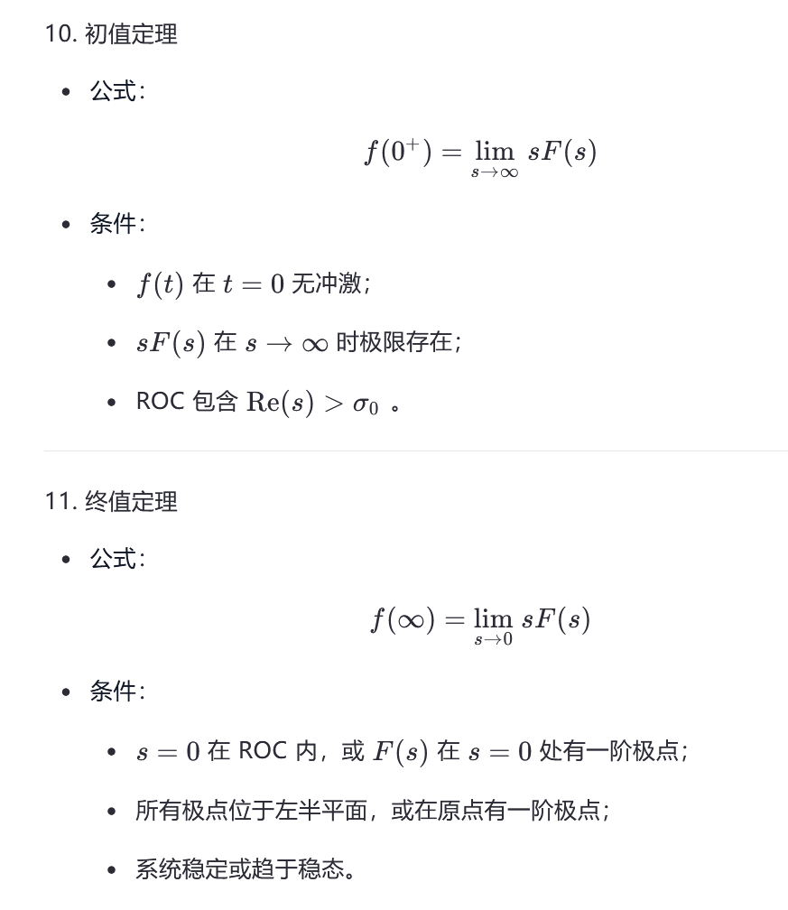

10. 初值定理
    - 公式：
      $$f(0^+) = \lim_{s \to \infty} sF(s)$$
    - 条件：
      - $f(t)$ 在 $t = 0$ 无冲激；
      - $sF(s)$ 在 $s \to \infty$ 时极限存在；
      - $\mathrm{ROC}$ 包含 $\mathrm{Re}(s) > \sigma_0$。

11. 终值定理
    - 公式：
      $$f(\infty) = \lim_{s \to 0} sF(s)$$
    - 条件：
      - $s = 0$ 在 $\mathrm{ROC}$ 内，或 $F(s)$ 在 $s = 0$ 处有一阶极点；
      - 所有极点位于左半平面，或在原点有一阶极点；
      - 系统稳定或趋于稳态。

## 152 正弦稳态响应

**问：** 请简述连续时间 LTI 系统的正弦稳态响应求解方法（包括永恒正弦波输入与因果正弦波输入）。

**答：**

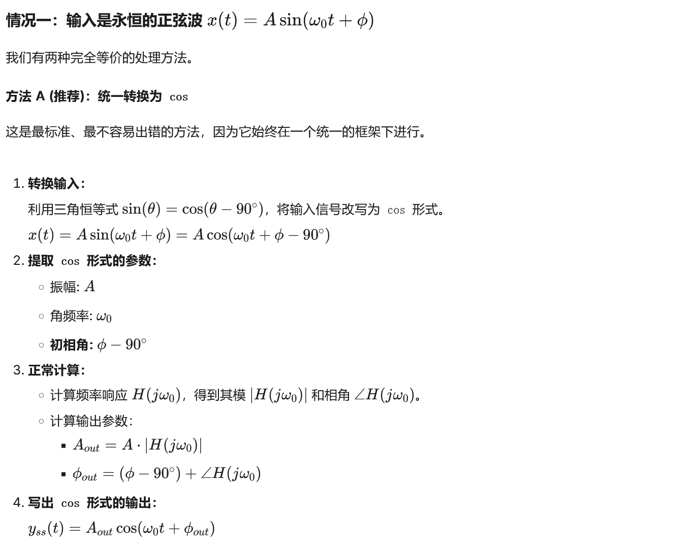

**情况一：输入是永恒的正弦波 $x(t) = A\sin(\omega_0 t + \phi)$**

我们有两种完全等价的处理方法。

**方法 A (推荐)：统一转换为 $\cos$**

这是最标准、最不容易出错的方法，因为它始终在一个统一的框架下进行。

1. **转换输入：**
   利用三角恒等式 $\sin(\theta) = \cos(\theta - 90^\circ)$，将输入信号改写为 $\cos$ 形式。
   $$x(t) = A\sin(\omega_0 t + \phi) = A\cos(\omega_0 t + \phi - 90^\circ)$$
2. **提取 $\cos$ 形式的参数：**
   - 振幅：$A$
   - 角频率：$\omega_0$
   - **初相角：$\phi - 90^\circ$**
3. **正常计算：**
   - 计算频率响应 $H(j\omega_0)$，得到其模 $|H(j\omega_0)|$ 和相角 $\angle H(j\omega_0)$。
   - 计算输出参数：
     - $A_{out} = A \cdot |H(j\omega_0)|$
     - $\phi_{out} = (\phi - 90^\circ) + \angle H(j\omega_0)$
4. **写出 $\cos$ 形式的输出：**
   $$y_{ss}(t) = A_{out}\cos(\omega_0 t + \phi_{out})$$

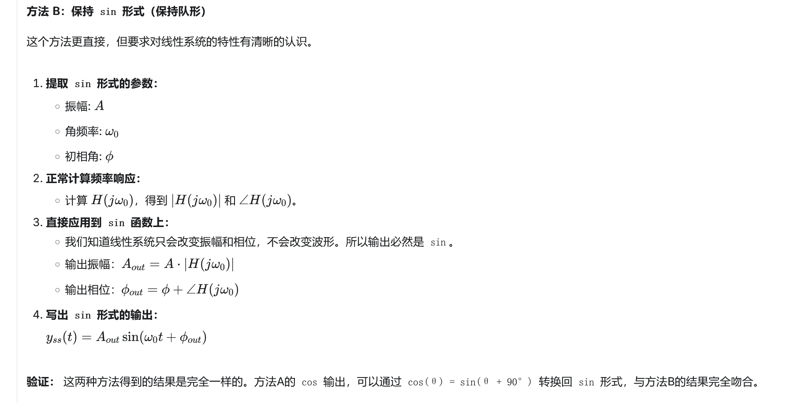

**方法 B：保持 $\sin$ 形式（保持队形）**

这个方法更直接，但要求对线性系统的特性有清晰的认识。

1. **提取 $\sin$ 形式的参数：**
   - 振幅：$A$
   - 角频率：$\omega_0$
   - 初相角：$\phi$
2. **正常计算频率响应：**
   - 计算 $H(j\omega_0)$，得到 $|H(j\omega_0)|$ 和 $\angle H(j\omega_0)$。
3. **直接应用到 $\sin$ 函数上：**
   - 我们知道线性系统只会改变振幅和相位，不会改变波形。所以输出必然是 $\sin$。
   - 输出振幅：$A_{out} = A \cdot |H(j\omega_0)|$
   - 输出相位：$\phi_{out} = \phi + \angle H(j\omega_0)$
4. **写出 $\sin$ 形式的输出：**
   $$y_{ss}(t) = A_{out}\sin(\omega_0 t + \phi_{out})$$

**验证：** 这两种方法得到的结果是完全一样的。方法 A 的 $\cos$ 输出，可以通过 $\cos(\theta) = \sin(\theta + 90^\circ)$ 转换回 $\sin$ 形式，与方法 B 的结果完全吻合。

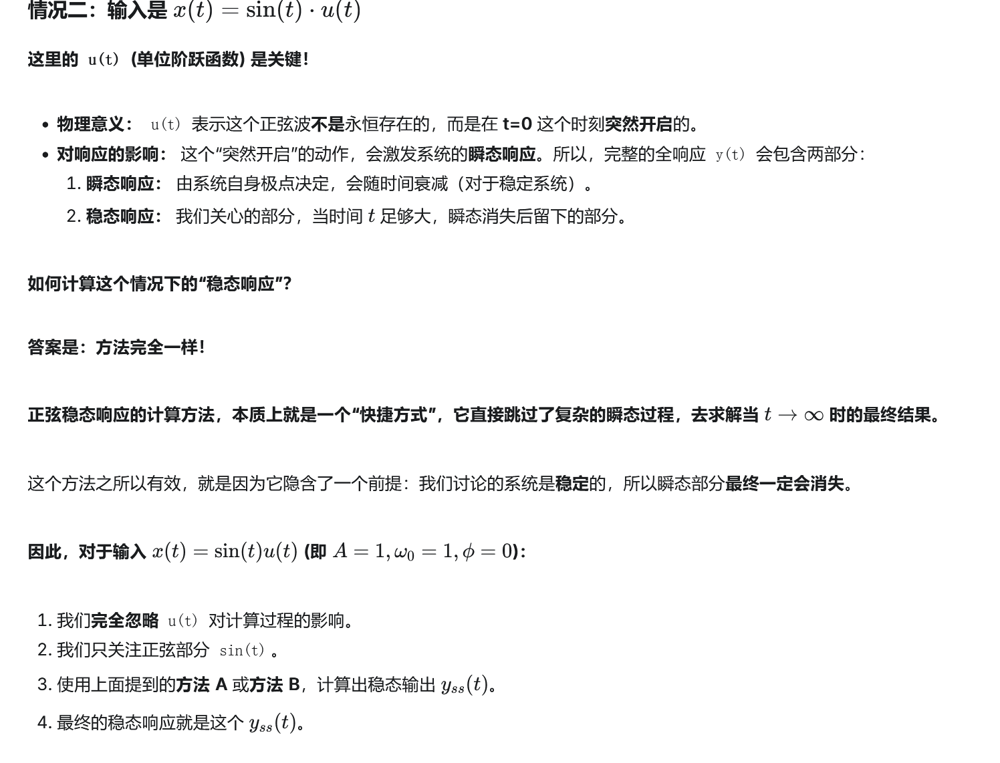

**情况二：输入是 $x(t) = \sin(t) \cdot u(t)$**

**这里的 $u(t)$（单位阶跃函数）是关键！**

- **物理意义：** $u(t)$ 表示这个正弦波**不是**永恒存在的，而是在 **$t=0$** 这个时刻**突然开启**的。
- **对响应的影响：** 这个“突然开启”的动作，会激发系统的**瞬态响应**。所以，完整的全响应 $y(t)$ 会包含两部分：
  1. **瞬态响应：** 由系统自身极点决定，会随时间衰减（对于稳定系统）。
  2. **稳态响应：** 我们关心的部分，当时间 $t$ 足够大，瞬态消失后留下的部分。

**如何计算这个情况下的“稳态响应”？**

**答案是：方法完全一样！**

**正弦稳态响应的计算方法，本质上就是一个“快捷方式”，它直接跳过了复杂的瞬态过程，去求解当 $t \to \infty$ 时的最终结果。**

这个方法之所以有效，就是因为它隐含了一个前提：我们讨论的系统是**稳定**的，所以瞬态部分**最终一定会消失**。

**因此，对于输入 $x(t) = \sin(t)u(t)$（即 $A=1, \omega_0=1, \phi=0$）：**

1. 我们**完全忽略** $u(t)$ 对计算过程的影响。
2. 我们只关注正弦部分 $\sin(t)$。
3. 使用上面提到的**方法 A** 或**方法 B**，计算出稳态输出 $y_{ss}(t)$。
4. 最终的稳态响应就是这个 $y_{ss}(t)$。

## 153 劳斯阵列画法和劳斯准则

**问：** 请写出劳斯阵列的画法及劳斯稳定性准则。

**答：**

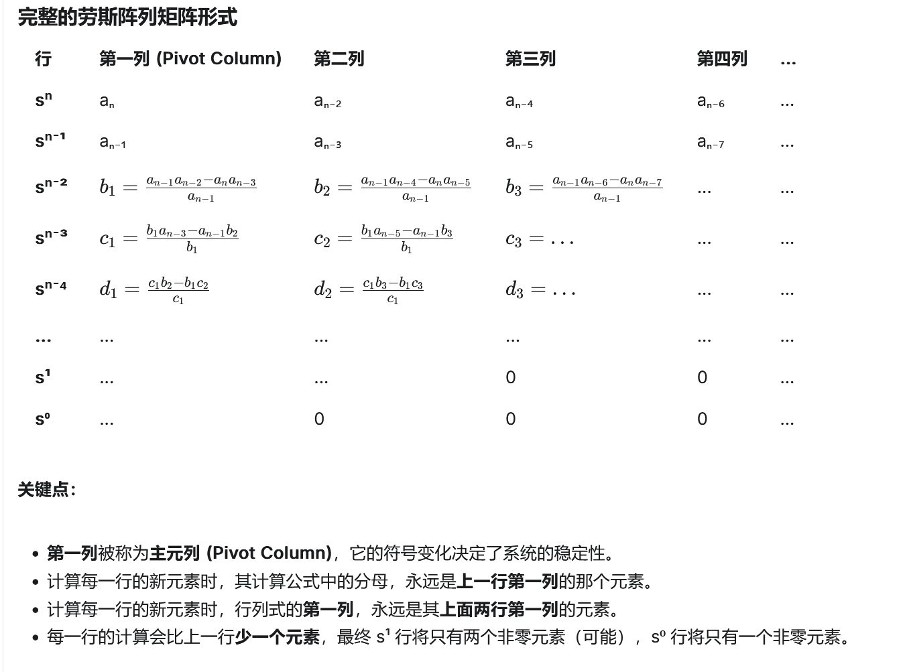

**完整的劳斯阵列矩阵形式**

| 行 | 第一列 (Pivot Column) | 第二列 | 第三列 | 第四列 | ... |
| :--- | :--- | :--- | :--- | :--- | :--- |
| **$s^n$** | $a_n$ | $a_{n-2}$ | $a_{n-4}$ | $a_{n-6}$ | ... |
| **$s^{n-1}$** | $a_{n-1}$ | $a_{n-3}$ | $a_{n-5}$ | $a_{n-7}$ | ... |
| **$s^{n-2}$** | $b_1 = \frac{a_{n-1}a_{n-2} - a_n a_{n-3}}{a_{n-1}}$ | $b_2 = \frac{a_{n-1}a_{n-4} - a_n a_{n-5}}{a_{n-1}}$ | $b_3 = \frac{a_{n-1}a_{n-6} - a_n a_{n-7}}{a_{n-1}}$ | ... | ... |
| **$s^{n-3}$** | $c_1 = \frac{b_1 a_{n-3} - a_{n-1}b_2}{b_1}$ | $c_2 = \frac{b_1 a_{n-5} - a_{n-1}b_3}{b_1}$ | $c_3 = \dots$ | ... | ... |
| **$s^{n-4}$** | $d_1 = \frac{c_1 b_2 - b_1 c_2}{c_1}$ | $d_2 = \frac{c_1 b_3 - b_1 c_3}{c_1}$ | $d_3 = \dots$ | ... | ... |
| **...** | ... | ... | ... | ... | ... |
| **$s^1$** | ... | ... | $0$ | $0$ | ... |
| **$s^0$** | ... | $0$ | $0$ | $0$ | ... |

**关键点：**

- **第一列**被称为**主元列 (Pivot Column)**，它的符号变化决定了系统的稳定性。
- 计算每一行的新元素时，其计算公式中的分母，永远是**上一行第一列**的那个元素。
- 计算每一行的新元素时，行列式的**第一列**，永远是其**上面两行第一列**的元素。
- 每一行的计算会比上一行**少一个元素**，最终 $s^1$ 行将只有两个非零元素（可能），$s^0$ 行将只有一个非零元素。

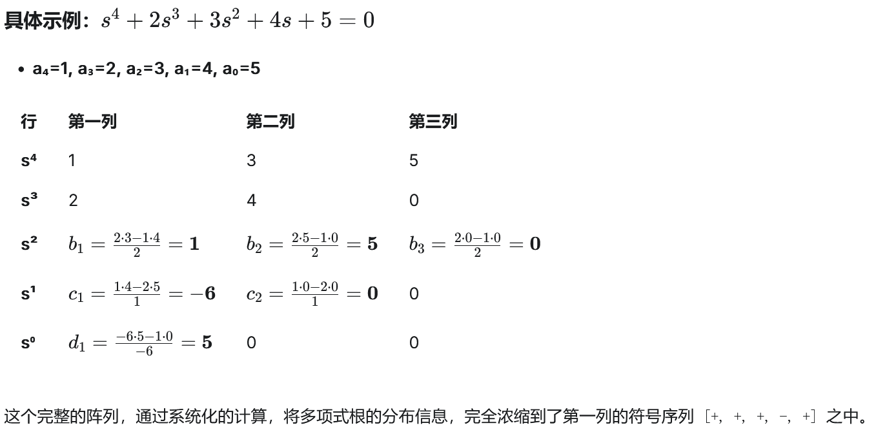

**具体示例：** $s^4 + 2s^3 + 3s^2 + 4s + 5 = 0$

- **$a_4=1, a_3=2, a_2=3, a_1=4, a_0=5$**

| 行 | 第一列 | 第二列 | 第三列 |
| :--- | :--- | :--- | :--- |
| **$s^4$** | $1$ | $3$ | $5$ |
| **$s^3$** | $2$ | $4$ | $0$ |
| **$s^2$** | $b_1 = \frac{2\cdot 3 - 1\cdot 4}{2} = 1$ | $b_2 = \frac{2\cdot 5 - 1\cdot 0}{2} = 5$ | $b_3 = \frac{2\cdot 0 - 1\cdot 0}{2} = 0$ |
| **$s^1$** | $c_1 = \frac{1\cdot 4 - 2\cdot 5}{1} = -6$ | $c_2 = \frac{1\cdot 0 - 2\cdot 0}{1} = 0$ | $0$ |
| **$s^0$** | $d_1 = \frac{-6\cdot 5 - 1\cdot 0}{-6} = 5$ | $0$ | $0$ |

这个完整的阵列，通过系统化的计算，将多项式根的分布信息，完全浓缩到了第一列的符号序列 `[+, +, +, -, +]` 之中。

---

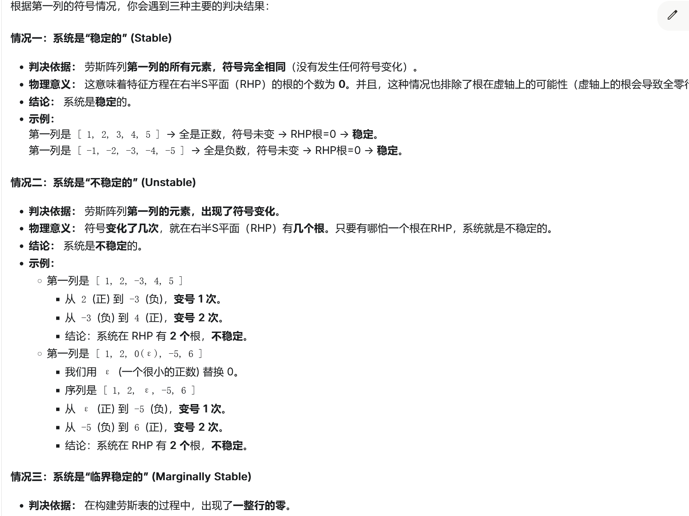

根据第一列的符号情况，你会遇到三种主要的判决结果：

**情况一：系统是“稳定的” (Stable)**

- **判决依据：** 劳斯阵列**第一列的所有元素，符号完全相同**（没有发生任何符号变化）。
- **物理意义：** 这意味着特征方程在右半S平面（RHP）的根的个数为 **0**。并且，这种情况也排除了根在虚轴上的可能性（虚轴上的根会导致全零……
- **结论：** 系统是**稳定**的。
- **示例：**
  第一列是 `[1, 2, 3, 4, 5]` → 全是正数，符号未变 → RHP根=0 → **稳定**。
  第一列是 `[-1, -2, -3, -4, -5]` → 全是负数，符号未变 → RHP根=0 → **稳定**。

**情况二：系统是“不稳定的” (Unstable)**

- **判决依据：** 劳斯阵列**第一列的元素，出现了符号变化**。
- **物理意义：** 符号**变化了几次**，就在右半S平面（RHP）有**几个根**。只要有哪怕一个根在RHP，系统就是不稳定的。
- **结论：** 系统是**不稳定**的。
- **示例：**
  - 第一列是 `[1, 2, -3, 4, 5]`
    - 从 $2$ (正) 到 $-3$ (负)，**变号 1 次**。
    - 从 $-3$ (负) 到 $4$ (正)，**变号 2 次**。
    - 结论：系统在 RHP 有 **2 个根**，**不稳定**。
  - 第一列是 `[1, 2, 0(ε), -5, 6]`
    - 我们用 $\varepsilon$（一个很小的正数）替换 $0$。
    - 序列是 `[1, 2, ε, -5, 6]`
    - 从 $\varepsilon$ (正) 到 $-5$ (负)，**变号 1 次**。
    - 从 $-5$ (负) 到 $6$ (正)，**变号 2 次**。
    - 结论：系统在 RHP 有 **2 个根**，**不稳定**。

**情况三：系统是“临界稳定的” (Marginally Stable)**

- **判决依据：** 在构建劳斯表的过程中，出现了**一整行的零**。

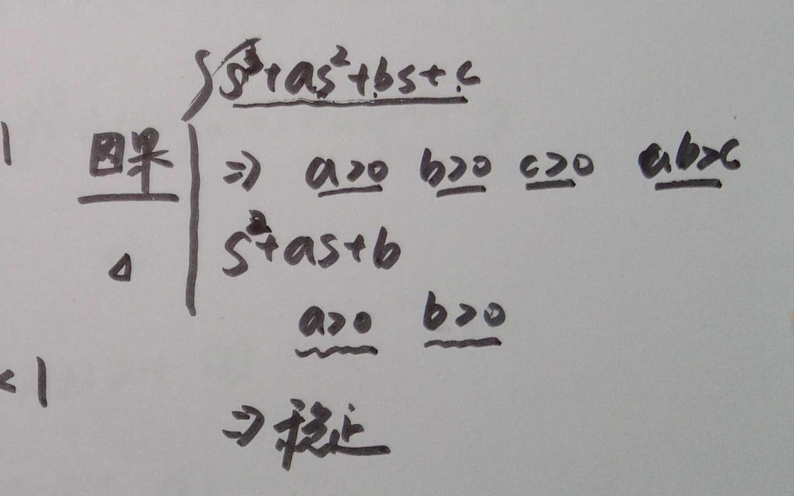

（手写内容暂不转写，见原图）

## 154 信号流图绘制

**问：** 请简述信号流图的绘制步骤（直接型、并联型、级联型）。

**答：**

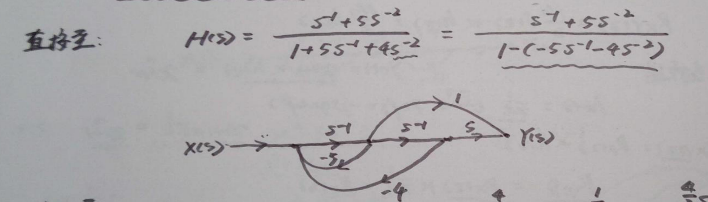

（手写内容暂不转写，见原图）

**1. 直接型**
1. 化成标准形式
2. 根据分母画前向通路
3. 根据分子画回路

**2. 并联型**

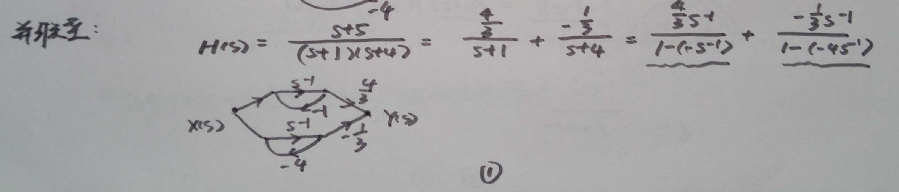

（手写内容暂不转写，见原图）

1. 分式展开、化标准型
2. 每个式子是一个单独支路

**3. 级联型**

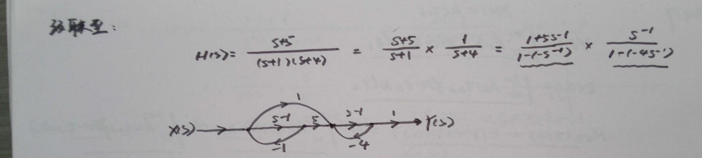

（手写内容暂不转写，见原图）

1. 分式相乘、化标准型
2. 单条主线级联，各分式各自画回路

## 155 幅频特性

**问：** 请简述幅频特性的常见画法与零极点规律（三点法、几何法、零点抑制与极点增强）。

**答：**

1. 三点法：
   代入 $H(j\omega)$，取 $\omega=0$、$\omega=1$、$\omega=\infty$，对称画出左侧
2. 几何法：
   把 $s$ 前系数都化为 $1$，幅度曲线为 $\omega$ 与对应零点连线乘积 / 极点连线乘积相除
   若极点在虚轴上，用傅里叶变换，在极点对应频率处有冲激。
   无零点、无极点模长为 $1$
3. 零点抑制、极点增强
   看靠近情况，若在零点处情况：零点抑制更为明显，至少不是最大点

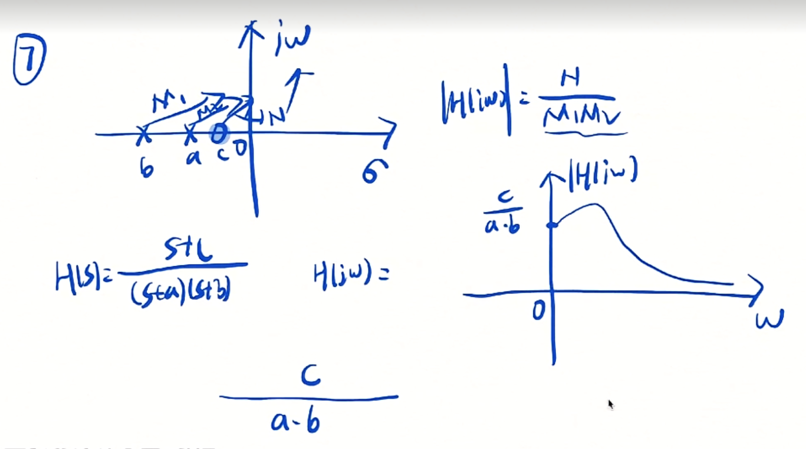

（手写内容暂不转写，见原图）

## 156 相频特性

**问：** 请简述相频特性的常见画法（三点法、几何法）。

**答：**

1. 三点法
2. 几何法：$s$ 前系数化为正数，连线和 $x$ 轴正向夹角相减

## 157 全通系统和最小相移系统

**问：** 请简述全通系统与最小相移系统的定义、关键特性及二者之间的关系。

**答：**

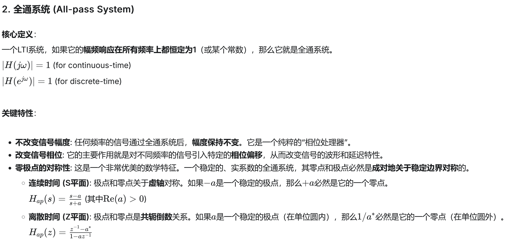

**2. 全通系统 (All-pass System)**

**核心定义：**

一个LTI系统，如果它的**幅频响应在所有频率上都恒定为1**（或某个常数），那么它就是全通系统。

$$|H(j\omega)| = 1 \text{ (for continuous-time)}$$
$$|H(e^{j\omega})| = 1 \text{ (for discrete-time)}$$

**关键特性：**

- **不改变信号幅度：** 任何频率的信号通过全通系统后，**幅度保持不变**。它是一个纯粹的“相位处理器”。
- **改变信号相位：** 它的主要作用就是对不同频率的信号引入特定的**相位偏移**，从而改变信号的波形和延迟特性。
- **零极点的对称性：** 这是一个非常优美的数学特征。一个稳定的、实系数的全通系统，其零点和极点必然是**成对地关于稳定边界对称的**。
  - **连续时间 (S平面)：** 极点和零点关于**虚轴**对称。如果 $-a$ 是一个稳定的极点，那么 $+a$ 必然是它的一个零点。
    $$H_{ap}(s) = \frac{s-a}{s+a} \text{ (其中 } \mathrm{Re}(a) > 0\text{)}$$
  - **离散时间 (Z平面)：** 极点和零点是**共轭倒数**关系。如果 $a$ 是一个稳定的极点（在单位圆内），那么 $1/a^*$ 必然是它的一个零点（在单位圆外）。
    $$H_{ap}(z) = \frac{z^{-1}-a^*}{1-az^{-1}}$$

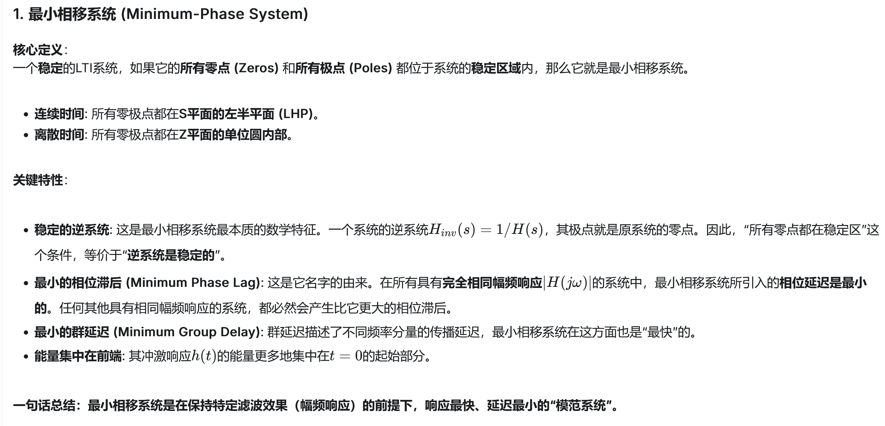

**1. 最小相移系统 (Minimum-Phase System)**

**核心定义：**

一个**稳定**的LTI系统，如果它的**所有零点 (Zeros) 和所有极点 (Poles)** 都位于系统的**稳定区域内**，那么它就是最小相移系统。

- **连续时间：** 所有零极点都在**S平面的左半平面 (LHP)**。
- **离散时间：** 所有零极点都在**Z平面的单位圆内部**。

**关键特性：**

- **稳定的逆系统：** 这是最小相移系统最本质的数学特征。一个系统的逆系统 $H_{inv}(s) = 1/H(s)$，其极点就是原系统的零点。因此，“所有零点都在稳定区”这个条件，等价于**“逆系统是稳定的”**。
- **最小的相位滞后 (Minimum Phase Lag)：** 这是它名字的由来。在所有具有**完全相同幅频响应** $|H(j\omega)|$ 的系统中，最小相移系统所引入的**相位延迟是最小的**。任何其他具有相同幅频响应的系统，都必然会产生比它更大的相位滞后。
- **最小的群延迟 (Minimum Group Delay)：** 群延迟描述了不同频率分量的传播延迟，最小相移系统在这方面也是“最快”的。
- **能量集中在前端：** 其冲激响应 $h(t)$ 的能量更多地集中在 $t=0$ 的起始部分。

**一句话总结：最小相移系统是在保持特定滤波效果（幅频响应）的前提下，响应最快、延迟最小的“模范系统”。**

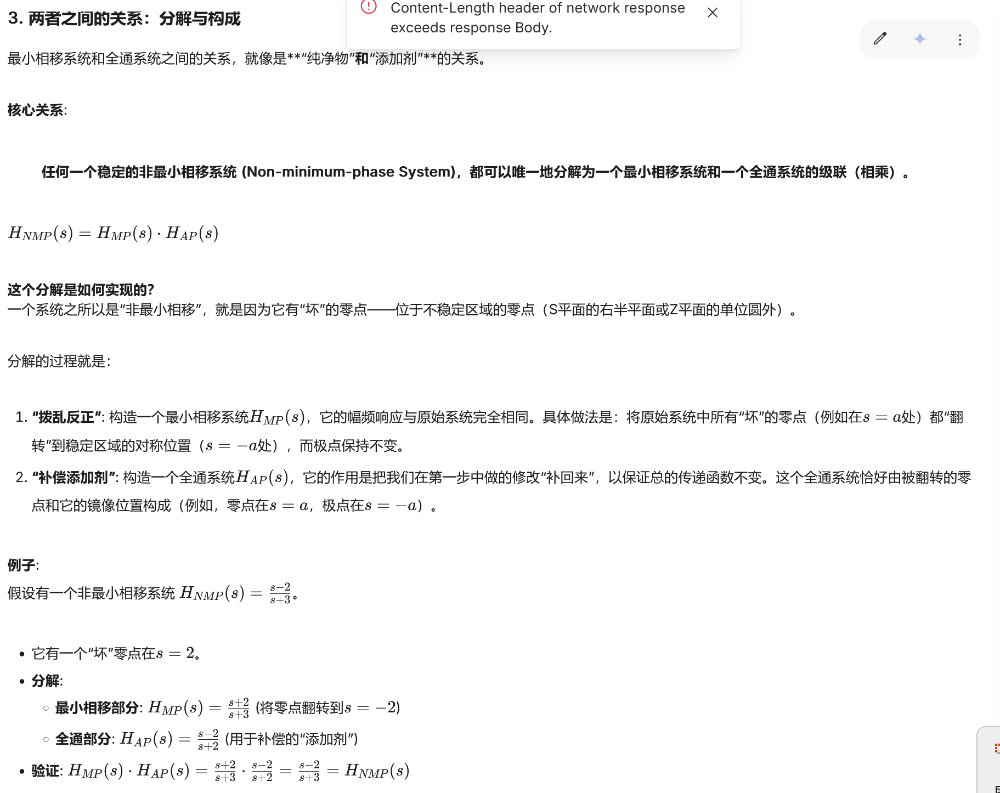

**3. 两者之间的关系：分解与构成**

最小相移系统和全通系统之间的关系，就像是**“纯净物”和“添加剂”**的关系。

**核心关系：**

**任何一个稳定的非最小相移系统 (Non-minimum-phase System)，都可以唯一地分解为一个最小相移系统和一个全通系统的级联（相乘）。**

$$H_{NMP}(s) = H_{MP}(s) \cdot H_{AP}(s)$$

**这个分解是如何实现的？**

一个系统之所以是“非最小相移”，就是因为它有“坏”的零点——位于不稳定区域的零点（S平面的右半平面或Z平面的单位圆外）。

分解的过程就是：

1. **“拨乱反正”：** 构造一个最小相移系统 $H_{MP}(s)$，它的幅频响应与原始系统完全相同。具体做法是：将原始系统中所有“坏”的零点（例如在 $s=a$ 处）都“翻转”到稳定区域的对称位置（$s=-a$ 处），而极点保持不变。
2. **“补偿添加剂”：** 构造一个全通系统 $H_{AP}(s)$，它的作用是把我们在第一步中做的修改“补回来”，以保证总的传递函数不变。这个全通系统恰好由被翻转的零点和它的镜像位置构成（例如，零点在 $s=a$，极点在 $s=-a$）。

**例子：**

假设有一个非最小相移系统 $H_{NMP}(s) = \frac{s-2}{s+3}$。

- 它有一个“坏”零点在 $s=2$。
- **分解：**
  - **最小相移部分：** $H_{MP}(s) = \frac{s+2}{s+3}$ （将零点翻转到 $s=-2$）
  - **全通部分：** $H_{AP}(s) = \frac{s-2}{s+2}$ （用于补偿的“添加剂”）
- **验证：** $H_{MP}(s) \cdot H_{AP}(s) = \frac{s+2}{s+3} \cdot \frac{s-2}{s+2} = \frac{s-2}{s+3} = H_{NMP}(s)$
