# z变换｜墨墨记忆卡重组

来源：[墨墨记忆卡「信号与系统」](https://www.markji.com/deck/editor/67dd5988bbc6238121685de1)。本章共 12 张（总编号 158—169）。印刷体公式与文字已转写为 Markdown/LaTeX；手写内容按约定暂不转写，均已保留本地高清原图。

## 158 z变换定义和收敛域理解

**问：** 请阐述z变换的定义及其收敛域（ROC）的理解。

**答：**

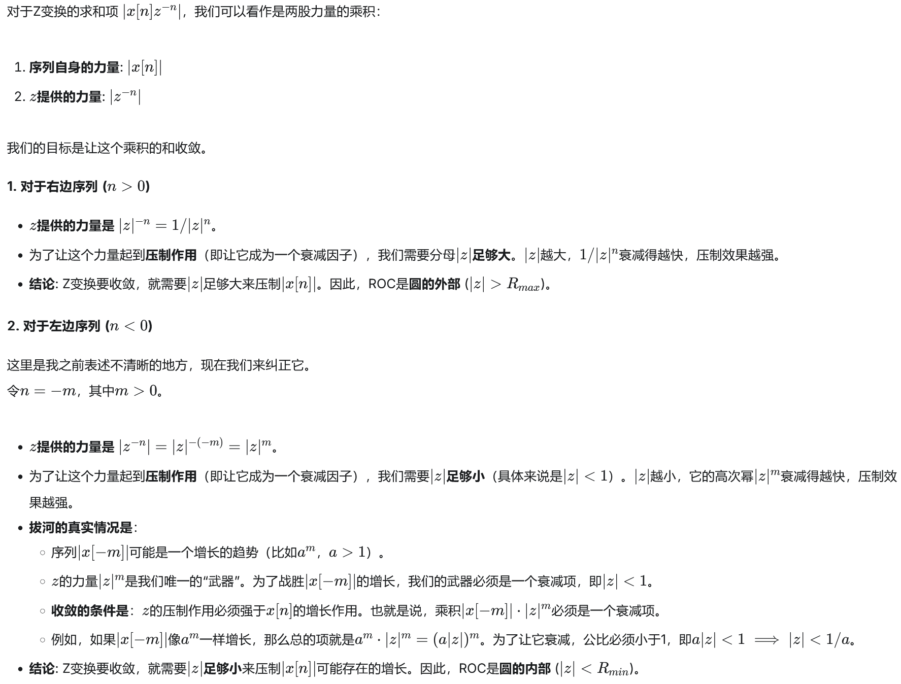

对于Z变换的求和项 $|x[n]z^{-n}|$，我们可以看作是两股力量的乘积：

1. **序列自身的力量**：$|x[n]|$
2. **$z$提供的力量**：$|z^{-n}|$

我们的目标是让这个乘积的和收敛。

**1. 对于右边序列 ($n > 0$)**

- **$z$提供的力量是** $|z|^{-n} = 1/|z|^n$。
- **为了让这个力量起到压制作用**（即让它成为一个衰减因子），我们需要分母$|z|$**足够大**。$|z|$越大，$1/|z|^n$衰减得越快，压制效果越强。
- **结论**：Z变换要收敛，就需要$|z|$足够大来压制$|x[n]|$。因此，ROC是**圆的外部** ($|z| > R_{\max}$)。

**2. 对于左边序列 ($n < 0$)**

这里是我之前表述不清晰的地方，现在我们来纠正它。  
令 $n = -m$，其中 $m > 0$。

- **$z$提供的力量是** $|z^{-n}| = |z|^{-(-m)} = |z|^m$。
- **为了让这个力量起到压制作用**（即让它成为一个衰减因子），我们需要$|z|$**足够小**（具体来说是$|z| < 1$）。$|z|$越小，它的高次幂$|z|^m$衰减得越快，压制效果越强。
- **拔河的真实情况是**：
  - 序列$|x[-m]|$可能是一个增长的趋势（比如$a^m,\ a > 1$）。
  - $z$的力量$|z|^m$是我们唯一的“武器”。为了战胜$|x[-m]|$的增长，我们的武器必须是一个衰减项，即$|z| < 1$。
  - **收敛的条件是**：$z$的压制作用必须强于$x[n]$的增长作用。也就是说，乘积$|x[-m]| \cdot |z|^m$必须是一个衰减项。
  - 例如，如果$|x[-m]|$像$a^m$一样增长，那么总的项就是$a^m \cdot |z|^m = (a|z|)^m$。为了让它衰减，公比必须小于1，即$a|z| < 1 \implies |z| < 1/a$。
- **结论**：Z变换要收敛，就需要$|z|$**足够小**来压制$|x[n]|$可能存在的增长。因此，ROC是**圆的内部** ($|z| < R_{\min}$)。

**有正不含零，有负无无穷**

## 159 z变换序列

**问：** 请写出常见序列的z变换及其收敛域。

**答：**

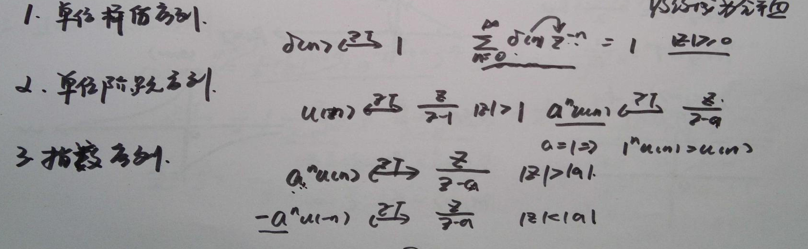

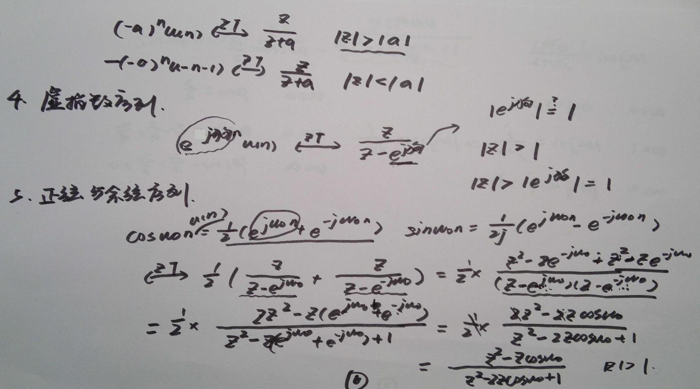

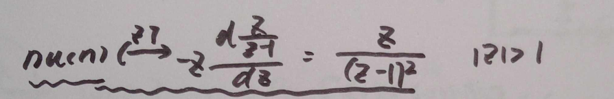

（手写内容暂不转写，见原图）

## 160 单边z变换时移

**问：** 请写出单边z变换的时移性质。

**答：**

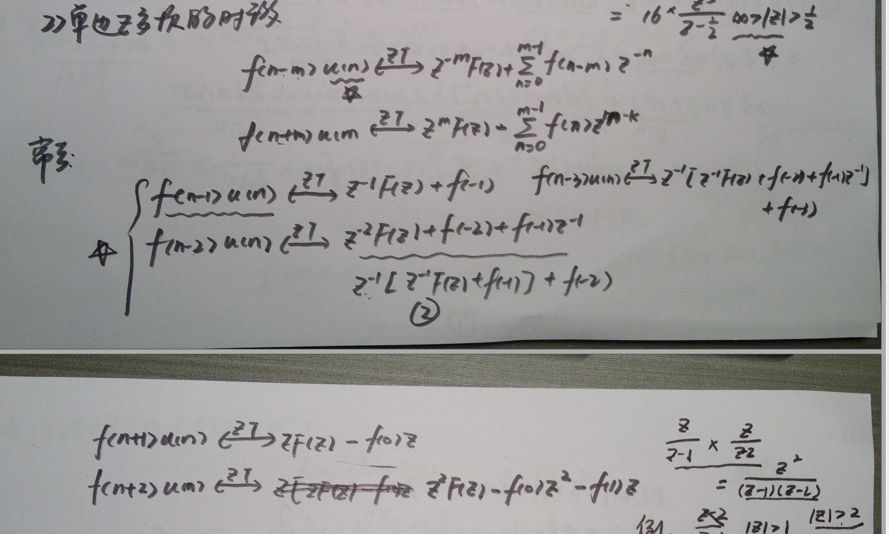

（手写内容暂不转写，见原图）

## 161 z时域卷积

**问：** 请写出z变换的时域卷积定理及收敛域。

**答：**

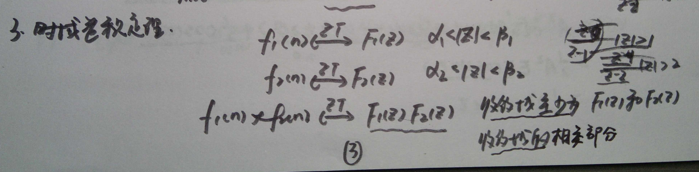

（手写内容暂不转写，见原图）

## 162 z尺度变换

**问：** 请写出z域尺度变换性质及其收敛域变化规律。

**答：**

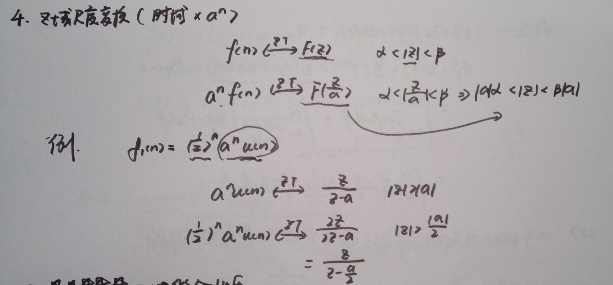

（手写内容暂不转写，见原图）

## 163 z域微分性质

**问：** 请写出z域微分性质。

**答：**

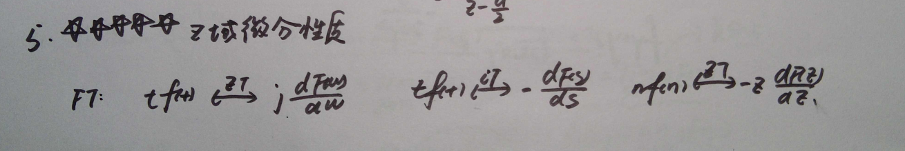

（手写内容暂不转写，见原图）

## 164 朱里准则

**问：** 请写出二阶因果系统分母多项式的朱里准则。

**答：**

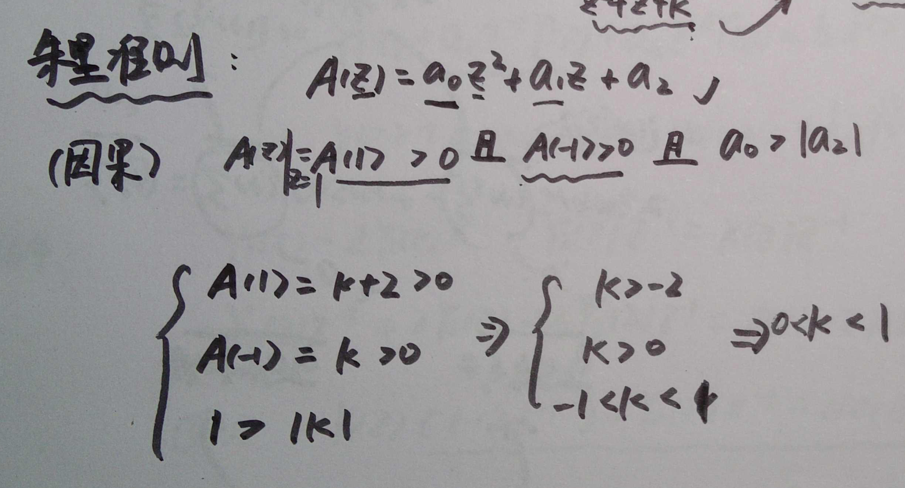

（手写内容暂不转写，见原图）

**分母多项式**

## 165 梅森公式

**问：** 请写出梅森增益公式及其各项含义。

**答：**

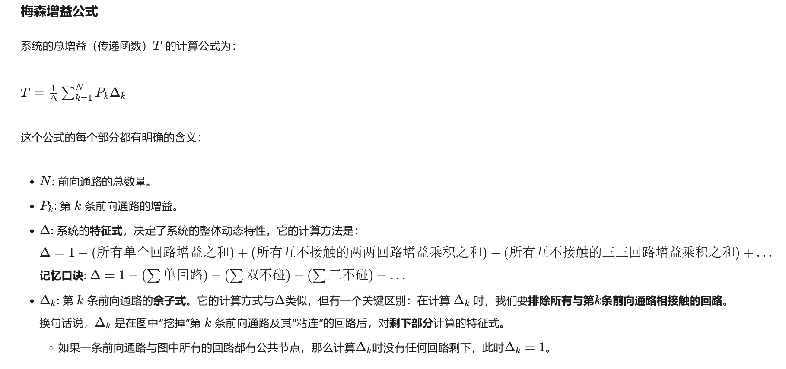

**梅森增益公式**

系统的总增益（传递函数）$T$ 的计算公式为：

$$T = \frac{1}{\Delta} \sum_{k=1}^{N} P_k \Delta_k$$

这个公式的每个部分都有明确的含义：

- $N$：前向通路的总数量。
- $P_k$：第 $k$ 条前向通路的增益。
- $\Delta$：系统的**特征式**，决定了系统的整体动态特性。它的计算方法是：
  $$\Delta = 1 - (\text{所有单个回路增益之和}) + (\text{所有互不接触的两两回路增益乘积之和}) - (\text{所有互不接触的三三回路增益乘积之和}) + \dots$$
  **记忆口诀**：$\Delta = 1 - (\sum \text{单回路}) + (\sum \text{双不碰}) - (\sum \text{三不碰}) + \dots$
- $\Delta_k$：第 $k$ 条前向通路的**余子式**。它的计算方式与 $\Delta$ 类似，但有一个关键区别：在计算 $\Delta_k$ 时，我们要**排除所有与第 $k$ 条前向通路相接触的回路**。  
  换句话说，$\Delta_k$ 是在图中“挖掉”第 $k$ 条前向通路及其“粘连”的回路后，对**剩下部分**计算的特征式。
  - 如果一条前向通路与图中所有的回路都有公共节点，那么计算 $\Delta_k$ 时没有任何回路剩下，此时 $\Delta_k = 1$。

## 166 特征函数法

**问：** 请写出傅里叶变换、拉普拉斯变换和z变换的特征函数法结论及证明。

**答：**

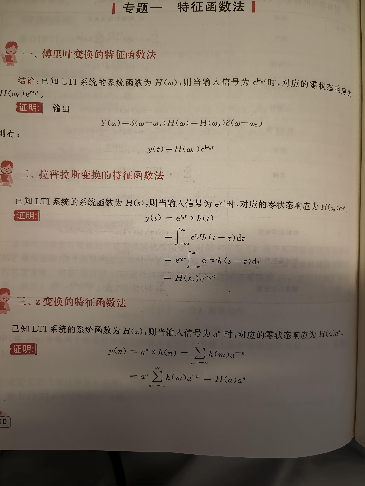

**专题一 特征函数法**

**一、傅里叶变换的特征函数法**

结论：已知 LTI 系统的系统函数为 $H(\omega)$，则当输入信号为 $\mathrm{e}^{j\omega_0 t}$ 时，对应的零状态响应为 $H(\omega_0)\mathrm{e}^{j\omega_0 t}$。

**证明**：输出
$$Y(\omega) = \delta(\omega - \omega_0) H(\omega) = H(\omega_0)\delta(\omega - \omega_0)$$
则有：
$$y(t) = H(\omega_0)\mathrm{e}^{j\omega_0 t}$$

**二、拉普拉斯变换的特征函数法**

已知 LTI 系统的系统函数为 $H(s)$，则当输入信号为 $\mathrm{e}^{s_0 t}$ 时，对应的零状态响应为 $H(s_0)\mathrm{e}^{s_0 t}$。

**证明**：
$$\begin{aligned}
y(t) &= \mathrm{e}^{s_0 t} * h(t) \\
&= \int_{-\infty}^{\infty} \mathrm{e}^{s_0 \tau} h(t - \tau)\,\mathrm{d}\tau \\
&= \mathrm{e}^{s_0 t} \int_{-\infty}^{\infty} \mathrm{e}^{-s_0 \tau} h(t - \tau)\,\mathrm{d}\tau \\
&= H(s_0)\mathrm{e}^{(s_0 t)}
\end{aligned}$$

**三、z变换的特征函数法**

已知 LTI 系统的系统函数为 $H(z)$，则当输入信号为 $a^n$ 时，对应的零状态响应为 $H(a)a^n$。

**证明**：
$$\begin{aligned}
y(n) &= a^n * h(n) = \sum_{n=-\infty}^{\infty} h(m)a^{n-m} \\
&= a^n \sum_{n=-\infty}^{\infty} h(m)a^{-m} = H(a)a^n
\end{aligned}$$

## 167 z变换频率响应定义

**问：** 请说明z变换与频率响应的关系、频率响应的定义及几何意义。

**答：**

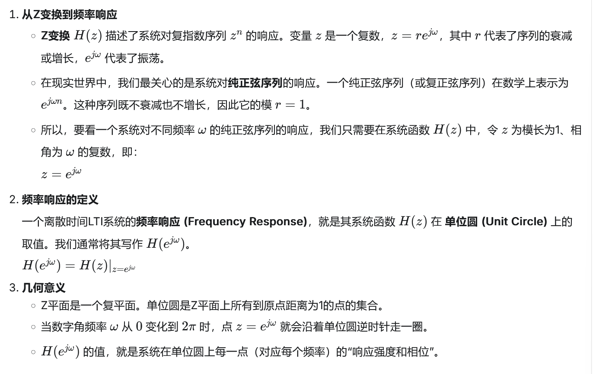

1. **从Z变换到频率响应**
   - **Z变换** $H(z)$ 描述了系统对复指数序列 $z^n$ 的响应。变量 $z$ 是一个复数，$z = r\mathrm{e}^{j\omega}$，其中 $r$ 代表了序列的衰减或增长，$\mathrm{e}^{j\omega}$ 代表了振荡。
   - 在现实世界中，我们最关心的是系统对**纯正弦序列**的响应。一个纯正弦序列（或复正弦序列）在数学上表示为 $\mathrm{e}^{j\omega n}$。这种序列既不衰减也不增长，因此它的模 $r = 1$。
   - 所以，要看一个系统对不同频率 $\omega$ 的纯正弦序列的响应，我们只需要在系统函数 $H(z)$ 中，令 $z$ 为模长为1、相角为 $\omega$ 的复数，即：
     $$z = \mathrm{e}^{j\omega}$$
2. **频率响应的定义**  
   一个离散时间LTI系统的**频率响应 (Frequency Response)**，就是其系统函数 $H(z)$ 在**单位圆 (Unit Circle)** 上的取值。我们通常将其写作 $H(\mathrm{e}^{j\omega})$。
   $$H(\mathrm{e}^{j\omega}) = H(z)\big|_{z=\mathrm{e}^{j\omega}}$$
3. **几何意义**
   - Z平面是一个复平面。单位圆是Z平面上所有到原点距离为1的点的集合。
   - 当数字角频率 $\omega$ 从 $0$ 变化到 $2\pi$ 时，点 $z = \mathrm{e}^{j\omega}$ 就会沿着单位圆逆时针走一圈。
   - $H(\mathrm{e}^{j\omega})$ 的值，就是系统在单位圆上每一点（对应每个频率）的“响应强度和相位”。

## 168 z变换幅频相频定义、计算

**问：** 请写出离散系统幅频响应与相频响应的定义、物理意义、作用，以及从系统函数 H(z) 计算频率响应的步骤。

**答：**

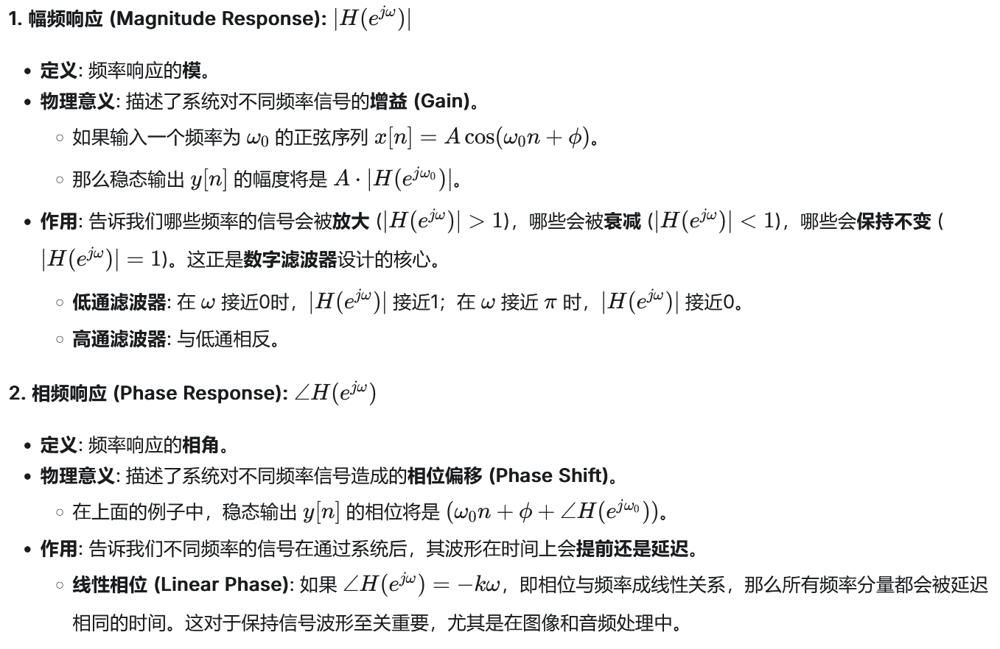

1. **幅频响应 (Magnitude Response)**：$|H(\mathrm{e}^{j\omega})|$
   - **定义**：频率响应的**模**。
   - **物理意义**：描述了系统对不同频率信号的**增益 (Gain)**。
     - 如果输入一个频率为 $\omega_0$ 的正弦序列 $x[n] = A\cos(\omega_0 n + \phi)$。
     - 那么稳态输出 $y[n]$ 的幅度将是 $A \cdot |H(\mathrm{e}^{j\omega_0})|$。
   - **作用**：告诉我们哪些频率的信号会被**放大** ($|H(\mathrm{e}^{j\omega})| > 1$)，哪些会被**衰减** ($|H(\mathrm{e}^{j\omega})| < 1$)，哪些会**保持不变** ($|H(\mathrm{e}^{j\omega})| = 1$)。这正是**数字滤波器**设计的核心。
     - **低通滤波器**：在 $\omega$ 接近0时，$|H(\mathrm{e}^{j\omega})|$ 接近1；在 $\omega$ 接近 $\pi$ 时，$|H(\mathrm{e}^{j\omega})|$ 接近0。
     - **高通滤波器**：与低通相反。
2. **相频响应 (Phase Response)**：$\angle H(\mathrm{e}^{j\omega})$
   - **定义**：频率响应的**相角**。
   - **物理意义**：描述了系统对不同频率信号造成的**相位偏移 (Phase Shift)**。
     - 在上面的例子中，稳态输出 $y[n]$ 的相位将是 $(\omega_0 n + \phi + \angle H(\mathrm{e}^{j\omega_0}))$。
   - **作用**：告诉我们不同频率的信号在通过系统后，其波形在时间上会**提前还是延迟**。
     - **线性相位 (Linear Phase)**：如果 $\angle H(\mathrm{e}^{j\omega}) = -k\omega$，即相位与频率成线性关系，那么所有频率分量都会被延迟相同的时间。这对于保持信号波形至关重要，尤其是在图像和音频处理中。

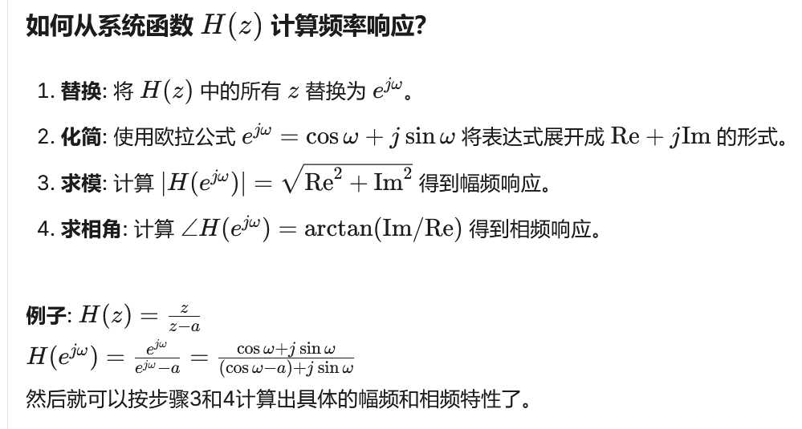

**如何从系统函数 $H(z)$ 计算频率响应？**

1. **替换**：将 $H(z)$ 中的所有 $z$ 替换为 $\mathrm{e}^{j\omega}$。
2. **化简**：使用欧拉公式 $\mathrm{e}^{j\omega} = \cos\omega + j\sin\omega$ 将表达式展开成 $\mathrm{Re} + j\mathrm{Im}$ 的形式。
3. **求模**：计算 $|H(\mathrm{e}^{j\omega})| = \sqrt{\mathrm{Re}^2 + \mathrm{Im}^2}$ 得到幅频响应。
4. **求相角**：计算 $\angle H(\mathrm{e}^{j\omega}) = \arctan(\mathrm{Im}/\mathrm{Re})$ 得到相频响应。

**例子**：$H(z) = \frac{z}{z-a}$
$$H(\mathrm{e}^{j\omega}) = \frac{\mathrm{e}^{j\omega}}{\mathrm{e}^{j\omega} - a} = \frac{\cos\omega + j\sin\omega}{(\cos\omega - a) + j\sin\omega}$$
然后就可以按步骤3和4计算出具体的幅频和相频特性了。

## 169 z变换解差分方程

**问：** 请写出利用单边z变换解差分方程的步骤及响应分解方法。

**答：**

1.代入求初始条件转化

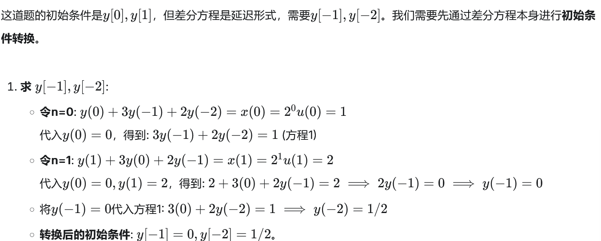

这道题的初始条件是$y[0], y[1]$，但差分方程是延迟形式，需要$y[-1], y[-2]$。我们需要先通过差分方程本身进行**初始条件转换**。

1. **求 $y[-1], y[-2]$**：
   - **令 $n=0$**：$y(0) + 3y(-1) + 2y(-2) = x(0) = 2^0 u(0) = 1$  
     代入$y(0) = 0$，得到：$3y(-1) + 2y(-2) = 1$（方程1）
   - **令 $n=1$**：$y(1) + 3y(0) + 2y(-1) = x(1) = 2^1 u(1) = 2$  
     代入$y(0) = 0, y(1) = 2$，得到：$2 + 3(0) + 2y(-1) = 2 \implies 2y(-1) = 0 \implies y(-1) = 0$
   - 将$y(-1) = 0$代入方程1：$3(0) + 2y(-2) = 1 \implies y(-2) = 1/2$
   - **转换后的初始条件**：$y[-1] = 0, y[-2] = 1/2$。

2.求单边z变换  
3.代入初始条件和输入  
4.求Yz

---

**响应分解：**  
零输入响应/零状态相应  
1.在Yz初始表达式可直接看出

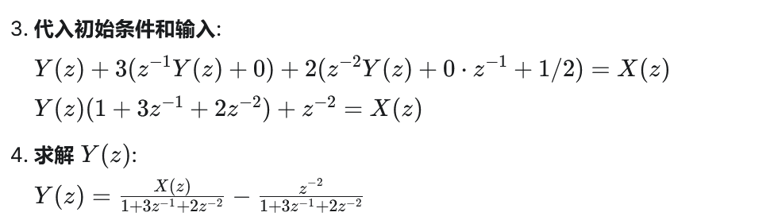

3. **代入初始条件和输入**：
   $$Y(z) + 3(z^{-1}Y(z) + 0) + 2(z^{-2}Y(z) + 0 \cdot z^{-1} + 1/2) = X(z)$$
   $$Y(z)(1 + 3z^{-1} + 2z^{-2}) + z^{-2} = X(z)$$
4. **求解 $Y(z)$**：
   $$Y(z) = \frac{X(z)}{1 + 3z^{-1} + 2z^{-2}} - \frac{z^{-2}}{1 + 3z^{-1} + 2z^{-2}}$$

2.零状态响应可Xz·Hz求出  
**自由响应/强迫响应**  
和系统极点**直接相关不带n系数，**的为自由响应
