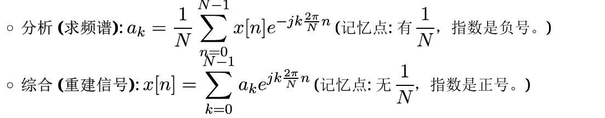
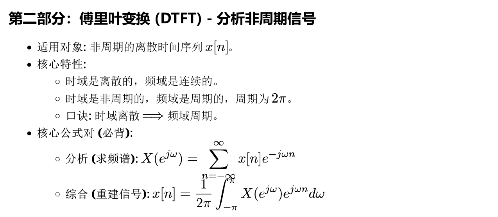
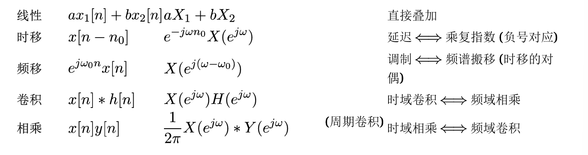
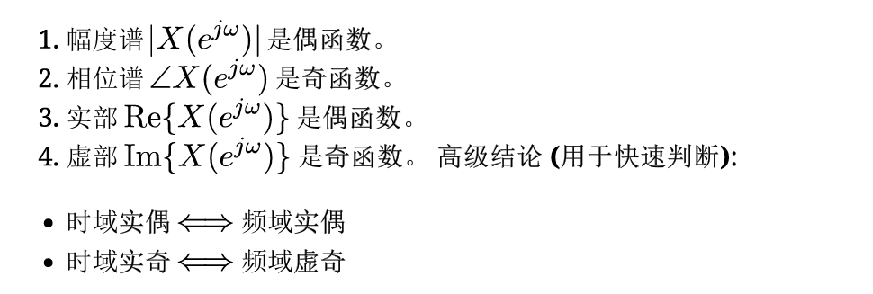
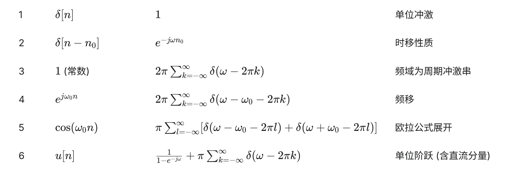
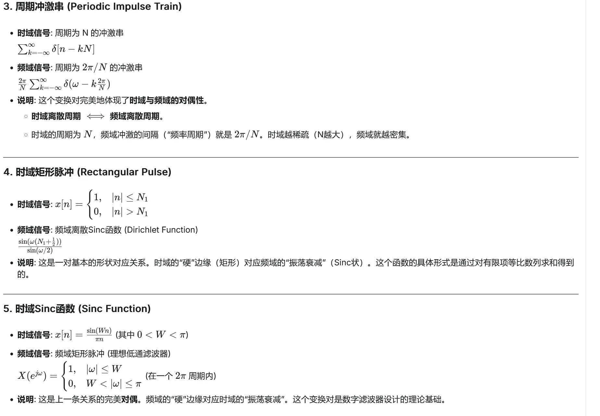
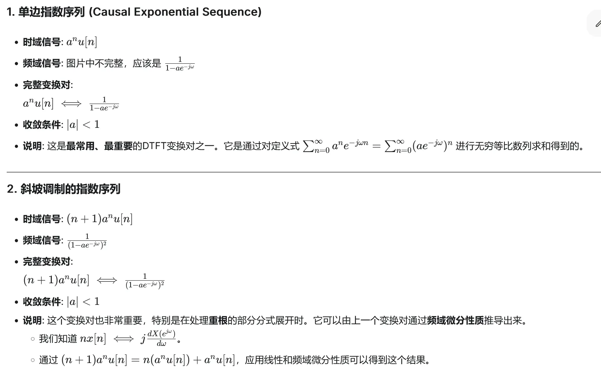

# DTFT｜墨墨记忆卡重组

来源：[墨墨记忆卡「信号与系统」](https://www.markji.com/deck/editor/67dd5988bbc6238121685de1)。本章共 7 张（总编号 170—176）。印刷体公式与文字已转写为 Markdown/LaTeX；手写内容按约定暂不转写，均已保留本地高清原图。

## 170 傅里叶级数定义

**问：** 请写出傅里叶级数定义。

**答：**

- 分析**（求频谱）：** $a_k = \frac{1}{N} \sum_{n=0}^{N-1} x[n]e^{-jk\frac{2\pi}{N}n}$ **（记忆点：** 有 $\frac{1}{N}$，指数是负号。**）**
- 综合**（重建信号）：** $x[n] = \sum_{k=0}^{N-1} a_k e^{jk\frac{2\pi}{N}n}$ **（记忆点：** 无 $\frac{1}{N}$，指数是正号。**）**

## 171 DTFT定义

**问：** 请写出DTFT定义。

**答：**

**第二部分：傅里叶变换 (DTFT) - 分析非周期信号**

- 适用对象：非周期的离散时间序列 $x[n]$。
- 核心特性：
  - 时域是离散的，频域是连续的。
  - 时域是非周期的，频域是周期的，周期为 $2\pi$。
  - 口诀：时域离散 $\Longrightarrow$ 频域周期。
- **核心公式对（必背）：**
  - 分析**（求频谱）：** $X(e^{j\omega}) = \sum_{n=-\infty}^{\infty} x[n]e^{-j\omega n}$
  - 综合**（重建信号）：** $x[n] = \frac{1}{2\pi} \int_{-\pi}^{\pi} X(e^{j\omega})e^{j\omega n}d\omega$

## 172 时移、频移、卷积、相乘

**问：**

请写出DTFT的以下性质（含时域、频域对应关系及说明）：

- 时移
- 频移
- 卷积
- 相乘

**答：**

| 性质名称 | 时域信号 | 频域 (DTFT) | 说明 |
| :--- | :--- | :--- | :--- |
| 线性 | $ax_1[n] + bx_2[n]$ | $aX_1 + bX_2$ | 直接叠加 |
| 时移 | $x[n - n_0]$ | $e^{-j\omega n_0}X(e^{j\omega})$ | 延迟 $\Longleftrightarrow$ 乘复指数**（负号对应）** |
| 频移 | $e^{j\omega_0 n}x[n]$ | $X(e^{j(\omega - \omega_0)})$ | 调制 $\Longleftrightarrow$ 频谱搬移**（时移的对偶）** |
| 卷积 | $x[n] * h[n]$ | $X(e^{j\omega})H(e^{j\omega})$ | 时域卷积 $\Longleftrightarrow$ 频域相乘 |
| 相乘 | $x[n]y[n]$ | $\frac{1}{2\pi}X(e^{j\omega}) * Y(e^{j\omega})$ | **（周期卷积）** 时域相乘 $\Longleftrightarrow$ 频域卷积 |

## 173 频域微分、帕塞瓦尔定理

**问：** 请写出频域微分、帕塞瓦尔定理。

**答：**

| 性质名称 | 时域信号 | 频域 (DTFT) | 说明 |
| :--- | :--- | :--- | :--- |
| **频域微分** | $nx[n]$ | $j\frac{dX(e^{j\omega})}{d\omega}$ | 时域乘 $n$ $\leftrightarrow$ 频域求导 |
| **帕塞瓦尔定理** | $\sum_{n=-\infty}^{\infty} \lvert x[n] \rvert^2$ | $\frac{1}{2\pi} \int_{-\pi}^{\pi} \lvert X(e^{j\omega}) \rvert^2 d\omega$ | 时域能量 $\leftrightarrow$ 频域能量 |

## 174 实信号的共轭对称性

**问：** 请写出实信号的共轭对称性。

**答：**

1. 幅度谱 $|X(e^{j\omega})|$ 是偶函数。
2. 相位谱 $\angle X(e^{j\omega})$ 是奇函数。
3. 实部 $\operatorname{Re}\{X(e^{j\omega})\}$ 是偶函数。
4. 虚部 $\operatorname{Im}\{X(e^{j\omega})\}$ 是奇函数。

高级结论**（用于快速判断）**：

- 时域实偶 $\Longleftrightarrow$ 频域实偶
- 时域实奇 $\Longleftrightarrow$ 频域虚奇

## 175 冲激、时移因子、1、频移因子、coswn、阶跃

**问：**

请写出以下序列的DTFT变换对及说明：

- 冲激
- 时移因子
- $1$
- 频移因子
- $\cos(\omega_0 n)$
- 阶跃

**答：**

| 序号 | 时域信号 | 频域 (DTFT) | 说明 |
| :--- | :--- | :--- | :--- |
| 1 | $\delta[n]$ | $1$ | 单位冲激 |
| 2 | $\delta[n - n_0]$ | $e^{-j\omega n_0}$ | 时移性质 |
| 3 | $1$（常数） | $2\pi \sum_{k=-\infty}^{\infty} \delta(\omega - 2\pi k)$ | 频域为周期冲激串 |
| 4 | $e^{j\omega_0 n}$ | $2\pi \sum_{k=-\infty}^{\infty} \delta(\omega - \omega_0 - 2\pi k)$ | 频移 |
| 5 | $\cos(\omega_0 n)$ | $\pi \sum_{l=-\infty}^{\infty} [\delta(\omega - \omega_0 - 2\pi l) + \delta(\omega + \omega_0 - 2\pi l)]$ | 欧拉公式展开 |
| 6 | $u[n]$ | $\frac{1}{1 - e^{-j\omega}} + \pi \sum_{k=-\infty}^{\infty} \delta(\omega - 2\pi k)$ | 单位阶跃（含直流分量） |

## 176 周期、矩形、Sa、斜坡、指数

**问：** 请写出周期、矩形、Sa、斜坡、指数序列的DTFT变换对及相关说明。

**答：**

**3. 周期冲激串 (Periodic Impulse Train)**

- 时域信号：周期为 $N$ 的冲激串
  $$\sum_{k=-\infty}^{\infty} \delta[n - kN]$$
- 频域信号：周期为 $2\pi/N$ 的冲激串
  $$\frac{2\pi}{N} \sum_{k=-\infty}^{\infty} \delta\left(\omega - k\frac{2\pi}{N}\right)$$
- 说明：这个变换对完美地体现了时域与频域的对偶性。
  - **时域离散周期 $\Longleftrightarrow$ 频域离散周期。**
  - 时域的周期为 $N$，频域冲激的间隔（“频率周期”）就是 $2\pi/N$。时域越稀疏（$N$越大），频域就越密集。

---

**4. 时域矩形脉冲 (Rectangular Pulse)**

- 时域信号：$x[n] = \begin{cases} 1, & |n| \le N_1 \\ 0, & |n| > N_1 \end{cases}$
- 频域信号：频域离散Sinc函数 (Dirichlet Function)
  $$\frac{\sin\left(\omega\left(N_1 + \frac{1}{2}\right)\right)}{\sin(\omega/2)}$$
- 说明：这是一对基本的形状对应关系。时域的“硬”边缘（矩形）对应频域的“振荡衰减”（Sinc状）。这个函数的具体形式是通过对有限项等比数列求和得到的。

---

**5. 时域Sinc函数 (Sinc Function)**

- 时域信号：$x[n] = \frac{\sin(Wn)}{\pi n}$（其中 $0 < W < \pi$）
- 频域信号：频域矩形脉冲（理想低通滤波器）
  $$X(e^{j\omega}) = \begin{cases} 1, & |\omega| \le W \\ 0, & W < |\omega| \le \pi \end{cases} \quad \text{（在一个 } 2\pi \text{ 周期内）}$$
- 说明：这是上一条关系的完美对偶。频域的“硬”边缘对应时域的“振荡衰减”。这个变换对是数字滤波器设计的理论基础。

**1. 单边指数序列 (Causal Exponential Sequence)**

- 时域信号：$a^n u[n]$
- 频域信号：图片中不完整，应该是 $\frac{1}{1 - ae^{-j\omega}}$
- **完整变换对：**
  $$a^n u[n] \Longleftrightarrow \frac{1}{1 - ae^{-j\omega}}$$
- **收敛条件：** $|a| < 1$
- 说明：这是最常用、最重要的DTFT变换对之一。它是通过对定义式 $\sum_{n=0}^{\infty} a^n e^{-j\omega n} = \sum_{n=0}^{\infty} (ae^{-j\omega})^n$ 进行无穷等比数列求和得到的。

---

**2. 斜坡调制的指数序列**

- 时域信号：$(n + 1)a^n u[n]$
- 频域信号：$\frac{1}{(1 - ae^{-j\omega})^2}$
- **完整变换对：**
  $$(n + 1)a^n u[n] \Longleftrightarrow \frac{1}{(1 - ae^{-j\omega})^2}$$
- **收敛条件：** $|a| < 1$
- 说明：这个变换对也非常重要，特别是在处理**重根**的部分分式展开时。它可以由上一个变换对通过**频域微分性质**推导出来。
  - 我们知道 $nx[n] \Longleftrightarrow j\frac{dX(e^{j\omega})}{d\omega}$。
  - 通过 $(n + 1)a^n u[n] = n(a^n u[n]) + a^n u[n]$，应用线性和频域微分性质可以得到这个结果。
