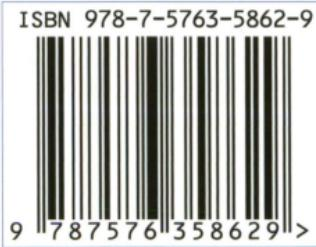
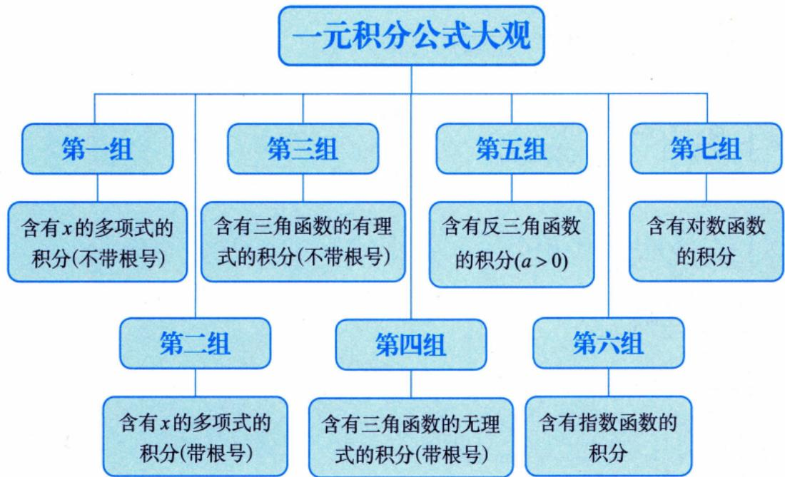

# 考研数学基础30讲高等数学分册

# 核心计算通关讲义

主编张宇  
○ 副主编 高昆轮

  
定价：139.90元（共3册）

# 核心计算通关讲义

主编张宇  
副主编 高昆轮

图书在版编目（CIP）数据

考研数学基础30讲.高等数学分册：函套三册/张

宇主编. --北京: 北京理工大学出版社, 2025.9(2025.10重印).

ISBN 978-7-5763-5862-9

I. 013

中国国家版本馆CIP数据核字第20255XE608号

责任编辑：多海鹏

文案编辑：多海鹏

责任校对：周瑞红

责任印制：李志强

出版发行/北京理工大学出版社有限责任公司

社址/北京市丰台区四合庄路6号

邮 编/100070

电话/（010）68944451（大众售后服务热线）

（010）68912824（大众售后服务热线）

网址 / http://www.bitpress.com.cn

版印次/2025年10月第1版第2次印刷

印 刷/河北鹏润印刷有限公司

开 本 $/787\mathrm{mm}\times 1092\mathrm{mm}1 / 16$

印 张/45.75

字数/1142千字

定价/139.90元（共3册）

# 核心计算通关讲义

本部分又可称为“一元积分公式大观”，专门整理了可以手算的常用积分公式，有两个目的：

一、用于提高积分计算能力.这里几乎囊括了（部分需要经过简单变形或换元）积分题的积分方法和原函数，将这些积分全部演算一遍，可使积分计算能力达到炉火纯青、登峰造极的水平，这是数学计算能力的重要衡量指标.再往深走，基本都要借助其他方法，或者根本算不出初等函数形式的原函数了.  
二、用于查找积分结果。随着现代技术的发展，寻找原函数早已不是主流的方法，今后的学习或者研究中，对于积分结果的获取，可以寻求两种帮助，一是查积分表，本部分内容只是一个有初等函数形式的简单积分表，国内外有不少积分结果汇编成册的资料，以后各位要用时，查表即可。二是用数值计算等方法，绕开原函数，甚至绕开分析学，都有很好的办法达到目的，这些方法就请考生在考研后自行研究了，那是更为广阔的天地。

所有积分公式的计算过程附于本部分最后，供各位参考，希望大家先不看答案，自行尝试解决。同样地，本部分的公式要常看，常练，以巩固掌握。
