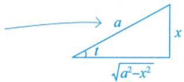
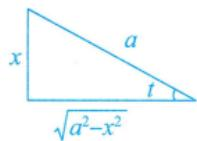
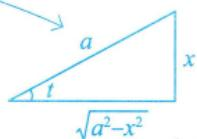
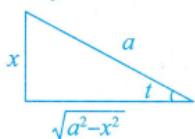
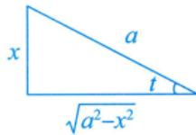

# 第二组

1. 解 $\int \sqrt{ax + b} \, \mathrm{d}x = \frac{1}{a} \int \sqrt{ax + b} \, \mathrm{d}(ax + b) = \frac{1}{a} \cdot \frac{2}{3} (ax + b)^{\frac{3}{2}} + C = \frac{2}{3a} \sqrt{(ax + b)^3} + C.$   
2. 解 令 $\sqrt{ax + b} = t (t \geqslant 0)$ , 则 $x = \frac{t^2 - b}{a}$ , $\mathrm{dx} = \frac{2t}{a}\mathrm{dt}$ , $x\sqrt{ax + b} = \frac{t^2 - b}{a} t$ .

所以 $\int x\sqrt{ax + b}\mathrm{d}x = \int \frac{t^2 - b}{a}\cdot t\cdot \frac{2t}{a}\mathrm{d}t = \frac{2}{a^2}\int (t^4 -bt^2)\mathrm{d}t$

$$
= \frac {2}{5 a ^ {2}} \cdot t ^ {5} - \frac {2 b}{3 a ^ {2}} \cdot t ^ {3} + C = \frac {2 t ^ {3}}{1 5 a ^ {2}} (3 t ^ {2} - 5 b) + C.
$$

将 $t = \sqrt{ax + b}$ 代入上式，得

$$
\begin{array}{l} \int x \sqrt {a x + b} d x = \frac {2}{1 5 a ^ {2}} [ 3 (a x + b) - 5 b ] \cdot \sqrt {(a x + b) ^ {3}} + C \\ = \frac {2}{1 5 a ^ {2}} (3 a x - 2 b) \cdot \sqrt {(a x + b) ^ {3}} + C. \\ \end{array}
$$

3. 解 令 $\sqrt{ax + b} = t (t \geqslant 0)$ ，则 $x = \frac{t^2 - b}{a}$ ， $\mathrm{dx} = \frac{2t}{a}\mathrm{dt}$ 。

故 $\int \frac{\mathrm{d}x}{x\sqrt{ax + b}} = \int \frac{1}{\underbrace{t^2 - b}_{a}\cdot t}\cdot \frac{2t}{a}\mathrm{d}t = \int \frac{2}{t^2 - b}\mathrm{d}t.$

① 当 $b > 0$ 时， $\int \frac{2}{t^2 - b} \, \mathrm{d}t = 2\int \frac{1}{t^2 - (\sqrt{b})^2} \, \mathrm{d}t = \frac{1}{\sqrt{b}} \ln \left| \frac{t - \sqrt{b}}{t + \sqrt{b}} \right| + C.$

将 $t = \sqrt{ax + b}$ 代入上式，得 $\int \frac{\mathrm{d}x}{x\sqrt{ax + b}} = \frac{1}{\sqrt{b}}\ln \left|\frac{\sqrt{ax + b} - \sqrt{b}}{\sqrt{ax + b} + \sqrt{b}}\right| + C.$

② 当 $b < 0$ 时， $\int \frac{2}{t^2 - b} \, \mathrm{d}t = 2\int \frac{1}{t^2 + (\sqrt{-b})^2} \, \mathrm{d}t = \frac{2}{\sqrt{-b}} \arctan \frac{t}{\sqrt{-b}} + C.$

将 $t = \sqrt{ax + b}$ 代入上式，得 $\int \frac{\mathrm{d}x}{x\sqrt{ax + b}} = \frac{2}{\sqrt{-b}}\arctan \sqrt{\frac{ax + b}{-b}} +C.$

综上，得

$$
\int \frac {\mathrm {d} x}{x \sqrt {a x + b}} = \left\{ \begin{array}{l l} \frac {1}{\sqrt {b}} \ln \left| \frac {\sqrt {a x + b} - \sqrt {b}}{\sqrt {a x + b} + \sqrt {b}} \right| + C, & b > 0, \\ \frac {2}{\sqrt {- b}} \arctan \sqrt {\frac {a x + b}{- b}} + C, & b <   0. \end{array} \right.
$$

$$
= - \frac {\sqrt {a x + b}}{x} + \int \frac {1}{x} \cdot (a x + b) ^ {- \frac {1}{2}} \cdot \frac {a}{2} d x = - \frac {\sqrt {a x + b}}{x} + \frac {a}{2} \int \frac {d x}{x \sqrt {a x + b}}.
$$

4. 解 $\int \frac{\sqrt{ax + b}}{x^2} \, \mathrm{d}x = -\int \sqrt{ax + b} \, \mathrm{d}\left(\frac{1}{x}\right) = -\frac{\sqrt{ax + b}}{x} + \int \frac{1}{x} \, \mathrm{d}(\sqrt{ax + b})$   
5. 解 $\int \frac{x}{\sqrt{x^2 - a^2}} \, \mathrm{d}x = \frac{1}{2} \int \frac{1}{\sqrt{x^2 - a^2}} \, \mathrm{d}(x^2 - a^2) = \frac{1}{2} \cdot 2(x^2 - a^2)^{\frac{1}{2}} + C = \sqrt{x^2 - a^2} + C.$   
6. 解 $\int \frac{x}{\sqrt{(x^2 - a^2)^3}} \, \mathrm{d}x = \frac{1}{2} \int \frac{1}{\sqrt{(x^2 - a^2)^3}} \, \mathrm{d}(x^2 - a^2) = \frac{1}{2} (-2) \cdot (x^2 - a^2)^{-\frac{1}{2}} + C = -\frac{1}{\sqrt{x^2 - a^2}} + C.$   
7. 解 $\int \frac{x^2}{\sqrt{x^2 - a^2}} \, \mathrm{d}x = \int \frac{x^2 - a^2 + a^2}{\sqrt{x^2 - a^2}} \, \mathrm{d}x = \int \sqrt{x^2 - a^2} \, \mathrm{d}x + a^2 \int \frac{1}{\sqrt{x^2 - a^2}} \, \mathrm{d}x,$

$$
\int \sqrt {x ^ {2} - a ^ {2}} d x = \frac {x}{2} \cdot \sqrt {x ^ {2} - a ^ {2}} - \frac {a ^ {2}}{2} \ln | x + \sqrt {x ^ {2} - a ^ {2}} | + C _ {1}, \tag {①}
$$

$$
a ^ {2} \int \frac {\mathrm {d} x}{\sqrt {x ^ {2} - a ^ {2}}} = a ^ {2} \ln \left| x + \sqrt {x ^ {2} - a ^ {2}} \right| + C _ {2}, \tag {②}
$$

由 $① + ②$ 得

$$
\int \frac {x ^ {2}}{\sqrt {x ^ {2} - a ^ {2}}} d x = \frac {x}{2} \sqrt {x ^ {2} - a ^ {2}} + \frac {a ^ {2}}{2} \ln | x + \sqrt {x ^ {2} - a ^ {2}} | + C.
$$

8.解 当 $x > a$ 时，令 $x = a\sec t\left(0 < t < \frac{\pi}{2}\right)$ $\mathrm{dx} = a\sec t\tan t\mathrm{dt}$

$$
\text {原 式} = \int \frac {a \sec t \cdot \tan t}{a \sec t \cdot a \tan t} \mathrm {d} t = \frac {1}{a} \int 1 \mathrm {d} t = \frac {t}{a} + C = \frac {1}{a} \arccos  \frac {a}{x} + C.
$$

同理可得，当 $x < -a$ 时，

$$
\text {原 式} = \frac {1}{a} \arccos  \left(- \frac {a}{x}\right) + C.
$$

综上，原式 $= \frac{1}{a}\arccos \frac{a}{|x|} +C.$

9. 解 令 $x = a \sec t\left(0 < t < \frac{\pi}{2}\right), \mathrm{d}x = a \sec t \tan t \, \mathrm{d}t,$

$$
\text {原 式} = \int \frac {a \sec t \tan t}{a ^ {2} \sec^ {2} t \cdot a \tan t} \mathrm {d} t = \frac {1}{a ^ {2}} \int \cos t \mathrm {d} t = \frac {1}{a ^ {2}} \cdot \sin t + C = \frac {\sqrt {x ^ {2} - a ^ {2}}}{a ^ {2} x} + C.
$$

10. 解 $\int x\sqrt{x^2 - a^2}\mathrm{d}x = \frac{1}{2}\int (x^2 -a^2)^{\frac{1}{2}}\mathrm{d}(x^2 -a^2) = \frac{1}{3}\sqrt{(x^2 - a^2)^3} +C.$   
11. 解 当 $x > a$ 时，令 $x = a \sec t\left(0 < t < \frac{\pi}{2}\right)$ ，则 $\frac{\sqrt{x^2 - a^2}}{x} = \frac{a \tan t}{a \sec t}$ ， $\mathrm{dx} = a \sec t \tan t \, \mathrm{d}t$

$$
\begin{array}{l} \int \frac {\sqrt {x ^ {2} - a ^ {2}}}{x} d x = \int \frac {a \tan t}{a \sec t} a \sec t \tan t d t = \int a \tan^ {2} t d t = a \int \frac {\sin^ {2} t}{\cos^ {2} t} d t = a \int \frac {1 - \cos^ {2} t}{\cos^ {2} t} d t \\ = a \int \frac {1}{\cos^ {2} t} d t - a \int d t = a \tan t - a t + C = \sqrt {x ^ {2} - a ^ {2}} - a \arccos  \frac {a}{x} + C, \\ \end{array}
$$

同理可得当 $x < -a$ 时，

$$
\int \frac {\sqrt {x ^ {2} - a ^ {2}}}{x} d x = \sqrt {x ^ {2} - a ^ {2}} - a \arccos  \frac {a}{- x} + C.
$$

综上， $\int \frac{\sqrt{x^2 - a^2}}{x}\mathrm{d}x = \sqrt{x^2 - a^2} -a\arccos \frac{a}{|x|} +C.$

12. 解 $\int \frac{\sqrt{x^2 - a^2}}{x^2} \, \mathrm{d}x = -\int \sqrt{x^2 - a^2} \, \mathrm{d}\left(\frac{1}{x}\right) = -\frac{\sqrt{x^2 - a^2}}{x} + \int \frac{1}{x} \, \mathrm{d}(\sqrt{x^2 - a^2})$

$$
= - \frac {\sqrt {x ^ {2} - a ^ {2}}}{x} + \int \frac {1}{x} \frac {1}{2} \cdot 2 x (x ^ {2} - a ^ {2}) ^ {- \frac {1}{2}} d x = - \frac {\sqrt {x ^ {2} - a ^ {2}}}{x} + \int \frac {1}{\sqrt {x ^ {2} - a ^ {2}}} d x,
$$

又 $\int \frac{1}{\sqrt{x^2 - a^2}}\mathrm{d}x = \ln \left|x + \sqrt{x^2 - a^2}\right| + C,$

所以原式 $= -\frac{\sqrt{x^2 - a^2}}{x} + \ln |x + \sqrt{x^2 - a^2}| + C.$

13. 解 令 $x = a\sin t\left(-\frac{\pi}{2} < t < \frac{\pi}{2}\right)$ , 则 $\mathrm{dx} = a\cos t\mathrm{dt}$ .

又 $-\frac{\pi}{2} < t < \frac{\pi}{2}$ , $\cos t > 0$ ，则

$$
\int \frac {\mathrm {d} x}{\sqrt {(a ^ {2} - x ^ {2}) ^ {3}}} = \int \frac {a \cos t}{a ^ {3} \cos^ {3} t} \mathrm {d} t = \frac {1}{a ^ {2}} \int \frac {1}{\cos^ {2} t} \mathrm {d} t = \frac {1}{a ^ {2}} \tan t + C = \frac {x}{a ^ {2} \sqrt {a ^ {2} - x ^ {2}}} + C.
$$

14. 解 $\int \frac{x}{\sqrt{a^2 - x^2}} \, \mathrm{d}x = -\frac{1}{2} \int (a^2 - x^2)^{-\frac{1}{2}} \, \mathrm{d}(a^2 - x^2)$

$$
= - \frac {1}{2} \cdot \frac {1}{1 - \frac {1}{2}} \left(a ^ {2} - x ^ {2}\right) ^ {1 - \frac {1}{2}} + C = - \sqrt {a ^ {2} - x ^ {2}} + C.
$$

15. 解 $\int \frac{x}{\sqrt{(a^2 - x^2)^3}} \, \mathrm{d}x = -\frac{1}{2} \int (a^2 - x^2)^{-\frac{3}{2}} \, \mathrm{d}(a^2 - x^2)$

$$
= - \frac {1}{2} \cdot \frac {1}{- \frac {1}{2}} \left(a ^ {2} - x ^ {2}\right) ^ {- \frac {1}{2}} + C = \frac {1}{\sqrt {a ^ {2} - x ^ {2}}} + C.
$$

16. 解 令 $x = a\sin t\left(-\frac{\pi}{2} < t < \frac{\pi}{2}\right)$ ，则 $\mathrm{dx} = a\cos t\mathrm{dt}$ ，故

$$
\begin{array}{l} \int \frac {x ^ {2}}{\sqrt {a ^ {2} - x ^ {2}}} d x = \int \frac {a ^ {2} \sin^ {2} t}{a \cos t} a \cos t d t = a ^ {2} \int \sin^ {2} t d t = a ^ {2} \int \frac {1 - \cos 2 t}{2} d t \\ = \frac {1}{2} a ^ {2} t - \frac {a ^ {2}}{4} \sin 2 t + C = \frac {a ^ {2}}{2} \arcsin \frac {x}{a} - \frac {x}{2} \sqrt {a ^ {2} - x ^ {2}} + C. \\ \end{array}
$$

17. 解 令 $x = a\sin t\left(-\frac{\pi}{2} < t < \frac{\pi}{2}\right)$ ，则 $\mathrm{dx} = a\cos t\mathrm{dt}$ 。故

$$
\begin{array}{l} \int \frac {x ^ {2}}{\sqrt {\left(a ^ {2} - x ^ {2}\right) ^ {3}}} d x = \int \frac {\sin^ {2} t}{a \cos^ {3} t} a \cos t d t = \int \frac {\sin^ {2} t}{\cos^ {2} t} d t = \int \frac {1 - \cos^ {2} t}{\cos^ {2} t} d t \\ = \int \frac {1}{\cos^ {2} t} d t - \int 1 d t = \tan t - t + C \\ = \frac {x}{\sqrt {a ^ {2} - x ^ {2}}} - \arcsin \frac {x}{a} + C. \\ \end{array}
$$

18. 解 令 $x = a\sin t\left(-\frac{\pi}{2} < t < \frac{\pi}{2}\right)$ , 则 $\mathrm{dx} = a\cos t\mathrm{dt}$ . 故

$$
\int \frac {1}{x ^ {2} \sqrt {a ^ {2} - x ^ {2}}} d x = \int \frac {1}{a ^ {3} \sin^ {2} t \cos t} \cdot a \cos t d t = \frac {1}{a ^ {2}} \int \frac {1}{\sin^ {2} t} d t
$$

$$
= - \frac {1}{a ^ {2}} \cot t + C = - \frac {\sqrt {a ^ {2} - x ^ {2}}}{a ^ {2} x} + C.
$$

19. 解 $\int x\sqrt{a^2 - x^2}\mathrm{d}x = -\frac{1}{2}\int (a^2 -x^2)^{\frac{1}{2}}\mathrm{d}(a^2 -x^2)$

$$
= - \frac {1}{2} \cdot \frac {2}{3} \left(a ^ {2} - x ^ {2}\right) ^ {\frac {3}{2}} + C = - \frac {1}{3} \sqrt {\left(a ^ {2} - x ^ {2}\right) ^ {3}} + C.
$$

20. 解 令 $x = a\sin t\left(-\frac{\pi}{2} < t < \frac{\pi}{2}\right), \mathrm{d}x = a\cos t\mathrm{d}t$

$$
\frac {\sqrt {a ^ {2} - x ^ {2}}}{x ^ {2}} = \frac {a \cos t}{a ^ {2} \sin^ {2} t} = \frac {\cos t}{a \sin^ {2} t},
$$

所以 $\int \frac{\sqrt{a^2 - x^2}}{x^2} \mathrm{d}x = \int \frac{\cos t}{a\sin^2 t} a\cos t \mathrm{d}t = \int \frac{\cos^2 t}{\sin^2 t} \mathrm{d}t = \int \frac{1 - \sin^2 t}{\sin^2 t} \mathrm{d}t = \int \csc^2 t \mathrm{d}t - \int 1 \mathrm{d}t$

$$
= - \cot t - t + C = - \frac {\sqrt {a ^ {2} - x ^ {2}}}{x} - \arcsin \frac {x}{a} + C.
$$

21. 解 $\int \sqrt{(a^2 - x^2)^3} \, \mathrm{d}x = x(a^2 - x^2)^{\frac{3}{2}} - \int x \, \mathrm{d}\left[(a^2 - x^2)^{\frac{3}{2}}\right] = x(a^2 - x^2)^{\frac{3}{2}} - \int x \cdot \frac{3}{2}(a^2 - x^2)^{\frac{1}{2}} \cdot (-2x) \, \mathrm{d}x$

$$
\begin{array}{l} = x \left(a ^ {2} - x ^ {2}\right) ^ {\frac {3}{2}} + 3 \int x ^ {2} \left(a ^ {2} - x ^ {2}\right) ^ {\frac {1}{2}} d x = x \left(a ^ {2} - x ^ {2}\right) ^ {\frac {3}{2}} + 3 \int \left(x ^ {2} - a ^ {2} + a ^ {2}\right) \left(a ^ {2} - x ^ {2}\right) ^ {\frac {1}{2}} d x \\ = x \left(a ^ {2} - x ^ {2}\right) ^ {\frac {3}{2}} - 3 \int \left(a ^ {2} - x ^ {2}\right) ^ {\frac {3}{2}} d x + 3 a ^ {2} \int \left(a ^ {2} - x ^ {2}\right) ^ {\frac {1}{2}} d x, \\ \end{array}
$$

移项整理得

$$
\int \sqrt {\left(a ^ {2} - x ^ {2}\right) ^ {3}} d x = \frac {x}{4} \left(a ^ {2} - x ^ {2}\right) ^ {\frac {3}{2}} + \frac {3 a ^ {2}}{4} \int \left(a ^ {2} - x ^ {2}\right) ^ {\frac {1}{2}} d x.
$$

又

$$
\int \left(a ^ {2} - x ^ {2}\right) ^ {\frac {1}{2}} d x = \frac {x}{2} \sqrt {a ^ {2} - x ^ {2}} + \frac {a ^ {2}}{2} \arcsin \frac {x}{a} + C _ {1},
$$

代入得 $\int \sqrt{(a^2 - x^2)^3} \, \mathrm{d}x = \frac{x}{8} (5a^2 - 2x^2) \sqrt{a^2 - x^2} + \frac{3}{8} a^4 \arcsin \frac{x}{a} + C$

$$
= \frac {1}{4} \left[ x \sqrt {\left(a ^ {2} - x ^ {2}\right) ^ {3}} + \frac {3 a ^ {2} x}{2} \sqrt {a ^ {2} - x ^ {2}} + \frac {3 a ^ {4}}{2} \arcsin \frac {x}{a} \right] + C.
$$

22. 解 令 $x = a\sin t\left(-\frac{\pi}{2} < t < \frac{\pi}{2}\right)$ , $\mathrm{dx} = a\cos t\mathrm{dt}, x^2\sqrt{a^2 - x^2} = a^2\sin^2 t \cdot a\cos t$

$$
\begin{array}{l} \int x ^ {2} \sqrt {a ^ {2} - x ^ {2}} d x = \int a ^ {2} \sin^ {2} t \cdot a \cos t \cdot a \cos t d t = \int a ^ {4} \sin^ {2} t \cos^ {2} t d t \\ = \int a ^ {4} \sin^ {2} t (1 - \sin^ {2} t) \mathrm {d} t = \underbrace {a ^ {4} \int \sin^ {2} t \mathrm {d} t} _ {\text {①}} - \underbrace {a ^ {4} \int \sin^ {4} t \mathrm {d} t} _ {\text {②}}. \\ \end{array}
$$

① $= a^4\int \frac{1 - \cos 2t}{2}\mathrm{d}t = \frac{a^4}{2} t - \frac{a^4}{4}\sin 2t + C_1$

② $= a^4 \int \left( \frac{1 - \cos 2t}{2} \right)^2 \, \mathrm{d}t = a^4 \int \frac{1 + \cos^2 2t - 2\cos 2t}{4} \, \mathrm{d}t = a^4 \int \left( \frac{1}{4} - \frac{1}{2}\cos 2t + \frac{\cos^2 2t}{4} \right) \, \mathrm{d}t$

$$
= a ^ {4} \int \left(\frac {1}{4} - \frac {1}{2} \cos 2 t + \frac {1 + \cos 4 t}{8}\right) d t = a ^ {4} \int \left(\frac {3}{8} - \frac {1}{2} \cos 2 t + \frac {1}{8} \cos 4 t\right) d t = \frac {3}{8} a ^ {4} t - \frac {a ^ {4}}{4} \sin 2 t + \frac {a ^ {4}}{3 2} \sin 4 t + C _ {2}.
$$

① - ② 得, 原式 $= \frac{1}{8} a^4 t - \frac{a^4}{32}\sin 4t + C = -\frac{x}{4}\sqrt{(a^2 - x^2)^3} + \frac{a^2}{8}\left(x\sqrt{a^2 - x^2} + a^2\arcsin \frac{x}{a}\right) + C.$   
23. 解 $\int \sqrt{2ax - x^2} \, \mathrm{d}x = \int \sqrt{-(x^2 - 2ax)} \, \mathrm{d}x = \int \sqrt{a^2 - (x - a)^2} \, \mathrm{d}x.$

令 $x - a = a\sin t\left(-\frac{\pi}{2} <  t <   \frac{\pi}{2}\right),\mathrm{d}x = a\cos t\mathrm{d}t$ ，则

原式 $= \int a\cos t\cdot a\cos t\mathrm{d}t = \int a^2\cos^2 t\mathrm{d}t = a^2\int \frac{1 + \cos 2t}{2}\mathrm{d}t = \frac{a^2}{2} t + \frac{a^2}{4}\sin 2t + C,$

由 $t = \arcsin \frac{x - a}{a}$ ， $\sin t = \frac{x - a}{a}$ ， $\cos t = \frac{\sqrt{a^2 - (x - a)^2}}{a}$ ，有

原式 $= \frac{a^2}{2}\arcsin \frac{x - a}{a} +\frac{a^2}{4}\cdot 2\cdot \frac{x - a}{a}\cdot \frac{\sqrt{a^2 - (x - a)^2}}{a} +C$

$$
= \frac {a ^ {2}}{2} \arcsin \frac {x - a}{a} + \frac {x - a}{2} \sqrt {a ^ {2} - (x - a) ^ {2}} + C.
$$

24. 解 $\int \frac{1}{\sqrt{2ax - x^2}}\mathrm{d}x = \int \frac{1}{\sqrt{a^2 - (x - a)^2}}\mathrm{d}x.$

令 $x - a = a\cos t$ $(0 <   t <   \pi)$ ， $\mathrm{dx} = -a\sin {t}\mathrm{dt}$ ， $\sqrt{a^2 - (x - a)^2} = a\sin t$

原式 $= \int \frac{1}{a\sin t} (-a\sin t)\mathrm{d}t = -\int 1\mathrm{d}t = -t + C = -\arccos \frac{x - a}{a} +C.$

同理，令 $x - a = a\sin t\left(-\frac{\pi}{2} < t < \frac{\pi}{2}\right), \mathrm{d}x = a\cos t\mathrm{d}t, \sqrt{a^2 - (x - a)^2} = a\cos t$

原式 $= \int \frac{1}{a\cos t}\cdot a\cos t\mathrm{d}t = \int 1\mathrm{d}t = t + C = \arcsin \frac{x - a}{a} +C.$

25. 解 $\int \frac{1}{\sqrt{2ax + x^2}}\mathrm{d}x = \int \frac{1}{\sqrt{(x + a)^2 - a^2}}\mathrm{d}x.$

令 $x + a = a\sec t\left(0 <   t <   \frac{\pi}{2}\right),\mathrm{d}x = a\sec t\tan t\mathrm{d}t.$

原式 $= \int \frac{a\sec t\tan t}{a\tan t}\mathrm{d}t = \int \sec t\mathrm{d}t = \ln |\sec t + \tan t| + C_1$

$$
= \ln \left| \frac {x + a}{a} + \frac {\sqrt {2 a x + x ^ {2}}}{a} \right| + C _ {1} = \ln \left| x + a + \sqrt {2 a x + x ^ {2}} \right| + C.
$$

26. 解 令 $t = x^{\frac{n}{2}}$ ， $\ln t = \frac{n}{2}\ln x$ ， $\frac{1}{t}\mathrm{d}t = \frac{n}{2}\frac{1}{x}\mathrm{d}x$ ，则

$$
\int \frac {1}{x \sqrt {x ^ {n} + a ^ {2}}} d x = \frac {2}{n} \int \frac {1}{t \sqrt {t ^ {2} + a ^ {2}}} d t.
$$

令 $t = a\tan u\left(-\frac{\pi}{2} <  u <   \frac{\pi}{2}\right),\mathrm{d}t = a\sec^2 u\mathrm{d}u$ ，则

一手+V：kaoyan33311

原式 $= \frac{2}{n}\int \frac{1}{a\tan u\cdot a\sec u} a\sec^2 u\mathrm{d}u = \frac{2}{an}\int \frac{1}{\sin u}\mathrm{d}u$

$$
\begin{array}{l} = \frac {2}{a n} \ln | \csc u - \cot u | + C = \frac {2}{a n} \ln \left| \frac {\sqrt {a ^ {2} + t ^ {2}}}{t} - \frac {a}{t} \right| + C \\ = \frac {2}{a n} \ln \left| \frac {\sqrt {a ^ {2} + x ^ {n}}}{x ^ {\frac {n}{2}}} - \frac {a}{x ^ {\frac {n}{2}}} \right| + C = \frac {2}{a n} \ln \frac {\sqrt {a ^ {2} + x ^ {n}} - a}{\sqrt {x ^ {n}}} + C. \\ \end{array}
$$

27. 解 令 $t = x^{\frac{n}{2}}$ ， $\ln t = \frac{n}{2}\ln x$ ， $\frac{1}{t}\mathrm{d}t = \frac{n}{2}\frac{1}{x}\mathrm{d}x$ ，则

$$
\int \frac {1}{x \sqrt {x ^ {n} - a ^ {2}}} d x = \frac {2}{n} \int \frac {1}{t} \frac {1}{\sqrt {t ^ {2} - a ^ {2}}} d t.
$$

令 $t = a\csc u\left(0 <   u <   \frac{\pi}{2}\right),\mathrm{d}t = -a\csc u\cot u\mathrm{d}u$ ，则

原式 $= -\frac{2}{n}\int \frac{1}{a\csc u\cdot a\cot u} a\csc u\cot u\mathrm{d}u = -\frac{2}{n}\int \frac{1}{a}\mathrm{d}u = -\frac{2}{an} u + C = -\frac{2}{an}\arcsin \frac{a}{t} +C$

$$
= - \frac {2}{a n} \arcsin \frac {a}{\sqrt {x ^ {n}}} + C.
$$

28. 解 令 $t = \sqrt{x}, x = t^2, \mathrm{d}x = 2t\mathrm{d}t$

$$
\int \sqrt {\frac {x}{a ^ {3} - x ^ {3}}} d x = \int \frac {t}{\sqrt {a ^ {3} - t ^ {6}}} 2 t d t = \frac {2}{3} \int \frac {1}{\sqrt {a ^ {3} - t ^ {6}}} d (t ^ {3}),
$$

令 $t^3 = u$ ，则

原式 $= \frac{2}{3}\int \frac{1}{\sqrt{a^3 - u^2}}\mathrm{d}u$

令 $u = a^{\frac{3}{2}}\sin z\left(-\frac{\pi}{2} <  z <   \frac{\pi}{2}\right)$ ，则 $\mathrm{du} = a^{\frac{3}{2}}\cos z\mathrm{dz}$

原式 $= \frac{2}{3}\int \frac{1}{a^{\frac{3}{2}}\cos z} a^{\frac{2}{3}}\cos z\mathrm{d}z = \frac{2}{3}\int 1\mathrm{d}z = \frac{2}{3} z + C$

$$
= \frac {2}{3} \arcsin \frac {u}{a ^ {\frac {3}{2}}} + C = \frac {2}{3} \arcsin \frac {t ^ {3}}{a ^ {\frac {3}{2}}} + C = \frac {2}{3} \arcsin \left(\frac {x}{a}\right) ^ {\frac {3}{2}} + C.
$$

29. 解 $\int \sqrt{\frac{a + bx}{a - bx}} \, \mathrm{d}x = \int \sqrt{\frac{(a + bx)^2}{(a - bx)(a + bx)}} \, \mathrm{d}x = \int \sqrt{\frac{(a + bx)^2}{a^2 - b^2x^2}} \, \mathrm{d}x.$

令 $x = \frac{a}{b}\sin t\left(-\frac{\pi}{2} <  t <   \frac{\pi}{2}\right),\mathrm{d}x = \frac{a}{b}\cos t\mathrm{d}t,t = \arcsin \frac{bx}{a},\cos t = \frac{\sqrt{a^2 - b^2x^2}}{a}$ 则

$$
\begin{array}{l} \int \sqrt {\frac {(a + b x) ^ {2}}{a ^ {2} - b ^ {2} x ^ {2}}} d x = \int \sqrt {\frac {(a + b \cdot \frac {a}{b} \sin t) ^ {2}}{a ^ {2} (1 - \sin^ {2} t)}} \cdot \frac {a}{b} \cos t d t = \int \sqrt {\frac {a ^ {2} (1 + \sin t) ^ {2}}{a ^ {2} \cos^ {2} t}} \cdot \frac {a}{b} \cos t d t \\ = \frac {a}{b} \int (1 + \sin t) d t = \frac {a}{b} (t - \cos t) + C. \\ \end{array}
$$

将 $t$ 反代回去，得

原式 $= \frac{a}{b}\left(\arcsin \frac{bx}{a} -\frac{\sqrt{a^2 - b^2x^2}}{a}\right) + C$

$$
= - \frac {1}{b} \sqrt {(a + b x) (a - b x)} + \frac {a}{b} \arcsin \frac {b x}{a} + C.
$$

30. 解 $\int \sqrt{\frac{a - bx}{a + bx}}\mathrm{d}x = \int \sqrt{\frac{(a - bx)^2}{(a + bx)(a - bx)}}\mathrm{d}x = \int \sqrt{\frac{(a - bx)^2}{a^2 - b^2x^2}}\mathrm{d}x.$

令 $x = \frac{a}{b}\sin t\left(-\frac{\pi}{2} < t < \frac{\pi}{2}\right), \mathrm{d}x = \frac{a}{b}\cos t\mathrm{d}t, t = \arcsin \frac{bx}{a}, \cos t = \frac{\sqrt{a^2 - b^2x^2}}{a}$ 则

$$
\begin{array}{l} \int \sqrt {\frac {(a - b x) ^ {2}}{a ^ {2} - b ^ {2} x ^ {2}}} d x = \int \sqrt {\frac {(a - b \cdot \frac {a}{b} \sin t) ^ {2}}{a ^ {2} (1 - \sin^ {2} t)}} \cdot \frac {a}{b} \cos t d t = \int \sqrt {\frac {a ^ {2} (1 - \sin t) ^ {2}}{a ^ {2} \cos^ {2} t}} \cdot \frac {a}{b} \cos t d t = \frac {a}{b} \int (1 - \sin t) d t \\ = \frac {a}{b} (t + \cos t) + C = \frac {a}{b} \left(\arcsin \frac {b x}{a} + \frac {\sqrt {a ^ {2} - b ^ {2} x ^ {2}}}{a}\right) + C \\ = \frac {1}{b} \sqrt {(a + b x) (a - b x)} + \frac {a}{b} \arcsin \frac {b x}{a} + C. \\ \end{array}
$$

31. 解 $\int \sqrt{\frac{1 + x}{1 - x}} \mathrm{d}x = \int \sqrt{\frac{(1 + x)^2}{(1 - x)(1 + x)}} \mathrm{d}x = \int \sqrt{\frac{(1 + x)^2}{1 - x^2}} \mathrm{d}x.$

令 $x = \sin t\left(-\frac{\pi}{2} <  t <   \frac{\pi}{2}\right),\mathrm{d}x = \cos t\mathrm{d}t,t = \arcsin x,\mathrm{cos}t = \sqrt{1 - x^2},$ 则

$$
\int \sqrt {\frac {(1 + x) ^ {2}}{1 - x ^ {2}}} d x = \int \sqrt {\frac {(1 + \sin t) ^ {2}}{\cos^ {2} t}} \cdot \cos t d t = \int (1 + \sin t) d t = t - \cos t + C = \arcsin x - \sqrt {1 - x ^ {2}} + C.
$$

32. 解 令 $x = a \tan t\left(-\frac{\pi}{2} < t < \frac{\pi}{2}\right), \mathrm{d}x = a \sec^2 t \mathrm{d}t, \sec t = \frac{\sqrt{x^2 + a^2}}{a}$ .

$$
\begin{array}{l} \int \frac {\mathrm {d} x}{\sqrt {x ^ {2} + a ^ {2}}} = \int \frac {a \sec^ {2} t}{\sqrt {a ^ {2} (1 + \tan^ {2} t)}} \mathrm {d} t = \int \sec t \mathrm {d} t = \ln | \sec t + \tan t | + C _ {1} \\ = \ln \left| \frac {\sqrt {x ^ {2} + a ^ {2}}}{a} + \frac {x}{a} \right| + C _ {1} = \ln (x + \sqrt {x ^ {2} + a ^ {2}}) + C. \\ \end{array}
$$

33. 解 令 $x = a \tan t\left(-\frac{\pi}{2} < t < \frac{\pi}{2}\right), \mathrm{d}x = a \sec^2 t \mathrm{~d}t$

$$
\int \frac {\mathrm {d} x}{\sqrt {(x ^ {2} + a ^ {2}) ^ {3}}} = \int \frac {1}{a ^ {3} \sec^ {3} t} \cdot a \sec^ {2} t \mathrm {d} t = \frac {1}{a ^ {2}} \int \frac {1}{\sec t} \mathrm {d} t = \frac {1}{a ^ {2}} \int \cos t \mathrm {d} t = \frac {1}{a ^ {2}} \sin t + C = \frac {x}{a ^ {2} \sqrt {x ^ {2} + a ^ {2}}} + C.
$$

34. 解 $\int \frac{x}{\sqrt{x^2 + a^2}} \, \mathrm{d}x = \frac{1}{2} \int \frac{1}{\sqrt{x^2 + a^2}} \, \mathrm{d}(x^2 + a^2) = \frac{1}{2} \times 2(x^2 + a^2)^{\frac{1}{2}} + C = \sqrt{x^2 + a^2} + C.$   
35. 解 $\int \frac{x}{\sqrt{(x^2 + a^2)^3}} \, \mathrm{d}x = \frac{1}{2} \int \frac{1}{\sqrt{(x^2 + a^2)^3}} \, \mathrm{d}(x^2 + a^2) = \frac{1}{2} (-2) \cdot (x^2 + a^2)^{-\frac{1}{2}} + C = -\frac{1}{\sqrt{x^2 + a^2}} + C.$   
36. 解 $\int \frac{x^2}{\sqrt{x^2 + a^2}} \, \mathrm{d}x = \int \frac{x^2 + a^2 - a^2}{\sqrt{x^2 + a^2}} \, \mathrm{d}x = \int \sqrt{x^2 + a^2} \, \mathrm{d}x - a^2 \int \frac{1}{\sqrt{x^2 + a^2}} \, \mathrm{d}x,$

其中 $\int \sqrt{x^2 + a^2} \, \mathrm{d}x = \frac{x}{2} \sqrt{x^2 + a^2} + \frac{a^2}{2} \ln (x + \sqrt{x^2 + a^2}) + C_1,$

$$
\int \frac {1}{\sqrt {x ^ {2} + a ^ {2}}} d x = \ln (x + \sqrt {x ^ {2} + a ^ {2}}) + C _ {2},
$$

所以 $\int \frac{x^2}{\sqrt{x^2 + a^2}}\mathrm{d}x = \frac{x}{2}\sqrt{x^2 + a^2} +\frac{a^2}{2}\ln (x + \sqrt{x^2 + a^2}) - a^2\ln (x + \sqrt{x^2 + a^2}) + C$

$$
= \frac {x}{2} \sqrt {x ^ {2} + a ^ {2}} - \frac {a ^ {2}}{2} \ln (x + \sqrt {x ^ {2} + a ^ {2}}) + C.
$$

37. 解 $\int \frac{\mathrm{d}x}{x^2\sqrt{x^2 + a^2}} = -\int \frac{1}{\sqrt{x^2 + a^2}}\mathrm{d}\left(\frac{1}{x}\right).$

# 核心计算通关讲义

令 $\frac{1}{x} = t$ ，则 $x = \frac{1}{t} (t\neq 0)$

$$
\begin{array}{l} - \int \frac {1}{\sqrt {x ^ {2} + a ^ {2}}} \mathrm {d} \left(\frac {1}{x}\right) = - \int \frac {1}{\sqrt {\frac {1}{t ^ {2}} + a ^ {2}}} \mathrm {d} t = - \int \frac {t}{\sqrt {1 + a ^ {2} t ^ {2}}} \mathrm {d} t \\ = - \frac {1}{2 a ^ {2}} \int \frac {1}{\sqrt {1 + a ^ {2} t ^ {2}}} d (1 + a ^ {2} t ^ {2}) = - \frac {1}{a ^ {2}} \sqrt {1 + a ^ {2} t ^ {2}} + C, \\ \end{array}
$$

将 $t = \frac{1}{x}$ 代回上式得

$$
\int \frac {\mathrm {d} x}{x ^ {2} \sqrt {x ^ {2} + a ^ {2}}} = - \frac {\sqrt {x ^ {2} + a ^ {2}}}{a ^ {2} x} + C.
$$

38. 解 $\int \sqrt{x^2 + a^2} \, \mathrm{d}x = x\sqrt{x^2 + a^2} - \int x \, \mathrm{d}(\sqrt{x^2 + a^2})$

$$
= x \sqrt {x ^ {2} + a ^ {2}} - \int \frac {x ^ {2}}{\sqrt {x ^ {2} + a ^ {2}}} d x = x \sqrt {x ^ {2} + a ^ {2}} - \int \sqrt {x ^ {2} + a ^ {2}} d x + a ^ {2} \int \frac {d x}{\sqrt {x ^ {2} + a ^ {2}}},
$$

移项即得 $\int \sqrt{x^2 + a^2}\mathrm{d}x = \frac{x}{2}\sqrt{x^2 + a^2} +\frac{a^2}{2}\int \frac{\mathrm{d}x}{\sqrt{x^2 + a^2}} = \frac{x}{2}\sqrt{x^2 + a^2} +\frac{a^2}{2}\ln (x + \sqrt{x^2 + a^2}) + C.$

39. 解 $\int x\sqrt{x^2 + a^2}\mathrm{d}x = \frac{1}{2}\int \sqrt{x^2 + a^2}\mathrm{d}(x^2 +a^2) = \frac{1}{2}\times \frac{2}{3} (x^2 +a^2)^{\frac{3}{2}} + C = \frac{1}{3}\sqrt{(x^2 + a^2)^3} +C.$

40. 解 令 $x = a \tan t\left(-\frac{\pi}{2} < t < \frac{\pi}{2}\right), \mathrm{d}x = a \sec^2 t \mathrm{~d}t$ ，则

$$
\begin{array}{l} \int \frac {\sqrt {x ^ {2} + a ^ {2}}}{x ^ {2}} \mathrm {d} x = \int \frac {\sec t}{a \tan^ {2} t} \cdot a \sec^ {2} t \mathrm {d} t = \int \frac {\sec t}{\tan^ {2} t} (1 + \tan^ {2} t) \mathrm {d} t = \int \frac {\sec t}{\tan^ {2} t} \mathrm {d} t + \int \sec t \mathrm {d} t \\ = \int \frac {\cos t}{\sin^ {2} t} d t + \int \sec t d t = \int \frac {1}{\sin^ {2} t} d (\sin t) + \int \sec t d t = \ln | \sec t + \tan t | - \frac {1}{\sin t} + C _ {1} \\ = - \frac {\sqrt {x ^ {2} + a ^ {2}}}{x} + \ln (x + \sqrt {x ^ {2} + a ^ {2}}) + C. \\ \end{array}
$$

41.解 当 $b^{2} - 4ac > 0$ 时，

$$
\begin{array}{l} \int \frac {\mathrm {d} x}{\sqrt {a x ^ {2} + b x + c}} = 2 \sqrt {a} \int \frac {\mathrm {d} x}{\sqrt {(2 a x + b) ^ {2} - (\sqrt {b ^ {2} - 4 a c}) ^ {2}}} = \frac {2 \sqrt {a}}{2 a} \int \frac {\mathrm {d} (2 a x + b)}{\sqrt {(2 a x + b) ^ {2} - (\sqrt {b ^ {2} - 4 a c}) ^ {2}}} \\ = \frac {1}{\sqrt {a}} \ln \left| 2 a x + b + \sqrt {(2 a x + b) ^ {2} - (\sqrt {b ^ {2} - 4 a c}) ^ {2}} \right| + C \\ = \frac {1}{\sqrt {a}} \ln \left| 2 a x + b + 2 \sqrt {a} \sqrt {a x ^ {2} + b x + c} \right| + C; \\ \end{array}
$$

当 $b^{2} - 4ac = 0$ 时，

$$
\int \frac {\mathrm {d} x}{\sqrt {a x ^ {2} + b x + c}} = \int \frac {\mathrm {d} x}{\sqrt {a} \left(x + \frac {b}{2 a}\right)} = \frac {1}{\sqrt {a}} \ln \left| x + \frac {b}{2 a} \right| + C;
$$

当 $b^{2} - 4ac < 0$ 时，

$$
\begin{array}{l} \int \frac {\mathrm {d} x}{\sqrt {a x ^ {2} + b x + c}} = 2 \sqrt {a} \int \frac {\mathrm {d} x}{\sqrt {(2 a x + b) ^ {2} + (\sqrt {4 a c - b ^ {2}}) ^ {2}}} = \frac {2 \sqrt {a}}{2 a} \int \frac {\mathrm {d} (2 a x + b)}{\sqrt {(2 a x + b) ^ {2} + (\sqrt {4 a c - b ^ {2}}) ^ {2}}} \\ = \frac {1}{\sqrt {a}} \ln \left| 2 a x + b + 2 \sqrt {a} \sqrt {a x ^ {2} + b x + c} \right| + C. \\ \end{array}
$$

42. 解 $\int \frac{\mathrm{d}x}{\sqrt{c + bx - ax^2}} = 2\sqrt{a}\int \frac{1}{\sqrt{b^2 + 4ac - (2ax - b)^2}}\mathrm{d}x = \frac{2\sqrt{a}}{2a}\int \frac{\mathrm{d}(2ax - b)}{\sqrt{\left(\sqrt{b^2 + 4ac}\right)^2 - (2ax - b)^2}}$

$$
= \frac {1}{\sqrt {a}} \arcsin \frac {2 a x - b}{\sqrt {b ^ {2} + 4 a c}} + C.
$$

43. 解 令 $t = \sqrt{\frac{x - a}{x - b}}$ ，则 $x = \frac{a - bt^2}{1 - t^2}$ ， $\mathrm{dx} = \frac{2t(a - b)}{(1 - t^2)^2}\mathrm{dt}$ ，故

$$
\begin{array}{l} \int \sqrt {\frac {x - a}{x - b}} d x = \int t \cdot \frac {2 t (a - b)}{(1 - t ^ {2}) ^ {2}} d t = 2 (a - b) \int \frac {t ^ {2}}{(1 - t ^ {2}) ^ {2}} d t = 2 (b - a) \int \frac {1 - t ^ {2} - 1}{(1 - t ^ {2}) ^ {2}} d t \\ = 2 (b - a) \int \left[ \frac {1}{1 - t ^ {2}} - \frac {1}{(1 - t ^ {2}) ^ {2}} \right] d t = 2 (a - b) \int \frac {1}{t ^ {2} - 1} d t + 2 (a - b) \int \frac {1}{(1 - t ^ {2}) ^ {2}} d t \\ = 2 (a - b) \cdot \frac {1}{2} \ln \left| \frac {t - 1}{t + 1} \right| + 2 (a - b) \int \frac {1}{(1 - t ^ {2}) ^ {2}} d t = (a - b) \ln \left| \frac {t - 1}{t + 1} \right| + 2 (a - b) \int \frac {1}{(1 - t ^ {2}) ^ {2}} d t, \\ \end{array}
$$

其中， $\int \frac{\mathrm{d}t}{(1 - t^2)^2} = \frac{t}{2(1 - t^2)} +\frac{1}{4}\ln \left|\frac{1 + t}{1 - t}\right| + C_1$ ，则 由第一组32式

$$
\begin{array}{l} \int \sqrt {\frac {x - a}{x - b}} d x = (a - b) \ln \left| \frac {t - 1}{t + 1} \right| + 2 (a - b) \left[ \frac {t}{2 \left(1 - t ^ {2}\right)} + \frac {1}{4} \ln \left| \frac {1 + t}{1 - t} \right| \right] + C _ {2} \\ = (a - b) \ln \left| \frac {t - 1}{t + 1} \right| + \frac {(a - b) t}{1 - t ^ {2}} + \frac {a - b}{2} \ln \left| \frac {1 + t}{1 - t} \right| + C _ {2} \\ = \frac {(a - b) t}{1 - t ^ {2}} + \frac {b - a}{2} \ln \left| \frac {1 + t}{1 - t} \right| + C _ {2}. \\ \end{array}
$$

将 $t = \sqrt{\frac{x - a}{x - b}}$ 代入上式得

$$
\begin{array}{l} \int \sqrt {\frac {x - a}{x - b}} d x = (x - b) \sqrt {\frac {x - a}{x - b}} + \frac {b - a}{2} \ln \left| \frac {1 + \sqrt {\frac {x - a}{x - b}}}{1 - \sqrt {\frac {x - a}{x - b}}} \right| + C _ {2} \\ = (x - b) \sqrt {\frac {x - a}{x - b}} + (b - a) \ln \left(\sqrt {| x - a |} + \sqrt {| x - b |}\right) + C. \\ \end{array}
$$

44. 解 令 $t = \sqrt{\frac{x - a}{b - x}}$ ，则 $x = \frac{a + bt^2}{1 + t^2}$ ， $\mathrm{dx} = \frac{2t(b - a)}{(1 + t^2)^2}\mathrm{dt}$ ，则

$$
\begin{array}{l} \int \sqrt {\frac {x - a}{b - x}} d x = \int t \cdot \frac {2 t (b - a)}{(1 + t ^ {2}) ^ {2}} d t = 2 (b - a) \int \frac {t ^ {2}}{(1 + t ^ {2}) ^ {2}} d t = 2 (b - a) \int \left[ \frac {1}{1 + t ^ {2}} - \frac {1}{(1 + t ^ {2}) ^ {2}} \right] d t \\ = 2 (b - a) \arctan t - 2 (b - a) \int \frac {1}{(1 + t ^ {2}) ^ {2}} d t, \\ \end{array}
$$

令 $t = \tan k$ ， $\mathrm{dt} = \sec^2 k\mathrm{dk}$ ，则

$$
\begin{array}{l} \int \frac {1}{(1 + t ^ {2}) ^ {2}} d t = \int \frac {1}{\sec^ {4} k} \sec^ {2} k d k = \int \cos^ {2} k d k = \frac {1}{2} \int (1 + \cos 2 k) d k = \frac {k}{2} + \frac {1}{4} \sin 2 k + C _ {1} \\ = \frac {k}{2} + \frac {1}{4} \cdot 2 \sin k \cos k + C _ {1} = \frac {1}{2} \arctan t + \frac {1}{2} \cdot \frac {1}{\sqrt {t ^ {2} + 1}} \cdot \frac {t}{\sqrt {t ^ {2} + 1}} + C _ {1} \\ = \frac {1}{2} \arctan t + \frac {t}{2 (t ^ {2} + 1)} + C _ {1}. \\ \end{array}
$$

所以 $\int \sqrt{\frac{x - a}{b - x}}\mathrm{d}x = 2(b - a)\arctan t - 2(b - a)\left[\frac{1}{2}\arctan t + \frac{t}{2(t^2 + 1)} + C_1\right].$

将 $t = \sqrt{\frac{x - a}{b - x}}$ 反代回去，得

$$
\int \sqrt {\frac {x - a}{b - x}} d x = (b - a) \arctan \sqrt {\frac {x - a}{b - x}} + (x - b) \sqrt {\frac {x - a}{b - x}} + C.
$$

45. 解 $\int \frac{\mathrm{d}x}{\sqrt{(x - a)(b - x)}} = \int \frac{1}{|x - a|} \cdot \sqrt{\frac{x - a}{b - x}} \, \mathrm{d}x.$

令 $t = \sqrt{\frac{x - a}{b - x}}$ ，则 $x = \frac{a + bt^2}{1 + t^2}$ $\mathrm{dx} = \frac{2t(b - a)}{(1 + t^2)^2}\mathrm{dt}$ ，因为 $b > a$ ，所以 $\left|x - a\right| = (b - a)\cdot \frac{t^2}{1 + t^2}$ 于是

$$
\begin{array}{l} \int \frac {1}{| x - a |} \cdot \sqrt {\frac {x - a}{b - x}} d x = \int \frac {1}{b - a} \cdot \frac {1 + t ^ {2}}{t ^ {2}} \cdot t \cdot \frac {2 t (b - a)}{(1 + t ^ {2}) ^ {2}} d t = 2 \int \frac {1}{1 + t ^ {2}} d t \\ = 2 \arctan t + C = 2 \arctan \sqrt {\frac {x - a}{b - x}} + C. \\ \end{array}
$$

令 $\tan u = \sqrt{\frac{x - a}{b - x}}$ ，则 $u = \arctan \sqrt{\frac{x - a}{b - x}}$ ， $\sin u = \sqrt{\frac{x - a}{b - a}}$ ， $u = \arcsin \sqrt{\frac{x - a}{b - a}}$ ，所以

$$
\int \frac {\mathrm {d} x}{\sqrt {(x - a) (b - x)}} = 2 \arcsin \sqrt {\frac {x - a}{b - a}} + C, a <   b.
$$

46. 解 因 $(x - a)(b - x) > 0$ 且 $a < b$ , 故 $a < x < b$ , 则有 $\int \sqrt{(x - a)(b - x)} \, \mathrm{d}x = \int (x - a)\sqrt{\frac{b - x}{x - a}} \, \mathrm{d}x$ .

令 $t = \sqrt{\frac{b - x}{x - a}}$ ，则 $x = \frac{b + at^2}{1 + t^2}$ $\mathrm{dx} = \frac{2t(a - b)}{(1 + t^2)^2}\mathrm{dt}$ ，所以

$$
\int \sqrt {(x - a) (b - x)} d x = \int \frac {b - a}{1 + t ^ {2}} \cdot t \cdot \frac {2 t (a - b)}{(1 + t ^ {2}) ^ {2}} d t = - 2 (a - b) ^ {2} \int \frac {t ^ {2}}{(1 + t ^ {2}) ^ {3}} d t.
$$

对于 $\int \frac{t^2}{(1 + t^2)^3}\mathrm{d}t$ ，令 $t = \tan k$ ， $(t^{2} + 1)^{3} = \sec^{6}k$ ， $\mathrm{d}t = \sec^2 k\mathrm{d}k$ ，则

$$
\begin{array}{l} \int \frac {t ^ {2}}{\left(1 + t ^ {2}\right) ^ {3}} d t = \int \frac {\tan^ {2} k}{\sec^ {6} k} \cdot \sec^ {2} k d k = \int \sin^ {2} k \cdot \cos^ {2} k d k = \frac {1}{4} \int \sin^ {2} 2 k d k = \frac {1}{8} \left(k - \frac {1}{4} \sin 4 k\right) + C _ {1} \\ = \frac {k}{8} - \frac {1}{3 2} \sin 4 k + C _ {1} = \frac {k}{8} - \frac {1}{3 2} (4 \sin k \cos^ {3} k - 4 \sin^ {3} k \cos k) + C _ {1} \\ = \frac {k}{8} - \frac {1}{8} \sin k \cos^ {3} k + \frac {1}{8} \sin^ {3} k \cos k + C _ {1}, \\ \end{array}
$$

则

$$
\int \sqrt {(x - a) (b - x)} d x = - \frac {(b - a) ^ {2}}{4} \left[ \arcsin \frac {t}{\sqrt {t ^ {2} + 1}} + \frac {t (t ^ {2} - 1)}{(t ^ {2} + 1) ^ {2}} \right] + C.
$$

将 $t = \sqrt{\frac{b - x}{x - a}}$ 代入上式得 $\int \sqrt{(x - a)(b - x)}\mathrm{d}x = \frac{2x - a - b}{4}\sqrt{(x - a)(b - x)} +\frac{(b - a)^2}{4}\arcsin \sqrt{\frac{x - a}{b - a}} +C,$

其中 $\arcsin \sqrt{\frac{x - a}{b - a}} +\arcsin \sqrt{\frac{b - x}{b - a}} = \frac{\pi}{2}.$
