# 张宇大学数学图书推荐

  
20年教学精华

  
20年习题精选

张宇

博士，知名数学教育专家，从教二十余年，培养了大批学生考入清华、北大等名校攻读研究生，带出了不少年轻有为的教学能手，撰写了数十本全国畅销数学教材、习题书、模考卷等，曾任高等教育出版社《全国硕士研究生入学统一考试数学考试大纲解析》编者之一，命题经验丰富。

张宇数学系列

# 考研教材类

考研数学基础30讲·高等数学分册   
考研数学基础30讲·线性代数分册   
考研数学基础30讲·概率论与数理统计分册 书稿包   
高等数学18讲  
线性代数9讲   
概率论与数理统计9计

# 考研题集类

张宇考研数学题源探析经典1000题（分数学一、数学二、数学三）  
考研数学真题大全解·基础篇-【1987—2012年】（分数学一、数学二、数学三）  
考研数学真题大全解·强化篇·【2013—2026年】（分数学一、数学二、数学三）  
考研数学命题人终极预测8套卷（分数学一、数学二、数学三）  
张宇考研数学最后4套卷（分数学一、数学二、数学三）

# ○大学教材类

大学数学解题指南  
大学数学题源大全  
高等数学习题全解（同济八版·上册）  
高等数学习题全解（同济八版·下册）  
线性代数习题全解（同济七版）  
概率论与数理统计习题全解（浙大五版）  
高等数学同步检测卷（上册）  
高等数学同步检测卷（下册）  
线性代数同步检测卷  
概率论与数理统计同步检测卷

  
定价：69.90元

启航书课包

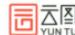

2027

张宇考研数学系列·一

壹2027版

考研数学基础30讲

概率论与数理统计分册

主编张宇

北京理工大学出版社

# 考研数学基础30讲

# 概率论与数理统计分册

主编张宇  
副主编 高昆轮

  
用“启航考研”小程序刷题  
免费听《30讲》配套习题讲解

# 温馨提示：

本书采用裸脊锁线的装帧工艺，制作精良，牢固且不易掉页，可 $180^{\circ}$ 平摊，学习阅读体验更佳！

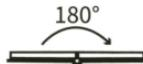

图书外封为护封，用于保护书籍，不易被损坏，可任意拆装，请不要随意丢弃哦~

北京理工大学出版社

BEIJING INSTITUTE OF TECHNOLOGY PRESS

# 张宇考研数学全家桶

一套完整的考研数学复习攻略

# 02 强化进阶

掌握高频考点和常考题型，提高解题能力

学习时间：2026年6月—9月

学习用书：

书课包《高等数学18讲》

书课包《线性代数9讲》

书课包《概率论与数理统计9讲》

《张宇考研数学题源探析经典1000题》强化篇&综合篇

# 04 冲刺拔高

模考测试，科学预测，查漏补缺

学习时间：2026年10月—12月

学习用书：

《考研数学命题人终极预测8套卷》

《张宇考研数学最后4套卷》

# 01 基础夯实

系统学习基础知识点，配合基础习题练习

学习时间：现在—2026年5月

学习用书：

书课包 《考研数学基础30讲·高等数学分册》

书课包 《考研数学基础30讲·线性代数分册》

书课包 《考研数学基础30讲·概率论与数理统计分册》

《张宇考研数学题源探析经典1000题》基础篇

# 03 真题演练

真题带练，把握命题规律，积累解题经验

学习时间：2026年3月—10月

学习用书：

《考研数学真题大全解·基础篇》

《考研数学真题大全解·强化篇》

这个世界

蕴含的客观规律

是美妙的，

谨以此书

献给努力探寻世界的人们。

# 考研数学基础30讲

# 概率论与数理统计分册

主编张宇  
副主编 高昆轮

# 图书在版编目（CIP）数据

考研数学基础30讲.概率论与数理统计分册/张宇主编.--北京北京理工大学出版社，2024.10（2025.9重印）ISBN978-7-5763-4520-9

I. 013

中国国家版本馆CIP数据核字第20246G1K27号

责任编辑：多海鹏 文案编辑：多海鹏

责任校对：周瑞红 责任印制：李志强

出版发行/北京理工大学出版社有限责任公司

社址/北京市丰台区四合庄路6号

邮 编/100070

电话/（010）68944451（大众售后服务热线）

（010）68912824（大众售后服务热线）

网址 / http://www.bitpress.com.cn

版印次/2025年9月第1版第4次印刷

印 刷/河北鹏润印刷有限公司

开 本 $/787\mathrm{mm}\times 1092\mathrm{mm}1 / 16$

印 张/11.25

字数/281千字

定价/69.90元

# 前言

《考研数学基础30讲》（简称《30讲》）按照《全国硕士研究生招生考试数学考试大纲》，并结合考研数学命题趋势编写，其中高等数学分册分为18讲，线性代数分册分为6讲，概率论与数理统计分册分为6讲，共30讲。学完这些内容，即可达到传统意义上的“基础阶段”与“强化阶段”的全部要求。

本书每一讲都由基础知识结构、基础内容精讲、基础习题精练三部分组成，涵盖《全国硕士研究生招生考试数学考试大纲》中所有知识点，循序渐进，由浅入深，最后达到考研数学对试题要求的难度水平。这里需要特别指出的是，数学学习是一环扣一环的，上一个环节的知识和想法，直接影响到下一个环节的知识和想法，任何环节都不能囿囿吞枣或降低要求，必须深刻掌握，否则越往下学习就会越困难。反之，若在初始阶段多下些功夫，搞明白原理，捋清楚关系，看似进度不快，却能为后面的学习加速打下坚实的基础。

《30讲》是书课包，即本书作者会对书中全部内容进行系统讲解，考生扫描书中二维码即可快速定位对应知识点的视频讲解。2027版的《30讲》根据课程讲解，标注了全程的学习笔记，既能防止考生漏记、错记笔记，又节省做笔记的时间，考生只需集中精力认真听即可。

建议考生结合课程反复研读本书，有些知识的掌握是需要反复琢磨的，要养成独立思考的习惯，逐渐达到知识、思路、题型和方法皆会以清晰的结构呈现眼前的效果。本书是作者多年基础阶段教学经验的总结，愿助潜心研读者打好地基、夯实基础，勇攀考研数学高峰。

本书自出版以来，承蒙广大师生厚爱，在考研数学基础阶段起到了一定的积极作用。限于作者水平，书中不足或错误之处，望各位不吝赐教，多提意见与建议，特此致谢！

结构

2025年8月 于北京

# 概率综述

# 概率引言

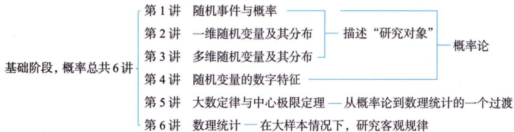

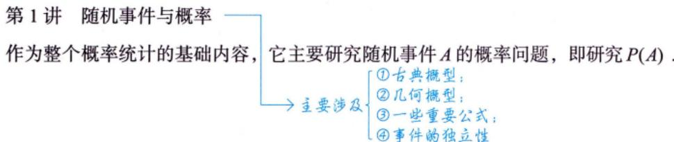

【重要思想】全集分解思想，贯穿整个课程.

★第2、3讲是经典的概率论课程的内容.

第2讲 一维随机变量及其分布

(1) 引入研究对象“随机变量”  
(2) 涉及与随机变量相关的分布函数（怎么去描述该随机变量的概率规律）.  
(3)随机变量函数的分布. ①离散型随机变量涉及分布律的问题； ②连续型随机变量涉及概率密度的问题

第3讲 多维随机变量及其分布（在一维的基础上升级到了多维）

第4讲 随机变量的数字特征

(1) 随机变量的数学期望.   
(2)随机变量的方差.  
(3)两个随机变量之间的关系（协方差、相关系数）

研究原因： $①$ 尽管分布函数非常全面准确地刻画了一个随机变量的概率规律，但本身可能是很难求的(即第2、3讲这两个部分，往往理论意义更强一些，在实践上，分布函数有时不太容易求)比如，牛顿-莱布尼茨公式很著名，但事实上它不太好用； $②$ 有时候并不需要知道今布函数，可以通过其他的方式或角度来研究随机变量的一些特征，比如期望、方差、协方差、相关系数就能够很好地去体现相应的特征或所研究问题需要知道的信息

第5讲 大数定律与中心极限定理（过渡：从概率论到数理统计）

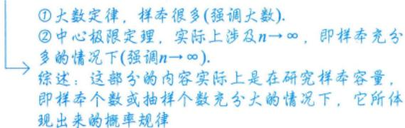

第6讲 数理统计

(1) 介绍基本统计量及其相应分布（三大抽样分布）. $\rightarrow$ (2) 参数估计（考解答题）  
(3)假设检验. 在统计学中，分布函数或者相应的概率密度中的量并不全知道，此时需要根据抽样得到数据反过来去估计概率规律中的参数。但实际上是不能求出来真实的客观值的，所以称之为估计

# 概率考题分布

第1讲随机事件与概率5分选择题，主要集中在怎么求一个复杂事件的概率.

第2、3讲一/多维随机变量及其分布5分小题/12分解答题.→常考

第4讲随机变量的数学特征5分小题/配合第2、3讲考12分解答题. 考研连续两年考了

第5讲 大数定律与中心极限定理 5分小题.

第6讲 数理统计 5分选择题（抽样分布）/12分解答题（估计问题）

# 目录

第1讲 随机事件与概率  
第2讲 一维随机变量及其分布 … 33  
第3讲 多维随机变量及其分布 62  
第4讲 随机变量的数字特征 … 103  
第5讲 大数定律与中心极限定理 … 125  
第6讲 数理统计 133

# 第1讲

# 随机事件与概率

# 基础知识结构

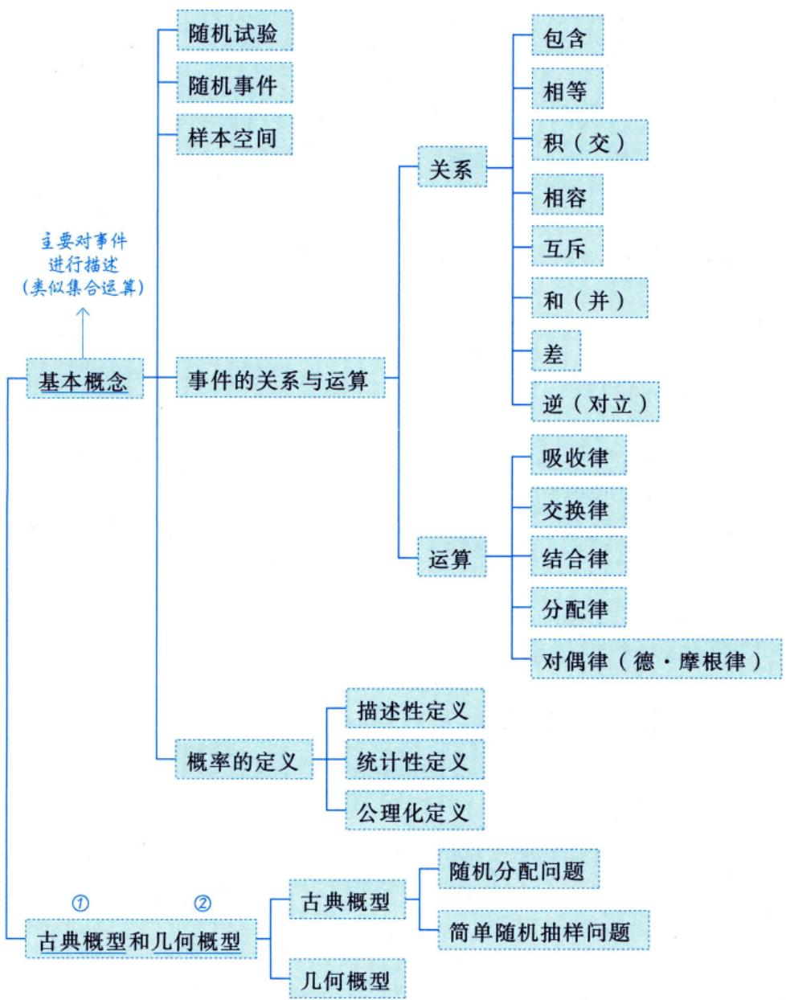

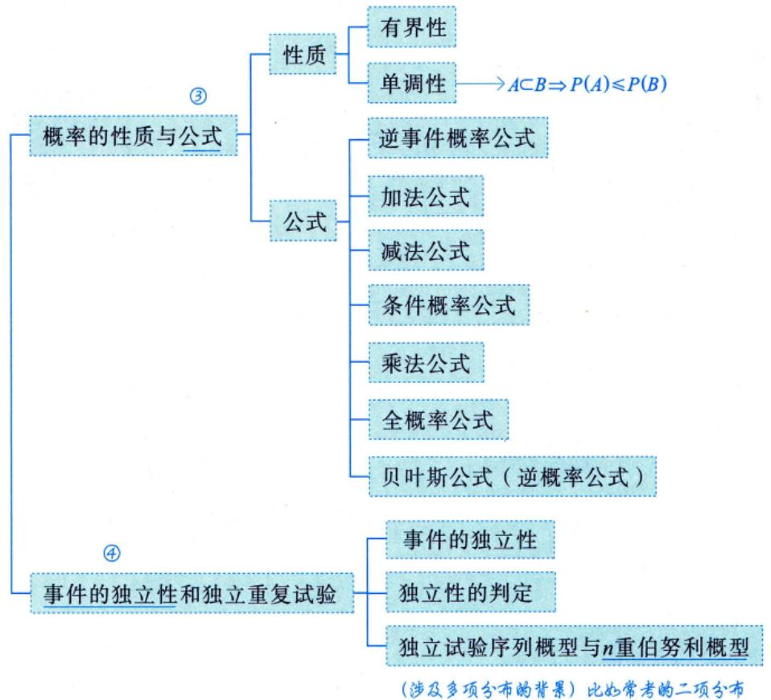

# 基础内容精讲

# 基本概念

# 随机试验

如果一个试验满足以下三个条件：

(1) 试验可以在相同的条件下重复进行；  
(2) 试验所有可能结果明确可知，且不止一个；  
(3)每一次试验会出现哪一个结果，事先并不能确定，

则称此试验为随机试验.

我们是通过研究随机试验来研究随机现象的，随机试验简称试验，用字母 $E$ 或 $E_{1}$ ， $E_{2}$ ，…表示.

# 示例1 投篮.

(1)相同条件下可重复.

首先这是一个理想化简化，因为并非真正同条件（一个篮球运动员投篮或者一个普通人投篮，假设

已经投10次了，再投第11次，可能就会比较累了。所以这个同条件在学科中实际上是在近似的相同条件下可重复）。

(2) 试验所有可能结果明确可知，且不止一个，只有“投中”和“投不中”两种可能.  
(3)每一次投篮，“投中”或“投不中”，事先未知.

# 示例2 掷硬币.

(1)相同条件下可重复.   
(2)试验结果明确可知，且不止一个，只有“正面”和“反面”两种可能.  
(3)硬币落下之前，不知道会是“正面”还是“反面”。

注 在不少情况下，不能确切知道某一随机试验的全部可能结果，但可以知道它不超出某个范围。这时，也可以用这个范围来作为该试验的全部可能结果的集合。例如，需要记录某个城市一天的交通事故数量，则试验结果将是非负整数 $x$ 。无法确定 $x$ 的可能取值的确切范围，但可以把这个范围取为 $[0, +\infty)$ ，将上限取到 $+\infty$ ，扩大范围，它总能包含一切可能的试验结果，尽管明知某些结果——如 $x > 10000$ 是不会出现的。甚至把这个范围取为 $(- \infty, +\infty)$ 也无妨。这里体现了一定的数学抽象，它可以带来很大的方便。

怎样去描述这个取值范围的扩大？

比如正态分布（两边低中间高）

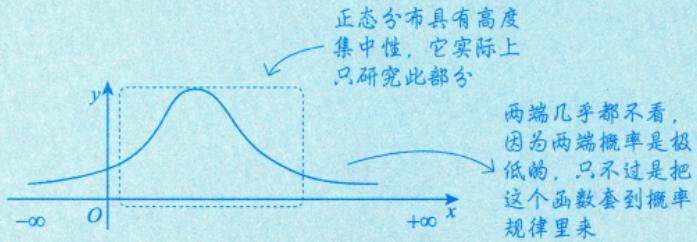

① 在大样本的情况下，根据中心极限定理，所有分布最终都会收敛于正态分布。这是自然规律中的一个神秘规律。  
② 普通现象的概率肯定是高的，而极端现象的概率是低的。

比如，人的身高基本上集中在某一个范围内。那么像姚明的身高，是少数的，然后身高往下走，变成负的，那是不可能的事情。但是正态分布里 $x$ 的范围就是从 $-\infty$ 到 $+\infty$ ，这相当于做了范围的扩大，能够使得概率分布完全对应上高斯曲线，极大方便了数学处理。实际上，曲线两端取值的可能性非常小，几乎取不到。

③ 疑问：身高怎么可能取负值呢？

答：并非是身高取负值，而是对自然现象进行了范围扩大。比如研究某学校学生身高的分布、体重的分布或者其他健康指标的分布。用什么函数来研究它呢？总不能用截断的部分区间的函数去研究，而将 $x$ 的范围扩大后刚好可以用这样一条从 $-\infty$ 到 $+\infty$ 上的著名曲线来研究概率规律。

# 随机事件

在一次试验中可能出现, 也可能不出现的结果称为随机事件, 简称事件, 并用大写字母 $A, B, C$ 等表示. 将每次试验中一定发生的事件称为必然事件, 记为 $\Omega$ . 每次试验中一定不发生的事件称为不可能事件, 记为 $\varnothing$ . 集合中的全集符号

集合中空集的符号

集合中的全集符号

大样本情况下寻找客观规律

注 随机事件在一次试验中是否发生虽然不能事先确定，但是在大量重复试验的情况下，它的发生呈现出一定的规律性，这门课程正是要研究这种规律性，考生应在学习这门课程后，对此有较为深刻的认识。

# 样本空间

不可再分

随机试验的每一个可能结果称为样本点，记为 $\omega$ 。样本点的全体组成的集合称为样本空间（或基本事件空间），记为 $\Omega$ ，即 $\Omega = \{\omega\}$ 。由一个样本点构成的事件称为基本事件。随机事件 $A$ 总是由若干个基本事件组成，即 $A$ 是 $\Omega$ 的子集。

示例 掷骰子，共六个面，即可能会出现1点到6点，记 $\omega_{i} = \{$ 掷出点数 $i\}$ ，则

(1) 每个 $\omega_{i}$ 都是不可再分的样本，每一个 $\omega_{i}$ 都叫基本事件。  
(2)这些基本事件组成的集合叫作样本空间，即

$$
\Omega = \left\{\omega_ {1}, \omega_ {2}, \dots , \omega_ {6} \right\}.
$$

(3) 随机事件 $A$ 为“掷出偶数点”，显然

$$
A = \left\{\omega_ {2}, \omega_ {4}, \omega_ {6} \right\}
$$

是 $\Omega$ 的子集.

# 事件的关系与运算

同时，还有概率的单调性，显然 $P(B)\geqslant P(A)$

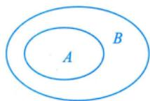

(1)关系.

包含：如果事件 $A$ 发生必导致事件 $B$ 发生，则称事件 $B$ 包含事件 $A$ （或 $A$ 被 $B$ 包含），记为 $A \subset B$ 。相等：如果 $A \subset B$ 且 $B \subset A$ ，则称事件 $A$ 与 $B$ 相等，记为 $A = B$ 。 $A$ 与 $B$ 相等，事实上也就是说， $A$ 与 $B$ 由一些完全相同的试验结果构成，它不过是同一事件表面上看起来不同的两个说法而已。

积（交）：称“事件 $A$ 与 $B$ 同时发生”的事件为事件 $A$ 与 $B$ 的积事件（或交事件），记为 $A \cap B$ 或 $AB$ 。如，掷骰子，共六个面， $A = \{\text{掷出的点数是偶数}\}$ ， $B = \{\text{掷出的点数不是1,3,5}\}$ ， $C = \{\text{掷出的点数是2的倍数}\}$ ，则 $A = B = C$

注称“有限个（或可列个）事件 $A_{1}, A_{2}, \cdots, A_{n}(\cdots)$ 同时发生”的事件为事件 $A_{1}, A_{2}, \cdots, A_{n}(\cdots)$ 的积事件（或交事件），记为 $\bigcap_{i=1}^{n} A_{i}$ （或 $\bigcap_{i=1}^{\infty} A_{i}$ ）。

里面是有元素的

相容：若 $AB \neq \emptyset$ ，则称事件 $A$ 和 $B$ 相容.

互斥：若 $AB = \emptyset$ ，则称事件 $A$ 与 $B$ 互不相容，也叫互斥.如果一些事件中任意两个事件都互斥，则称这些事件是两两互斥的，或简称互斥的.加法公式： $P(A\bigcup B) = P(A) + P(B)$

和（并）：称“事件 $A$ 与 $B$ 至少有一个发生”的事件为事件 $A$ 与 $B$ 的和事件（或并事件），记为 $A \cup B$ 。

注称“有限个（或可列个）事件 $A_{1}, A_{2}, \cdots, A_{n}(\cdots)$ 至少有一个发生”的事件为事件 $A_{1}, A_{2}, \cdots, A_{n}(\cdots)$ 的和事件（或并事件），记为 $\bigcup_{i=1}^{n} A_{i}$ （或 $\bigcup_{i=1}^{\infty} A_{i}$ ）.

差：称“事件 $A$ 发生而事件 $B$ 不发生”的事件为事件 $A$ 与 $B$ 的差事件，记为 $A - B$ ：

逆(对立)：称“事件 $A$ 不发生”的事件为事件 $A$ 的逆事件或对立事件,记为 $\overline{A}$

由定义易知

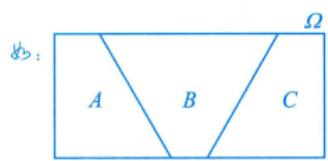

对立事件一定是互不相容事件，但互不相容事件不一定是对立事件

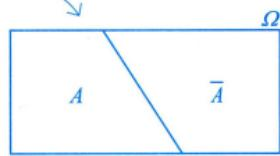

$A$ 与 $B$ ， $B$ 与 $C$ ， $A$ 与 $C$ 均为互斥事件，但 $B \cup C$ 才为 $A$ 的对立事件

$$
A - B = A - A B = A \bar {B},
$$

$$
B = \bar {A} \Leftrightarrow A B = \varnothing \text {且} A \bigcup B = \Omega .
$$

3、对立事件

完备事件组：如果 $\bigcup_{i = 1}^{n}A_{i}$ （或 $\bigcup_{i = 1}^{\infty}A_{i}) = \Omega$ ， $A_{i}A_{j} = \varnothing$ （对一切 $i\neq j$ ； $i,j = 1,2,\dots ,n(\dots)$ )，称有限个（或可列个）事件 $A_{1}$ ， $A_{2}$ ，…， $A_{n}(\dots)$ 构成一个完备事件组.

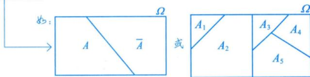

注 完备事件组也称为对样本空间的一种划分，也叫全集分解。

文氏图：事件的关系与运算可以用文氏图形象地表示出来（见图1-1)，图中的矩形表示必然事件 $\Omega$ ：

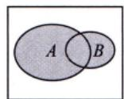  
$A\cup B$

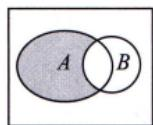  
A-B

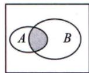  
AB

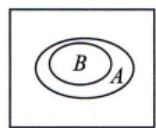  
$B\subset A$

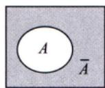  
A

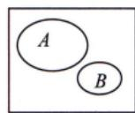  
$AB = \emptyset$   
图1-1

(2) 运算.

① 吸收律 若 $A \subset B$ ，则 $A \cup B = B, A \cap B = A$   
② 交换律 $A \cup B = B \cup A, A \cap B = B \cap A$ .  
③结合律 $(A\bigcup B)\bigcup C = A\bigcup (B\bigcup C),(A\bigcap B)\bigcap C = A\bigcap (B\bigcap C).$   
④分配律 $A \cap (B \cup C) = (A \cap B) \cup (A \cap C), A \cup (B \cap C) = (A \cup B) \cap (A \cup C)$ .

$$
A \cap (B - C) = (A \cap B) - (A \cap C).
$$

★⑤对偶律（德·摩根律） $\overline{A\bigcup B} = \overline{A}\cap \overline{B},\overline{A\bigcap B} = \overline{A}\bigcup \overline{B}.$

口诀：长杠变短杠，开口换方向。

$\overline{\overline{A}\cap B} = \overline{\overline{A}}\cup \overline{B} = A\bigcup \overline{B}.$

注 (1) 事件运算顺序约定为先进行逆运算, 然后进行交运算, 最后进行并或差运算.

(2) 事件的关系、运算与集合的关系、运算相当，且具有相同的运算法则，所以可以对比着理解记忆，并要学会用集合关系去考虑事件关系。

# 5 概率的定义

(1)描述性定义.

通常将随机事件 $A$ 发生的可能性大小的度量（非负值）称为事件 $A$ 发生的概率，记为 $P(A)$ ：

如：抛硬币1000次，正面朝上的次数

为527，那么 $\frac{527}{1000}$ 称为这1000次试

验中，硬币正面朝上的频率

(2) 统计性定义.

在相同条件下做重复试验，事件 $A$ 出现的次数 $k$ 和总的试验次数 $n$ 之比 $\frac{k}{n}$ 称为事件 $A$ 在这 $n$ 次试验中出现的频率.当试验次数 $n$ 充分大时，频率将“稳定”于某常数 $p$ . $n$ 越大，频率偏离这个常数 $p$ 的可能性越小.这个常数 $p$ 就称为事件 $A$ 的概率. 不断趋近 $p$

比如说投掷硬币正面朝上的频率是 $\frac{527}{1000} = 0.527$ ，但它是硬币正面朝上的概率吗？

对于均匀的硬币，正面朝上的概率应该是 $\frac{1}{2}$ 。这是客观规律。

理想情况下，均匀硬币是真正的均匀，此时就说它的概率是客观上的 $\frac{1}{2}$ 频率只能是逐渐地靠近 $\frac{1}{2}$ 但在硬币不均匀的情况下，不清楚抛出硬币正面朝上的概率，不能直接讲是 $\frac{1}{2}$

注 后面会提到一个概念，就是频率依概率收敛到概率。这实际上涉及大数定律的问题了

(1) 概率的统计性定义实质上是说, 用频率 $\frac{k}{n}$ 作为事件 $A$ 的概率 $P(A)$ 的估计. 其直观理解为某事件出现的可能性大小, 可由其在多次重复试验中出现的频率去刻画.  
(2) 从上述 (1) 可以看出, 频率只是概率的估计, 而非概率本身. 也就是说, 概率的统计性定义是无法准确给出某事件的概率的, 其重要性主要基于以下两点.  
① 它提供了估计概率的方法。比如在一批产品中抽取样品，来估计该批产品的合格率（合格率是客观的数据，抽取样品计算出来的合格率只是一种估计）。  
② 它提供了一种检验某结论是否正确的准则。比如，你说某批产品的合格率是 $95\%$ ，我们做试验，抽取样品进行计算，得出的结果是合格率为 $20\%$ ，远远低于你所说的 $95\%$ ，于是毫不犹豫地拒绝你的结论。

统计性定义，它没有理论上的价值，不能精确定义概率。但是从实践上来讲，它有时候是很有用的。

(3) 公理化定义.

设随机试验的样本空间为 $\Omega$ ，如果对每一个事件 $A$ 都有一个确定的实数 $P(A)$ ，且事件函数 $P(\cdot)$ 满足：

①非负性： $P(A) \geqslant 0$   
②规范性： $P(\Omega) = 1$ ； “归一性”  
③可列可加性：对任意可列个两两互不相容事件 $A_{1}, A_{2}, \dots, A_{n}, \dots$ （即 $A_{i}A_{j} = \emptyset, i \neq j; i, j = 1, 2, \dots$ ），有

$P\left(\bigcup_{i = 1}^{\infty}A_{i}\right) = \sum_{i = 1}^{\infty}P(A_{i}),$ 事件和的概率等于概率的和

则称 $P(\cdot)$ 为概率， $P(A)$ 为事件 $A$ 的概率.

注 (1) 数学上所说的“公理”，就是一些不加证明而承认的前提，上述公理化定义只是界定了概率这个概念所必须满足的一些一般性质，它不解决具体场合下的概率计算。

(2) 概率 $P(\cdot)$ 是事件的函数.  
(3) 虽然公理化定义不解决具体场合下的概率计算，但是我们却常常用它来判断某事件函数 $P(\cdot)$ 是不是概率，这种题型在考研试题中也是经常遇到的。

# 古典概型和几何概型

# 古典概型

(1) 概念.

如果随机试验的样本空间满足：

①只有有限个样本点（基本事件）； $\longrightarrow$ 也掷骰子， $\Omega = \{\omega_{1},\omega_{2},\dots ,\omega_{6}\}$ ，一旦出现无穷个，就不是古典概型  
②每个样本点（基本事件）发生的可能性都一样，

则称随机试验的概率模型为古典概型.

如果古典概型的基本事件总数为 $n$ ，事件 $A$ 包含 $k$ 个基本事件，也叫作有利于 $A$ 的基本事件有 $k$ 个，则 $A$ 的概率为

$$
P (A) = \frac {k}{n} = \frac {\text {事 件} A \text {所 含 基 本 事 件 的 个 数}}{\text {基 本 事 件 总 数}}. \text {则} P (A) = \frac {3}{6} = \frac {1}{2}
$$

由上式计算得出的概率称为 $A$ 的古典概率.

注 计算的关键是基本事件、样本空间的选定以及基本事件数的计算.

计数方法常用的有三种.

(1)列举法（直接数数法）：基本事件数不多时常用这种方法.  
(2) 集合对应法：① 加法原理——完成一件事有 $n$ 类办法，第一类办法中有 $m_{1}$ 种方法，第二类办法中有 $m_{2}$ 种方法，……，第 $n$ 类办法中有 $m_{n}$ 种方法，则完成此事共有 $\sum_{i=1}^{n} m_{i}$ 种方法。  
② 乘法原理——完成一件事有 $n$ 个步骤，第一步有 $m_{1}$ 种方法，第二步有 $m_{2}$ 种方法，……，第 $n$ 步有 $m_{n}$ 种方法，则完成此事共有 $\prod_{i=1}^{n} m_{i}$ 种方法。

例如，从 $A$ 地到 $B$ 地的方法.

$$
\begin{array}{r l}&{\underset {A \text {地}} {\nearrow} \text {飞 机} \left\{\begin{array}{l}{\mathrm {C} 9 1 9}\\{\mathrm {C} 9 2 9}\\{\mathrm {A} 3 3 0}\end{array}\right\}\rightarrow B \text {地}.}\\&{\quad \underset {\text {火 车}} {\searrow} \left\{\begin{array}{l}{\text {复 兴 号}}\\{\text {和 谐 号}}\end{array}\right\}}\end{array}
$$

看路线，从加法原理的角度，可以有 $m_{1} + m_{2} = 3 + 2 = 5$ （种）交通方式.

$$
A \text {地} \rightarrow \text {飞 机} \left\{\begin{array}{l}\mathrm {C} 9 1 9\\\mathrm {C} 9 2 9 \rightarrow \text {火 车} \left\{\begin{array}{l}\text {复 兴 号}\\\text {和 谐 号}\end{array}\right.\rightarrow B \text {地}.\end{array}\right.
$$

看路线，从乘法原理的角度，需要2个步骤.第1步：坐飞机有3种选择；第2步：坐火车有2种选择.故可以有 $m_{1} \cdot m_{2} = 3 \times 2 = 6$ （种）交通方式.

加法原理与乘法原理有一个重要的区分，即在完成这件事情的时候，是否需要分步骤进行。如果需要分步骤进行，即用乘法原理解决。如果不是按照步骤，而是按照完成一件事情有几类方法，把这些方法加起来即可。

③排列——从 $n$ 个不同的元素中取出 $m \leqslant n$ 个元素，并按照一定顺序排成一列，叫作排列。所有排列的个数叫作排列数，记作

有 $n$ 个不同的元素, 按顺序取 $m$ 个. 取第 1 个时, 有 $n$ 种取法; 取第 2 个时, 剩余 $n - 1$ 个元素则有 $n - 1$ 种可能性, 故再乘上 $n - 1$ , 这是第二步; 依次类推到取第 $m$ 个元素时, 还剩 $n - m + 1$ 种取法, 所以按乘法原理把它们乘起来即可得到排列数

$$
\mathrm {P} _ {n} ^ {m} = n (n - 1) (n - 2) \dots (n - m + 1) = \frac {n !}{(n - m) !}.
$$

当 $m = n$ 时， $\mathbf{P}_n^n = \frac{n!}{0!} = n!$ ，叫作全排列.

④ 组合——从 $n$ 个不同的元素中取出 $m \leqslant n$ 个元素，并成一组，叫作组合。所有组合的个数叫作组合数，记作

$$
\mathrm {C} _ {n} ^ {m} = \frac {\mathrm {P} _ {n} ^ {m}}{m !}.
$$

$$
\begin{array}{l} C _ {n} ^ {m} = \frac {n !}{m ! (n - m) !}, \\ C _ {n} ^ {m} = C _ {n} ^ {n - m}, \\ 0! = 1 \\ C _ {n} ^ {0} = 1 \\ \end{array}
$$

(3)逆数法：先求 $\overline{A}$ 中的基本事件数 $n_{\overline{A}}$ ，用基本事件总数 $n$ 减去 $n_{\overline{A}}$ 便得 $A$ 中的基本事件数，这种方法常用于计算含有“至少”字样的事件的概率．用对立事件解题： $P(A) = 1 - P(\overline{A})$

(2)计算方法.

①随机分配问题.

随机分配也叫随机占位，突出一个“放”字，即将 $n$ 个可辨质点随机地分配到 $N$ 个盒子中，区分每盒可以容纳任意多个质点和最多可以容纳一个质点，不同分法的总数如表所示.

比如在1月1日出生的人,有很多 $\rightarrow$ 一个萝卜一个坑

<table><tr><td>分配方式</td><td>不同分法的总数</td></tr><tr><td>每盒容纳任意多个质点</td><td>Nn(见注①)</td></tr><tr><td>每盒容纳至多一个质点</td><td>PN=NN-1···(N-n+1)(见注②)</td></tr></table>

注 ① 每个质点均可放到 $N$ 个盒子中的任何一个，即有 $N$ 种放法，于是 $n$ 个可辨质点放到 $N$ 个盒子中共有 $N^n$ 种不同放法。

② 质点可辨，且一个盒子至多容纳一个质点，故 $n$ 个质点放到 $N(N \geqslant n)$ 个盒子中的所有不同放法即为从 $N$ 个元素中选取 $n$ 个元素的排列数 $\mathbf{P}_N^n$ 。

例1.1 将 $n$ 个球随机放入 $N(n \leqslant N)$ 个盒子中，每个盒子可以放任意多个球。求下列事件的概率： $A = \{\text{某指定} n \text{ 个盒子各有一球}\}$ ； $B = \{\text{恰有} n \text{ 个盒子各有一球}\}$ ； $C = \{\text{指定} k (k \leqslant n) \text{个盒子各有一球}\}$ 。

解这是随机占位的问题，设 $n$ 个球， $N$ 个盒子是可分辨的（例如编号），由于每个盒子可以放任意多个球，因此每个球都有 $N$ 种不同的放置方法.将 $n$ 个球随机放入 $N$ 个盒子的一种放法作为基本事件，则基本事件总数为 $N^n$ .事件 $A$ 所含的基本事件是 $n$ 个不同球的一种排列，故

$$
n _ {A} = n! \text {,} P (A) = \frac {\mid 1 \cdot n !}{N ^ {n}}.
$$

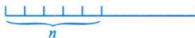

（ $n$ 个盒子的位置是唯一确定的，现假定就是前 $n$ 个位置）

事件 $B$ 中的基本事件可以设想为先从 $N$ 个盒子中选出 $n$ 个（共有 $\mathbf{C}_N^n$ 种不同选法），然后把 $n$ 个球随机放入这 $n$ 个盒子中，每盒一球（共有 $n!$ 种不同放法），因此 $B$ 中基本事件数

$$
n _ {B} = \mathrm {C} _ {N} ^ {n} \cdot n!, P (B) = \frac {\mathrm {C} _ {N} ^ {n} \cdot n !}{N ^ {n}}. \overrightarrow {“ 恰 有 n 个 ”}, \text {有 C} _ {N} ^ {n} \text {种 情 形}
$$

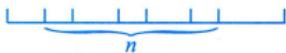

（ $n$ 个盒子的位置并非唯一确定的，是从 $N$ 个里面选出 $n$ 个）

事件 $C$ 的基本事件可以设想为先从 $n$ 个球中选出 $k$ 个球（有 $\mathbf{C}_n^k$ 种不同选法），再将这 $k$ 个球随机放入指定的 $k$ 个盒子中，每盒一球（有 $k!$ 种不同放法），最后将余下的 $n - k$ 个球随机放入其余的 $N - k$ 个盒子中，每个球都有 $N - k$ 种放置方法，因此共有 $(N - k)^{n - k}$ 种不同放法，故

$$
n _ {C} = C _ {n} ^ {k} \cdot k! (N - k) ^ {n - k}, P (C) = \frac {C _ {n} ^ {k} k ! (N - k) ^ {n - k}}{N ^ {n}} = \frac {n ! (N - k) ^ {n - k}}{(n - k) ! N ^ {n}}.
$$

$\theta$ 方法总结 必背基本事件个数，将 $n$ 个球放入 $n$ 个盒子，使得每个盒子各有一球，有 $n!$ 种方法.

注许多问题的结构形式与分球入盒问题相同，都属于随机占位问题.例如生日问题（n个人生日，相当于 $n$ 个球随机放入365个盒子中，每盒可以放多个球）；住房分配问题（n个人被分配到 $N$ 个房间中去，每个房间可住多个人）；乘客下车问题（n个乘客在 $N$ 个车站下车的各种可能情况）；等等.对这些问题的求解都可以用“将 $_n$ 个球等可能地投放到 $N$ 个盒子中”的思路来考虑.

比如，12个球随机放入365个盒子中，每盒可放多个球.

$A_{1} = \{$ 指定12个盒子，各放1球 $\}$ ，则 $P(A_{1}) = \frac{12!}{365^{12}}$

$B_{1} = \{\text{恰有} 12$ 个盒子，各放1球 $\}$ ，则 $P(B_{1}) = \frac{C_{365}^{12}12!}{365^{12}}$

$C_1 = \{\text{指定} 3 \text{个盒子，各放} 1 \text{球}\}$ ，则 $P(C_1) = \frac{C_{12}^3 3! (365 - 3)^{12 - 3}}{365^{12}}$

又比如12个人 $\omega_{1},\dots ,\omega_{12}$ 回母校参加校庆，每个人在365天中的某一天出生的概率相等.令

$A_{2} = \{$ 生日全不相同，且分别为每个月的第一天\};

$B_{2} = \{$ 生日全不相同 $\}$ ； $\overline{B}_2 = \{$ 至少有两人生日相同 $\}$

$C_2 = \{$ 有且仅有三个人的生日分别在劳动节、儿童节、中秋节 $\}$

则 $A_{2}$ ， $B_{2}$ ， $C_2$ 就对应着题中的 $A,B,C$ ，只不过此时 $N = 365$ ， $n = 12$ ， $k = 3$ ：

②简单随机抽样问题.

设 $\Omega = \{\omega_{1},\omega_{2},\dots ,\omega_{N}\}$ 含 $N$ 个元素，称 $\varOmega$ 为总体.如果各元素被抽到的可能性相同，则总体 $\varOmega$ 的抽样称作简单随机抽样，突出一个“取”字.

简单随机抽样分为先后有放回、先后无放回及任取这三种不同的方式. 在每种抽样方式下各种不同抽取方法（基本事件）的总数如表所示.

<table><tr><td>抽样方式</td><td>抽取方法总数</td></tr><tr><td>先后有放回取n次(样本空间始终无变化)</td><td>Nn(见注(1)①)</td></tr><tr><td>先后无放回取n次</td><td>PN=N(N-1)···(N-n+1)(见注(1)②)</td></tr><tr><td>任取n个</td><td>CN(见注(1)③)</td></tr></table>

注 (1) ① 既考虑抽到何元素, 又考虑各元素出现的顺序, 每次从 $\Omega$ 中随意抽取一个元素, 并在抽取下一元素前将其放回 $\Omega$ , 于是每次都有 $N$ 个元素可被抽取, 即有 $N$ 种抽取方法, 抽取 $n$ 次, 即 $N^n$ .

② 既考虑抽到何元素，又考虑各元素出现的顺序，凡是抽出的元素均不再放回 $\Omega$ ，于是每次抽取时都比上一次少了一个元素，抽 $n(n \leqslant N)$ 次，即

$$
\mathrm {P} _ {N} ^ {n} = N (N - 1) \cdot \dots \cdot (N - n + 1).
$$

③ 任取 $n (n \leqslant N)$ 个是指一次性取 $n$ 个元素，相当于将 $n$ 个元素无序且无放回地取走，其抽取方法总数为

$$
\mathbf {C} _ {N} ^ {n} = \frac {\mathbf {P} _ {N} ^ {n}}{n !}.
$$

(2) ① 先后有放回与先后无放回的区别。先后有放回取也不意味是真的放回去了。当产品的数量足够多的时候，拿走一个不放回来，也当作有放回处理（因为若按照先后无放回去计算，可能比较复杂，所以可以当作有放回）。实际上是改变了样本空间，每取走一个，样本空间里就少一个元素，但是如果元素足够多，取走一个可以近似看作原来的样本空间没有变，所以如果样本空间不变，那很多问题研究起来就非常方便了。故先后有放回取，往往是用在样本 $n$ 足够大的情况下。

② 先后无放回与任取的区别。先后无放回，强调“先后”顺序；任取无顺序，故计算公式少了排列 $n!$ 。

例1.2 袋中有5个球，3个白球，2个黑球.

(1) 先后有放回取 2 个球；  
(2) 先后无放回取 2 个球；  
(3) 任取2个球.

求取的2个球中至少1个是白球的概率.

分析 考查简单抽样的3种抽取方法.要求必会.

解用对立事件思想，计算“两球全黑”的种数，再用总数减去它.

(1) $5^{2} - 2^{2} = 21$ （种）.  
(2) $5 \times 4 - 2 \times 1 = 18$ （种）.  
(3) $C_5^2 - C_2^2 = 9$ (种).

下面计算概率.

(1) $p_1 = \frac{5^2 - 2^2}{5^2} = 1 - \frac{2^2}{5^2} = \frac{21}{25}$ .   
(2) $p_2 = \frac{5 \times 4 - 2 \times 1}{5 \times 4} = 1 - \frac{2 \times 1}{5 \times 4} = \frac{9}{10}$ .   
(3) $p_{3} = \frac{C_{5}^{2} - C_{2}^{2}}{C_{5}^{2}} = 1 - \frac{C_{2}^{2}}{C_{5}^{2}} = \frac{9}{10}$ .

注 本题中的 (2) 与 (3) 概率相同, 如何理解?

$\frac{2 \cdot 1}{5 \cdot 4} = \frac{\mathrm{C}_2^2 \cdot \mathrm{P}_2^2}{\mathrm{C}_5^2 \cdot \mathrm{P}_2^2} = \frac{\mathrm{C}_2^2}{\mathrm{C}_5^2}$ , 左边上下有序, 右边上下无序, 相当于把顺序“消掉”了, 故“先后无放回取 $k$ 个球”与“任取 $k$ 个球”的概率相同. 由于 (3) 较方便, 因此计算 (2) 时, 可按 (3) 来计算.

例1.3 袋中有100个球，40个白球、60个黑球.

(1) 先后有放回取20个球，求取出15个白球、5个黑球的概率；  
(2) 先后无放回取 20 个球, 求取出 15 个白球、5 个黑球的概率;  
(3) 先后有放回取20个球，求第20次取到白球的概率；  
(4) 先后无放回取 20 个球, 求第 20 次取到白球的概率.

分析 (1)转化为投篮模型.

$① P \{$ 投中 $\} = 40 / 100$ ， $P$ 投不中 $\} = 60 / 100$   
②这样的投篮试验做20次，15次投中、5次投不中（先后有放回取20个球，每次试验之前，球放回去了，它的样本空间没有变化），这属于二项分布。  
(2)简单随机抽样问题转化为随机占位问题.

解 (1) $p_1 = \frac{40^{15} \cdot 60^5 \cdot C_{20}^{15}}{100^{20}}$ → 20个位置中有15个位置放白球每次取都是100种取法，取20次

(2) 按照“任取20个球”来计算，即 $p_2 = \frac{\mathrm{C}_{40}^{15}\mathrm{C}_{60}^5}{\mathrm{C}_{100}^{20}}$ .

(3) $p_3 = \frac{40}{100} = \frac{2}{5}$ （有放回取球，每次抽取的样本空间没有变化，故每次取到白球的概率始终为 $\frac{2}{5}$ ）.

(4) 看作随机占位问题. 设有 100 个盒子, 每个盒子中放 1 个球, 则要求第 20 个盒子中放入白球即可. 故 $p_{4} = \frac{C_{40}^{1} \cdot 99!}{100!} = \frac{40}{100} = \frac{2}{5}$ . 剩下 99 个球放在 99 个盒子里, 每个盒子各有 1 球

40个白球抽取1个

放在第20个盒子中

注 (1) 若 (4) 修改为: 先后无放回取 $k$ 个球, 求第 $k$ 次取到白球的概率. 结果仍为 $\frac{2}{5}$ .

第20个盒子放的是白球，但是前19个盒子放的什么球并不清楚。若清楚了，即转化为条件概率问题

(2) $p_4 = p_3$ .例1.3(4)是抓阁模型，即使无放回，每次取到白球的概率也不会变，可理解成依概率摸球.类比的例子： （绝对概率）

①设有100个灰球，白的成分：黑的成分 $= 40:60$ ，每次取到球中白的成分是 $40\%$   
②设有糖水，糖的成分：水的成分 $= 40:60$ ，每次取一勺糖水，取到糖的成分是 $40\%$

# 几何概型

（可测）在测度论的基础上，概率论会非常精确严谨但是在非测度论的基础上，理解即可

如果随机试验的样本空间满足：

① 样本空间（基本事件空间） $\Omega$ 是一个可度量的有界区域；

【名词解释】可度量：通俗来讲，即为可以度量，就是我们现在理解的长度、面积、体积.

对于数学一：计算体积，则要涉及三重积分；

对于数学三：可度量其实基本上就限定在一维的长度和二维的面积上.

② 每个样本点（基本事件）发生的可能性都一样，即样本点落入 $\Omega$ 的某一可度量的子区域 $S$ 的可能性大小与 $S$ 的几何度量成正比，而与 $S$ 的位置及形状无关，则称随机试验的概率模型为几何概型。

# 示例 “天上掉馅饼”.

假如明天早晨9:00，在学校操场上会从天上掉一个馅饼下来.大家拿着食堂的饭盆去接这个馅饼.现思考两个问题： 9:00

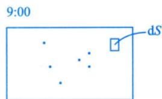

# 考研数学基础30讲·概率论与数理统计分册

(1)拿着饭盆到操场上去，请问大家站在哪里最容易接到这个馅饼？

面积的微分

站在哪儿都行. 在概率论上，9：00 有一个馅饼要落下来，这个馅饼落到操场上任意一个 $\mathrm{d}S$ ，具有等可能性. 实际上是有无数个 $\mathrm{d}S$ 的，即无数个面积微分. 所以跟你拿着饭盆站哪里没关系.

(2) 跟饭盆的什么有关系？

与饭盆的形状没关系，但是与饭盆的面积有关系。若饭盆的面积 $=$ 操场面积的 $\frac{1}{2}$ ，则 $P\{\text{接到馅饼}\} = \frac{1}{2}$ ；若饭盆的面积 $=$ 操场面积，则 $P\{\text{接到馅饼}\} = 1$ 。

注 古典概型与几何概型的区别：基本事件有限、等可能发生的随机试验为古典概型；基本事件无限且具有几何度量、等可能发生的随机试验为几何概型.

古典概型与几何概型的联系（如下例）

操场被平均分成四部分， $A_{1}, A_{2}, A_{3}, A_{4}$ 。现假设4个人分别拿着与 $A_{1}, A_{2}, A_{3}, A_{4}$ 同等面积的饭盆，此时相当于对 $\Omega$ 进行均等的划分。

显然，馅饼落到4个饭盆里具有等可能性，且基本事件数只有四个，即基本事件数是有限的，此时就可以把几何概型转化成古典概型。

<table><tr><td>A1</td><td>A2</td></tr><tr><td>A3</td><td>A4</td></tr></table>

例1.4 在区间(0,1)中随机地取两个数，则这两个数之差的绝对值小于0.5的概率为

分析 在区间(0，1)上随机取两个数，这两个数的取值范围就可构成一个可以度量的几何区域，实际上是一二维平面上的一个正方形.理解为“馅饼落在操场任何一个点具有等可能性”.记事件

$$
A = \left\{(x, y) \| x - y | <   0. 5 \right\} \cap \Omega ,
$$

则 $p = \frac{S_A}{S_\Omega}$

解 应填0.75.

设两个数分别为 $x, y$ ，则依题意 $(x, y)$ 的取值范围为正方形区域 $D = \{(x, y) | 0 < x < 1, 0 < y < 1\}$ . 又 $\left|x - y\right| < 0.5$ ，则所在区域如图1-2中阴影部分所示，于是所求概率为

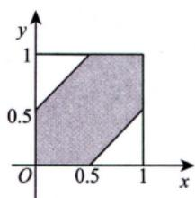  
图1-2

$$
p = \frac {1 ^ {2} - 0 . 5 ^ {2}}{1 ^ {2}} = 0. 7 5.
$$

# 概率的性质与公式

# 性质

不可能事件的概率

金集，也就是必然事件的概率

(1)有界性：对于任一事件 $A$ ，有 $0\leqslant P(A)\leqslant 1$ ，且 $P(\varnothing) = 0$ ， $P(\Omega) = 1$ ：

8:00~9:00按照时间连续来记，可以认为它是一个可以度量的长度，那么任何一个时刻进入这个教室是具有等可能性的

如，用 $\Omega$ 表示一个人在 $8:00\sim 9:00$ 之间进入教室，

$A = \{8:30$ 到达教室 $\}$ ，则 $P(A) = \frac{0}{1} = 0$

8:00~9:00时间长度为1，

8:30是一个点，长度为0.

注 $P(A) = 0$ ，不能断言 $A = \varnothing ;P(A) = 1$ ，不能断言 $A = \Omega$ ：

从对立事件理解， $\overline{A} = \{\text{不在8:30进入教室}\}$

对于

$$
A = \varnothing \rightleftharpoons P (A) = 0,
$$

要知道，在非测度论的基础上，有可能会测不到那个概率。这是我们在现在这个概率学的基础上，数学工具不够完善所导致的，即明明是可能发生的事情，但是测不到它，故它的概率是零了。但是概率是零的事件，却不一定是不可能事件。

两种身份

(1) 它确确实实是不可能事件, 所以空集里面什么元素都没有;

(2) 在我们现在所学习的基础上, $A$ 事件的测量是测不到它的,

测不到它，那概率依然是零

示例1 假如，一个男生追求一个女生或者一个女生追求一个男生。如果对方说我们在一起的概率为零。我们知道，这不一定是不可能事件，还有一丝希望，只要有一丝希望，就要做百倍努力坚持追求下去。

示例2有的同学跟你讲，你考上研究生的概率为零.但这也不是不可能实现的.只要有一丝希望，我们都要尽百倍努力，这样才能够在未来越来越好.

★(2)单调性：设 $A,B$ 是两个事件，若 $A\subset B$ ，则有

$$
P (B - A) = P (B) - P (A), P (B) \geqslant P (A).
$$

# 2 公式

看谁好算，灵活运用

(1)逆事件概率公式：对于任一事件 $A$ ，有 $P(\overline{A}) = 1 - P(A)$   
(2)加法公式：对于任意两个事件 $A,B$ ，有

$$
P (A \bigcup B) = P (A) + P (B) - P (A B),
$$

$$
P (A \cup B) = P (A \bar {B} \cup A B \cup B \bar {A}) = P (A \bar {B}) + P (A B) + P (B \bar {A}).
$$

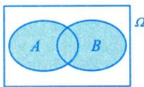

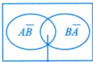  
AB

注 (1) 设 $A_{1}, A_{2}, A_{3}$ 为任意三个事件, 则有

$$
P \left(A _ {1} \bigcup A _ {2} \bigcup A _ {3}\right) = P \left(A _ {1}\right) + P \left(A _ {2}\right) + P \left(A _ {3}\right) - P \left(A _ {1} A _ {2}\right) - P \left(A _ {1} A _ {3}\right) - P \left(A _ {2} A _ {3}\right) + P \left(A _ {1} A _ {2} A _ {3}\right).
$$

(2)若 ${A}_{1},{A}_{2},\cdots ,{A}_{n}$ 是两两互不相容的事件,则有 丙两互斥

$$
P \left(A _ {1} \cup A _ {2} \cup \dots \cup A _ {n}\right) = P \left(A _ {1}\right) + P \left(A _ {2}\right) + \dots + P \left(A _ {n}\right).
$$

(3) 减法公式: $P(A - B) = P(A) - P(AB) = P(A\overline{B})$ .

排除掉 $P(A) = 0$ ，是因为它值

往出现在分母位置

★★★(4)条件概率公式：设 $A$ ， $B$ 为任意两个事件，若 $P(A) > 0$ ，我们称在已知事件 $A$ 发生的条件下，事件 $B$ 发生的概率为条件概率，记为 $P(B|A)$ ，且

$$
P (B \mid A) = \frac {P (A B)}{P (A)}.
$$

注 (1)条件概率 $P(\cdot |A)$ 是概率，概率的一切性质和结论对条件概率都适用.

例如，

$$
P (\overline {{B}} \mid A) = 1 - P (B \mid A),
$$

$$
P [ (B - C) \mid A ] = P (B \mid A) - P (B C \mid A),
$$

等等.

(2)条件概率就是在一定的附加条件之下所计算的概率.当说到“条件概率”时，总是指另外附加了条件，其形式可归结为“已知某事件发生了”.（或当……时）

区分：① 有一个单位长度的质杆，任意切两刀，截成三段。

② 一个长度为1的质杆，先切一刀，把它分成两段之后，再对剩下的任意一段切一刀。以上两种说法不一致。

(5)乘法公式：如果 $P(A) > 0$ ，则 $P(AB) = P(A)P(B\mid A)$

一般地，对于 $n > 2$ ，如果 $P(A_{1}A_{2}\dots A_{n - 1}) > 0$ ，则

$$
P \left(A _ {1} A _ {2} \dots A _ {n}\right) = P \left(A _ {1}\right) P \left(A _ {2} \mid A _ {1}\right) P \left(A _ {3} \mid A _ {1} A _ {2}\right) \dots P \left(A _ {n} \mid A _ {1} A _ {2} \dots A _ {n - 1}\right).
$$

如： $P(A_{1}A_{2}) > 0$ ，则 $P(A_{1}A_{2}A_{3}) = P(A_{1})P(A_{2}|A_{1})P(A_{3}|A_{1}A_{2}).$

金集分解思想示例：一个

村子和三个小偷的故事。

★★★(6)全概率公式：如果 $\bigcup_{i = 1}^{n}A_{i} = \Omega$ ， $A_{i}A_{j} = \emptyset (i\neq j;i,j = 1,2,\dots ,n),P(A_{i}) > 0$ ，则对任一事件B，有

$$
\text {存 在} n = \infty \text {的 情 形} \quad B = \bigcup_ {i = 1} ^ {n} A _ {i} B, P (B) = \sum_ {i = 1} ^ {n} P (A _ {i}) P (B \mid A _ {i}).
$$

示例 一个村子和三个小偷的故事。

现实中不会出现成功概率为0的小偷

假设一个村子有3个小偷，一个叫小张，一个叫小英，一个叫小郑，小张偷东西成功的概率为0，小英偷东西成功的概率为 $\frac{3}{4}$ ，小郑偷东西成功的概率为 $\frac{1}{6}$ ，派一个人去偷东西.

现记 $A_{i} = \{\text{第} i$ 个人去偷东西 $\}$ ， $i = 1,2,3$

$$
B = \{\text {村 子 失 窃} \}.
$$

(1)求村子失窃的概率；  
(2)若事件 $B$ 已经发生了，即发生了失窃，那么现在第 $i$ 个人去偷的概率 $P(A_{i} \mid B)$ 是多少呢？

用贝叶斯公式，也叫逆概率公式。

(1) $B$ 事件比较复杂, 它的复杂性在于它不是一个可能原因导致的. 这里有三个原因, 都可以导致结果. 但是每个原因导致结果的能力还不一样. 所以在概率论里, 我们提出了一个重要的思想, 即全集分解思想.

(2)当 $B$ 事件非常复杂的时候，它实际上属于整个试验的第二个阶段.

第一个阶段，选人，选哪个人去偷；第二个阶段，失窃，偷东西偷成功了。

解

(1)

第一阶段 $A_{1}, A_{2}, A_{3}$ 第二阶段 $B$

失窃原因的全集

完备事件组：保证不重不漏.所谓不重，就是任何两个事件的交集是空集或者说没有公共的元素；不漏也就是所有的事件并起来，最后是全集，我们叫这个事件组为一个完备事件组

$$
\begin{array}{l} P (B) = P (B \Omega) = P \left[ B \left(A _ {1} \cup A _ {2} \cup A _ {3}\right) \right] \\ = \overline {{P}} \left(B A _ {1} \cup B A _ {2} \cup B A _ {3}\right) \\ = P \left(B A _ {1}\right) + P \left(B A _ {2}\right) + P \left(B A _ {3}\right) \\ = P \left(A _ {1}\right) P \left(B \mid A _ {1}\right) + P \left(A _ {2}\right) P \left(B \mid A _ {2}\right) + P \left(A _ {3}\right) P \left(B \mid A _ {3}\right) \\ \end{array}
$$

$P(B|A_{i})$ 代表第 $i$ 个人偷成功的概率，且 $\sum P(B|A_i)$ 无要求

$$
= \frac {1}{3} \times 0 + \frac {1}{3} \times \frac {3}{4} + \frac {1}{3} \times \frac {1}{6} = \frac {1 1}{3 6}.
$$

根据事件的基本运算法律

完备事件组是互斥的

在没有任何附加信息的条件下，只好认为三个人去偷具有等可能性（当然有的题目可能不具有等可能性，但具体的题目会告知），所以

$$
P \left(A _ {i}\right) = \frac {1}{3}, i = 1, 2, 3
$$

(2) $P(A_{i} \mid B) = \frac{P(A_{i} B)}{P(B)} = \frac{P(A_{i}) P(B \mid A_{i})}{\sum_{i=1}^{3} P(A_{i}) P(B \mid A_{i})}, i = 1, 2, 3,$

故 $P(A_{1} \mid B) = \frac{0}{\frac{11}{36}} = 0, P(A_{2} \mid B) = \frac{\frac{1}{4}}{\frac{11}{36}} = \frac{1}{4} \times \frac{36}{11} = \frac{9}{11},$

$$
P (A _ {3} \mid B) = \frac {\frac {1}{1 8}}{\frac {1 1}{3 6}} = \frac {1}{1 8} \times \frac {3 6}{1 1} = \frac {2}{1 1}.
$$

注 (1)对比. ① 在村子没有失窃的情况下，那三个原因具有等可能性，即在没有任何信息的情况下，并不知道哪个人去偷，所以只能认为他们具有等可能性。  
② 当信息增加时，即当我们获取了一定信息的时候，比如知道村子丢东西了，当这个信息进来以后，第 $i$ 个人偷盗的这三个事件发生的概率就悄然发生了变化。  
(2) 总结. 在整个试验过程中，当我们增加一些信息的时候，原来所谓的在没有任何信息的条件下所设立的那些可能性，在信息增加之后，它们的概率就随之变化. 这是很重要的一个思想，叫作逆概率公式（执果索因）. 发生变化的原因是权重发生了变化.

存在 $n = \infty$ 的情形

(7) 贝叶斯公式（又称逆概率公式）：如果 $\bigcup_{i=1}^{n} A_i = \Omega$ ， $A_i A_j = \emptyset (i \neq j; i, j = 1, 2, \dots, n)$ ， $P(A_i) > 0$ ，则对任一事件 $B$ ，只要 $P(B) > 0$ ，就有

$$
P (A _ {j} \mid B) = \frac {P (A _ {j}) P (B \mid A _ {j})}{\sum_ {i = 1} ^ {n} P (A _ {i}) P (B \mid A _ {i})} (j = 1, 2, \dots , n).
$$

方法总结 如果一个事件或者说一个结果的发生是复杂的，它是由多个原因引起的，那么这个时候一定要考虑到全集分解，把原因拉进来处理问题.

注全概率公式用于计算某个“结果” $B$ 发生的可能性大小.如果一个“结果” $B$ 的发生总是与多个“原因” $A_{i}$ 相联系，那么在计算 $P(B)$ 时，我们一般这样处理：

$$
B = B \Omega = B \left(\bigcup_ {i = 1} ^ {n} A _ {i}\right) = \bigcup_ {i = 1} ^ {n} A _ {i} B,
$$

然后应用全概率公式计算 $P(B)$ ，我们常称这种方法为全集分解法.如果在“结果” $B$ 发生的条件下，探求导致这一“结果”的各种“原因”，即 $A_{i}$ 发生的可能性大小 $P(A_{i}|B)$ ，则要应用贝叶斯公式.

在引入随机变量之后，还有相应的很多场合要用到全集分解思想。

例1.5 设 $A, B$ 为两个随机事件，则（ ）

(A) $P(AB) + P(\overline{A}\overline{B})\leqslant 1$

(B) $P(AB) + P(\overline{A}\overline{B})\geqslant 1$

(C) $P(A - B)\leqslant P(A) - P(B)$

(D) $P(A\bigcup B) + P(\overline{A}\bigcup \overline{B})\leqslant 1$

解 应选(A).

本题涉及事件之间的关系，由于 $AB\subset A\bigcup B$ ，即有 $P(AB)\leqslant P(A\bigcup B)$ ，从而有

$$
P (A B) \leqslant P (A \bigcup B) = 1 - P (\overline {{A \bigcup B}}) = 1 - P (\overline {{A B}}), \quad P (\overline {{\overline {{A B}}}}) = P (A \bigcup B)
$$

即 $P(AB) + P(\overline{A}\overline{B})\leqslant 1$ ，同时有

$$
P (A \cup B) - P (A B) = P (A \cup B) + P (\overline {{A B}}) - 1 = P (A \cup B) + P (\bar {A} \cup \bar {B}) - 1 \geqslant 0,
$$

即 $P(A\bigcup B) + P(\overline{A}\bigcup \overline{B})\geqslant 1,\longrightarrow 1 - P(\overline{A}\bigcup \overline{B}) = P(\overline{\overline{A}}\bigcup \overline{\overline{B}}) = P(AB)$

知选项(B)，(D)不正确.又 $AB\subset B$ ，有 $P(AB)\leqslant P(B)$ ，从而有

$$
P (A - B) = P (A) - P (A B) \geqslant P (A) - P (B),
$$

知选项(C)不正确，故选择(A).

例1.6 设随机事件 $A, B$ 满足 $P(A) = P(B) = \frac{1}{2}$ 和 $P(A \cup B) = 1$ ，则有（ ）

(A) $A\bigcup B = \Omega$

(B) $AB = \emptyset$

(C) $P(\overline{A}\cup \overline{B}) = 1$

(D) $P(A - B) = 0$

解 应选(C).

前面已经指出， $P(A\bigcup B) = 1$ 不能推出 $\underline{A\bigcup B} = \Omega$ ，且 $P(AB) = P(A) + P(B) - P(A\bigcup B) = 0$ 不能推出 $AB = \varnothing$ .故选项(A)，(B)不正确.

不代表是不可能事件，比如8：00~9：00时段恰好在8：30进入教室，这个事情是可以发生的，但概率为0

又 $P(A - B) = P(A) - P(AB) = \frac{1}{2}$ ，选项(D)不正确.从而 $P(\overline{A} \cup \overline{B}) = P(\overline{AB}) = 1 - P(AB) = 1$ ，选(C).

例1.7 设 $A, B, C$ 是三个随机事件， $A$ 与 $C$ 互斥， $P(AB) = \frac{1}{2}$ ， $P(C) = \frac{1}{3}$ ，则 $P(AB|\overline{C}) =$

分析 考查全概率公式及单调性.

解 应填 $\frac{3}{4}$

$$
0 \leqslant P (A B C) \leqslant P (A C) = 0
$$

因为 $A$ 与 $C$ 互斥，所以 $P(AC) = 0$ .又 $ABC\subset AC$ ，所以 $P(ABC) = 0$ ，故

$$
P (A B \mid \overline {{C}}) = \frac {P (\overline {{A B C}})}{P (\overline {{C}})} = \frac {P (A B) - P (A B C)}{1 - P (C)} = \frac {\frac {1}{2}}{1 - \frac {1}{3}} = \frac {3}{4}.
$$

注 由于 $AC = \emptyset$ ，则 $ABC = \emptyset B = \emptyset$ ，得到 $P(ABC) = 0$ ：

例1.8 已知 $P(A) = \frac{1}{4}, P(B|A) = \frac{1}{3}, P(A|B) = \frac{1}{2}$ ，则 $P(A\cup B) =$

分析 从求解所需的条件出发，进行分析.

解 应填 $\frac{1}{3}$

由乘法公式知

$$
P (A B) = P (A) P (B \mid A) = \frac {1}{4} \times \frac {1}{3} = \frac {1}{1 2}, P (B) = \frac {P (A B)}{P (A \mid B)} = \frac {1 / 1 2}{1 / 2} = \frac {1}{6},
$$

所以 $P(A\bigcup B) = P(A) + P(B) - P(AB) = \frac{1}{4} +\frac{1}{6} -\frac{1}{12} = \frac{1}{3}.$

例1.9

某人给四位亲友各写一封信，然后随机地装入4个写好地址的信封中，且每个信封装

一封信.问：

①那就是 ${A}_{1},{A}_{2},{A}_{3},{A}_{4}$ 四个事件同时发生,是“且”关系,即第一封信装对, 且第二封信装对,且第三封信装对,且第四封信装对,用乘法公式.

(1)4封信都装对了的概率；

②对立事件：至少有一封信装错了，而不是全部装错了

(2)4封信都装错了的概率.

解设事件 $A_{i}(i = 1,2,3,4)$ 为“第 $i$ 封信装对了”，事件 $A$ 为“4封信都装对了”，事件 $B$ 为“4封信都装错了”。于是

(1) $P(A) = P(A_{1}A_{2}A_{3}A_{4}) = P(A_{1})P(A_{2}|A_{1})P(A_{3}|A_{1}A_{2})P(A_{4}|A_{1}A_{2}A_{3})$

$$
= \frac {1}{4} \times \frac {1}{3} \times \frac {1}{2} \times \frac {1}{1} = \frac {1}{2 4}.
$$

(2) $P(B) = P(\overline{A}_1\overline{A}_2\overline{A}_3\overline{A}_4)$

德·摩根公式 $\overline{A\cap B} = \overline{A}\cup \overline{B}$

$$
= 1 - P (\overline {{A _ {1} A _ {2} A _ {3} A _ {4}}}) = 1 - P (\bigcup A _ {1} \bigcup A _ {2} \bigcup A _ {3} \bigcup A _ {4})
$$

$$
= 1 - \left\{P \left(A _ {1}\right) + P \left(A _ {2}\right) + P \left(A _ {3}\right) + P \left(A _ {4}\right) - \right.
$$

$$
\begin{array}{l} \left[ P \left(A _ {1} A _ {2}\right) + P \left(A _ {1} A _ {3}\right) + P \left(A _ {1} A _ {4}\right) + P \left(A _ {2} A _ {3}\right) + P \left(A _ {2} A _ {4}\right) + P \left(A _ {3} A _ {4}\right) \right] + \\ \left. \left[ P \left(A _ {1} A _ {2} A _ {3}\right) + P \left(A _ {1} A _ {2} A _ {4}\right) + P \left(A _ {1} A _ {3} A _ {4}\right) + P \left(A _ {2} A _ {3} A _ {4}\right) \right] - P \left(A _ {1} A _ {2} A _ {3} A _ {4}\right) \right\}, \\ \end{array}
$$

其中 $P(A_{i}) = \frac{1}{4}$ ， $P(A_{i}A_{j}) = \frac{1}{4}\times \frac{1}{3} = \frac{1}{12},P(A_{i}A_{j}A_{k}) = \frac{1}{4}\times \frac{1}{3}\times \frac{1}{2} = \frac{1}{24}(1\leqslant i,j,k\leqslant 4,i\neq j\neq k)$ ，于是

$$
P (B) = 1 - 4 \times \frac {1}{4} + 6 \times \frac {1}{1 2} - 4 \times \frac {1}{2 4} + \frac {1}{2 4} = \frac {3}{8}.
$$

注本题装信过程可看作无放回抽取信件，依次装入信封.在计算第(2)问时，直接计算较为困难，这种情况下，采用逆向思维方法求解问题更加简捷.

例1.10 从1，2，3，4中任取一个数，记为 $X$ ，再从1,…， $X$ 中任取一个数，记为 $Y$ ，则 $P\{Y = 2\} = \_ .$

解 应填 $\frac{13}{48}$

$$
P \{X = i \} = \frac {1}{4}, i = 1, 2, 3, 4,
$$

$$
P \left\{Y = 2 \mid X = 1 \right\} = 0, P \left\{Y = 2 \mid X = 2 \right\} = \frac {1}{2}, P \left\{Y = 2 \mid X = 3 \right\} = \frac {1}{3}, P \left\{Y = 2 \mid X = 4 \right\} = \frac {1}{4},
$$

故 $P\{Y = 2\} = \sum_{i = 1}^{4}P\{X = i\} P\{Y = 2|X = i\} = \frac{1}{4}\times 0 + \frac{1}{4}\times \frac{1}{2} +\frac{1}{4}\times \frac{1}{3} +\frac{1}{4}\times \frac{1}{4} = \frac{13}{48}.$

例1.11 一批产品有10个正品和2个次品，任意抽取两次，每次抽一个，抽出后不再放回，则第二次抽出的是次品的概率为 先后不放回取两次

解 应填 $\frac{1}{6}$

记 $A_{i} = \{$ 第 $i$ 次取得次品 $\}$ ， $i = 1,2$ ，则由已知得

$$
P (A _ {1}) = \frac {2}{1 2} = \frac {1}{6}, P (\overline {{A}} _ {1}) = \frac {1 0}{1 2} = \frac {5}{6}, P (A _ {2} | A _ {1}) = \frac {1}{1 1}, P (A _ {2} | \overline {{A}} _ {1}) = \frac {2}{1 1}.
$$

由全概率公式得 $P(A_{2}) = P(A_{1})P(A_{2}|A_{1}) + P(\overline{A}_{1})P(A_{2}|\overline{A}_{1}) = \frac{1}{6}\times \frac{1}{11} +\frac{5}{6}\times \frac{2}{11} = \frac{1}{6}.$

注此例为抓阁模型：有12个可辨产品（10个正品和2个次品）放入12个格子，每个格子放1个产品，则放法总数为12！，现只关注第2个格子放两个次品中的一个，则放法总数为 $C_2^1\cdot 1\cdot 11!$ 故 $p = \frac{C_2^1\cdot 1\cdot 11!}{12!} = \frac{1}{6}$ ，此过程与结果表明，从第1次到第12次取到次品的概率均为 $\frac{1}{6}$ 即亦可用例1.3(4)的结论直接得出结果 $\frac{1}{6}$

结果已知，正品可能来自第一批，

也可能来自第二批

例1.12 设有两批数量相同的零件，已知有一批产品全部合格，另一批产品有 $25\%$ 不合格。从两批产品中任取1只，经检验是正品，放回原处，并从原所在批次再取1只，求这只产品是次品的概率。分析两次抽取情况有不同之处，第一次是在完全不知情的情况下等可能地从两批产品中抽取，第二次是在第一次抽取产品并检验合格后，这时对所抽取是第一批还是第二批产品的概率已有计算，因此计算要分两步走。第一步：在已知抽取产品合格的条件下，计算抽取的是第一批还是第二批产品的概率，属于贝叶斯概型；第二步：事件“从第一批产品中抽取”和“从第二批产品中抽取”构成一个完备事件组，计算第二次抽到次品的概率，属于全概率概型。两个概型的复合，常常是该类题型的特点。

解 记 $H_{i} = \{\text{第一次从第} i\text{批产品中抽取}\}$ ， $i = 1,2$ ， $P(H_{1}) = P(H_{2}) = \frac{1}{2}$ （等可能性）

再记 $A = \{$ 取到正品 $\}$ ，则 $P(A|H_1) = 1, P(A|H_2) = \frac{3}{4}$ ，即

$$
P (A) = P \left(H _ {1}\right) P \left(A \mid H _ {1}\right) + P \left(H _ {2}\right) P \left(A \mid H _ {2}\right) = \frac {7}{8}.
$$

又记 $C_i = \{$ 第二次从第 $i$ 批产品中抽取 $\}$ ， $i = 1,2$ ，则有

$A$ 已经发生了

P(C1)=P(H1|A) P(H1A) P(H1)P(A|H1) 执果索因

$\star P(C_2) = P(H_2|A) = \frac{P(H_2A)}{P(A)} = \frac{P(H_2)P(A|H_2)}{P(A)} = \frac{3}{7}.$

则 $P(\overline{A}) = P(C_1)P(\overline{A} |C_1) + P(C_2)P(\overline{A} |C_2) = \frac{4}{7}\times 0 + \frac{3}{7}\times \frac{1}{4} = \frac{3}{28}.$

# 四 事件的独立性和独立重复试验

# 事件的独立性

$\left. \begin{array}{c} P\left( {AB}\right)  > P\left( A\right) P\left( B\right) \\   \rightarrow  P\left( {AB}\right)  < P\left( A\right) P\left( B\right)  \end{array}\right\}   \rightarrow$ 不独立

设 $A, B$ 为两个事件，如果 $P(AB) = P(A)P(B)$ ，则称事件 $A$ 与 $B$ 相互独立，简称 $A$ 与 $B$ 独立。

(1) 表示两个事件相互独立的其他形式.

① 若 $P(A) > 0, P(B \mid A) = \frac{P(AB)}{P(A)} = \frac{P(A)P(B)}{P(A)} = P(B)$ .

$A$ 是否发生,不影响 $B$ 发生的概率

② $P(A) = 0$

若 $P(A) = 0$ ，且 $AB\subset A$ ，则 $0\leqslant P(AB)\leqslant P(A) = 0$ ，故 $P(AB) = 0$ ，即 $P(AB) = P(A)P(B)$ 依然成立.

(2) 两个事件不相互独立时.

$\frac{P\left( {AB}\right) }{P\left( A\right) } < \frac{P\left( A\right) P\left( B\right) }{P\left( A\right) }$ ①若 $P\left( {AB}\right)  > P\left( A\right) P\left( B\right)$ ,则 $P\left( {B \mid  A}\right)  > P\left( B\right)$ ,

(A有利于 $B$ 的发生)相互有利

$②$ 若 $P(AB) <   P(A)P(B)$ ，则 $P(B\mid A) <   P(B)$ 相互抑止

注 设 $A_{1}, A_{2}, \cdots, A_{n}$ 为 $n (n \geqslant 2)$ 个事件，如果对其中任意有限个事件 $A_{i_{1}}, A_{i_{2}}, \cdots, A_{i_{k}} (2 \leqslant k \leqslant n)$ ，有

$$
P \left(A _ {i _ {1}} A _ {i _ {2}} \dots A _ {i _ {k}}\right) = P \left(A _ {i _ {1}}\right) P \left(A _ {i _ {2}}\right) \dots P \left(A _ {i _ {k}}\right),
$$

则称 $n$ 个事件 $A_{1}, A_{2}, \dots, A_{n}$ 相互独立.

考研中常考的是 $n = 3$ 时的情形. 细致说来，设 $A_{1}, A_{2}, A_{3}$ 为三个事件，若

$$
P \left(A _ {1} A _ {2}\right) = P \left(A _ {1}\right) P \left(A _ {2}\right), \tag {1-1}
$$

$$
P \left(A _ {1} A _ {3}\right) = P \left(A _ {1}\right) P \left(A _ {3}\right), \tag {1-2}
$$

$$
P \left(A _ {2} A _ {3}\right) = P \left(A _ {2}\right) P \left(A _ {3}\right), \tag {1-3}
$$

$$
P \left(A _ {1} A _ {2} A _ {3}\right) = P \left(A _ {1}\right) P \left(A _ {2}\right) P \left(A _ {3}\right), \tag {1-4}
$$

则称事件 $A_{1}, A_{2}, A_{3}$ 相互独立. 当去掉上述(1-4)式后，称只满足(1-1)，(1-2)，(1-3)式的事件 $A_{1}, A_{2}, A_{3}$ 两两独立. 见例1.13.

# 独立性的判定

$A, B, C$ 相互独立.

$\overline{A}, \overline{B}, \overline{C}$ 也相互独立

① $A$ 与 $B$ 相互独立 $\overset{\left( *\right) }{ \Leftrightarrow  }A$ 与 $\bar{B}$ 相互独立 $\Leftrightarrow  \bar{A}$ 与 $B$ 相互独立 $\Leftrightarrow  \bar{A}$ 与 $\bar{B}$ 相互独立. 夫唱归随

注 (1) 仅证 $(*)$ ，由 $A, B$ 独立，有 $P(AB) = P(A)P(B)$ ，于是

$$
\begin{array}{l} P (A \bar {B}) = P (A) - P (A B) = P (A) - P (A) P (B) \\ = P (A) [ 1 - P (B) ] = P (A) P (\bar {B}), \\ \end{array}
$$

故 $A, \overline{B}$ 独立，其余证明同理.

(2)将相互独立的事件组中的任意几个事件换成各自的对立事件，所得的新事件组仍相互独立.

② 对独立事件组不含相同事件作运算，得到的新事件组仍独立，如 $A, B, C, D$ 相互独立，则 $AB$ 与 $CD$ 相互独立， $A$ 与 $BC - D$ 相互独立.

注 直接使用，无须证明。

③若 $P(A) = 0$ 或 $P(A) = 1$ ，则 $A$ 与任意事件 $B$ 相互独立. 不可能事件或必然事件和任意事件独立

注证若 $P(A) = 0$ ，由 $P(AB)\leqslant P(A)\leqslant P(A + B)$ ，有 $0\leqslant P(AB)\leqslant P(A) = 0$ ，则 $P(AB) = 0$ ，于是 $P(A)P(B) = P(AB)$

若 $P(A) = 1$ ，则 $P(\overline{A}) = 1 - P(A) = 0$ ，又由 $P(B\overline{A}) \leqslant P(\overline{A}) \leqslant P(\overline{A} + B)$ ，有 $0 \leqslant P(B\overline{A}) \leqslant P(\overline{A}) = 0$ ，知 $P(B\overline{A}) = 0$ ，又 $P(B\overline{A}) = P(B) - P(AB)$ ，故 $P(B) = P(AB)$ ，即 $P(A)P(B) = P(AB)$ ：

# 3 独立试验序列概型与 $n$ 重伯努利概型 $\xrightarrow{\text{化态}}\mathrm{Ber} - E_{n}$ 数字

在同样条件下独立重复地进行一系列完全相同的试验, 即每次试验的可能结果及其发生的概率都不变, 每次试验是相互独立的, 称这种重复试验序列的概率模型为独立试验序列概型. 如果每次试验只有两个结果 $A$ 与 $\bar{A}$ , 且在每次试验中 $A$ 发生的概率都相等 (即 $P(A) = p$ ), 将这种试验独立重复 $n$ 次, 则称这种试验的概率模型为 $n$ 重伯努利概型.

投篮，投 $n$ 次，投中 $k$ 次，

$$
P \{X = k \} = C _ {n} ^ {k} p ^ {k} (1 - p) ^ {n - k}, k = 0, 1, \dots , n
$$

②每次试验 $A$ 发生的概率 $p = P(A)$ 不变；  
③试验独立重复进行 $n$ 次

例1.13 将一枚硬币独立地掷两次，引进事件： $A_{1} = \{$ 掷第一次出现正面 $\}$ ， $A_{2} = \{$ 掷第二次出现正面 $\}$ ， $A_{3} = \{$ 正反面各出现一次 $\}$ ， $A_{4} = \{$ 正面出现两次 $\}$ ，则事件（ ）

(A) $A_{1}, A_{2}, A_{3}$ 相互独立

(B) $A_{2}, A_{3}, A_{4}$ 相互独立

(C) $A_{1}, A_{2}, A_{3}$ 两两独立

(D) $A_{2}, A_{3}, A_{4}$ 两两独立

解 应选(C).

由题可知， $\Omega = \{\text{正正，正反，反正，反反}\}$

则 $P(A_{1}) = \frac{1}{2}, P(A_{2}) = \frac{1}{2}, P(A_{3}) = \frac{1}{2}, P(A_{4}) = \frac{1}{4},$

$$
P \left(A _ {1} A _ {2}\right) = \frac {1}{4}, P \left(A _ {1} A _ {3}\right) = \frac {1}{4}, P \left(A _ {2} A _ {3}\right) = \frac {1}{4},
$$

但 $P(A_{1}A_{2}A_{3}) = 0\neq P(A_{1})P(A_{2})P(A_{3}),$ 故 $A_{1},A_{2},A_{3}$ 两两独立，但三者不相互独立.

又 $A_{3}A_{4} = \emptyset$ ， $P(A_4) = \frac{1}{4}$ ， $P(A_{3}) = \frac{1}{2}$ ， $P(A_{3}A_{4}) = 0\neq P(A_{3})P(A_{4})$ ，知 $A_{2},A_{3},A_{4}$ 不两两独立，也不相互独立.

例1.14 对同一目标接连进行3次独立重复射击，假设至少命中目标一次的概率为 $\frac{7}{8}$ ，则每次射击命中目标的概率 $p =$

解 应填 $\frac{1}{2}$

记 $A_{i} = \{$ 第 $i$ 次命中目标 $\}$ ， $i = 1,2,3$ ，且 $P(A_{1}\bigcup A_{2}\bigcup A_{3}) = \frac{7}{8}$ ，故

$$
\begin{array}{l} 1 - P \left(\bar {A} _ {1} \bar {A} _ {2} \bar {A} _ {3}\right) = 1 - P \left(\bar {A} _ {1}\right) P \left(\bar {A} _ {2}\right) P \left(\bar {A} _ {3}\right) \\ = 1 - (1 - p) ^ {3} = \frac {7}{8}, \\ \end{array}
$$

则 $p = \frac{1}{2}$

例1.15 某人向同一目标独立重复射击，每次命中目标的概率为 $p(0 < p < 1)$ ，则此人第4次射击恰好第2次命中目标的概率为（）.

(A) $3p(1 - p)^{2}$   
(B) $6p(1 - p)^{2}$   
(C) $3p^{2}(1 - p)^{2}$   
(D) $6p^{2}(1 - p)^{2}$

分析

$$
\begin{array}{c c c c} \checkmark & \times & \times & \checkmark \\ \times & \checkmark & \times & \checkmark \\ \times & \times & \checkmark & \checkmark \\ \hline & & & \end{array}
$$

解 应选(C).

依题设，4次射击，最后一次命中，前3次有一次命中.若设前3次射击有 $X$ 次命中，则 $X\sim B(3,p)$ ，且有

$$
P \{X = 1 \} = \mathrm {C} _ {3} ^ {1} p (1 - p) ^ {2}.
$$

于是第4次射击恰好第2次命中目标的概率为 $3p^{2}(1 - p)^{2}$ ，故选择(C).

# 基础习题精练

# 习题

1.1 设 $A, B, C$ 是任意三个事件，则下列选项中正确的是（ ）

(A) 若 $A \cup C = B \cup C$ ，则 $A = B$

(B) 若 $A - C = B - C$ ，则 $A = B$

(C) 若 $AC = BC$ ，则 $A = B$

(D) 若 $AB = \varnothing$ 且 $\overline{A}\overline{B} = \varnothing$ ，则 $\overline{A} = B$

1.2 设 $A$ 和 $B$ 是任意两个事件.

① 若 $P(A) = P(B)$ ，则 $A = B$ ；  
② 若 $P(AB) = 0$ ，则 $AB = \varnothing$

则关于两个命题的结论，正确的是（ ）

(A) ①正确，②不正确

(B) ①不正确，②正确

(C) ①, ②均正确

(D) ①, ②均不正确

1.3 考虑一元二次方程 $x^{2} + Bx + C = 0$ ，其中 $B, C$ 分别是将一枚骰子接连抛两次先后出现的点数，则该方程有实根的概率为（）.

(A) $\frac{19}{36}$

(B) $\frac{17}{36}$

(C) $\frac{15}{36}$

(D) $\frac{13}{36}$

1.4 甲口袋有5个白球、3个黑球，乙口袋有4个白球、6个黑球。从两个口袋中各任取一个球，则取到的两个球颜色相同的概率为（）

(A) $\frac{19}{40}$

(B) $\frac{21}{40}$

(C) $\frac{1}{4}$

(D) $\frac{9}{40}$

1.5 设 $A, B, C$ 为三个随机事件，且 $A$ 与 $C$ 相互独立， $B$ 与 $C$ 相互独立，则 $A \cup B$ 与 $C$ 相互独立的充分必要条件是（）.

(A) $A$ 与 $B$ 相互独立

(B) $A$ 与 $B$ 互不相容

(C) $AB$ 与 $C$ 相互独立

(D) $AB$ 与 $C$ 互不相容

# 考研数学基础30讲·概率论与数理统计分册

1.6 随机地向半圆 $0 < y < \sqrt{2ax - x^2} (a > 0)$ 内投掷一点，点均匀落在半圆内任何一个区域，则该点和原点连线同 $x$ 轴的夹角 $\theta \leqslant \frac{\pi}{4}$ 的概率为  
1.7 从[0,1]中随机地取两个数，其积大于 $\frac{1}{4}$ ，其和小于 $\frac{5}{4}$ 的概率为  
1.8 已知事件 $A, B$ 满足 $P(AB) = P(\overline{A} \cap \overline{B})$ ，记 $P(A) = p$ ，则 $P(B) =$ ______.  
1.9 已知 $P(A) = 0.7$ ， $P(A - B) = 0.3$ ，则 $P(\overline{AB}) = \_ .$   
1.10 已知 $P(\overline{A}) = 0.3, P(B) = 0.4, P(A\overline{B}) = 0.5$ ，则 $P(B|A \cup \overline{B}) =$   
1.11 设 $A, B$ 为两个随机事件，且 $P(A) = 0.4, P(A \cup B) = 0.7$ 。若 $A, B$ 互不相容，则 $P(B) =$ ______；若 $A, B$ 相互独立，则 $P(B) =$ ______；若 $A$ 发生 $B$ 必发生，则 $P(B) =$ ______。  
1.12 三人独立地破译一个密码，他们能单独译出的概率分别为 $\frac{1}{5}, \frac{1}{3}, \frac{1}{4}$ ，则此密码被译出的概率为  
1.13 甲、乙两人独立地对同一目标射击一次，其命中率分别为0.6和0.7。现已知目标被击中，则它是甲射中的概率为  
1.14 用事件 $A, B, C$ 的运算关系表示事件：① $A, B, C$ 都不发生；② $A, B, C$ 不都发生；③ $A, B, C$ 不多于一个发生。  
1.15 设 $X, Y$ 为随机变量，事件 $A$ 表示 $\{X \geqslant c\}$ ，事件 $B$ 表示 $\{Y \geqslant c\}$ 。用 $A, B$ 表示下列事件：

D: $\{\max \{X,Y\} \geqslant c\}$ .E: $\{\min \{X,Y\} \geqslant c\}$ .F: $\{\max \{X,Y\} <  c\}$ .G: $\{\min \{X,Y\} <  c\}$

1.16 判断下列命题是否成立，并说明理由.

(1) $A - (B - C) = (A - B)\bigcup C$   
(2) 若 $AB = \emptyset$ 且 $C \subset A$ ，则 $BC = \emptyset$   
(3) $(A\bigcup B) - B = A$   
(4) $(A - B)\bigcup B = A$

1.17 口袋中有 1 个球，不知它的颜色是黑的还是白的，现再往口袋中放入 1 个白球，然后从口袋中任意取出 1 个，发现取出的是白球，求口袋中原来那个球是白球的概率。  
1.18 已知装有同种零件的产品两箱，第一箱内装 50 件产品，其中一等品 10 件；第二箱内装 30 件产品，其中一等品 18 件，现从两箱中任意挑选一箱。求：从中先后取出两件产品（取后不放回），先取出的产品是一等品的概率 $p$ ；已知先取出的产品是一等品，那么第二次取出的产品仍然是一等品的概率 $q$ 。  
1.19 每箱产品有 10 件, 其次品数从 0 到 2 是等可能的, 开箱检验时, 从中任取 1 件, 如检验出是次品, 则认为该箱产品不合格而拒收. 假设由于检验有误, 将 1 件正品误认为次品的概率为 $2\%$ , 1 件次品被漏查而判为正品的概率为 $5\%$ , 求该箱产品通过验收的概率.

# 解答

1.1 (D) 解 方法一（直接法）对于选项(D)，由事件运算的对偶律，有 $\overline{A}\overline{B} = A\bigcup B = \varnothing = \Omega$ 而由 $A\bigcup B = \Omega$ 且 $AB = \emptyset$ ，可见 $A$ 和 $B$ 互为对立事件，即 $\overline{A} = B$ ，因此(D)正确.

方法二（排除法）前三个选项都不成立，只需分别举出反例。例如，由于 $A, B, C$ 是任意三个事件，若取 $A \neq B$ ，而 $C = \Omega$ 是必然事件，则 $A \cup C = B \cup C$ 且 $A - C = B - C$ ，但 $A \neq B$ ，从而 (A) 和 (B) 不成立。取 $A \neq B, C = \emptyset$ ，则 $AC = BC$ ，但 $A \neq B$ ，因此 (C) 不成立。从而选 (D)。

注 本题的结果反映了事件的运算与数的运算的不同之处.

1.2 (D) 解考虑向区间 $[0, 2]$ 上掷一随机点的试验. 令 $A = \{\text{随机点落入区间} [0, 1]\}$ , $B = \{\text{随机点落入区间} [1, 2]\}$ . 显然 $P(A) = P(B)$ , $P(AB) = 0$ , 然而 $A \neq B$ , $AB \neq \emptyset$ . 故两个命题均不正确, 选(D).

1.3 (A) 解 本题属于古典概型。由于很难套用现有概型模式或公式求解，一个最简单也是最直接的做法是数出总样本数和事件所含样本点数并计算比值，给出答案。事件所含样本点数可借助列表等手段列出各种可能的结果，然后数出事件所含样本点数。由于接连抛两次，每次都可能出现6个点数，因此其总样本数为 $6^2$ 。

方程有实根，即事件 $\{B^2 -4C\geqslant 0\}$ ，列表如下.

<table><tr><td>\( B^2 -4C \) \( B \)</td><td>1</td><td>2</td><td>3</td><td>4</td><td>5</td><td>6</td></tr><tr><td>1</td><td>-</td><td>-</td><td>-</td><td>-</td><td>-</td><td>-</td></tr><tr><td>2</td><td>0</td><td>-</td><td>-</td><td>-</td><td>-</td><td>-</td></tr><tr><td>3</td><td>+</td><td>+</td><td>-</td><td>-</td><td>-</td><td>-</td></tr><tr><td>4</td><td>+</td><td>+</td><td>+</td><td>0</td><td>-</td><td>-</td></tr><tr><td>5</td><td>+</td><td>+</td><td>+</td><td>+</td><td>+</td><td>+</td></tr><tr><td>6</td><td>+</td><td>+</td><td>+</td><td>+</td><td>+</td><td>+</td></tr></table>

其中事件 $\{B^2 -4C\geqslant 0\}$ 所含样本点数为19，则 $p = \frac{19}{36}$ ，故本题应选择(A).

1.4 (A) 解 从两个口袋中各取一个球，共有 $C_8^1 C_{10}^1$ 种等可能取法，而两个球颜色相同有两种情况：第一种是从甲口袋取出白球，从乙口袋也取出白球；第二种是从甲口袋取出黑球，从乙口袋也取出黑球，共有 $C_5^1 C_4^1 + C_3^1 C_6^1$ 种取法。于是 $P\{ \text{取到的两个球颜色相同} \} = \frac{5 \times 4 + 3 \times 6}{8 \times 10} = \frac{19}{40}$ 。

1.5 (C) 解 $A \cup B$ 与 $C$ 相互独立，即 $P[(A \cup B) \cap C] = P(A \cup B)P(C)$ .

由 $P[(A\bigcup B)\cap C] = P(AC\bigcup BC)$

$$
\begin{array}{l} = P (A C) + P (B C) - P (A C \cap B C) \\ = P (A) P (C) + P (B) P (C) - P (A B C), \\ \end{array}
$$

而 $P(A\bigcup B)P(C) = [P(A) + P(B) - P(AB)]P(C)$

$$
= P (A) P (C) + P (B) P (C) - P (A B) P (C),
$$

所以 $A\cup B$ 与 $C$ 相互独立的充分必要条件为 $P(ABC) = P(AB)P(C)$ ，即 $AB$ 与 $C$ 相互独立.应选(C).

1.6 $\frac{1}{2} +\frac{1}{\pi}$ 解由题设，半圆与直线 $y = x$ 的交点坐标为 $(a,a)$ ，如图1-3所示，阴影区域 $D$ 内任意点与原点连线同 $x$ 轴的夹角 $\theta \leqslant \frac{\pi}{4}$ ，因此所求概率为

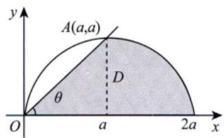  
图1-3

$$
P \{(x, y) \in D \} = \left(\frac {\pi a ^ {2}}{4} + \frac {a ^ {2}}{2}\right) / \frac {\pi a ^ {2}}{2} = \frac {1}{2} + \frac {1}{\pi}.
$$

1.7 $\frac{15}{32} -\frac{1}{2}\ln 2$ 解从[0,1]中随机地取两个数 $x$ 与 $y$ ，可以看成从图1-4所示正方形区域中任取一点，满足几何概型的两个特点.记 $\Omega = \{(x,y)|0\leqslant x\leqslant 1,$ $0\leqslant y\leqslant 1\} ,A = \left\{(x,y)\Bigg{|}x + y <   \frac{5}{4},xy > \frac{1}{4}\right\}$ ，对应图1-4中阴影部分.

$$
\begin{array}{l} P (A) = \frac {S _ {A}}{S _ {\Omega}} = \frac {\int_ {\frac {1}{4}} ^ {1} \left(\frac {5}{4} - x - \frac {1}{4 x}\right) \mathrm {d} x}{1} = \left(\frac {5}{4} x - \frac {1}{2} x ^ {2} - \frac {1}{4} \ln x\right) \Bigg | _ {\frac {1}{4}} ^ {1} \\ = \frac {1 5}{3 2} - \frac {1}{2} \ln 2. \\ \end{array}
$$

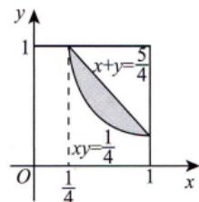  
图1-4

1.8 $1 - p$ 解因为

$$
P (A B) = P (\bar {A} \cap \bar {B}) = P (\overline {{A \cup B}}) = 1 - P (A \cup B) = 1 - P (A) - P (B) + P (A B),
$$

由此得 $1 - P(A) - P(B) = 0,$

所以 $P(B) = 1 - P(A) = 1 - p.$

1.9 0.6 解 因为 $0.3 = P(A - B) = P(A) - P(AB) = 0.7 - P(AB)$ ，由此得 $P(AB) = 0.7 - 0.3 = 0.4$ 所以

$$
P (\overline {{A B}}) = 1 - P (A B) = 0. 6.
$$

1.10 0.25 解由条件概率的定义知 $P(B \mid A \cup \overline{B}) = \frac{P(AB)}{P(A \cup \overline{B})}$ ，其中

$$
P (A \cup \bar {B}) = P (A) + P (\bar {B}) - P (A \bar {B}) = 0. 7 + 0. 6 - 0. 5 = 0. 8.
$$

又由 $P(\overline{A}\overline{B}) = P(A) - P(AB)$ ，可得

$$
P (A B) = P (A) - P (A \bar {B}) = 0. 7 - 0. 5 = 0. 2.
$$

代回原式，可得 $P(B\mid A\bigcup \overline{B}) = \frac{P(AB)}{P(A\bigcup\overline{B})} = \frac{0.2}{0.8} = 0.25.$

1.11 0.3；0.5；0.7解由加法公式，有 $P(A\bigcup B) = P(A) + P(B) - P(AB)$ ，于是：

若 $A, B$ 互不相容，则 $P(AB) = 0, P(B) = P(A \cup B) - P(A) = 0.3$

若 $A, B$ 相互独立，则 $P(AB) = P(A)P(B), P(A \cup B) = P(A) + P(B) - P(A)P(B)$ ，解得

$$
P (B) = \frac {P (A \bigcup B) - P (A)}{1 - P (A)} = 0. 5;
$$

若 $A$ 发生 $B$ 必发生，则 $P(B) = P(A \cup B) = 0.7$

1.12 $\frac{3}{5}$ 解 记事件 $A_{i}$ 为“第 $i$ 个人译出密码”， $i = 1, 2, 3$ ，事件 $B$ 为“密码被译出”。则

$$
\begin{array}{l} P (B) = P \left(A _ {1} \bigcup A _ {2} \bigcup A _ {3}\right) = 1 - P \left(\bar {A} _ {1} \bar {A} _ {2} \bar {A} _ {3}\right) \\ = 1 - \frac {4}{5} \times \frac {2}{3} \times \frac {3}{4} = \frac {3}{5}. \\ \end{array}
$$

注 互不相容可简化并事件的概率计算，相互独立可简化交事件的概率计算。这里为了利用相互独立性，把事件的并在对偶律下转化为事件的交，这一方法会经常用到。

1.13 0.682 解 记事件 $A$ 为“目标被击中”，事件 $B_{1}$ 为“甲射中目标”，事件 $B_{2}$ 为“乙射中目标”，因为 $A = B_{1} \cup B_{2}$ ，所以

$$
\begin{array}{l} P (A) = P \left(B _ {1} \cup B _ {2}\right) = P \left(B _ {1}\right) + P \left(B _ {2}\right) - P \left(B _ {1} B _ {2}\right) \\ = 0. 6 + 0. 7 - 0. 6 \times 0. 7 = 0. 8 8. \\ \end{array}
$$

考虑到 $B_{1} \subset A$ ，故有

$$
P \left(B _ {1} \mid A\right) = \frac {P \left(A B _ {1}\right)}{P (A)} = \frac {P \left(B _ {1}\right)}{P (A)} = \frac {0 . 6}{0 . 8 8} \approx 0. 6 8 2.
$$

1.14 解 ① $\{A, B, C$ 都不发生 $\} = \{A$ 不发生，且 $B$ 不发生，且 $C$ 不发生\}

$$
= \bar {A} \bar {B} \bar {C} = \bar {A} \bigcup B \bigcup C.
$$

② $\{A, B, C$ 不都发生 $\} = \{A, B, C$ 至少有一个不发生 $\}$

$= \{A,B,C$ 都发生}的逆事件

$$
= \bar {A} \cup \bar {B} \cup \bar {C} = \bar {A B C}.
$$

# 考研数学基础30讲·概率论与数理统计分册

③ $\{A, B, C$ 不多于一个发生 $\} = \{A, B, C$ 至多有一个发生 $\}$

$$
\begin{array}{l} = \{A, B, C \text {至 少 有 两 个 不 发 生} \} \\ = \bar {A} \bar {B} \cup \bar {A} \bar {C} \cup \bar {B} \bar {C} = A \bar {B} \bar {C} \cup \bar {A} B \bar {C} \cup \bar {A} \bar {B} C \cup \bar {A} \bar {B} \bar {C}. \\ \end{array}
$$

1.15 解 $D = A \cup B$ （即 $X, Y$ 中至少有一个 $\geqslant c$ ）

$E = A\cap B$ （即 $X,Y$ 都要 $\geqslant c$ ）

$F = \overline{D} = \overline{A}\cap \overline{B}$ （即 $X$ ，Y都要 $<  c$ ）

$G = \overline{E} = \overline{A}\bigcup \overline{B}$ （即 $X,Y$ 中至少有一个 $<  c$

1.16 解 (1) 不成立. $A - (B - C) = A - B\overline{C} = A\overline{B}\overline{C} = A(\overline{B}\bigcup C) = A\overline{B}\bigcup AC = (A - B)\bigcup AC \neq (A - B)\bigcup C;$ 也可由图1-5快速判断.

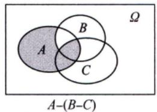  
(a)

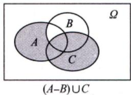  
(b)   
图1-5

(2) 成立. 因 $C \subset A$ , 有 $BC \subset AB = \emptyset$ , 故 $BC = \emptyset$ .  
(3) 不成立. 因 $(A \cup B) - B = (A \cup B)\overline{B} = A\overline{B} \cup B\overline{B} = A\overline{B} = A - B \neq A$   
(4) 不成立. 因 $(A - B) \cup B = A \overline{B} \cup B = (A \cup B)(\overline{B} \cup B) = A \cup B \neq A$

注 考生可再做练习，证明下列事件的运算公式：

(1) $A = AB \cup A\overline{B}$ ;   
(2) $A \cup B = A \cup \overline{A} B$ .

证 (1) $AB \cup A\overline{B} = A(B \cup \overline{B}) = A\Omega = A$   
(2) $A \cup \overline{A} B = (A \cup \overline{A})(A \cup B) = \Omega(A \cup B) = A \cup B$ .

1.17解记事件 $A$ 为“取出的是白球”，事件 $B$ 为“原来那个球是白球”.容易看出

$$
P (A \mid B) = 1, P (A \mid \bar {B}) = \frac {1}{2}.
$$

另外，由于不知道袋中原来那个球的颜色，故 $P(B) = P(\overline{B}) = \frac{1}{2}$ ，由贝叶斯公式得

$$
\begin{array}{l} P (B \mid A) = \frac {P (B) P (A \mid B)}{P (B) P (A \mid B) + P (\bar {B}) P (A \mid \bar {B})} \\ = \frac {\frac {1}{2} \times 1}{\frac {1}{2} \times 1 + \frac {1}{2} \times \frac {1}{2}} = \frac {2}{3}. \\ \end{array}
$$

1.18 解 记 $A = \{$ 第一次取出的产品是一等品 $\}$ , $B = \{$ 第二次取出的产品是一等品 $\}$ , 则

$$
p = P (A), q = P (B \mid A) = \frac {P (A B)}{P (A)}.
$$

要计算 $p, q$ ，仅需求出 $P(A), P(AB)$ 。而事件 $A, AB$ 都是试验的结果，它与其前提条件产品取自哪一箱有关。因此我们自然想到：写出前提条件，应用全概率公式计算 $P(A), P(AB)$ 。

记 $C_i = \{$ 产品取自第 $i$ 箱 $\} (i = 1,2)$ ，则

$$
C _ {1} C _ {2} = \varnothing , C _ {1} \cup C _ {2} = \Omega , A = A C _ {1} + A C _ {2}, A B = A B C _ {1} + A B C _ {2},
$$

故 $P(A) = P(AC_{1}) + P(AC_{2})$

$$
= P \left(C _ {1}\right) P \left(A \mid C _ {1}\right) + P \left(C _ {2}\right) P \left(A \mid C _ {2}\right)
$$

$$
= \frac {1}{2} \times \frac {1 0}{5 0} + \frac {1}{2} \times \frac {1 8}{3 0} = \frac {2}{5},
$$

$$
\begin{array}{l} P (A B) = P \left(A B C _ {1}\right) + P \left(A B C _ {2}\right) \\ = P \left(C _ {1}\right) P \left(A B \mid C _ {1}\right) + P \left(C _ {2}\right) P \left(A B \mid C _ {2}\right) \\ = \frac {1}{2} \times \frac {1 0}{5 0} \times \frac {9}{4 9} + \frac {1}{2} \times \frac {1 8}{3 0} \times \frac {1 7}{2 9} = \frac {2 7 6}{1 4 2 1}, \\ p = P (A) = \frac {2}{5}, q = \frac {P (A B)}{P (A)} = \frac {2 7 6}{1 4 2 1} \times \frac {5}{2} = \frac {6 9 0}{1 4 2 1}. \\ \end{array}
$$

1.19 解 题中有两个完备事件组：一是箱中次品的件数为 0, 1, 2；二是通过验收是在抽取正品和抽取次品这两种情况下发生。设 $A_{i} (i = 0, 1, 2)$ 为“箱中有 $i$ 个次品”， $B$ 为“通过验收”， $B_{1}$ 为“抽取正品”，于是有

$$
P \left(A _ {i}\right) = \frac {1}{3} (i = 0, 1, 2),
$$

$$
P \left(B _ {1} \mid A _ {i}\right) = \frac {1 0 - i}{1 0},
$$

从而由全概率公式得

$$
\begin{array}{l} P \left(B _ {1}\right) = \sum_ {i = 0} ^ {2} P \left(A _ {i}\right) P \left(B _ {1} \mid A _ {i}\right) \\ = \frac {1}{3} \sum_ {i = 0} ^ {2} \frac {1 0 - i}{1 0} = 0. 9, \\ \end{array}
$$

$$
P \left(\bar {B} _ {1}\right) = 0. 1,
$$

因此由全概率公式得

$$
\begin{array}{l} P (B) = P \left(B _ {1}\right) P \left(B \mid B _ {1}\right) + P \left(\bar {B} _ {1}\right) P \left(B \mid \bar {B} _ {1}\right) \\ = 0. 9 \times 0. 9 8 + 0. 1 \times 0. 0 5 = 0. 8 8 7. \\ \end{array}
$$

注 本题中，通过验收是在完备事件组 $B_{1}$ ， $\overline{B}_{1}$ 背景下发生的，抽取正品则是在完备事件组 $A_{0}$ ， $A_{1}$ ， $A_{2}$ 背景下实现的，因此，具备全概率概型的特征。

# 第2讲

# 一维随机变量及其分布

# 基础知识结构

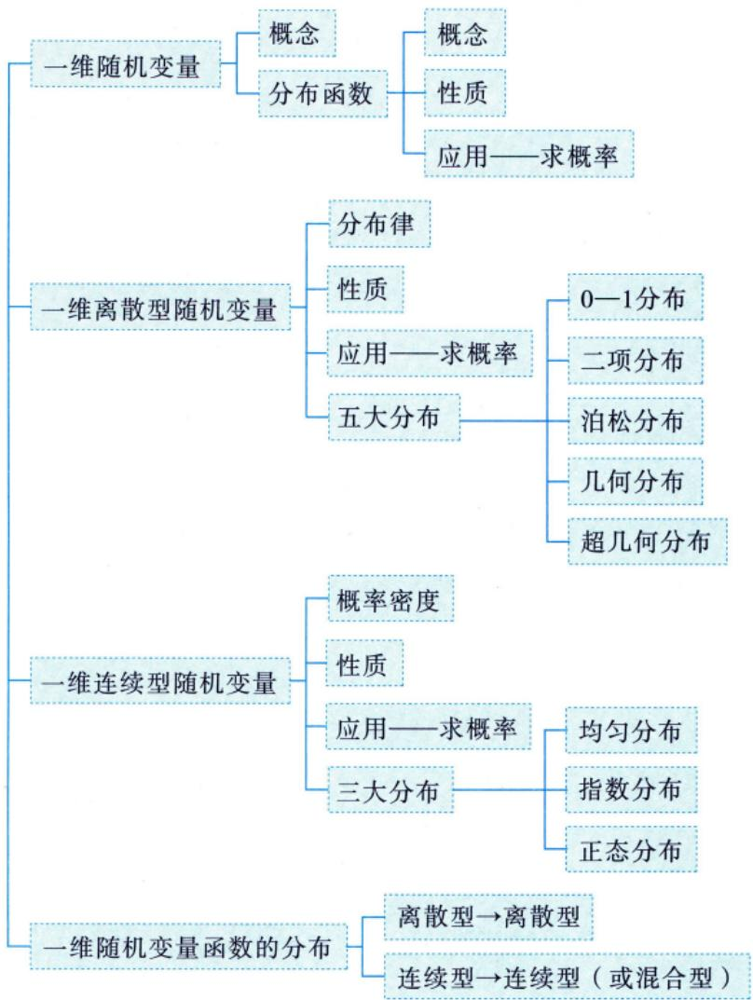

# 随机变量及其分布函数的概念、性质及应用

# 随机变量的概念

对 $y = y(x)$ 而言， $x$ 是确定性变量， $y$ 是确定性函数值.

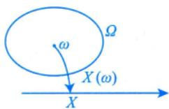

对 $X = X(\omega)$ 而言， $X$ 是不确定性变量．具有可能性，例也投篮是否投中

随机变量就是“其值会随机而定”的变量。设随机试验 $E$ 的样本空间为 $\Omega = \{\omega\}$ ，如果对每一个 $\omega \in \Omega$ ，都有唯一的实数 $X(\omega)$ 与之对应，并且对任意实数 $x$ ， $\{\omega | X(\omega) \leqslant x, \omega \in \Omega\}$ 是随机事件，则称定义在 $\Omega$ 上的实值单值函数 $X(\omega)$ 为随机变量，简记为随机变量 $X$ 。一般用大写字母 $X, Y, Z, \cdots$ 或希腊字母 $\xi, \eta, \zeta, \cdots$ 来表示随机变量。

注 (1)随机事件是从静态的观点来研究随机现象, 而随机变量则是一种动态的观点, 如高等数学中常量与变量的区别.

(2)随机变量的实质是“实值单值函数”，这个定义不同于高等数学中函数的定义（其“定义域”一般是实数集），它的“定义域”不一定是实数集，这点需要考生注意.

# 2 分布函数的概念及性质

(1) 概念.

当 $x$ 从 $-\infty$ 到 $+\infty$ 取遍所有实数时， $\{X \leq x\}$ 就相应从不可能事件 $\varnothing$ 取到必然事件 $\Omega$ ，即分布函数完整地描述了随机变量的概率规律

设 $X$ 是随机变量， $x$ 是任意实数，称函数 $F(x) = P\{X \leqslant x\} (x \in \mathbf{R})$ 为随机变量 $X$ 的分布函数，或称 $X$ 服从 $F(x)$ 分布，记为 $X \sim F(x)$ ： $\Omega : \{\omega_1, \omega_2, \dots, \omega_6\}$ 公布函数 $F(x)$ 图像如图所示

(2)性质. 一克要条件

① $F(x)$ 是 $x$ 的单调不减函数，即对任意实数 $x_{1} < x_{2}$ ，有 $F(x_{1}) \leqslant F(x_{2})$

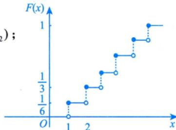

② $F\left( x\right)$ 是 $x$ 的右连续函数,即对任意 ${x}_{0} \in  \mathbf{R}$ ,有 $\mathop{\lim }\limits_{{x \rightarrow  {x}_{0}^{ + }}}F\left( x\right)  = F\left( {{x}_{0} + 0}\right)  = F\left( {x}_{0}\right)$ ;

③ $F(-\infty) = \lim_{x \to -\infty} F(x) = 0, F(+\infty) = \lim_{x \to +\infty} F(x) = 1.$ 分布函数是事件的概率，由此知 $0 \leqslant F(x) \leqslant 1$ 即 $F(x)$ 是有界函数

注 满足以上三条性质的函数 $F(x)$ 必是某个随机变量 $X$ 的分布函数，所以，这三条性质也是判断函数 $F(x)$ 是否为某一随机变量 $X$ 的分布函数的充要条件。

# 3 分布函数的应用——求概率

$$
P \{X \leqslant a \} = F (a);
$$

$$
P \{X <   a \} = F (a - 0);
$$

$$
P \{X = a \} = F (a) - F (a - 0);
$$

$$
P \{a <   X <   b \} = F (b - 0) - F (a);
$$

$$
P \{a \leqslant X <   b \} = F (b - 0) - F (a - 0);
$$

$$
P \{a <   X \leqslant b \} = F (b) - F (a);
$$

$$
P \{a \leqslant X \leqslant b \} = F (b) - F (a - 0).
$$

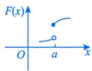

★★★ $F(x) = P\{X\leqslant x\}$ ， $x\in (-\infty , + \infty)$

针对离散型： $F(a) = P\{X \leqslant a\} = P\{x < a\} + P\{X = a\}$

$$
\begin{array}{c c} \downarrow & \downarrow \\ F (a - 0) & F (a) - F (a - 0) \end{array}
$$

例2.1 设随机变量 $X$ 的分布函数为

$$
X \sim F (x) = \left\{ \begin{array}{l l} a + b \mathrm {e} ^ {- x}, & x > 0, \\ 0, & x \leqslant 0. \end{array} \right.
$$

求常数 $a, b$ 及概率 $P\{|X| < 2\}$

分析 $F(x)$ 中含有2个未知参数，依据分布函数的性质建立两个独立方程解之.

解 由分布函数的性质，有

$$
F (+ \infty) = \lim  _ {x \rightarrow + \infty} F (x) = \lim  _ {x \rightarrow + \infty} (a + b e ^ {- x}) = 1,
$$

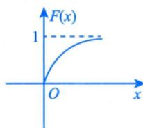

满足：① 单调不减；

② 右连续；

③ 极限性质

得 $a = 1$ .又 $F(x)$ 在 $x = 0$ 处右连续，有

$$
\lim  _ {x \rightarrow 0 ^ {+}} F (x) = \lim  _ {x \rightarrow 0 ^ {+}} (a + b e ^ {- x}) = a + b = 0,
$$

得 $b = -1$ .所以 $F(x) = \left\{ \begin{array}{ll}1 - \mathrm{e}^{-x}, & x > 0,\\ 0, & x\leqslant 0, \end{array} \right.$

从而有

$$
P \{\left| X \right| <   2 \} = P \{- 2 <   X <   2 \} = F (2 - 0) - F (- 2) = 1 - e ^ {- 2} - 0 = 1 - e ^ {- 2}.
$$

# 常见的两类随机变量——离散型随机变量和连续型随机变量

# 离散型随机变量及其概率分布

如果随机变量 $X$ 只可能取有限个或可列无限个值 $x_{1}, x_{2}, \cdots$ ，则称 $X$ 为离散型随机变量，称

$$
P \left\{X = x _ {i} \right\} = p _ {i}, i = 1, 2, \dots
$$

为 $X$ 的分布列、分布律或概率分布，记为 $X\sim p_i$ ，概率分布常常用表格形式或矩阵形式表示，即

<table><tr><td>X</td><td>x1</td><td>x2</td><td>...</td></tr><tr><td>P</td><td>p1</td><td>p2</td><td>...</td></tr></table>

或 $X\sim \left( \begin{array}{lll}x_{1} & x_{2} & \dots \\ p_{1} & p_{2} & \dots \end{array} \right).$

如掷骰子， $X$ 的概率分布为 $X\sim \left( \begin{array}{ccccccc}1 & 2 & 3 & 4 & 5 & 6\\ \frac{1}{6} & \frac{1}{6} & \frac{1}{6} & \frac{1}{6} & \frac{1}{6} & \frac{1}{6} \end{array} \right).$

数列 $\{p_i\} (i = 1,2,\dots)$ 是离散型随机变量的概率分布的充要条件： $p_i\geqslant 0(i = 1,2,\dots)$ ，且 $\sum_{i}p_{i} = 1$ 设离散型随机变量 $X$ 的概率分布为 $P\{X = x_i\} = p_i,i = 1,2,\dots$ ，则 $X$ 的分布函数 归一性

某点概率 $F(x) = P\{X\leqslant x\} = \sum_{x_i\leqslant x}P\{X = x_i\},$

$$
P \{X = x _ {i} \} = P \{X \leqslant x _ {i} \} - P \{X <   x _ {i} \} = F (x _ {i}) - F (x _ {i} - 0),
$$

并且对实数轴上的任一集合 $B$ ，有

区间概率 $P\{X \in B\} = \sum_{x_i \in B} P\{X = x_i\},$

特别地， $P\{a <   X\leqslant b\} = P\{X\leqslant b\} -P\{X\leqslant a\} = F(b) - F(a).$

# 2 连续型随机变量及其概率密度

如果随机变量 $X$ 的分布函数可以表示为

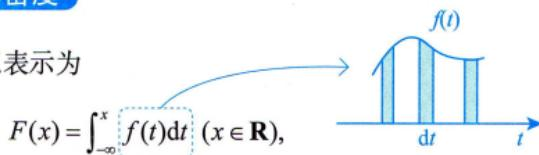

其中 $f(x)$ 是非负可积函数，则称 $X$ 为连续型随机变量，称 $f(x)$ 为 $X$ 的概率密度函数，简称概率密度，记为 $X \sim f(x)$ ：

离散型随机变量 $X\sim p_i$ ， $F(x) = P\{X\leqslant x\} = \sum_{x_i\leqslant x}p_i,$

对比

连续型随机变量 $X\sim f(x),F(x) = P\{X\leqslant x\} = \int_{-\infty}^{x}f(t)\mathrm{d}t.$

$f\left( x\right)$ 为某一随机变量 $X$ 的概率密度的充分必要条件： $f\left( x\right)  \geq  0$ ,且 ${\int }_{-\infty }^{+\infty }f\left( x\right) \mathrm{d}x = 1$ (由此可知,在保

证非负的条件下，改变 $f(x)$ 有限个点的值， $f(x)$ 仍然是概率密度）

一个点的值改变，不会改变面积

一点概率

设 $X$ 为连续型随机变量， $X \sim f(x)$ ，则对任意实数 $c$ ，有 $P\{X = c\} = 0$ ；对实数轴上任一集合 $B$ ，有

区间概率

$$
P \{X \in B \} = \int_ {B} f (x) d x,
$$

特别地，

$$
P \{a <   X <   b \} = P \{a \leqslant X <   b \} = P \{a <   X \leqslant b \} = P \{a \leqslant X \leqslant b \} = \int_ {a} ^ {b} f (x) d x = F (b) - F (a).
$$

注 (1) “概率密度”这个名词的由来可解释如下：取定一个点 $x$ ，则按分布函数的定义，事件 $\{x < X \leqslant x + h\} (h > 0$ ，为常数）的概率应为 $F(x + h) - F(x)$ . 所以，比值 $[F(x + h) - F(x)] / h$ 可以解释为在点 $x$ 附近长为 $h$ 的区间 $(x, x + h]$ 内，单位长所占的概率. 令 $h \to 0$ ，则这个比值的极限，即 $F'(x) = f(x)$ ，也就是在点 $x$ 处（无穷小区间内）单位长的概率. 或者说，它反映了概率在点 $x$ 处的“密集程度”. 设想一条极细的无穷长的金属杆，总质量为 1，概率密度相当于杆上各点的质量密度.

(2) $P\{a < X < b\} = \int_{a}^{b} f(x) \mathrm{d}x$ 意味着 $X$ 落入某一区间的概率等于该区间上概率密度曲线之下的曲边梯形的面积. 应用概率的这种几何意义，常常有助于问题的分析与求解.  
(3) 设 $X \sim f(x)$ ，则 $X$ 的分布函数 $F(x)$ 是 $x$ 的连续函数，在 $f(x)$ 的连续点 $x_0$ 处有 $F'(x_0) = f(x_0)$ 。如果 $F(x)$ 是连续函数，除有限个点外， $F'(x)$ 存在且连续，则 $X$ 为连续型随机变量，且 $f(x) = F'(x)$ （在 $F'(x)$ 不存在的地方可以令 $f(x) = 0$ 或取其他值）。

例2.2 设 $F_{1}(x), F_{2}(x)$ 是随机变量的分布函数， $f_{1}(x), f_{2}(x)$ 是相应的概率密度，则（ ）

(A) $F_{1}(x) + F_{2}(x)$ 是分布函数  
(B) $F_{1}(x)\cdot F_{2}(x)$ 是分布函数  
(C) $f_{1}(x) + f_{2}(x)$ 是概率密度  
(D) $f_{1}(x)\cdot f_{2}(x)$ 是概率密度

分析

$F(x)$ 是分布函数 $\Leftrightarrow$ $\begin{array}{l}\left\{ \begin{array}{ll}1F(x) \text{单调不减},\\ 2F(x_0 + 0) = F(x_0), \end{array} \right.\\ \left\{ \begin{array}{ll}F(+\infty) = 1,\\ 3F(-\infty) = 0. \end{array} \right. \end{array}$

$f(x)$ 是概率密度 $\Leftrightarrow \left\{ \begin{array}{l}1f(x)\geqslant 0,\\ 2\int_{-\infty}^{+\infty}f(x)\mathrm{d}x = 1. \end{array} \right.$

# 解 应选(B).

根据连续型随机变量分布函数和概率密度的性质，有

$$
F _ {1} (+ \infty) + F _ {2} (+ \infty) = 2, \int_ {- \infty} ^ {+ \infty} [ f _ {1} (x) + f _ {2} (x) ] d x = 2,
$$

$$
\int_ {- \infty} ^ {+ \infty} f _ {1} (x) f _ {2} (x) d x \neq \int_ {- \infty} ^ {+ \infty} f _ {1} (x) d x \int_ {- \infty} ^ {+ \infty} f _ {2} (x) d x = 1,
$$

应排除选项(A)，(C)，(D)，故选择(B).事实上，由于 $F_{1}(x)\cdot F_{2}(x)$ 是单调不减的右连续函数，且

$$
F _ {1} (- \infty) \cdot F _ {2} (- \infty) = 0, F _ {1} (+ \infty) \cdot F _ {2} (+ \infty) = 1,
$$

可直接判断选项(B)正确.

注 判断 $\sqrt{f_1(x)f_2(x)}$ 是不是概率密度. 易知 $\frac{f_1(x) + f_2(x)}{2} \geqslant \sqrt{f_1(x)f_2(x)}$ , $f_1(x) \neq f_2(x)$ , 故

$$
1 > \int_ {- \infty} ^ {+ \infty} \sqrt {f _ {1} (x) f _ {2} (x)} d x,
$$

不满足归一性，所以 $\sqrt{f_1(x)f_2(x)}$ 不是概率密度.

# 例2.3 已知随机变量 $X$ 的概率分布为

<table><tr><td>X</td><td>1</td><td>2</td><td>3</td></tr><tr><td>P{X=k}</td><td>θ²</td><td>2θ(1-θ)</td><td>(1-θ)²</td></tr></table>

且 $P\{X\geqslant 2\} = \frac{3}{4}$ ，求未知参数 $\theta$ 及 $X$ 的分布函数 $F(x)$ ：

分析此题若利用归一性， $\theta^2 + 2\theta (1 - \theta) + (1 - \theta)^2 = 1$ ，发现解不出 $\theta$ ：

解 由 $P\{X \geqslant 2\} = P\{X = 2\} + P\{X = 3\} = 2\theta (1 - \theta) + (1 - \theta)^{2} = 1 - \theta^{2} = \frac{3}{4}$ ，解得 $\theta = \pm \frac{1}{2}$ .

又 $P\{X = 2\} = 2\theta (1 - \theta)\geqslant 0$ ，故取 $\theta = \frac{1}{2}$ ，从而得 $X$ 的概率分布为 利用概率不能为负值

<table><tr><td>X</td><td>1</td><td>2</td><td>3</td></tr><tr><td>P{X=k}</td><td>1/4</td><td>1/2</td><td>1/4</td></tr></table>

$X$ 的分布函数

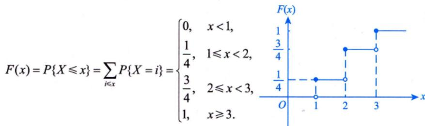

例2.4 已知 $X$ 的分布函数为 $F(x)$ ，概率密度为 $f(x)$ .当 $x\leqslant 0$ 时， $f(x)$ 连续，且 $f(x) = F(x)$ 若 $F(0) = 1$ ，则 $f(x) = \_ \_$

解 应填 $\left\{ \begin{array}{ll}\mathrm{e}^x, & x\leqslant 0,\\ 0, & x > 0. \end{array} \right.$

由于 $F(x)$ 是单调不减的函数，且 $F(0) = 1$ ，故对任意的 $x > 0$ ，均有 $F(x) = 1$ .又当 $x\leqslant 0$ 时， $f(x)$ 连续，故 $f(x) = F^{\prime}(x)$ .已知 $f(x) = F(x)$ ，由微分方程 $F^{\prime}(x) = F(x)$ 及 $F(0) = 1$ ，解得 $F(x) = \mathrm{e}^{x}(x\leqslant 0)$ ，从而得

$$
F (x) = \left\{ \begin{array}{l l} \mathrm {e} ^ {x}, & x <   0, \\ 1, & x \geqslant 0, \end{array} \right.
$$

$$
f (x) = \left\{ \begin{array}{l l} \mathrm {e} ^ {x}, & x \leqslant 0, \\ 0, & x > 0. \end{array} \right.
$$

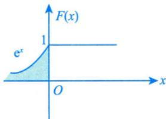

注 当分布函数是不连续的分段函数时，为保证其右连续性，自变量 $x$ 的分段小区间除第一个区间之外，其余都应是左闭右开的，即等号跟着大于号。连续情况下等号跟谁都可以

例2.5 已知随机变量 $X$ 的概率密度为

正概率密度区间

$$
f (x) = \left\{ \begin{array}{l l} 2 \left(1 - \frac {1}{x ^ {2}}\right), & 1 \leqslant x \leqslant 2, \\ 0, & \text {其 他}. \end{array} \right.
$$

求 $X$ 的分布函数 $F(x)$ ：

解当 $x <   1$ 时，

$$
F (x) = \int_ {- \infty} ^ {x} f (t) \mathrm {d} t = \int_ {- \infty} ^ {x} 0 \mathrm {d} t = 0;
$$

当 $1 \leqslant x < 2$ 时，

$$
\begin{array}{l} F (x) = \int_ {- \infty} ^ {x} f (t) d t = \int_ {1} ^ {x} 2 \left(1 - \frac {1}{t ^ {2}}\right) d t = 2 \left(t + \frac {1}{t}\right) \Bigg | _ {1} ^ {x} \\ = 2 \left(x + \frac {1}{x}\right) - 4 = 2 \left(x + \frac {1}{x} - 2\right); \\ \end{array}
$$

当 $x \geqslant 2$ 时，

$$
F (x) = \int_ {- \infty} ^ {x} f (t) d t = \int_ {1} ^ {2} 2 \left(1 - \frac {1}{t ^ {2}}\right) d t = 2 \left(t + \frac {1}{t}\right) | _ {1} ^ {2} = 2 \times \frac {1}{2} = 1.
$$

故

$$
F (x) = \left\{ \begin{array}{l l} 0, & x <   1, \\ 2 \left(x + \frac {1}{x} - 2\right), & 1 \leqslant x <   2, \\ 1, & x \geqslant 2. \end{array} \right.
$$

# 常见的随机变量分布类型

# 1 离散型

(1)0—1分布 $B(1,p)(\mathrm{Ber} - E_1)$

只有0与1两个点，0一1分布是二项分布的一种特殊情况

1.伯努利计数变量——发生计1，不发生计0

如果 $X$ 的概率分布为 $X \sim \left( \begin{array}{cc} 1 & 0 \\ p & 1 - p \end{array} \right)$ ，即 $P\{X = 1\} = p, P\{X = 0\} = 1 - p$ ，则称 $X$ 服从参数为 $p$ 的0-1分布，记为 $X \sim B(1, p) (0 < p < 1)$ 。

(2)二项分布 $B\left( {n,p}\right) \left( {\operatorname{Ber} - {E}_{n}}\right)$ . $\rightarrow  n$ 重伯努利试验中事件 $A$ 发生的次数,其中 $p = P\left( A\right)$

如果 $X$ 的概率分布为 $P\{X = k\} = \mathrm{C}_n^k p^k (1 - p)^{n - k}(k = 0,1,\dots ,n;0 <   p <   1)$ ，则称 $X$ 服从参数为 $(n,p)$ 的二项分布，记为 $X\sim B(n,p)$ ：

举例：投篮投中打√，投不中打×， $X = k$ 即表示有 $k$ 个√， $n - k$ 个×.

则 $X\sim B(n,p)$ ， $P = \{X = k\} = C_n^k p^k (1 - p)^{n - k},k = 0,1,\dots ,n.$

若 $n = 1$ ，则 $X_{i}\sim B(1,p),i = 1,2,\dots ,n,X = X_{1} + X_{2} + \dots +X_{n}$ 随机变量的分解

稀有事件发生概率

(3) 泊松分布 $P(\lambda)$ .

如果 $X$ 的概率分布为

单位时间源源不断的质点来流的个数，也常用于描述稀有事件发生的次数

$$
P \{X = k \} = \frac {\lambda^ {k}}{k !} e ^ {- \lambda} (k = 0, 1, \dots ; \quad \lambda > 0),
$$

$\lambda$ 表示来流强度. $EX = \lambda$ ，期望代表随机变量取值的中心水平，可以理解为强度

则称 $X$ 服从参数为 $\lambda$ 的泊松分布，记为 $X\sim P(\lambda)$

定义 $k$ 为非负整数

注 泊松定理 若 $X \sim B(n, p)$ ，当 $n$ 很大， $p$ 很小， $\lambda = np$ 适中时，二项分布可用泊松分布近似表示，即

例如, ${C}_{100}^{1}{\left( \frac{1}{500}\right) }^{1}{\left( 1 - \frac{1}{500}\right) }^{99} \approx  \frac{{\left( \frac{1}{5}\right) }^{1}}{1!}{\mathrm{e}}^{-\frac{1}{5}} = \frac{1}{5}{\mathrm{e}}^{-\frac{1}{5}}$

$$
C _ {n} ^ {k} p ^ {k} (1 - p) ^ {n - k} \approx \frac {\lambda^ {k}}{k !} e ^ {- \lambda}.
$$

一般地，当 $n \geqslant 20$ ， $p \leqslant 0.05$ 时，用泊松近似公式逼近二项分布效果比较好，特别当 $n \geqslant 100$ ， $np \leqslant 10$ 时，逼近效果更佳。

此处《全国硕士研究生招生考试数学考试大纲》的要求是“会用泊松分布近似表示二项分布”，考生应予以重视.

参数只有 $p$ ，首中即停止

(4) 几何分布 $G(p)(\mathrm{Ber} - E_{\infty})$

如果 $X$ 的概率分布为

$n$ 重伯努利试验中，事件 $A$ 首次出现即停止时的试验次数，其中 $p = P(A)$

$$
P \{X = \widehat {k} \} = (1 - p) ^ {k - 1} p (k = 1, 2, \dots ; 0 <   p <   1),
$$

$k - 1$

则称 $X$ 服从参数为 $p$ 的几何分布,记为 $X \sim  G\left( p\right)$ . 离散型等待分布：守株待兔

(5) 超几何分布 $H(n, N, M)$ .

·见注

如果 $X$ 的概率分布为 $P\{X = k\} = \frac{\mathrm{C}_M^k\mathrm{C}_{N - M}^{n - k}}{\mathrm{C}_N^n} (\max \{0,n - N + M\} \leqslant k\leqslant \min \{M,n\} ;M,N,n$ 为正整数且 $M\leqslant N$ ， $n\leqslant N$ ， $k$ 为整数），则称 $X$ 服从参数为 $(n,N,M)$ 的超几何分布，记为 $X\sim H(n,N,M)$ ：

古典概型

注设由 $N$ 个产品组成的总体，其中含有 $M$ 个不合格品.若从中随机不放回地抽取 $_n$ 个，则其中含有不合格品的个数 $X$ 是一个离散型随机变量.假如 $n\leqslant M$ ，则 $X$ 可能取0,1，…， $n$ ；若 $n > M$ 则 $X$ 可能取0,1，…， $M$ .由古典概型概率公式容易算得

$$
P \{X = k \} = \frac {\mathrm {C} _ {M} ^ {k} \mathrm {C} _ {N - M} ^ {n - k}}{\mathrm {C} _ {N} ^ {n}},
$$

其中 $\max \{0, n - N + M\} \leqslant k \leqslant \min \{M, n\}$ ; $M, N, n$ 为正整数且 $M \leqslant N, n \leqslant N, k$ 为整数.

这个分布就是超几何分布，它含有三个参数 $N$ ， $M$ 和 $n$ ，记为 $H(n,N,M)$ ：

当 $n \ll N$ （即抽取个数 $n$ 远远小于产品总数 $N$ ）时，每次抽取后，总体中的不合格品率 $p = \frac{M}{N}$ 改变甚微，这时不放回抽样可近似看作放回抽样，超几何分布可用二项分布近似.

# 2 连续型

(1) 均匀分布 $U(a, b)$ .

如果随机变量 $X$ 的概率密度和分布函数（见图2-1，图2-2)分别为

$$
f (x) = \left\{ \begin{array}{l l} \frac {1}{b - a}, & a <   x <   b, \\ 0, & \text {其 他 ,} \end{array} \right. F (x) = \left\{ \begin{array}{l l} 0, & x <   a, \\ \frac {x - a}{b - a}, & a \leqslant x <   b, \\ 1, & x \geqslant b, \end{array} \right. \begin{array}{l} F (x) = \int_ {- \infty} ^ {x} f (t)   \mathrm {d} t \\ \text {面 积 的 思 想} \end{array}
$$

则称 $X$ 在区间 $(a,b)$ 上服从均匀分布，记为 $X\sim U(a,b)$ ：

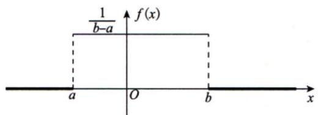  
图2-1

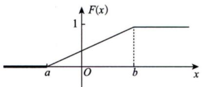  
图2-2

注 区间 $(a, b)$ 可以是闭区间 $[a, b]$ ，记为 $X \sim U[a, b]$ ；几何概型是均匀分布的实际背景，几何概型可以用均匀分布函数计算概率。对于连续型随机变量，取一点的概率是测不到的

(2) 指数分布 $E\left( \lambda \right)$ . 连续型等待分布

如果 $X$ 的概率密度和分布函数（见图2-3，图2-4)分别为

$$
f (x) = \left\{ \begin{array}{l l} \lambda \mathrm {e} ^ {- \lambda x}, & x > 0, \\ 0, & \text {其 他 ,} \end{array} \right. F (x) = \left\{ \begin{array}{l l} 1 - \mathrm {e} ^ {- \lambda x}, & x \geqslant 0, \\ 0, & x <   0 \end{array} \right. (\lambda > 0),
$$

$\lambda$ 叫失效频率，后

面会知道 ${EX} = \frac{1}{\lambda }$

则称 $X$ 服从参数为 $\lambda$ 的指数分布，记为 $X\sim E(\lambda)$ ：

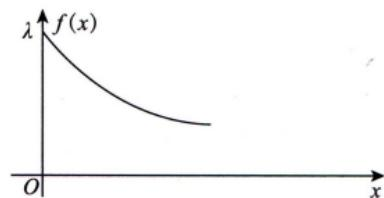  
图2-4

图2-3

记 $\{N_{t}, t \geqslant 0\}$ ， $N_{t}$ ——质点来流的个数，泊松分布中 $\lambda$ 表示单位时间质点来流的强度，所以 $t$ 时间内质点来流的强度为 $\lambda t$ 。

令 $T$ 表示等待时间(第一个质点出现)，则

$$
T \sim F (t) = P \{T \leqslant t \} = 1 - P \{T > t \},
$$

由 $\{N_t, t \geqslant 0\}$ 知 $[0, t]$ 时，

$$
P \{T > t \} = P \{N _ {t} = 0 \} = e ^ {- \lambda t},
$$

$$
\begin{array}{l} \text {故} T \sim F (t) = P \{T <   t \} = 1 - P \{T > t \} \\ = \left\{ \begin{array}{l l} 1 - \mathrm {e} ^ {- \lambda t}, & t > 0, \\ 0, & t <   0 \end{array} \right. \\ \end{array}
$$

注 当 $t > 0, s > 0$ 时， $P\{X \geqslant t + s \mid X \geqslant t\} = P\{X \geqslant s\}$ 称为指数分布的无记忆性 (Memoryless Property).

(3) 正态分布 $N(\mu, \sigma^2)$ .

如果 $X$ 的概率密度为

这是由于 $\lambda$ 是常数，失放频率不变，也即研究对象（如元件、产品等）被视为理想状态，无任何损耗。

$$
f (x) = \frac {1}{\sqrt {2 \pi} \sigma} e ^ {- \frac {1}{2} \left(\frac {x - \mu}{\sigma}\right) ^ {2}} (- \infty <   x <   + \infty),
$$

其中 $-\infty < \mu < +\infty, \sigma > 0$ ，则称 $X$ 服从参数为 $(\mu, \sigma^2)$ 的正态分布或称 $X$ 为正态变量，记为 $X \sim N(\mu, \sigma^2)$ 。此时 $f(x)$ 的图形关于直线 $x = \mu$ 对称，即 $f(\mu - x) = f(\mu + x)$ ，并在 $x = \mu$ 处有唯一最大

值 $f(\mu) = \frac{1}{\sqrt{2\pi}\sigma}$ .如图2-5所示.

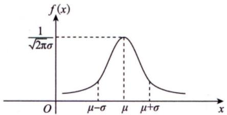  
图2-5

称 $\mu = 0, \sigma = 1$ 时的正态分布 $N(0,1)$ 为标准正态分布，通常记标准正态分布的概率密度为 $\varphi(x) = \frac{1}{\sqrt{2\pi}} \mathrm{e}^{-\frac{1}{2} x^2}$ ，分布函数为 $\Phi(x) = \frac{1}{\sqrt{2\pi}} \int_{-\infty}^{x} \mathrm{e}^{-\frac{t^2}{2}} \mathrm{d}t$ 。显然 $\varphi(x)$ 为偶函数，则

$$
\Phi (0) = \frac {1}{2}, \Phi (- x) = 1 - \Phi (x).
$$

如图2-6所示.

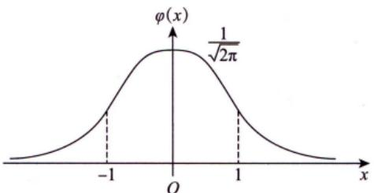  
图2-6

若 $X\sim N(0,1)$ ， $P\{X > \mu_{\alpha}\} = \alpha$ ，则称 $\mu_{\alpha}$ 为标准正态分布的上侧 $\alpha$ 分位数（上 $\alpha$ 分位点）.

如果 $X \sim N(\mu, \sigma^2)$ ，则

为了查表方便，所以将正态分布标准化

$$
\begin{array}{l} F (x) = P \{X \leqslant x \} = \Phi \left(\frac {x - \mu}{\sigma}\right), \\ F (\mu - x) + F (\mu + x) = 1, \\ \begin{array}{l} P \{a <   X <   b \} = \Phi \left(\frac {b - \mu}{\sigma}\right) - \Phi \left(\frac {a - \mu}{\sigma}\right), \\ a X + b \sim N (a \mu + b, a ^ {2} \sigma^ {2}) (a \neq 0). \end{array} \\ \end{array}
$$

例2.6 通过某交叉路口的汽车流可以看作服从泊松分布.已知在1分钟内有汽车通过的概率为0.7，则1分钟内最多有1辆汽车通过的概率为（）

(A) $0.7(1 - \ln 0.7)$

(B) $0.3(1 - \ln 0.7)$

(C) $0.3(1 - \ln 0.3)$

(D) $0.7(1 - \ln 0.3)$

解 应选(C).

1分钟内通过路口的汽车数量 $X$ 服从参数为 $\lambda$ 的泊松分布.由已知，

$$
P \{X \geqslant 1 \} = 1 - \frac {\lambda^ {0}}{0 !} \mathrm {e} ^ {- \lambda} = 0. 7, \quad \text {首 先 求 出 参 数} \lambda , \text {再 根 据}
$$

得 $\lambda = -\ln 0.3$ ，于是 $P\{X\leqslant 1\} = \frac{\lambda^0}{0!}\mathrm{e}^{-\lambda} + \frac{\lambda^1}{1!}\mathrm{e}^{-\lambda} = \mathrm{e}^{\ln 0.3}(1 - \ln 0.3) = 0.3(1 - \ln 0.3)$ ，故选择(C).

首中停止

首中停止例2.7 设随机变量 $X$ 的概率密度为 $f(x) = \left\{ \begin{array}{ll} 2^{-x}\ln 2, & x > 0, \\ 0, & \text{其他}. \end{array} \right.$ 对 $X$ 进行独立重复的观测，直到第2个大于3的观测值出现时停止，记Y为观测次数.求Y的概率分布.

分析 $2^{-x}\ln 2 = \mathrm{e}^{-x\ln 2}\cdot \ln 2$ .先求大于3的概率.

解 记 $p$ 为“观测值大于3”的概率，则 $p = P\{X > 3\} = \int_{3}^{+\infty}2^{-x}\ln 2\mathrm{d}x = \frac{1}{8}$

依题意， $Y$ 为离散型随机变量，而且取值为2,3，…，则 $Y$ 的概率分布为

$$
P \{Y = k _ {j} ^ {\prime} = C _ {k - 1} ^ {1} p (1 - p) ^ {k - 2} \cdot p = C _ {k - 1} ^ {1} p ^ {2} (1 - p) ^ {k - 2} = (k - 1) \left(\frac {1}{8}\right) ^ {2} \left(\frac {7}{8}\right) ^ {k - 2}, k = 2, 3, \dots .
$$

注 $k$ 只能从2开始. $\times \dots \times \sqrt{\dots \times \sqrt{}}$ ，前 $k - 1$ 次包含一个√，第 $k$ 次出现第2个√.

k-1

例2.8 已知 $X \sim U(a, b) (a > 0)$ ，且 $P\{0 < X < 3\} = \frac{1}{4}$ ， $P\{X > 4\} = \frac{1}{2}$ ，求 $X$ 的概率密度及 $P\{1 < X < 5\}$ .

解如图2-7所示， $X\sim U(a,b)$

由 $P\{X > 4\} = \frac{1}{2}$ ，且 $P\left\{X > \frac{a + b}{2}\right\} = \frac{1}{2}$ 得 $\frac{a + b}{2} = 4$ 即 $a + b = 8$

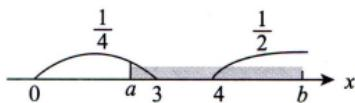  
图2-7

由于 $P\{3 <   X <   4\} = 1 - P\{X\geqslant 4\} -P\{X\leqslant 3\} = 1 - P\{X > 4\} -P\{0 <   X <   3\} = 1 - \frac{1}{2} -\frac{1}{4} = \frac{1}{4}$ ，又 $P\{3 <   X <   4\}$

$4\} = \frac{4 - 3}{b - a}$ 故 $\frac{4 - 3}{b - a} = \frac{1}{4}$ 得 $b - a = 4$

$a, b$ 值的另一种解法. 因为只在 $(a, b)$ 内取值且 $P\{0 < X < 3\}$ 不为 0，所以 3 只能大于 $a$ . 同理，4 只能小于 $b$ ，则有

联立得 $\left\{ \begin{array}{l}a + b = 8,\\ b - a = 4, \end{array} \right.$ 解得 $\left\{ \begin{array}{ll}a = 2,\\ b = 6. \end{array} \right.$

$\left\{ \begin{array}{l} P\{0 < X < 3\} = P\{a < X < 3\} = \frac{1}{4}, \\ p\{X > 4\} = P\{4 < X < b\} = \frac{1}{2}, \end{array} \right.$ 即 $\left\{ \begin{array}{l} \frac{3 - a}{b - a} = \frac{1}{4}, \\ \frac{b - 4}{b - a} = \frac{1}{2}, \end{array} \right.$ ①

① 与 ② 联立，解得 $a = 2, b = 6$

所以 $X$ 的概率密度为

$f(x) = \left\{ \begin{array}{ll} \frac{1}{4}, & 2 < x < 6, \\ 0, & \text{其他}. \end{array} \right.$

于是 $P\{1 < X < 5\} = P\{2 < X < 5\} = \frac{5 - 2}{6 - 2} = \frac{3}{4}.$

例2.9 某元件的工作寿命 $X$ （小时）服从参数为 $\lambda (\lambda >0)$ 的指数分布，

(1) 求该元件正常工作 $t$ 小时的概率；

正常工作 $\mathrm{t}$ 小时,即工作寿命肯定大于 $\mathrm{t}$ 小时.

(2)已知该元件已正常工作10小时，求在此基础上再工作10小时的概率 $(\lambda = 0.01)$ ：

解 由题意 $X\sim F(x) = \left\{ \begin{array}{ll}1 - \mathrm{e}^{-\lambda x} & x\geqslant 0,\\ 0, & \text{其他}. \end{array} \right.$

(1) $P\{X > t\} = 1 - P\{X \leqslant t\} = 1 - F(t) = 1 - (1 - \mathrm{e}^{-\lambda t}) = \mathrm{e}^{-\lambda t}$ .

(2) $P\{X > 20 \mid X > 10\} = \frac{P\{X > 20, X > 10\}}{P\{X > 10\}}$

$$
= \frac {P \{X > 2 0 \}}{P \{X > 1 0 \}} = \frac {\mathrm {e} ^ {- 0 . 0 1 \times 2 0}}{\mathrm {e} ^ {- 0 . 0 1 \times 1 0}} = \underbrace {\mathrm {e} ^ {- 0 . 1}}. = P \{X > 1 0 \}
$$

注本题第(2)问的结果， $P\{X > 20|X > 10\} = P\{X > 10\}$ ，即元件正常工作10小时的概率与在这之前的工作状态无关，说明指数分布具有无记忆性.

例2.10 设 $X \sim N(2, \sigma^2)$ ，且 $P\{2 < X < 4\} = 0.3$ ，则 $P\{X < 0\} =$

解 应填0.2.

把正态分布进行标准化处理：

已知 $X \sim N(2, \sigma^2)$ ，故

$$
P \{2 <   x <   4 \} = P \left\{\frac {2 - 2}{\sigma} <   \frac {x - 2}{\sigma} <   \frac {4 - 2}{\sigma} \right\}
$$

$$
P \{2 <   X <   4 \} = \Phi \left(\frac {4 - 2}{\sigma}\right) - \Phi \left(\frac {2 - 2}{\sigma}\right) = \Phi \left(\frac {2}{\sigma}\right) - 0. 5 = 0. 3, \Phi \left(\frac {2}{\sigma}\right) = 0. 8,
$$

所以 $P\{X < 0\} = \Phi \left(\frac{0 - 2}{\sigma}\right) = 1 - \Phi \left(\frac{2}{\sigma}\right) = 0.2$

注 结合图2-8，本题应用面积求解更为直观、简便.

已知 $P\{2 < X < 4\} = 0.3$ ，故

也可利用对称性解题

$$
P \{X <   0 \} = 0. 5 - 0. 3 = 0. 2.
$$

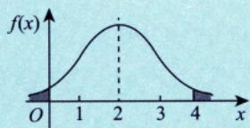  
图2-8

例2.11 设随机变量 $X$ 服从正态分布 $N(\mu, \sigma^2)$ ，则随着 $\sigma$ 的增大， $P\{|X - \mu| < 1\}$ （ ）

(A) 单调增加

(B) 单调减少

(C)保持不变

(D) 先增后减

解 应选(B). 只要不是标准正态分布, 就往标

准正态上想 $\frac{x - \mu}{\sigma} \sim N(0,1)$

讨论 $P\{|X - \mu | < 1\}$ 的单调性应在将其标准化之后进行.由 $P\{|X - \mu | < 1\} = P\left\{\left|\frac{X - \mu}{\sigma}\right| < \frac{1}{\sigma}\right\} =$

# 考研数学基础30讲·概率论与数理统计分册

$2\Phi \left(\frac{1}{\sigma}\right) - 1$ ，又 $\varPhi(u)$ 为单调增加函数， $u = \frac{1}{\sigma}$ 为单调减少函数，则随着 $\sigma$ 的增大， $\varPhi\left(\frac{1}{\sigma}\right)$ 单调减少，从而知，随着 $\sigma$ 的增大， $P\{|X - \mu | < 1\}$ 单调减少，故选择(B).

例2.12 设随机变量 $X$ 服从正态分布 $N(0,1)$ ，对给定的 $\alpha (0 < \alpha < 1)$ ，数 $u_{\alpha}$ 满足 $P\{X > u_{\alpha}\} = \alpha$ 若 $P\{|X| < x\} = \alpha$ ，则 $x$ 等于（）

(A) $u_{\frac{\alpha}{2}}$

(B) $u_{1 - \frac{\alpha}{2}}$

(C) $u_{\frac{1 - \alpha}{2}}$

(D) $u_{1 - \alpha}$

解 应选(C).

如图2-9所示，从几何直观看，条件中给出的 $u_{\alpha}$ 即为上侧 $\alpha$ 分位数.类比可得 $P\left\{\left|X\right| < u_{\frac{1 - \alpha}{2}}\right\} = \alpha$ 故选择(C).

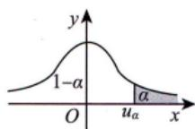  
(a)

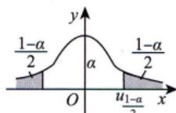  
(b)   
图2-9

例2.13 设随机变量 $X$ 满足不等式 $1 \leqslant X \leqslant 4$ ，且 $P\{X = 1\} = \frac{1}{4}$ ， $P\{X = 4\} = \frac{1}{3}$ ，当 $X$ 在区间 $(1, 4)$ 时， $X$ 服从均匀分布。求 $X$ 的分布函数。

0分析 $X$ 的分布是混合型的，则用定义法求分布函数，条件分布

解当 $x <   1$ 时， $F(x) = P\{X\leqslant x\} = 0$

当 $x = 1$ 时， $F(x) = P\{X \leqslant x\} = \frac{1}{4}$

当 $1 < x < 4$ 时，

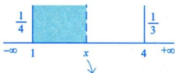

分布函数 $F(x) = P\{X \leqslant x\}$ ，且 $x$ 需取遍 $-\infty$ 到 $+\infty$

$$
F (x) = P \{X \leqslant 1 \} + P \{1 <   X \leqslant x \},
$$

其中 $P\{1 < X \leqslant x\} = P\{1 < X \leqslant x, \Omega\} = P\{1 < X \leqslant x, 1 < X < 4\} + P\{1 < X \leqslant x, \overline{1 < X < 4}\}$

$$
= P \{1 <   X \leqslant x \mid 1 <   X <   4 \} P \{1 <   X <   4 \} + P \{1 <   X \leqslant x \mid \overline {{1 <   X <   4}} \} P \{\overline {{1 <   X <   4}} \}
$$

$$
= \frac {x - 1}{4 - 1} \cdot \frac {5}{1 2} + 0 = \frac {5 (x - 1)}{3 6},
$$

注意到 $X$ 只在[1,4]取值，所以 $X$ 在(1,4)内的概率即为 $X$ 在[1,4]的概率减去两个端点.

故

$$
F (x) = \frac {1}{4} + \frac {5 (x - 1)}{3 6} = \frac {1}{9} + \frac {5}{3 6} x;
$$

$$
P \{1 <   X <   4 \} = 1 - P \{X = 1 \} - P \{X = 4 \} = 1 - \frac {7}{1 2} = \frac {5}{1 2}
$$

当 $x \geqslant 4$ 时， $F(x) = 1$

从而得 $X$ 的分布函数为

$$
F (x) = \left\{ \begin{array}{l l} 0, & x <   1, \\ \frac {1}{9} + \frac {5}{3 6} x, & 1 \leqslant x <   4, \\ 1, & x \geqslant 4. \end{array} \right.
$$

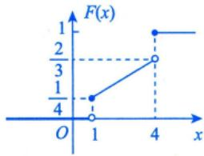

注 (1) 将 $\{1 < X \leqslant x\}$ 写成 $\{1 < X \leqslant x, \Omega\}$ ，然后作全集分解，是解决本题的关键。

(2)由图可知， $X$ 既不是离散型随机变量，也不是连续型随机变量，称为混合型随机变量.  
(3)还可知，当 $1 <   x <   4$ 时，记 $A = \{1 <   X <   4\}$ ，则

$$
f (x) = f (x \mid A) P (A) + f (\underbrace {x \mid \bar {A}} _ {\downarrow}) P (\bar {A}) = \frac {1}{3} \times \frac {5}{1 2} + 0 \times \frac {7}{1 2} = \frac {5}{3 6}.
$$

或在 $1 < x < 4$ 时， $f\left( x\right)  = {F}^{\prime }\left( x\right)  = \frac{5}{36}$ . 对立事件,所以概率为0

# 四 一维随机变量函数的分布

# 1 概念

设 $X$ 为随机变量，函数 $y = g(x)$ ，则以随机变量 $X$ 作为自变量的函数 $Y = g(X)$ 也是随机变量，称为随机变量 $X$ 的函数.例如： $Y = aX^{2} + bX + c$ ， $Y = |X - a|$ ， $Y = \left\{ \begin{array}{ll}X, & X\leqslant 1,\\ 1, & X > 1, \end{array} \right.$ 等等.

示例 设随机变量 $X \sim \left( \begin{array}{lll} 1 & 2 & 5 \\ \frac{1}{2} & \frac{1}{3} & \frac{1}{6} \end{array} \right)$ ，令 $Y = 10000X + 8$ ，则 $Y \sim \left( \begin{array}{ccc} 10008 & 20008 & 50008 \\ \frac{1}{2} & \frac{1}{3} & \frac{1}{6} \end{array} \right)$ .

# 随机变量函数的分布

(1) 离散型 $\rightarrow$ 离散型.

设 $X$ 为离散型随机变量，其概率分布为 $P\{X = x_i\} = p_i (i = 1, 2, \dots)$ ，则 $X$ 的函数 $Y = g(X)$ 也是离散型随机变量，其概率分布为 $P\{Y = g(x_i)\} = p_i (i = 1, 2, \dots)$ ，即

$$
Y \sim \left( \begin{array}{c c c} g (x _ {1}) & g (x _ {2}) & \dots \\ p _ {1} & p _ {2} & \dots \end{array} \right).
$$

如果有若干个 $g(x_{i})$ 值相同，则合并诸项为一项 $g(x_{k})$ ，并将相应概率相加作为 $Y$ 取 $g(x_{k})$ 值的概率.

示例 设随机变量 $X \sim \left( \begin{array}{ccc} -1 & 0 & 1 \\ \frac{1}{3} & \frac{1}{3} & \frac{1}{3} \end{array} \right)$ , 令 $Y = X^2$ , 则 $Y \sim \left( \begin{array}{cc} 0 & 1 \\ \frac{1}{3} & \frac{2}{3} \end{array} \right)$ .

# 考研数学基础30讲·概率论与数理统计分册

(2)连续型 $\rightarrow$ 连续型（或混合型） 注意下标的书写，说明是谁的分布函数

设 $X$ 为连续型随机变量，其分布函数、概率密度分别为 $F_{X}(x)$ 与 $f_{X}(x)$ ，随机变量 $Y = g(X)$ 是 $X$ 的函数，则 $Y$ 的分布函数或概率密度可用下面两种方法求得.

① 分布函数法 (定义法). 最可嘉

直接由定义求 $Y$ 的分布函数

此不等式的几何意义：曲线 $Y = g(X)$ 在直线 $Y = y$

下方，由此可通过作图得出 $X$ 的取值范围，在

$Y = g(X)$ 是非单调函数时，一般比解析法方便

$$
F _ {Y} (y) = P \{Y \leqslant y \} = P \underline {{\{g (X) \leqslant y \}}} = \int_ {g (x) \leqslant y} f _ {X} (x) d x,
$$

反解出 $X$ 即可

如果 $F_{Y}(y)$ 连续，且除有限个点外， $F_{Y}^{\prime}(y)$ 存在且连续，则 $Y$ 的概率密度 $f_{Y}(y) = F_{Y}^{\prime}(y)$ ：

$②$ 公式法.

根据上面的分布函数法，若 $y = g(x)$ 在 $(a, b)$ 上是关于 $x$ 的严格单调可导函数，则存在 $x = h(y)$ 是 $y = g(x)$ 在 $(a, b)$ 上的可导反函数.

若 $y = g(x)$ 严格单调增加，则 $x = h(y)$ 也严格单调增加，即 $h^{\prime}(y) > 0$ ，且

$$
F _ {Y} (y) = P \{Y \leqslant y \} = P \{g (X) \leqslant y \} = P \{X \leqslant h (y) \} = \int_ {- \infty} ^ {h (y)} f _ {X} (x) d x,
$$

故 $f_{Y}(y) = F_{Y}^{\prime}(y) = f_{X}[h(y)]\bullet h^{\prime}(y)$

若 $y = g(x)$ 严格单调减少，则 $x = h(y)$ 也严格单调减少，即 $h^\prime (y) <   0$ ，且

$$
F _ {Y} (y) = P \{Y \leqslant y \} = P \{g (X) \leqslant y \} = P \{X \geqslant h (y) \} = \int_ {h (y)} ^ {+ \infty} f _ {X} (x) d x,
$$

故 $f_{Y}(y) = F_{Y}^{\prime}(y) = -f_{X}[h(y)]\bullet h^{\prime}(y) = f_{X}[h(y)]\bullet [-h^{\prime}(y)]$

综上，

$$
f _ {Y} (y) = \left\{ \begin{array}{l l} f _ {X} [ h (y) ] \bullet \left| h ^ {\prime} (y) \right|, & \alpha <   y <   \beta , \\ 0, & \text {其 他}, \end{array} \right.
$$

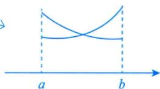

其中 $\alpha = \min \left\{\lim_{x\to a^{+}}g(x),\lim_{x\to b^{-}}g(x)\right\} ,\beta = \max \left\{\lim_{x\to a^{+}}g(x),\lim_{x\to b^{-}}g(x)\right\} .$

例2.14 设随机变量 $X$ 的分布律为

$$
P \{X = - 1 \} = \frac {1}{4}, P \{X = 0 \} = \frac {1}{2}, P \{X = 1 \} = \frac {1}{4},
$$

求 $Y = X^2$ 的分布.

$\rho$ 分析离散型随机变量的函数仍属于离散型随机变量范畴，求解其分布问题仍然按照计算离散型随机变量分布的三个步骤进行.

解 注意到 $Y$ 的可能取值为0，1，于是有

$$
P \{Y = 0 \} = P \{X ^ {2} = 0 \} = P \{X = 0 \} = \frac {1}{2},
$$

$$
P \{Y = 1 \} = P \{X ^ {2} = 1 \} = P \{X = \pm 1 \}
$$

$$
= P \{X = 1 \} + P \{X = - 1 \} = \frac {1}{4} + \frac {1}{4} = \frac {1}{2},
$$

或 $P\{Y = 1\} = 1 - P\{Y = 0\} = \frac{1}{2},$

即有 $Y\sim \left( \begin{array}{ll}0 & 1\\ \frac{1}{2} & \frac{1}{2} \end{array} \right).$

$\star \star \star$ 例2.15 设随机变量 $X$ 的分布函数 $F_{X}(x)$ 是严格单调增加函数，其反函数 $F_{X}^{-1}(y)$ 存在， $Y = F_{X}(X)$ . 证明： $Y$ 服从区间 $(0,1)$ 上的均匀分布.

证 $Y = F_{X}(X)$ 是在区间 $(0,1)$ 上取值的随机变量，故

当 $y < 0$ 时， $F_{Y}(y) = 0$

当 $y \geqslant 1$ 时， $F_{Y}(y) = 1$

当 $0 \leqslant y < 1$ 时，

$$
F _ {Y} (y) = P \{Y \leqslant y \} = P \{F _ {X} (X) \leqslant y \} = P \{X \leqslant F _ {X} ^ {- 1} (y) \} = F _ {X} [ F _ {X} ^ {- 1} (y) ] = y.
$$

综上所述， $Y = F_{X}(X)$ 的分布函数为

$$
F _ {Y} (y) = \left\{ \begin{array}{l l} 0, & y <   0, \\ y, & 0 \leqslant y <   1, \\ 1, & y \geqslant 1, \end{array} \right. \text {注 意 到 分 布 函 数 处 处 右 连 续}
$$

这是在区间 $(0,1)$ 上的均匀分布函数，所以 $Y\sim U(0,1)$

注 (1)题设条件中的“ $F_{X}(x)$ 严格单调增加”是充分条件，事实上只需要 $F_{X}(x)$ 在 $X$ 的正概率密度区间上严格单调增加即可.  
(2)本题是一个重要结论，即在满足 $F_{X}(x)$ 在 $X$ 的正概率密度区间上严格单调增加时，若 $X\sim F_X(x)$ ，则 $Y = F_{X}(X)\sim U(0,1)$ .这一结论考研中常用.

例2.16 在区间(0,2)上随机取一点，将该区间分成两段，较短一段的长度记为 $X$ ，较长一段的长度记为 $Y$ .令 $Z = \frac{Y}{X}$

(1) 求 $X$ 的概率密度；  
(2)求 $Z$ 的概率密度.

解 (1) 设随机取的点的坐标记为 $V$ ，则 $V \sim U(0, 2)$ ， $\overline{X} = \min \{V, 2 - V\}$ ， $X$ 的分布函数记为 $F_{X}(x)$ 。由于 $P\{0 \leqslant X \leqslant 1\} = 1$ ，故已知

当 $x < 0$ 时， $F_{X}(x) = 0$ ；

当 $x\geqslant 1$ 时， $F_{X}(x) = 1$

当 $0 \leqslant x < 1$ 时， $F_{X}(x) = P\{X \leqslant x\}$

$$
\begin{array}{l} = P \left\{\min  \{V, 2 - V \} \leqslant x \right\} \\ = 1 - P \{\min  \{V, 2 - V \} > x \} \quad V > x \text {且} 2 - V > x \Rightarrow x <   V <   2 - x \\ = 1 - P \{x <   V <   2 - x \} \rightarrow 0 \frac {1}{x} \frac {1}{2 - x} \\ = 1 - \frac {(2 - x) - x}{2} = x. \rightarrow \frac {2 - 2 x}{2} = 1 - x \\ \end{array}
$$

所以 $X$ 的分布函数为 $F_{X}(x) = \left\{ \begin{array}{ll}0, & x < 0,\\ x, & 0\leqslant x < 1,\\ 1, & x\geqslant 1. \end{array} \right.$

故 $X$ 的概率密度为 $f_{X}(x) = \left\{ \begin{array}{ll}1, & 0 <   x <   1,\\ 0, & \text{其他}. \end{array} \right.$

能用一元表示就不要用多元

(2) 由条件知， $Z = \frac{Y}{X} = \frac{2 - X}{X}$ . 由于函数 $z = \frac{2 - x}{x}$ 在 (0,1) 内严格单调减少且可导，反函数为 $x = \frac{2}{1 + z}$ ，且 $\frac{\mathrm{d}x}{\mathrm{d}z} = -\frac{2}{(1 + z)^2}$ ，故 $Z$ 的概率密度为

$$
\begin{array}{l} f _ {Z} (z) = \left\{\begin{array}{l l}f _ {X} \left(\frac {2}{1 + z}\right) \Bigg | - \frac {2}{(1 + z) ^ {2}} \Bigg |,&z > 1,\\0,&\text {其 他}\end{array}\quad \rightarrow z (0) \rightarrow \infty , z (1) = 1 \right. \\ = \left\{ \begin{array}{l l} \frac {2}{(1 + z) ^ {2}}, & z > 1, \\ 0, & \text {其 他}. \end{array} \right. \\ \end{array}
$$

例2.17 设随机变量 $X$ 的概率密度为 $f_{X}(x) = \begin{cases} \frac{1}{2}, & -1 < x < 0, \\ \frac{1}{4}, & 0 \leqslant x < 2, \\ 0, & \text{其他}. \end{cases}$ 令 $Y = X^2$ ，求 $Y$ 的概率密度 $f_{Y}(y)$ 。

0分析 利用定义来做. $Y\sim F_{Y}(y) = P\{Y\leqslant y\} = P\{X^{2}\leqslant y\}$

$$
F _ {Y} (y) = \left\{ \begin{array}{l l} 0, & y <   0, \\ P \{- \sqrt {y} \leqslant X \leqslant \sqrt {y} \}, & 0 \leqslant y <   1, \\ P \{- 1 \leqslant X \leqslant \sqrt {y} \}, & 1 \leqslant y <   4, \\ 1, & y \geqslant 4. \end{array} \right.
$$

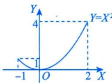

解 $Y$ 的分布函数为 $F_{Y}(y) = P\{Y \leqslant y\} = P\{X^{2} \leqslant y\}$ .

① 当 $y < 0$ 时， $F_{Y}(y) = 0$ ；  
② 当 $0 \leqslant y < 1$ 时，

$$
\begin{array}{l} F _ {Y} (y) = P \{- \sqrt {y} \leqslant X \leqslant \sqrt {y} \} = P \{- \sqrt {y} \leqslant X <   0 \} + P \{0 \leqslant X \leqslant \sqrt {y} \} \\ = \frac {1}{2} \sqrt {y} + \frac {1}{4} \sqrt {y} = \frac {3}{4} \sqrt {y}; \quad \int_ {- \sqrt {y}} ^ {0} \frac {1}{2} d x + \int_ {0} ^ {\sqrt {y}} \frac {1}{4} d x \\ \end{array}
$$

③当 $1 \leqslant y < 4$ 时，

$$
F _ {Y} (y) = P \{- 1 \leqslant X <   0 \} + P \{0 \leqslant X \leqslant \sqrt {y} \} = \frac {1}{2} + \frac {1}{4} \sqrt {y};
$$

④当 $y \geq 4$ 时， $F_{y}(y) = 1$

所以 $Y$ 的分布函数为

$$
F _ {Y} (y) = \left\{ \begin{array}{l l} 0, & y <   0, \\ \frac {3}{4} \sqrt {y}, & 0 \leqslant y <   1, \\ \frac {1}{2} + \frac {\sqrt {y}}{4}, & 1 \leqslant y <   4, \\ 1, & y \geqslant 4. \end{array} \right.
$$

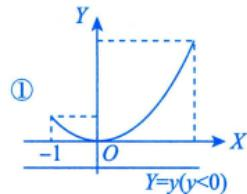

故 $Y$ 的概率密度为

$$
f _ {Y} (y) = \left\{ \begin{array}{l l} \frac {3}{8 \sqrt {y}}, & 0 <   y <   1, \\ \frac {1}{8 \sqrt {y}}, & 1 <   y <   4, \\ 0, & \text {其 他}. \end{array} \right.
$$

# 五 综合题举例

例2.18 投保人的损失事件发生时，保险公司的赔付额 $Y$ 与投保人的损失额 $X$ 的关系为

$$
Y = \left\{ \begin{array}{l l} 0, & X \leqslant 1 0 0, \\ X - 1 0 0, & X > 1 0 0. \end{array} \right.
$$

设损失事件发生时，投保人的损失额 $X$ 的概率密度为

$$
f (x) = \left\{ \begin{array}{l l} \frac {2 \times 1 0 0 ^ {2}}{(1 0 0 + x) ^ {3}}, & x > 0, \\ 0, & x \leqslant 0. \end{array} \right.
$$

（1）求 $P\{Y > 0\}$ 及 $EY$

（2）这种损失事件在一年内发生的次数记为 $N$ ，保险公司在一年内就这种损失事件产生的理赔次数记为 $M$ .假设 $N$ 服从参数为8的泊松分布，在 $N = n(n\geqslant 1)$ 的条件下， $M$ 服从二项分布 $B(n,p)$ ，其中 $p = P\{Y > 0\}$ ，求 $M$ 的概率分布.

解 (1) $P\{Y > 0\} = P\{X - 100 > 0\} = P\{X > 100\} = \int_{100}^{+\infty}\frac{2\times 100^2}{(100 + x)^3}\mathrm{d}x = \frac{1}{4}.$

$$
E Y = \int_ {1 0 0} ^ {+ \infty} (x - 1 0 0) \frac {2 \times 1 0 0 ^ {2}}{(1 0 0 + x) ^ {3}} d x = 5 0.
$$

（2）由题知， $N\sim P(8),P\{M = m|N = n\} = \mathrm{C}_n^m\left(\frac{1}{4}\right)^m\left(\frac{3}{4}\right)^{n - m}$ ，由乘法公式可得

$$
\begin{array}{l} P \{M = m, N = n \} = P \{N = n \} P \{M = m \mid N = n \} \\ = \frac {8 ^ {n}}{n !} \mathrm {e} ^ {- 8} \cdot C _ {n} ^ {m} \cdot \left(\frac {1}{4}\right) ^ {m} \cdot \left(\frac {3}{4}\right) ^ {n - m}, \\ \end{array}
$$

其中 $m = 0,1,\dots ,n;n = 1,2,\dots .$

故 $M$ 的概率分布为

$$
\begin{array}{l} P \{M = m \} = \sum_ {n = m} ^ {\infty} P \{M = m, N = n \} = \sum_ {n = m} ^ {\infty} \frac {8 ^ {n}}{n !} e ^ {- 8} \cdot C _ {n} ^ {m} \cdot \left(\frac {1}{4}\right) ^ {m} \cdot \left(\frac {3}{4}\right) ^ {n - m} \\ = \sum_ {n = m} ^ {\infty} \frac {8 ^ {n}}{n !} e ^ {- 8} \cdot \frac {n !}{m ! (n - m) !} \left(\frac {1}{4}\right) ^ {m} \cdot \left(\frac {3}{4}\right) ^ {n - m} \\ = \left(\frac {1}{4}\right) ^ {m} \mathrm {e} ^ {- 8} \frac {8 ^ {m}}{m !} \sum_ {n = m} ^ {\infty} \frac {8 ^ {n - m}}{(n - m) !} \cdot \left(\frac {3}{4}\right) ^ {n - m} \\ = \left(\frac {1}{4}\right) ^ {m} e ^ {- 8} \frac {8 ^ {m}}{m !} \sum_ {n = m} ^ {\infty} \frac {6 ^ {n - m}}{(n - m) !} = \frac {2 ^ {m}}{m !} e ^ {- 8} \cdot e ^ {6} = \frac {2 ^ {m}}{m !} e ^ {- 2}, \\ \end{array}
$$

即 $P\{M = m\} = \frac{2^m}{m!}\mathrm{e}^{-2},m = 0,1,2,\dots ,$ 即 $M\sim P(2)$

注本题第（2）问在2001年考研真题中出现过其中一部分，如下.

设某班车起点站上车人数 $X$ 服从参数为 $\lambda (\lambda >0)$ 的泊松分布，每位乘客在中途下车的概率为 $p(0 <   p <   1)$ ，且中途下车与否相互独立.以 $Y$ 表示在中途下车的人数，求：

（1）在发车时有 $n$ 个乘客的条件下，中途有 $m$ 人下车的概率；  
（2）二维随机变量 $(X,Y)$ 的概率分布.

解（1） $P\{Y = m \mid X = n\} = \mathrm{C}_n^m p^m (1 - p)^{n - m}, 0 \leqslant m \leqslant n, n = 0, 1, 2, \dots.$

(2) $P\{X = n, Y = m\} = P\{Y = m \mid X = n\} P\{X = n\}$

$$
= \mathrm {C} _ {n} ^ {m} p ^ {m} (1 - p) ^ {n - m} \cdot \frac {\mathrm {e} ^ {- \lambda}}{n !} \lambda^ {n}, 0 \leqslant m \leqslant n, n = 0, 1, 2, \dots .
$$

# 习题

2.1 已知 $F(x)$ 是分布函数，下列函数中：

① $aF(x)(a > 0, a \neq 1)$ ; ② $F(x) + F(-x)$ ; ③ $F(x) - F(-x)$ ; ④ $F(x) \cdot F(-x)$ .

不能作为分布函数的个数是（ ）

(A)1

(B)2

(C)3

(D)4

2.2 设 $X \sim B(2, p)$ , $Y \sim B(4, p)$ , 且 $P\{X \geqslant 1\} = \frac{5}{9}$ , 则 $P\{Y \geqslant 1\} = (\quad)$ .

(A) $\frac{65}{81}$

(B) $\frac{16}{81}$

(C) 1

(D) $\frac{4}{7}$

2.3 设随机变量 $X$ 服从正态分布 $N(\mu_1, \sigma_1^2)$ ，随机变量 $Y$ 服从正态分布 $N(\mu_2, \sigma_2^2), \sigma_1, \sigma_2 > 0$ ，且 $P\{|X - \mu_1| < 1\} > P\{|Y - \mu_2| < 1\}$ ，则必有（ ）.

(A) $\sigma_{1} <   \sigma_{2}$

(B) $\sigma_{1} > \sigma_{2}$

(C) $\mu_1 <   \mu_2$

(D) $\mu_1 > \mu_2$

2.4 设随机变量 $X$ 的分布函数 $F(x) = \begin{cases} 0, & x < 0, \\ \frac{1}{2}, & 0 \leqslant x < 1, \\ 1 - \mathrm{e}^{-x}, & x \geqslant 1, \end{cases}$ 则 $P\{0 \leqslant X \leqslant 1\} = \_ , P\{0 < X < 1\} = \_\ .$

2.5 离散型随机变量 $X$ 的分布函数为

$$
F (x) = \left\{ \begin{array}{l l} 0, & x <   - 1, \\ 0. 4, & - 1 \leqslant x <   2, \\ 0. 8, & 2 \leqslant x <   3, \\ 1, & x \geqslant 3, \end{array} \right.
$$

则 $X$ 的分布列为 ， $P\{X\leqslant 3.2\} = \_ ,$ 方程 $x^{2} + Xx + 1 = 0$ 有实根的概率为

2.6 设连续型随机变量 $X$ 的分布函数为

$$
F (x) = \left\{ \begin{array}{l l} 0, & x <   - a, \\ A + B \arcsin \frac {x}{a}, & - a \leqslant x <   a, \\ 1, & x \geqslant a, \end{array} \right.
$$

则 $A = \_$ ， $B = \_$ ， $X$ 的概率密度 $f(x) = \_$ ， $P\left\{-\frac{a}{2} < X < \frac{a}{2}\right\} = \_$

2.7 设连续型随机变量 $X$ 的概率密度为

$$
f (x) = \left\{ \begin{array}{l l} \frac {A}{x ^ {2}}, & x > 1 0 0, \\ 0, & x \leqslant 1 0 0, \end{array} \right.
$$

则 $A = \_$ ， $P\{100 < X \leqslant 150\} = \_$ ， $P\{X \geqslant 1000\} = \_$ ， $P\{X = 1000\} = \_$ ， $X$ 的分布函数 $F(x) = \_$

2.8 设随机变量 $X$ 服从正态分布 $N(\mu, \sigma^2)(\sigma > 0)$ ，且二次方程 $y^{2} + 4y + X = 0$ 无实根的概率为 $\frac{1}{2}$ ，则 $\mu =$   
2.9 设随机变量 $X$ 服从区间(2,5)上的均匀分布，则对 $X$ 进行3次独立观测中，至少有2次的观测值大于3的概率为  
2.10 设随机变量 $X$ 的概率密度为 $f(x) = \begin{cases} 2x, & 0 < x < 1, \\ 0, & \text{其他}, \end{cases}$ $Y$ 表示对 $X$ 的3次独立重复试验中事件 $\left\{X \leqslant \frac{1}{2}\right\}$ 出现的次数，则 $P\{Y = 2\} = \_$   
2.11 设随机变量 $X$ 和 $Y$ 同分布， $X$ 的概率密度为

$$
f (x) = \left\{ \begin{array}{l l} \frac {3}{8} x ^ {2}, & 0 <   x <   2, \\ 0, & \text {其 他}. \end{array} \right.
$$

已知事件 $A = \{X > a\}$ 和 $B = \{Y > a\}$ 独立，且 $P(A \cup B) = \frac{3}{4}$ ，则常数 $a =$

2.12 已知 $X$ 为随机变量， $Y = X^2 + X + 1$ ，已知 $X$ 的概率分布为 $P\{X = -1\} = P\{X = 0\} = P\{X = 1\} = \frac{1}{3}$ ，则 $Y$ 的分布函数 $F_Y(y) = \_$   
2.13 已知离散型随机变量 $X$ 的正概率点为 $-1, 0, 2$ ，它们各自的概率互不相等且成等差数列。

(1) 求 $X$ 的分布律；  
(2) 求 $X$ 的分布函数；  
(3) 求 $P\{|X| \leqslant 1 | X \geqslant 0\}$ .

2.14 随机变量 $X$ 的概率密度为

$$
f (x) = \left\{ \begin{array}{l l} x, & 0 \leqslant x <   1, \\ 2 - x, & 1 \leqslant x <   2, \\ 0, & \text {其 他}. \end{array} \right.
$$

求 $X$ 的分布函数 $F(x)$ ：

2.15 设连续型随机变量 $X$ 的概率密度 $f(x)$ 是一个偶函数， $F(x)$ 为 $X$ 的分布函数，证明：对任意实数 $a > 0$ ，有

(1) $F(-a) = 1 - F(a) = 0.5 - \int_{0}^{a} f(x) \, \mathrm{d}x$ ;   
(2) $P\{|X| < a\} = 2F(a) - 1$ ;   
(3) $P\{|X| > a\} = 2[1 - F(a)]$

2.16 设随机变量 $X$ 的概率密度为 $f_{X}(x) = \frac{k}{1 + x^{2}} (x\in \mathbf{R})$ .求：

(1) 常数 $k$ ；  
(2) 随机变量 $Y = 1 - \sqrt[3]{X}$ 的概率密度 $f_{Y}(y)$ .

2.17 设随机变量 $X$ 的概率密度为 $f(x) = \frac{\mathrm{e}^x}{(1 + \mathrm{e}^x)^2}, -\infty < x < +\infty$ ，令 $Y = \mathrm{e}^{X}$ .

(1) 求 $X$ 的分布函数；  
(2)求 $Y$ 的概率密度.

2.18 设随机变量 $X \sim U(-1, 2)$ ，求 $Y = |X|$ 的概率密度。

# 解答

2.1 (D) 解 应用分布函数的充要条件求解. 由于

$①$

$$
a F (+ \infty) = a \neq 1,
$$

②

$$
F (- \infty) + F (+ \infty) = 1 \neq 0,
$$

$③$

$$
F (- \infty) - F (+ \infty) = - 1 \neq 0,
$$

$④$

$$
F (+ \infty) \cdot F (- \infty) = 0 \neq 1,
$$

因此 $①$ ， $②$ ， $③$ ， $④$ 都不能作为分布函数，故选(D).

2.2 (A) 解 由题设 $P\{X \geqslant 1\} = \frac{5}{9} = 1 - P\{X = 0\} = 1 - C_2^0 p^0 (1 - p)^2$ ，即 $(1 - p)^2 = \frac{4}{9}$ ，解得 $p = \frac{1}{3}$ ，从而有

$$
P \{Y \geqslant 1 \} = 1 - P \{Y = 0 \} = 1 - C _ {4} ^ {0} p ^ {0} (1 - p) ^ {4} = 1 - \left(\frac {2}{3}\right) ^ {4} = \frac {6 5}{8 1},
$$

故选 (A).

2.3(A)解所有有关正态分布不等式的判别都应先标准化，即由

$$
P \left\{\left| X - \mu_ {1} \right| <   1 \right\} > P \left\{\left| Y - \mu_ {2} \right| <   1 \right\},
$$

有

$$
P \left\{\frac {\left| X - \mu_ {1} \right|}{\sigma_ {1}} <   \frac {1}{\sigma_ {1}} \right\} > P \left\{\frac {\left| Y - \mu_ {2} \right|}{\sigma_ {2}} <   \frac {1}{\sigma_ {2}} \right\},
$$

从而有 $\Phi \left(\frac{1}{\sigma_1}\right) > \Phi \left(\frac{1}{\sigma_2}\right).$

又由函数 $\varPhi(x)$ 的单调增加性，有 $\frac{1}{\sigma_1} >\frac{1}{\sigma_2} >0$ ，即 $\sigma_{1} <   \sigma_{2}$ ，故选(A).

2.4 $1 - \mathrm{e}^{-1}$ ；0 解 $P\{0\leqslant X\leqslant 1\} = P\{X\leqslant 1\} -P\{X <   0\} = F(1) - F(0 - 0)$

$$
= 1 - \mathrm {e} ^ {- 1} - 0 = 1 - \mathrm {e} ^ {- 1};
$$

$$
P \{0 <   X <   1 \} = P \{X <   1 \} - P \{X \leqslant 0 \} = F (1 - 0) - F (0) = \frac {1}{2} - \frac {1}{2} = 0.
$$

2.5 $X\sim \left( \begin{array}{ccc} - 1 & 2 & 3\\ 0.4 & 0.4 & 0.2 \end{array} \right);$ 1;0.6解分布函数的分段点即为离散型随机变量的正概率点，正概率点的概率即为对应点的跃度，即 $X = -1,2,3$ ，分布列为

$$
X \sim \left( \begin{array}{c c c} - 1 & 2 & 3 \\ 0. 4 & 0. 4 & 0. 2 \end{array} \right),
$$

$$
P \{X \leqslant 3. 2 \} = F (3. 2) = 1.
$$

方程 $x^{2} + Xx + 1 = 0$ 有实根，即 $X^2 -4\geqslant 0$ ，从而有

$$
P \{X ^ {2} - 4 \geqslant 0 \} = P \{X \leqslant - 2 \} + P \{X \geqslant 2 \} = F (- 2) + 1 - F (2 - 0) = 1 - 0. 4 = 0. 6.
$$

2.6 $\frac{1}{2};\frac{1}{\pi};\left\{\begin{array}{ll}\frac{1}{\pi\sqrt{a^2-x^2}},&-a< x<a,\frac{1}{3}\\0,&\text{其他};\end{array}\right.$ 解 根据连续型随机变量分布函数的连续性，有

$$
F (- a) = F (- a - 0), F (a) = F (a - 0),
$$

即有 $A + B\cdot \left(-\frac{\pi}{2}\right) = 0,$ $A + B\cdot \frac{\pi}{2} = 1,$

解得 $A = \frac{1}{2}, B = \frac{1}{\pi}$

于是

$f(x) = \left\{ \begin{array}{ll}F^{\prime}(x), & -a <   x <   a,\\ 0, & \text{其他} \end{array} \right.$ $\frac{1}{\pi\sqrt{a^2 - x^2}},\quad -a <   x <   a,$ 其他.

$$
P \left\{- \frac {a}{2} <   X <   \frac {a}{2} \right\} = \int_ {- \frac {a}{2}} ^ {\frac {a}{2}} f (x) d x = \int_ {- \frac {a}{2}} ^ {\frac {a}{2}} \frac {1}{\pi \sqrt {a ^ {2} - x ^ {2}}} d x = \frac {1}{3},
$$

或 $P\left\{-\frac{a}{2} < X < \frac{a}{2}\right\} = F\left(\frac{a}{2} - 0\right) - F\left(-\frac{a}{2}\right) = \frac{1}{\pi}\left[\arcsin \frac{1}{2} - \arcsin \left(-\frac{1}{2}\right)\right] = \frac{1}{3}.$

2.7 100; $\frac{1}{3}$ ; $\frac{1}{10}$ ; 0; $\left\{ \begin{array}{ll}0, & x < 100, \\ 1 - \frac{100}{x}, & x \geqslant 100 \end{array} \right.$ 解 根据连续型随机变量概率密度的性质，有

$$
\int_ {- \infty} ^ {+ \infty} f (x) \mathrm {d} x = \int_ {1 0 0} ^ {+ \infty} \frac {A}{x ^ {2}} \mathrm {d} x = - \left. \frac {A}{x} \right| _ {1 0 0} ^ {+ \infty} = \frac {A}{1 0 0} = 1, A = 1 0 0,
$$

于是

$$
P \{1 0 0 <   X \leqslant 1 5 0 \} = \int_ {1 0 0} ^ {1 5 0} \frac {1 0 0}{x ^ {2}} d x = - \left. \frac {1 0 0}{x} \right| _ {1 0 0} ^ {1 5 0} = \frac {1}{3},
$$

$$
P \{X \geqslant 1 0 0 0 \} = \int_ {1 0 0 0} ^ {+ \infty} \frac {1 0 0}{x ^ {2}} d x = - \left. \frac {1 0 0}{x} \right| _ {1 0 0 0} ^ {+ \infty} = \frac {1}{1 0},
$$

$$
P \{X = 1 0 0 0 \} = 0,
$$

$$
F (x) = \int_ {- \infty} ^ {x} f (t) \mathrm {d} t = \left\{ \begin{array}{l l} 0, & x <   1 0 0, \\ \int_ {1 0 0} ^ {x} \frac {1 0 0}{t ^ {2}} \mathrm {d} t, & x \geqslant 1 0 0 \end{array} = \left\{ \begin{array}{l l} 0, & x <   1 0 0, \\ 1 - \frac {1 0 0}{x}, & x \geqslant 1 0 0. \end{array} \right. \right.
$$

2.84解二次方程 $y^{2} + 4y + X = 0$ 无实根的充要条件是 $4 - X <   0$ .故由条件知

$$
P \{X > 4 \} = \frac {1}{2},
$$

于是有 $\frac{1}{2} = P\{X > 4\} = 1 - P\{X \leqslant 4\} = 1 - P\left\{\frac{X - \mu}{\sigma} \leqslant \frac{4 - \mu}{\sigma}\right\} = 1 - P\left\{Y \leqslant \frac{4 - \mu}{\sigma}\right\} = 1 - \Phi\left(\frac{4 - \mu}{\sigma}\right),$

$$
\Phi \left(\frac {4 - \mu}{\sigma}\right) = \frac {1}{2},
$$

其中 $Y = \frac{X - \mu}{\sigma} \sim N(0,1), \Phi(x) = \frac{1}{\sqrt{2\pi}} \int_{-\infty}^{x} \mathrm{e}^{-\frac{t^2}{2}} \mathrm{d}t.$ 又 $\Phi(0) = \frac{1}{2}$ ，所以 $\frac{4 - \mu}{\sigma} = 0, \mu = 4$ 。

注 事实上，根据正态分布的对称性，可直接得 $\mu = 4$

2.9 $\frac{20}{27}$ 解 在一次观测中，观测值大于3的概率为

$$
p = P \{X > 3 \} = \int_ {3} ^ {5} \frac {1}{3} d x = \frac {2}{3}.
$$

记 $Y = \{3$ 次独立观测中 $X$ 的观测值大于3的次数}，由 $Y\sim B\left(3,\frac{2}{3}\right)$ 得

$$
P \{Y \geqslant 2 \} = 1 - P \{Y = 0 \} - P \{Y = 1 \} = 1 - \left(\frac {1}{3}\right) ^ {3} - 3 \times \frac {2}{3} \times \left(\frac {1}{3}\right) ^ {2} = \frac {2 0}{2 7}.
$$

2.10 $\frac{9}{64}$ 解 依题意得 $Y\sim B(3,p)$ ，其中 $p = P\left\{X\leqslant \frac{1}{2}\right\} = \int_0^{\frac{1}{2}}2x\mathrm{d}x = \frac{1}{4}$ ，故

$$
P \{Y = 2 \} = C _ {3} ^ {2} p ^ {2} (1 - p) = \frac {9}{6 4}.
$$

2.11 $\sqrt[3]{4}$ 解 由 $X$ 和 $Y$ 同分布可得 $P(A) = P(B)$ ，从而

$$
\frac {3}{4} = P (A \cup B) = P (A) + P (B) - P (A B) = 2 P (A) - [ P (A) ] ^ {2},
$$

由此解得 $P(A) = \frac{1}{2}$ ，则 $0 < a < 2$ 。又

$$
\frac {1}{2} = P (A) = P \{X > a \} = \int_ {a} ^ {2} \frac {3}{8} x ^ {2} d x = \frac {1}{8} x ^ {3} \Bigg | _ {a} ^ {2} = 1 - \frac {1}{8} a ^ {3},
$$

解得 $a = \sqrt[3]{4}$

注 随机变量 $X$ 与 $Y$ 同分布，并不意味着 $X = Y$ ，但反之成立，即若 $X = Y$ ，则 $X$ 与 $Y$ 同分布.

2.12 $\left\{ \begin{array}{ll}0, & y < 1,\\ \frac{2}{3}, & 1\leqslant y < 3,\\ 1, & y\geqslant 3 \end{array} \right.$ 解由题设知 $Y$ 为离散型随机变量，当 $X = -1$ 时， $Y$ 取1；当 $X = 0$ 时， $Y$ 取1;

当 $X = 1$ 时， $Y$ 取3. 则 $Y$ 的概率分布为

$$
P \{Y = 1 \} = P \{X = - 1 \} + P \{X = 0 \} = \frac {2}{3}, P \{Y = 3 \} = P \{X = 1 \} = \frac {1}{3}.
$$

故 $Y$ 的分布函数为

$$
F _ {Y} (y) = P \{Y \leqslant y \} = \left\{ \begin{array}{l l} 0, & y <   1, \\ \frac {2}{3}, & 1 \leqslant y <   3, \\ 1, & y \geqslant 3. \end{array} \right.
$$

2.13解(1)设 $P\{X = -1\} = a + d$ ， $P\{X = 0\} = a$ ， $P\{X = 2\} = a - d$ ，其中 $0 < a + d < 1$ ， $0 < a < 1$ ， $0 < a - d < 1$ ，由离散型随机变量 $X$ 分布律的性质，有

$$
a + d + a + a - d = 3 a = 1,
$$

解得 $a = \frac{1}{3}$ ，且 $-\frac{1}{3} < d < \frac{1}{3}, d \neq 0$ ，因此 $X \sim \left( \begin{array}{ccc} -1 & 0 & 2 \\ \frac{1}{3} + d & \frac{1}{3} & \frac{1}{3} - d \end{array} \right)$ ，其中 $-\frac{1}{3} < d < \frac{1}{3}, d \neq 0$

(2) 由 (1) 可知，

$$
F (x) = \left\{ \begin{array}{l l} 0, & x <   - 1, \\ \frac {1}{3} + d, & - 1 \leqslant x <   0, \\ \frac {2}{3} + d, & 0 \leqslant x <   2, \\ 1, & x \geqslant 2. \end{array} \right.
$$

(3) 由条件概率公式及 (1) 可知, $P\{|X| \leqslant 1 | X \geqslant 0\} = \frac{P\{0 \leqslant X \leqslant 1\}}{P\{X \geqslant 0\}} = \frac{1}{2 - 3d}$ .

2.14 解 由题设知，当 $x < 0$ 时， $F(x) = 0$ ；

当 $0 \leqslant x < 1$ 时，

$$
F (x) = \int_ {- \infty} ^ {x} f (t) \mathrm {d} t = \int_ {0} ^ {x} t \mathrm {d} t = \frac {1}{2} t ^ {2} \Bigg | _ {0} ^ {x} = \frac {x ^ {2}}{2};
$$

当 $1 \leqslant x < 2$ 时，

$$
\begin{array}{l} F (x) = \int_ {- \infty} ^ {x} f (t) \mathrm {d} t = \int_ {1} ^ {x} (2 - t) \mathrm {d} t + \int_ {0} ^ {1} t \mathrm {d} t \\ = \left. \left(2 t - \frac {t ^ {2}}{2}\right) \right| _ {1} ^ {x} + \left. \frac {t ^ {2}}{2} \right| _ {0} ^ {1} = 2 x - \frac {x ^ {2}}{2} - 1; \\ \end{array}
$$

当 $x \geqslant 2$ 时，

$$
\begin{array}{l} F (x) = \int_ {- \infty} ^ {x} f (t) \mathrm {d} t = \int_ {0} ^ {1} t \mathrm {d} t + \int_ {1} ^ {2} (2 - t) \mathrm {d} t \\ = \left. \frac {t ^ {2}}{2} \right| _ {0} ^ {1} + \left. \left(2 t - \frac {t ^ {2}}{2}\right) \right| _ {1} ^ {2} = 1. \\ \end{array}
$$

所以

$$
F (x) = \left\{ \begin{array}{l l} 0, & x <   0, \\ \frac {x ^ {2}}{2}, & 0 \leqslant x <   1, \\ 2 x - \frac {x ^ {2}}{2} - 1, & 1 \leqslant x <   2, \\ 1, & x \geqslant 2. \end{array} \right.
$$

2.15 证明 因为 $f(x)$ 是一个偶函数，所以 $f(-x) = f(x)$ ，且 $1 = \int_{-\infty}^{+\infty} f(x) \, \mathrm{d}x = 2 \int_{0}^{+\infty} f(x) \, \mathrm{d}x$ ，可得

$$
\int_ {0} ^ {+ \infty} f (x) d x = 0. 5.
$$

(1) $F(-a) = \int_{-\infty}^{-a} f(x) \, \mathrm{d}x$ ，令 $x = -t$ ，则 $F(-a) = \int_{+\infty}^{a} f(t)(-\mathrm{d}t) = \int_{a}^{+\infty} f(t) \, \mathrm{d}t = 1 - F(a)$ .

$$
\begin{array}{l} F (- a) = \int_ {a} ^ {+ \infty} f (t) d t = \int_ {0} ^ {+ \infty} f (t) d t - \int_ {0} ^ {a} f (t) d t \\ = 0. 5 - \int_ {0} ^ {a} f (x) d x. \\ \end{array}
$$

$$
\begin{array}{l} P \{\left| X \right| <   a \} = P \{- a <   X <   a \} = F (a - 0) - F (- a) \tag {2} \\ = F (a) - [ 1 - F (a) ] \\ = 2 F (a) - 1. \\ \end{array}
$$

$$
P \{| X | > a \} = P \{X <   - a \} + P \{X > a \} = F (- a - 0) + 1 - F (a) \tag {3}
$$

$$
\begin{array}{l} = 1 - F (a) + 1 - F (a) \\ = 2 [ 1 - F (a) ] \\ \end{array}
$$

2.16 解 (1) 由于

$$
\int_ {- \infty} ^ {+ \infty} f _ {X} (x) d x = \int_ {- \infty} ^ {+ \infty} \frac {k}{1 + x ^ {2}} d x = k \arctan x | _ {- \infty} ^ {+ \infty} = k \pi = 1,
$$

因此 $k = \frac{1}{\pi}$

(2) $X$ 的概率密度为 $f_{X}(x) = \frac{1}{\pi(1 + x^{2})} (x\in \mathbf{R})$ .随机变量 $Y = 1 - \sqrt[3]{X}$ 的分布函数为

$$
\begin{array}{l} F _ {Y} (y) = P \{Y \leqslant y \} = P \{1 - \sqrt [ 3 ]{X} \leqslant y \} = P \{X \geqslant (1 - y) ^ {3} \} \\ = \int_ {(1 - y) ^ {3}} ^ {+ \infty} f _ {X} (x) d x = \int_ {(1 - y) ^ {3}} ^ {+ \infty} \frac {1}{\pi \left(1 + x ^ {2}\right)} d x \\ = \frac {1}{\pi} \arctan x \Bigg | _ {(1 - y) ^ {3}} ^ {+ \infty} = \frac {1}{\pi} \left[ \frac {\pi}{2} - \arctan (1 - y) ^ {3} \right] (y \in \mathbf {R}), \\ \end{array}
$$

由此可得 $Y = 1 - \sqrt[3]{X}$ 的概率密度为 $f_{Y}(y) = F_{Y}^{\prime}(y) = \frac{3(1 - y)^{2}}{\pi[1 + (1 - y)^{6}]} (y\in \mathbf{R})$

2.17 解 (1) $X$ 的分布函数为

$$
\begin{array}{l} F (x) = \int_ {- \infty} ^ {x} f (t) d t = \int_ {- \infty} ^ {x} \frac {e ^ {t}}{\left(1 + e ^ {t}\right) ^ {2}} d t = \int_ {- \infty} ^ {x} \frac {d \left(1 + e ^ {t}\right)}{\left(1 + e ^ {t}\right) ^ {2}}. \\ = - \frac {1}{1 + e ^ {t}} \Bigg | _ {- \infty} ^ {x} = 1 - \frac {1}{1 + e ^ {x}} (- \infty <   x <   + \infty). \\ \end{array}
$$

(2)函数 $y = \mathrm{e}^{x}$ 单调且反函数为 $x = \ln y(y > 0)$ ，从而 $Y$ 的概率密度为

$$
\begin{array}{l} f _ {Y} (y) = \left\{ \begin{array}{l l} \frac {1}{y} f (\ln y), & y > 0, \\ 0, & \text {其 他} \end{array} \right. \\ = \left\{ \begin{array}{l l} \frac {1}{(1 + y) ^ {2}}, & y > 0, \\ 0, & \text {其 他}. \end{array} \right. \\ \end{array}
$$

2.18 解 $X$ 的概率密度为

$$
f _ {X} (x) = \left\{ \begin{array}{l l} \frac {1}{3}, & - 1 <   x <   2, \\ 0, & \text {其 他}. \end{array} \right.
$$

记 $X$ 的分布函数为 $F_{X}(x)$ ，先求 $Y$ 的分布函数 $F_{Y}(y)$ ：

当 $y < 0$ 时， $F_{Y}(y) = P\{Y \leqslant y\} = 0$

当 $y\geqslant 0$ 时， $F_{Y}(y) = P\{|X|\leqslant y\} = P\{-y\leqslant X\leqslant y\} = F_{X}(y) - F_{X}(-y - 0).$

将 $F_{Y}(y)$ 关于 $y$ 求导可得 $Y$ 的概率密度为

$$
f _ {Y} (y) = \left\{ \begin{array}{l l} f _ {X} (y) + f _ {X} (- y), & y > 0, \\ 0, & \text {其 他}. \end{array} \right.
$$

当 $0 \leqslant y < 1$ 时， $-1 < -y \leqslant 0$ ，因而 $f_{X}(y) = \frac{1}{3}$ ， $f_{X}(-y) = \frac{1}{3}$ ，此时

$$
f _ {Y} (y) = \frac {1}{3} + \frac {1}{3} = \frac {2}{3};
$$

当 $1 \leqslant y < 2$ 时， $-2 < -y \leqslant -1$ ，因而 $f_{X}(y) = \frac{1}{3}$ ， $f_{X}(-y) = 0$ ，此时

$$
f _ {Y} (y) = \frac {1}{3};
$$

当 $y \geqslant 2$ 时， $-y \leqslant -2$ ，因而 $f_{X}(y) = 0, f_{X}(-y) = 0$ ，此时 $f_{Y}(y) = 0$ 。故 $Y$ 的概率密度为

$$
f _ {Y} (y) = \left\{ \begin{array}{l l} \frac {2}{3}, & 0 \leqslant y <   1, \\ \frac {1}{3}, & 1 \leqslant y <   2, \\ 0, & \text {其 他}. \end{array} \right.
$$

# 第3讲

# 多维随机变量及其分布

在一维基础上，引入两个或更多的随机变量

基础知识结构 $\longrightarrow$ 结构与一维一致, 但需找到多维(二维)与一维的联系与区别

# 基础内容精讲

在一维中 $X = X(w)$ ， $w\in \Omega$ ，将事件映射 $n$ 维随机变量及其分布函数 到实数轴上使其成为一个数.数是有概率出现的，随机而定的，称之为随机变量

# $\langle 1\rangle$ $n$ 维随机变量的概念

要指出值数

如果 $X_{1}, X_{2}, \cdots, X_{n}$ 是定义在同一个样本空间 $\Omega$ 上的 $n$ 个随机变量，则称 $(X_{1}, X_{2}, \cdots, X_{n})$ 为 $n$ 维随机变量或 $n$ 维随机向量， $X_{i} (i = 1, 2, \cdots, n)$ 称为第 $i$ 个分量。将这些指标写成数组 $X_{1}, X_{2}, \cdots, X_{n}$ 的取值都是有概率的

当 $n = 2$ 时，称 $(X,Y)$ 为二维随机变量或二维随机向量. 主要考 $n = 2$ ，但 $n = 3,n = 4$ 也需要准备，学习时，主要是二维和 $n$ 维

注在实际问题中，所研究问题的数量指标往往不止一个.比如根据一个人体检的结果来反映他的健康程度.年龄越大，体检的项目就越多，这些数量指标显然可以构成一个多维向量.

比如身高、体重、血压等

# 2 $n$ 维随机变量的分布函数的概念和性质

(1) 概念.

对任意的 $n$ 个实数 $x_{1}, x_{2}, \dots, x_{n}$ ，称 $n$ 元函数

即 $P(A_{1}A_{2}\dots A_{n})$ ： $A_{1},A_{2},\dots ,A_{n}$ 同时发生的概率

$$
F \left(x _ {1}, x _ {2}, \dots , x _ {n}\right) = P \left\{X _ {1} \leqslant x _ {1}, X _ {2} \leqslant x _ {2}, \dots , X _ {n} \leqslant^ {\prime} x _ {n} \right\}
$$

多个随机变量

为 $n$ 维随机变量 $(X_{1},X_{2},\dots ,X_{n})$ 的分布函数或随机变量 $X_{1},X_{2},\dots ,X_{n}$ 的联合分布函数.

当 $n = 2$ 时，对任意的实数 $x, y$ ，称二元函数

$F(x,y)$ 是事件 $A = \{X\leqslant x\}$ 与 $B = \{Y\leqslant y\}$ 同时发生的概率

$$
F (x, y) = P \{X \leqslant x, Y \leqslant y \}
$$

为二维随机变量 $(X,Y)$ 的分布函数或随机变量 $X$ 和 $Y$ 的联合分布函数，记为 $(X,Y)\sim F(x,y)$ ：

4个性质，尤其 $④$ 最重要

(2)性质： $\rightarrow$ 有两个自变量

类似“偏”导数，固定一个字母，看另一个字母的变化

二元函数研究单调性的方法

$①$ 单调性 $F(x,y)$ 是 $x,y$ 的单调不减函数：

如固定 $y = {y}_{0}$ ,一刀切进去,研究关于 $x$ 的变化率

对任意固定的 $\frac{1}{y}$ ，当 $x_{1} <   x_{2}$ 时， $F(x_{1},y)\leqslant F(x_{2},y)$ ； $\longrightarrow$ 关于 $\mathcal{X}$ 单调不减

对任意固定的 $x$ ，当 $y_{1} < y_{2}$ 时， $F(x,y_1)\leqslant F(x,y_2)$ . $\longrightarrow$ 关于 $y$ 单调不减

② 右连续性 $F(x, y)$ 是 $x, y$ 的右连续函数：

一维中 $F(x)$ 固定y也是右连续 $\lim_{x\to x_0^+}F(x,y) = F(x_0 + 0,y) = F(x_0,y);$ 右极限值 $=$ 函数值，故右连续 $F(x,y) = F(x,y_0 + 0) = F(x,y_0).$

③有界性 $F(-\infty, y) = F(x, -\infty) = F(-\infty, -\infty) = 0$ , $F(+\infty, +\infty) = 1$ .

有一个负无穷，为不可能事件，不可能事件交任何事件都是不可能事件

$P(X\leqslant +\infty ,Y\leqslant +\infty)$ 必然事件必然事件

必然事件的交集也是必然事件,必然事件的概率为1

注 $F(x,y)$ 关于某一个自变量单调不减； $F(x,y)$ 关于某一个自变量右连续； $F(x,y)$ 的两个自变量都趋于正无穷时，概率是1.性质①，②，③与一维类似.

④非负性 对任意的 $x_{1} <   x_{2},y_{1} <   y_{2}$ ，有 $\rightarrow$ 点 $(x_{2},y_{2})$ 在点 $(x_{1},y_{1})$ 的右上方

$P\{x_{1} <   X\leqslant x_{2},y_{1} <   Y\leqslant y_{2}\} = F(x_{2},y_{2}) - F(x_{2},y_{1}) - F(x_{1},y_{2}) + F(x_{1},y_{1})\geqslant 0.$

① 实质上是 $(x, y) \in \overrightarrow{D_0}$ 的概率 $\geqslant 0$

非0区域，有面积

$$
② F (x, y) = P \{X \leqslant x, Y \leqslant y \}
$$

# 边缘分布函数

单独看

设二维随机变量(X,Y)的分布函数为F(x,y)，随机变量X与Y的分布函数Fx（x）与Fy（y）分别称为(X,Y)关于X和关于Y的边缘分布函数.由概率性质得

  
直接写，不需要中间的过程

同理，有 $F_{Y}(y) = F(+\infty, y)$

随机变量（r.v.）

一维r.v.

$X\sim F(x)$

二维 $r, v$ .

$(X,Y)\sim F(x,y)$ $\rightarrow$ 联合分布函数

$X\sim F_{X}(x) = F(x, + \infty),$

$Y\sim F_{Y}(y) = F(+\infty ,y)$

多了边缘分布函数

# 常见的两类二维随机变量——离散型随机变量与连续型随机变量

是根据实际问题来的

# 二维离散型随机变量的概率分布、边缘分布和条件分布

(1) 概率分布.

也称分布律

考试重点

① 如果二维随机变量 $(X, Y)$ 的可能取值是有限对值或可列无限对值，则称 $(X, Y)$ 为二维离散型随机变量. 无穷可列个（比如像正整数 $1, 2, 3, \dots$ ）

称 $p_{ij} = P\{X = x_i, Y = y_j\}, i, j = 1, 2, \dots$

为 $(X,Y)$ 的分布律或随机变量 $X$ 和 $Y$ 的联合分布律，记为 $(X,Y)\sim p_{ij}$ .联合分布律常用表格形式表示.

利用全集分解 $P\{X = x_1\} = P\{X = x_1,\Omega \}$ .比如Y只能取 $y_{1}$ 和 $y_{2}$ ，则

上式 $= P\{X = x_{1},(Y = y_{1}\bigcup Y = y_{2})\} = P\{X = x_{1},Y = y_{1}\} +P\{X = x_{1},Y = y_{2}\}$

② 数列 $\{p_{ij}\}$ ， $i, j = 1, 2, \cdots$ 是某一二维离散型随机变量的概率分布的充分必要条件为

(2)联合分布函数、边缘分布、条件分布.

① 联合分布函数.

设 $(X,Y)$ 的概率分布为 $p_{ij}$ ， $i,j = 1,2,\dots$ ，则 $(X,Y)$ 的分布函数或 $X$ 和 $Y$ 的联合分布函数为

$$
F (x, y) = P \{X \leqslant x, Y \leqslant y \} = \sum_ {x _ {i} \leqslant x} \sum_ {y _ {j} \leqslant y} p _ {i j}.
$$

注 它是以 $(x, y)$ 为顶点的左下方平面上 $(X, Y)$ 取所有可能值的概率的和.

设 $G$ 是平面上的某个区域，则

$$
P \{(X, Y) \in G \} = \sum_ {(x _ {i}, y _ {j}) \in G} p _ {i j}.
$$

注 $(X,Y)$ 落入 $G$ 的概率等于 $(X,Y)$ 在 $G$ 内取所有可能值的概率的和.

离散型问题相对来讲不难，考试为了有区分度，出现的频率很低，但要注意与连续型对比.

② 边缘分布.

$X, Y$ 的边缘分布分别为

固定 $x_{i}$ ，把所有 $y_{j}$ 的概率相加

$p_{i\cdot} = P\{X = x_{i}\} = \sum_{j = 1}^{\infty}P\{X = x_{i},Y = y_{j}\} = \sum_{j = 1}^{\infty}p_{ij}(i = 1,2,\dots);$ 结合表格计算 $p_{.j} = P\{Y = y_j\} = \sum_{i = 1}^{\infty}P\{X = x_i,Y = y_j\} = \sum_{i = 1}^{\infty}p_{ij}(j = 1,2,\dots).$ （2号

★③条件分布. $\longrightarrow$ 不管是离散还是连续都经常考

如果 $(X,Y)\sim p_{ij}(i,j = 1,2,\dots)$ ，对固定的 $j$ ，如果 $p_{\cdot j} = P\{Y = y_j\} >0$ ，则称

$$
P \{X = x _ {i} \bigcap Y = y _ {j} \} = \frac {P \{X = x _ {i} , Y = y _ {j} \}}{P \{Y = y _ {j} \}} = \frac {p _ {i j}}{p _ {\cdot j}} (i = 1, 2, \dots)
$$

$\rightarrow$ 看谁在帘子后边,今母就是谁

为 $X$ 在“ $Y = y_{j}$ ”条件下的条件分布.

同理，对固定的 $i$ ，如果 $p_{i.} > 0$ ，可定义 $Y$ 在“ $X = x_{i}$ ”条件下的条件分布

$\Rightarrow$ 在二维表格中

二维离散型随机变量 $\sim p_{ij}\rightarrow$ 联合分布律.

边缘分布 \(\left\{ \begin{array}{l}X\sim p_{i}\text{(把}j\) 的所有情况相加）,\\ Y\sim p_{j}\text{(把}i\) 的所有情况相加）. \end{array} \right.\)

条件分布 $\left\{ \begin{array}{l} P\left\{Y = y_{j} \mid X = x_{i}\right\} = \frac{p_{ij}}{p_{i}}, \\ P\left\{X = x_{i} \mid Y = y_{j}\right\} = \frac{p_{ij}}{p_{j}}. \end{array} \right.$

# 二维连续型随机变量的概率密度、边缘概率密度和条件概率密度

(1) 概率密度.

$①$ 概念.

如果二维随机变量 $(X, Y)$ 的分布函数 $F(x, y)$ 可以表示为

其中 $f(x, y)$ 是非负可积函数，则称 $(X, Y)$ 为二维连续型随机变量，称 $f(x, y)$ 为 $(X, Y)$ 的概率密度，记为 $(X, Y) \sim f(x, y)$ 。

注 连续,即点与点之间的距离是无穷小量.

② 二元函数 $f(x, y)$ 是概率密度的充分必要条件为

$$
\frac {f (x , y) \geqslant 0 , \int_ {- \infty} ^ {+ \infty} \mathrm {d} y \int_ {- \infty} ^ {+ \infty} f (x , y) \mathrm {d} x = 1}{\text {非 负}} \text {在 金 平 面 积 分 结 果 是} 1
$$

注 改变 $f(x, y)$ 的有限个点的值（仍取非负值）， $f(x, y)$ 仍然是概率密度。

(2)联合分布函数与概率密度、边缘概率密度、条件概率密度.

① 联合分布函数与概率密度.

设 $(X,Y)$ 的分布函数为 $F(x,y)$ ，概率密度为 $f(x,y)$ ，则

a. $F(x,y)$ 为 $(x,y)$ 的二元连续函数，且

$$
F (x, y) = P \{X \leqslant x, Y \leqslant y \} = \int_ {- \infty} ^ {y} d v \int_ {- \infty} ^ {x} f (u, v) d u;
$$

b. 设 $G$ 为平面上某个区域，则

$$
\begin{array}{r l}&{\rightarrow \text {在 某 个 区 域 上 取 值}}\\&{P \{(X, Y) \in G \} = \iint_ {G} f (x, y) \mathrm {d} x \mathrm {d} y ;}\\&{\qquad \qquad \qquad \qquad \qquad \qquad \qquad \qquad \text {体 积 对 应 概 率}}\end{array}
$$

c. 若 $f\left( {x,y}\right)$ 在点(x,y)处连续,则 $\frac{{\partial }^{2}F\left( {x,y}\right) }{\partial x\partial y} = f\left( {x,y}\right)$ ；

$\therefore$ 一维为例， $F'(x) = f(x)$ . $F(x)$ 不一定处处可导，但一定连续. 在不可导的地方给 $f(x)$ 赋值即可. 一般赋值为0，二维同理

d. 若 $F(x, y)$ 连续且可导，则 $(X, Y)$ 是连续型随机变量，且 $\frac{\partial^2 F(x, y)}{\partial x \partial y}$ 是它的概率密度。

② 边缘概率密度.

离散的是画表格找边缘

设 $(X,Y)\sim f(x,y)$ ，则 $X$ 的边缘分布函数为

$$
F _ {X} (x) = F (x, + \infty) = \int_ {- \infty} ^ {x} \left[ \int_ {- \infty} ^ {+ \infty} f (u, v) d v \right] d u, \longrightarrow = \int_ {- \infty} ^ {x} g (u) d u
$$

所以 $X$ 是连续型随机变量，其概率密度为

连续即离散得足够靠近,故两者性质应类似 $\rightarrow  x$ 不动. 累加

$f_{X}(x) = \int_{-\infty}^{+\infty}f(x,y)\mathrm{d}y,$ 称 $f_{X}(x)$ 为 $(X,Y)$ 关于 $X$ 的边缘概率密度. 求谁不积谁曲面的面积同理， $Y$ 也是连续型随机变量，其概率密度为 $f_{Y}(y) = \int_{-\infty}^{+\infty}f(x,y)\mathrm{d}x.$

③ 条件概率密度.

设 $(X,Y)\sim f(x,y)$ ，边缘概率密度 $f_{X}(x) > 0$ ，则称

$$
f _ {Y \mid X} (y \mid x) = \frac {f (x , y)}{f _ {X} (x)}
$$

为 $Y$ 在“ $X = x$ ”条件下的条件概率密度.

条件概率密度 $= \frac{\text{联合概率密度}}{\text{边缘概率密度}}$

同理，可定义 $X$ 在“ $Y = y$ ”条件下的条件概率密度

$$
f _ {X | Y} (x \mid y) = \frac {f (x , y)}{f _ {Y} (y)} \left(f _ {Y} (y) > 0\right).
$$

由以上讨论可知，若 $f_{\chi}(x) > 0$ ， $f_{Y}(y) > 0$ ，则有概率密度乘法公式

$$
f (x, y) = f _ {X} (x) f _ {Y \mid X} (y \mid x) = f _ {Y} (y) f _ {X \mid Y} (x \mid y).
$$

注1称

$$
F _ {Y \mid X} (y \mid x) = \int_ {- \infty} ^ {y} f _ {Y \mid X} (y \mid x) d y = \int_ {- \infty} ^ {y} \frac {f (x , y)}{f _ {X} (x)} d y
$$

为 $Y$ 在“ $X = x$ ”条件下的条件分布函数.

同理，可定义 $X$ 在“ $Y = y$ ”条件下的条件分布函数

为了避免字母混淆，可以写成

$$
F _ {Y \mid X} (y \mid x) = \int_ {- \infty} ^ {y} f _ {Y \mid X} (t \mid x) d t
$$

$$
F _ {X | Y} (x \mid y) = \int_ {- \infty} ^ {x} f _ {X | Y} (x \mid y) d x = \int_ {- \infty} ^ {x} \frac {f (x , y)}{f _ {Y} (y)} d x.
$$

注2

<table><tr><td></td><td>二维离散型随机变量</td><td>二维连续型随机变量</td></tr><tr><td>概率分布/概率密度</td><td>(X,Y)~pij</td><td>(X,Y)~f(x,y)</td></tr><tr><td>联合分布F(x,y)</td><td>∑xij=xyj≤ypiij</td><td>∫y-∞dv∫x-∞f(u,v)du</td></tr><tr><td>边缘分布FX(x), FY(y)</td><td>{X~pi=∑j=1∞pij, Y~pj=∑i=1∞piij}</td><td>{X~FX(x)=∫x-∞fX(u)du=f∫x-∞∫+∞f(u,v)dvdu, Y~FY(y)=∫y-∞fY(v)dv=f∫y-∞∫+∞f(u,v)du dv}</td></tr><tr><td>条件分布 FY|X(y|x), FX|Y(x|y)</td><td>{P{Y=yj|X=xi}=pi/pi, P{X=xj|Y=yj}=pi/pj}</td><td>{FY|X(y|x)=∫y-∞f(u,v)/fX(u)dv, FXY(y|x/y)=∫x-∞f(u,v)/fY(v)du}</td></tr></table>

(3) 常见的二维分布.→《全国硕士研究生招生考试数学考试大纲》要求掌握两种

$①$ 二维均匀分布.

如果 $(X,Y)$ 的概率密度为

  
不画图直接算面积也可以

其中 $S_{D}$ 为区域 $D$ 的面积，则称 $(X,Y)$ 在平面有界区域 $D$ 上服从均匀分布.

★★★②二维正态分布. 记住以下结论即可,不必看证明

如果 $(X,Y)$ 的概率密度为

一维正态分布： $X\sim f(x) = \frac{1}{\sqrt{2\pi}\sigma}\mathrm{e}^{\frac{(x - \mu)^{2}}{2\sigma^{2}}}\longrightarrow$ 记住！考试会考 $f(x,y) = \frac{1}{2\pi\sigma_1\sigma_2\sqrt{1 - \rho^2}}\exp \left\{-\frac{1}{2(1 - \rho^2)}\left[\left(\frac{x - \mu_1}{\sigma_1}\right)^2 -\right.\right.$

表示 $X$ 与 $Y$ 间的相关系数

X的期望、标准差1-ρ²其中μ∈R，μ∈R,σ>0,σ>0,-1<ρ<1，则称(X,Y)服从参数为μ,μ,σ²,σ²,ρ的二维正态Y的期望、标准差→若ρ=0,(X,Y)~f(x,y)=e[（x-μ）²+(y-μ）²]分布，记为(X,Y)~N(μ,μ;σ²,σ²;ρ).此时有5个参数如果ρ=0，联合概率 =1/√2πσe（x-μ）² 1 e（y-μ）²密度等于两个边缘概率密度的乘积.是最简单的情况

a.若 $(X_{1},X_{2})\sim N(\mu_{1},\mu_{2};\sigma_{1}^{2},\sigma_{2}^{2};\rho)$ ，则  
边缘分布一定是正态分布 $X_{1}\sim N(\mu_{1},\sigma_{1}^{2}),X_{2}\sim N(\mu_{2},\sigma_{2}^{2}).$ 但两个正态分布联合未必是二维正态分布恰好说明：b.若 $X_{1}\sim N(\mu_{1},\sigma_{1}^{2})$ ， $X_{2}\sim N(\mu_{2},\sigma_{2}^{2})$ 且 $X_{1}$ ， $X_{2}$ 相互独立，则相关性是指线性相关的程度.不相关即不线性相关，  
但可能有非线性关系，故不相关求必独立独立 $\Rightarrow$ 不相关，故 $\rho = 0$ $(X_1,X_2)\sim N(\mu_1,\mu_2;\sigma_1^2,\sigma_2^2;0).$ （20号 $X_{2}$ 取什么值，不影响 $X_{1}$ 取什么值的概率，反之也是.即 $X_{1}$ 与 $X_{2}$ 没有任何关系

c. $(X_{1},X_{2})\sim N\Rightarrow k_{1}X_{1} + k_{2}X_{2}\sim N(k_{1},k_{2}$ 是不全为0的常数）

线性组合依然服从正态分布

此类题几乎不考大题,如果考大题可学习本题的过程.本题

是基本问题，在传统考研题中会出现，第（1）问是随机事

件与概率，属于古典概型问题

例3.1 将两封信投入3个信箱，设 $X_{1}$ ， $X_{2}$ 分别表示第一个和第二个信箱投进的信的数量，求：

(1) $(X_{1},X_{2})$ 的分布律、边缘分布；  
(2)在条件 $X_{2} = 1$ 下， $X_{1}$ 的条件分布. 3个信箱

分析 不限定每个信箱放入信的数量， $X_{1}$ 与 $X_{2}$ 的可能取值为0,1,2.

第一封信投入3个信箱有3种可能，第二封信投入3个信箱也有3种可能

解 (1) $X_{1}$ 与 $X_{2}$ 可能取值为0,1,2，样本点总数为 $3^{2} = 9$ ，则

$$
p _ {0 0} = P \{X _ {1} = 0, X _ {2} = 0 \} = \frac {1}{9},
$$

第1个、第2个信箱没有信

即信都在第3个信箱中

$$
p _ {0 1} = P \left\{X _ {1} = 0, X _ {2} = 1 \right\} = \frac {2}{9},
$$

第1个信箱中没有，第2个信箱有1封，

第3个信箱有1封， $\mathbf{C}_2^1\mathbf{C}_1^1$ 种可能

$$
\begin{array}{l} p _ {0 2} = P \{X _ {1} = 0, X _ {2} = 2 \} = \frac {1}{9}, \\ p _ {1 0} = P \left\{X _ {1} = 1, X _ {2} = 0 \right\} = \frac {2}{9}, \\ p _ {1 1} = P \left\{X _ {1} = 1, X _ {2} = 1 \right\} = \frac {2}{9}, \\ p _ {1 2} = P \left\{X _ {1} = 1, X _ {2} = 2 \right\} = 0, \\ p _ {2 0} = P \left\{X _ {1} = 2, X _ {2} = 0 \right\} = \frac {1}{9}, \\ p _ {2 1} = p _ {2 2} = 0, \\ \end{array}
$$

于是 $(X_{1},X_{2})$ 的分布律与边缘分布为

<table><tr><td>X2
X1</td><td>0</td><td>1</td><td>2</td><td>pi.</td></tr><tr><td>0</td><td>1/9</td><td>2/9</td><td>1/9</td><td>行相加 4/9</td></tr><tr><td>1</td><td>2/9</td><td>2/9</td><td>0</td><td>→ 4/9</td></tr><tr><td rowspan="2">2</td><td rowspan="2">1/9</td><td>0</td><td>0</td><td rowspan="2">→ 1/9</td></tr><tr><td>↓</td><td>↓相加</td></tr><tr><td>p.j</td><td>4/9</td><td>4/9</td><td>1/9</td><td>1→归一性</td></tr></table>

没有独立性前提，在一个事件发生的条件下，会影响另一个事件的概率(2) $P\{X_1 = 0|X_2 = 1\} = \frac{p_{01}}{p_{,1}} = \frac{\frac{2}{9}}{\frac{4}{9}} = \frac{1}{2},$ 按数字标

$$
P \{X _ {1} = 1 \mid X _ {2} = 1 \} = \frac {p _ {1 1}}{p _ {\cdot 1}} = \frac {\frac {2}{9}}{\frac {4}{9}} = \frac {1}{2},
$$

$$
P \{X _ {1} = 2 \mid X _ {2} = 1 \} = 0,
$$

所以在条件 $X_{2} = 1$ 下， $X_{1}$ 的条件分布为

$$
X _ {1} \sim \left( \begin{array}{c c} 0 & 1 \\ \frac {1}{2} & \frac {1}{2} \end{array} \right).
$$

例3.2 二维随机变量 $(X,Y)$ 的概率分布为

<table><tr><td>X Y</td><td>0</td><td>1</td></tr><tr><td>0</td><td>0.4</td><td>a</td></tr><tr><td>1</td><td>b</td><td>0.1</td></tr></table>

若随机事件 $\{X = 0\}$ 与 $\{X + Y = 1\}$ 相互独立，则（ ）

(A) $a = 0.2, b = 0.3$

(B) $a = 0.1, b = 0.4$

(C) $a = 0.3, b = 0.2$

(D) $a = 0.4, b = 0.1$

应选(D).

由联合分布、边缘分布及条件分布的性质，有

$$
P \{X = 0 \} = p _ {0 0} + p _ {0 1} = 0. 4 + a,
$$

$$
P \{X + Y = 1 \} = p _ {0 1} + p _ {1 0} = a + b,
$$

$$
p _ {0 0} + p _ {0 1} + p _ {1 0} + p _ {1 1} = \underbrace {a + b + 0 . 5} _ {\text {归 一 性}} = 1 \Rightarrow a + b = 0. 5,
$$

$$
P \{X = 0, X + Y = 1 \} = P \{X = 0, Y = 1 \} = a.
$$

又 $\{X = 0\}$ 与 $\{X + Y = 1\}$ 相互独立，故

$$
\begin{array}{l} P \{X = 0, X + Y = 1 \} = P \{X = 0 \} \cdot \underline {{P \{X + Y = 1 \}}} \\ = (0. 4 + a) (a + b) \\ = 0. 5 (0. 4 + a). \\ \end{array}
$$

因此 $0.5(0.4 + a) = a$ ，解得 $a = 0.4$ ， $b = 0.5 - 0.4 = 0.1$ ，故选择(D).

例3.3 已知二维随机变量 $(X,Y)$ 在 $G$ 上服从均匀分布， $G$ 由直线 $x - y = 0$ $x + y = 2$ 与 $y = 0$ 围成，求： 连续型

(1) 边缘概率密度 $f_{X}(x)$ 和 $f_{Y}(y)$   
(2)条件概率密度 $f_{X|Y}(x|y)$ ：

分析 先画图，求面积，再写出联合概率密度.由联合概率密度求边缘概率密度几乎必考，很重要.

解 $(X,Y)$ 的正概率密度区域如图3-1所示.

  
图3-1

由题设， $(X,Y)$ 的概率密度为

(2) 在 $0 < y < 1$ 的条件下，条件概率密度

$f_{X|Y}(x|\bar{y}) = \frac{f(x,y)}{\bar{f}_Y(y)} = \frac{1}{2 - 2y},y\leqslant x\leqslant 2 - y,$ $f_{X|Y}(x|\bar{y}) = \frac{f(x,y)}{f_Y(y)} = \frac{1}{2 - 2y},y\leqslant x\leqslant 2 - y,$ $f_{X|Y}(x|\bar{y}) = \frac{f(x,y)}{f_Y(y)} = \frac{1}{2 - 2y},y\leqslant x\leqslant 2 - y,$ $f_{X|Y}(x|\bar{z}) = \frac{f(x,y)}{f_Y(y)} = \frac{1}{2 - 2y},y\leqslant x\leqslant 2 - y,$ $f_{X|Y}(x|\bar{y}) = \frac{f(x,y)}{f_Y(y)} = \frac{1}{2 - 2y},y\leqslant x\leqslant 2 - y,\quad$ $f_{X|Y}(x|\bar{y}) = \frac{f(x,y)}{f_Y(y)} = \frac{1}{2 - 2y},y\leqslant x\leqslant 2 - y,$ $f_{X|Y}(x|\bar{y}) = \frac{f(x,y)}{f_Y(y)} = \frac{1}{2 - 2y},y\leqslANT x\leqslant 2 - y,$ $f_{X|Y}(x|\bar{y}) = \frac{f(x,y)}{f_Y(y)} = \frac{1}{2 - 2y},y\leqslant x\leqslant 2 - y,$ $f_{X|Y}(x|\bar{y}) = \frac{f(x,y)}{f_Y(y)} = \frac{1 + 1}{2 - 2y},y\leqslant x\leqslant 2 - y,$ $f_{X|Y}(x|\bar{y}) = \frac{f(x,y)}{f_Y(y)} = \frac{1 + 1}{2 - 2y},y\leqslant x\leqslant 2 - y,$ $f_{X|Y}(x|\bar{y}) = f_{X|Y}(x|\bar{y}) = \frac{1 + 1}{2 - 2y},y\leqslant x\leqslant 2 - y,$ $f_{X|Y}(x|\bar{y}) = f_{X|Y}(x|\bar{y}) = \frac{1 + 1}{2 - 2y},y\leqslant x\leqslant 2 - y,$ $f_{X|Y}(X|\bar{y}) = \frac{\left(1 + \sqrt{x^2 + y^2}\right)^{\frac{1}{2}}}{4},$ $f_{X|Y}(x|\bar{y}) = \frac{(1 + \sqrt{x^2 + y^2})^{1 / 3}}{4}.$

无条件分布 $\langle \rangle$ 0到1内任意实数

例3.4 已知随机变量 $X$ 在区间 $[0,1]$ 上服从均匀分布，在 $X = x(0 < x < 1)$ 的条件下，随机变量 $Y$ 在区间 $[0,x]$ 上服从均匀分布，求：一般写(0,1)

(1) $(X,Y)$ 的概率密度；  
(2) $Y$ 的概率密度；  
(3)概率 $P\{X + Y > 1\}$ . $\longrightarrow$ 很重要，典型问题一维： $P\{(X,Y)\in D\} = \iint_{D}f(x,y)\mathrm{d}\sigma$ 解 (1)由题设， $X$ 的边缘概率密度为

$$
f _ {X} (x) = \left\{ \begin{array}{l l} 1, & 0 <   x <   1, \\ 0, & \text {其 他}. \end{array} \right.
$$

在 $X = x(0 < x < 1)$ 的条件下，随机变量 $Y$ 的条件概率密度为

$f = \left\{  \begin{array}{ll} \frac{1}{x}, & 0 < y < x < 1, \\  0, & \text{其他. } \end{array}\right.$ $\rightarrow$ 常数

因此，当 $0 <   y <   x <   1$ 时， $f(x,y) = f_{X}(x)f_{Y|X}(y|x) = \frac{1}{x}$ 故 $(X,Y)$ 的概率密度为变量 $f(x,y) = \left\{ \begin{array}{ll} \frac{1}{x}, & 0 <   y <   x <   1,\\ 0, & \text{其他}. \end{array} \right.$

(2) $(X,Y)$ 的正概率密度区域如图3-2所示.

当 $0 < y < 1$ 时， $f_{Y}(y) = \int_{-\infty}^{+\infty} f(x, y) \, \mathrm{d}x = \int_{y}^{1} \frac{1}{x} \, \mathrm{d}x = -\ln y$ ；

当 $y \leqslant 0$ 或 $y \geqslant 1$ 时， $f_{Y}(y) = 0$

从而有 $f_{Y}(y) = \left\{ \begin{array}{ll} - \ln y, & 0 <   y <   1,\\ 0, & \text{其他}. \end{array} \right.$

  
图3-2

★★★(3) $P\{X + Y > 1\} = \iint_{x + y > 1}f(x,y)\mathrm{d}x\mathrm{d}y = \int_{\frac{1}{2}}^{1}\mathrm{d}x\int_{1 - x}^{x}\underbrace{\frac{1}{x}}_{x}\mathrm{d}y = \int_{\frac{1}{2}}^{1}(2x - 1)\bullet \frac{1}{x}\mathrm{d}x = 1 - \ln 2.$

注 (1) 第 (1) 问中, 当 $f_{X}(x) > 0$ 时, 才有 $f_{Y|X}(y|x) = \frac{f(x, y)}{f_{X}(x)}$ , 所以 $f(x, y) = f_{X}(x) \cdot f_{Y|X}(y|x)$ 是在 $f_{X}(x) > 0$ 时的表达式, 故最终结果要加上 $f_{X}(x) = 0$ 时的定义, 一般说来, 会归类到分段表达式的“其他”中, 这样就定义全面了.  
(2) 连续型: $(X, Y) \sim f(x, y)$ .

边缘概率密度 $\left\{ \begin{array}{l} f_{X}(x) = \int_{-\infty}^{+\infty}f(x,y)\mathrm{d}y, \\ f_{Y}(y) = \int_{-\infty}^{+\infty}f(x,y)\mathrm{d}x. \end{array} \right.$

条件概率密度 $\left\{ \begin{array}{l} f_{X|Y}(x|y) = \frac{f(x,y)}{f_Y(y)}, \\ f_{Y|X}(y|x) = \frac{f(x,y)}{f_X(x)}. \end{array} \right.$

一个事件的发生，不会促进，也不会抑止另一个事件的发生

# 三 随机变量的相互独立性

# 概念

(1) 设二维随机变量 $(X, Y)$ 的分布函数为 $F(x, y)$ ，边缘分布函数分别为 $F_{X}(x), F_{Y}(y)$ ，如果对任意的实数 $x, y$ ，都有

充要条件 $F(x,y) = F_{X}(x)\bullet F_{Y}(y)$ （即事件 $\{X\leqslant x\}$ 与 $\{Y\leqslant y\}$ 相互独立），则称 $X$ 与 $Y$ 相互独立，否则称 $X$ 与 $Y$ 不相互独立.

(2)如果 $n$ 维随机变量 $(X_{1},X_{2},\dots ,X_{n})$ 的分布函数等于边缘分布函数的乘积，即

$$
F \left(x _ {1}, x _ {2}, \dots , x _ {n}\right) = F _ {1} \left(x _ {1}\right) \cdot F _ {2} \left(x _ {2}\right) \dots \cdot F _ {n} \left(x _ {n}\right),
$$

其中 $F_{i}(x_{i})(i = 1,2,\dots ,n)$ 为 $X_{i}$ 的边缘分布函数， $x_{i}$ 为任意实数，则称 $X_{1},X_{2},\dots ,X_{n}$ 相互独立.

$\therefore n = 3$ 为例， $F(x_{1},x_{2},x_{3}) = F_{1}(x_{1})\bullet F_{2}(x_{2})\bullet F_{3}(x_{3}).$ ①

$F_{1}(x_{1}) = P\{X_{1}\leqslant x_{1}\}$ ， $x_{1}$ 是可以任意取值的.

这个式子其实包含了任意的两个变量独立的情况，不需要像事件的独立性，列多个式子

当 $x_{1}\rightarrow +\infty$ ， $1 = P\{\Omega \}$ ，此时

$$
F \left(x _ {1}, x _ {2}, x _ {3}\right) = F \left(x _ {2}, x _ {3}\right) = F _ {2} \left(x _ {2}\right) \cdot F _ {3} \left(x _ {3}\right).
$$

$$
F \left(x _ {1}, x _ {2}\right) = P \left\{X _ {1} \leqslant x _ {1}, X _ {2} \leqslant x _ {2} \right\};
$$

$$
F _ {1} \left(x _ {1}\right) = P \left\{X _ {1} \leqslant x _ {1} \right\};
$$

$$
F _ {1} \left(x _ {1}\right) \geqslant F \left(x _ {1}, x _ {2}\right). \quad ②
$$

①, ②的不等关系和蕴含关系, 可以取特殊值, 或把定义写出来之后, 用不定式、

单调性对式子进行处理

(3) 如果对任意实数 $x_{i}(i = 1,2,\dots ,n)$ 与 $y_{j}(j = 1,2,\dots ,m)$ ，有

分别满足了两个事件的积再取交

乘积的概率 $=$ 概率的乘积 $P\{X_{1}\leqslant x_{1},X_{2}\leqslant x_{2},\dots ,X_{n}\leqslant x_{n},Y_{1}\leqslant y_{1},Y_{2}\leqslant y_{2},\dots ,Y_{m}\leqslant y_{m}\}$ $= P\{X_1\leqslant x_1,X_2\leqslant x_2,\dots ,X_n\leqslant x_n\} \bullet P\{Y_1\leqslant y_1,Y_2\leqslant y_2,\dots ,Y_m\leqslant y_m\} ,$

即联合分布函数等于各自的分布函数相乘：

$$
F \left(x _ {1}, x _ {2}, \dots , x _ {n}, y _ {1}, y _ {2}, \dots , y _ {m}\right) = F _ {1} \left(x _ {1}, x _ {2}, \dots , x _ {n}\right) \cdot F _ {2} \left(y _ {1}, y _ {2}, \dots , y _ {m}\right),
$$

则两个多维随机变量 $\left( {{X}_{1},{X}_{2},\cdots ,{X}_{n}}\right)$ 与 $\left( {{Y}_{1},{Y}_{2},\cdots ,{Y}_{m}}\right)$ 相互独立. 理论上了解,不必验证

# 相互独立的充要条件

(1) $n$ 个随机变量 $X_{1}, X_{2}, \dots, X_{n}$ 相互独立

$\Leftrightarrow$ 对任意的 $n$ 个实数 $\{x_{i}\} (i = 1,2,\dots ,n)$ ， $n$ 个事件 $\{X_1\leqslant x_1\} ,\{X_2\leqslant x_2\} ,\dots ,\{X_n\leqslant x_n\}$ 相互独立.具有任意性， $x_{i}\in (-\infty , + \infty)$

★★★(2) $①$ 设 $(X,Y)$ 为二维离散型随机变量，则

虽然简单，但经常考 $X$ 与 $Y$ 相互独立 $\Leftrightarrow$ 联合分布律等于边缘分布相乘，

如可在例3.1中加(3) $X_{1}$ ， $X_{2}$ 是否独立？即 由于 $\overrightarrow{p_{00}}\neq \overrightarrow{p_{0,}p_{,0}}$ 故 $X_{1}$ 与 $X_{2}$ 不独立. $P\{X = x_i,Y = y_j\} = P\{X = x_i\} \bullet P\{Y = y_j\} (i,j = 1,2,\dots).$ 验证的方法很多，找一个就行实际考题一般只考二值

② $n$ 个离散型随机变量 $X_{1}, X_{2}, \dots, X_{n}$ 相互独立

$\Leftrightarrow$ 对任意的 $x_{i}\in D_{i} = \{X_{i}$ 的一切可能值 $\} (i = 1,2,\dots ,n)$ ，有

$$
P \left\{X _ {1} = x _ {1}, \dots , X _ {n} = x _ {n} \right\} = \prod_ {i = 1} ^ {n} P \left\{X _ {i} = x _ {i} \right\}.
$$

★★★(3) $①$ 设 $(X,Y)$ 为二维连续型随机变量，则

即

$X$ 与 $Y$ 相互独立 $\Leftrightarrow$ 概率密度等于边缘概率密度相乘，

$$
f (x, y) = f _ {X} (x) \cdot f _ {Y} (y).
$$

② 设 $(X_{1}, X_{2}, \dots, X_{n})$ 为 $n$ 维连续型随机变量，则

$X_{1}, X_{2}, \dots, X_{n}$ 相互独立 $\Leftrightarrow$ 概率密度等于边缘概率密度相乘，

即

$$
f (x _ {1}, x _ {2}, \dots , x _ {n}) = f _ {1} (x _ {1}) \cdot f _ {2} (x _ {2}) \cdot \dots \cdot f _ {n} (x _ {n}),
$$

其中 $f_{i}(x_{i})$ 为 $X_{i}$ 的边缘概率密度.

# 相互独立的性质

类似线性代数中的向量组，整体向量组线性无关，则部分向量组线性无关

(1) 设 $X_{1}, X_{2}, \cdots, X_{n}$ 相互独立，则其中任意 $k (2 \leqslant k \leqslant n)$ 个随机变量也相互独立. 部分

(2) ① 设 $(X, Y)$ 为二维离散型随机变量， $X$ 与 $Y$ 独立，则条件分布等于边缘分布：

类似 $P(B\mid A) = P(B),$ $P(A) > 0$ Y的取值不影响X的概率前提 第1讲事件概率中推导的基本性质

$P\{Y = y_{j} \mid X = x_{i}\} = P\{Y = y_{j}\} (P\{X = x_{i}\} > 0).$ $X$ 的取值不影响 $Y$ 的概率

② 设 $(X, Y)$ 为二维连续型随机变量， $X$ 与 $Y$ 独立，则条件概率密度等于边缘概率密度：

$$
\begin{array}{r l} & \overrightarrow {f _ {X | Y}} (x \mid y) = \frac {f (x , y)}{f _ {Y} (y)} = f _ {X} (x) (f _ {Y} (y) > 0), \\ & f _ {Y | X} (y \mid x) = \frac {f (x , y)}{f _ {X} (x)} = f _ {Y} (y) (f _ {X} (x) > 0). \end{array}
$$

③ 若 $X_{1}, X_{2}, \cdots, X_{n}$ 相互独立， $g_{1}(x), g_{2}(x), \cdots, g_{n}(x)$ 为一元连续函数，则 $g_{1}(X_{1}), g_{2}(X_{2}), \cdots, g_{n}(X_{n})$ 相互独立。分组(分成若干组，变量不重叠)

一般地，若 $X_{11},\dots ,X_{1t_1},\overline{X_{21}},\dots ,X_{2t_2},\dots ,X_{n1},\dots ,X_{nt_n}$ 相互独立， $g_{i}$ 是 $t_i(i = 1,2,\dots ,n)$ 元连续函数，则 $g_{1}(X_{11},\dots ,X_{1t_{1}}),g_{2}(X_{21},\dots ,X_{2t_{2}}),\dots ,g_{n}(X_{n1},\dots ,X_{nt_{n}})$ 也相互独立.

注 (1)所有涉及的 $n$ 维,只是为了数理统计中应用这些原理、性质.只需掌握二维中的性质即可. (2)二维随机变量 $\left( {X,Y}\right)$ .

$$
\begin{array}{r l} & {\text {独 立} \stackrel {\text {定 义}} {\Leftrightarrow} F (x, y) = F _ {X} (x) \bullet F _ {Y} (y), \text {任 意} x, y} \\ & {\quad \stackrel {\text {离 散 型}} {\Leftrightarrow} p _ {i j} = p _ {i} \bullet p _ {- j}, \text {任 意} i, j} \\ & {\quad \stackrel {\text {连 续 型}} {\Leftrightarrow} f (x, y) = f _ {X} (x) \bullet f _ {Y} (y).} \end{array}
$$

# $X$ 与 $Y$ 不独立的判断与证明

$X$ 与 $Y$ 不独立 $\Leftrightarrow$ 存在 $x_0, y_0$ ，使 $A = \{X \leqslant x_0\}$ 与 $B = \{Y \leqslant y_0\}$ 不独立，即

从分布函数判断也常考 $F\left( {{x}_{0},{y}_{0}}\right)  \neq  {F}_{X}\left( {x}_{0}\right)  \cdot  {F}_{Y}\left( {y}_{0}\right) .$ 此如前边补充的例3.1(3)

也即取合适的 $x_0, y_0$ ，使 $P\{X \leqslant x_0\} \cdot P\{Y \leqslant y_0\} \neq P\{X \leqslant x_0, Y \leqslant y_0\}$ 。如：取 $x_0, y_0$ ，使 $0 < P\{X \leqslant x_0\} < 1$ ， $0 < P\{Y \leqslant y_0\} < 1$ ，但 $\{X \leqslant x_0\} \subset \{Y \leqslant y_0\}$ 或 $\{Y \leqslant y_0\} \subset \{X \leqslant x_0\}$ 或 $\{X \leqslant x_0, Y \leqslant y_0\} = \emptyset$ 等。

三种取法应掌握.应用见例3.6

正向会推，反向也需要会写严格的证明过程。

例3.5 设随机变量 $X \sim N(0,1)$ ，在 $X = x$ 的条件下，随机变量 $Y \sim N(x,1)$ ，则 $(X,Y)$ 的概率密度 $f(x,y) = \_$

解 应填 $\frac{1}{2\pi}\mathrm{e}^{-\frac{2x^2 + y^2 - 2xy}{2}}$

由题意知 $f_{X}(x) = \frac{1}{\sqrt{2\pi}}\mathrm{e}^{-\frac{x^{2}}{2}},f_{Y|X}(y|x) = \frac{1}{\sqrt{2\pi}}\mathrm{e}^{-\frac{(y - x)^{2}}{2}},$

故 $f(x, y) = f_{X}(x) \cdot f_{Y|X}(y|x) = \frac{1}{2\pi} \mathrm{e}^{-\frac{2x^{2} + y^{2} - 2xy}{2}}.$

注 考题中不会单独考查这一点，会结合其他知识点一起命题.

$\rightarrow$ 很重要, 但真正考试不会单独作为一个大题, 一般会作为选择题 ★★★ 例3.6 设随机变量 $X$ 的概率密度为

$$
f (x) = \frac {1}{2} e ^ {- | x |}, x \in (- \infty , + \infty),
$$

证明： $X$ 与 $|X|$ 不独立.

分析 首先需要想到什么是独立、什么是不独立，再看题目已给出 $X$ 的概率密度，需要找 $|X|$ 的概率密度，可以根据前边学习的知识，求 $|X|$ 的分布函数，也可以求联合概率密度。具体选什么方法，需要结合具体问题确定，本题最优解法是根据定义找 $x_0$ ，使 $P\{X \leqslant x_0, |X| \leqslant x_0\} \neq P\{X \leqslant x_0\} \cdot P\{|X| \leqslant x_0\}$ 。

证 取 $x_0 = 1$ ，则

因此， $X$ 与 $|X|$ 不独立.

注 本题中 $x_0$ 可取任意正数.

作为选择题时，可以口算

$$
P \left\{X \leqslant 1, | X | \leqslant 1 \right\} = P \left\{| X | \leqslant 1 \right\},
$$

而 $P\{X \leqslant 1\} \cdot P\{|X| \leqslant 1\}$ 显然是 $P\{|X| \leqslant 1\}$ 乘上一个小于 1 的正数. 故必然有

$$
P \left\{X \leqslant 1, | X | \leqslant 1 \right\} \neq P \left\{X \leqslant 1 \right\} \cdot P \left\{| X | \leqslant 1 \right\}.
$$

基础阶段先学好基础知识，强化阶段慢慢总结做题技巧.

★★★四多维随机变量函数的分布 随机事件和概率，没有统一化的研究对象

对分布函数的考查达到顶峰，既是知识的一脉相承，也是对前边所有知识的总结。此部分内容需要考生好好掌握

概念

设 $X, Y$ 为随机变量， $g(x, y)$ 是二元函数，则以随机变量 $X, Y$ 作为变量的函数 $Z = \{g_{1}(X, Y)$ 也是 拼一起是二维 是一维 随机变量，称为随机变量 $X, Y$ 的函数。例如： $Z = X + Y, Z = \left\{ \begin{array}{ll} 1, & X < Y, \\ 0, & X \geqslant Y \end{array} \right.$ 等。输入 $(X, Y)$ ，输出一个 $Z$ 值加减乘除。有很好的实际背景，很多问题都可以抽象成线性组合

常考问题: 已知(X,Y)的分布,求Z=g(X,Y)的分布; 又U=h(X,Y),求(Z,U)的分布. 联合 由于 $Z$ 是一维的,求 $Z$ 的分布,即求一维随机变量的分布 数值函数

2 求法

已知 $(X,Y)$ 的分布，求函数 $Z = g(X,Y)$ 的分布.首先要确定 $X,Y$ 的类型，然后采用相应的公式计算.

(1) 如果 $(X, Y)$ 是二维离散型随机变量，则 $Z = \{g(X, Y)\}$ 也是离散型的，先确定 $Z$ 的值，而后求其相应的概率，即可求得 $Z$ 的分布，具体见例3.7.

此类问题比较简单

★★★(2)如果 $X,Y$ 其中一个是离散型的，另一个是非离散型的，将事件对离散型的一切可能值进行全集分解，而后应用全概率公式求得 $Z$ 的分布，具体见例3.10.

很重要高考重点考 $\left\{  \begin{array}{l} \text{ 若 }\left( {X,Y}\right)  \sim  {p}_{ij}. \\  \text{ 若 }\left( {X,Y}\right)  \sim  f\left( {x,y}\right) . \end{array}\right.$ 考研重点考若 $\left( {X,Y}\right)$ ,便没有 ${p}_{ij}$ ,也没有 $f\left( {x,y}\right)$ ,问题会复杂一些

(3)如果 $(X,Y)$ 是二维连续型随机变量，即 $(X,Y)\sim f(x,y)$ ，则 $Z = g(X,Y)$ 的分布函数

$$
F (z) = P \{g (X, Y) \leqslant z \} = \iint_ {g (x, y) \leqslant z} f (x, y) d x d y,
$$

其中 $-\infty < z < +\infty$ ，讨论起来会复杂一些

要求概率密度 $f(z)$ ，亦可直接用下面的“四、3.”中所讲公式，具体见例3.8，例3.9。

求概率密度前一般先求分布函数 $F(z)$ ，再求导得到 $f(z)$

$$
F (z) = P \{Z \leqslant z \}
$$

注设 $(X,Y)$ 是二维连续型随机变量，且 $(X,Y)\sim f(x,y)$ ，若 $\left\{ \begin{array}{ll}u = u(x,y),\\ v = v(x,y), \end{array} \right.$ 且 $u$ ，v具有一阶连续偏

导数. $\left\{  {\begin{array}{l} x = x\left( {u,v}\right) , \\  y = y\left( {u,v}\right)  \end{array}\text{是其唯一反函数,则}\left( {X,Y}\right) \text{的函数}\left\{  {\begin{array}{l} U = U\left( {X,Y}\right) , \\  V = V\left( {X,Y}\right)  \end{array}\text{的}{f}_{U,V}\left( {u,v}\right)  = f\left\lbrack  {x\left( {u,v}\right) ,y\left( {u,v}\right) }\right\rbrack   * J}\right\}  }\right.$ 已知 $f\left( {x,y}\right)$

其中 $J = \frac{\partial(x,y)}{\partial(u,v)} = \begin{vmatrix} \frac{\partial x}{\partial u} & \frac{\partial x}{\partial v}\\ \frac{\partial y}{\partial u} & \frac{\partial y}{\partial v} \end{vmatrix} = \left[ \begin{array}{cc}\frac{\partial(u,v)}{\partial(x,y)} \end{array} \right]^{-1} = \left| \begin{array}{cc}\frac{\partial u}{\partial x} & \frac{\partial u}{\partial y}\\ \frac{\partial v}{\partial x} & \frac{\partial v}{\partial y} \end{array} \right|^{-1}\neq 0$ ，那么

$$
\left. \begin{array}{l} U \sim f _ {U} (u) = \int_ {- \infty} ^ {+ \infty} f [ x (u, v), y (u, v) ] | J | \mathrm {d} v, \\ V \sim f _ {V} (v) = \int_ {- \infty} ^ {+ \infty} f [ x (u, v), y (u, v) ] | J | \mathrm {d} u. \end{array} \right\} \text {直 接 用 这 两 个}
$$

证

$$
F _ {U, V} (u, v) = P \left\{U \leqslant u, V \leqslant v \right\}
$$

$$
= P \left\{U (X, Y) \leqslant u, V (X, Y) \leqslant v \right\}
$$

即两个区域的交集 $\rightarrow  X,Y$ 的另一个范围

$$
= \iint_ {D _ {x y}} f (x, y) d x d y
$$

换元 $\frac{x = x\left( {u,v}\right) }{y = y\left( {u,v}\right) }{\iint }_{D}f\left\lbrack  {\underline{x}\left( {u,v}\right) ,y\left( {u,v}\right) }\right\rbrack  J\left| {\mathrm{d}u\mathrm{\;d}v}\right|$

换积分区域

换积分变量

换雅可比行列式的绝对值，表示从一个坐标系到另一个坐标系几何度量上的转换系数

故 $f_{U,V}(u,v) = \frac{\partial^2F_{U,V}(u,v)}{\partial u\partial v} = f[x(u,v),y(u,v)]|J|$ . 由 $U, V$ 的联合概率密度可得 $U, V$ 的边缘概率密度，如上所写.

在高等数学中，我们已经熟练掌握了二重积分的换元积分法，故在此给出换元法求 $f_{u,v}(u,v)$ 这是比卷积公式更为有用且极为简便的方法.

# 相互独立随机变量函数的分布及卷积公式

(1) 和的分布.

设 $(X,Y)\sim f(x,y)$ ，则 $Z = X + Y$ 的概率密度为

$$
\begin{array}{l} f _ {Z} (z) = \int_ {- \infty} ^ {+ \infty} f (x, z - x) d x = \int_ {- \infty} ^ {+ \infty} f (z - y, y) d y \\ \stackrel {\text {独 立}} {=} \int_ {- \infty} ^ {+ \infty} f _ {X} (x) f _ {Y} (z - x) \mathrm {d} x = \int_ {- \infty} ^ {+ \infty} f _ {X} (z - y) f _ {Y} (y) \mathrm {d} y. \\ \end{array}
$$

(2)差的分布.

设 $(X,Y)\sim f(x,y)$ ，则 $Z = X - Y$ 的概率密度为

$$
\begin{array}{l} f _ {Z} (z) = \int_ {- \infty} ^ {+ \infty} f (x, x - z) d x = \int_ {- \infty} ^ {+ \infty} f (y + z, y) d y \\ \stackrel {\text {独 立}} {=} \int_ {- \infty} ^ {+ \infty} f _ {X} (x) f _ {Y} (x - z) \mathrm {d} x = \int_ {- \infty} ^ {+ \infty} f _ {X} (y + z) f _ {Y} (y) \mathrm {d} y. \\ \end{array}
$$

注1 令 $\left\{ \begin{array}{ll}u = x - y,\\ v = y, \end{array} \right.$ 则 $\left\{ \begin{array}{ll}x = u + v,\\ y = v, \end{array} \right.$ 雅可比行列式为 $J = \left| \begin{array}{ll}1 & 1\\ 0 & 1 \end{array} \right|$ 由

$f_{U,V}(u,v) = f(u + v,v)\bullet 1,$ 得 $f_{U}(u) = \int_{-\infty}^{+\infty}f_{X}(u + v)\bullet f_{Y}(v)\mathrm{d}v.$

注2 由此处可知，卷积公式均可由换元法经简单计算得出，无须再记卷积公式，也省去了使用卷积公式后关于变量和区域的复杂讨论。如 $X \sim f_{X}(x)$ ， $Y \sim f_{Y}(y)$ ， $X$ ， $Y$ 相互独立。 $Z = aX + bY (ab \neq 0)$ 。

令 $\left\{ \begin{array}{l} u = ax + by, \\ v = y, \end{array} \right.$ 则有 $\left\{ \begin{array}{l} x = \frac{u - bv}{a}, \\ y = v. \end{array} \right.$ , $J = \left| \begin{array}{cc} \frac{\partial x}{\partial u} & \frac{\partial x}{\partial v} \\ \frac{\partial y}{\partial u} & \frac{\partial y}{\partial v} \end{array} \right| = \left| \begin{array}{cc} \frac{1}{a} & -\frac{b}{a} \\ 0 & 1 \end{array} \right| = \frac{1}{a}$ .

故 $f_{U,V}(u,v) = f\left(\frac{u - bv}{a},v\right)\cdot \frac{1}{|a|} = f_X\left(\frac{u - bv}{a}\right)\cdot f_Y(v)\cdot \frac{1}{|a|}$ 则 $f_{U}(u) = \int_{-\infty}^{+\infty}f_{X}\left(\frac{u - bv}{a}\right)f_{Y}(v)\cdot \frac{1}{|a|}\mathrm{d}v$ 将 $u$ 换为 $z$ ， $f_{Z}(z)$ 即为 $Z = aX + bY$ 的概率密度.

(3) 积的分布.

设 $(X,Y)\sim f(x,y)$ ，则 $Z = XY$ 的概率密度为

$$
f _ {Z} (z) = \int_ {- \infty} ^ {+ \infty} \frac {1}{| x |} f \left(x, \frac {z}{x}\right) d x = \int_ {- \infty} ^ {+ \infty} \frac {1}{| y |} f \left(\frac {z}{y}, y\right) d y
$$

$$
\stackrel {\text {独 立}} {=} \int_ {- \infty} ^ {+ \infty} \frac {1}{| x |} f _ {X} (x) f _ {Y} \left(\frac {z}{x}\right) \mathrm {d} x = \int_ {- \infty} ^ {+ \infty} \frac {1}{| y |} f _ {X} \left(\frac {z}{y}\right) f _ {Y} (y) \mathrm {d} y .
$$

注 令 $\left\{ \begin{array}{l} u = xy, \\ v = y, \end{array} \right.$ 则有 $\left\{ \begin{array}{l} x = \frac{u}{v}, \\ y = v, \end{array} \right.$ $J = \left| \begin{array}{cc} \frac{\partial x}{\partial u} & \frac{\partial x}{\partial v} \\ \frac{\partial y}{\partial u} & \frac{\partial y}{\partial v} \end{array} \right| = \left| \begin{array}{cc} \frac{1}{v} & -\frac{u}{v^2} \\ 0 & 1 \end{array} \right| = \frac{1}{v} \neq 0.$

故 $f_{U,V}(u,v) = f\left(\frac{u}{v},v\right)\cdot \frac{1}{|v|}\frac{\text{独立}}{}f_X\left(\frac{u}{v}\right)\cdot f_Y(v)\cdot \frac{1}{|v|}$ ，于是

$$
f _ {U} (u) = \int_ {- \infty} ^ {+ \infty} f _ {U, V} (u, v) d v = \int_ {- \infty} ^ {+ \infty} f _ {X} \left(\frac {u}{v}\right) \cdot f _ {Y} (v) \cdot \frac {1}{| v |} d v,
$$

$$
f _ {Z} (z) = \int_ {- \infty} ^ {+ \infty} f _ {X} \left(\frac {z}{v}\right) \cdot f _ {Y} (v) \cdot \frac {1}{| v |} d v.
$$

(4) 商的分布.

设 $(X, Y) \sim f(x, y)$ ，则 $Z = \frac{X}{Y}$ 的概率密度为

$$
f _ {Z} (z) = \int_ {- \infty} ^ {+ \infty} | y | f (y z,   y) \mathrm {d} y \overset {\text {独 立}} {=} \int_ {- \infty} ^ {+ \infty} | y | f _ {X} (y z) f _ {Y} (y) \mathrm {d} y .
$$

注1 令 $\left\{ \begin{array}{l} u = \frac{x}{y}, \\ v = y, \end{array} \right.$ 则 $\left\{ \begin{array}{l} x = uv, \\ y = v, \end{array} \right.$ 雅可比行列式为 $J = \left| \begin{array}{ll}v & u\\ 0 & 1 \end{array} \right| = v$ ，由

$$
f _ {U, V} (u, v) = f (u v, v) \cdot | v |,
$$

得 $f_{U}(u) = \int_{-\infty}^{+\infty}f_{X}(uv)\bullet f_{Y}(v)|v|\mathrm{d}\nu .$

会了二重积分换元，

将不再需要

注2 以上四组公式，可用“口诀”来记忆：“积谁不换谁，换完求偏导。”

如 $Z = X - Y$ 的 $f_{Z}(z) = \int_{-\infty}^{+\infty}f(x,x - z)\mathrm{d}x$ 中.

先用第一句“积谁不换谁”.对 $x$ 积分，则不换 $x$ ，写成 $f(x,\square)$ ，换 $y = x - z$ ，为 $f(x,x - z)$ ：

再用第二句“换完求偏导”. $\frac{\partial(x - z)}{\partial z} = -1$ ，因概率密度非负，要加绝对值，即为 $|-1| = 1$ .这样便记住了公式.

(5) $\max \{X, Y\}$ 分布.

设 $(X,Y)\sim F(x,y)$ ，则 $Z = \max \{X,Y\}$ 的分布函数为

$$
F _ {\max } (z) = P \left\{\max  \{X, Y \} \leqslant z \right\} = P \{X \leqslant z, Y \leqslant z \} = F (z, z).
$$

当 $X$ 与 $Y$ 独立时，

$$
F _ {\max } (z) = F _ {X} (z) \cdot F _ {Y} (z).
$$

(6) $\min \{X, Y\}$ 分布.

设 $(X,Y)\sim F(x,y)$ ，则 $Z = \min \{X,Y\}$ 的分布函数为

$$
\begin{array}{l} F _ {\min } (z) = P \{\min  \{X, Y \} \leqslant z \} = P \{\{X \leqslant z \} \cup \{Y \leqslant z \} \} \\ = P \{X \leqslant z \} + P \{Y \leqslant z \} - P \{X \leqslant z, Y \leqslant z \} \\ = F _ {X} (z) + F _ {Y} (z) - F (z, z). \\ \end{array}
$$

当 $X$ 与 $Y$ 独立时，

${F}_{\min }\left( z\right)  = {F}_{X}\left( z\right)  + {F}_{Y}\left( z\right)  - {F}_{X}\left( z\right) {F}_{Y}\left( z\right)$ $= 1 - \left\lbrack  {1 - {F}_{X}\left( z\right) }\right\rbrack  \left\lbrack  {1 - {F}_{Y}\left( z\right) }\right\rbrack$ . $= 1 - \left\lbrack  {1 - {F}_{x}\left( z\right) }\right\rbrack   \cdot  \left\lbrack  {1 - {F}_{y}\left( z\right) }\right\rbrack$ 一般不考,或放数理统计里考 $= 1 - P\{ \min \{ X,Y\}  > z\}$ 生存函数

注上述结果容易推广到 $n$ 个相互独立的随机变量 $X_{1}, X_{2}, \dots, X_{n}$ 的情况，即

$$
\begin{array}{l} F _ {\max } (z) = F _ {X _ {1}} (z) F _ {X _ {2}} (z) \dots F _ {X _ {n}} (z), \\ F _ {\min } (z) = 1 - \left[ 1 - F _ {X _ {1}} (z) \right] \left[ 1 - F _ {X _ {2}} (z) \right] \dots \left[ 1 - F _ {X _ {n}} (z) \right]. \\ \end{array}
$$

特别地，当 $X_{i}(i = 1,2,\dots ,n)$ 相互独立且有相同的分布函数 $F(x)$ 与概率密度 $f(x)$ 时，

见例3.11应用

$$
\begin{array}{l} F _ {\max } (x) = [ F (x) ] ^ {n}, \\ f _ {\max } (x) = n [ F (x) ] ^ {n - 1} f (x). \\ F _ {\min } (x) = 1 - [ 1 - F (x) ] ^ {n}, \\ f _ {\min } (x) = n \left[ 1 - F (x) \right] ^ {n - 1} f (x). \\ \end{array}
$$

这些结果在数理统计部分是要用到的。

(7) 常见分布的可加性.

有些相互独立且服从同类型分布的随机变量，其和的分布也是同类型的，它们是二项分布、泊松分布、正态分布与 $\chi^2$ 分布.

设随机变量 $X$ 与 $Y$ 相互独立，则

若 $X\sim B(n,p),Y\sim B(m,p)$ ，则 $X + Y\sim B(\underline{n} +m,p)$ （注意 $p$ 相同）；

若 $X\sim P(\lambda_1),Y\sim P(\lambda_2)$ ，则 $X + Y\sim P(\lambda_1 + \lambda_2)$

强度相加

若 $X \sim N(\mu_1, \sigma_1^2), Y \sim N(\mu_2, \sigma_2^2)$ ，则 $X + Y \sim N(\mu_1 + \mu_2, \sigma_1^2 + \sigma_2^2)$ ；

若 $X\sim \chi^2 (n),Y\sim \chi^2 (m)$ ，则 $X + Y\sim \chi^{2}(n + m)$ 第6讲再讲自由度 自由度相加

注上述结果对 $n$ 个相互独立的随机变量也成立.

是对“四、2(1)”的应用.

(离散，离散) $\rightarrow$ 离散

例3.7 将两封信投入3个信箱，设 $X_{1}, X_{2}$ 分别表示第一个和第二个信箱投进的信的数量，求随机变量 $Y_{1} = X_{1} + X_{2}$ 和 $Y_{2} = X_{1} - X_{2}$ 的分布。分别对应“四、2(1)”中的 $X$ 和 $Y$

$\mathcal{O}$ 分析 利用例3.1的联合分布律，再计算 $Y_{1} = X_{1} + X_{2}$ 的所有可能取值：0,1,2,3,4.

但概率为0的可以去掉，即得答案上 $Y_{1}$ 的分布律， $Y_{2}$ 的分布律同理.

解 由例3.1知 $(X_{1}, X_{2})$ 的分布律，则 $Y_{1} = X_{1} + X_{2}$ 的可能取值为0,1,2，于是

$$
P \{Y _ {1} = 0 \} = p _ {0 0} = \frac {1}{9}, P \{Y _ {1} = 1 \} = p _ {0 1} + p _ {1 0} = \frac {4}{9}, P \{Y _ {1} = 2 \} = p _ {0 2} + p _ {1 1} + p _ {2 0} = \frac {4}{9},
$$

从而有 $Y_{1}\sim \left( \begin{array}{lll}0 & 1 & 2\\ \frac{1}{9} & \frac{4}{9} & \frac{4}{9} \end{array} \right).$

又 $Y_{2} = X_{1} - X_{2}$ 的可能取值为 $-2, -1, 0, 1, 2$ ，于是

$$
P \{Y _ {2} = - 2 \} = p _ {0 2} = \frac {1}{9}, P \{Y _ {2} = - 1 \} = p _ {0 1} = \frac {2}{9}, P \{Y _ {2} = 0 \} = p _ {0 0} + p _ {1 1} = \frac {1}{3},
$$

$$
P \{Y _ {2} = 1 \} = p _ {1 0} = \frac {2}{9}, P \{Y _ {2} = 2 \} = p _ {2 0} = \frac {1}{9},
$$

从而有 $Y_{2}\sim \left( \begin{array}{ccccc} - 2 & -1 & 0 & 1 & 2\\ \frac{1}{9} & \frac{2}{9} & \frac{1}{3} & \frac{2}{9} & \frac{1}{9} \end{array} \right).$

例3.8 设随机变量 $X, Y$ 相互独立，它们的概率密度分别为

引导大家走第(2)步

(1)求 $(X,Y)$ 的概率密度； 联合概率密度 $=$ 边缘概率密度的乘积但现在考题不会这样送分  
(2) 求 $Z = X + Y$ 的概率密度.

解 (1) 由于 $X, Y$ 相互独立，则 $(X, Y)$ 的概率密度为

$$
f (x, y) = f _ {X} (x) f _ {Y} (y) = \left\{ \begin{array}{l} 2 y e ^ {- x}, \\ 0, \end{array} \right.
$$

(2)方法一在 $X$ ，Y相互独立的条件下，用公式 $f_{Z}(z) = \int_{-\infty}^{+\infty}f_{X}(x)f_{Y}(z - x)\mathrm{d}x$ 计算，有

用卷积公式“三部曲”：

① 换字母. $x > 0, 0 < z - x < 1 \Rightarrow x > 0, x < z < x + 1$ .

$②$ 换区域.

$$
f _ {X} (x) f _ {Y} (z - x) = \left\{ \begin{array}{l l} 2 (z - x) \mathrm {e} ^ {- x}, & x > 0, 0 <   z - x <   1, \\ 0, & \text {其 他}. \end{array} \right.
$$

当 $z < 0$ 时， $f_{Z}(z) = 0$

当 $0 < z < 1$ 时， $f_{Z}(z) = \int_{0}^{z} 2(z - x)\mathrm{e}^{-x}\mathrm{d}x = 2z + 2\mathrm{e}^{-z} - 2;$

当 $z > 1$ 时， $f_{Z}(z) = \int_{z - 1}^{z}2(z - x)\mathrm{e}^{-x}\mathrm{d}x = 2\mathrm{e}^{-z}$ .

③ 背口诀。

求 $z$ 不积 $z$

不积先定限，

限内画条线.

先卖写下限，

后交写上限

因此 $Z = X + Y$ 的概率密度为

$$
f _ {Z} (z) = \left\{ \begin{array}{l l} 2 z + 2 \mathrm {e} ^ {- z} - 2, & 0 <   z <   1, \\ 2 \mathrm {e} ^ {- z}, & z > 1, \\ 0, & \text {其 他}. \end{array} \right.
$$

方法二 先记 $U = X + Y\sim f_U(u)$ ，令 $\left\{ \begin{array}{l}u = x + y,\\ \bar{v} = \bar{y}, \end{array} \right.$ 换元法保证两边同维 保证二重积分换元，二元到二元，几元到几元，元不  
够，凑.类似线性代数中二次型，换元保证维数相同一定有一阶连续偏导数.且  
反函数是唯一的 $\left\{ \begin{array}{ll}x = u - v,\\ y = v, \end{array} \right.$ 再计算 $|J| = \left\| \begin{array}{ll}\frac{\partial x}{\partial u} & \frac{\partial x}{\partial v}\\ \frac{\partial y}{\partial u} & \frac{\partial y}{\partial v} \end{array} \right\| = \left\| \begin{array}{ll}1 & -1\\ 0 & 1 \end{array} \right\| = 1$

则 $f_{u,v}(u,v) = f(u - v,v)\cdot 1$ ，故

说明两个坐标系转

换后，测度相同

$$
f _ {U} (u) = \int_ {- \infty} ^ {+ \infty} f (u - v, v) d v = \int_ {- \infty} ^ {+ \infty} f _ {X} (u - v) \cdot f _ {Y} (v) d v,
$$

又因为 $\left\{ \begin{array}{l}x > 0,\\ 0 <   y <   1, \end{array} \right.$ 则 $\left\{ \begin{array}{ll}u - v > 0,\\ 0 <   v <   1, \end{array} \right.$ 解得 $\left\{ \begin{array}{ll}u > v,\\ 0 <   v <   1. \end{array} \right.$

故

$f_{U}(u) = \left\{ \begin{array}{ll}\int_{0}^{u}\mathrm{e}^{-(u - v)}\bullet 2v\mathrm{d}v = 2u - 2 + 2\mathrm{e}^{-u}, & 0 <   u <   1,\\ 2\mathrm{e}^{-u}, & u > 1,\\ 0, & \text{其他}. \end{array} \right.$

将 $u$ 换为 $z$ 即为答案

$$
\begin{array}{l} 2 \mathrm {e} ^ {- u} \int_ {0} ^ {u} \mathrm {e} ^ {v} \cdot v \mathrm {d} v \\ = 2 e ^ {- u} \left[ \left(v e ^ {v} - e ^ {v}\right) \bigg | _ {0} ^ {u} \right] \\ = 2 \mathrm {e} ^ {- u} \left[ (v - 1) \mathrm {e} ^ {v} \Big | _ {0} ^ {u} \right] = 2 \mathrm {e} ^ {- u} \left[ (u - 1) \mathrm {e} ^ {u} + 1 \right] \\ = 2 (u - 1) + 2 \mathrm {e} ^ {- u} \\ \end{array}
$$

即

$$
f _ {Z} (z) = \left\{ \begin{array}{l l} 2 z + 2 \mathrm {e} ^ {- z} - 2, & 0 <   z <   1, \\ 2 \mathrm {e} ^ {- z}, & z > 1, \\ 0, & \text {其 他}. \end{array} \right.
$$

注本题亦可用分布函数法. $(X,Y)$ 的正概率区域 $D$ 与所求概率 $F_{Z}(z) = P\{X + Y\leqslant z\}$ 的积分区域的公共部分有三种不同的组合形式（见图3-3)，于是：

当 $z < 0$ 时， $F_{z}(z) = 0$ ；

当 $0 \leqslant z < 1$ 时， $F_{z}(z) = \int_{0}^{z} \mathrm{d}x \int_{0}^{z - x} 2y \mathrm{e}^{-x} \mathrm{d}y = z^{2} - 2z - 2\mathrm{e}^{-z} + 2;$

当 $z\geqslant 1$ 时， $F_{Z}(z) = 1 - \int_{0}^{1}\mathrm{d}y\int_{z - y}^{+\infty}2ye^{-x}\mathrm{d}x = 1 - 2e^{-z}.$

因此 $Z = X + Y$ 的概率密度为

$$
f _ {Z} (z) = \left\{ \begin{array}{l l} 2 z + 2 \mathrm {e} ^ {- z} - 2, & 0 <   z <   1, \\ 2 \mathrm {e} ^ {- z}, & z > 1, \\ 0, & \text {其 他}. \end{array} \right.
$$

  
图3-3

例3.9 设二维随机变量 $(X, Y)$ 在矩形区域 $D = \{(x, y) | 0 \leqslant x \leqslant 2, 0 \leqslant y \leqslant 1\}$ 上服从均匀分布，求边长为 $X$ 和 $Y$ 的矩形面积 $Z$ 的概率密度。

解方法一令 $\left\{ \begin{array}{l}u = xy,\\ v = y, \end{array} \right.$ 则 $x = \frac{u}{v}$ 则雅可比行列式为 $y = v,$

$$
J = \left| \begin{array}{c c} \frac {1}{v} & - \frac {u}{v ^ {2}} \\ 0 & 1 \end{array} \right| = \frac {1}{v},
$$

则 $f(u,v) = \frac{1}{2}\cdot \frac{1}{|v|} = \frac{1}{2v},$

所以

$$
= \frac {1}{2} (\ln 2 - \ln u), 0 <   u <   2,
$$

即 $f_{z}(z) = \left\{ \begin{array}{ll} \frac{1}{2} (\ln 2 - \ln z), & 0 < z < 2, \\ 0, & \text{其他}. \end{array} \right.$

方法二 由题设 $Z = XY$ ， $(X,Y)$ 的概率密度为

$$
f (x, y) = \left\{\begin{array}{l l}\frac {1}{S _ {D}}&0 \leqslant x \leqslant 2, 0 \leqslant y \leqslant 1,\\0,&\text {其 他 .}\end{array}\right. \quad y \rightarrow \frac {z}{x}
$$

用卷积公式

$$
f _ {Z} (z) = \int_ {- \infty} ^ {+ \infty} \frac {1}{| x |} f \left(x, \frac {z}{x}\right) d x, 0 \leqslant z \leqslant x \leqslant 2.
$$

用卷积公式“三部曲”：

① 换字母.

$$
0 <   x \leqslant 2, 0 \leqslant \frac {z}{x} \leqslant 1 \Rightarrow 0 <   x \leqslant 2, 0 \leqslant z \leqslant x.
$$

$②$ 换区域.

当 $z\leqslant 0$ 或 $z\geqslant 2$ 时， $f_{Z}(z) = 0$ ；③背口诀求 $z$ 不积不积先写下限，  
当 $0 <   z <   2$ 时， $f_{Z}(z) = \frac{1}{2}\int_{z}^{2}\frac{1}{x}\mathrm{d}x = \frac{1}{2} (\ln 2 - \ln z).$ 后麦写上限

因此 $Z = XY$ 的概率密度为

$$
f _ {Z} (z) = \left\{ \begin{array}{l l} \frac {1}{2} (\ln 2 - \ln z), & 0 <   z <   2, \\ 0, & \text {其 他}. \end{array} \right.
$$

注 本题亦可用分布函数法.

正概率密度区域 $D$ 与所求概率 $F_{Z}(z) = P\{XY \leqslant z\}$ 的积分区域的公共部分有三种不同的组合形式（见图3-4），于是

当 $z \leqslant 0$ 时， $F_{z}(z) = 0$ ；

当 $0 < z < 2$ 时，

$$
\begin{array}{l} F _ {z} (z) = \int_ {0} ^ {z} d x \int_ {0} ^ {1} \frac {1}{2} d y + \int_ {z} ^ {2} d x \int_ {0} ^ {\frac {z}{x}} \frac {1}{2} d y \\ = \frac {1}{2} z (1 - \ln z + \ln 2); \\ \end{array}
$$

当 $z \geqslant 2$ 时， $F_{Z}(z) = 1$

因此 $Z = XY$ 的概率密度为

$$
f _ {Z} (z) = \left\{ \begin{array}{l l} \frac {1}{2} (\ln 2 - \ln z), & 0 <   z <   2, \\ 0, & \text {其 他}. \end{array} \right.
$$

  
图3-4

→此类型为考研最后一个大题，但不难

例3.10 设随机变量 $X_{1}$ ， $X_{2}$ ， $X_{3}$ 相互独立，其中 $X_{1}$ 与 $X_{2}$ 均服从标准正态分布， $X_{3}$ 的概率

分布为 $P\{X_{3} = 0\} = P\{X_{3} = 1\} = \frac{1}{2},Y = X_{3}X_{1} + (1 - X_{3})X_{2}$ .→ {X=0时，Y=X2,所以Y有一的概率取X离散的两点分布，即0-1分布有一的概率取 $X_{2}$

(1)求二维随机变量 $(X_{1},Y)$ 的分布函数，结果用标准正态分布函数 $\varPhi(x)$ 表示；  
(2) 证明随机变量 $Y$ 服从标准正态分布.

(1)解记 $(X_{1},Y)$ 的分布函数为 $F(x,y)$ ，则对任意实数 $x$ 和 $y$ ，有

$F\left( {x,y}\right)  = P\left\{  {{X}_{1} \leq  x,\frac{Y \leq  y}{\downarrow }\text{事件复杂}}\right\}$ $= P\left\{  {{X}_{1} \leq  x,{X}_{3}{X}_{1} + \left( {1 - {X}_{3}}\right) {X}_{2} \leq  y,\Omega }\right\}$ 分解 $= P\left\{  {{X}_{1} \leq  x,{X}_{3}{X}_{1} + \left( {1 - {X}_{3}}\right) {X}_{2} \leq  y,\left( {{X}_{3} = 0 \cup  {X}_{3} = 1}\right) }\right\}$ $= P\left\{  {{X}_{1} \leq  x,{X}_{3}{X}_{1} + \left( {1 - {X}_{3}}\right) {X}_{2} \leq  y}\right\}$ 完备事件组

$$
\begin{array}{l} \begin{array}{r l} & = P \{X _ {3} = 0 \} P \{X _ {1} \leqslant x, X _ {3} X _ {1} + (1 - X _ {3}) X _ {2} \leqslant y | X _ {3} = 0 \} + \\ & \quad P \{X _ {3} = 1 \} P \{X _ {1} \leqslant x, X _ {3} X _ {1} + (1 - X _ {3}) X _ {2} \leqslant y | X _ {3} = 1 \} \end{array} \\ = \frac {1}{2} P \left\{X _ {1} \leqslant x, X _ {2} \leqslant y \mid X _ {3} = 0 \right\} + \frac {1}{2} P \left\{X _ {1} \leqslant x, X _ {1} \leqslant y \mid X _ {3} = 1 \right\} \\ = \frac {1}{2} P \{X _ {1} \leqslant x, X _ {2} \leqslant y \} + \frac {1}{2} P \{\underbrace {X _ {1} \leqslant x , X _ {1} \leqslant y} _ {\text {取 交 集}} \} \\ = \frac {1}{2} P \{X _ {1} \leqslant x, X _ {2} \leqslant y \} + \frac {1}{2} P \{X _ {1} \leqslant \min  \{x, y \} \} \\ = \frac {1}{2} \Phi (x) \Phi (y) + \frac {1}{2} \Phi (\min  \{x, y \}). \\ \end{array}
$$

(2) 证 由 (1) 知, $Y$ 的分布函数为

$$
\begin{array}{l} F _ {Y} (y) = \lim  _ {x \rightarrow + \infty} F (x, y) \quad \text {找 边 缘 ， 取 极 限} \\ = \lim  _ {x \rightarrow + \infty} \left[ \frac {1}{2} \Phi (x) \Phi (y) + \frac {1}{2} \Phi (\min  \{x, y \}) \right] \\ = \frac {1}{2} \Phi (y) + \frac {1}{2} \Phi (y) = \Phi (y), \\ \end{array}
$$

所以 $Y$ 服从标准正态分布.

注 本题较简单，考研题不会考这么单一，但核心都是全集分解思想，热点题型。

例3.11 设随机变量 $X, Y$ 相互独立，且都在区间 $[a, b]$ 上服从均匀分布，求 $Z = \max \{X, Y\}$ 的概率密度。

解方法一由题设，有

$$
f (x) = \left\{ \begin{array}{l l} \frac {1}{b - a}, & a \leqslant x \leqslant b, \\ 0, & \text {其 他}, \end{array} \right.
$$

则 $F(x) = \left\{ \begin{array}{ll}0, & x <   a,\\ \frac{x - a}{b - a}, & a\leqslant x <   b,\\ 1, & x\geqslant b, \end{array} \right.$

故 $f_{z}(z) = f_{\max}(z) = 2F(z)f(z) = \left\{ \begin{array}{ll}\frac{2(z - a)}{(b - a)^{2}}, & a\leqslant z\leqslant b,\\ 0, & \text{其他}. \end{array} \right.$

方法二由题意可知 $X,Y$ 相互独立，且

$\rightarrow$ 很重要,会写公式,把握解题方法

$$
f (x) = \left\{ \begin{array}{l l} \frac {1}{b - a}, & a \leqslant x \leqslant b, \\ 0, & \text {其 他}, \end{array} \right.
$$

$$
f (y) = \left\{ \begin{array}{l l} \frac {1}{b - a}, & a \leqslant y \leqslant b, \\ 0, & \text {其 他}, \end{array} \right.
$$

所以 $(X,Y)$ 的概率密度为

$$
f (x, y) = \left\{ \begin{array}{l l} { \frac {1}{(b - a) ^ {2}},} & {a \leqslant x \leqslant b, a \leqslant y \leqslant b,} \\ {0,} & {\text {其 他}.} \end{array} \right.
$$

由 $(X,Y)$ 的取值区域 $\{(x,y)|a\leqslant x\leqslant b,a\leqslant y\leqslant b\}$ ，可知 $Z = \max \{X,Y\}$ 的取值区间为 $[a,b]$ ：

当 $z < a$ 或 $z > b$ 时，有 $f_{Z}(z) = 0$

当 $a \leqslant z \leqslant b$ 时，有

$$
\begin{array}{l} F _ {Z} (z) = P \{Z \leqslant z \} = P \{\max  \{X, Y \} \leqslant z \} = P \{X \leqslant z, Y \leqslant z \} \\ = \iint_ {x \leqslant z, y \leqslant z} f (x, y) d x d y = \int_ {a} ^ {z} d x \int_ {a} ^ {z} \frac {1}{(b - a) ^ {2}} d y \\ = \frac {(z - a) ^ {2}}{(b - a) ^ {2}}, \\ \end{array}
$$

所以

$$
f _ {Z} (z) = F _ {Z} ^ {\prime} (z) = \frac {2 (z - a)}{(b - a) ^ {2}}.
$$

综上， $Z = \max \{X,Y\}$ 的概率密度为

$$
f _ {Z} (z) = \left\{ \begin{array}{l l} \frac {2 (z - a)}{(b - a) ^ {2}}, & a \leqslant z \leqslant b, \\ 0, & \text {其 他}. \end{array} \right.
$$

# 五 综合题举例

例3.12 设二维随机变量 $(X,Y)$ 的概率密度为

$$
f (x, y) = \left\{ \begin{array}{l l} \frac {2}{\pi} (x ^ {2} + y ^ {2}), & x ^ {2} + y ^ {2} \leqslant 1, \\ 0, & \text {其 他}. \end{array} \right.
$$

（1）求 $X$ 与 $Y$ 的协方差；  
（2） $X$ 与 $Y$ 是否相互独立？

（3）求 $Z = X^{2} + Y^{2}$ 的概率密度.

解 （1）因为

$$
E X = \iint_ {x ^ {2} + y ^ {2} \leqslant 1} x \cdot \frac {2}{\pi} \left(x ^ {2} + y ^ {2}\right) d x d y = 0,
$$

$$
E Y = \iint_ {x ^ {2} + y ^ {2} \leqslant 1} y \cdot \frac {2}{\pi} \left(x ^ {2} + y ^ {2}\right) d x d y = 0,
$$

$$
E (X Y) = \iint_ {x ^ {2} + y ^ {2} \leqslant 1} x y \cdot \frac {2}{\pi} \left(x ^ {2} + y ^ {2}\right) d x d y = 0,
$$

所以 $X$ 与 $Y$ 的协方差为

$$
\operatorname {C o v} (X, Y) = E (X Y) - E X E Y = 0.
$$

（2）当 $x\geqslant 1$ 或 $x\leq -1$ 时， $X$ 的边缘概率密度 $f_{X}(x) = 0$

当 $-1 < x < 1$ 时，

$$
f _ {X} (x) = \int_ {- \sqrt {1 - x ^ {2}}} ^ {\sqrt {1 - x ^ {2}}} \frac {2}{\pi} \left(x ^ {2} + y ^ {2}\right) d y = \frac {4}{3 \pi} \left(1 + 2 x ^ {2}\right) \sqrt {1 - x ^ {2}},
$$

所以

$$
f _ {X} (x) = \left\{ \begin{array}{l l} \frac {4}{3 \pi} (1 + 2 x ^ {2}) \sqrt {1 - x ^ {2}}, & - 1 <   x <   1, \\ 0, & \text {其 他}. \end{array} \right.
$$

同理得

$$
f _ {Y} (y) = \left\{ \begin{array}{l l} \frac {4}{3 \pi} (1 + 2 y ^ {2}) \sqrt {1 - y ^ {2}}, & - 1 <   y <   1, \\ 0, & \text {其 他}. \end{array} \right.
$$

由于 $f(x,y)\neq f_{X}(x)f_{Y}(y)$ ，故 $X$ 与 $Y$ 不相互独立.

（3）记 $Z$ 的分布函数为 $F_{Z}(z)$

因为 $P\{0 \leqslant Z \leqslant 1\} = 1$ ，所以当 $z < 0$ 时， $F_{Z}(z) = 0$ ；当 $z \geqslant 1$ 时， $F_{Z}(z) = 1$ 。

当 $0 \leqslant z < 1$

$$
\begin{array}{l} F _ {Z} (z) = P \{Z \leqslant z \} \\ = P \left\{X ^ {2} + Y ^ {2} \leqslant z \right\} \\ = \iint_ {x ^ {2} + y ^ {2} \leqslant z} \frac {2}{\pi} \left(x ^ {2} + y ^ {2}\right) d x d y \\ = \int_ {0} ^ {2 \pi} \mathrm {d} \theta \int_ {0} ^ {\sqrt {z}} \frac {2}{\pi} r ^ {3} \mathrm {d} r \\ = z ^ {2}. \\ \end{array}
$$

所以 $Z$ 的概率密度为

$$
f _ {Z} (z) = \left\{ \begin{array}{l l} 2 z, & 0 <   z <   1. \\ 0, & \text {其 他}. \end{array} \right.
$$

# 基础习题精练

# 习题

3.1 设二维随机变量 $(X_{1},Y_{1})$ 和 $(X_{2},Y_{2})$ 的概率密度分别为 $f_{1}(x,y)$ 与 $f_{2}(x,y)$ ，令

$$
f (x, y) = a f _ {1} (x, y) + b f _ {2} (x, y),
$$

若 $f(x,y)$ 是某二维连续型随机变量的概率密度，则 $a,b$ 满足条件（ ）

(A) $a + b = 1$   
(B) $a > 0$ 且 $b > 0$   
(C) $0\leqslant a\leqslant 1,0\leqslant b\leqslant 1$   
(D) $a \geqslant 0, b \geqslant 0$ 且 $a + b = 1$

3.2 设随机变量 $X_{i}\sim \left( \begin{array}{ccc} - 1 & 0 & 1\\ \frac{1}{4} & \frac{1}{2} & \frac{1}{4} \end{array} \right)(i = 1,2)$ ，且满足 $P\{X_1X_2 = 0\} = 1$ 则 $P\{X_{1} = X_{2}\}$ 等于（ ）

(A) 0

(B) $\frac{1}{4}$

(C) $\frac{1}{2}$

(D) 1

3.3 设随机变量 $X, Y$ 相互独立，且均服从标准正态分布 $N(0,1)$ ，则（ ）

(A) $P\{X + Y\geqslant 1\} = \frac{1}{2}$

(B) $P\{X - Y\geqslant 1\} = \frac{1}{2}$

(C) $P\{\max \{X,Y\} \geqslant 0\} = \frac{1}{4}$

(D) $P\{\min \{X,Y\} \geqslant 0\} = \frac{1}{4}$

3.4 设随机变量 $X$ 和 $Y$ 独立同分布，且 $X$ 的分布函数为 $F(x)$ ，则 $Z = \max \{X, Y\}$ 的分布函数为（ ）.

(A) $F^2 (z)$   
(B) $F(x)F(y)$   
(C) $1 - [1 - F(z)]^2$   
(D) $[1 - F(x)][1 - F(y)]$

3.5 如果二维随机变量 $(X,Y)$ 的分布函数为

$$
F (x, y) = \left\{ \begin{array}{l l} 1 - \mathrm {e} ^ {- \lambda_ {1} x} - \mathrm {e} ^ {- \lambda_ {2} y} + \mathrm {e} ^ {- \lambda_ {1} x - \lambda_ {2} y - \lambda_ {1 2} \max  \{x, y \}}, & x > 0, y > 0, \\ 0, & \text {其 他}, \end{array} \right.
$$

其中 $\lambda_1, \lambda_2, \lambda_{12} > 0$ ，则 $X$ 和 $Y$ 的边缘分布函数分别为

3.6 设随机变量 $(X, Y)$ 的概率密度为

$$
f (x, y) = \frac {1 + \sin x \sin y}{2 \pi} e ^ {- \frac {1}{2} (x ^ {2} + y ^ {2})} (- \infty <   x, y <   + \infty),
$$

则两个边缘概率密度 $f_{X}(x),f_{Y}(y)$ 分别为

3.7 设随机变量 $X_{1}, X_{2}, X_{3}, X_{4}$ 相互独立且同分布， $P\{X_{i} = 0\} = 0.6, P\{X_{i} = 1\} = 0.4, i = 1, 2, 3, 4$ 则行列式 $X = \left| \begin{array}{ll}X_{1} & X_{2}\\ X_{3} & X_{4} \end{array} \right|$ 的概率分布为

3.8 设二维随机变量 $(X, Y)$ 的概率密度为

$$
f (x, y) = \left\{ \begin{array}{l l} 2 - x - y, & 0 <   x <   1, 0 <   y <   1, \\ 0, & \text {其 他}, \end{array} \right.
$$

则 $Z = X + Y$ 的概率密度 $f_{Z}(z) = \_ .$

3.9 设 $X$ 与 $Y$ 相互独立，下表是随机变量 $X$ 与 $Y$ 的联合分布律以及两个边缘分布律中的部分数值，请将其余数值填入表中空白处.

<table><tr><td>X Y</td><td>\( y_1 \)</td><td>\( y_2 \)</td><td>\( y_3 \)</td><td>\( P\{X=x_i\} \)</td></tr><tr><td>\( x_1 \)</td><td></td><td>\( \frac{1}{8} \)</td><td></td><td></td></tr><tr><td>\( x_2 \)</td><td>\( \frac{1}{8} \)</td><td></td><td></td><td></td></tr><tr><td>\( P\{Y=y_j\} \)</td><td>\( \frac{1}{6} \)</td><td></td><td></td><td>1</td></tr></table>

3.10 袋中有编号为 1, 1, 2, 3 的四个球，现从中无放回地取两次，每次任取一个，设 $X_{1}, X_{2}$ 分别为第一次、第二次取到的球的号码，求：

(1) $(X_{1}, X_{2})$ 的分布律，并判断 $X_{1}$ 与 $X_{2}$ 的独立性；  
(2) 在 $X_{2} = 2$ 的条件下， $X_{1}$ 的条件分布；  
(3) 随机变量 $Y = X_{1}X_{2}$ 的分布.

3.11 已知 $(X, Y)$ 的概率分布为

<table><tr><td>X Y</td><td>-1</td><td>1</td></tr><tr><td>-1</td><td>1/6</td><td>1/6</td></tr><tr><td>0</td><td>1/3</td><td>1/6</td></tr><tr><td>1</td><td>0</td><td>1/6</td></tr></table>

(1) 求 $Z = X - Y$ 的概率分布；  
(2) 设 $U_{1} = XY, V_{1} = \frac{X}{Y}$ ，求 $(U_{1}, V_{1})$ 的概率分布；  
(3) 设 $U_{2} = \max \{X, Y\}$ , $V_{2} = \min \{X, Y\}$ ，求 $(U_{2}, V_{2})$ 的概率分布， $U_{2}V_{2}$ 的概率分布.

3.12 求以下给出概率密度的 $(X, Y)$ 的边缘概率密度 $f_{X}(x)$ 和 $f_{Y}(y)$ :

(1) $f_{1}(x,y) = \left\{ \begin{array}{ll}\mathrm{e}^{-y}, & 0 <   x <   y,\\ 0, & \text{其他}; \end{array} \right.$   
(2) $f_{2}(x,y) = \left\{ \begin{array}{ll} \frac{5}{4} (x^{2} + y), & 0 < y < 1 - x^{2},\\ 0, & \text{其他}. \end{array} \right.$

3.13 设二维随机变量 $(X, Y)$ 的概率密度为

$$
f (x,   y) = \left\{ \begin{array}{l l} {k,} & {0 <   x ^ {2} <   y <   x <   1,} \\ {0,} & {\text {其 他}.} \end{array} \right.
$$

(1) 求常数 $k$ ；  
(2) 求 $P\left\{X > \frac{1}{2}\right\}$ 和 $P\left\{Y < \frac{1}{2}\right\}$ .

3.14 已知随机变量 $(X,Y)$ 的概率密度

$$
f (x,   y) = \left\{ \begin{array}{l l} {A \mathrm {e} ^ {- y},} & {0 <   x <   y,} \\ {0,} & {\text {其 他},} \end{array} \right.
$$

求常数 $A$ ，并计算概率 $P\{X + Y\geqslant 1\}$ ， $P\left\{\frac{X}{Y}\leqslant \frac{1}{2}\right\} .$

3.15 已知随机变量 $X$ 与 $Y$ 相互独立， $X$ 服从参数为 $\lambda$ 的指数分布， $P\{Y = -1\} = \frac{1}{4}$ ， $P\{Y = 1\} = \frac{3}{4}$ 求概率 $P\{X - Y \leqslant 1\}$ ， $P\{XY \leqslant 2\}$ ：

3.16 设随机变量 $X, Y$ 相互独立，且都服从指数分布，它们的概率密度分别为

$$
f _ {X} (x) = \left\{ \begin{array}{l l} \lambda \mathrm {e} ^ {- \lambda x}, & x \geqslant 0, \\ 0, & \text {其 他}, \end{array} \quad f _ {Y} (y) = \left\{ \begin{array}{l l} \lambda \mathrm {e} ^ {- \lambda y}, & y \geqslant 0, \\ 0, & \text {其 他}, \end{array} \right. \right.
$$

求 $Z = \frac{X}{Y}$ 的概率密度.

3.17 设随机变量 $X, Y$ 相互独立，且都在区间 $[a, b]$ 上服从均匀分布，求 $Z = \min \{X, Y\}$ 的概率密度.

3.18 设随机变量 $X$ 与 $Y$ 相互独立，且 $X$ 服从标准正态分布 $N(0,1)$ ， $Y$ 的概率分布为 $P\{Y = 0\} = P\{Y = 1\} = \frac{1}{2}$ ，记 $F_Z(z)$ 为随机变量 $Z = XY$ 的分布函数，求函数 $F_Z(z)$ 的间断点。

# 解答

3.1 (D) 解 函数 $f(x, y)$ 为某二维连续型随机变量的概率密度的充分必要条件是

$$
f (x, y) \geqslant 0, \int_ {- \infty} ^ {+ \infty} d x \int_ {- \infty} ^ {+ \infty} f (x, y) d y = 1,
$$

即同时有

$$
f (x, y) = a f _ {1} (x, y) + b f _ {2} (x, y) \geqslant 0,
$$

$$
\int_ {- \infty} ^ {+ \infty} d x \int_ {- \infty} ^ {+ \infty} f (x, y) d y = a \int_ {- \infty} ^ {+ \infty} d x \int_ {- \infty} ^ {+ \infty} f _ {1} (x, y) d y + b \int_ {- \infty} ^ {+ \infty} d x \int_ {- \infty} ^ {+ \infty} f _ {2} (x, y) d y = a + b = 1,
$$

故选择(D).

3.2 (A) 解 首先，列出二维随机变量 $(X_{1}, X_{2})$ 的分布律及其边缘分布律中的部分数值。

<table><tr><td>\( X_{2} \) \( X_{1} \)</td><td>-1</td><td>0</td><td>1</td><td>\( P\{X_{1}=x_{1i}\} \)</td></tr><tr><td>-1</td><td>a</td><td>b</td><td>c</td><td>\( \frac{1}{4} \)</td></tr><tr><td>0</td><td>d</td><td>e</td><td>f</td><td>\( \frac{1}{2} \)</td></tr><tr><td>1</td><td>g</td><td>h</td><td>k</td><td>\( \frac{1}{4} \)</td></tr><tr><td>\( P\{X_{2}=x_{2j}\} \)</td><td>\( \frac{1}{4} \)</td><td>\( \frac{1}{2} \)</td><td>\( \frac{1}{4} \)</td><td>1</td></tr></table>

由于 $P\{X_1X_2 = 0\} = 1$ ，故 $P\{X_1X_2 \neq 0\} = 0$ ，因此 $a = 0, c = 0, g = 0, k = 0.$ 根据边缘分布的性质

$$
b = \frac {1}{4}, h = \frac {1}{4}, d = \frac {1}{4}, f = \frac {1}{4}, e = \frac {1}{2} - (b + h) = \frac {1}{2} - \frac {1}{2} = 0,
$$

故 $(X_{1},X_{2})$ 的分布律为

<table><tr><td>\( X_{2} \) \( X_{1} \)</td><td>-1</td><td>0</td><td>1</td><td>\( P\{X_{1}=x_{1i}\} \)</td></tr><tr><td>-1</td><td>0</td><td>\( \frac{1}{4} \)</td><td>0</td><td>\( \frac{1}{4} \)</td></tr><tr><td>0</td><td>\( \frac{1}{4} \)</td><td>0</td><td>\( \frac{1}{4} \)</td><td>\( \frac{1}{2} \)</td></tr><tr><td>1</td><td>0</td><td>\( \frac{1}{4} \)</td><td>0</td><td>\( \frac{1}{4} \)</td></tr><tr><td>\( P\{X_{2}=x_{2j}\} \)</td><td>\( \frac{1}{4} \)</td><td>\( \frac{1}{2} \)</td><td>\( \frac{1}{4} \)</td><td>1</td></tr></table>

可见 $P\{X_{1} = X_{2}\} = P\{X_{1} = -1,X_{2} = -1\} +P\{X_{1} = 0,X_{2} = 0\} +P\{X_{1} = 1,X_{2} = 1\} = 0.$

故应选(A).

3.3 (D) 解 因为 $X, Y$ 相互独立，且均服从标准正态分布 $N(0,1)$ ，所以 $U = X + Y \sim N(0,2), V = X - Y \sim N(0,2)$ ，排除(A)，(B). 又

$$
P \{\max  \{X, Y \} \geqslant 0 \} = 1 - P \{\max  \{X, Y \} <   0 \} = 1 - P \{X <   0, Y <   0 \} = \frac {3}{4},
$$

$$
P \{\min  \{X, Y \} \geqslant 0 \} = P \{X \geqslant 0, Y \geqslant 0 \} = \frac {1}{4},
$$

故应选择(D).

3.4 (A) 解 由于 $X$ 和 $Y$ 独立同分布，且 $X$ 的分布函数为 $F(x)$ ，则 $Z$ 的分布函数为

$$
F _ {Z} (z) = P \{Z \leqslant z \} = P \{\max  \{X, Y \} \leqslant z \} = P \{X \leqslant z, Y \leqslant z \} = P \{X \leqslant z \} P \{Y \leqslant z \} = F ^ {2} (z),
$$

故选择(A).

3.5 $F_{X}(x) = \left\{ \begin{array}{ll}1 - \mathrm{e}^{-\lambda_{1}x}, & x > 0,\\ 0, & \text{其他}; \end{array} \right.$ $F_{Y}(y) = \left\{ \begin{array}{ll}1 - \mathrm{e}^{-\lambda_{2}y}, & y > 0,\\ 0, & \text{其他} \end{array} \right.$ 解因为

$$
\lim  _ {y \rightarrow + \infty} (1 - e ^ {- \lambda_ {1} x} - e ^ {- \lambda_ {2} y} + e ^ {- \lambda_ {1} x - \lambda_ {2} y - \lambda_ {1 2} \max  \{x, y \}}) = 1 - e ^ {- \lambda_ {1} x},
$$

$$
\lim  _ {x \rightarrow + \infty} (1 - e ^ {- \lambda_ {1} x} - e ^ {- \lambda_ {2} y} + e ^ {- \lambda_ {1} x - \lambda_ {2} y - \lambda_ {1 2} \max  \{x, y \}}) = 1 - e ^ {- \lambda_ {2} y},
$$

所以 $X$ 和 $Y$ 的边缘分布函数分别为

$$
F _ {X} (x) = F (x, + \infty) = \lim  _ {y \to + \infty} F (x, y) = \left\{ \begin{array}{l l} 1 - \mathrm {e} ^ {- \lambda_ {1} x}, & x > 0, \\ 0, & \text {其 他}, \end{array} \right.
$$

$$
F _ {Y} (y) = F (+ \infty , y) = \lim  _ {x \rightarrow + \infty} F (x, y) = \left\{\begin{array}{l l}1 - \mathrm {e} ^ {- \lambda_ {2} y},&y > 0,\\0,&\text {其 他}.\end{array}\right.
$$

3.6 $f_{X}(x) = \frac{1}{\sqrt{2\pi}}\mathrm{e}^{-\frac{x^{2}}{2}};f_{Y}(y) = \frac{1}{\sqrt{2\pi}}\mathrm{e}^{-\frac{y^{2}}{2}}$ 解由边缘概率密度的公式，有

$$
f _ {X} (x) = \int_ {- \infty} ^ {+ \infty} f (x, y) d y = \frac {1}{2 \pi} e ^ {- \frac {x ^ {2}}{2}} \int_ {- \infty} ^ {+ \infty} e ^ {- \frac {y ^ {2}}{2}} d y + \frac {\sin x}{2 \pi} e ^ {- \frac {x ^ {2}}{2}} \int_ {- \infty} ^ {+ \infty} \sin y \cdot e ^ {- \frac {y ^ {2}}{2}} d y = \frac {1}{\sqrt {2 \pi}} e ^ {- \frac {x ^ {2}}{2}},
$$

即 $f_{X}(x)$ 是标准正态概率密度. 由对称性知 $f_{Y}(y)$ 也是标准正态概率密度，所以 $f_{Y}(y) = \frac{1}{\sqrt{2\pi}} \mathrm{e}^{-\frac{y^{2}}{2}}$

3.7 $X \sim \left( \begin{array}{ccc} -1 & 0 & 1 \\ 0.1344 & 0.7312 & 0.1344 \end{array} \right)$ 解 因为 $X = X_{1}X_{4} - X_{2}X_{3}$ ，所以 $X$ 的可能取值为 $-1, 0, 1$ 。易知 $Z_{1} = X_{1}X_{4}$ 与 $Z_{2} = X_{2}X_{3}$ 独立同分布，且

$$
P \{Z _ {1} = 1 \} = P \{X _ {1} = 1, X _ {4} = 1 \} = 0. 4 ^ {2} = 0. 1 6,
$$

$$
P \{Z _ {1} = 0 \} = 1 - P \{Z _ {1} = 1 \} = 0. 8 4,
$$

同理，得 $P\{Z_2 = 1\} = 0.16$ ， $P\{Z_2 = 0\} = 0.84$ .由此得

$$
\begin{array}{l} P \{X = - 1 \} = P \{Z _ {1} = 0, Z _ {2} = 1 \} = P \{Z _ {1} = 0 \} P \{Z _ {2} = 1 \} = 0. 8 4 \times 0. 1 6 = 0. 1 3 4 4, \\ P \{X = 1 \} = P \left\{Z _ {1} = 1, Z _ {2} = 0 \right\} = P \left\{Z _ {1} = 1 \right\} P \left\{Z _ {2} = 0 \right\} = 0. 1 6 \times 0. 8 4 = 0. 1 3 4 4, \\ P \{X = 0 \} = 1 - P \{X = - 1 \} - P \{X = 1 \} = 1 - 2 \times 0. 1 3 4 4 = 0. 7 3 1 2. \\ \end{array}
$$

所以 $X$ 的概率分布为

$$
X \sim \left( \begin{array}{c c c} - 1 & 0 & 1 \\ 0. 1 3 4 4 & 0. 7 3 1 2 & 0. 1 3 4 4 \end{array} \right).
$$

3.8 $\left\{ \begin{array}{ll}z(2 - z), & 0 <   z <   1,\\ (2 - z)^2, & 1\leqslant z <   2,\\ 0, & \text{其他} \end{array} \right.$ 解 $f_{Z}(z) = \int_{-\infty}^{+\infty}f(x,z - x)\mathrm{d}x$ ，其中

$$
f (x, z - x) = \left\{ \begin{array}{l l} 2 - x - (z - x), & 0 <   x <   1, 0 <   z - x <   1, \\ 0, & \text {其 他} \end{array} \right. = \left\{ \begin{array}{l l} 2 - z, & 0 <   x <   1, 0 <   z - x <   1, \\ 0, & \text {其 他}. \end{array} \right.
$$

当 $z \leqslant 0$ 或 $z \geqslant 2$ 时， $f_{Z}(z) = 0$ ；

当 $0 < z < 1$ 时， $f_{Z}(z) = \int_{0}^{z}(2 - z)\mathrm{d}x = z(2 - z)$ ；

当 $1 \leqslant z < 2$ 时， $f_{Z}(z) = \int_{z - 1}^{1} (2 - z) \, \mathrm{d}x = (2 - z)^{2}$ .

所以 $Z$ 的概率密度为 $f_{Z}(z) = \left\{ \begin{array}{ll} z(2 - z), & 0 < z < 1, \\ (2 - z)^{2}, & 1 \leqslant z < 2, \\ 0, & \text{其他}. \end{array} \right.$

3.9 解 由于 $X$ 与 $Y$ 相互独立，因此

$$
p _ {i j} = P \{X = x _ {i}, Y = y _ {j} \} = P \{X = x _ {i} \} P \{Y = y _ {j} \} = p _ {i}. p _ {. j} (i = 1, 2; j = 1, 2, 3).
$$

由边缘分布的性质，有

$$
p _ {i \cdot} = P \{X = x _ {i} \} = \sum_ {j = 1} ^ {3} p _ {i j}, p _ {\cdot j} = P \{Y = y _ {j} \} = \sum_ {i = 1} ^ {2} p _ {i j},
$$

于是

$$
p _ {1 1} = p _ {. 1} - p _ {2 1} = \frac {1}{6} - \frac {1}{8} = \frac {1}{2 4},
$$

$$
p _ {1.} = \frac {p _ {1 1}}{p _ {. 1}} = \frac {1}{2 4} \div \frac {1}{6} = \frac {1}{4}, p _ {2.} = 1 - p _ {1.} = \frac {3}{4},
$$

$$
p _ {. 2} = \frac {p _ {1 2}}{p _ {1 .}} = \frac {1}{8} \div \frac {1}{4} = \frac {1}{2}, p _ {. 3} = 1 - p _ {. 1} - p _ {. 2} = \frac {1}{3},
$$

$$
p _ {2 2} = p _ {2}. p _ {. 2} = \frac {3}{4} \times \frac {1}{2} = \frac {3}{8}, p _ {1 3} = p _ {1}. p _ {. 3} = \frac {1}{4} \times \frac {1}{3} = \frac {1}{1 2},
$$

$$
p _ {2 3} = p _ {2}. p _ {3} = \frac {3}{4} \times \frac {1}{3} = \frac {1}{4}.
$$

因此所得数值填空如下表：

<table><tr><td>X Y</td><td>\( y_1 \)</td><td>\( y_2 \)</td><td>\( y_3 \)</td><td>\( P\{X=x_i\} \)</td></tr><tr><td>\( x_1 \)</td><td>\( \frac{1}{24} \)</td><td>\( \frac{1}{8} \)</td><td>\( \frac{1}{12} \)</td><td>\( \frac{1}{4} \)</td></tr><tr><td>\( x_2 \)</td><td>\( \frac{1}{8} \)</td><td>\( \frac{3}{8} \)</td><td>\( \frac{1}{4} \)</td><td>\( \frac{3}{4} \)</td></tr><tr><td>\( P\{Y=y_j\} \)</td><td>\( \frac{1}{6} \)</td><td>\( \frac{1}{2} \)</td><td>\( \frac{1}{3} \)</td><td>1</td></tr></table>

3.10 解 (1) $X_{1}$ 与 $X_{2}$ 的可能取值为1,2,3，则

$$
\begin{array}{l} p _ {1 1} = P \left\{X _ {1} = 1, X _ {2} = 1 \right\} = \frac {2}{4} \times \frac {1}{3} = \frac {1}{6}, p _ {1 2} = P \left\{X _ {1} = 1, X _ {2} = 2 \right\} = \frac {2}{4} \times \frac {1}{3} = \frac {1}{6}, \\ p _ {1 3} = P \left\{X _ {1} = 1, X _ {2} = 3 \right\} = \frac {2}{4} \times \frac {1}{3} = \frac {1}{6}, p _ {2 1} = P \left\{X _ {1} = 2, X _ {2} = 1 \right\} = \frac {1}{4} \times \frac {2}{3} = \frac {1}{6}, \\ p _ {2 2} = 0, p _ {2 3} = P \left\{X _ {1} = 2, X _ {2} = 3 \right\} = \frac {1}{4} \times \frac {1}{3} = \frac {1}{1 2}, p _ {3 1} = P \left\{X _ {1} = 3, X _ {2} = 1 \right\} = \frac {1}{4} \times \frac {2}{3} = \frac {1}{6}, \\ p _ {3 2} = P \{X _ {1} = 3, X _ {2} = 2 \} = \frac {1}{4} \times \frac {1}{3} = \frac {1}{1 2}, p _ {3 3} = 0. \\ \end{array}
$$

于是 $(X_{1},X_{2})$ 的分布律为

<table><tr><td>\( X_{2} \) \( X_{1} \)</td><td>1</td><td>2</td><td>3</td><td>\( p_{i} \)</td></tr><tr><td>1</td><td>\( \frac{1}{6} \)</td><td>\( \frac{1}{6} \)</td><td>\( \frac{1}{6} \)</td><td>\( \frac{1}{2} \)</td></tr><tr><td>2</td><td>\( \frac{1}{6} \)</td><td>0</td><td>\( \frac{1}{12} \)</td><td>\( \frac{1}{4} \)</td></tr><tr><td>3</td><td>\( \frac{1}{6} \)</td><td>\( \frac{1}{12} \)</td><td>0</td><td>\( \frac{1}{4} \)</td></tr><tr><td>\( p_{\cdot j} \)</td><td>\( \frac{1}{2} \)</td><td>\( \frac{1}{4} \)</td><td>\( \frac{1}{4} \)</td><td>1</td></tr></table>

因为 $p_{11} \neq p_{1} \cdot p_{1}$ , 所以 $X_{1}$ 与 $X_{2}$ 不相互独立.

(2) 由于 $P\{X_{1} = 1 \mid X_{2} = 2\} = \frac{p_{12}}{p_{2}} = \frac{\frac{1}{6}}{\frac{1}{4}} = \frac{2}{3},$

$$
P \left\{X _ {1} = 2 \mid X _ {2} = 2 \right\} = 0, P \left\{X _ {1} = 3 \mid X _ {2} = 2 \right\} = \frac {p _ {3 2}}{p _ {. 2}} = \frac {\frac {1}{1 2}}{\frac {1}{4}} = \frac {1}{3},
$$

因此在 $X_{2} = 2$ 的条件下， $X_{1}$ 的条件分布为 $X_{1}\sim \left( \begin{array}{cc}1 & 3\\ \frac{2}{3} & \frac{1}{3} \end{array} \right)$

(3) $Y = X_{1}X_{2}$ 的可能取值为1,2,3,6，于是

$$
P \{Y = 1 \} = p _ {1 1} = \frac {1}{6}, P \{Y = 2 \} = p _ {1 2} + p _ {2 1} = \frac {1}{3},
$$

$$
P \{Y = 3 \} = p _ {1 3} + p _ {3 1} = \frac {1}{3}, P \{Y = 6 \} = p _ {2 3} + p _ {3 2} = \frac {1}{6},
$$

从而有 $Y\sim \left( \begin{array}{cccc}1 & 2 & 3 & 6\\ \frac{1}{6} & \frac{1}{3} & \frac{1}{3} & \frac{1}{6} \end{array} \right).$

# 3.11 解 由题设得

<table><tr><td>\( {p}_{ij} \)</td><td>\( \frac{1}{6} \)</td><td>\( \frac{1}{6} \)</td><td>\( \frac{1}{3} \)</td><td>\( \frac{1}{6} \)</td><td>0</td><td>\( \frac{1}{6} \)</td></tr><tr><td>(X,Y)</td><td>(-1, - 1)</td><td>(-1,1)</td><td>(0, - 1)</td><td>(0,1)</td><td>(1, - 1)</td><td>(1,1)</td></tr><tr><td>\( Z = X - Y \)</td><td>0</td><td>-2</td><td>1</td><td>-1</td><td>2</td><td>0</td></tr><tr><td>\( {U}_{1} = {XY} \)</td><td>1</td><td>-1</td><td>0</td><td>0</td><td>-1</td><td>1</td></tr><tr><td>\( {V}_{1} = X/Y \)</td><td>1</td><td>-1</td><td>0</td><td>0</td><td>-1</td><td>1</td></tr><tr><td>\( {U}_{2} = \max \left\{  {X,Y}\right\} \)</td><td>-1</td><td>1</td><td>0</td><td>1</td><td>1</td><td>1</td></tr><tr><td>\( {V}_{2} = \min \left\{  {X,Y}\right\} \)</td><td>-1</td><td>-1</td><td>-1</td><td>0</td><td>-1</td><td>1</td></tr><tr><td>\( {U}_{2}{V}_{2} \)</td><td>1</td><td>-1</td><td>0</td><td>0</td><td>-1</td><td>1</td></tr></table>

(1)由上表可得 $Z = X - Y$ 的概率分布为

<table><tr><td>Z=X-Y</td><td>-2</td><td>-1</td><td>0</td><td>1</td></tr><tr><td>P{Z=k}</td><td>1/6</td><td>1/6</td><td>1/3</td><td>1/3</td></tr></table>

(2) $(U_{1},V_{1})$ 的概率分布为

<table><tr><td>\( V_1 \) \( U_1 \)</td><td>-1</td><td>0</td><td>1</td></tr><tr><td>-1</td><td>\( \frac{1}{6} \)</td><td>0</td><td>0</td></tr><tr><td>0</td><td>0</td><td>\( \frac{1}{2} \)</td><td>0</td></tr><tr><td>1</td><td>0</td><td>0</td><td>\( \frac{1}{3} \)</td></tr></table>

(3) $(U_{2},V_{2})$ 的概率分布为

<table><tr><td>\( V_2 \) \( U_2 \)</td><td>-1</td><td>0</td><td>1</td></tr><tr><td>-1</td><td>\( \frac{1}{6} \)</td><td>0</td><td>0</td></tr><tr><td>0</td><td>\( \frac{1}{3} \)</td><td>0</td><td>0</td></tr><tr><td>1</td><td>\( \frac{1}{6} \)</td><td>\( \frac{1}{6} \)</td><td>\( \frac{1}{6} \)</td></tr></table>

$U_{2}V_{2}$ 的概率分布为

<table><tr><td>\( {U}_{2}{V}_{2} \)</td><td>-1</td><td>0</td><td>1</td></tr><tr><td>\( P\left\{  {{U}_{2}{V}_{2} = k}\right\} \)</td><td>\( \frac{1}{6} \)</td><td>\( \frac{1}{2} \)</td><td>\( \frac{1}{3} \)</td></tr></table>

3.12 解 (1) 当 $x > 0$ 时，有 $f_{X}(x) = \int_{x}^{+\infty}\mathrm{e}^{-y}\mathrm{d}y = \mathrm{e}^{-x}$ ，所以 $X$ 的边缘概率密度为

$$
f _ {X} (x) = \left\{ \begin{array}{l l} {\mathrm {e} ^ {- x},} & {x > 0,} \\ {0,} & {\text {其 他},} \end{array} \right.
$$

这是指数分布 $E(1)$ ：

当 $y > 0$ 时，有 $f_{Y}(y) = \int_{0}^{y}\mathrm{e}^{-y}\mathrm{d}x = y\mathrm{e}^{-y}$ ，所以 $Y$ 的边缘概率密度为

$$
f _ {Y} (y) = \left\{ \begin{array}{l l} y \mathrm {e} ^ {- y}, & y > 0, \\ 0, & \text {其 他}. \end{array} \right.
$$

(2)因为 $f_{2}(x,y)$ 的非零区域如图3-5阴影部分所示，所以当 $-1 < x < 1$ 时，有

$$
f _ {X} (x) = \int_ {0} ^ {1 - x ^ {2}} \frac {5}{4} (x ^ {2} + y) d y = \frac {5}{4} x ^ {2} (1 - x ^ {2}) + \frac {5}{8} (1 - x ^ {2}) ^ {2} = \frac {5}{8} (1 - x ^ {4}),
$$

所以 $X$ 的边缘概率密度为

$$
f _ {X} (x) = \left\{ \begin{array}{l l} \frac {5}{8} (1 - x ^ {4}), & - 1 <   x <   1, \\ 0, & \text {其 他}. \end{array} \right.
$$

又因为当 $0 < y < 1$ 时，有

  
图3-5

$$
\begin{array}{l} f _ {Y} (y) = \int_ {- \sqrt {1 - y}} ^ {\sqrt {1 - y}} \frac {5}{4} (x ^ {2} + y) d x = \frac {5}{1 2} x ^ {3} \Bigg | _ {- \sqrt {1 - y}} ^ {\sqrt {1 - y}} + \frac {5}{2} y \sqrt {1 - y} \\ = \frac {5}{6} \sqrt {1 - y} (1 + 2 y), \\ \end{array}
$$

所以 $Y$ 的边缘概率密度为 $f_{Y}(y) = \left\{ \begin{array}{ll} \frac{5}{6}\sqrt{1 - y} (1 + 2y), & 0 < y < 1,\\ 0, & \text{其他}. \end{array} \right.$

3.13 解 (1) $f(x, y)$ 的非零区域如图 3-6(a) 阴影部分所示.

由 $k\int_{0}^{1}\mathrm{d}x\int_{x^2}^{x}\mathrm{d}y = k\int_{0}^{1}(x - x^2)\mathrm{d}x = \frac{k}{6} = 1$ ，解得 $k = 6$ ：

(2) $f(x, y)$ 的非零区域与 $x > \frac{1}{2}$ 的交集如图3-6(b)阴影部分所示，所以

$$
P \left\{X > \frac {1}{2} \right\} = 6 \int_ {\frac {1}{2}} ^ {1} d x \int_ {x ^ {2}} ^ {x} d y = 6 \int_ {\frac {1}{2}} ^ {1} (x - x ^ {2}) d x = 6 \left(\frac {1}{2} x ^ {2} - \frac {1}{3} x ^ {3}\right) \Bigg | _ {\frac {1}{2}} ^ {1} = \frac {1}{2}.
$$

又因为 $f(x,y)$ 的非零区域与 $y < \frac{1}{2}$ 的交集如图3-6(c)阴影部分所示，所以

$$
P \left\{Y <   \frac {1}{2} \right\} = 6 \int_ {0} ^ {\frac {1}{2}} d y \int_ {y} ^ {\sqrt {y}} d x = 6 \int_ {0} ^ {\frac {1}{2}} (\sqrt {y} - y) d y = \sqrt {2} - \frac {3}{4}.
$$

  
(a)

  
(b)

  
(c)   
图3-6

3.14 解 由于

$$
1 = \int_ {- \infty} ^ {+ \infty} d x \int_ {- \infty} ^ {+ \infty} f (x, y) d y = \int_ {0} ^ {+ \infty} d x \int_ {x} ^ {+ \infty} A e ^ {- y} d y = A \int_ {0} ^ {+ \infty} e ^ {- x} d x = A,
$$

因此 $A = 1$

$$
\begin{array}{l} P \{X + Y \geqslant 1 \} = 1 - P \{X + Y <   1 \} = 1 - \iint_ {x + y <   1} f (x, y) d x d y \\ = 1 - \int_ {0} ^ {\frac {1}{2}} d x \int_ {x} ^ {1 - x} e ^ {- y} d y = 1 - \int_ {0} ^ {\frac {1}{2}} \left(e ^ {- x} - e ^ {x - 1}\right) d x \\ = 1 - \left(1 + e ^ {- 1} - 2 e ^ {- \frac {1}{2}}\right) = 2 e ^ {- \frac {1}{2}} - e ^ {- 1}, \\ \end{array}
$$

积分区域如图3-7中阴影部分所示，

$$
P \left\{\frac {X}{Y} \leqslant \frac {1}{2} \right\} = \iint_ {\frac {x}{y} \leqslant \frac {1}{2}} f (x, y) d x d y = \int_ {0} ^ {+ \infty} d x \int_ {2 x} ^ {+ \infty} e ^ {- y} d y = \frac {1}{2},
$$

积分区域如图3-8中阴影部分所示，

  
图3-7

  
图3-8

3.15 解 由于 $Y$ 是离散型随机变量， $X$ 与 $Y$ 相互独立，因此计算与 $X, Y$ 有关的事件 $A$ 的概率时，自然想到将 $A$ 对 $Y$ 的可能值作全集分解，应用全概率公式计算 $P(A)$ 。

已知 $X\sim f(x) = \left\{ \begin{array}{ll}\lambda \mathrm{e}^{-\lambda x}, & x > 0,\\ 0, & x\leqslant 0, \end{array} \right.$ $P\{Y = -1\} = \frac{1}{4},P\{Y = 1\} = \frac{3}{4},X$ 与 $Y$ 独立，所以由全概率公式得

$$
\begin{array}{l} P \{X - Y \leqslant 1 \} = P \{X - Y \leqslant 1, Y = 1 \} + P \{X - Y \leqslant 1, Y = - 1 \} \\ = P \{X - 1 \leqslant 1, Y = 1 \} + P \{X + 1 \leqslant 1, Y = - 1 \} \\ = P \{Y = 1 \} P \{X \leqslant 2 \} + P \{Y = - 1 \} P \{X \leqslant 0 \} \\ = \frac {3}{4} \int_ {0} ^ {2} \lambda e ^ {- \lambda x} d x = \frac {3}{4} (1 - e ^ {- 2 \lambda}), \\ \end{array}
$$

$$
\begin{array}{l} P \{X Y \leqslant 2 \} = P \{X Y \leqslant 2, Y = 1 \} + P \{X Y \leqslant 2, Y = - 1 \} \\ = P \{X \leqslant 2, Y = 1 \} + P \{- X \leqslant 2, Y = - 1 \} \\ = P \{Y = 1 \} P \{X \leqslant 2 \} + P \{Y = - 1 \} P \{X \geqslant - 2 \} \\ = \frac {3}{4} \int_ {0} ^ {2} \lambda \mathrm {e} ^ {- \lambda x} \mathrm {d} x + \frac {1}{4} \int_ {0} ^ {+ \infty} \lambda \mathrm {e} ^ {- \lambda x} \mathrm {d} x = 1 - \frac {3}{4} \mathrm {e} ^ {- 2 \lambda}. \\ \end{array}
$$

3.16 解 由于 $X, Y$ 相互独立， $(X, Y)$ 的概率密度为

$f(x,y) = f_{X}(x)f_{Y}(y) = \left\{ \begin{array}{ll}\lambda^{2}\mathrm{e}^{-\lambda (x + y)}, & x\geqslant 0,y\geqslant 0,\\ 0, & \text{其他}. \end{array} \right.$

用卷积公式

用卷积公式“三部曲”： $①$ 换字母 $yz\geqslant 0,y\geqslant 0\Rightarrow y\geqslant 0,z\geqslant 0.$

$②$ 换区域.

$$
f _ {Z} (z) = \int_ {- \infty} ^ {+ \infty} | y | f (y z, y) d y, y \geqslant 0, z \geqslant 0.
$$

当 $z \leqslant 0$ 时， $f_{Z}(z) = 0$ ；

当 $z > 0$ 时，

$$
\begin{array}{l} f _ {Z} (z) = \int_ {0} ^ {+ \infty} y \cdot \lambda^ {2} e ^ {- \lambda (y z + y)} d y \\ = \frac {1}{(1 + z) ^ {2}} \int_ {0} ^ {+ \infty} \lambda (1 + z) y e ^ {- \lambda (1 + z) y} d [ \lambda (1 + z) y ] \\ \xlongequal {t = \lambda (1 + z) y} \frac {1}{(1 + z) ^ {2}} \int_ {0} ^ {+ \infty} t e ^ {- t} d t \\ = \frac {1}{(1 + z) ^ {2}}. \\ \end{array}
$$

$③$ 背口诀求 $z$ 不积 $z$ 不积先定限限内画条线先交写下限后交写上限

因此 $Z = \frac{X}{Y}$ 的概率密度为

$$
f _ {Z} (z) = \left\{ \begin{array}{l l} \frac {1}{(1 + z) ^ {2}}, & z > 0, \\ 0, & \text {其 他}. \end{array} \right.
$$

3.17 解 由例3.11可知 $(X, Y)$ 的概率密度为

$$
f (x, y) = \left\{ \begin{array}{l l} { \frac {1}{(b - a) ^ {2}},} & {a \leqslant x \leqslant b, a \leqslant y \leqslant b,} \\ {0,} & {\text {其 他}.} \end{array} \right.
$$

又由 $(X,Y)$ 的取值区域 $\{(x,y)|a\leqslant x\leqslant b,a\leqslant y\leqslant b\}$ ，可知 $Z = \min \{X,Y\}$ 的取值区间为 $[a,b]$ ：当 $z < a$ 或 $z > b$ 时，有 $f_{Z}(z) = 0$ ：

当 $a \leqslant z \leqslant b$ 时，有

$$
\begin{array}{l} F _ {Z} (z) = P \{Z \leqslant z \} = P \{\min  \{X, Y \} \leqslant z \} = 1 - P \{X > z, Y > z \} \\ = 1 - \iint_ {x > z, y > z} f (x, y) d x d y = 1 - \int_ {z} ^ {b} d x \int_ {z} ^ {b} \frac {1}{(b - a) ^ {2}} d y \\ = 1 - \frac {(b - z) ^ {2}}{(b - a) ^ {2}}, \\ \end{array}
$$

所以

$$
f _ {Z} (z) = F _ {Z} ^ {\prime} (z) = \frac {2 (b - z)}{(b - a) ^ {2}}.
$$

综上， $Z = \min \{X,Y\}$ 的概率密度为

$$
f _ {Z} (z) = \left\{ \begin{array}{l l} \frac {2 (b - z)}{(b - a) ^ {2}}, & a \leqslant z \leqslant b, \\ 0, & \text {其 他}. \end{array} \right.
$$

3.18 解 $F_{Z}(z) = P\{XY \leqslant z\} = P\{XY \leqslant z | Y = 0\} P\{Y = 0\} + P\{XY \leqslant z | Y = 1\} P\{Y = 1\}$

$$
\begin{array}{l} = \frac {1}{2} \left(P \left\{X Y \leqslant z \mid Y = 0 \right\} + P \left\{X Y \leqslant z \mid Y = 1 \right\}\right) \\ = \frac {1}{2} \left(P \{0 \leqslant z \} + P \{X \leqslant z \}\right) \\ = \left\{ \begin{array}{l l} \frac {1}{2} \Phi (z), & z <   0, \\ \frac {1}{2} [ 1 + \Phi (z) ], & z \geqslant 0. \end{array} \right. \\ \end{array}
$$

所以 $z = 0$ 是唯一间断点.

# 第4讲

# 随机变量的数字特征

# 基础知识结构

# 基础内容精讲

# 一维随机变量的数字特征

# 随机变量的数学期望

(1) 概念.

设 $X$ 是随机变量， $Y$ 是 $X$ 的函数， $Y = g(X)$ （ $g$ 为连续函数）.

① 如果 $X$ 是离散型随机变量，其分布列为 $p_i = P\{X = x_i\} (i = 1,2,\dots)$ .若级数 $\sum_{i = 1}^{\infty}x_i p_i$ 绝对收敛，则称随机变量 $X$ 的数学期望存在，并将级数 $\sum_{i = 1}^{\infty}x_i p_i$ 的和称为随机变量 $X$ 的数学期望，记为 $EX$ ，即

$$
E X = \sum_ {i = 1} ^ {\infty} x _ {i} p _ {i},
$$

否则称 $X$ 的数学期望不存在.

若级数 $\sum_{i=1}^{\infty} g(x_i)p_i$ 绝对收敛，则称 $Y = g(X)$ 的数学期望 $E[g(X)]$ 存在，且 $E[g(X)] = \sum_{i=1}^{\infty} g(x_i)p_i$ ，否则称 $g(X)$ 的数学期望不存在。

② 如果 $X$ 是连续型随机变量，其概率密度为 $f(x)$ 。若积分 $\int_{-\infty}^{+\infty} x f(x) \mathrm{d} x$ 绝对收敛，则称 $X$ 的数学期望存在，且 $E X = \int_{-\infty}^{+\infty} x f(x) \mathrm{d} x$ ，否则称 $X$ 的数学期望不存在。

若积分 $\int_{-\infty}^{+\infty}g(x)f(x)\mathrm{d}x$ 绝对收敛，则称 $g(X)$ 的数学期望存在，且 $E[g(X)] = \int_{-\infty}^{+\infty}g(x)f(x)\mathrm{d}x$ ，否则称 $g(X)$ 的数学期望不存在.

  
离散型随机变量 连续型随机变量

注 (1)数学期望又称为概率平均值, 常常简称期望或均值. 数学期望是描述随机变量平均取值状况特征的指标, 它刻画随机变量的一切可能值的集中位置.

(2)在数学期望的定义中要求级数（或积分）绝对收敛，否则称期望不存在.

(2) 性质.

$$
\begin{array}{r l} & {Y = g (X)} \\ & {\text {若} X \sim p _ {i} \Rightarrow E X =  \sum_ {i} x _ {i} p _ {i}} \\ & {X \sim f (x) \Rightarrow E X =  \int_ {- \infty} ^ {+ \infty} x f (x) \mathrm {d} x} \end{array} \Bigg \} \stackrel {{\downarrow}} {{\Rightarrow}} E Y = \left\{ \begin{array}{l l} { \sum_ {i} g (x _ {i}) p _ {i},} & {X \sim p _ {i},} \\ { \int_ {- \infty} ^ {+ \infty} g (x) f (x) \mathrm {d} x,} & {X \sim f (x)} \end{array} \right.
$$

数 ① ${Ea} = a$ , $E\left( \underline{EX}\right)  = {EX}$ . $E\left\lbrack  {E\left( {EX}\right) }\right\rbrack   = {EX}$

$②$ $E(aX + bY) = aEX + bEY$ ， $E\left(\sum_{i = 1}^{n}a_{i}X_{i}\right) = \sum_{i = 1}^{n}a_{i}EX_{i}$ 线性运算无条件打开

$③$ 若 $X,Y$ 相互独立，则 $E(XY) = EXEY$

# 随机变量的方差、标准差

现有 $A, B$ 两名射击运动员，打靶环数平均水平都为9.6，那要选择哪名运动员参加比赛呢？由此，需要引入一个衡量数据波动情况的特征量——方差

(1) 概念.

设 $X$ 是随机变量，如果 $E[(X - EX)^2 ]$ 存在，则称 $E[(X - EX)^2 ]$ 为 $X$ 的方差，记为 $DX$ ，即

$$
\begin{array}{r l} \star D X & = E [ (X - E X) ^ {2} ] = E (X ^ {2}) - (E X) ^ {2}, \\ & = E (X ^ {2}) - 2 E X \cdot E X + (E X) ^ {2} \\ & = E (X ^ {2}) - (E X) ^ {2} \end{array}
$$

称 $\sqrt{DX}$ 为 $X$ 的标准差或均方差，记为 $\sigma (X)$ ，称随机变量 $X^{*} = \frac{X - EX}{\sqrt{DX}}$ 为 $X$ 的标准化随机变量，此时

$$
E X ^ {*} = 0, D X ^ {*} = 1.
$$

去中心化, $\frac{1}{3}$ 二维为例

$$
\begin{array}{l} D X ^ {*} = D \left(\frac {X - E X}{\sqrt {D X}}\right) = \frac {1}{D X} D (X - E X) \\ = \frac {D X - 0}{D X} = 1 \\ \end{array}
$$

最早研究波动情况时，采用的是 $|X - EX|$ ，但由于绝对值不方便计算，因此选择平方这种计算方法.

(2)性质.

① ${DX} \geq  0,E{\left( {X}^{2}\right) }^{2} = {DX} + {\left( EX\right) }^{2} \geq  {\left( EX\right) }^{2}$ . ${DX} = E{\left\lbrack  {\left( X - EX\right) }^{2}\right\rbrack  }^{2}$ $= E{\left( {X}^{2}\right) }^{2} - {\left( EX\right) }^{2} \geq  0$   
② $Dc = 0$ （ $c$ 为常数）.

$DX = 0\Leftrightarrow X$ 几乎处处为某个常数 $a$ ，即 $P\{X = a\} = 1$

③ $D\left( {{aX} + b}\right)  = {a}^{2}{DX}$ . 注意这里是 ${a}^{2}$   
④ $D(X \pm Y) = DX + DY \pm 2\operatorname{Cov}(X, Y)$ , $D\left(\sum_{i=1}^{n} a_i X_i\right) = \sum_{i=1}^{n} a_i^2 DX_i + 2 \sum_{1 \leqslant i < j \leqslant n} a_i a_j \operatorname{Cov}(X_i, X_j)$ .   
⑤如果 $X$ 与 $Y$ 相互独立，则

★每两个随机变量之间都要求协方差

$$
D (a X + b Y) = a ^ {2} D X + b ^ {2} D Y,
$$

$$
D (X Y) = D X D Y + D X (E Y) ^ {2} + D Y (E X) ^ {2} \geqslant D X D Y.
$$

注证因为 $X,Y$ 相互独立，故 $X^{2}$ ， $Y^{2}$ 也相互独立，即有

$$
E (X Y) = E X E Y,
$$

$$
E \left(X ^ {2} Y ^ {2}\right) = E \left(X ^ {2}\right) E \left(Y ^ {2}\right),
$$

$$
\begin{array}{l} D (X Y) = E \left(X ^ {2} Y ^ {2}\right) - [ E (X Y) ] ^ {2} = E \left(X ^ {2}\right) E \left(Y ^ {2}\right) - (E X) ^ {2} (E Y) ^ {2} \\ = [ D X + (E X) ^ {2} ] [ D Y + (E Y) ^ {2} ] - (E X) ^ {2} (E Y) ^ {2} \\ = D X D Y + (E X) ^ {2} D Y + (E Y) ^ {2} D X. \\ \end{array}
$$

又 $(EX)^2 DY + (EY)^2 DX\geqslant 0$ ，所以 $D(XY)\geqslant DXDY$ ：

一般地，如果 $X_{1}$ ， $X_{2}$ ，…， $X_{n}$ 相互独立， $g_{i}(x)(i = 1,2,\dots ,n)$ 为 $\mathcal{X}$ 的连续函数，则

$$
\begin{array}{l} D \left(\sum_ {i = 1} ^ {n} a _ {i} X _ {i}\right) = \sum_ {i = 1} ^ {n} a _ {i} ^ {2} D X _ {i}, \\ D \left[ \sum_ {i = 1} ^ {n} g _ {i} \left(X _ {i}\right) \right] = \sum_ {i = 1} ^ {n} D \left[ g _ {i} \left(X _ {i}\right) \right]. \\ \end{array}
$$

⑥对任意常数 $c$ ,有 ${DX} = E{\left\lbrack  {\left( X - {EX}\right) }^{2}\right\rbrack  }^{2} \leq  E{\left\lbrack  {\left( X - c\right) }^{2}\right\rbrack  }^{2}$ . $\rightarrow$ 关于 $c$ 的函数

注证

$$
\begin{array}{l} E \left[ (X - c) ^ {2} \right] = E \left(X ^ {2} - 2 c X + c ^ {2}\right) \\ = E \left(X ^ {2}\right) - 2 c E X + c ^ {2} \\ \stackrel {\text {令}} {=} g (c) . \\ \end{array}
$$

由

$$
g ^ {\prime} (c) = - 2 E X + 2 c \stackrel {\text {令}} {=} 0,
$$

得 $c = EX$ ，又 $g^{\prime \prime}(c) = 2 > 0$ ，故 $c = EX$ 是 $g(c)$ 的最小值点.

我们将常用分布的数学期望和方差列表如下。要记住

<table><tr><td>分布</td><td>分布列pk或概率密度f(x)</td><td>数学期望</td><td>方差</td></tr><tr><td>0-1分布</td><td>P{X=k}=pk(1-p)^{1-k}, k=0,1</td><td>p</td><td>p(1-p)</td></tr><tr><td>二项分布B(n,p)</td><td>P{X=k}=Cnk^k p^k (1-p)^{n-k}, k=0,1, ..., n</td><td>np</td><td>np(1-p)</td></tr><tr><td>泊松分布P(λ) 泊松分布与指数分布要</td><td>P{X=k}=\frac{\lambda^k}{k!}e^{-\lambda}, k=0,1, ...,</td><td>λ</td><td>λ</td></tr><tr><td>几何分布G(p)</td><td>P{X=k}=(1-p)^{k-1}p, k=1,2, ...</td><td>1/p</td><td>1-p/p^2</td></tr><tr><td>正态分布N(μ,σ^2)</td><td>f(x)=1/√2πσ exp[-((x-μ)^2)/2σ^2], -∞&lt;x&lt;+∞</td><td>μ</td><td>σ^2</td></tr><tr><td>均匀分布U(a,b)</td><td>f(x)=1/b-a, a&lt;x&lt;b</td><td>a+b/2</td><td>(b-a)^2/12</td></tr><tr><td>指数分布E(λ)</td><td>f(x)=λe^{-λx}, x&gt;0</td><td>1/λ</td><td>1/λ^2</td></tr></table>

注：表中仅列出各分布概率密度的非零区域.

例4.1 设一次试验成功的概率为 $p$ ，进行100次独立重复试验，则成功次数的标准差的最大值为

解 应填5.

设成功次数为 $X$ ，则 $X\sim B(100,p),X$ 的标准差为 $\sqrt{DX} = \sqrt{100p(1 - p)}$

由于 $p(1 - p) \leqslant \frac{1}{4}$ ，当且仅当 $p = \frac{1}{2}$ 时等号成立，故当 $p = \frac{1}{2}$ 时成功次数的标准差最大，且其最大值为 $\sqrt{100 \times \frac{1}{4}} = 5$ 。

例4.2 设随机变量 $X$ 的概率密度为

$$
f (x) = \left\{ \begin{array}{l l} \frac {1}{2} \cos \frac {x}{2}, & 0 \leqslant x <   \pi , \\ 0, & \text {其 他}, \end{array} \right.
$$

对 $X$ 独立观察4次，用 $Y$ 表示观察值大于 $\frac{\pi}{3}$ 的次数，求 $Y^2$ 的数学期望.

解 由题意知 $P\left\{X > \frac{\pi}{3}\right\} = \int_{\frac{\pi}{3}}^{+\infty}f(x)\mathrm{d}x = \int_{\frac{\pi}{3}}^{\pi}\frac{1}{2}\cos \frac{x}{2}\mathrm{d}x = \frac{1}{2}$ 所以 $Y\sim B\left(4,\frac{1}{2}\right)$ ，于是

$$
E Y = 4 \times \frac {1}{2} = 2, D Y = 4 \times \frac {1}{2} \times \left(1 - \frac {1}{2}\right) = 1,
$$

所以 $E(Y^{2}) = DY + (EY)^{2} = 1 + 4 = 5.$

例4.3 设连续型随机变量 $X$ 的概率密度为

$$
f (x) = \frac {1}{\pi \left(1 + x ^ {2}\right)} (- \infty <   x <   + \infty),
$$

则 $EX$ （ ）.

(A)等于0

(B)等于1

(C) 等于 $\pi$

(D) 不存在

解 应选(D).

由连续型随机变量数学期望的定义，有

$$
\int_ {- \infty} ^ {+ \infty} \frac {x}{\pi \left(1 + x ^ {2}\right)} d x = \frac {1}{2 \pi} \ln \left(1 + x ^ {2}\right) \Bigg | _ {- \infty} ^ {+ \infty},
$$

由于该积分发散，因此 $EX$ 不存在.

例4.4 设连续型随机变量 $X$ 的概率密度为

$$
f (x) = \frac {1}{\sqrt {\pi}} \mathrm {e} ^ {- x ^ {2} + 2 x - 1} (- \infty <   x <   + \infty),
$$

则 $EX\cdot \sqrt{DX} =$

解 应填 $\frac{1}{\sqrt{2}}$

形如 $A\mathrm{e}^{-ax^2 +bx + c}(a > 0)$ 的概率密度

由 $f(x) = \frac{1}{\sqrt{\pi}}\mathrm{e}^{-x^2 +2x - 1} = \frac{1}{\sqrt{2\pi}\cdot\frac{1}{\sqrt{2}}}\exp \left\{-\frac{(x - 1)^2}{2\left(\frac{1}{\sqrt{2}}\right)^2}\right\} ,$ $\Rightarrow \mu = 1,\sigma^2 = \frac{1}{2}$

知 $EX = 1,\sqrt{DX} = \frac{1}{\sqrt{2}}$ 故 $EX\cdot \sqrt{DX} = \frac{1}{\sqrt{2}}$

例4.5 设随机变量 $X$ 的概率分布为 $P\{X = k\} = \frac{C}{k!}$ $k = 0,1,2,\dots$ ，则 $E(|X - EX|) = .$

解 应填 $\frac{2}{\mathrm{e}}$

形似泊松分布 $P\{X = k\} = \frac{\lambda^k}{k!}\mathrm{e}^{-\lambda},k = 0,1,2,\dots$ ，且 $\mathrm{e}^{x} = \sum_{n = 0}^{\infty}\frac{x^{n}}{n!}$ 结合起来解题

利用性质 $\sum_{k=0}^{\infty} P\{X=k\}=1$ 。因为 $\sum_{k=0}^{\infty} P\{X=k\}=\sum_{k=0}^{\infty} \frac{C}{k!}=Ce=1$ ，所以 $C=e^{-1}$ 。可知随机变量 $X$ 服从参数为 1 的泊松分布。于是

$$
E X = 1, E (X - E X) = E (X - 1) = E X - 1 = 0,
$$

而 $E(|X - EX|) = E(|X - 1|)$

$$
\begin{array}{l} = P \{X = 0 \} \cdot | 0 - 1 | + \sum_ {k = 1} ^ {\infty} P \{X = k \} \cdot | k - 1 | \\ = \frac {\mathrm {e} ^ {- 1}}{0 !} + \sum_ {k = 1} ^ {\infty} P \{X = k \} \cdot (k - 1) \\ = \frac {1}{\mathrm {e}} + \underbrace {\left[ \sum_ {k = 0} ^ {\infty} P \{X = k \} \cdot (k - 1) - P \{X = 0 \} \cdot (0 - 1) \right]} _ {\downarrow} \\ E (X - 1) = 0 \\ = \frac {1}{e} + \left(0 + \frac {1}{e}\right) \\ = \frac {2}{\mathrm {e}}. \\ \end{array}
$$

注 由泊松分布的分布列 $P\{X = k\} = \frac{\lambda^k}{k!}\mathrm{e}^{-\lambda}, k = 0,1,2,\dots$ ，与本题给出的分布列 $P\{X = k\} = \frac{C}{k!}, k = 0,1,2,\dots$ ，比较可以看出题目中的随机变量 $X$ 就是服从参数 $\lambda = 1$ 的泊松分布。

例4.6 设随机变量 $X$ 的概率密度为 $f(x) = \begin{cases} \frac{x}{2}, & 0 < x < 2, \\ 0, & \text{其他}, \end{cases}$ $F(x)$ 为 $X$ 的分布函数， $EX$ 为 $X$ 的数学期望，则 $P\{F(X) > EX - 1\} =$

解 应填 $\frac{2}{3}$

方法一 令 $Y = F(X)$ ，因为 $F(x)$ 严格单调增加，所以 $Y \sim U(0,1)$ ，又 $EX = \int_{-\infty}^{+\infty}xf(x)\mathrm{d}x =$ $\int_0^2\frac{x^2}{2}\mathrm{d}x = \frac{4}{3}$ 则 由例2.15可得

$$
P \{F (X) > E X - 1 \} = P \left\{Y > \frac {1}{3} \right\} = \frac {2}{3}.
$$

方法二 由题意知，

$$
E X = \int_ {- \infty} ^ {+ \infty} x f (x) d x = \int_ {0} ^ {2} \frac {x ^ {2}}{2} d x = \frac {4}{3}.
$$

由 $F(x) = \int_{-\infty}^{x}f(t)\mathrm{d}t$ ，得

$$
F (x) = \left\{ \begin{array}{l l} 0, & x <   0, \\ \frac {x ^ {2}}{4}, & 0 \leqslant x <   2, \\ 1, & x \geqslant 2. \end{array} \right.
$$

从而，

$$
\begin{array}{l} P \{F (X) > E X - 1 \} = P \{F (X) > E X - 1, X <   0 \} + P \{F (X) > E X - 1, 0 \leqslant X <   2 \} + \\ P \{F (X) > E X - 1, X \geqslant 2 \} = P \left\{\frac {X ^ {2}}{4} > \frac {1}{3}, 0 \leqslant X <   2 \right\} \\ = P \left\{\frac {2}{\sqrt {3}} <   X <   2 \right\} = \int_ {\frac {2}{\sqrt {3}}} ^ {2} \frac {x}{2} d x = \frac {2}{3}. \\ \end{array}
$$

注 显然方法二解法比较复杂.

# 二维随机变量的数字特征

二维随机变量函数的数学期望 $Z = g(X,Y)$ 仍然是一维，期望，方差都是对一维变量进行研究

设 $X, Y$ 为随机变量， $g(X, Y)$ 为 $X, Y$ 的函数（ $g$ 是连续函数）

(1) 如果 $(X, Y)$ 为离散型随机变量，其联合分布律为

$$
p _ {i j} = P \{X = x _ {i}, Y = y _ {j} \} (i, j = 1, 2, \dots),
$$

若级数 $\sum_{i}\sum_{j}g(x_{i},y_{j})p_{ij}$ 绝对收敛，则定义

概率取值设变

$$
E [ g (X, Y) ] \xlongequal {Z = g (X, Y)} E Z = \sum_ {i} \sum_ {j} g \left(x _ {i}, y _ {j}\right) p _ {i j}.
$$

(2)如果 $(X,Y)$ 为连续型随机变量，其概率密度为 $f(x,y)$ ，若积分 $\int_{-\infty}^{+\infty}\int_{-\infty}^{+\infty}g(x,y)f(x,y)\mathrm{d}x\mathrm{d}y$ 绝对收敛，则定义

二重积分

$$
E [ g (X, Y) ] \stackrel {Z = g (X, Y)} {=} E Z = \int_ {- \infty} ^ {+ \infty} \int_ {- \infty} ^ {+ \infty} g (x, y) f (x, y) \mathrm {d} x \mathrm {d} y.
$$

$$
D Z = E \left(Z ^ {2}\right) - (E Z) ^ {2}.
$$

$$
E \left(Z ^ {2}\right) = \int_ {- \infty} ^ {+ \infty} \int_ {- \infty} ^ {+ \infty} g ^ {2} (x, y) f (x, y) d x d y
$$

# 两个随机变量的协方差与相关系数

(1) 概念. 描述两个随机变量之间的关系

如果随机变量 $X$ 与 $Y$ 的方差存在且 $DX > 0$ ， $DY > 0$ ，则称 $E[(X - EX)(Y - EY)]$ 为随机变量 $X$ 与 $Y$ 的协方差，并记为 $\operatorname{Cov}(X,Y)$ ，即

$$
\begin{array}{r l}&{\quad \rightarrow \text {若} X = Y, \text {则} \operatorname {C o v} (X, Y) = E \big [ (X - E X) ^ {2} \big ] = D X}\\&{\quad \operatorname {C o v} (X, Y) = E [ (X - E X) (Y - E Y) ] = E (X Y) - E X \bullet E Y,}\end{array}
$$

其中

$$
E (X Y) = \left\{ \begin{array}{l l} \sum_ {i} \sum_ {j} x _ {i} y _ {j} P \{X = x _ {i}, Y = y _ {j} \} (\text {离 散 型}), \\ \int_ {- \infty} ^ {+ \infty} \int_ {- \infty} ^ {+ \infty} x y f (x, y) \mathrm {d} x \mathrm {d} y (\text {连 续 型}). \end{array} \right.
$$

称 $\rho_{XY} = \frac{\operatorname{Cov}(X,Y)}{\sqrt{DX}\sqrt{DY}}$ 为随机变量 $X$ 与 $Y$ 的相关系数.如果 $\rho_{XY} = 0$ ，则称 $X$ 与 $Y$ 不相关；如果 $\rho_{XY}\neq 0$ 则称 $X$ 与 $Y$ 相关.

若有随机变量 $X$ ，数字特征为 $EX$ ， $DX$ ，有 $X^{*} = \frac{X - EX}{\sqrt{DX}}$ 为 $X$ 的标准化；类似的，有随机变量 $Y$ $Y^{*}$ 为 $Y$ 的标准化，则 $EX^{*} = 0$ （去中心化）， $DX^{*} = 1$ （去扰动，去量纲）

$$
\begin{array}{l} \operatorname {C o v} \left(X ^ {*}, Y ^ {*}\right) = \operatorname {C o v} \left(\frac {X - E X}{\sqrt {D X}}, \frac {Y - E Y}{\sqrt {D Y}}\right) \\ = \frac {\operatorname {C o v} (X - E X , Y - E Y)}{\sqrt {D X} \sqrt {D Y}} = \frac {\operatorname {C o v} (X , Y)}{\sqrt {D X} \sqrt {D Y}} = \rho_ {X Y}. \\ \end{array}
$$

注 (1) 协方差 $\operatorname{Cov}(X, Y)$ 是描述随机变量 $X$ 与 $Y$ 之间偏差的关联程度的特征，比如研究父亲身高 $X$ 与孩子身高 $Y$ 之间的偏差程度，便可用 $\operatorname{Cov}(X, Y)$ 来刻画。相关系数 $\rho_{XY}$ 描述随机变量 $X$ 与 $Y$ 之间的线性相依性， $|\rho_{XY}|$ 是刻画 $X$ 与 $Y$ 之间线性相关程度的一种度量。 $\rho_{XY} = 0$ 表示 $X$ 与 $Y$ 之间不存在线性关系，故称 $X$ 与 $Y$ 不相关，但这并不意味着 $X$ 与 $Y$ 之间不存在相依关系，它们之间还可能存在某种非线性关系。

$$
\begin{array}{l} \text {如} X \sim U (- 1, 1), Y = \cos X, \text {则} \\ E X = 0, E (X Y) = E (X \cos X) = \int_ {- 1} ^ {1} x \cos x \cdot \frac {1}{2} d x = 0. \\ \end{array}
$$

故 $\rho_{XY} = 0$ , 说明 $X$ 与 $Y$ 之间没有线性关系, 但它们有函数关系.

(2) 随机变量的矩.

设 $(X,Y)$ 是二维随机变量.如果 $E(X^{k}Y^{l})$ 存在，则称 $E(X^{k})(k = 1,2,\dots)$ 为 $X$ 的 $k$ 阶原点矩；称 $E[(X - EX)^{k}] (k = 2,3,\dots)$ 为 $X$ 的 $k$ 阶中心矩；称 $E(X^{k}Y^{l})(k,l = 1,2,\dots)$ 为 $X$ 与 $Y$ 的 $k + l$ 阶混合原点矩；称 $E[(X - EX)^{k}(Y - EY)^{l}] (k,l = 1,2,\dots)$ 为 $X$ 与 $Y$ 的 $k + l$ 阶混合中心矩.

从上述定义看出：数学期望 $EX$ 是 $X$ 的一阶原点矩，方差 $DX$ 是 $X$ 的二阶中心矩，协方差 $\operatorname{Cov}(X, Y)$ 是 $X$ 与 $Y$ 的二阶混合中心矩.

(2)性质.

$① \operatorname {C o v} (X, Y) = \operatorname {C o v} (Y, X).$   
② $\operatorname{Cov}(aX, bY) = ab\operatorname{Cov}(X, Y)$ .   
③ $\operatorname{Cov}(X_1 + X_2, Y) = \operatorname{Cov}(X_1, Y) + \operatorname{Cov}(X_2, Y)$ .   
④ $|\rho_{XY}| \leqslant 1$   
⑤ $\rho_{XY} = 1\Leftrightarrow P\{Y = aX + b\} = 1(a > 0)$

$$
\rho_ {X Y} = - 1 \Leftrightarrow P \{Y = a X + b \} = 1 (a <   0).
$$

注 $Y = aX + b$ ， $a > 0\Rightarrow \rho_{XY} = 1$

$Y = {aX} + b,a < 0 \Rightarrow  {\rho }_{XY} =  - 1$ . 一 $\rightarrow$ 作为结论记住

例4.7 设随机变量 $X$ 与 $Y$ 的概率分布分别为

<table><tr><td>X</td><td>0</td><td>1</td></tr><tr><td>P</td><td>1/3</td><td>2/3</td></tr></table>

<table><tr><td>Y</td><td>-1</td><td>0</td><td>1</td></tr><tr><td>P</td><td>1/3</td><td>1/3</td><td>1/3</td></tr></table>

且 $P\{X^2 = Y^2\} = 1$

(1) 求随机变量 $(X, Y)$ 的概率分布；  
(2)求 $Z = XY$ 的概率分布；  
(3) 求 $X$ 与 $Y$ 的相关系数 $\rho_{XY}$ .

解 (1) 由 $P\{X^2 = Y^2\} = 1$ ，知 $P\{X^2 \neq Y^2\} = 0$ ，即

$$
P \{X = 0, Y = - 1 \} = P \{X = 0, Y = 1 \} = P \{X = 1, Y = 0 \} = 0,
$$

从而有

$$
P \{X = 0, Y = 0 \} = P \{X = 0 \} = \frac {1}{3},
$$

$$
P \{X = 1, Y = - 1 \} = P \{Y = - 1 \} = \frac {1}{3},
$$

$$
P \{X = 1, Y = 1 \} = P \{Y = 1 \} = \frac {1}{3},
$$

因此， $(X,Y)$ 的概率分布为

<table><tr><td>X Y</td><td>-1</td><td>0</td><td>1</td><td>pi.</td></tr><tr><td>0</td><td>0</td><td>1/3</td><td>0</td><td>1/3</td></tr><tr><td>1</td><td>1/3</td><td>0</td><td>1/3</td><td>2/3</td></tr><tr><td>p.j</td><td>1/3</td><td>1/3</td><td>1/3</td><td>1</td></tr></table>

(2) $Z = XY$ 的可能取值为 $-1, 0, 1$ .

$$
\begin{array}{l l} \downarrow & P \{Z = - 1 \} = P \{X = 1, Y = - 1 \} = \frac {1}{3}, \\ X = 1, Y = - 1 \Rightarrow Z = - 1, \\ X = 0, Y = - 1, 0, 1 \\ X = 1, Y = 0 \\ X = 1, Y = 1 \Rightarrow Z = 1 \end{array}
$$

$$
P \{Z = 0 \} = 1 - \frac {1}{3} - \frac {1}{3} = \frac {1}{3},
$$

所以 $Z\sim \left( \begin{array}{ccc} - 1 & 0 & 1\\ \frac{1}{3} & \frac{1}{3} & \frac{1}{3} \end{array} \right).$

(3)由于

$$
E X = 0 \times \frac {1}{3} + 1 \times \frac {2}{3} = \frac {2}{3}, E \left(X ^ {2}\right) = \frac {2}{3}, D X = \frac {2}{3} - \left(\frac {2}{3}\right) ^ {2} = \frac {2}{9},
$$

$$
E Y = - 1 \times \frac {1}{3} + 0 \times \frac {1}{3} + 1 \times \frac {1}{3} = 0, E \left(Y ^ {2}\right) = \frac {2}{3}, D Y = \frac {2}{3},
$$

$$
E (X Y) = - 1 \times 1 \times \frac {1}{3} + 1 \times 1 \times \frac {1}{3} = 0,
$$

因此

$$
\rho_ {X Y} = \frac {E (X Y) - E X E Y}{\sqrt {D X} \sqrt {D Y}} = 0.
$$

例4.8 甲、乙两人相约于某地在 $12:00\sim 13:00$ 会面，设 $X,Y$ 分别是甲、乙到达超过12：00的时间（单位：小时），且假设 $X$ 和 $Y$ 相互独立，已知 $X,Y$ 的概率密度分别为

$$
f _ {X} (x) = \left\{ \begin{array}{l l} 3 x ^ {2}, & 0 <   x <   1, \\ 0, & \text {其 他}, \end{array} \right. f _ {Y} (y) = \left\{ \begin{array}{l l} 2 y, & 0 <   y <   1, \\ 0, & \text {其 他}. \end{array} \right.
$$

求先到达者需要等待的时间的数学期望.

→|X-Y|

解 由题意可得 $f(x,y) = \left\{ \begin{array}{ll}6x^{2}y, & 0 <   x <   1,0 <   y <   1,\\ 0, & \text{其他}. \end{array} \right.$ 由于 $X,Y$ 相互独立

根据题意可知，所求即为 $|X - Y|$ 的数学期望，如图4-1所示，有

$$
\begin{array}{l} E \left(\left| X - Y \right|\right) = \int_ {0} ^ {1} \int_ {0} ^ {1} | x - y | 6 x ^ {2} y d x d y \\ = \iint_ {D _ {1}} [ - (x - y) 6 x ^ {2} y ] d x d y + \iint_ {D _ {2}} (x - y) 6 x ^ {2} y d x d y \\ = \frac {1}{1 2} + \frac {1}{6} = \frac {1}{4} (\text {小 时}). \\ \end{array}
$$

  
图4-1

# 三 独立性与不相关性的判定、切比雪夫不等式

# 独立性与不相关性的判定

(1)随机变量 $X$ 与 $Y$ 相互独立，意指对任意实数 $x,y$ ，事件 $\{X\leqslant x\}$ 与 $\{Y\leqslant y\}$ 相互独立，即 $(X,Y)$ 的分布等于边缘分布相乘： $F(x,y) = F_{X}(x)\bullet F_{Y}(y)$ ：

若 $(X,Y)$ 是离散型的，则 $X$ 与 $Y$ 独立的充要条件是

$$
P \{X = x _ {i}, Y = y _ {j} \} = P \{X = x _ {i} \} \cdot P \{Y = y _ {j} \}; \quad \text {存 在} x _ {0}, y _ {0} \text {， 使 得}
$$

若 $(X,Y)$ 是连续型的，则 $X$ 与 $Y$ 独立的充要条件是

$$
F \left(x _ {0}, y _ {0}\right) \neq F _ {X} \left(x _ {0}\right) \cdot F _ {Y} \left(y _ {0}\right)
$$

#

$X,Y$ 不独立

$$
f (x, y) = f _ {X} (x) \cdot f _ {Y} (y).
$$

一般通过分布判定独立性.

(2)随机变量 $X$ 与 $Y$ 不相关，意指 $X$ 与 $Y$ 之间不存在线性相依性，即 $\rho_{XY} = 0$ ，其充要条件是

$$
\rho_ {X Y} = 0 \Leftrightarrow \operatorname {C o v} (X, Y) = 0 \Leftrightarrow E (X Y) = E X \cdot E Y \Leftrightarrow D (X \pm Y) = D X + D Y.
$$

一般通过数字特征判定不相关性.

$$
\rightarrow D (X \pm Y) = D X + D Y \pm 2 \operatorname {C o v} (X, Y)
$$

# 考研数学基础30讲·概率论与数理统计分册

(3)几个重要结论： $\neg$ 没有任何关系

① 如果 $X$ 与 $Y$ 独立，则 $X, Y$ 不相关，反之不然；  
② 如果 $(X, Y)$ 服从二维正态分布，则 $X, Y$ 独立 $\Leftrightarrow X, Y$ 不相关；  
③由①知，如果 $X$ 与 $Y$ 相关，则 $X, Y$ 不独立.

综上所述，我们在讨论随机变量 $X$ 与 $Y$ 的不相关性、独立性时，总是先计算 $\operatorname{Cov}(X, Y)$ ，而后按下列程序进行判断或再计算：

$\begin{array}{r}\mathrm{Cov}(X,Y) = E(XY) - EXEY \end{array}$ $\neq 0\Leftrightarrow X$ 与 $Y$ 相关 $\Rightarrow X$ 与 $Y$ 不独立， $= 0\Leftrightarrow X$ 与 $Y$ 不相关，通过分布推断 $\left\{ \begin{array}{ll}X,Y\\ X,Y \end{array} \right.$ 独立，

注 上述讨论均假设方差存在且不为零.

# 切比雪夫不等式

如果随机变量 $X$ 的期望 $EX$ 和方差 $DX$ 存在，则对任意 $\varepsilon > 0$ ，有

$$
P \{| X - E X | \geqslant \varepsilon \} \leqslant \frac {D X}{\varepsilon^ {2}} \text {或} P \{| X - E X | <   \varepsilon \} \geqslant 1 - \frac {D X}{\varepsilon^ {2}}.
$$

随机变量离中心点应当相差不远

注 由切比雪夫不等式知，当 $DX$ 越小时，概率 $P\{|X - EX| < \varepsilon\}$ 越大，这表明方差是刻画随机变量与其期望值偏离程度的量，是描述随机变量 $X$ “分散程度”特征的指标。

例4.9 设随机变量 $(X, Y)$ 服从二维正态分布，则随机变量 $U = X + Y$ ， $V = X - Y$ 不相关的充分必要条件为（ ）.

(A) $EX = EY$

(B) $E(X^{2}) - (EX)^{2} = E(Y^{2}) - (EY)^{2}$

(C) $E(X^{2}) = E(Y^{2})$

(D) $E(X^{2}) + (EX)^{2} = E(Y^{2}) + (EY)^{2}$

分析 $\operatorname {Cov}(X + Y,X - Y) = 0\Leftrightarrow E[(X + Y)(X - Y)] = E(X + Y)\bullet E(X - Y)\Leftrightarrow E(X^2) - E(Y^2) = (EX)^2 -(EY)^2.$

解 应选(B).

随机变量 $U, V$ 不相关的充分必要条件是协方差 $\operatorname{Cov}(U, V) = 0$ ，由

$$
E (U V) = E \left(X ^ {2}\right) - E \left(Y ^ {2}\right), E U = E X + E Y, E V = E X - E Y,
$$

得 $\operatorname {Cov}(U,V) = E(UV) - EUEV = E(X^2) - E(Y^2) - (EX + EY)(EX - EY)$

$$
= E \left(X ^ {2}\right) - (E X) ^ {2} - \left[ E \left(Y ^ {2}\right) - (E Y) ^ {2} \right],
$$

因此，随机变量 $U, V$ 不相关的充分必要条件为 $E(X^2) - (EX)^2 - [E(Y^2) - (EX)^2] = 0$ ，即 $E(X^2) - (EX)^2 = E(Y^2) - (EX)^2$ ，故选择(B).

例4.10

设随机变量 $X$ 的概率密度为

常考题,研究 $X$ , $\left| X\right|$ 的独立性、相关性

$$
f (x) = \frac {1}{2} \mathrm {e} ^ {- | x |}, x \in (- \infty , + \infty),
$$

则（ ）.

(A) $X$ 与 $|X|$ 不相关， $X$ 与 $|X|$ 不独立

(B) $X$ 与 $|X|$ 不相关， $X$ 与 $|X|$ 独立

(C) $X$ 与 $|X|$ 相关， $X$ 与 $|X|$ 不独立

(D) $X$ 与 $|X|$ 相关， $X$ 与 $|X|$ 独立

应选(A).

①由对称性，有

$$
E X = \int_ {- \infty} ^ {+ \infty} x f (x) \mathrm {d} x = 0, E (X | X |) = \int_ {- \infty} ^ {+ \infty} x | x | f (x) \mathrm {d} x = 0,
$$

因此， $\operatorname {Cov}(X,\left|X\right|) = E(X\left|X\right|) - EXE(\left|X\right|) = 0$ ，知 $X$ 与 $\left|X\right|$ 不相关.

② 由例3.6知， $X$ 与 $\left|X\right|$ 不独立，故选(A).

例4.11 设 $X, Y$ 为随机变量，数学期望都是2，方差分别为1和4，相关系数为0.5，则由切比雪夫不等式， $P\{|X - Y| \geqslant 6\} \leqslant$

已知 $EX = EY = 2,DX = 1, DY = 4,\rho_{XY} = 0.5 = \frac{\operatorname{Cov}(X,Y)}{\sqrt{DX}\cdot\sqrt{DY}} = \frac{\operatorname{Cov}(X,Y)}{2}$ .记 $U = X - Y$ ，则

$$
E U = 0, D U = D (X - Y) = D X + D Y - 2 \operatorname {C o v} (X, Y) = 1 + 4 - 2 \times 0. 5 \times 2 = 3.
$$

取 $\varepsilon = 6$ ，由切比雪夫不等式，得

$$
P \{| X - Y | \geqslant 6 \} \leqslant \frac {D (X - Y)}{6 ^ {2}} = \frac {3}{3 6} = \frac {1}{1 2}.
$$

综合题举例

例4.12 在区间(0,2)上随机取一点，将该区间分成两段，较短一段的长度记为 $X$ ，较长一段的长度记为 $Y$ ，令 $Z = \frac{Y}{X}$

（1）求 $X$ 的概率密度；  
（2）求 $Z$ 的概率密度；

（3）求 $E\left(\frac{X}{Y}\right)$

解（1）设随机取的点的坐标记为 $V$ ，则 $V\sim U(0,2),X = \min \{V,2 - V\} .X$ 的分布函数记为 $F_{X}(x)$ 由于 $P\{0\leqslant X\leqslant 1\} = 1$ ，故

当 $x < 0$ 时， $F_{X}(x) = 0$

当 $x\geqslant 1$ 时， $F_{X}(x) = 1$

当 $0 \leqslant x < 1$ 时，

$$
\begin{array}{l} F _ {X} (x) = P \{X \leqslant x \} \\ = P \left\{\min  \{V, 2 - V \} \leqslant x \right\} \\ = 1 - P \left\{\min  \{V, 2 - V \} > x \right\} \\ = 1 - P \{x <   V <   2 - x \} \\ = 1 - \frac {(2 - x) - x}{2} = x. \\ \end{array}
$$

所以 $X$ 的分布函数为

$$
F _ {X} (x) = \left\{ \begin{array}{l l} 0, & x <   0, \\ x, & 0 \leqslant x <   1, \\ 1, & x \geqslant 1. \end{array} \right.
$$

故 $X$ 的概率密度为

$$
f _ {X} (x) = \left\{ \begin{array}{l l} 1, & 0 <   x <   1. \\ 0, & \text {其 他}. \end{array} \right.
$$

（2）由条件，知 $Z = \frac{Y}{X} = \frac{2 - X}{X}$ 由于函数 $z = \frac{2 - x}{x}$ 在(0,1)内严格单调且可导，反函数为 $x = \frac{2}{1 + z}$ ， $\frac{\mathrm{d}x}{\mathrm{d}z} = -\frac{2}{(1 + z)^2}$ ，故 $Z$ 的概率密度为

$$
\begin{array}{l} f _ {Z} (z) = \left\{ \begin{array}{l l} f _ {X} \left(\frac {2}{1 + z}\right) \Bigg | - \frac {2}{(1 + z) ^ {2}} \Bigg |, & z > 1, \\ 0, & \text {其 他} \end{array} \right. \\ = \left\{ \begin{array}{l l} \frac {2}{(1 + z) ^ {2}}, & z > 1, \\ 0, & \text {其 他}. \end{array} \right. \\ \end{array}
$$

(3) $E\left(\frac{X}{Y}\right) = E\left(\frac{X}{2 - X}\right) = \int_{0}^{1} \frac{x}{2 - x} \, \mathrm{d}x = 2 \ln 2 - 1.$

# 习题

4.1 已知连续型随机变量 $X$ 与 $Y$ 有相同的概率密度，且

$$
X \sim f (x) = \left\{ \begin{array}{l l} {2 x \theta^ {2},} & {0 <   x <   \frac {1}{\theta}, (\theta > 0), E [ a (X + 2 Y) ] = \frac {1}{\theta},} \\ {0,} & {\text {其 他}} \end{array} \right.
$$

则 $a =$ （ ）.

(A) $\frac{2}{3}$

(B) $\frac{1}{2}$

(C) $\frac{1}{3}$

(D) $\frac{1}{6}$

4.2 设随机变量 $(X, Y)$ 服从二维正态分布， $X$ 与 $Y$ 的期望值均为 $\mu$ ，方差均为 $\sigma^2$ ， $X, Y$ 的相关系数为 $\rho_{XY} = 0$ ，记 $Z_1 = 2X + Y$ ， $Z_2 = 2X - Y$ ，则 $Z_1, Z_2$ 的相关系数为（ ）.

(A) 0

(B) $\frac{3}{5}$

(C) $\frac{3}{\sqrt{15}}$

(D) $\frac{3}{\sqrt{10}}$

4.3 设二维随机变量 $(X, Y)$ 的概率分布为

<table><tr><td>X Y</td><td>0</td><td>1</td><td>2</td></tr><tr><td>-1</td><td>0.1</td><td>0.1</td><td>b</td></tr><tr><td>1</td><td>a</td><td>0.1</td><td>0.1</td></tr></table>

若事件 $\{\max \{X,Y\} = 2\}$ 与事件 $\{\min \{X,Y\} = 1\}$ 相互独立，则 $\operatorname {Cov}(X,Y) =$ （ ）.

(A)-0.6

(B)-0.36

(C) 0

(D) 0.48

4.4 设随机变量 $X$ 在 $[-1, 1]$ 上服从均匀分布， $Y = X^3$ ，则 $X$ 与 $Y$ （ ）.

(A) 不相关且相互独立

(B) 不相关且不相互独立

(C) 相关且相互独立

(D) 相关且不相互独立

4.5 设随机变量 $X$ 的分布函数为

$$
F (x) = \left\{ \begin{array}{l l} 0, & x <   - 1, \\ 0. 2, & - 1 \leqslant x <   0, \\ 0. 8, & 0 \leqslant x <   1, \\ 1, & x \geqslant 1, \end{array} \right.
$$

则 $D(X^{2}) = \underline{\quad}$

4.6 设连续型随机变量 $X$ 服从参数为1的指数分布，则 $D(\mathrm{e}^{-2X}) =$

4.7 已知连续型随机变量 $Y$ 的概率密度为

$$
f (y) = \left\{ \begin{array}{l l} \frac {y}{a ^ {2}} \mathrm {e} ^ {- \frac {y ^ {2}}{2 a ^ {2}}}, & y > 0, \\ 0, & y \leqslant 0, \end{array} \right. a > 0,
$$

则随机变量 $Z = \frac{1}{Y}$ 的数学期望 $E Z =$

4.8 设随机变量 $X$ 服从参数为 $\lambda$ 的泊松分布，且已知 $E[(X - 1)(X - 2)] = 1$ ，则 $\lambda =$

4.9 设连续型随机变量 $X$ 的概率密度为

$$
f (x) = \frac {1}{\pi \left(1 + x ^ {2}\right)} (- \infty <   x <   + \infty),
$$

则 $E(\min \{|X|, 1\}) =$

4.10 已知随机变量 $(X, Y) \sim N(0, 0; 1, 1; 0.5)$ ， $U = \max\{X, Y\}$ ， $V = \min\{X, Y\}$ ，则 $E(U + V) =$ ______， $E(UV) =$ ______.  
4.11 设 $X$ 为随机变量， $P\{|X - EX| < \varepsilon\} \geqslant 0.9, DX = 0.009$ ，用切比雪夫不等式估计 $\varepsilon$ 的取值范围为  
4.12 设随机变量

$$
X \sim \left( \begin{array}{c c} 0 & 1 \\ \frac {1}{4} & \frac {3}{4} \end{array} \right), Y \sim \left( \begin{array}{c c} 0 & 1 \\ \frac {1}{2} & \frac {1}{2} \end{array} \right),
$$

且 $\operatorname {Cov}(X,Y) = \frac{1}{8}$ $X$ 与 $Y$ 的联合分布律为

4.13 设 $A, B$ 为两个随机事件，且 $P(A) = \frac{1}{4}, P(B|A) = \frac{1}{3}, P(A|B) = \frac{1}{2}$ . 令

$$
X = \left\{ \begin{array}{l l} 1, & A \text {发 生}, \\ 0, & A \text {不 发 生}, \end{array} \right. Y = \left\{ \begin{array}{l l} 1, & B \text {发 生}, \\ 0, & B \text {不 发 生}, \end{array} \right.
$$

求：(1)二维随机变量 $(X,Y)$ 的概率分布；

(2) $X, Y$ 的相关系数 $\rho_{XY}$ ;  
(3) $Z = X^{2} + Y^{2}$ 的概率分布.

4.14 设 $X \sim N(0, \sigma^2)(\sigma > 0), Y = X^3$

(1)求 ${EY}$ ;   
(2) 判断 $X$ 与 $Y$ 是否相关？是否独立？说明理由.

# 解答

4.1 (B) 解 由于 $X$ 与 $Y$ 有相同的概率密度，因此 $EX = EY$ ，于是

$$
\begin{array}{l} E [ a (X + 2 Y) ] = a (E X + 2 E Y) = 3 a E X \\ = 3 a \int_ {- \infty} ^ {+ \infty} x f (x) d x = 3 a \int_ {0} ^ {\frac {1}{\theta}} 2 x ^ {2} \theta^ {2} d x \\ = 3 a \cdot \frac {2}{3} x ^ {3} \theta^ {2} \Bigg | _ {0} ^ {\frac {1}{\theta}} = \frac {2 a}{\theta} = \frac {1}{\theta}, \\ \end{array}
$$

解得 $a = \frac{1}{2}$ ，故选择(B).

4.2 (B) 解 利用已有的关系计算，不必从 $(Z_{1}, Z_{2})$ 的分布去考虑。

由 $\rho_{XY} = 0$ ，知 $X$ 与 $Y$ 不相关且相互独立.于是

$$
D Z _ {1} = 4 D X + D Y = 5 \sigma^ {2}, D Z _ {2} = 4 D X + D Y = 5 \sigma^ {2},
$$

$$
\begin{array}{l} \operatorname {C o v} \left(Z _ {1}, Z _ {2}\right) = E \left[ (2 X + Y) (2 X - Y) \right] - E (2 X + Y) E (2 X - Y) \\ = 4 E \left(X ^ {2}\right) - 4 (E X) ^ {2} - E \left(Y ^ {2}\right) + (E Y) ^ {2} \\ = 4 D X - D Y = 3 \sigma^ {2}, \\ \end{array}
$$

因此， $Z_{1},Z_{2}$ 的相关系数 $\rho = \frac{\operatorname{Cov}(Z_1,Z_2)}{\sqrt{DZ_1}\sqrt{DZ_2}} = \frac{3}{5}$ 故选择(B).

4.3 (B) 解 $P\{\max \{X, Y\} = 2\} = P\{Y = 2\} = b + 0.1,$

$$
P \{\min  \{X, Y \} = 1 \} = P \{X = 1, Y = 1 \} + P \{X = 1, Y = 2 \} = 0. 2 ,
$$

$$
P \left\{\max  \{X, Y \} = 2, \min  \{X, Y \} = 1 \right\} = P \{X = 1, Y = 2 \} = 0. 1,
$$

由于事件 $\{\max \{X,Y\} = 2\}$ 与事件 $\{\min \{X,Y\} = 1\}$ 相互独立，从而有

$$
P \{\max  \{X, Y \} = 2, \min  \{X, Y \} = 1 \} = P \{\max  \{X, Y \} = 2 \} P \{\min  \{X, Y \} = 1 \},
$$

即 $0.1 = (b + 0.1)\times 0.2$ ，解得 $b = 0.4$ ：

由分布律的性质知 $0.1 + 0.1 + b + a + 0.1 + 0.1 = 1$ ，解得 $a = 0.2$ .从而有

$$
E X = - 1 \times (0. 1 + 0. 1 + 0. 4) + 1 \times (0. 2 + 0. 1 + 0. 1) = - 0. 2,
$$

$$
E Y = 0 + 1 \times (0. 1 + 0. 1) + 2 \times (0. 4 + 0. 1) = 1. 2,
$$

$$
E (X Y) = - 1 \times 1 \times 0. 1 + 1 \times 1 \times 0. 1 + (- 1) \times 2 \times 0. 4 + 1 \times 2 \times 0. 1 = - 0. 6,
$$

所以 $\operatorname {Cov}(X,Y) = E(XY) - EXEY = -0.6 - (-0.2)\times 1.2 = -0.36.$

故选 (B).

4.4 (D) 解 显然，结论(C)对任意两个随机变量都不正确。又 $X$ 与 $Y$ 之间存在函数关系，因而

不可能独立，结论(A)不正确.由题设， $EX = 0$ ， $E(XY) = \int_{-1}^{1}x^{4}\cdot \frac{1}{2}\mathrm{d}x\neq 0$ ，从而知 $\operatorname {Cov}(X,Y)\neq 0$ ，则 $X$ 与 $Y$ 必相关，也必不相互独立，故选择(D).

4.5 0.24 解 先求 $X$ 的分布列，即有

$$
X \sim \left( \begin{array}{c c c} - 1 & 0 & 1 \\ 0. 2 & 0. 6 & 0. 2 \end{array} \right).
$$

因此

$$
\begin{array}{l} E \left(X ^ {2}\right) = (- 1) ^ {2} \times 0. 2 + 0 ^ {2} \times 0. 6 + 1 ^ {2} \times 0. 2 = 0. 4, \\ E \left(X ^ {4}\right) = (- 1) ^ {4} \times 0. 2 + 0 ^ {4} \times 0. 6 + 1 ^ {4} \times 0. 2 = 0. 4, \\ D \left(X ^ {2}\right) = E \left(X ^ {4}\right) - \left[ E \left(X ^ {2}\right) \right] ^ {2} = 0. 4 - 0. 4 ^ {2} = 0. 2 4. \\ \end{array}
$$

4.6 $\frac{4}{45}$ 解 因为 $E(\mathrm{e}^{-2X}) = \int_0^{+\infty}\mathrm{e}^{-2x}\mathrm{e}^{-x}\mathrm{d}x = \int_0^{+\infty}\mathrm{e}^{-3x}\mathrm{d}x = \frac{1}{3}$ ，且

$$
\begin{array}{l} E \left[ \left(\mathrm {e} ^ {- 2 X}\right) ^ {2} \right] = E \left(\mathrm {e} ^ {- 4 X}\right) = \int_ {0} ^ {+ \infty} \mathrm {e} ^ {- 4 x} \mathrm {e} ^ {- x} \mathrm {d} x \\ = \int_ {0} ^ {+ \infty} e ^ {- 5 x} d x = \frac {1}{5}, \\ \end{array}
$$

所以 $D(\mathrm{e}^{-2X}) = E[(\mathrm{e}^{-2X})^2 ] - [E(\mathrm{e}^{-2X})]^2 = \frac{1}{5} -\left(\frac{1}{3}\right)^2 = \frac{4}{45}.$

4.7 $\frac{\sqrt{2\pi}}{2a}$ 解 $EZ = E\left(\frac{1}{Y}\right) = \int_{-\infty}^{+\infty}\frac{1}{y}\bullet f(y)\mathrm{d}y = \int_{0}^{+\infty}\frac{1}{a^{2}}\mathrm{e}^{-\frac{y^{2}}{2a^{2}}}\mathrm{d}y$

$$
= \frac {1}{2 a ^ {2}} \int_ {- \infty} ^ {+ \infty} \mathrm {e} ^ {- \frac {y ^ {2}}{2 a ^ {2}}} \mathrm {d} y = \frac {\sqrt {2 \pi} a}{2 a ^ {2}} \int_ {- \infty} ^ {+ \infty} \frac {1}{\sqrt {2 \pi} a} \mathrm {e} ^ {- \frac {y ^ {2}}{2 a ^ {2}}} \mathrm {d} y = \frac {\sqrt {2 \pi}}{2 a}.
$$

注上面是凑正态分布来处理 $\int_0^{+\infty}\frac{1}{a^2}\mathrm{e}^{-\frac{y^2}{2a^2}}\mathrm{d}y$ 的，也可利用泊松积分 $\int_0^{+\infty}\mathrm{e}^{-x^2}\mathrm{d}x = \frac{\sqrt{\pi}}{2}$ 来完成.

4.81 解 由于随机变量 $X$ 服从参数为 $\lambda$ 的泊松分布，因此 $EX = DX = \lambda$ ，从而有

$$
\begin{array}{l} E [ (X - 1) (X - 2) ] = E \left(X ^ {2}\right) - 3 E X + 2 \\ = D X + (E X) ^ {2} - 3 E X + 2 = \lambda^ {2} - 2 \lambda + 2 = 1, \\ \end{array}
$$

解得 $\lambda = 1$

4.9 $\frac{1}{\pi}\ln 2 + \frac{1}{2}$ 解由对称性知，

$$
\begin{array}{l} E (\min  \{| X |, 1 \}) = \int_ {- \infty} ^ {+ \infty} \min  \{| x |, 1 \} f (x) d x \\ = 2 \int_ {0} ^ {+ \infty} \min  \{x, 1 \} f (x) d x \\ \end{array}
$$

$$
\begin{array}{l} = 2 \left[ \int_ {0} ^ {1} x f (x) d x + \int_ {1} ^ {+ \infty} f (x) d x \right] \\ = \frac {2}{\pi} \left(\int_ {0} ^ {1} \frac {x}{1 + x ^ {2}} d x + \int_ {1} ^ {+ \infty} \frac {1}{1 + x ^ {2}} d x\right) \\ = \frac {1}{\pi} \ln (1 + x ^ {2}) \Bigg | _ {0} ^ {1} + \frac {2}{\pi} \arctan x \Bigg | _ {1} ^ {+ \infty} \\ = \frac {1}{\pi} \ln 2 + \frac {1}{2}. \\ \end{array}
$$

4.10 0; 0.5 解 由于

$$
U = \max  \{X, Y \} = \frac {1}{2} \left[ (X + Y) + | X - Y | \right],
$$

$$
V = \min  \{X, Y \} = \frac {1}{2} \left[ (X + Y) - | X - Y | \right],
$$

则 $U + V = X + Y, UV = XY.$

所以 $E(U + V) = EX + EY = 0$

$$
\begin{array}{l} E (U V) = E (X Y) = \operatorname {C o v} (X, Y) + E X E Y \\ = 0. 5 + 0 = 0. 5. \\ \end{array}
$$

4.11 $\varepsilon \geqslant 0.3$ 解 应用切比雪夫不等式 $P\{|X - EX| < \varepsilon\} \geqslant 1 - \frac{DX}{\varepsilon^2}$ 求解.由题设得

$$
\begin{array}{l} P \{\left| X - E X \right| <   \varepsilon \} \geqslant 1 - \frac {0 . 0 0 9}{\varepsilon^ {2}} \geqslant 0. 9, \\ \varepsilon^ {2} \geqslant 0. 0 9, \\ \varepsilon \geqslant 0. 3. \\ \end{array}
$$

4.12

<table><tr><td>X Y</td><td>0</td><td>1</td><td>pi.</td></tr><tr><td>0</td><td>1/4</td><td>0</td><td>1/4</td></tr><tr><td>1</td><td>1/4</td><td>1/2</td><td>3/4</td></tr><tr><td>p.j</td><td>1/2</td><td>1/2</td><td>1</td></tr></table>

解依题设， $EX = \frac{3}{4},EY = \frac{1}{2}$ ，于是

$$
\operatorname {C o v} (X, Y) = E (X Y) - E X E Y = E (X Y) - \frac {3}{8} = \frac {1}{8},
$$

得 $E(XY) = \frac{1}{2}$ ，即有

$$
E (X Y) = \frac {1}{2} = P \{X = 1, Y = 1 \},
$$

$$
P \{X = 0, Y = 1 \} = P \{Y = 1 \} - P \{X = 1, Y = 1 \} = 0,
$$

$$
P \{X = 0, Y = 0 \} = P \{X = 0 \} - P \{X = 0, Y = 1 \} = \frac {1}{4},
$$

$$
P \{X = 1, Y = 0 \} = 1 - \frac {1}{4} - \frac {1}{2} - 0 = \frac {1}{4}.
$$

因此， $X$ 与 $Y$ 的联合分布律为

<table><tr><td>X Y</td><td>0</td><td>1</td><td>pi.</td></tr><tr><td>0</td><td>1/4</td><td>0</td><td>1/4</td></tr><tr><td>1</td><td>1/4</td><td>1/2</td><td>3/4</td></tr><tr><td>p.j</td><td>1/2</td><td>1/2</td><td>1</td></tr></table>

4.13 解 (1) $(X, Y)$ 的所有取值为 $(0, 0), (0, 1), (1, 0), (1, 1)$ ，并有

$$
\begin{array}{l} P \{X = 0, Y = 0 \} = P (\overline {{A}} \overline {{B}}) = P (\overline {{A \bigcup B}}) \\ = 1 - P (A) - P (B) + P (A B), \\ \end{array}
$$

其中， $P(AB) = P(A)P(B|A) = \frac{1}{12},P(B) = \frac{P(AB)}{P(A|B)} = \frac{\frac{1}{12}}{\frac{1}{2}} = \frac{1}{6}$ ，因此

$$
\begin{array}{l} P \{X = 0, Y = 0 \} = 1 - \frac {1}{4} - \frac {1}{6} + \frac {1}{1 2} = \frac {2}{3}, \\ P \{X = 0, Y = 1 \} = P (\overline {{A}} B) = P (B) - P (A B) \\ = \frac {1}{6} - \frac {1}{1 2} = \frac {1}{1 2}, \\ \end{array}
$$

$$
\begin{array}{l} P \{X = 1, Y = 0 \} = P (A \bar {B}) = P (A) - P (A B) \\ = \frac {1}{4} - \frac {1}{1 2} = \frac {1}{6}, \\ \end{array}
$$

$$
P \{X = 1, Y = 1 \} = P (A B) = \frac {1}{1 2},
$$

从而 $(X,Y)$ 的概率分布为

<table><tr><td>X Y</td><td>0</td><td>1</td><td>pi.</td></tr><tr><td>0</td><td>2/3</td><td>1/12</td><td>3/4</td></tr><tr><td>1</td><td>1/6</td><td>1/12</td><td>1/4</td></tr><tr><td>pj</td><td>5/6</td><td>1/6</td><td>1</td></tr></table>

(2)由 $X$ 与 $Y$ 的联合分布律，得 $X$ 与 $Y$ 的边缘分布律分别为

$$
X \sim \left( \begin{array}{c c} 0 & 1 \\ \frac {3}{4} & \frac {1}{4} \end{array} \right), Y \sim \left( \begin{array}{c c} 0 & 1 \\ \frac {5}{6} & \frac {1}{6} \end{array} \right),
$$

从而 $EX = \frac{1}{4},E(X^{2}) = \frac{1}{4},$

$$
\begin{array}{l} D X = \frac {1}{4} - \left(\frac {1}{4}\right) ^ {2} = \frac {3}{1 6}, \\ E Y = \frac {1}{6}, E \left(Y ^ {2}\right) = \frac {1}{6}, \\ D Y = \frac {1}{6} - \left(\frac {1}{6}\right) ^ {2} = \frac {5}{3 6}, \\ \end{array}
$$

$$
E (X Y) = \frac {2}{3} \times 0 \times 0 + \frac {1}{1 2} \times 0 \times 1 + \frac {1}{6} \times 1 \times 0 + \frac {1}{1 2} \times 1 \times 1 = \frac {1}{1 2},
$$

$$
\operatorname {C o v} (X, Y) = E (X Y) - E X E Y = \frac {1}{2 4},
$$

因此 $\rho_{XY} = \frac{\operatorname{Cov}(X,Y)}{\sqrt{DX}\sqrt{DY}} = \frac{1}{\sqrt{15}} = \frac{\sqrt{15}}{15}.$

(3) $Z = X^{2} + Y^{2}$ 的可能取值为0,1,2，因此

$$
P \{Z = 0 \} = P \{X = 0, Y = 0 \} = \frac {2}{3},
$$

$$
P \{Z = 1 \} = P \{X = 0, Y = 1 \} + P \{X = 1, Y = 0 \} = \frac {1}{4},
$$

$$
P \{Z = 2 \} = P \{X = 1, Y = 1 \} = \frac {1}{1 2},
$$

从而 $Z\sim \left( \begin{array}{lll}0 & 1 & 2\\ \frac{2}{3} & \frac{1}{4} & \frac{1}{12} \end{array} \right).$

4.14 解 (1) 已知 $X$ 的概率密度为 $f(x) = \frac{1}{\sqrt{2\pi}\sigma} \mathrm{e}^{-\frac{1}{2}\left(\frac{x}{\sigma}\right)^2}, -\infty < x < +\infty, f(x)$ 为 $x$ 的偶函数，故

$$
E Y = E \left(X ^ {3}\right) = \int_ {- \infty} ^ {+ \infty} x ^ {3} f (x) d x = 0.
$$

(2) $E(XY) = E(X^4) = \int_{-\infty}^{+\infty}x^4\cdot \frac{1}{\sqrt{2\pi}\sigma}\mathrm{e}^{-\frac{1}{2}\left(\frac{x}{\sigma}\right)^2}\mathrm{d}x$

$$
= \frac {2}{\sqrt {2 \pi} \sigma} \int_ {0} ^ {+ \infty} x ^ {4} e ^ {- \frac {1}{2} \left(\frac {x}{\sigma}\right) ^ {2}} d x \neq 0,
$$

故 $EX\cdot EY\neq E(XY)$ ，因此 $X$ 与 $Y$ 相关，从而可知 $X$ 与 $Y$ 不独立.

# 第5讲

# 大数定律与中心极限定理

# 基础知识结构

# 基础内容精讲

# 依概率收敛

若 $x_{n}\longrightarrow a$ ，则对于任意的 $\varepsilon >0$ ，当 $n\to \infty$ 时，有 $\left|x_n - a\right| <   \varepsilon$

若 $X_{n}\xrightarrow{P}a$ ，则对于任意的 $\varepsilon >0$ ，当 $n\to \infty$ 时，有 $P\left\{\left|X_n - a\right| <   \varepsilon \right\} \to 1$

依据概率的

设随机变量 $X$ 与随机变量序列 $\{X_{n}\} (n = 1,2,\dots)$ ，如果对任意的 $\varepsilon >0$ ，有

$$
\lim  _ {n \to \infty} P \big \{| X _ {n} - X | \geqslant \varepsilon \big \} = 0 \text {或} \lim  _ {n \to \infty} P \big \{| X _ {n} - X | <   \varepsilon \big \} = 1,
$$

则称随机变量序列 $\{X_{n}\}$ 依概率收敛于随机变量 $X$ ，记为

$$
\lim  _ {n \to \infty} X _ {n} = X (P) \text {或} X _ {n} {\xrightarrow {P}} X (n \to \infty) .
$$

(1) 以上定义中将随机变量 $X$ 写成数 $a$ 也成立.

(2) 设 $X_{n} \xrightarrow{P} X$ ， $Y_{n} \xrightarrow{P} Y$ ， $g(x, y)$ 是二元连续函数，则 $g(X_{n}, Y_{n}) \xrightarrow{P} g(X, Y)$ .

一般地，对 $m$ 元连续函数 $g(x_{1},x_{2},\dots ,x_{m})$ ，上述结论亦成立.

# 三 大数定律

总而言之： $\overline{X}\xrightarrow{P}E\overline{X}(\overline{X}$ 依概率收敛到 $E\overline{X}$

①

定理1（切比雪夫大数定律）假设 $\{X_{n}\} (n = 1,2,\dots)$ 是相互独立的随机变量序列，如果方差 $DX_{i}$ $(i\geqslant 1)$ 存在且一致有上界，即存在常数 $C$ ，使 $DX_{i}\leqslant C$ 对一切 $i\geqslant 1$ 均成立，则 $\{X_{n}\}$ 服从大数定律：

随机变量的平均值 $\rightarrow \frac{1}{n}\sum_{i = 1}^{n}X_{i}\xrightarrow{p}\frac{1}{n}\sum_{i = 1}^{n}EX_{i}$ 期望的均值

定理2（伯努利大数定律）假设 $\mu_{n}$ 是 $n$ 重伯努利试验中事件 $A$ 发生的次数，在每次试验中事件 $A$ 发生的概率为 $p(0 < p < 1)$ ，则 $\frac{\mu_n}{n} \xrightarrow{P} p$ ，即对任意 $\varepsilon > 0$ ，有

$$
\lim  _ {n \rightarrow \infty} P \left\{\left| \frac {\mu_ {n}}{n} - p \right| <   \varepsilon \right\} = 1.
$$

若 $\mu_{n}$ 表示投篮投中的次数， $n$ 表示投篮总次数，则 $\frac{\mu_n}{n}$ 表示投中的频率.当 $n$ 足够大时，频率依概率收敛到概率本身

注（仅数学三）在数理统计中，若 $(x_{1}, x_{2}, \dots, x_{n})$ 为总体样本 $(X_{1}, X_{2}, \dots, X_{n})$ 的一个观测值，按大小顺序排列为 $x_{(1)} \leqslant x_{(2)} \leqslant \dots \leqslant x_{(n)}$ 。对任意实数 $x$ ，称函数

$$
\begin{array}{l} F _ {n} (x) = \frac {x _ {1} , x _ {2} , \cdots , x _ {n} \text {中 小 于 等 于} x \text {的 样 本 值 个 数}}{n} \\ = \left\{ \begin{array}{l l} 0, & x <   x _ {(1)}, \\ \frac {k}{n}, & x _ {(k)} \leqslant x <   x _ {(k + 1)} (k = 1, 2, \dots , n - 1), \\ 1, & x \geqslant x _ {(n)} \end{array} \right. \\ \end{array}
$$

为样本 $(X_{1},X_{2},\dots ,X_{n})$ 的经验分布函数.

事实上， $F_{n}(x)$ 就是事件 $\{X \leqslant x\}$ 在 $n$ 次试验中出现的频率，而 $P\{X \leqslant x\} = F(x)$ 是事件 $\{X \leqslant x\}$ 出现的概率，由伯努利大数定律（即频率收敛于概率）可知，当 $n$ 充分大时， $F_{n}(x)$ 可作为未知分布函数 $F(x)$ 的一个近似， $n$ 越大，近似效果越好。

$\Rightarrow$ 这种考题是经常出现的.

考得比较多

$①$ $②$

(3)

★定理3（辛钦大数定律）假设 $\{X_{n}\} (n = 1,2,\dots)$ 是独立同分布的随机变量序列，如果数学期望

[ EX_{i} = \mu (i = 1,2,\dots) ] 存在，则 $\frac{1}{n}\sum_{i = 1}^{n}X_{i}\xrightarrow{P}\mu$ ，即对任意 $\varepsilon >0$ ，有

$$
\lim  _ {n \rightarrow \infty} P \left\{\left| \frac {1}{n} \sum_ {i = 1} ^ {n} X _ {i} - \mu \right| <   \varepsilon \right\} = 1.
$$

$$
\bar {X} \xrightarrow {P} E \bar {X} = \mu
$$

注（仅数学一）在考查未知参数估计量是否具有一致性（相合性）时，常常要用到依概率收敛和大数定律.

①

例5.1 设 $X_{1}, X_{2}, \dots, X_{n}, \dots$ 是相互独立的随机变量序列， $X_{n}$ 服从参数为 $n (n \geqslant 1)$ 的指数分布，则下列随机变量序列中不服从切比雪夫大数定律的是（ ）.

(A) $X_{1},\frac{1}{2} X_{2},\dots ,\frac{1}{n} X_{n},\dots$

(B) $X_{1},X_{2},\dots ,X_{n},\dots$

(C) $X_{1}, 2X_{2}, \dots, nX_{n}, \dots$

(D) $X_{1}, 2^{2}X_{2}, \dots, n^{2}X_{n}, \dots$

解 应选(D).

切比雪夫大数定律要求 $\{X_{n}\}$ 相互独立，方差存在且一致有界，即 $DX_{n} \leqslant C$ 。逐一验证各选项是否满足这一条件，从而确定正确选项。

由题设知 $\{X_{n}\}$ 相互独立，且 $DX_{n} = \frac{1}{n^{2}}\leqslant 1$ ，所以选项(B)满足切比雪夫大数定律的条件.

又

$$
D \left(\frac {1}{n} X _ {n}\right) = \frac {1}{n ^ {2}} D X _ {n} = \frac {1}{n ^ {4}} \leqslant 1, D (n X _ {n}) = n ^ {2} D X _ {n} = 1 \leqslant 2,
$$

由此可知，选项(A)，(C)均满足切比雪夫大数定律的条件，然而 $D(n^{2}X_{n}) = n^{4}DX_{n} = n^{2}$ ，选项(D)不满足切比雪夫大数定律的条件，故选择(D).

例5.2（仅数学三）设(2,1,5,2,1,3,1)是来自总体 $X$ 的简单随机样本值，求总体 $X$ 的经验分布函数 $F_{7}(x)$ ：

解 将各观测值按从小到大的顺序排列，得1，1，1，2，2，3，5，则经验分布函数为

$$
F _ {7} (x) = \left\{ \begin{array}{l l} 0, & x <   1, \\ \frac {3}{7}, & 1 \leqslant x <   2, \\ \frac {5}{7}, & 2 \leqslant x <   3, \\ \frac {6}{7}, & 3 \leqslant x <   5, \\ 1, & x \geqslant 5. \end{array} \right.
$$

例5.3 设随机变量序列 $X_{1}, X_{2}, \dots, X_{n}, \dots$ 独立同分布，且 $X_{1}$ 的概率密度为

$$
f (x) = \left\{ \begin{array}{l l} 1 - | x |, & | x | <   1, \\ 0, & \text {其 他}, \end{array} \right.
$$

满足辛钦大数定律： $①$ 独立； $②$ 同分布； $③ EX$ 存在，则 $\overline{X}\xrightarrow{p}E\overline{X}$ ，即

则当 $n\to \infty$ 时， $\frac{1}{n}\sum_{i = 1}^{n}X_{i}^{2}$ 依概率收敛于（

$$
\frac {1}{n} \sum_ {i = 1} ^ {n} X _ {i} ^ {2} \xrightarrow {p} E \left(\frac {1}{n} \sum_ {i = 1} ^ {n} X _ {i} ^ {2}\right)
$$

(A) $\frac{1}{8}$

(B) $\frac{1}{6}$

(C) $\frac{1}{3}$

(D) $\frac{1}{2}$

解 应选(B).

$$
E \left(X _ {1} ^ {2}\right) = \int_ {- \infty} ^ {+ \infty} x ^ {2} f (x) d x = \int_ {- 1} ^ {1} x ^ {2} (1 - | x |) d x = 2 \int_ {0} ^ {1} x ^ {2} (1 - x) d x = \frac {1}{6}.
$$

依题意知随机变量序列 $X_{1}^{2}, X_{2}^{2}, \dots, X_{n}^{2}, \dots$ 独立同分布，从而由辛钦大数定律知，当 $n \to \infty$ 时， $\frac{1}{n}\sum_{i=1}^{n} X_{i}^{2}$ 依概率收敛于 $E(X_{1}^{2})$ ，即依概率收敛于 $\frac{1}{6}$ . 故选 (B).

# 三 中心极限定理

定理4（列维-林德伯格定理）假设 $\{X_{n}\} (n = 1,2,\dots)$ 是独立同分布的随机变量序列，如果

$$
E X _ {i} = \mu , D X _ {i} = \sigma^ {2} > 0 (i = 1, 2, \dots)
$$

存在，则对任意的实数 $x$ ，有

$$
\lim  _ {n \rightarrow \infty} P \left\{\frac {\sum_ {i = 1} ^ {n} X _ {i} - n \mu}{\sqrt {n} \sigma} \leqslant x \right\} = \frac {1}{\sqrt {2 \pi}} \int_ {- \infty} ^ {x} e ^ {- \frac {t ^ {2}}{2}} d t = \Phi (x).
$$

注 (1)定理的三个条件“独立、同分布、期望和方差存在”,缺一不可.

(2) 只要 $X_{n}$ 满足定理条件，那么当 $n$ 很大时，独立同分布随机变量的和 $\sum_{i=1}^{n} X_{i}$ 近似服从正态分布 $N(n\mu, n\sigma^{2})$ ，由此可知，当 $n$ 很大时，有

$$
P \left\{a <   \sum_ {i = 1} ^ {n} X _ {i} <   b \right\} \approx \Phi \left(\frac {b - n \mu}{\sqrt {n} \sigma}\right) - \Phi \left(\frac {a - n \mu}{\sqrt {n} \sigma}\right),
$$

这常常是解题的依据. 只要题目涉及独立同分布随机变量的和 $\sum_{i=1}^{n} X_i$ ，我们就要考虑独立同分布中心极限定理.

定理5(棣莫弗-拉普拉斯定理）假设随机变量 $Y_{n}\sim B(n,p)(0 < p < 1,n\geqslant 1)$ ，则对任意实数 $x$ ，有

$$
\lim  _ {n \rightarrow \infty} P \left\{\frac {Y _ {n} - n p}{\sqrt {n p (1 - p)}} \leqslant x \right\} = \frac {1}{\sqrt {2 \pi}} \int_ {- \infty} ^ {x} \mathrm {e} ^ {- \frac {t ^ {2}}{2}} \mathrm {d} t = \Phi (x).
$$

注 (1) 如果记 $X_{i} \sim B(1, p)(0 < p < 1, i = 1, 2, \dots)$ , 即 $X_{i} \sim \left( \begin{array}{cc} 1 & 0 \\ p & 1 - p \end{array} \right)$ 且相互独立, 则

$$
Y _ {n} = \sum_ {i = 1} ^ {n} X _ {i} \sim B (n, p),
$$

由列维－林德伯格定理推出棣莫弗－拉普拉斯定理.

(2)二项分布概率计算的三种方法.

设 $X\sim B(n,p)$ ：

① 当 $n$ 不太大时（ $n \leqslant 10$ ），直接计算

$$
P \{X = k \} = \mathrm {C} _ {n} ^ {k} p ^ {k} (1 - p) ^ {n - k}, k = 0, 1, \dots , n;
$$

② 当 $n$ 较大且 $p$ 较小时 $(n > 10, p < 0.1)$ ， $\lambda = np$ 适中，根据泊松定理有近似公式

$$
P \{X = k \} = C _ {n} ^ {k} p ^ {k} (1 - p) ^ {n - k} \approx \frac {\lambda^ {k}}{k !} e ^ {- \lambda}, k = 0, 1, \dots , n;
$$

③当 $n$ 较大而 $p$ 不太大时 $(p < 0.1, np \geqslant 10)$ ，根据中心极限定理，有近似公式

$$
P \{a <   X <   b \} \approx \Phi \left(\frac {b - n p}{\sqrt {n p (1 - p)}}\right) - \Phi \left(\frac {a - n p}{\sqrt {n p (1 - p)}}\right).
$$

例5.4 设随机变量 $X_{1}, X_{2}, \dots, X_{n}$ 相互独立， $S_{n} = X_{1} + X_{2} + \dots + X_{n}$ ，则根据列维-林德伯格定理，当 $n$ 充分大时， $S_{n}$ 近似服从正态分布，只要 $X_{1}, X_{2}, \dots, X_{n}$ （ ）.

(A)有相同的期望和方差 $\leftarrow$ 不一定同分布

(B) 服从同一离散型分布 $\leftarrow$ 同分布但期望或方差

(C) 服从同一指数分布

(D) 服从同一连续型分布 $\prec$ 不一定存在

解 应选(C).

列维-林德伯格定理的条件：随机变量 $X_{1}, X_{2}, \dots, X_{n}$ 独立同分布，并且其数学期望和方差均存在。由于有相同的数学期望和方差未必服从相同的分布，可见选项(A)不满足定理条件。满足选项(B)和选项(D)的随机变量的数学期望或方差未必存在，故选项(B)和选项(D)也不满足定理条件。于是，只有选项(C)成立（指数分布的数学期望和方差都存在）。

例5.5 设 $X_{n}$ 表示将一枚硬币随意投掷 $n$ 次出现“正面”的次数，则（ ）.

(A) $\lim_{n\to \infty}P\left\{\frac{X_n - n}{\sqrt{n}}\leqslant x\right\} = \Phi (x)$

(B) $\lim_{n\to \infty}P\left\{\frac{2X_n - n}{\sqrt{n}}\leqslant x\right\} = \Phi (x)$

(C) $\lim_{n\to \infty}P\left\{\frac{X_n - 2n}{\sqrt{n}}\leqslant x\right\} = \Phi (x)$

(D) $\lim_{n\to \infty}P\left\{\frac{2X_n - 2n}{\sqrt{n}}\leqslant x\right\} = \Phi (x)$

解 应选(B).

由题设知 $X_{n}\sim B\left(n,\frac{1}{2}\right)$ ，根据棣莫弗－拉普拉斯定理，得

$$
\lim  _ {n \rightarrow \infty} P \left\{\frac {X _ {n} - \frac {1}{2} n}{\sqrt {\frac {1}{4} n}} \leqslant x \right\} = \lim  _ {n \rightarrow \infty} P \left\{\frac {2 X _ {n} - n}{\sqrt {n}} \leqslant x \right\} = \Phi (x),
$$

故选择(B).

例5.6 生产线生产的产品成箱包装，每箱质量是随机的。假设平均每箱重50千克，标准差为5千克，若用载重为5吨的汽车承运，试用中心极限定理说明每辆汽车最多可以装多少箱，才能保证不超载的概率大于0.977。（ $\Phi(2) = 0.977$ ）

解设 $X_{i}(i = 1,2,\dots ,n)$ 为“第 $i$ 箱产品的质量（千克）”，由题意， $X_{i}$ 独立同分布，且 $EX_{i} = 50$ $\sqrt{DX_i} = 5,n$ 箱总质量为 $T_{n} = \sum_{i = 1}^{n}X_{i}$ ，从而有 平均每箱重50千克

$$
E T _ {n} = 5 0 n, \sqrt {D T _ {n}} = 5 \sqrt {n}.
$$

由列维-林德伯格定理，知 $T_{n}$ 近似 $N(50n,25n)$ ，因此有

$$
P \left\{T _ {n} \leqslant 5 0 0 0 \right\} = P \left\{\frac {T _ {n} - 5 0 n}{5 \sqrt {n}} \leqslant \frac {5 0 0 0 - 5 0 n}{5 \sqrt {n}} \right\} \approx \Phi \left(\frac {1 0 0 0 - 1 0 n}{\sqrt {n}}\right) > 0. 9 7 7,
$$

即 $\frac{1000 - 10n}{\sqrt{n}} > 2, n < 98.0199$ ，所以每辆汽车最多可以装98箱，才能保证不超载的概率大于0.977.

# 基础习题精练

# 习题

5.1 设 $X_{1}, X_{2}, \dots, X_{n}, \dots$ 为独立同分布随机变量序列，且均服从参数为 $\lambda (\lambda > 1)$ 的指数分布，记 $\Phi(x)$ 为标准正态分布函数，则（ ）.

(A) $\lim_{n\to \infty}P\left\{\frac{\sum_{i = 1}^{n}X_{i} - n\lambda}{\lambda\sqrt{n}}\leqslant x\right\} = \Phi (x)$

(B) $\lim_{n\to \infty}P\left\{\frac{\sum_{i = 1}^{n}X_i - n\lambda}{\sqrt{\lambda n}}\leqslant x\right\} = \Phi (x)$

(C) $\lim_{n\to \infty}P\left\{\frac{\lambda\sum_{i = 1}^{n}X_{i} - n}{\sqrt{n}}\leqslant x\right\} = \Phi (x)$

(D) $\lim_{n\to \infty}P\left\{\frac{\sum_{i = 1}^{n}X_i - \lambda}{\sqrt{n\lambda}}\leqslant x\right\} = \Phi (x)$

5.2 设 $X_{1}, X_{2}, \cdots, X_{100}$ 为来自总体 $X$ 的简单随机样本，其中 $P\{X = 0\} = P\{X = 1\} = \frac{1}{2}$ . $\Phi(x)$ 表示标准正态分布函数，则利用中心极限定理可得 $P\left\{\sum_{i=1}^{100} X_{i} \leqslant 55\right\}$ 的近似值为（ ）.

(A) $1 - \varPhi (1)$

(B) $\varPhi(1)$

(C) $1 - \varPhi (0.2)$

(D) $\varPhi(0.2)$

5.3 设某种电气元件不能承受超负荷试验的概率为 0.05。现在对 100 个这样的元件进行超负荷试验，以 $X$ 表示“不能承受试验而烧毁的元件数”，则根据中心极限定理， $P\{5 \leqslant X \leqslant 10\} \approx$ ______。（ $\Phi(2.29) = 0.989$ ）

5.4 将一枚骰子重复掷 $n$ 次，则当 $n \to \infty$ 时， $n$ 次掷出点数的算术平均值 $\overline{X}_n$ 依概率收敛于

5.5 假设 $X_{1}, X_{2}, \dots, X_{n}$ 是来自总体 $X$ 的简单随机样本，已知 $E(X^{k}) = \alpha_{k} (k = 1, 2, 3, 4)$ . 证明：当 $n$ 充分大时，随机变量 $Z_{n} = \frac{1}{n} \sum_{i=1}^{n} X_{i}^{2}$ 近似服从正态分布，并指出其分布参数.

# 解答

5.1 (C) 解 由于 $E\left(\sum_{i=1}^{n} X_{i}\right) = \frac{n}{\lambda}, D\left(\sum_{i=1}^{n} X_{i}\right) = \frac{n}{\lambda^{2}}$ ，因此 $\lim_{n \to \infty} P\left\{\frac{\sum_{i=1}^{n} X_{i} - \frac{n}{\lambda}}{\sqrt{n}} \leqslant x\right\} = \Phi(x)$ ，即

$$
\lim  _ {n \rightarrow \infty} P \left\{\frac {\lambda \sum_ {i = 1} ^ {n} X _ {i} - n}{\sqrt {n}} \leqslant x \right\} = \Phi (x) ,
$$

故选择(C).

5.2 (B) 解 由总体的概率分布得总体的期望、方差分别为 $EX = \frac{1}{2}$ , $DX = \frac{1}{4}$ ，故

$$
E \left(\sum_ {i = 1} ^ {1 0 0} X _ {i}\right) = 5 0, D \left(\sum_ {i = 1} ^ {1 0 0} X _ {i}\right) = 2 5.
$$

由中心极限定理， $\sum_{i = 1}^{100}X_i$ 近似服从正态分布 $N(50,25)$ ，从而有

$$
P \left\{\sum_ {i = 1} ^ {1 0 0} X _ {i} \leqslant 5 5 \right\} = P \left\{\frac {\sum_ {i = 1} ^ {1 0 0} X _ {i} - 5 0}{5} \leqslant \frac {5 5 - 5 0}{5} \right\} \approx \Phi \left(\frac {5 5 - 5 0}{\sqrt {2 5}}\right) = \Phi (1),
$$

故选 (B).

5.3 0.489 解不能承受试验而烧毁的元件数 $X \sim B(n, p)$ . 根据棣莫弗-拉普拉斯定理， $X$ 近似服从正态分布 $N(np, npq)$ ，其中 $n = 100, p = 0.05, q = 0.95$ . 因此

$$
\begin{array}{l} P \{5 \leqslant X \leqslant 1 0 \} = P \left\{\frac {5 - n p}{\sqrt {n p q}} \leqslant \frac {X - n p}{\sqrt {n p q}} \leqslant \frac {1 0 - n p}{\sqrt {n p q}} \right\} = P \left\{0 \leqslant \frac {X - 5}{\sqrt {4 . 7 5}} \leqslant \frac {1 0 - 5}{\sqrt {4 . 7 5}} \right\} \\ = P \left\{0 \leqslant \frac {X - 5}{\sqrt {4 . 7 5}} \leqslant 2. 2 9 \right\} \approx \Phi (2. 2 9) - \Phi (0) = 0. 4 8 9. \\ \end{array}
$$

5.4 $\frac{7}{2}$ 解 设 $X_{1}, X_{2}, \cdots, X_{n}$ 是各次掷出的点数，显然它们独立同分布，每次掷出点数的数学期望等于 $\frac{7}{2}$ . 因此，根据辛钦大数定律， $\overline{X}_{n}$ 依概率收敛于 $\frac{7}{2}$ .

5.5 证明 依题意 $X_{1}, X_{2}, \dots, X_{n}$ 独立同分布，可知 $X_{1}^{2}, X_{2}^{2}, \dots, X_{n}^{2}$ 也独立同分布且有

$$
E \left(X _ {i} ^ {2}\right) = \alpha_ {2}, D \left(X _ {i} ^ {2}\right) = E \left(X _ {i} ^ {4}\right) - \left[ E \left(X _ {i} ^ {2}\right) \right] ^ {2} = \alpha_ {4} - \alpha_ {2} ^ {2}.
$$

由列维-林德伯格定理， $V_{n} = \frac{\sum_{i = 1}^{n}X_{i}^{2} - n\alpha_{2}}{\sqrt{n(\alpha_{4} - \alpha_{2}^{2})}} = \frac{\frac{1}{n}\sum_{i = 1}^{n}X_{i}^{2} - \alpha_{2}}{\sqrt{(\alpha_{4} - \alpha_{2}^{2}) / n}} = \frac{Z_{n} - \alpha_{2}}{\sqrt{(\alpha_{4} - \alpha_{2}^{2}) / n}}$ 的极限分布是标准正态分布，所以当 $n$ 充分大时， $V_{n}$ 近似服从标准正态分布，从而 $Z_{n} = \sqrt{\frac{\alpha_{4} - \alpha_{2}^{2}}{n}}\cdot V_{n} + \alpha_{2}$ 近似服从参数为 $\mu = \alpha_{2},\sigma^{2} = \frac{\alpha_{4} - \alpha_{2}^{2}}{n}$ 的正态分布.

# 第6讲

# 数理统计

# 基础知识结构

# 基础内容精讲

# 总体与样本

# 1 总体

研究对象的全体称为总体，组成总体的每一个元素称为个体。在对总体进行统计研究时，我们所关心的是表征总体状况的某个（或某几个）数量指标 $X$ （可以是向量）和该指标在总体中的分布情况。我们把总体与随机变量 $X$ 等同起来，说“总体 $X$ ”，所谓总体的分布就是随机变量 $X$ 的分布。

大样本下,其他分布收敛于正态分布,所以常考的是正态分布

$n$ 个相互独立且与总体 $X$ 具有相同概率分布的随机变量 $X_{1}, X_{2}, \ldots, X_{n}$ 所组成的整体 $(X_{1}, X_{2}, \ldots, X_{n})$ 称为来自总体 $X$ 、容量为 $n$ 的一个简单随机样本，简称样本。一次抽样结果的 $n$ 个具体数值 $(x_{1}, x_{2}, \ldots, x_{n})$ 称为样本 $X_{1}, X_{2}, \ldots, X_{n}$ 的一个观测值（或样本值）。简单随机样本都是独立同分布的，数学写法 $X_{i}^{\mathrm{iid}} F(x)$

# 样本的分布（iid）

对于容量为 $n$ 的样本 $X_{1}, X_{2}, \dots, X_{n}$ ，有如下定理：

假设总体 $X$ 的分布函数为 $F(x)$ （概率密度为 $f(x)$ ，或概率分布为 $p_i = P\{X = x_i\}$ ，则 $(X_{1},X_{2},\dots ,$ $X_{n})$ 的分布函数为

$$
F \left(x _ {1}, x _ {2}, \dots , x _ {n}\right) = \prod_ {i = 1} ^ {n} F \left(x _ {i}\right).
$$

相应地：

$\rightarrow$ 因为独立,所以可以拆成连乘形式

(1) 对于离散型随机变量的样本 $X_{1}, X_{2}, \dots, X_{n}$ ，联合分布为

$$
P \left\{X _ {1} = x _ {1}, X _ {2} = x _ {2}, \dots , X _ {n} = x _ {n} \right\} = \prod_ {i = 1} ^ {n} P \left\{X _ {i} = x _ {i} \right\}.
$$

$\Rightarrow$ 因为独立,所以可以拆成连乘形式

(2)对于连续型随机变量的样本 $X_{1},X_{2},\dots ,X_{n}$ ，联合概率密度为

$$
f \left(x _ {1}, x _ {2}, \dots , x _ {n}\right) = \prod_ {i = 1} ^ {n} f \left(x _ {i}\right).
$$

$\overrightarrow{a} = \left( {{x}_{1},{y}_{1}}\right) ,\overrightarrow{b} = \left( {{x}_{2},{y}_{2}}\right)$

# 二 统计量及其分布

# 统计量

设 $X_{1}, X_{2}, \cdots, X_{n}$ 为来自总体 $X$ 的一个样本， $g(x_{1}, x_{2}, \cdots, x_{n})$ 为 $n$ 元函数，如果 $g$ 中不含任何未知参数，则称 $g(X_{1}, X_{2}, \cdots, X_{n})$ 为样本 $X_{1}, X_{2}, \cdots, X_{n}$ 的一个统计量。若 $(x_{1}, x_{2}, \cdots, x_{n})$ 为样本值，则称 $g(x_{1}, x_{2}, \cdots, x_{n})$ 为 $g(X_{1}, X_{2}, \cdots, X_{n})$ 的观测值。注意统计量是大写的 $X$

注意是小写的 $x$

注 (1) 直观上, 统计量就是由统计数据计算得来的量. 数学上, 统计量是样本 $X_{1}, X_{2}, \cdots, X_{n}$ 的函数: $T = g(X_{1}, X_{2}, \cdots, X_{n})$ . 统计量不依赖于任何未知参数.

(2) 统计量也是随机变量，且是样本的函数. 只能有样本 $X_{1}, X_{2}, \cdots, X_{n}$

# 常用统计量

样本数字特征和顺序统计量都是常用的统计量. 统计量是统计分析和统计推断的重要工具.

(1) 样本数字特征.

数学期望（均值）、方差和标准差、矩等都是总体 $X$ 最重要的数字特征.设 $X_{1},X_{2},\dots ,X_{n}$ 是来自总体 $X$ 的简单随机样本，则相应的样本数字特征定义如下：

样本均值 $\overline{X} = \frac{1}{n}\mathop{\sum }\limits_{{i = 1}}^{n}{X}_{i}$ ; (将所有的随机变量加起来再除以 $n$ )

就是样本一阶（原点）矩

② 样本方差 $S^{2} = \frac{1}{n - 1}\sum_{i = 1}^{n}(X_{i} - \overline{X})^{2};$ $E(X - EX)^2 = DX$ 随机变量的方差是样本二阶中心矩的修正值 取的值 自己的波动中心注意是“n-1”，而不是“n”.因 $\frac{1}{n}\sum_{i = 1}^{n}(X_i - \overline{X})^2$ 不满足无偏性

样本标准差 $S = \sqrt{\frac{1}{n - 1}\sum_{i = 1}^{n}(X_i - \overline{X})^2};$

$③$ 样本 $k$ 阶（原点）矩 $A_{k} = \frac{1}{n}\sum_{i = 1}^{n}X_{i}^{k}(k = 1,2,\dots);$ $\frac{1}{n}\sum_{i = 1}^{n}(X_i - 0)^k$   
④样本 $k$ 阶中心矩 ${B}_{k} = \frac{1}{n}\mathop{\sum }\limits_{{i = 1}}^{n}{\left( {X}_{i} - \overline{X}\right) }^{k}\left( {k = 2,3,\cdots }\right)$ . 减去中心值

★(2)顺序统计量.

将样本 $X_{1}, X_{2}, \dots, X_{n}$ 的 $n$ 个观测值按其取值从小到大的顺序排列，得

$$
X _ {(1)} \leqslant X _ {(2)} \leqslant \dots \leqslant X _ {(n)}.
$$

随机变量 $X_{(k)}(k = 1,2,\dots ,n)$ 称作第 $k$ 顺序统计量，其中 $X_{(1)}$ 是最小顺序统计量，而 $X_{(n)}$ 是最大顺序统计量：

$$
X _ {(1)} = \min  \left\{X _ {1}, X _ {2}, \dots , X _ {n} \right\}, X _ {(n)} = \max  \left\{X _ {1}, X _ {2}, \dots , X _ {n} \right\}.
$$

注 (1) $X_{(n)} = \max \{X_1, X_2, \dots, X_n\}$ 的分布函数为 $X_i \overset{\mathrm{id}}{\underset{i=1}{}^{\mathrm{id}}} F$

$$
F _ {(n)} (x) = [ F (x) ] ^ {n}
$$

（概率密度为 $f_{(n)}(x) = n[F(x)]^{n - 1}f(x)$ ）

(2) $X_{(1)} = \min \{X_1, X_2, \dots, X_n\}$ 的分布函数为

$$
F _ {(1)} (x) = 1 - [ 1 - F (x) ] ^ {n}
$$

（概率密度为 $f_{(1)}(x) = n[1 - F(x)]^{n - 1}f(x)$ ）

(3)性质.

设总体 $X$ 的期望 $EX = \mu$ ，方差 $DX = \sigma^2$ ， $X_{1}$ ， $X_{2}$ ，…， $X_{n}$ 是取自总体 $X$ 、容量为 $n$ 的一个样本， $\overline{X}$ ， $S^2$ 分别为样本均值和样本方差，则

$E X_{i} = \mu ,D X_{i} = \sigma^{2}(i = 1,2,\dots ,n),$ $E\overline{X} = EX = \mu ,D\overline{X} = \frac{1}{n} DX = \frac{\sigma^2}{n},E(S^2) = DX = \sigma^2.$ 因 $X_{i}$ 独立同分布，故有相同的数字特征 例：若 $\overline{X} = \frac{X_1 + X_2}{2}$ ，则 举例：若 $\overline{X} = \frac{X_1 + X_2}{2}$ ，则

$$
\begin{array}{r l} E \overline {{X}} = E \left(\frac {X _ {1} + X _ {2}}{2}\right) & = \frac {1}{2} (E X _ {1} + E X _ {2}) \\ & = \frac {1}{2} \cdot 2 \mu = \mu \end{array} D \overline {{X}} = D \left(\frac {X _ {1} + X _ {2}}{2}\right) = \frac {1}{2 ^ {2}} (D X _ {1} + D X _ {2})
$$

★★★ 3 三大分布—— $\chi^2$ 分布、 $t$ 分布和 $F$ 分布

$$
= \frac {1}{2} \sigma^ {2}
$$

$\chi^2$ 分布、 $t$ 分布和 $F$ 分布是统计推断中最常用的抽样分布.考生不必记忆 $\chi^2$ 分布、 $t$ 分布和 $F$ 分布的概率密度，只需了解相应统计量的概念，以及它们的分布曲线的示意图和分位数，会查相应分位数的数值表.

(1) $\chi^2$ 分布.

$①$ 概念.

若随机变量 $X_{1}, X_{2}, \cdots, X_{n}$ 相互独立，且都服从标准正态分布，则随机变量 $X = \sum_{i=1}^{n} X_{i}^{2}$ 服从自由度为 $n$ 的 $\chi^2$ 分布，记为 $X \sim \chi^2(n)$ 。 $X = X_{1}^{2} + X_{2}^{2} + \cdots + X_{n}^{2} \sim \chi^2(n)$ 和式中独立变量的个数为自由度

$②$ 上 $\alpha$ 分位数.

对于给定的 $\alpha (0 <   \alpha <  1)$ ，称满足

$$
P \{\chi^ {2} > \chi_ {\alpha} ^ {2} (n) \} = \int_ {\chi_ {\alpha} ^ {2} (n)} ^ {+ \infty} f (x) d x = \alpha
$$

的 $\chi_{\alpha}^{2}(n)$ 为 $\chi^2 (n)$ 分布的上 $\alpha$ 分位数（见图6-1）.对于不同的 $\alpha ,n$ $\chi^2 (n)$ 分布上 $\alpha$ 分位数可通过查表求得.

  
图6-1

$③$ 性质.

a. 若 $X_{1} \sim \chi^{2}(n_{1})$ ， $X_{2} \sim \chi^{2}(n_{2})$ ， $X_{1}$ 与 $X_{2}$ 相互独立，则

$$
X _ {1} + X _ {2} \sim \chi^ {2} \left(n _ {1} + n _ {2}\right).
$$

此结论可推广至有限多个的和.

b. 若 $X \sim \chi^2(n)$ , 则 $EX = n$ , $DX = 2n$ . 期望是 方差是 自由度 的自由

# 考研数学基础30讲·概率论与数理统计分册

# (2) $t$ 分布.

$①$ 概念.

设随机变量 $X \sim N(0,1)$ ， $Y \sim \chi^2(n)$ ，且 $X$ 与 $Y$ 相互独立，则随机变量 $t = \frac{X}{\sqrt{Y / n}}$ 服从自由度为 $n$ 的分布，记为 $t \sim t(n)$ 。保证上下“公平”

$②$ 上 $\alpha$ 分位数.

对于给定的 $\alpha (0 <   \alpha <  1)$ ，称满足

$$
P \{t > t _ {\alpha} (n) \} = \alpha
$$

的 $t_{\alpha}(n)$ 为 $t(n)$ 分布的上 $\alpha$ 分位数（见图6-2）.

$③$ 性质.

a. $t$ 分布的概率密度 $f(x)$ 的图形关于 $x = 0$ 对称（见图6-3），因此

$$
\frac {E t = 0 (n \geqslant 2)}{\text {因 为} f (x) \text {为 偶 函 数}}.
$$

b.由t分布的概率密度f(x)图形的对称性，知P{t-ta(n)}=P{t-ta(n)}，故 $t_{1 - \alpha}(n) = -t_{\alpha}(n)$ 当 $\alpha$ 值在表中没有时，可用此式求得上 $\alpha$ 分位数.

  
图6-2 需要查2个数： $\alpha ,n$

  
图6-3

(3) $F$ 分布.

$①$ 概念.

设随机变量 $X \sim \chi^2(n_1)$ ， $Y \sim \chi^2(n_2)$ ，且 $X$ 与 $Y$ 相互独立，则 $F = \frac{X / n_1}{Y / n_2}$ 服从自由度为 $(n_1, n_2)$ 的 $F$ 分布，记为 $F \sim F(\bar{n}_1, \bar{n}_2)$ ，其中 $n_1$ 称为第一自由度， $n_2$ 称为第二自由度。 $F$ 分布的概率密度 $f(x)$ 的图形如图6-4所示。分子的自由度

$②$ 上 $\alpha$ 分位数.

对于给定的 $\alpha (0 <   \alpha <  1)$ ，称满足

$$
P \{F > F _ {\alpha} (n _ {1}, n _ {2}) \} = \alpha
$$

的 $F_{\alpha}(n_1,n_2)$ 为 $F(n_{1},n_{2})$ 分布的上 $\alpha$ 分位数（见图6-5）.

  
图6-4

  
图6-5

需要查3个数： $\alpha ,n_{1},n_{2}$

证明：设 $F \sim F(n_{2}, n_{1})$ ，则

$$
P \{F > F _ {\alpha} (n _ {2}, n _ {1}) \} = \alpha ,
$$

$$
P \left\{F \leqslant F _ {\alpha} \left(n _ {2}, n _ {1}\right) \right\} = 1 - \alpha ,
$$

$$
P \left\{\frac {1}{F} \geqslant \frac {1}{F _ {\alpha} \left(n _ {2} , n _ {1}\right)} \right\} = 1 - \alpha ,
$$

$③$ 性质.

a. 若 $F \sim F(n_{1}, n_{2})$ ，则 $\frac{1}{F} \sim F(n_{2}, n_{1})$   
b. $F_{1 - \alpha}(n_1,n_2) = \frac{1}{F_\alpha(n_2,n_1)}$ ，常用来求 $F$ 分布表中未列出的上 $\alpha$ 分位数.  
c. 若 $t \sim t(n)$ , 则 $t^2 \sim F(1, n)$ .

因为 $\frac{1}{F} \sim F(n_{1}, n_{2})$ ，结合上 $\alpha$ 分位数

的定义，可知 $\frac{1}{F_{\alpha}(n_2,n_1)} = F_{1 - \alpha}(n_1,n_2)$

$$
t = \frac {X}{\sqrt {Y / n}}, t ^ {2} = \frac {X ^ {2}}{Y / n} \sim F (1, n)
$$

自由度位置调换了

4 正态总体条件下的常用结论（将4个结论当成4个例题）

设 $X_{1}, X_{2}, \dots, X_{n}$ 是来自正态总体 $N(\mu, \sigma^{2})$ 的一个样本， $\overline{X}, S^{2}$ 分别是样本均值和样本方差，则

① $\overline{X} \sim N\left(\mu, \frac{\sigma^2}{n}\right)$ ，即 $\frac{\overline{X} - \mu}{\frac{\sigma}{\sqrt{n}}} = \frac{\sqrt{n} (\overline{X} - \mu)}{\sigma} \sim N(0, 1)$ ；在正态总体下， $\frac{\overline{X} - X$ 的期望}{X的标准差/ $\sqrt{n}$ } $\sim N(0, 1)$   
② $\frac{1}{\sigma^2}\sum_{i = 1}^{n}(X_i - \bar{\mu})^2\sim \chi^2 (n)$

客观， $\mu = EX = \int_{-\infty}^{+\infty}xf(x)\mathrm{d}x.$

$$
\begin{array}{l} X \sim N (\mu , \sigma^ {2}), \\ \frac {X _ {i} - \mu}{\sigma} \sim N (0, 1), \\ \left(\frac {X _ {i} - \mu}{\sigma}\right) ^ {2} \sim \chi^ {2} (1), \\ \sum_ {i = 1} ^ {n} \left(\frac {X _ {i} - \mu}{\sigma}\right) ^ {2} = \frac {1}{\sigma^ {2}} \sum_ {i = 1} ^ {n} (X _ {i} - \mu) ^ {2} \sim \chi^ {2} (n) \\ \end{array}
$$

③ $\frac{(n - 1)S^2}{\sigma^2} = \sum_{i = 1}^{n}\left(\frac{X_i - \overline{X}}{\sigma}\right)^2\sim \chi^2 (n - 1)(\mu$ 未知时，在 $②$ 中用 $\overline{X}$ 替代 $\mu$ ）；

$$
S ^ {2} = \frac {1}{n - 1} \sum_ {i = 1} ^ {n} (X _ {i} - \overline {{X}}) ^ {2} \Rightarrow \frac {(n - 1) S ^ {2}}{\sigma^ {2}} = \sum_ {i = 1} ^ {n} \frac {(X _ {i} - \overline {{X}}) ^ {2}}{\sigma^ {2}} = \sum_ {i = 1} ^ {n} \left(\frac {X _ {i} - \overline {{X}}}{\sigma}\right) ^ {2}
$$

④ $\bar{X}$ 与 ${S}^{2}$ 相互独立, $\frac{\sqrt{n}\left( {\bar{X} - \mu }\right) }{S} \sim  t\left( {n - 1}\right)$ ( $\sigma$ 未知时,在①中用 $S$ 替代 $\sigma$ ). 进一步有

★ 正态总体下才有此结论

例6.1 设 $X_{1}, X_{2}, \cdots, X_{n} (n > 2)$ 为独立同分布的随机变量，且均服从正态分布 $N(0,1)$ ，记 $\overline{X} = \frac{1}{n}\sum_{i=1}^{n} X_{i}, Y_{i} = X_{i} - \overline{X}, i = 1, 2, \cdots, n$ 。则 $Y_{i}$ 的方差 $DY_{i} =$ _______. 考点：结合第4讲 随机变量的数字特征

解 应填 $\frac{n - 1}{n}$

$$
\begin{array}{l} D Y _ {i} = D (X _ {i} - \overline {{X}}) = D (\underbrace {\overline {{X}} _ {i} - \frac {\overline {{X}} _ {1} + X _ {2} + \cdots + X _ {n}}} _ {n}) \\ = D \left[ \left(1 - \frac {1}{n}\right) X _ {i} - \frac {1}{n} \sum_ {k \neq i} X _ {k} \right] = \left(1 - \frac {1}{n}\right) ^ {2} + \frac {n - 1}{n ^ {2}} \\ = \frac {n - 1}{n}, i = 1, 2, \dots , n. \\ \end{array}
$$

例6.2 已知总体 $X$ 的期望 $EX = 0$ ，方差 $DX = \sigma^2$ ，从总体 $X$ 中抽取容量为 $n$ 的简单随机样本，其样本均值、样本方差分别为 $\overline{X}$ ， $S^2$ .记 $S_{k}^{2} = \frac{n}{k}\overline{X}^{2} + \frac{1}{k} S^{2}(k = 1,2,3,4)$ ，则（）. $X_{1},\dots ,X_{n}\stackrel {\mathrm{i.i.d}}{\sim}X$

(A) $E(S_1^2) = \sigma^2$

(B) $E(S_2^2) = \sigma^2$

(C) $E(S_3^2) = \sigma^2$

(D) $E(S_4^2) = \sigma^2$

解 应选(B).

解应选(B). $S^2 = \frac{1}{n - 1}\sum_{i = 1}^{n}(X_i - \overline{X})^2$ 由 $E\overline{X} = EX = 0,D\overline{X} = \frac{DX}{n} = \frac{\sigma^2}{n},E(S^2) = \sigma^2$ ，且 $E(\overline{X}^2) = D\overline{X} +(E\overline{X})^2 = D\overline{X} = \frac{\sigma^2}{n}$ 故

$$
E \left(S _ {k} ^ {2}\right) = \frac {n}{k} E \left(\overline {{X}} ^ {2}\right) + \frac {1}{k} E \left(S ^ {2}\right) = \frac {n}{k} \cdot \frac {\sigma^ {2}}{n} + \frac {1}{k} \sigma^ {2} = \frac {2}{k} \sigma^ {2}.
$$

当 $k = 2$ 时， $E(S_2^2) = \sigma^2$ ，选择(B).

例6.3 设 $X_{1}, X_{2}, X_{3}, X_{4}$ 是来自正态总体 $N(0, 2^{2})$ 的简单随机样本，记

$$
X = a \left(X _ {1} - 2 X _ {2}\right) ^ {2} + b \left(3 X _ {3} - 4 X _ {4}\right) ^ {2},
$$

若统计量 $X$ 服从自由度为2的 $\chi^2$ 分布，则 $ab =$

分析 若 $X_{i}\stackrel {\mathrm{id}}{\sim}N(0,1)$ ，则 $X_{1}^{2} + \dots +X_{n}^{2}\sim \chi^{2}(n)$ ，故

$$
X = \boxed {a (X _ {1} - 2 X _ {2}) ^ {2} + b (3 X _ {3} - 4 X _ {4}) ^ {2}}
$$

自变量无重叠，故独立

$$
= \left(\frac {X _ {1} - 2 X _ {2}}{\frac {1}{\sqrt {a}}}\right) ^ {2} + \left(\frac {3 X _ {3} - 4 X _ {4}}{\frac {1}{\sqrt {b}}}\right) ^ {2} \sim \chi^ {2} (2).
$$

解 应填 $\frac{1}{2000}$

$$
D \left(X _ {1} - 2 X _ {2}\right) = D X _ {1} + 4 D X _ {2} = 2 0
$$

由条件知 $X_{1}, X_{2}, X_{3}, X_{4}$ 相互独立且同服从正态分布 $N(0, 2^{2})$ 。因此 $X_{1} - 2X_{2}$ 服从正态分布 $N(0, 20)$ ，而 $3X_{3} - 4X_{4}$ 服从正态分布 $N(0, 100)$ ，并且相互独立。由 $\chi^2$ 分布的概念，知

$$
\begin{array}{l} D (3 X _ {3} - 4 X _ {4}) = 9 D X _ {3} + 1 6 D X _ {4} \\ = 1 0 0 \end{array} T = \frac {\left(X _ {1} - 2 X _ {2}\right) ^ {2}}{2 0} + \frac {\left(3 X _ {3} - 4 X _ {4}\right) ^ {2}}{1 0 0}
$$

服从自由度为2的 $\chi^2$ 分布，从而 $a = \frac{1}{20}, b = \frac{1}{100}$ ，于是 $ab = \frac{1}{2000}$ 。

例6.4 设总体 $X \sim N(0, 3^2)$ , $X_1, X_2, \dots, X_8$ 是来自总体 $X$ 的简单随机样本，则统计量

$$
Y = \frac {X _ {1} + X _ {2} + X _ {3} + X _ {4}}{\sqrt {X _ {5} ^ {2} + X _ {6} ^ {2} + X _ {7} ^ {2} + X _ {8} ^ {2}}}
$$

若 $X\sim N(0,1),Y\sim \chi^2 (n)$

则 $\frac{X}{\sqrt{Y / n}}\sim t(n)$

服从（ ）.

(A) $\chi^2 (4)$

(B) $t(4)$

(C) $F(4,4)$

(D) $N(0,4^2)$

解 应选(B).

由于相互独立且服从正态分布的随机变量的线性组合仍然服从正态分布，易见

$$
\begin{array}{l} U = \frac {X _ {1} + X _ {2} + X _ {3} + X _ {4}}{\sqrt {D (X _ {1} + X _ {2} + X _ {3} + X _ {4})}} \\ = \frac {X _ {1} + X _ {2} + X _ {3} + X _ {4}}{6} \sim N (0, 1). \\ \end{array}
$$

作为相互独立且服从标准正态分布的随机变量的平方和，

$$
V = \frac {X _ {5} ^ {2}}{9} + \frac {X _ {6} ^ {2}}{9} + \frac {X _ {7} ^ {2}}{9} + \frac {X _ {8} ^ {2}}{9}
$$

服从 $\chi^2$ 分布，自由度为4.随机变量 $U$ 和 $V$ 显然相互独立，且随机变量 $Y$ 可以表示为

$$
Y = \frac {\left(X _ {1} + X _ {2} + X _ {3} + X _ {4}\right) / 6}{\sqrt {\frac {X _ {5} ^ {2} + X _ {6} ^ {2} + X _ {7} ^ {2} + X _ {8} ^ {2}}{9}} / 4} = \frac {U}{\sqrt {V / 4}},
$$

由 $t$ 分布的概念，可知随机变量 $Y$ 服从自由度为4的 $t$ 分布，故选(B).

例6.5 设 $X_{1}, X_{2}, \dots, X_{15}$ 是来自正态总体 $N(0, 9)$ 的简单随机样本，则统计量

$$
\frac {X _ {i} - 0}{3} \sim N (0, 1), \left(\frac {X _ {i}}{3}\right) ^ {2} \sim \chi^ {2} (1) \quad Y = \frac {1}{2} \frac {X _ {1} ^ {2} + X _ {2} ^ {2} + \cdots + X _ {1 0} ^ {2}}{X _ {1 1} ^ {2} + X _ {1 2} ^ {2} + \cdots + X _ {1 5} ^ {2}}
$$

服从（ ）.

(A) $t(10)$

(B) $t(15)$

(C) $F(10,5)$

(D) $F(5,10)$

解 应选(C).

由 $\chi^2$ 分布的概念，知

$$
\chi_ {1} ^ {2} = \frac {X _ {1} ^ {2} + X _ {2} ^ {2} + \cdots + X _ {1 0} ^ {2}}{9} \text {和} \chi_ {2} ^ {2} = \frac {X _ {1 1} ^ {2} + X _ {1 2} ^ {2} + \cdots + X _ {1 5} ^ {2}}{9}
$$

分别服从自由度为10和5的 $\chi^2$ 分布，且相互独立.从而，由 $F$ 分布的概念，知

$$
Y = \frac {1}{2} \frac {X _ {1} ^ {2} + X _ {2} ^ {2} + \cdots + X _ {1 0} ^ {2}}{X _ {1 1} ^ {2} + X _ {1 2} ^ {2} + \cdots + X _ {1 5} ^ {2}} = \frac {\frac {\chi_ {1} ^ {2}}{1 0}}{\frac {\chi_ {2} ^ {2}}{5}}
$$

服从自由度为(10,5)的 $F$ 分布，故选(C).

例6.6 设随机变量 $X \sim t(n), Y \sim F(1, n)$ ，给定 $\alpha (0 < \alpha < 0.5)$ ，常数 $c$ 满足 $P\{X > c\} = \alpha$ ，则 $P\{Y > c^2\} = (\quad)$ 。

(A) $\alpha$

(B) $1 - \alpha$

(C) $2\alpha$

(D) $1 - 2\alpha$

解 应选(C).

由 $X\sim t(n)$ ，可得 $X^{2}\sim F(1,n)$ ，从而

$$
P \{Y > c ^ {2} \} = P \{X ^ {2} > c ^ {2} \} = P \{X > c \} + P \{X <   - c \} = 2 \alpha ,
$$

故正确选项为 (C).

注此题只能有概率 $P\{Y > c^2\}$ 与 $P\{X^2 >c^2\}$ 相等，而不能说 $Y = X^{2}$ ，因为服从相同分布的随机变量并不一定相同.

例6： $X\sim U(0,1)$

$$
Y = 1 - X \sim U (0, 1),
$$

$X$ 和 $Y$ 服从相同的分布但 $X \neq Y$

属于必考知识点参数的点估计

估计客观存在的未知参数，接近实际参数值

设总体 $X$ 的分布函数为 $F(x;\theta)$ （可以是多维的），其中 $\theta$ 是一个未知参数， $X_{1}, X_{2}, \dots, X_{n}$ 是取自总体 $X$ 的一个样本。由样本构造一个适当的统计量 $\hat{\theta}(X_{1}, X_{2}, \dots, X_{n})$ 作为参数 $\theta$ 的估计，则称统计量 $\hat{\theta}(X_{1}, X_{2}, \dots, X_{n})$ 为 $\theta$ 的估计量。

大写的样本 $X$

如果 ${x}_{1},{x}_{2},\cdots ,{x}_{n}$ 是样本的一个观测值,将其代入估计量 $\widehat{\theta }$ 中得值 $\widehat{\theta }\left( {{x}_{1},{x}_{2},\cdots ,{x}_{n}}\right)$ ,统计学中称这个值为未知参数 $\theta$ 的估计值. 小写的样本 $x$ 小写时为样本值 $\widehat{\theta }$ 为估计值

建立一个适当的统计量作为未知参数 $\theta$ 的估计量，并以相应的观测值作为未知参数估计值的问题，称为参数 $\theta$ 的点估计问题.

“点估点”,即由样本求出参数 $\theta$ 的估计值.

两者是不等的，因为当 $\hat{\theta}$ 为连续型变量时， $P\{\hat{\theta} = \theta \} = 0$ 估计值 客观参数

# 矩估计

均值 $\overline{X}$ 与期望 $EX$ 是不相等的，若令

(1) 对于一个参数

$①$ 用一阶矩建立方程：令 $\overline{X} = EX$   
一阶原点矩  
②若“①”不能用，用二阶矩建立方程：令 $\frac{1}{n}\sum_{i = 1}^{n}X_{i}^{2} = E(X^{2})$

①中等式没有参数 $\theta$ 或解出 $\theta$ 很困难

求解方法： $① Y = X^2$ ，求 $EY$

② $E(X^{2}) = DX + (EX)^{2}$

一个方程解出一个参数即可作为矩估计.

(2)对于两个参数，用一阶矩与二阶矩建立两个方程，即 $① \overline { { X } } = E X$ 与 $② \frac { 1 } { n } \sum _ { i = 1 } ^ { n } X _ { i } ^ { 2 } = E ( X ^ { 2 } )$ ，两个方程解出两个参数即可作为矩估计. $k$ 不是随便取的，优先用低阶的，能用一阶绝不用二阶，一阶不能

显然，一般情况下，将 $\frac{1}{n}\sum_{i = 1}^{n}X_{i}^{k} = E(X^{k})(k = 1,2,\dots ,m)$ 联立，即可求 $m$ 个参数的矩估计.那么，若求一个参数的矩估计，是否 $k$ 可任取一个正整数呢？答案是否定的，在统计的问题中，一般以低阶为原则，即取能解出含参数的方程的最小 $k$ 值.

# 最大似然估计

对未知参数 $\theta$ 进行估计时，在该参数可能的取值范围内选取，使“样本获此观测值 $x_{1}, x_{2}, \cdots, x_{n}$ ”的概率最大的参数值 $\hat{\theta}$ 作为 $\theta$ 的估计，这样选定的 $\hat{\theta}$ 最有利于 $x_{1}, x_{2}, \cdots, x_{n}$ 的出现，即“参数 $\theta = ?$ 时，观测值出现的概率最大”。

即 $P\{x_1,x_2,\dots ,x_n|\theta = ?\}$ 为最大.

$X_{i}\overset {\mathrm{ii}}{\sim}F(i = 1,2,3)$ 为连续型随机变量时， $(x_{1},x_{2},x_{3})$ 出现的概率 $= f(x_{1},x_{2},x_{3};\theta)\mathrm{d}x_{1}\mathrm{d}x_{2}\mathrm{d}x_{3}$

(1)写似然函数 $L(x_{1},x_{2},\dots ,x_{n};\theta)$ 为方便求解 $\hat{\theta}$ ，也可取对数，即

$$
\ln L (\theta) = \left\{ \begin{array}{l} \sum_ {i = 1} ^ {n} \ln p (x _ {i}; \theta), \\ \sum_ {i = 1} ^ {n} \ln f (x _ {i}; \theta) \end{array} \right.
$$

$\prod_{i = 1}^{n}p(x_i;\theta)$ （这是离散型总体 $X$ 取 $x_{1},x_{2},\dots ,x_{n}$ 的概率），独立同分布 $p(x_1,x_2,\dots x_n;\theta) = p_1(x_i;\theta)p_2(x_2;\theta)\dots p_n(x_n;\theta) = \prod_{i = 1}^{n}p(x_i;\theta)$ $\prod_{i = 1}^{n}f(x_{i};\theta)$ （这是连续型总体 $X$ 取 $x_{1},x_{2},\dots ,x_{n}$ 的联合概率密度）.

$f(x_{1},x_{2},\dots x_{n};\theta) = f_{1}(x_{1};\theta)f_{2}(x_{2};\theta)\dots f_{n}(x_{n};\theta) = \prod_{i = 1}^{n}f(x_{i};\theta)$ 同分布

# 考研数学基础30讲·概率论与数理统计分册

若似然函数有驻点，则令 $\frac{\mathrm{d}L}{\mathrm{d}\theta} = 0$ 或 $\frac{\mathrm{d}(\ln L)}{\mathrm{d}\theta} = 0$ ，解出 $\hat{\theta}$ (2)求参数若似然函数无驻点(单调)，则用定义求 $\hat{\theta}$ 若似然函数为常数，则用定义求 $\hat{\theta}$ ，此时 $\hat{\theta}$ 不唯一.

(3) 最大似然估计量的不变性原则.

充分条件

设 $\hat{\theta}$ 是总体分布中未知参数 $\theta$ 的最大似然估计，函数 $u = u(\theta)$ 具有反函数，则 $\hat{u} = u(\hat{\theta})$ 是 $u(\theta)$ 的最大似然估计，如 $\hat{\theta}$ 是 $\theta$ 的最大似然估计，则 $\mathrm{e}^{\hat{\theta}}$ 是 $\mathrm{e}^{\theta}$ 的最大似然估计.

# 3 估计量的评价标准（仅数学一）

(1) 无偏性.

对于估计量 $\hat{\theta}$ ，若 $E\hat{\theta} = \theta$ ，则称 $\hat{\theta}$ 为 $\theta$ 的无偏估计量.

(2) 有效性（最小方差性）

判断有效性的前提

若 $E\hat{\theta}_1 = \theta$ ， $E\hat{\theta}_2 = \theta$ ，即 $\hat{\theta}_{1}$ ， $\hat{\theta}_{2}$ 均是 $\theta$ 的无偏估计量，当 $D\hat{\theta}_1 < D\hat{\theta}_2$ 时，称 $\hat{\theta}_{1}$ 比 $\hat{\theta}_{2}$ 有效.

一般用 $n$ 下两种方法：  
(3)一致性（相合性）（只针对大样本 $n\to \infty$ ）：若 $\hat{\theta}$ 为 $\theta$ 的估计量，对任意 $\varepsilon >0$ ，有 $①$ 切比雪夫不等式 $P\{|X - EX|\geqslant \varepsilon \} \leqslant \frac{DX}{\varepsilon^2},$ $②$ 辛钦大数定律（独立同分布、EX存在） $\star \lim_{n\to \infty}P\{|\hat{\theta} -\theta |\geqslant \varepsilon \} = 0,$ 均值依概率收敛到数学期望

或

$$
\star \lim  _ {n \rightarrow \infty} P \{\left| \hat {\theta} - \theta \right| <   \varepsilon \} = 1,
$$

即当 $\hat{\theta}\longrightarrow \theta$ 时，称 $\hat{\theta}$ 为 $\theta$ 的一致（或相合）估计.

$\hat{\theta}$ 依概率收敛到 $\theta$

# 4 估计量的数字特征与收敛性（仅数学三）

主要考计算

(1)求 $E\hat{\theta}$   
(2)求 $D\hat{\theta}$   
(3) 验证 $\hat{\theta}$ 是否依概率收敛到 $\theta$ ，即是否有 $\hat{\theta} \xrightarrow{P} \theta$ ，即对任意 $\varepsilon > 0$ ，有

$$
\lim  _ {n \to \infty} P \{\vert \hat {\theta} - \theta \vert \geqslant \varepsilon \} = 0   \text {或}   \lim  _ {n \to \infty} P \{\vert \hat {\theta} - \theta \vert <   \varepsilon \} = 1 .
$$

例6.7 设总体 $X$ 的概率分布为

<table><tr><td>X</td><td>0</td><td>1</td><td>2</td><td>3</td></tr><tr><td>P</td><td>θ²</td><td>2θ(1-θ)</td><td>θ²</td><td>1-2θ</td></tr></table>

其中 $\theta \left(0 < \theta < \frac{1}{2}\right)$ 是未知参数，从总体 $X$ 中抽取容量为8的一组样本，其样本值为3,1,3,0,3,1,2,3. 求 $\theta$ 的矩估计值和最大似然估计值.

解 由于总体分布仅含一个未知参数，因此矩法方程为 $EX = \overline{X}$ ，其中

$$
\bar {x} = \frac {1}{8} \sum_ {i = 1} ^ {8} x _ {i},
$$

概率论知识去计算 $EX = 0 \times \theta^{2} + 1 \times 2\theta (1 - \theta) + 2\theta^{2} + 3(1 - 2\theta) = 3 - 4\theta,$

令 $3 - 4\theta = \overline{X}$ ，解得 $\theta$ 的矩估计量为 $\hat{\theta} = \frac{3 - \overline{X}}{4}$

估计值

$$
\overline {{x}} = \frac {1}{8} \times (3 + 1 + 3 + 0 + 3 + 1 + 2 + 3) = 2,
$$

所以 $\theta$ 的矩估计值为 $\hat{\theta} = \frac{3 - 2}{4} = \frac{1}{4}$

已知总体 $X$ 的概率分布为 $p_i = P\{X = x_i\} = p(x_i;\theta)$ ，故样本值 $x_{i}(1\leqslant i\leqslant 8)$ 的似然函数为

$$
\begin{array}{l} L (\theta) = L \left(x _ {1}, \dots , x _ {8}; \theta\right) = \prod_ {i = 1} ^ {8} p \left(x _ {i}; \theta\right) = \theta^ {2} \left[ 2 \theta (1 - \theta) \right] ^ {2} \theta^ {2} (1 - 2 \theta) ^ {4} \\ = 4 \theta^ {6} (1 - \theta) ^ {2} (1 - 2 \theta) ^ {4}, \\ \end{array}
$$

取对数， $\ln L(\theta) = \ln 4 + 6\ln \theta +2\ln (1 - \theta) + 4\ln (1 - 2\theta),$

令 $\frac{\mathrm{d}[\ln L(\theta)]}{\mathrm{d}\theta} = \frac{6}{\theta} -\frac{2}{1 - \theta} -\frac{8}{1 - 2\theta} = \frac{24\theta^2 - 28\theta + 6}{\theta(1 - \theta)(1 - 2\theta)} = 0,$

即 $12\theta^{2} - 14\theta +3 = 0$ ，解得 $\theta = \frac{7\pm\sqrt{13}}{12}$ 因为 $\frac{7 + \sqrt{13}}{12} >\frac{1}{2}$ 不合题意，故 $\theta$ 最大似然估计值为 $\hat{\theta} = \frac{7 - \sqrt{13}}{12}$

注 似然方程满足条件的解 $\hat{\theta}$ 一般就认为是最大似然估计而不加以验证。原则上是需要证明的，然而有些问题证明是不容易的，甚至是不可能的。如果能断言 $L(\theta)$ 有最大值点，而且似然方程只有唯一解 $\hat{\theta}$ ，则 $\hat{\theta}$ 为最大似然估计。此外有些问题可用微积分方法来验证，如本例。事实上，由于

$$
\frac {\mathrm {d} ^ {2} [ \ln L (\theta) ]}{\mathrm {d} \theta^ {2}} = \frac {- 6}{\theta^ {2}} - \frac {2}{(1 - \theta) ^ {2}} - \frac {1 6}{(1 - 2 \theta) ^ {2}} <   0,
$$

因此 $\hat{\theta} = \frac{7 - \sqrt{13}}{12}$ 使 $L(\theta)$ 达到最大，因而满足条件的解为 $\hat{\theta} = \frac{7 - \sqrt{13}}{12}$ .

例6.8 设某种产品的使用寿命 $T$ 的分布函数 $F(t)$ 满足方程 $F^{\prime}(t) + \frac{2t}{\theta^{2}} [F(t) - 1] = 0, t \geqslant 0,$ $F(0) = 0$ ，其中 $\theta$ 为大于1的参数，且产品性能 $Q(\theta) = \frac{\theta^2}{2}\ln \theta -\frac{3}{4}\theta^2 +\theta .$

(1) 求概率 $P\{T > t\}$ 与 $P\{T > s + t \mid T > s\}$ ，其中 $s > 0, t > 0$ ；  
(2) 任取 $n$ 个这种产品做寿命试验，测得它们的寿命分别为 $t_1, t_2, \dots, t_n$ ，求 $\theta$ 的最大似然估计值 $\hat{\theta}$ ；  
(3)求产品性能 $Q$ 的最大似然估计值 $\hat{Q}$

解 首先求 $F(t)$ ，由 $F^{\prime}(t) + \frac{2t}{\theta^{2}} F(t) = \frac{2t}{\theta^{2}}$ ，知

一阶线性微分方程，直接用公式法求解

$$
\begin{array}{l} F (t) = \mathrm {e} ^ {- \int \frac {2 t}{\theta^ {2}} \mathrm {d} t} \left(\int \mathrm {e} ^ {\int \frac {2 t}{\theta^ {2}} \mathrm {d} t} \frac {2 t}{\theta^ {2}} \mathrm {d} t + C\right) \\ = \mathrm {e} ^ {- \frac {t ^ {2}}{\theta^ {2}}} \left[ \int \mathrm {e} ^ {\frac {t ^ {2}}{\theta^ {2}}} \mathrm {d} \left(\frac {t ^ {2}}{\theta^ {2}}\right) + C \right] \\ = \mathrm {e} ^ {- \frac {t ^ {2}}{\theta^ {2}}} \left(\mathrm {e} ^ {\frac {t ^ {2}}{\theta^ {2}}} + C\right) = 1 + C \mathrm {e} ^ {- \frac {t ^ {2}}{\theta^ {2}}}, t \geqslant 0. \\ \end{array}
$$

由 $F(0) = 0$ ，知 $C = -1$ ，故

$$
F (t) = \left\{ \begin{array}{l l} 1 - \mathrm {e} ^ {- \frac {t ^ {2}}{\theta^ {2}}}, & t \geqslant 0, \\ 0, & \text {其 他}. \end{array} \right.
$$

(1) 由条件知

$$
P \{T > t \} = e ^ {- \frac {t ^ {2}}{\theta^ {2}}}
$$

条件概率公式

$$
\begin{array}{l} P \{T > s + t \mid T > s \} = \frac {P \{T > s + t , T > s \}}{P \{T > s \}} \\ = \frac {P \{T > s + t \}}{P \{T > s \}} \\ = e ^ {- \frac {t ^ {2} + 2 t s}{\theta^ {2}}}. \\ \end{array}
$$

(2)总体 $T$ 的概率密度为

$$
f (t; \theta) = \left\{ \begin{array}{l l} \frac {2 t}{\theta^ {2}} \mathrm {e} ^ {- \frac {t ^ {2}}{\theta^ {2}}}, & t > 0, \\ 0, & \text {其 他}. \end{array} \right.
$$

似然函数为

$$
L (\theta) = \left\{ \begin{array}{l l} 2 ^ {n} \theta^ {- 2 n} t _ {1} t _ {2} \dots t _ {n} \mathrm {e} ^ {- \frac {1}{\theta^ {2}} \sum_ {i = 1} ^ {n} t _ {i} ^ {2}}, & t _ {1}, t _ {2}, \dots , t _ {n} > 0, \\ 0, & \text {其 他}. \end{array} \right.
$$

当 $t_1, t_2, \dots, t_n > 0$ 时， $\ln L(\theta) = n \ln 2 - 2n \ln \theta + \sum_{i=1}^{n} \ln t_i - \frac{1}{\theta^2} \sum_{i=1}^{n} t_i^2.$

两边同时取对数

令 $\frac{\mathrm{d}[\ln L(\theta)]}{\mathrm{d}\theta} = 0$ ，得

$$
- \frac {2 n}{\theta} + \frac {2}{\theta^ {3}} \sum_ {i = 1} ^ {n} t _ {i} ^ {2} = 0,
$$

从而 $\theta$ 的最大似然估计值为 $\hat{\theta} = \left(\frac{1}{n}\sum_{i = 1}^{n}t_i^2\right)^{\frac{1}{2}}$

(3)由

$$
\begin{array}{l} Q ^ {\prime} (\theta) = \theta \ln \theta + \frac {\theta}{2} - \frac {3}{2} \theta + 1 = \theta \ln \theta - \theta + 1 \\ \underline {{\underline {{\text {令} \theta - 1 = u}}}} (u + 1) \ln (u + 1) - u, \\ \end{array}
$$

根据不等式 $\frac{u}{u + 1} < \ln (u + 1), u > 0$ ，知 $Q^{\prime}(\theta) > 0$ .于是 $Q = Q(\theta)$ 有反函数，且由(2)可知， $Q$ 的最大似然估计值

$$
\hat {Q} = \left(\frac {1}{2 n} \sum_ {i = 1} ^ {n} t _ {i} ^ {2}\right) \ln \left(\frac {1}{n} \sum_ {i = 1} ^ {n} t _ {i} ^ {2}\right) ^ {\frac {1}{2}} - \frac {3}{4 n} \sum_ {i = 1} ^ {n} t _ {i} ^ {2} + \left(\frac {1}{n} \sum_ {i = 1} ^ {n} t _ {i} ^ {2}\right) ^ {\frac {1}{2}}.
$$

例6.9 设总体 $X$ 的概率密度为

$$
f (x; \theta) = \left\{ \begin{array}{l l} \frac {1}{1 - \theta}, & \theta \leqslant x \leqslant 1, \\ 0, & \text {其 他}, \end{array} \right.
$$

其中 $\theta$ 为未知参数， $X_{1},X_{2},\dots ,X_{n}$ 为来自该总体的简单随机样本.

(1)求 $\theta$ 的矩估计量；  
(2)求 $\theta$ 的最大似然估计量.

解 (1) 由于总体 $X$ 服从区间 $[\theta, 1]$ 上的均匀分布，因此 $EX = \frac{1 + \theta}{2}$ .

由 $\frac{1 + \theta}{2} = \overline{X}$ ，其中 $\overline{X}$ 为样本均值，得 $\theta$ 的矩估计量 $\hat{\theta} = 2\overline{X} - 1$

(2) 设 $x_{1}, x_{2}, \cdots, x_{n}$ 为样本 $X_{1}, X_{2}, \cdots, X_{n}$ 的观测值，则似然函数为

$$
\begin{array}{l} L (\theta) = \prod_ {i = 1} ^ {n} f (x _ {i}; \theta) = \left\{ \begin{array}{l l} \frac {1}{(1 - \theta) ^ {n}}, & \theta \leqslant x _ {i} \leqslant 1 (i = 1, 2, \dots , n), \\ 0, & \text {其 他} \end{array} \right. \\ = \left\{ \begin{array}{l l} \frac {1}{(1 - \theta) ^ {n}}, & \theta \leqslant \min  \{x _ {1}, x _ {2}, \dots , x _ {n} \}, x _ {i} \leqslant 1, \\ 0, & \text {其 他}. \end{array} \right. \\ \end{array}
$$

由此可知，当 $\theta = \min \{x_1, x_2, \dots, x_n\}$ 时， $L(\theta)$ 达到最大，故 $\theta$ 的最大似然估计量为

$$
\hat {\theta} = \min  \left\{X _ {1}, X _ {2}, \dots , X _ {n} \right\}.
$$

例6.10 （仅数学一）设 $X_{1}, X_{2}, \dots, X_{n}$ 是来自正态总体 $X \sim N(\mu, \sigma^{2})$ 的简单随机样本，为使

$$
D = k \sum_ {i = 1} ^ {n - 1} \left(X _ {i + 1} - X _ {i}\right) ^ {2}
$$

成为总体方差 $\sigma^2$ 的无偏估计量，则 $k = (\quad)$

(A) $\frac{1}{n - 1}$ 即 ${ED} = {\sigma }^{2}$

(B) $\frac{1}{n}$

(C) $\frac{1}{2(n - 1)}$

(D) $\frac{1}{2n}$

解 应选(C).

由条件知 $E(X^{2}) = \sigma^{2} + \mu^{2}$ .假如统计量 $D$ 是总体方差 $\sigma^2$ 的无偏估计量，则

$$
\begin{array}{l} E D = k \sum_ {i = 1} ^ {n - 1} E \left[ \left(X _ {i + 1} - X _ {i}\right) ^ {2} \right] = k \sum_ {i = 1} ^ {n - 1} E \left(X _ {i + 1} ^ {2} + X _ {i} ^ {2} - 2 X _ {i} X _ {i + 1}\right) \\ = k \sum_ {i = 1} ^ {n - 1} \left[ 2 E \left(X _ {i} ^ {2}\right) - 2 E X _ {i} E X _ {i + 1} \right] = k \sum_ {i = 1} ^ {n - 1} \left(2 \sigma^ {2} + 2 \mu^ {2} - 2 \mu^ {2}\right) \\ = 2 k (n - 1) \sigma^ {2} = \sigma^ {2}, \\ \end{array}
$$

于是 $k = \frac{1}{2(n - 1)}$ ，故选(C).

（仅数学三）设 $X_{1}, X_{2}, \dots, X_{n}$ 是来自正态总体 $X \sim N(\mu, \sigma^{2})$ 的简单随机样本，记

$$
D = k \sum_ {i = 1} ^ {n - 1} \left(X _ {i + 1} - X _ {i}\right) ^ {2},
$$

若 $ED = \sigma^2$ ，则 $k = (\quad)$

(A) $\frac{1}{n - 1}$

(B) $\frac{1}{n}$

(C) $\frac{1}{2(n - 1)}$

(D) $\frac{1}{2n}$

解 应选(C).

由条件知 $E(X^2) = \sigma^2 +\mu^2$ .又 $ED = \sigma^2$ ，则

[ ED = k\sum_{i=1}^{n-1} E[(X_{i+1} - X_i)^2] = k\sum_{i=1}^{n-1} E(X_{i+1}^2 + X_i^2 - 2X_iX_{i+1}) ]
[ E(X_i^2) = DX_i + (EX_i)^2 ]
[ = k\sum_{i=1}^{n-1}\left[2E(X_i^2) - 2EX_iEX_{i+1}\right] = k\sum_{i=1}^{n-1}(2\sigma^2 + 2\mu^2 - 2\mu^2) ]
[ = 2k(n-1)\sigma^2 = \sigma^2, ]

于是 $k = \frac{1}{2(n - 1)}$ ，故选(C).

例6.11 设总体 $X \sim N(\mu, \sigma^2)$ , $X_1, X_2, X_3$ 是来自总体 $X$ 的简单随机样本，记

$$
\hat {\mu} _ {1} = \frac {1}{5} X _ {1} + \frac {3}{1 0} X _ {2} + \frac {1}{2} X _ {3},
$$

$$
\hat {\mu} _ {2} = \frac {1}{3} X _ {1} + \frac {1}{4} X _ {2} + \frac {5}{1 2} X _ {3},
$$

$$
\hat {\mu} _ {3} = \frac {1}{3} X _ {1} + \frac {1}{6} X _ {2} + \frac {1}{2} X _ {3}.
$$

（仅数学一）证明估计量 $\hat{\mu}_1, \hat{\mu}_2, \hat{\mu}_3$ 都是 $\mu$ 的无偏估计，并指出它们中哪一个最有效.

（仅数学三）求估计量 $\hat{\mu}_1, \hat{\mu}_2, \hat{\mu}_3$ 的数学期望与方差.

（仅数学一）证 因

$$
E \hat {\mu} _ {1} = \frac {1}{5} E X _ {1} + \frac {3}{1 0} E X _ {2} + \frac {1}{2} E X _ {3} = \left(\frac {1}{5} + \frac {3}{1 0} + \frac {1}{2}\right) \mu = \mu ,
$$

直接线性拆开

$$
E \hat {\mu} _ {2} = \left(\frac {1}{3} + \frac {1}{4} + \frac {5}{1 2}\right) \mu = \mu ,
$$

$$
E \hat {\mu} _ {3} = \left(\frac {1}{3} + \frac {1}{6} + \frac {1}{2}\right) \mu = \mu ,
$$

故 $\hat{\mu}_1, \hat{\mu}_2, \hat{\mu}_3$ 都是 $\mu$ 的无偏估计.

又

$$
D \hat {\mu} _ {1} = \frac {1}{2 5} D X _ {1} + \frac {9}{1 0 0} D X _ {2} + \frac {1}{4} D X _ {3} = \frac {1 9}{5 0} \sigma^ {2},
$$

$$
D \hat {\mu} _ {2} = \left(\frac {1}{9} + \frac {1}{1 6} + \frac {2 5}{1 4 4}\right) \sigma^ {2} = \frac {2 5}{7 2} \sigma^ {2},
$$

$$
D \hat {\mu} _ {3} = \left(\frac {1}{9} + \frac {1}{3 6} + \frac {1}{4}\right) \sigma^ {2} = \frac {7}{1 8} \sigma^ {2},
$$

$$
D \hat {\mu} _ {2} <   D \hat {\mu} _ {1} <   D \hat {\mu} _ {3},
$$

所以 $\hat{\mu}_2$ 最有效.

（仅数学三）解 $E\hat{\mu}_1 = \frac{1}{5} EX_1 + \frac{3}{10} EX_2 + \frac{1}{2} EX_3 = \left(\frac{1}{5} +\frac{3}{10} +\frac{1}{2}\right)\mu = \mu ,$

$$
E \hat {\mu} _ {2} = \left(\frac {1}{3} + \frac {1}{4} + \frac {5}{1 2}\right) \mu = \mu ,
$$

$$
E \hat {\mu} _ {3} = \left(\frac {1}{3} + \frac {1}{6} + \frac {1}{2}\right) \mu = \mu ,
$$

$$
D \hat {\mu} _ {1} = \frac {1}{2 5} D X _ {1} + \frac {9}{1 0 0} D X _ {2} + \frac {1}{4} D X _ {3} = \frac {1 9}{5 0} \sigma^ {2},
$$

$$
D \hat {\mu} _ {2} = \left(\frac {1}{9} + \frac {1}{1 6} + \frac {2 5}{1 4 4}\right) \sigma^ {2} = \frac {2 5}{7 2} \sigma^ {2},
$$

$$
D \hat {\mu} _ {3} = \left(\frac {1}{9} + \frac {1}{3 6} + \frac {1}{4}\right) \sigma^ {2} = \frac {7}{1 8} \sigma^ {2}.
$$

例6.12 设 $X_{1}, X_{2}, \dots, X_{n}$ 是来自总体 $X$ 的一个简单随机样本， $EX = \mu, DX = \sigma^{2}$ .

（仅数学一）证明统计量 $Y = \frac{2}{n(n + 1)}\sum_{i = 1}^{n}iX_{i}$ 是 $\mu$ 的无偏相合估计量.

（仅数学三）求统计量 $Y = \frac{2}{n(n + 1)}\sum_{i = 1}^{n}iX_{i}$ 的数学期望，并证明 $Y$ 依概率收敛到 $\mu$ ：

（仅数学一）证 由于

$$
\begin{array}{l} E Y = \frac {2}{n (n + 1)} \sum_ {i = 1} ^ {n} E \left(i X _ {i}\right) = \frac {2}{n (n + 1)} \sum_ {i = 1} ^ {n} i E X _ {i} \\ = \frac {2}{n (n + 1)} (\mu + 2 \mu + \dots + n \mu) \\ = \mu , \\ \end{array}
$$

从而知， $Y$ 是 $\mu$ 的无偏估计量.

又因

$$
\begin{array}{l} D Y = \left[ \frac {2}{n (n + 1)} \right] ^ {2} \sum_ {i = 1} ^ {n} i ^ {2} D X _ {i} = \frac {4 \sigma^ {2}}{n ^ {2} (n + 1) ^ {2}} \left(1 ^ {2} + 2 ^ {2} + \dots + n ^ {2}\right) \\ = \frac {4 \sigma^ {2}}{n ^ {2} (n + 1) ^ {2}} \cdot \frac {1}{6} n (n + 1) (2 n + 1) \\ = \frac {2}{3} \cdot \frac {2 n + 1}{n (n + 1)} \sigma^ {2}, \\ \end{array}
$$

于是由切比雪夫不等式，对任意实数 $\varepsilon > 0$ ，有

$$
1 \geqslant P \left\{\left| Y - \mu \right| <   \varepsilon \right\} \geqslant 1 - \frac {D Y}{\varepsilon^ {2}} = 1 - \frac {2}{3} \cdot \frac {(2 n + 1) \sigma^ {2}}{n (n + 1) \varepsilon^ {2}},
$$

两边取极限，由 $\lim_{n\to \infty}1\geqslant \lim_{n\to \infty}\left[1 - \frac{2}{3}\cdot \frac{(2n + 1)\sigma^2}{n(n + 1)\varepsilon^2}\right] = 1$ ，有

$\lim  _{n \rightarrow \infty} P\left\{\left|Y - \mu \right|< \varepsilon \right\}=1,$ 这是我们的目标

所以 $Y$ 是 $\mu$ 的无偏相合估计量.

（仅数学三）解 $EY = \frac{2}{n(n + 1)}\sum_{i = 1}^{n}E(iX_{i}) = \frac{2}{n(n + 1)}\sum_{i = 1}^{n}iEX_{i}$

$$
\begin{array}{l} = \frac {2}{n (n + 1)} (\mu + 2 \mu + \dots + n \mu) \\ = \mu , \\ \end{array}
$$

$$
D Y = \left[ \frac {2}{n (n + 1)} \right] ^ {2} \sum_ {i = 1} ^ {n} i ^ {2} D X _ {i} = \frac {4 \sigma^ {2}}{n ^ {2} (n + 1) ^ {2}} \left(1 ^ {2} + 2 ^ {2} + \dots + n ^ {2}\right)
$$

$$
\begin{array}{l} = \frac {4 \sigma^ {2}}{n ^ {2} (n + 1) ^ {2}} \cdot \frac {1}{6} n (n + 1) (2 n + 1) \\ = \frac {2}{3} \cdot \frac {2 n + 1}{n (n + 1)} \sigma^ {2}, \\ \end{array}
$$

于是由切比雪夫不等式，对任意实数 $\varepsilon > 0$ ，有

$$
1 \geqslant P \left\{\left| Y - \mu \right| <   \varepsilon \right\} \geqslant 1 - \frac {D Y}{\varepsilon^ {2}} = 1 - \frac {2}{3} \cdot \frac {(2 n + 1) \sigma^ {2}}{n (n + 1) \varepsilon^ {2}},
$$

两边取极限，由 $\lim_{n\to \infty}1\geqslant \lim_{n\to \infty}\left[1 - \frac{2}{3}\cdot \frac{(2n + 1)\sigma^2}{n(n + 1)\varepsilon^2}\right] = 1$ ，有

$$
\lim  _ {n \rightarrow \infty} P \left\{\left| Y - \mu \right| <   \varepsilon \right\} = 1,
$$

$n\to \infty$ 时，趋向于0

所以 $Y$ 依概率收敛到 $\mu$

# 四 参数的区间估计（仅数学一）

$\overset{\theta }{ \rightarrow  }$ 0.5 $\frac{\theta }{2}$ 0.4

# 概念

设 $\theta$ 是总体 $X$ 的分布函数的一个未知参数，对于给定 $\alpha (0 < \alpha < 1)$ ，如果由样本 $X_{1}, X_{2}, \dots, X_{n}$ 确定的两个统计量 $\hat{\theta}_{1} = \hat{\theta}_{1}(X_{1}, X_{2}, \dots, X_{n})$ ， $\hat{\theta}_{2} = \hat{\theta}_{2}(X_{1}, X_{2}, \dots, X_{n})$ ，使

$$
P \left\{\hat {\theta} _ {1} \left(X _ {1}, X _ {2}, \dots , X _ {n}\right) <   \theta <   \hat {\theta} _ {2} \left(X _ {1}, X _ {2}, \dots , X _ {n}\right) \right\} = 1 - \alpha ,
$$

即 $\theta$ 落在区间 $(\hat{\theta}_1, \hat{\theta}_2)$ 上的可能性为 $1 - \alpha$

则称随机区间 $(\hat{\theta}_1,\hat{\theta}_2)$ 是 $\theta$ 的置信度为 $1 - \alpha$ 的置信区间， $\hat{\theta}_{1}$ 和 $\hat{\theta}_{2}$ 分别称为 $\theta$ 的置信度为 $1 - \alpha$ 的双侧置信区间的置信下限和置信上限， $1 - \alpha$ 称为置信度或置信水平， $\alpha$ 称为显著性水平.如果

$P\{\theta < \hat{\theta}_1\} = P\{\theta > \hat{\theta}_2\} = \frac{\alpha}{2}$ ，则称这种置信区间为等尾置信区间。

中考前记一记，喝前摇一摇，即可

# 2 单个正态总体均值和方差的置信区间

设 $X \sim N(\mu, \sigma^2)$ ，从总体 $X$ 中抽取样本 $X_1, X_2, \dots, X_n$ ，样本均值为 $\overline{X}$ ，样本方差为 $S^2$ 。

(1) $\sigma^2$ 已知， $\mu$ 的置信水平是 $1 - \alpha$ 的置信区间为

也称置信度

$$
\left(\overline {{X}} - \frac {\sigma}{\sqrt {n}} z _ {\frac {\alpha}{2}}, \overline {{X}} + \frac {\sigma}{\sqrt {n}} z _ {\frac {\alpha}{2}}\right) \xrightarrow [ \Delta ]{\text {记 为} I _ {1}} P \{\mu \in I _ {1} \} = 1 - \alpha = P \{\overline {{X}} - \Delta <   \mu <   \overline {{X}} + \Delta \}
$$

(2) $\sigma^2$ 未知， $\mu$ 的置信水平是 $1 - \alpha$ 的置信区间为

用样本方差 $S^{2}$ 代替方差 $\sigma^2$ ， $S$ 是可以继续抽样的数据

$$
\left(\overline {{X}} - \underbrace {\frac {S}{\sqrt {n}} t _ {\frac {\alpha}{2}} (n - 1)} _ {\Delta}, \overline {{X}} + \underbrace {\frac {S}{\sqrt {n}} t _ {\frac {\alpha}{2}} (n - 1)} _ {\Delta}\right) ^ {\text {记 为} I _ {2}} \rightarrow P \{\mu \in I _ {2} \} = 1 - \alpha = P \{\overline {{X}} - \Delta <   \mu <   \overline {{X}} + \Delta \}
$$

(3) $\mu$ 已知， $\sigma^2$ 的置信水平是 $1 - \alpha$ 的置信区间为

$$
\left(\sum_ {i = 1} ^ {n} (X _ {i} - \mu) ^ {2} \quad \sum_ {i = 1} ^ {n} (X _ {i} - \mu) ^ {2}\right) \xrightarrow {\text {记 为} I _ {3}} P \{\sigma^ {2} \in I _ {3} \} = 1 - \alpha = P \{\Delta_ {1} <   \sigma^ {2} <   \Delta_ {2} \},
$$

此种情况一般不出现

(4) $\mu$ 未知, $\sigma^2$ 的置信水平是 $1 - \alpha$ 的置信区间为

$$
\left(\underbrace {\frac {(n - 1) S ^ {2}}{\chi_ {\frac {\alpha}{2}} ^ {2} (n - 1)} , \frac {(n - 1) S ^ {2}}{\chi_ {1 - \frac {\alpha}{2}} ^ {2} (n - 1)}} _ {\text {记 为} I _ {4}}\right) \xrightarrow {} P \{\sigma^ {2} \in I _ {4} \} = 1 - \alpha
$$

A

$\Delta_{2}$

注 (1) $\sigma^2$ 已知时，估 $\mu$ 。

令 $P\left\{  {\left| {\bar{X} - {EX}}\right|  < \Delta }\right\}   = 1 - \alpha$ (人为给定的),即令 $\overline{X}$ 到 $\mu$ 的距离小于某个正数的概率为 $1 - \alpha$ .

抽样数据. 某个正数

由于 $\overline{X} \sim N\left(\mu, \frac{\sigma^2}{n}\right)$ ，记 $Z = \frac{\overline{X} - \mu}{\sqrt{n}} \sim N(0, 1)$ 。

则 $P\left\{\left|\frac{\bar{X} - \mu}{\sigma / \sqrt{n}}\right| < \frac{\Delta}{\sigma / \sqrt{n}}\right\} = 1 - \alpha$ ，即 $\frac{\Delta}{\sigma / \sqrt{n}} = z_{\frac{\alpha}{2}}$ ，解得 $\Delta = \frac{z_{\frac{\alpha}{2}}}{\sqrt{n}} \cdot \frac{\sigma}{\sqrt{n}} \Rightarrow P\left\{\bar{X} - \Delta < \mu < \bar{X} + \Delta\right\} = 1 - \alpha$

上 $\alpha$ 分位数 $\downarrow$ 个 $\frac{\sigma }{2}\sqrt{n}$ $\mu  \in  \left( {\bar{X} - {z}_{\frac{\alpha }{2}}\frac{\sigma }{\sqrt{n}}}\right) ,\bar{X} + {z}_{\frac{\alpha }{2}}\frac{\sigma }{\sqrt{n}}$

故称 $\left(\overline{X} - z_{\frac{\alpha}{2}} \frac{\sigma}{\sqrt{n}}, \overline{X} + z_{\frac{\alpha}{2}} \frac{\sigma}{\sqrt{n}}\right)$ 为置信度为 $1 - \alpha$ 的置信区间.

(2) $\sigma^2$ 未知时，估 $\mu$

令 $P\left\{\left|\frac{\overline{X} - \mu}{S / \sqrt{n}}\right| < \frac{\Delta}{S / \sqrt{n}}\right\} = 1 - \alpha$ ，则 $P\left\{|T| < \frac{\Delta}{S / \sqrt{n}}\right\} = 1 - \alpha$ ，即 $\frac{\Delta}{S / \sqrt{n}} = t_{\frac{\alpha}{2}}(n - 1)$ ，解得 $\Delta = 1$

$$
t _ {\frac {\alpha}{2}} (n - 1) \frac {S}{\sqrt {n}}. ^ {T} \sim t (n - 1)
$$

(3) $\mu$ 已知时，估 $\sigma^2$

若 $P\left\{\Delta_1 < \sigma^2 < \Delta_2\right\} = 1 - \alpha$ ，则

$$
\begin{array}{l} P \left\{\frac {1}{\Delta_ {2}} <   \frac {1}{\sigma^ {2}} <   \frac {1}{\Delta_ {1}} \right\} = 1 - \alpha \\ = P \left\{\frac {\sum_ {i = 1} ^ {n} (X _ {i} - \mu) ^ {2}}{\Delta_ {2}} <   \frac {\sum_ {i = 1} ^ {n} (X _ {i} - \mu) ^ {2}}{\sigma^ {2}} <   \frac {\sum_ {i = 1} ^ {n} (X _ {i} - \mu) ^ {2}}{\Delta_ {1}} \right\}, \\ \chi_ {1 - \frac {\alpha}{2}} ^ {2} (n) \quad \sum_ {i = 1} ^ {n} \frac {\left(X _ {i} - \mu\right) ^ {2}}{\sigma^ {2}} \sim \chi^ {2} (n) \quad \chi_ {\frac {\alpha}{2}} ^ {2} (n) \\ \end{array}
$$

故 $\Delta_{1} = \frac{\sum_{i = 1}^{n}(X_{i} - \mu)^{2}}{\chi_{\frac{\alpha}{2}}^{2}(n)},\Delta_{2} = \frac{\sum_{i = 1}^{n}(X_{i} - \mu)^{2}}{\chi_{1 - \frac{\alpha}{2}}^{2}(n)}.$

(4) $\mu$ 未知时，估 $\sigma^2$

若 $P\left\{\Delta_1 < \sigma^2 < \Delta_2\right\} = 1 - \alpha$ ，则

$$
\begin{array}{l} P \left\{\frac {1}{\Delta_ {2}} <   \frac {1}{\sigma^ {2}} <   \frac {1}{\Delta_ {1}} \right\} = 1 - \alpha \\ = P \left\{\frac {\sum_ {i = 1} ^ {n} (X _ {i} - \bar {X}) ^ {2}}{\Delta_ {2}} <   \frac {\sum_ {i = 1} ^ {n} (X _ {i} - \bar {X}) ^ {2}}{\sigma^ {2}} <   \frac {\sum_ {i = 1} ^ {n} (X _ {i} - \bar {X}) ^ {2}}{\Delta_ {1}} \right\}, \\ \chi_ {1 - \frac {\alpha}{2}} ^ {2} (n - 1) \quad \text {服 从} \chi^ {2} (n - 1) \quad \chi_ {\frac {\alpha}{2}} ^ {2} (n - 1) \\ \end{array}
$$

故 $\Delta_{1} = \frac{\sum_{i = 1}^{n}(X_{i} - \overline{X})^{2}}{\chi_{\frac{\alpha}{2}}^{2}(n - 1)},\Delta_{2} = \frac{\sum_{i = 1}^{n}(X_{i} - \overline{X})^{2}}{\chi_{1 - \frac{\alpha}{2}}^{2}(n - 1)}.$

例6.13 设总体 $X \sim N(\mu, \sigma^2)$ ( $\sigma^2$ 已知)，则在给定样本容量 $n$ 及置信度 $1 - \alpha$ 的情况下，未知参数 $\mu$ 的置信区间长度随着样本均值 $\overline{X}$ 的增加而（ ）.

(A) 增加

(B) 减少

(C) 不变

(D) 不能确定增或减

$\frac{\mu}{X - \Delta}$ 故区间长度 $L = 2\Delta = 2z_{\frac{\alpha}{2}}\frac{\sigma}{\sqrt{n}}.$ 与 $\overline{X}$ 无关

解 应选(C).

在给定条件下，未知参数 $\mu$ 的置信区间为 $\left(\overline{X} -\frac{\sigma}{\sqrt{n}} z_{\frac{\alpha}{2}},\overline{X} +\frac{\sigma}{\sqrt{n}} z_{\frac{\alpha}{2}}\right)$ ，其中 $\Phi \left(z_{\frac{\alpha}{2}}\right) = 1 - \frac{\alpha}{2}$ 可见该区间长度 $2\frac{\sigma}{\sqrt{n}} z_{\frac{\alpha}{2}}$ 与 $\overline{X}$ 无关，故选择(C).

例6.14 设总体 $X$ 的方差为1，根据来自 $X$ 的容量为100的简单随机样本测得样本均值为5，又 $\Phi (1.96) = 0.975$ ，则 $X$ 的数学期望的置信度近似等于0.95的置信区间为

分析 由中心极限定理，若 $X_{i}^{\mathrm{id}}F$ ，则当 $n\to \infty$ 时， $\sum_{i = 1}^{n}X_{i}$ 服从 $N(n\mu ,n\sigma^2)$ ，故

$$
\sum_ {i = 1} ^ {1 0 0} X _ {i} \sim N (1 0 0 \mu , 1 0 0), \bar {X} = \frac {1}{1 0 0} \sum_ {i = 1} ^ {1 0 0} X _ {i} \sim N \left(\mu , \frac {1}{1 0 0}\right).
$$

$\frac{\mu}{X - \Delta}\overline{X + \Delta}$ ，已知 $\sigma^2 = 1$ ，故 $\Delta = z_{\frac{\alpha}{2}}\frac{\sigma}{\sqrt{n}} = z_{\frac{\alpha}{2}}\cdot \frac{1}{10} = 1.96\times 0.1 = 0.196.$ （5-0.196，5+0.196）

解 应填(4.804,5.196).

$$
\left. \begin{array}{l} 1 - \alpha = 0. 9 5, \alpha = 0. 0 5, \frac {\alpha}{2} = 0. 0 2 5 \\ 1 - \Phi (1. 9 6) = 0. 0 2 5 \end{array} \right\} \Rightarrow z _ {\frac {\alpha}{2}} = z _ {0. 0 2 5} = 1. 9 6
$$

尽管未说明 $X$ 是否为正态总体，但是由于样本容量 $n = 100$ 属于大样本，因此由中心极限定理易得

$$
Z = \frac {\overline {{X}} - \mu}{1 / \sqrt {1 0 0}} \stackrel {\text {近 似}} {\sim} N (0, 1),
$$

又由 $\Phi (1.96) = 0.975$ ，故 $P\{-1.96 < Z < 1.96\} = 0.95$ ，即 $\mu$ 的置信度近似为0.95的置信区间为

$$
\left(\bar {X} - \frac {1}{1 0} \times 1. 9 6, \bar {X} + \frac {1}{1 0} \times 1. 9 6\right),
$$

将 $\overline{x} = 5$ 代入上式得置信区间为(4.804,5.196).

# 五 假设检验（仅数学一）

与估计的区别：估计是通过实测数据（样本值）来反映背后客观存在的未知参数；假设检验是对已有的说法（命题）进行检验，判断是否正确

# 概念

关于总体（分布中的未知参数，分布的类型、特征、不相关性、独立性……）的每一种论断（“看法”）称为统计假设，然后根据样本观察数据或试验结果所提供的信息去推断（检验）这个“看法”（即假设）是否成立，这类统计推断问题称为假设检验。

# 原假设与备择假设

常常把没有充分理由不能轻易否定的假设取为原假设（基本假设或零假设），记为 $H_0$ ，将其否定的陈述（假设）称为对立假设或备择假设，记为 $H_{1}$ ：

# 小概率原理与显著性水平

(1)小概率原理.

对假设进行检验的基本思想是采用某种带有概率性质的反证法.这种方法的依据是小概率原理——概率很接近于0的事件在一次试验或观察中认为不会发生.若小概率事件发生了,则拒绝原假设.

(2)显著性水平 $\alpha$ ．人为给定的

小概率事件中的“小概率”的值没有统一规定, 通常是根据实际问题的要求, 规定一个界限 $\alpha (0 < \alpha < 1)$ , 当一个事件的概率不大于 $\alpha$ 时, 即认为它是小概率事件. 在假设检验问题中, $\alpha$ 称为显著性水平, 通常取 $\alpha = 0.1$ , 0.05, 0.01 等.

# 4 正态总体下的六大检验及拒绝域

考前记一记，喝前摇一摇，即可

(1) $\sigma^2$ 已知， $\mu$ 未知： $H_0: \mu = \mu_0$ ， $H_1: \mu \neq \mu_0$ ，则拒绝域为 $\left(-\infty, \mu_0 - \frac{\sigma}{\sqrt{n}} z_{\frac{\alpha}{2}}\right] \cup \left[\mu_0 + \frac{\sigma}{\sqrt{n}} z_{\frac{\alpha}{2}}, +\infty\right)$ 。 $\Delta = z_{\frac{\alpha}{2}} \frac{\sigma}{\sqrt{n}}$ 原假设 备择假设

注 应熟知四、2中 $\mu$ 的区间估计的相关知识.以 $\sigma^2$ 已知，估 $\mu$ 为例.

$$
P \left\{\left| \frac {\bar {X} - \mu_ {0}}{\sigma / \sqrt {n}} \right| <   \frac {\Delta}{\sigma / \sqrt {n}} \right\} = 1 - \alpha , \Delta = z _ {\frac {\alpha}{2}} \frac {\sigma}{\sqrt {n}},
$$

则

$$
P \left\{\left| \frac {\bar {X} - \mu_ {0}}{\sigma / \sqrt {n}} \right| \geqslant \frac {\Delta}{\sigma / \sqrt {n}} \right\} = \alpha ,
$$

故令

$$
\left| \bar {X} - \mu_ {0} \right| \geqslant z _ {\frac {\alpha}{2}} \frac {\sigma}{\sqrt {n}},
$$

解得 $\overline{X} \geqslant \mu_0 + \Delta$ 或 $\overline{X} \leqslant \mu_0 - \Delta$ .

则当小概率事件发生，即 $\overline{X}$ 落到 $(-\infty, \mu_0 - \Delta] \cup [\mu_0 + \Delta, +\infty)$ 时，拒绝原假设.

(2) $\sigma^2$ 未知， $\mu$ 未知。 $H_0: \mu = \mu_0$ ， $H_1: \mu \neq \mu_0$ ，则拒绝域为

$$
\Delta = t _ {\frac {\alpha}{2}} (n - 1) \frac {S}{\sqrt {n}}
$$

★★★不同情况下，仅换 $\Delta$ 就行 $\left(-\infty ,\mu_0 - \frac{S}{\sqrt{n}} t_\frac{\alpha}{2} (n - 1)\right)\bigcup \left[\mu_0 + \frac{S}{\sqrt{n}} t_\frac{\alpha}{2} (n - 1), + \infty\right).$

$$
\left. \frac {(- \infty - \mu_ {0} - \frac {S}{\sqrt {n}} t _ {\frac {2}{8}} (n - 1)}{\mu_ {0} + \frac {S}{\sqrt {n}} t _ {\frac {2}{8}} (n - 1)} \right. + \infty
$$

(3) $\sigma^2$ 已知， $\mu$ 未知。 $H_0: \mu \leqslant \mu_0$ ， $H_1: \mu > \mu_0$ ，则拒绝域为 $\left[\mu_0 + \frac{\sigma}{\sqrt{n}} z_\alpha, +\infty\right)$ 。

（或写 $\mu = \mu_0$ ）

$$
\frac {1}{\mu_ {0}} \xrightarrow [ \mu_ {0} + \sqrt {\frac {\sigma}{n}} z _ {\alpha} ]{(\infty)} + \infty
$$

(4) $\sigma^2$ 已知， $\mu$ 未知. $H_0: \mu \geqslant \mu_0$ ， $H_1: \mu < \mu_0$ ，则拒绝域为 $\left(-\infty, \mu_0 - \frac{\sigma}{\sqrt{n}} z_\alpha\right]$ .

（或写 $\mu = \mu_0$ ）

$$
- \frac {(\mu_ {0} - \frac {\sigma^ {2}}{\sqrt {n}} z _ {a}}{\mu_ {0}} \quad \mu_ {0}
$$

(5) $\sigma^2$ 未知， $\mu$ 未知. $H_0: \mu \leqslant \mu_0, H_1: \mu > \mu_0$ ，则拒绝域为 $\left[\mu_0 + \frac{S}{\sqrt{n}} t_\alpha(n - 1), +\infty\right)$ .

（或写 $\mu = \mu_0$ ）

$$
\frac {\mu_ {0} \left[ \frac {S}{\sqrt {n}} t _ {\alpha} (n - 1) ^ {2} + \infty \right.}{\mu_ {0} + \frac {S}{\sqrt {n}} t _ {\alpha} (n - 1)}
$$

(6) $\sigma^2$ 未知， $\mu$ 未知. $H_0: \mu \geqslant \mu_0$ ， $H_1: \mu < \mu_0$ ，则拒绝域为 $\left(-\infty, \mu_0 - \frac{S}{\sqrt{n}} t_\alpha(n - 1)\right]$ .

（或写 $\mu = \mu_0$ ）

$$
- \frac {(\quad)}{\infty} \frac {]}{\mu_ {0} - \frac {S}{\sqrt {n}} t _ {\alpha} (n - 1) ^ {\prime}}
$$

注拒绝域的“形式”与备择假设 $H_{1}$ 的“形式”一致，便于记忆.

例6.15 已知某机器生产出的零件长度 $X$ （单位：cm）服从正态分布 $N(\mu, \sigma^2)$ ，其中 $\mu, \sigma^2$ 均未知，现从中随意抽取一个容量为16的样本，测得样本均值 $\overline{x} = 10$ ，样本方差 $s^2 = 0.16$ . $(t_{0.025}(15) = 2.132)$

(1) 求总体均值 $\mu$ 置信水平为 0.95 的置信区间；  
(2)在显著性水平为0.05下检验假设 $H_0$ ： $\mu = 9.7$ ， $H_{1}$ ： $\mu \neq 9.7$

解 (1) 在总体方差未知条件下，总体均值 $\mu$ 的置信水平为 $1 - \alpha$ 的置信区间为

$$
\left(\overline {{X}} - \frac {S}{\sqrt {n}} t _ {\frac {\alpha}{2}} (n - 1), \overline {{X}} + \frac {S}{\sqrt {n}} t _ {\frac {\alpha}{2}} (n - 1)\right).
$$

$t_{0.025}(15) = 2.132$

由样本均值 $\overline{x} = 10$ ，样本方差 $s^2 = 0.16 = 0.4^2$ ，求得置信区间为

$$
\left(1 0 - \frac {2 . 1 3 2 \times 0 . 4}{4}, 1 0 + \frac {2 . 1 3 2 \times 0 . 4}{4}\right) = (9. 7 8 6 8, 1 0. 2 1 3 2).
$$

(2)在方差 $\sigma^2$ 未知的条件下对总体均值进行检验.拒绝域为

$$
\left(- \infty , \mu_ {0} - \frac {S}{\sqrt {n}} t _ {\frac {\alpha}{2}} (n - 1) \right] \cup \left[ \mu_ {0} + \frac {S}{\sqrt {n}} t _ {\frac {\alpha}{2}} (n - 1), + \infty\right),
$$

代入数值，计算得 $(- \infty, 9.4868] \cup [9.9132, + \infty)$ ，由 $\overline{x} = 10$ 知，落入拒绝域，故否定 $H_0$ ，即认为 $\mu \neq 9.7$ 。

# 两类错误（仅数学一）

第一类错误(“弃真”): 若 $H_{0}$ 为真, 按检验法则否定 $H_{0}$ , 此时犯了 “弃真” 的错误, 这种错误称为第一类错误, 犯第一类错误的概率为 $\alpha = P\{\text{拒绝} H_{0} \mid H_{0}\text{为真}\}$ . 小概率事件的概率, 也称为显著性水平

第二类错误（“取伪”）：若 $H_0$ 不真，按检验法则接受 $H_0$ ，此时犯了“取伪”的错误，这种错误称为第二类错误，犯第二类错误的概率为 $\beta = P$ {接受 $H_0|H_0$ 为假} $= P$ {接受 $H_0|H_1$ 为真}.

# 即两类错误不是对立事件

注犯两类错误的概率 $\alpha$ 与 $\beta$ ，并不满足 $\beta = 1 - \alpha$ ，在固定样本容量 $n$ 的条件下， $\alpha$ 小， $\beta$ 就大； $\beta$ 小， $\alpha$ 就大.在实际应用中，我们总是在控制 $\alpha$ 的条件下，尽量使 $\beta$ 小，这是因为人们常常把拒绝 $H_0$ 比错误地接受 $H_0$ 看得更重要些.

例6.16

假定 $X$ 是连续型随机变量， $U$ 是对 $X$ 的一次观测值.关于其概率密度 $f(x)$ 有如下假设：

$$
H _ {0}: f (x) = \left\{ \begin{array}{l l} \frac {1}{2}, & 0 \leqslant x \leqslant 2, \\ 0, & \text {其 他 ,} \end{array} H _ {1}: f (x) = \left\{ \begin{array}{l l} \frac {x}{2}, & 0 \leqslant x \leqslant 2, \\ 0, & \text {其 他 ,} \end{array} \right. \right.
$$

检验规则：当事件 $V = \left\{U > \frac{3}{2}\right\}$ 出现时，否定假设 $H_{0}$ ，接受 $H_{1}$ . 则犯第一类错误的概率 $\alpha$ 与犯第二类错误的概率 $\beta$ 分别为（ ）.

(A) $\frac{3}{4}, \frac{7}{16}$

(B) $\frac{7}{16}, \frac{3}{4}$

(C) $\frac{9}{16}, \frac{1}{4}$

(D) $\frac{1}{4},\frac{9}{16}$

应选(D).

由 $\alpha$ 和 $\beta$ 的意义，知

$$
\alpha = P \left\{U > \frac {3}{2} \mid H _ {0} \right\} = \int_ {\frac {3}{2}} ^ {2} \frac {1}{2} d x = \frac {1}{4},
$$

$$
\beta = P \left\{U \leqslant \frac {3}{2} \mid H _ {1} \right\} = \int_ {0} ^ {\frac {3}{2}} \frac {x}{2} d x = \frac {9}{1 6}.
$$

故选 (D).

例6.17 设 $X_{1}, X_{2}, \dots, X_{16}$ 是来自总体 $N(\mu, 4)$ 的简单随机样本，考虑假设检验问题： $H_{0}: \mu \leqslant 10$ ， $H_{1}: \mu > 10$ 。 $\Phi(x)$ 表示标准正态分布函数。若该检验问题的拒绝域为 $W = \{\overline{X} > 11\}$ ，其中 $\overline{X} = \frac{1}{16} \sum_{i=1}^{16} X_{i}$ ，则 $\mu = 11.5$ 时，该检验犯第二类错误的概率为（ ）.

(A) $1 - \varPhi (1)$

(B) $1 - \varPhi (0.5)$

(C) $1 - \Phi (1.5)$

(D) $1 - \Phi (2)$

解 应选(A).

检验犯第二类错误的概率为落在接受域的概率，即

$$
P = \{\overline {{X}} \leqslant 1 1 \} = P \left\{\frac {\overline {{X}} - \mu}{\sigma / \sqrt {n}} \leqslant \frac {1 1 - 1 1 . 5}{2 / 4} \right\} = \Phi (- 1) = 1 - \Phi (1).
$$

故选 (A).

# 基础习题精练

# 习题

6.1 设总体 $X$ 服从正态分布 $N(\mu, \sigma^2)$ ，其中 $\mu$ 已知， $\sigma^2$ 未知。 $X_1, X_2, \dots, X_n$ 是取自总体 $X$ 的简单随机样本，则下列样本函数中不是统计量的是（ ）.

(A) $\frac{1}{n}\sum_{i = 1}^{n}X_{i}$

(B) $\max_{1\leqslant i\leqslant n}\{X_i\}$

(C) $\sum_{i = 1}^{n}\left(\frac{X_i - \mu}{\sigma}\right)^2$

(D) $\frac{1}{n}\sum_{i = 1}^{n}(X_i - \mu)^2$

6.2 设总体 $X$ 与 $Y$ 相互独立且都服从正态分布 $N(\mu, \sigma^2)$ ， $\overline{X}$ ， $\overline{Y}$ 是分别来自总体 $X$ ， $Y$ ，容量都为 $n$ 的样本的样本均值，则当 $n$ 固定时，概率 $P\{\left|\overline{X} - \overline{Y}\right| > \sigma\}$ 的值随 $\sigma$ 的增大而（ ）.

(A) 单调增大

(B) 单调减小

(C)保持不变

(D) 增减不定

6.3 设 $X_{1}, X_{2}, X_{3}, X_{4}$ 为来自总体 $N\left(0, \frac{1}{2}\right)$ 的简单随机样本，则统计量 $Y = \frac{X_{1} - X_{2}}{\sqrt{X_{3}^{2} + X_{4}^{2}}}$ 服从（ ）

(A) $N(0,1)$

(B) $\chi^2 (2)$

(C) $t(2)$

(D) $F(2,2)$

6.4 设总体 $X \sim N(\mu_1, 4), Y \sim N(\mu_2, 5), X$ 与 $Y$ 相互独立， $X_1, \dots, X_8$ 和 $Y_1, \dots, Y_{10}$ 是分别来自总体 $X$ 和 $Y$ 的两个样本， $S_X^2$ 与 $S_Y^2$ 分别为两个样本的样本方差，则（ ）.

(A) $\frac{2S_X^2}{5S_Y^2}\sim F(7,9)$

(B) $\frac{5S_X^2}{2S_Y^2}\sim F(7,9)$

(C) $\frac{4S_X^2}{5S_Y^2}\sim F(7,9)$

(D) $\frac{5S_X^2}{4S_Y^2}\sim F(7,9)$

6.5 设总体 $X$ 的概率分布为 $P\{X = 1\} = \frac{1 - \theta}{2}$ , $P\{X = 2\} = P\{X = 3\} = \frac{1 + \theta}{4}$ . 利用来自总体 $X$ 的样本值 1, 3, 2, 2, 1, 3, 1, 2，可得 $\theta$ 的最大似然估计值为（ ）.

(A) $\frac{1}{4}$

(B) $\frac{3}{8}$

(C) $\frac{1}{2}$

(D) $\frac{5}{8}$

6.6（仅数学一）一批零件的长度服从正态分布 $N(\mu, \sigma^2)$ ，其中 $\mu, \sigma^2$ 均未知。现从中随机抽取16个零件，测得样本均值 $\overline{x} = 20\mathrm{cm}$ ，样本标准差 $s = 1\mathrm{cm}$ ，则 $\mu$ 的置信水平为0.90的置信区间为（ ）.

(A) $\left(20 - \frac{1}{4} t_{0.05}(16), 20 + \frac{1}{4} t_{0.05}(16)\right)$

(B) $\left(20 - \frac{1}{4} t_{0.1}(16), 20 + \frac{1}{4} t_{0.1}(16)\right)$

(C) $\left(20 - \frac{1}{4} t_{0.05}(15), 20 + \frac{1}{4} t_{0.05}(15)\right)$

(D) $\left(20 - \frac{1}{4} t_{0,1}(15), 20 + \frac{1}{4} t_{0,1}(15)\right)$

6.7（仅数学一）在假设检验中，显著性水平 $\alpha$ 的意义是（ ）.

(A) 原假设 $H_0$ 成立，经检验被拒绝的概率  
(B) 原假设 $H_{0}$ 成立，经检验被接受的概率  
(C) 原假设 $H_{0}$ 不成立，经检验被拒绝的概率  
(D) 原假设 $H_{0}$ 不成立，经检验被接受的概率

6.8 设总体 $X$ 的概率密度为 $f(x) = \frac{1}{2}\mathrm{e}^{-|x|}(-\infty < x < +\infty), X_1, X_2, \dots, X_n$ 为来自总体 $X$ 的简单随机样本，其样本方差为 $S^2$ ，则 $E(S^2) = \_$

6.9 设总体 $X$ 的概率密度为

$$
f (x) = \left\{ \begin{array}{l l} \frac {6 x}{\theta^ {3}} (\theta - x), & 0 <   x <   \theta , \\ 0, & \text {其 他}, \end{array} \right.
$$

$X_{1}, X_{2}, \dots, X_{n}$ 是取自总体 $X$ 的简单随机样本. 求：

(1) $\theta$ 的矩估计量 $\hat{\theta}$   
(2) $\hat{\theta}$ 的方差 $D\hat{\theta}$

6.10 已知总体 $X$ 的概率密度为

$$
f (x) = \left\{ \begin{array}{l l} (1 + \theta) x ^ {\theta}, & 0 <   x <   1, \\ 0, & \text {其 他}, \end{array} \right.
$$

其中 $\theta > -1$ 是未知参数，设 $X_{1}, X_{2}, \dots, X_{n}$ 为来自总体 $X$ 的简单随机样本，求 $\theta$ 的矩估计量和最大似然估计量.

6.11 设总体 $X$ 的概率密度为 $f(x) = \begin{cases} \frac{2x}{\alpha^2}, & 0 \leqslant x \leqslant \alpha, \\ 0, & \text{其他}, \end{cases}$ 其中 $\alpha > 1$ 未知， $X_1, X_2, \dots, X_n$ 是来自总体 $X$ 的简单随机样本。

(1) 求 $p = P\{0 < X < \sqrt{\alpha}\}$ ;   
(2) 求 $p$ 的最大似然估计量 $\hat{p}$ .

6.12 设 $X_{1}, X_{2}, \dots, X_{n}$ 是来自正态总体 $N(\mu, \sigma^{2})$ 的一个简单随机样本，记

$$
\bar {X} = \frac {1}{n} \sum_ {i = 1} ^ {n} X _ {i}, S ^ {2} = \frac {1}{n - 1} \sum_ {i = 1} ^ {n} (X _ {i} - \bar {X}) ^ {2}, T = \bar {X} ^ {2} - \frac {1}{n} S ^ {2}.
$$

（仅数学一）证明： $T$ 是 $\mu^2$ 的无偏估计量.

（仅数学三）求 $ET$

# 解答

6.1 (C) 解由统计量的定义“不含任何未知参数的样本函数”，即知不是统计量的选项应该是(C)，因为选项(C)中含有未知参数 $\sigma$ ，故选择(C).  
6.2 (C) 解 要计算概率需要知道 $\overline{X} - \overline{Y}$ 的分布。依题意 $\overline{X} \sim N\left(\mu, \frac{\sigma^2}{n}\right)$ ， $\overline{Y} \sim N\left(\mu, \frac{\sigma^2}{n}\right)$ 且相互独立，故 $\overline{X} - \overline{Y} \sim N\left(0, \frac{2\sigma^2}{n}\right)$ ，由此可知当 $n$ 固定时， $P\{| \overline{X} - \overline{Y} | > \sigma\} = P\left\{\left|\frac{\overline{X} - \overline{Y}}{\sqrt{2}\sigma / \sqrt{n}}\right| > \sqrt{\frac{n}{2}}\right\}$ 与 $\sigma$ 无关，故所求概率值保持不变，选择(C)。事实上，

$$
\begin{array}{l} P \{| \overline {{X}} - \overline {{Y}} | > \sigma \} = 1 - P \left\{\left| \frac {\overline {{X}} - \overline {{Y}}}{\sqrt {2} \sigma / \sqrt {n}} \right| \leqslant \sqrt {\frac {n}{2}} \right\} = 1 - \left[ \Phi \left(\sqrt {\frac {n}{2}}\right) - \Phi \left(- \sqrt {\frac {n}{2}}\right) \right] \\ = 2 \left[ 1 - \Phi \left(\sqrt {\frac {n}{2}}\right) \right]. \\ \end{array}
$$

6.3 (C) 解 取 $X = X_{1} - X_{2}$ , 则 $EX = 0$ , $DX = DX_{1} + DX_{2} = 1$ , $X \sim N(0, 1)$ .

又 $E(\sqrt{2} X_{i}) = 0, D(\sqrt{2} X_{i}) = 2DX_{i} = 1$ ，知 $\sqrt{2} X_{i}\sim N(0,1)$ ，从而

$$
Y _ {1} = (\sqrt {2} X _ {3}) ^ {2} + (\sqrt {2} X _ {4}) ^ {2} \sim \chi^ {2} (2),
$$

又 $X$ 与 $Y_{1}$ 相互独立，因此 $Y = \frac{X}{\sqrt{\frac{Y_1}{2}}}\sim t(2)$ ，即 $Y$ 服从自由度为2的 $t$ 分布.

6.4 (D) 解 如果 $aQ \sim \chi^2(m)$ , $bT \sim \chi^2(n)$ , $Q$ 与 $T$ 独立, 则 $\frac{aQ / m}{bT / n} = \frac{naQ}{mbT} \sim F(m, n)$ . 依题意

$$
\frac {7 S _ {X} ^ {2}}{4} \sim \chi^ {2} (7), \frac {9 S _ {Y} ^ {2}}{5} \sim \chi^ {2} (9).
$$

$S_{X}^{2}$ 与 $S_{Y}^{2}$ 相互独立，因此服从 $F(7,9)$ 分布的统计量 $A\frac{S_X^2}{S_Y^2}$ ，其系数应是 $A = \frac{\frac{7}{4} / 7}{\frac{9}{5} / 9} = \frac{5}{4}$ ，选择(D).

通过 $F$ 分布系数与自由度的关系确定选项.

6.5 (A) 解 由题意可知，似然函数为

$$
\begin{array}{l} L (\theta) = P \left\{X _ {1} = 1, X _ {2} = 3, X _ {3} = 2, X _ {4} = 2, X _ {5} = 1, X _ {6} = 3, X _ {7} = 1, X _ {8} = 2 \right\} \\ = \left(\frac {1 - \theta}{2}\right) ^ {3} \left(\frac {1 + \theta}{4}\right) ^ {3} \left(\frac {1 + \theta}{4}\right) ^ {2} \\ = \frac {1}{2 ^ {1 3}} (1 - \theta) ^ {3} (1 + \theta) ^ {5}, \\ \end{array}
$$

对数似然函数为

$$
\ln L (\theta) = - 1 3 \ln 2 + 3 \ln (1 - \theta) + 5 \ln (1 + \theta),
$$

令 $\frac{\mathrm{d}[\ln L(\theta)]}{\mathrm{d}\theta} = -\frac{3}{1 - \theta} +\frac{5}{1 + \theta} = 0,$

解得 $\theta = \frac{1}{4}$ ，从而 $\theta$ 的最大似然估计值为 $\hat{\theta} = \frac{1}{4}$ .故选(A).

6.6 (C) 解 $\sigma^2$ 未知，均值 $\mu$ 的置信水平为 $1 - \alpha$ 的置信区间为

$$
\left(\overline {{X}} - \frac {S}{\sqrt {n}} t _ {\frac {\alpha}{2}} (n - 1), \overline {{X}} + \frac {S}{\sqrt {n}} t _ {\frac {\alpha}{2}} (n - 1)\right),
$$

其中，在给定条件下， $\overline{x} = 20$ ， $s = 1$ ， $t_{\frac{\alpha}{2}}(n - 1) = t_{0.05}(15)$ ，则所求参数 $\mu$ 的置信水平为0.90的置信区间为

$$
\left(2 0 - \frac {1}{4} t _ {0. 0 5} (1 5), 2 0 + \frac {1}{4} t _ {0. 0 5} (1 5)\right),
$$

故选择(C).

6.7 (A) 解 显著性水平 \(\alpha\) 是确定小概率事件的一个界限，由检验法则知，\(\alpha = P\{\text{拒绝} H_0 \mid H_0\) 为真}\)，所以正确选项是(A). 选项(B)是 \(P\{\text{接受} H_0 \mid H_0\) 为真} = 1 - \(\alpha\)；选项(D)是 \(P\{\text{接受} H_0 \mid H_0\) 不成立\} = P\{\text{犯第二类错误} \} = \beta\)；选项(C)是 \(P\{\text{拒绝} H_0 \mid H_0\) 不成立\} = 1 - \(\beta\)。

6.82解因为样本方差的数学期望等于总体的方差，即 $E(S^2) = DX$ ，而

$$
E X = \int_ {- \infty} ^ {+ \infty} x f (x) d x = \int_ {- \infty} ^ {+ \infty} x \cdot \frac {1}{2} e ^ {- | x |} d x = 0,
$$

$$
E \left(X ^ {2}\right) = \int_ {- \infty} ^ {+ \infty} x ^ {2} f (x) d x = \int_ {0} ^ {+ \infty} x ^ {2} e ^ {- x} d x = 2,
$$

故 $E(S^{2}) = DX = E(X^{2}) - (EX)^{2} = 2 - 0 = 2.$

6.9 解 (1) $EX = \int_{-\infty}^{+\infty} x f(x) \, \mathrm{d}x = \int_{0}^{\theta} \frac{6x^2}{\theta^3} (\theta - x) \, \mathrm{d}x = \frac{\theta}{2}$ .

记 $\overline{X} = \frac{1}{n}\sum_{i = 1}^{n}X_{i}$ ，由 $\frac{\theta}{2} = \overline{X}$ ，得 $\theta$ 的矩估计量为 $\hat{\theta} = 2\overline{X}$ ：

(2) 由于 $E(X^2) = \int_{-\infty}^{+\infty}x^2 f(x)\mathrm{d}x$

$$
= \int_ {0} ^ {\theta} \frac {6 x ^ {3}}{\theta^ {3}} (\theta - x) d x = \frac {3 \theta^ {2}}{1 0},
$$

$$
\begin{array}{l} D X = E \left(X ^ {2}\right) - (E X) ^ {2} \\ = \frac {3 \theta^ {2}}{1 0} - \left(\frac {\theta}{2}\right) ^ {2} = \frac {\theta^ {2}}{2 0}, \\ \end{array}
$$

因此 $\hat{\theta} = 2\overline{X}$ 的方差为 $D\hat{\theta} = D(2\overline{X}) = 4D\overline{X} = \frac{4}{n} DX = \frac{\theta^2}{5n}.$

6.10 解 $\mu_{1} = EX = \int_{-\infty}^{+\infty}xf(x)\mathrm{d}x = \int_{0}^{1}(1 + \theta)x^{\theta +1}\mathrm{d}x = \frac{1 + \theta}{2 + \theta},\overline{X} = \frac{1}{n}\sum_{i = 1}^{n}X_{i}.$

令 $\mu_{1} = \overline{X}$ ，即 $\frac{1 + \theta}{2 + \theta} = \overline{X}$ ，解得 $\theta$ 的矩估计量为 $\hat{\theta} = \frac{2\overline{X} - 1}{1 - \overline{X}}$

设 $x_{1}, x_{2}, \dots, x_{n}$ 为样本值，则似然函数为

$$
L (\theta) = (1 + \theta) ^ {n} \prod_ {i = 1} ^ {n} x _ {i} ^ {\theta} (0 <   x _ {i} <   1, i = 1, 2, \dots , n),
$$

取对数得 $\ln L(\theta) = n\ln (1 + \theta) + \theta \sum_{i = 1}^{n}\ln x_{i},$

令 $\frac{\mathrm{d}[\ln L(\theta)]}{\mathrm{d}\theta} = \frac{n}{1 + \theta} +\sum_{i = 1}^{n}\ln x_{i} = 0,$

解得唯一解 $\hat{\theta} = -\frac{n}{\sum_{i=1}^{n}\ln x_i} - 1$ ，则 $\theta$ 的最大似然估计量为 $\hat{\theta} = -\frac{n}{\sum_{i=1}^{n}\ln X_i} - 1$ 。

6.11 解 (1) $p = P\{0 < X < \sqrt{\alpha}\} = \int_{0}^{\sqrt{\alpha}} f(x) \, \mathrm{d}x = \frac{1}{\alpha}$ .

(2) 当 $0 \leqslant x_{1} \leqslant \alpha, 0 \leqslant x_{2} \leqslant \alpha, \dots, 0 \leqslant x_{n} \leqslant \alpha$ 时，似然函数为

$$
\begin{array}{l} L (\alpha) = f \left(x _ {1}\right) f \left(x _ {2}\right) \dots f \left(x _ {n}\right) \\ = \frac {2 ^ {n}}{\alpha^ {2 n}} x _ {1} x _ {2} \dots x _ {n}, \\ \end{array}
$$

显然 $L(\alpha)$ 关于 $\alpha$ 单调减少，且 $\alpha \geqslant \max \{x_1, x_2, \dots, x_n\}$ ，则 $\alpha$ 的最大似然估计量为

$$
\hat {\alpha} = \max  \left\{X _ {1}, X _ {2}, \dots , X _ {n} \right\}.
$$

又由(1)知 $p = \frac{1}{\alpha}$ 关于 $\alpha$ 是单调函数，根据最大似然估计的不变性，有 $p$ 的最大似然估计量为

$$
\hat {p} = \frac {1}{\max  \left\{X _ {1} , X _ {2} , \cdots , X _ {n} \right\}}.
$$

6.12（仅数学一）证明 由于

$$
\begin{array}{l} E T = E \left(\bar {X} ^ {2} - \frac {1}{n} S ^ {2}\right) = E \left(\bar {X} ^ {2}\right) - \frac {1}{n} E \left(S ^ {2}\right) \\ = D \bar {X} + (E \bar {X}) ^ {2} - \frac {1}{n} E (S ^ {2}) = \frac {\sigma^ {2}}{n} + \mu^ {2} - \frac {\sigma^ {2}}{n} \\ = \mu^ {2}, \\ \end{array}
$$

从而知， $T$ 是 $\mu^2$ 的无偏估计量.

（仅数学三）解 $ET = E\left(\overline{X}^2 - \frac{1}{n} S^2\right) = E(\overline{X}^2) - \frac{1}{n} E(S^2)$

$$
\begin{array}{l} = D \bar {X} + (E \bar {X}) ^ {2} - \frac {1}{n} E (S ^ {2}) = \frac {\sigma^ {2}}{n} + \mu^ {2} - \frac {\sigma^ {2}}{n} \\ = \mu^ {2}. \\ \end{array}
$$
