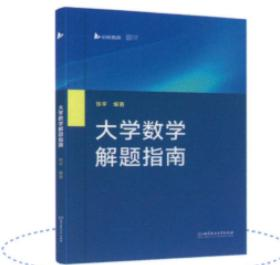
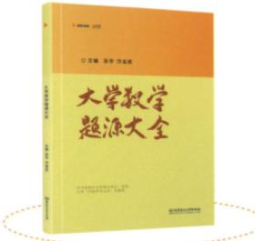
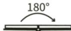
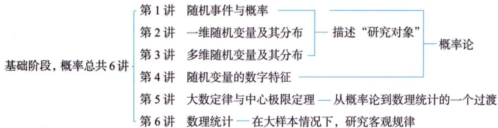
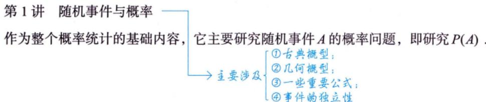
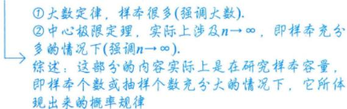

# 张宇大学数学图书推荐

  
20年教学精华

  
20年习题精选

张宇

博士，知名数学教育专家，从教二十余年，培养了大批学生考入清华、北大等名校攻读研究生，带出了不少年轻有为的教学能手，撰写了数十本全国畅销数学教材、习题书、模考卷等，曾任高等教育出版社《全国硕士研究生入学统一考试数学考试大纲解析》编者之一，命题经验丰富。

张宇数学系列

# 考研教材类

考研数学基础30讲·高等数学分册   
考研数学基础30讲·线性代数分册   
考研数学基础30讲·概率论与数理统计分册 书稿包   
高等数学18讲  
线性代数9讲   
概率论与数理统计9计

# 考研题集类

张宇考研数学题源探析经典1000题（分数学一、数学二、数学三）  
考研数学真题大全解·基础篇-【1987—2012年】（分数学一、数学二、数学三）  
考研数学真题大全解·强化篇·【2013—2026年】（分数学一、数学二、数学三）  
考研数学命题人终极预测8套卷（分数学一、数学二、数学三）  
张宇考研数学最后4套卷（分数学一、数学二、数学三）

# ○大学教材类

大学数学解题指南  
大学数学题源大全  
高等数学习题全解（同济八版·上册）  
高等数学习题全解（同济八版·下册）  
线性代数习题全解（同济七版）  
概率论与数理统计习题全解（浙大五版）  
高等数学同步检测卷（上册）  
高等数学同步检测卷（下册）  
线性代数同步检测卷  
概率论与数理统计同步检测卷

  
定价：69.90元

启航书课包

2027

张宇考研数学系列·一

壹2027版

考研数学基础30讲

概率论与数理统计分册

主编张宇

北京理工大学出版社

# 考研数学基础30讲

# 概率论与数理统计分册

主编张宇  
副主编 高昆轮

  
用“启航考研”小程序刷题  
免费听《30讲》配套习题讲解

# 温馨提示：

本书采用裸脊锁线的装帧工艺，制作精良，牢固且不易掉页，可 $180^{\circ}$ 平摊，学习阅读体验更佳！

图书外封为护封，用于保护书籍，不易被损坏，可任意拆装，请不要随意丢弃哦~

北京理工大学出版社

BEIJING INSTITUTE OF TECHNOLOGY PRESS

# 张宇考研数学全家桶

一套完整的考研数学复习攻略

# 02 强化进阶

掌握高频考点和常考题型，提高解题能力

学习时间：2026年6月—9月

学习用书：

书课包《高等数学18讲》

书课包《线性代数9讲》

书课包《概率论与数理统计9讲》

《张宇考研数学题源探析经典1000题》强化篇&综合篇

# 04 冲刺拔高

模考测试，科学预测，查漏补缺

学习时间：2026年10月—12月

学习用书：

《考研数学命题人终极预测8套卷》

《张宇考研数学最后4套卷》

# 01 基础夯实

系统学习基础知识点，配合基础习题练习

学习时间：现在—2026年5月

学习用书：

书课包 《考研数学基础30讲·高等数学分册》

书课包 《考研数学基础30讲·线性代数分册》

书课包 《考研数学基础30讲·概率论与数理统计分册》

《张宇考研数学题源探析经典1000题》基础篇

# 03 真题演练

真题带练，把握命题规律，积累解题经验

学习时间：2026年3月—10月

学习用书：

《考研数学真题大全解·基础篇》

《考研数学真题大全解·强化篇》

这个世界

蕴含的客观规律

是美妙的，

谨以此书

献给努力探寻世界的人们。

# 考研数学基础30讲

# 概率论与数理统计分册

主编张宇  
副主编 高昆轮

# 图书在版编目（CIP）数据

考研数学基础30讲.概率论与数理统计分册/张宇主编.--北京北京理工大学出版社，2024.10（2025.9重印）ISBN978-7-5763-4520-9

I. 013

中国国家版本馆CIP数据核字第20246G1K27号

责任编辑：多海鹏 文案编辑：多海鹏

责任校对：周瑞红 责任印制：李志强

出版发行/北京理工大学出版社有限责任公司

社址/北京市丰台区四合庄路6号

邮 编/100070

电话/（010）68944451（大众售后服务热线）

（010）68912824（大众售后服务热线）

网址 / http://www.bitpress.com.cn

版印次/2025年9月第1版第4次印刷

印 刷/河北鹏润印刷有限公司

开 本 $/787\mathrm{mm}\times 1092\mathrm{mm}1 / 16$

印 张/11.25

字数/281千字

定价/69.90元

# 前言

《考研数学基础30讲》（简称《30讲》）按照《全国硕士研究生招生考试数学考试大纲》，并结合考研数学命题趋势编写，其中高等数学分册分为18讲，线性代数分册分为6讲，概率论与数理统计分册分为6讲，共30讲。学完这些内容，即可达到传统意义上的“基础阶段”与“强化阶段”的全部要求。

本书每一讲都由基础知识结构、基础内容精讲、基础习题精练三部分组成，涵盖《全国硕士研究生招生考试数学考试大纲》中所有知识点，循序渐进，由浅入深，最后达到考研数学对试题要求的难度水平。这里需要特别指出的是，数学学习是一环扣一环的，上一个环节的知识和想法，直接影响到下一个环节的知识和想法，任何环节都不能囿囿吞枣或降低要求，必须深刻掌握，否则越往下学习就会越困难。反之，若在初始阶段多下些功夫，搞明白原理，捋清楚关系，看似进度不快，却能为后面的学习加速打下坚实的基础。

《30讲》是书课包，即本书作者会对书中全部内容进行系统讲解，考生扫描书中二维码即可快速定位对应知识点的视频讲解。2027版的《30讲》根据课程讲解，标注了全程的学习笔记，既能防止考生漏记、错记笔记，又节省做笔记的时间，考生只需集中精力认真听即可。

建议考生结合课程反复研读本书，有些知识的掌握是需要反复琢磨的，要养成独立思考的习惯，逐渐达到知识、思路、题型和方法皆会以清晰的结构呈现眼前的效果。本书是作者多年基础阶段教学经验的总结，愿助潜心研读者打好地基、夯实基础，勇攀考研数学高峰。

本书自出版以来，承蒙广大师生厚爱，在考研数学基础阶段起到了一定的积极作用。限于作者水平，书中不足或错误之处，望各位不吝赐教，多提意见与建议，特此致谢！

结构

2025年8月 于北京

# 概率综述

# 概率引言

【重要思想】全集分解思想，贯穿整个课程.

★第2、3讲是经典的概率论课程的内容.

第2讲 一维随机变量及其分布

(1) 引入研究对象“随机变量”  
(2) 涉及与随机变量相关的分布函数（怎么去描述该随机变量的概率规律）.  
(3)随机变量函数的分布. ①离散型随机变量涉及分布律的问题； ②连续型随机变量涉及概率密度的问题

第3讲 多维随机变量及其分布（在一维的基础上升级到了多维）

第4讲 随机变量的数字特征

(1) 随机变量的数学期望.   
(2)随机变量的方差.  
(3)两个随机变量之间的关系（协方差、相关系数）

研究原因： $①$ 尽管分布函数非常全面准确地刻画了一个随机变量的概率规律，但本身可能是很难求的(即第2、3讲这两个部分，往往理论意义更强一些，在实践上，分布函数有时不太容易求)比如，牛顿-莱布尼茨公式很著名，但事实上它不太好用； $②$ 有时候并不需要知道今布函数，可以通过其他的方式或角度来研究随机变量的一些特征，比如期望、方差、协方差、相关系数就能够很好地去体现相应的特征或所研究问题需要知道的信息

第5讲 大数定律与中心极限定理（过渡：从概率论到数理统计）

第6讲 数理统计

(1) 介绍基本统计量及其相应分布（三大抽样分布）. $\rightarrow$ (2) 参数估计（考解答题）  
(3)假设检验. 在统计学中，分布函数或者相应的概率密度中的量并不全知道，此时需要根据抽样得到数据反过来去估计概率规律中的参数。但实际上是不能求出来真实的客观值的，所以称之为估计

# 概率考题分布

第1讲随机事件与概率5分选择题，主要集中在怎么求一个复杂事件的概率.

第2、3讲一/多维随机变量及其分布5分小题/12分解答题.→常考

第4讲随机变量的数学特征5分小题/配合第2、3讲考12分解答题. 考研连续两年考了

第5讲 大数定律与中心极限定理 5分小题.

第6讲 数理统计 5分选择题（抽样分布）/12分解答题（估计问题）

# 目录

第1讲 随机事件与概率  
第2讲 一维随机变量及其分布 … 33  
第3讲 多维随机变量及其分布 62  
第4讲 随机变量的数字特征 … 103  
第5讲 大数定律与中心极限定理 … 125  
第6讲 数理统计 133
