# 第1讲

# 随机事件与概率

# 基础知识结构

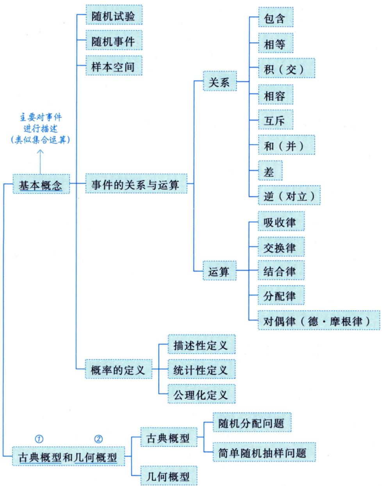

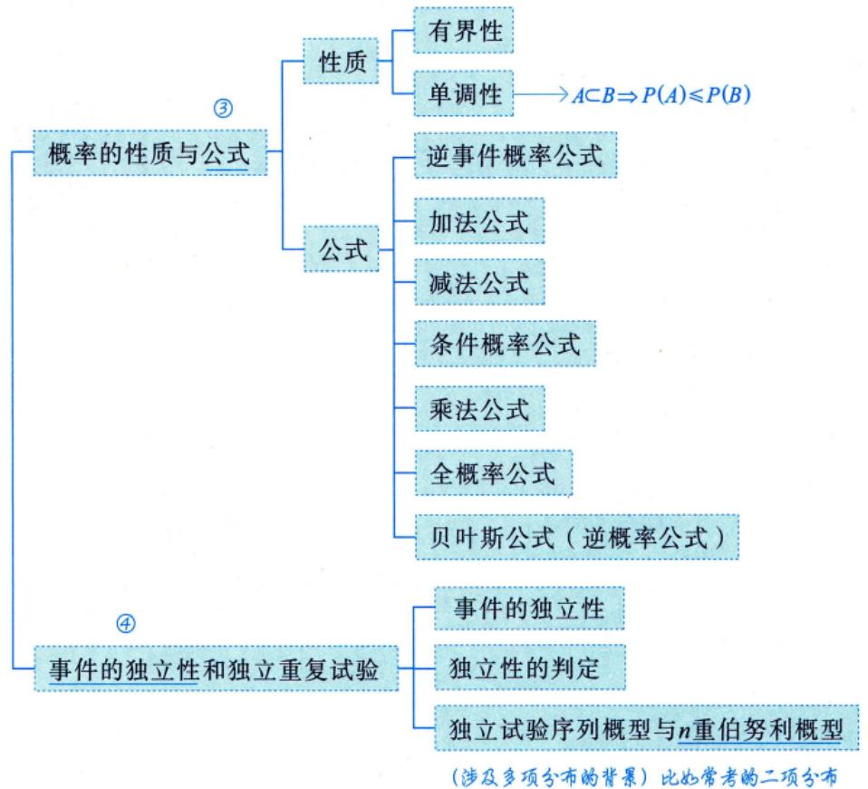

# 基础内容精讲

# 基本概念

# 随机试验

如果一个试验满足以下三个条件：

(1) 试验可以在相同的条件下重复进行；  
(2) 试验所有可能结果明确可知，且不止一个；  
(3)每一次试验会出现哪一个结果，事先并不能确定，

则称此试验为随机试验.

我们是通过研究随机试验来研究随机现象的，随机试验简称试验，用字母 $E$ 或 $E_{1}$ ， $E_{2}$ ，…表示.

# 示例1 投篮.

(1)相同条件下可重复.

首先这是一个理想化简化，因为并非真正同条件（一个篮球运动员投篮或者一个普通人投篮，假设

已经投10次了，再投第11次，可能就会比较累了。所以这个同条件在学科中实际上是在近似的相同条件下可重复）。

(2) 试验所有可能结果明确可知，且不止一个，只有“投中”和“投不中”两种可能.  
(3)每一次投篮，“投中”或“投不中”，事先未知.

# 示例2 掷硬币.

(1)相同条件下可重复.   
(2)试验结果明确可知，且不止一个，只有“正面”和“反面”两种可能.  
(3)硬币落下之前，不知道会是“正面”还是“反面”。

注 在不少情况下，不能确切知道某一随机试验的全部可能结果，但可以知道它不超出某个范围。这时，也可以用这个范围来作为该试验的全部可能结果的集合。例如，需要记录某个城市一天的交通事故数量，则试验结果将是非负整数 $x$ 。无法确定 $x$ 的可能取值的确切范围，但可以把这个范围取为 $[0, +\infty)$ ，将上限取到 $+\infty$ ，扩大范围，它总能包含一切可能的试验结果，尽管明知某些结果——如 $x > 10000$ 是不会出现的。甚至把这个范围取为 $(- \infty, +\infty)$ 也无妨。这里体现了一定的数学抽象，它可以带来很大的方便。

怎样去描述这个取值范围的扩大？

比如正态分布（两边低中间高）

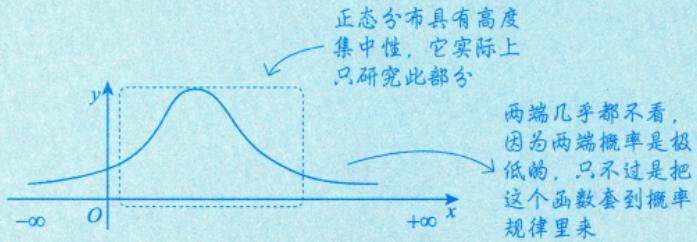

① 在大样本的情况下，根据中心极限定理，所有分布最终都会收敛于正态分布。这是自然规律中的一个神秘规律。  
② 普通现象的概率肯定是高的，而极端现象的概率是低的。

比如，人的身高基本上集中在某一个范围内。那么像姚明的身高，是少数的，然后身高往下走，变成负的，那是不可能的事情。但是正态分布里 $x$ 的范围就是从 $-\infty$ 到 $+\infty$ ，这相当于做了范围的扩大，能够使得概率分布完全对应上高斯曲线，极大方便了数学处理。实际上，曲线两端取值的可能性非常小，几乎取不到。

③ 疑问：身高怎么可能取负值呢？

答：并非是身高取负值，而是对自然现象进行了范围扩大。比如研究某学校学生身高的分布、体重的分布或者其他健康指标的分布。用什么函数来研究它呢？总不能用截断的部分区间的函数去研究，而将 $x$ 的范围扩大后刚好可以用这样一条从 $-\infty$ 到 $+\infty$ 上的著名曲线来研究概率规律。

# 随机事件

在一次试验中可能出现, 也可能不出现的结果称为随机事件, 简称事件, 并用大写字母 $A, B, C$ 等表示. 将每次试验中一定发生的事件称为必然事件, 记为 $\Omega$ . 每次试验中一定不发生的事件称为不可能事件, 记为 $\varnothing$ . 集合中的全集符号

集合中空集的符号

集合中的全集符号

大样本情况下寻找客观规律

注 随机事件在一次试验中是否发生虽然不能事先确定，但是在大量重复试验的情况下，它的发生呈现出一定的规律性，这门课程正是要研究这种规律性，考生应在学习这门课程后，对此有较为深刻的认识。

# 样本空间

不可再分

随机试验的每一个可能结果称为样本点，记为 $\omega$ 。样本点的全体组成的集合称为样本空间（或基本事件空间），记为 $\Omega$ ，即 $\Omega = \{\omega\}$ 。由一个样本点构成的事件称为基本事件。随机事件 $A$ 总是由若干个基本事件组成，即 $A$ 是 $\Omega$ 的子集。

示例 掷骰子，共六个面，即可能会出现1点到6点，记 $\omega_{i} = \{$ 掷出点数 $i\}$ ，则

(1) 每个 $\omega_{i}$ 都是不可再分的样本，每一个 $\omega_{i}$ 都叫基本事件。  
(2)这些基本事件组成的集合叫作样本空间，即

$$
\Omega = \left\{\omega_ {1}, \omega_ {2}, \dots , \omega_ {6} \right\}.
$$

(3) 随机事件 $A$ 为“掷出偶数点”，显然

$$
A = \left\{\omega_ {2}, \omega_ {4}, \omega_ {6} \right\}
$$

是 $\Omega$ 的子集.

# 事件的关系与运算

同时，还有概率的单调性，显然 $P(B)\geqslant P(A)$

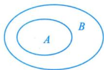

(1)关系.

包含：如果事件 $A$ 发生必导致事件 $B$ 发生，则称事件 $B$ 包含事件 $A$ （或 $A$ 被 $B$ 包含），记为 $A \subset B$ 。相等：如果 $A \subset B$ 且 $B \subset A$ ，则称事件 $A$ 与 $B$ 相等，记为 $A = B$ 。 $A$ 与 $B$ 相等，事实上也就是说， $A$ 与 $B$ 由一些完全相同的试验结果构成，它不过是同一事件表面上看起来不同的两个说法而已。

积（交）：称“事件 $A$ 与 $B$ 同时发生”的事件为事件 $A$ 与 $B$ 的积事件（或交事件），记为 $A \cap B$ 或 $AB$ 。如，掷骰子，共六个面， $A = \{\text{掷出的点数是偶数}\}$ ， $B = \{\text{掷出的点数不是1,3,5}\}$ ， $C = \{\text{掷出的点数是2的倍数}\}$ ，则 $A = B = C$

注称“有限个（或可列个）事件 $A_{1}, A_{2}, \cdots, A_{n}(\cdots)$ 同时发生”的事件为事件 $A_{1}, A_{2}, \cdots, A_{n}(\cdots)$ 的积事件（或交事件），记为 $\bigcap_{i=1}^{n} A_{i}$ （或 $\bigcap_{i=1}^{\infty} A_{i}$ ）。

里面是有元素的

相容：若 $AB \neq \emptyset$ ，则称事件 $A$ 和 $B$ 相容.

互斥：若 $AB = \emptyset$ ，则称事件 $A$ 与 $B$ 互不相容，也叫互斥.如果一些事件中任意两个事件都互斥，则称这些事件是两两互斥的，或简称互斥的.加法公式： $P(A\bigcup B) = P(A) + P(B)$

和（并）：称“事件 $A$ 与 $B$ 至少有一个发生”的事件为事件 $A$ 与 $B$ 的和事件（或并事件），记为 $A \cup B$ 。

注称“有限个（或可列个）事件 $A_{1}, A_{2}, \cdots, A_{n}(\cdots)$ 至少有一个发生”的事件为事件 $A_{1}, A_{2}, \cdots, A_{n}(\cdots)$ 的和事件（或并事件），记为 $\bigcup_{i=1}^{n} A_{i}$ （或 $\bigcup_{i=1}^{\infty} A_{i}$ ）.

差：称“事件 $A$ 发生而事件 $B$ 不发生”的事件为事件 $A$ 与 $B$ 的差事件，记为 $A - B$ ：

逆(对立)：称“事件 $A$ 不发生”的事件为事件 $A$ 的逆事件或对立事件,记为 $\overline{A}$

由定义易知

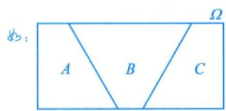

对立事件一定是互不相容事件，但互不相容事件不一定是对立事件

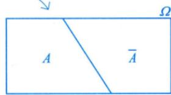

$A$ 与 $B$ ， $B$ 与 $C$ ， $A$ 与 $C$ 均为互斥事件，但 $B \cup C$ 才为 $A$ 的对立事件

$$
A - B = A - A B = A \bar {B},
$$

$$
B = \bar {A} \Leftrightarrow A B = \varnothing \text {且} A \bigcup B = \Omega .
$$

3、对立事件

完备事件组：如果 $\bigcup_{i = 1}^{n}A_{i}$ （或 $\bigcup_{i = 1}^{\infty}A_{i}) = \Omega$ ， $A_{i}A_{j} = \varnothing$ （对一切 $i\neq j$ ； $i,j = 1,2,\dots ,n(\dots)$ )，称有限个（或可列个）事件 $A_{1}$ ， $A_{2}$ ，…， $A_{n}(\dots)$ 构成一个完备事件组.

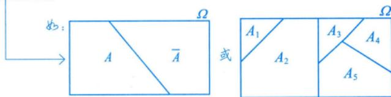

注 完备事件组也称为对样本空间的一种划分，也叫全集分解。

文氏图：事件的关系与运算可以用文氏图形象地表示出来（见图1-1)，图中的矩形表示必然事件 $\Omega$ ：

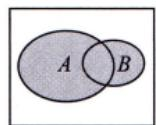  
$A\cup B$

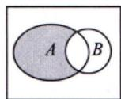  
A-B

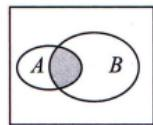  
AB

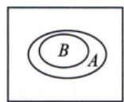  
$B\subset A$

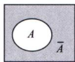  
A

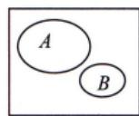  
$AB = \emptyset$   
图1-1

(2) 运算.

① 吸收律 若 $A \subset B$ ，则 $A \cup B = B, A \cap B = A$   
② 交换律 $A \cup B = B \cup A, A \cap B = B \cap A$ .  
③结合律 $(A\bigcup B)\bigcup C = A\bigcup (B\bigcup C),(A\bigcap B)\bigcap C = A\bigcap (B\bigcap C).$   
④分配律 $A \cap (B \cup C) = (A \cap B) \cup (A \cap C), A \cup (B \cap C) = (A \cup B) \cap (A \cup C)$ .

$$
A \cap (B - C) = (A \cap B) - (A \cap C).
$$

★⑤对偶律（德·摩根律） $\overline{A\bigcup B} = \overline{A}\cap \overline{B},\overline{A\bigcap B} = \overline{A}\bigcup \overline{B}.$

口诀：长杠变短杠，开口换方向。

$\overline{\overline{A}\cap B} = \overline{\overline{A}}\cup \overline{B} = A\bigcup \overline{B}.$

注 (1) 事件运算顺序约定为先进行逆运算, 然后进行交运算, 最后进行并或差运算.

(2) 事件的关系、运算与集合的关系、运算相当，且具有相同的运算法则，所以可以对比着理解记忆，并要学会用集合关系去考虑事件关系。

# 5 概率的定义

(1)描述性定义.

通常将随机事件 $A$ 发生的可能性大小的度量（非负值）称为事件 $A$ 发生的概率，记为 $P(A)$ ：

如：抛硬币1000次，正面朝上的次数

为527，那么 $\frac{527}{1000}$ 称为这1000次试

验中，硬币正面朝上的频率

(2) 统计性定义.

在相同条件下做重复试验，事件 $A$ 出现的次数 $k$ 和总的试验次数 $n$ 之比 $\frac{k}{n}$ 称为事件 $A$ 在这 $n$ 次试验中出现的频率.当试验次数 $n$ 充分大时，频率将“稳定”于某常数 $p$ . $n$ 越大，频率偏离这个常数 $p$ 的可能性越小.这个常数 $p$ 就称为事件 $A$ 的概率. 不断趋近 $p$

比如说投掷硬币正面朝上的频率是 $\frac{527}{1000} = 0.527$ ，但它是硬币正面朝上的概率吗？

对于均匀的硬币，正面朝上的概率应该是 $\frac{1}{2}$ 。这是客观规律。

理想情况下，均匀硬币是真正的均匀，此时就说它的概率是客观上的 $\frac{1}{2}$ 频率只能是逐渐地靠近 $\frac{1}{2}$ 但在硬币不均匀的情况下，不清楚抛出硬币正面朝上的概率，不能直接讲是 $\frac{1}{2}$

注 后面会提到一个概念，就是频率依概率收敛到概率。这实际上涉及大数定律的问题了

(1) 概率的统计性定义实质上是说, 用频率 $\frac{k}{n}$ 作为事件 $A$ 的概率 $P(A)$ 的估计. 其直观理解为某事件出现的可能性大小, 可由其在多次重复试验中出现的频率去刻画.  
(2) 从上述 (1) 可以看出, 频率只是概率的估计, 而非概率本身. 也就是说, 概率的统计性定义是无法准确给出某事件的概率的, 其重要性主要基于以下两点.  
① 它提供了估计概率的方法。比如在一批产品中抽取样品，来估计该批产品的合格率（合格率是客观的数据，抽取样品计算出来的合格率只是一种估计）。  
② 它提供了一种检验某结论是否正确的准则。比如，你说某批产品的合格率是 $95\%$ ，我们做试验，抽取样品进行计算，得出的结果是合格率为 $20\%$ ，远远低于你所说的 $95\%$ ，于是毫不犹豫地拒绝你的结论。

统计性定义，它没有理论上的价值，不能精确定义概率。但是从实践上来讲，它有时候是很有用的。

(3) 公理化定义.

设随机试验的样本空间为 $\Omega$ ，如果对每一个事件 $A$ 都有一个确定的实数 $P(A)$ ，且事件函数 $P(\cdot)$ 满足：

①非负性： $P(A) \geqslant 0$   
②规范性： $P(\Omega) = 1$ ； “归一性”  
③可列可加性：对任意可列个两两互不相容事件 $A_{1}, A_{2}, \dots, A_{n}, \dots$ （即 $A_{i}A_{j} = \emptyset, i \neq j; i, j = 1, 2, \dots$ ），有

$P\left(\bigcup_{i = 1}^{\infty}A_{i}\right) = \sum_{i = 1}^{\infty}P(A_{i}),$ 事件和的概率等于概率的和

则称 $P(\cdot)$ 为概率， $P(A)$ 为事件 $A$ 的概率.

注 (1) 数学上所说的“公理”，就是一些不加证明而承认的前提，上述公理化定义只是界定了概率这个概念所必须满足的一些一般性质，它不解决具体场合下的概率计算。

(2) 概率 $P(\cdot)$ 是事件的函数.  
(3) 虽然公理化定义不解决具体场合下的概率计算，但是我们却常常用它来判断某事件函数 $P(\cdot)$ 是不是概率，这种题型在考研试题中也是经常遇到的。

# 古典概型和几何概型

# 古典概型

(1) 概念.

如果随机试验的样本空间满足：

①只有有限个样本点（基本事件）； $\longrightarrow$ 也掷骰子， $\Omega = \{\omega_{1},\omega_{2},\dots ,\omega_{6}\}$ ，一旦出现无穷个，就不是古典概型  
②每个样本点（基本事件）发生的可能性都一样，

则称随机试验的概率模型为古典概型.

如果古典概型的基本事件总数为 $n$ ，事件 $A$ 包含 $k$ 个基本事件，也叫作有利于 $A$ 的基本事件有 $k$ 个，则 $A$ 的概率为

$$
P (A) = \frac {k}{n} = \frac {\text {事 件} A \text {所 含 基 本 事 件 的 个 数}}{\text {基 本 事 件 总 数}}. \text {则} P (A) = \frac {3}{6} = \frac {1}{2}
$$

由上式计算得出的概率称为 $A$ 的古典概率.

注 计算的关键是基本事件、样本空间的选定以及基本事件数的计算.

计数方法常用的有三种.

(1)列举法（直接数数法）：基本事件数不多时常用这种方法.  
(2) 集合对应法：① 加法原理——完成一件事有 $n$ 类办法，第一类办法中有 $m_{1}$ 种方法，第二类办法中有 $m_{2}$ 种方法，……，第 $n$ 类办法中有 $m_{n}$ 种方法，则完成此事共有 $\sum_{i=1}^{n} m_{i}$ 种方法。  
② 乘法原理——完成一件事有 $n$ 个步骤，第一步有 $m_{1}$ 种方法，第二步有 $m_{2}$ 种方法，……，第 $n$ 步有 $m_{n}$ 种方法，则完成此事共有 $\prod_{i=1}^{n} m_{i}$ 种方法。

例如，从 $A$ 地到 $B$ 地的方法.

$$
\begin{array}{r l}&{\underset {A \text {地}} {\nearrow} \text {飞 机} \left\{\begin{array}{l}{\mathrm {C} 9 1 9}\\{\mathrm {C} 9 2 9}\\{\mathrm {A} 3 3 0}\end{array}\right\}\rightarrow B \text {地}.}\\&{\quad \underset {\text {火 车}} {\searrow} \left\{\begin{array}{l}{\text {复 兴 号}}\\{\text {和 谐 号}}\end{array}\right\}}\end{array}
$$

看路线，从加法原理的角度，可以有 $m_{1} + m_{2} = 3 + 2 = 5$ （种）交通方式.

$$
A \text {地} \rightarrow \text {飞 机} \left\{\begin{array}{l}\mathrm {C} 9 1 9\\\mathrm {C} 9 2 9 \rightarrow \text {火 车} \left\{\begin{array}{l}\text {复 兴 号}\\\text {和 谐 号}\end{array}\right.\rightarrow B \text {地}.\end{array}\right.
$$

看路线，从乘法原理的角度，需要2个步骤.第1步：坐飞机有3种选择；第2步：坐火车有2种选择.故可以有 $m_{1} \cdot m_{2} = 3 \times 2 = 6$ （种）交通方式.

加法原理与乘法原理有一个重要的区分，即在完成这件事情的时候，是否需要分步骤进行。如果需要分步骤进行，即用乘法原理解决。如果不是按照步骤，而是按照完成一件事情有几类方法，把这些方法加起来即可。

③排列——从 $n$ 个不同的元素中取出 $m \leqslant n$ 个元素，并按照一定顺序排成一列，叫作排列。所有排列的个数叫作排列数，记作

有 $n$ 个不同的元素, 按顺序取 $m$ 个. 取第 1 个时, 有 $n$ 种取法; 取第 2 个时, 剩余 $n - 1$ 个元素则有 $n - 1$ 种可能性, 故再乘上 $n - 1$ , 这是第二步; 依次类推到取第 $m$ 个元素时, 还剩 $n - m + 1$ 种取法, 所以按乘法原理把它们乘起来即可得到排列数

$$
\mathrm {P} _ {n} ^ {m} = n (n - 1) (n - 2) \dots (n - m + 1) = \frac {n !}{(n - m) !}.
$$

当 $m = n$ 时， $\mathbf{P}_n^n = \frac{n!}{0!} = n!$ ，叫作全排列.

④ 组合——从 $n$ 个不同的元素中取出 $m \leqslant n$ 个元素，并成一组，叫作组合。所有组合的个数叫作组合数，记作

$$
\mathrm {C} _ {n} ^ {m} = \frac {\mathrm {P} _ {n} ^ {m}}{m !}.
$$

$$
\begin{array}{l} C _ {n} ^ {m} = \frac {n !}{m ! (n - m) !}, \\ C _ {n} ^ {m} = C _ {n} ^ {n - m}, \\ 0! = 1 \\ C _ {n} ^ {0} = 1 \\ \end{array}
$$

(3)逆数法：先求 $\overline{A}$ 中的基本事件数 $n_{\overline{A}}$ ，用基本事件总数 $n$ 减去 $n_{\overline{A}}$ 便得 $A$ 中的基本事件数，这种方法常用于计算含有“至少”字样的事件的概率．用对立事件解题： $P(A) = 1 - P(\overline{A})$

(2)计算方法.

①随机分配问题.

随机分配也叫随机占位，突出一个“放”字，即将 $n$ 个可辨质点随机地分配到 $N$ 个盒子中，区分每盒可以容纳任意多个质点和最多可以容纳一个质点，不同分法的总数如表所示.

比如在1月1日出生的人,有很多 $\rightarrow$ 一个萝卜一个坑

<table><tr><td>分配方式</td><td>不同分法的总数</td></tr><tr><td>每盒容纳任意多个质点</td><td>Nn(见注①)</td></tr><tr><td>每盒容纳至多一个质点</td><td>PN=NN-1···(N-n+1)(见注②)</td></tr></table>

注 ① 每个质点均可放到 $N$ 个盒子中的任何一个，即有 $N$ 种放法，于是 $n$ 个可辨质点放到 $N$ 个盒子中共有 $N^n$ 种不同放法。

② 质点可辨，且一个盒子至多容纳一个质点，故 $n$ 个质点放到 $N(N \geqslant n)$ 个盒子中的所有不同放法即为从 $N$ 个元素中选取 $n$ 个元素的排列数 $\mathbf{P}_N^n$ 。

例1.1 将 $n$ 个球随机放入 $N(n \leqslant N)$ 个盒子中，每个盒子可以放任意多个球。求下列事件的概率： $A = \{\text{某指定} n \text{ 个盒子各有一球}\}$ ； $B = \{\text{恰有} n \text{ 个盒子各有一球}\}$ ； $C = \{\text{指定} k (k \leqslant n) \text{个盒子各有一球}\}$ 。

解这是随机占位的问题，设 $n$ 个球， $N$ 个盒子是可分辨的（例如编号），由于每个盒子可以放任意多个球，因此每个球都有 $N$ 种不同的放置方法.将 $n$ 个球随机放入 $N$ 个盒子的一种放法作为基本事件，则基本事件总数为 $N^n$ .事件 $A$ 所含的基本事件是 $n$ 个不同球的一种排列，故

$$
n _ {A} = n! \text {,} P (A) = \frac {\mid 1 \cdot n !}{N ^ {n}}.
$$

（ $n$ 个盒子的位置是唯一确定的，现假定就是前 $n$ 个位置）

事件 $B$ 中的基本事件可以设想为先从 $N$ 个盒子中选出 $n$ 个（共有 $\mathbf{C}_N^n$ 种不同选法），然后把 $n$ 个球随机放入这 $n$ 个盒子中，每盒一球（共有 $n!$ 种不同放法），因此 $B$ 中基本事件数

$$
n _ {B} = \mathrm {C} _ {N} ^ {n} \cdot n!, P (B) = \frac {\mathrm {C} _ {N} ^ {n} \cdot n !}{N ^ {n}}. \overrightarrow {“ 恰 有 n 个 ”}, \text {有 C} _ {N} ^ {n} \text {种 情 形}
$$

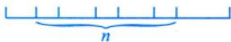

（ $n$ 个盒子的位置并非唯一确定的，是从 $N$ 个里面选出 $n$ 个）

事件 $C$ 的基本事件可以设想为先从 $n$ 个球中选出 $k$ 个球（有 $\mathbf{C}_n^k$ 种不同选法），再将这 $k$ 个球随机放入指定的 $k$ 个盒子中，每盒一球（有 $k!$ 种不同放法），最后将余下的 $n - k$ 个球随机放入其余的 $N - k$ 个盒子中，每个球都有 $N - k$ 种放置方法，因此共有 $(N - k)^{n - k}$ 种不同放法，故

$$
n _ {C} = C _ {n} ^ {k} \cdot k! (N - k) ^ {n - k}, P (C) = \frac {C _ {n} ^ {k} k ! (N - k) ^ {n - k}}{N ^ {n}} = \frac {n ! (N - k) ^ {n - k}}{(n - k) ! N ^ {n}}.
$$

$\theta$ 方法总结 必背基本事件个数，将 $n$ 个球放入 $n$ 个盒子，使得每个盒子各有一球，有 $n!$ 种方法.

注许多问题的结构形式与分球入盒问题相同，都属于随机占位问题.例如生日问题（n个人生日，相当于 $n$ 个球随机放入365个盒子中，每盒可以放多个球）；住房分配问题（n个人被分配到 $N$ 个房间中去，每个房间可住多个人）；乘客下车问题（n个乘客在 $N$ 个车站下车的各种可能情况）；等等.对这些问题的求解都可以用“将 $_n$ 个球等可能地投放到 $N$ 个盒子中”的思路来考虑.

比如，12个球随机放入365个盒子中，每盒可放多个球.

$A_{1} = \{$ 指定12个盒子，各放1球 $\}$ ，则 $P(A_{1}) = \frac{12!}{365^{12}}$

$B_{1} = \{\text{恰有} 12$ 个盒子，各放1球 $\}$ ，则 $P(B_{1}) = \frac{C_{365}^{12}12!}{365^{12}}$

$C_1 = \{\text{指定} 3 \text{个盒子，各放} 1 \text{球}\}$ ，则 $P(C_1) = \frac{C_{12}^3 3! (365 - 3)^{12 - 3}}{365^{12}}$

又比如12个人 $\omega_{1},\dots ,\omega_{12}$ 回母校参加校庆，每个人在365天中的某一天出生的概率相等.令

$A_{2} = \{$ 生日全不相同，且分别为每个月的第一天\};

$B_{2} = \{$ 生日全不相同 $\}$ ； $\overline{B}_2 = \{$ 至少有两人生日相同 $\}$

$C_2 = \{$ 有且仅有三个人的生日分别在劳动节、儿童节、中秋节 $\}$

则 $A_{2}$ ， $B_{2}$ ， $C_2$ 就对应着题中的 $A,B,C$ ，只不过此时 $N = 365$ ， $n = 12$ ， $k = 3$ ：

②简单随机抽样问题.

设 $\Omega = \{\omega_{1},\omega_{2},\dots ,\omega_{N}\}$ 含 $N$ 个元素，称 $\varOmega$ 为总体.如果各元素被抽到的可能性相同，则总体 $\varOmega$ 的抽样称作简单随机抽样，突出一个“取”字.

简单随机抽样分为先后有放回、先后无放回及任取这三种不同的方式. 在每种抽样方式下各种不同抽取方法（基本事件）的总数如表所示.

<table><tr><td>抽样方式</td><td>抽取方法总数</td></tr><tr><td>先后有放回取n次(样本空间始终无变化)</td><td>Nn(见注(1)①)</td></tr><tr><td>先后无放回取n次</td><td>PN=N(N-1)···(N-n+1)(见注(1)②)</td></tr><tr><td>任取n个</td><td>CN(见注(1)③)</td></tr></table>

注 (1) ① 既考虑抽到何元素, 又考虑各元素出现的顺序, 每次从 $\Omega$ 中随意抽取一个元素, 并在抽取下一元素前将其放回 $\Omega$ , 于是每次都有 $N$ 个元素可被抽取, 即有 $N$ 种抽取方法, 抽取 $n$ 次, 即 $N^n$ .

② 既考虑抽到何元素，又考虑各元素出现的顺序，凡是抽出的元素均不再放回 $\Omega$ ，于是每次抽取时都比上一次少了一个元素，抽 $n(n \leqslant N)$ 次，即

$$
\mathrm {P} _ {N} ^ {n} = N (N - 1) \cdot \dots \cdot (N - n + 1).
$$

③ 任取 $n (n \leqslant N)$ 个是指一次性取 $n$ 个元素，相当于将 $n$ 个元素无序且无放回地取走，其抽取方法总数为

$$
\mathbf {C} _ {N} ^ {n} = \frac {\mathbf {P} _ {N} ^ {n}}{n !}.
$$

(2) ① 先后有放回与先后无放回的区别。先后有放回取也不意味是真的放回去了。当产品的数量足够多的时候，拿走一个不放回来，也当作有放回处理（因为若按照先后无放回去计算，可能比较复杂，所以可以当作有放回）。实际上是改变了样本空间，每取走一个，样本空间里就少一个元素，但是如果元素足够多，取走一个可以近似看作原来的样本空间没有变，所以如果样本空间不变，那很多问题研究起来就非常方便了。故先后有放回取，往往是用在样本 $n$ 足够大的情况下。

② 先后无放回与任取的区别。先后无放回，强调“先后”顺序；任取无顺序，故计算公式少了排列 $n!$ 。

例1.2 袋中有5个球，3个白球，2个黑球.

(1) 先后有放回取 2 个球；  
(2) 先后无放回取 2 个球；  
(3) 任取2个球.

求取的2个球中至少1个是白球的概率.

分析 考查简单抽样的3种抽取方法.要求必会.

解用对立事件思想，计算“两球全黑”的种数，再用总数减去它.

(1) $5^{2} - 2^{2} = 21$ （种）.  
(2) $5 \times 4 - 2 \times 1 = 18$ （种）.  
(3) $C_5^2 - C_2^2 = 9$ (种).

下面计算概率.

(1) $p_1 = \frac{5^2 - 2^2}{5^2} = 1 - \frac{2^2}{5^2} = \frac{21}{25}$ .   
(2) $p_2 = \frac{5 \times 4 - 2 \times 1}{5 \times 4} = 1 - \frac{2 \times 1}{5 \times 4} = \frac{9}{10}$ .   
(3) $p_{3} = \frac{C_{5}^{2} - C_{2}^{2}}{C_{5}^{2}} = 1 - \frac{C_{2}^{2}}{C_{5}^{2}} = \frac{9}{10}$ .

注 本题中的 (2) 与 (3) 概率相同, 如何理解?

$\frac{2 \cdot 1}{5 \cdot 4} = \frac{\mathrm{C}_2^2 \cdot \mathrm{P}_2^2}{\mathrm{C}_5^2 \cdot \mathrm{P}_2^2} = \frac{\mathrm{C}_2^2}{\mathrm{C}_5^2}$ , 左边上下有序, 右边上下无序, 相当于把顺序“消掉”了, 故“先后无放回取 $k$ 个球”与“任取 $k$ 个球”的概率相同. 由于 (3) 较方便, 因此计算 (2) 时, 可按 (3) 来计算.

例1.3 袋中有100个球，40个白球、60个黑球.

(1) 先后有放回取20个球，求取出15个白球、5个黑球的概率；  
(2) 先后无放回取 20 个球, 求取出 15 个白球、5 个黑球的概率;  
(3) 先后有放回取20个球，求第20次取到白球的概率；  
(4) 先后无放回取 20 个球, 求第 20 次取到白球的概率.

分析 (1)转化为投篮模型.

$① P \{$ 投中 $\} = 40 / 100$ ， $P$ 投不中 $\} = 60 / 100$   
②这样的投篮试验做20次，15次投中、5次投不中（先后有放回取20个球，每次试验之前，球放回去了，它的样本空间没有变化），这属于二项分布。  
(2)简单随机抽样问题转化为随机占位问题.

解 (1) $p_1 = \frac{40^{15} \cdot 60^5 \cdot C_{20}^{15}}{100^{20}}$ → 20个位置中有15个位置放白球每次取都是100种取法，取20次

(2) 按照“任取20个球”来计算，即 $p_2 = \frac{\mathrm{C}_{40}^{15}\mathrm{C}_{60}^5}{\mathrm{C}_{100}^{20}}$ .

(3) $p_3 = \frac{40}{100} = \frac{2}{5}$ （有放回取球，每次抽取的样本空间没有变化，故每次取到白球的概率始终为 $\frac{2}{5}$ ）.

(4) 看作随机占位问题. 设有 100 个盒子, 每个盒子中放 1 个球, 则要求第 20 个盒子中放入白球即可. 故 $p_{4} = \frac{C_{40}^{1} \cdot 99!}{100!} = \frac{40}{100} = \frac{2}{5}$ . 剩下 99 个球放在 99 个盒子里, 每个盒子各有 1 球

40个白球抽取1个

放在第20个盒子中

注 (1) 若 (4) 修改为: 先后无放回取 $k$ 个球, 求第 $k$ 次取到白球的概率. 结果仍为 $\frac{2}{5}$ .

第20个盒子放的是白球，但是前19个盒子放的什么球并不清楚。若清楚了，即转化为条件概率问题

(2) $p_4 = p_3$ .例1.3(4)是抓阁模型，即使无放回，每次取到白球的概率也不会变，可理解成依概率摸球.类比的例子： （绝对概率）

①设有100个灰球，白的成分：黑的成分 $= 40:60$ ，每次取到球中白的成分是 $40\%$   
②设有糖水，糖的成分：水的成分 $= 40:60$ ，每次取一勺糖水，取到糖的成分是 $40\%$

# 几何概型

（可测）在测度论的基础上，概率论会非常精确严谨但是在非测度论的基础上，理解即可

如果随机试验的样本空间满足：

① 样本空间（基本事件空间） $\Omega$ 是一个可度量的有界区域；

【名词解释】可度量：通俗来讲，即为可以度量，就是我们现在理解的长度、面积、体积.

对于数学一：计算体积，则要涉及三重积分；

对于数学三：可度量其实基本上就限定在一维的长度和二维的面积上.

② 每个样本点（基本事件）发生的可能性都一样，即样本点落入 $\Omega$ 的某一可度量的子区域 $S$ 的可能性大小与 $S$ 的几何度量成正比，而与 $S$ 的位置及形状无关，则称随机试验的概率模型为几何概型。

# 示例 “天上掉馅饼”.

假如明天早晨9:00，在学校操场上会从天上掉一个馅饼下来.大家拿着食堂的饭盆去接这个馅饼.现思考两个问题： 9:00

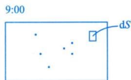

# 考研数学基础30讲·概率论与数理统计分册

(1)拿着饭盆到操场上去，请问大家站在哪里最容易接到这个馅饼？

面积的微分

站在哪儿都行. 在概率论上，9：00 有一个馅饼要落下来，这个馅饼落到操场上任意一个 $\mathrm{d}S$ ，具有等可能性. 实际上是有无数个 $\mathrm{d}S$ 的，即无数个面积微分. 所以跟你拿着饭盆站哪里没关系.

(2) 跟饭盆的什么有关系？

与饭盆的形状没关系，但是与饭盆的面积有关系。若饭盆的面积 $=$ 操场面积的 $\frac{1}{2}$ ，则 $P\{\text{接到馅饼}\} = \frac{1}{2}$ ；若饭盆的面积 $=$ 操场面积，则 $P\{\text{接到馅饼}\} = 1$ 。

注 古典概型与几何概型的区别：基本事件有限、等可能发生的随机试验为古典概型；基本事件无限且具有几何度量、等可能发生的随机试验为几何概型.

古典概型与几何概型的联系（如下例）

操场被平均分成四部分， $A_{1}, A_{2}, A_{3}, A_{4}$ 。现假设4个人分别拿着与 $A_{1}, A_{2}, A_{3}, A_{4}$ 同等面积的饭盆，此时相当于对 $\Omega$ 进行均等的划分。

显然，馅饼落到4个饭盆里具有等可能性，且基本事件数只有四个，即基本事件数是有限的，此时就可以把几何概型转化成古典概型。

<table><tr><td>A1</td><td>A2</td></tr><tr><td>A3</td><td>A4</td></tr></table>

例1.4 在区间(0,1)中随机地取两个数，则这两个数之差的绝对值小于0.5的概率为

分析 在区间(0，1)上随机取两个数，这两个数的取值范围就可构成一个可以度量的几何区域，实际上是一二维平面上的一个正方形.理解为“馅饼落在操场任何一个点具有等可能性”.记事件

$$
A = \left\{(x, y) \| x - y | <   0. 5 \right\} \cap \Omega ,
$$

则 $p = \frac{S_A}{S_\Omega}$

解 应填0.75.

设两个数分别为 $x, y$ ，则依题意 $(x, y)$ 的取值范围为正方形区域 $D = \{(x, y) | 0 < x < 1, 0 < y < 1\}$ . 又 $\left|x - y\right| < 0.5$ ，则所在区域如图1-2中阴影部分所示，于是所求概率为

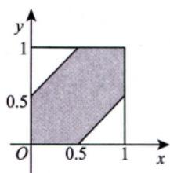  
图1-2

$$
p = \frac {1 ^ {2} - 0 . 5 ^ {2}}{1 ^ {2}} = 0. 7 5.
$$

# 概率的性质与公式

# 性质

不可能事件的概率

金集，也就是必然事件的概率

(1)有界性：对于任一事件 $A$ ，有 $0\leqslant P(A)\leqslant 1$ ，且 $P(\varnothing) = 0$ ， $P(\Omega) = 1$ ：

8:00~9:00按照时间连续来记，可以认为它是一个可以度量的长度，那么任何一个时刻进入这个教室是具有等可能性的

如，用 $\Omega$ 表示一个人在 $8:00\sim 9:00$ 之间进入教室，

$A = \{8:30$ 到达教室 $\}$ ，则 $P(A) = \frac{0}{1} = 0$

8:00~9:00时间长度为1，

8:30是一个点，长度为0.

注 $P(A) = 0$ ，不能断言 $A = \varnothing ;P(A) = 1$ ，不能断言 $A = \Omega$ ：

从对立事件理解， $\overline{A} = \{\text{不在8:30进入教室}\}$

对于

$$
A = \varnothing \rightleftharpoons P (A) = 0,
$$

要知道，在非测度论的基础上，有可能会测不到那个概率。这是我们在现在这个概率学的基础上，数学工具不够完善所导致的，即明明是可能发生的事情，但是测不到它，故它的概率是零了。但是概率是零的事件，却不一定是不可能事件。

两种身份

(1) 它确确实实是不可能事件, 所以空集里面什么元素都没有;

(2) 在我们现在所学习的基础上, $A$ 事件的测量是测不到它的,

测不到它，那概率依然是零

示例1 假如，一个男生追求一个女生或者一个女生追求一个男生。如果对方说我们在一起的概率为零。我们知道，这不一定是不可能事件，还有一丝希望，只要有一丝希望，就要做百倍努力坚持追求下去。

示例2有的同学跟你讲，你考上研究生的概率为零.但这也不是不可能实现的.只要有一丝希望，我们都要尽百倍努力，这样才能够在未来越来越好.

★(2)单调性：设 $A,B$ 是两个事件，若 $A\subset B$ ，则有

$$
P (B - A) = P (B) - P (A), P (B) \geqslant P (A).
$$

# 2 公式

看谁好算，灵活运用

(1)逆事件概率公式：对于任一事件 $A$ ，有 $P(\overline{A}) = 1 - P(A)$   
(2)加法公式：对于任意两个事件 $A,B$ ，有

$$
P (A \bigcup B) = P (A) + P (B) - P (A B),
$$

$$
P (A \cup B) = P (A \bar {B} \cup A B \cup B \bar {A}) = P (A \bar {B}) + P (A B) + P (B \bar {A}).
$$

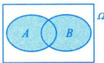

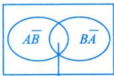  
AB

注 (1) 设 $A_{1}, A_{2}, A_{3}$ 为任意三个事件, 则有

$$
P \left(A _ {1} \bigcup A _ {2} \bigcup A _ {3}\right) = P \left(A _ {1}\right) + P \left(A _ {2}\right) + P \left(A _ {3}\right) - P \left(A _ {1} A _ {2}\right) - P \left(A _ {1} A _ {3}\right) - P \left(A _ {2} A _ {3}\right) + P \left(A _ {1} A _ {2} A _ {3}\right).
$$

(2)若 ${A}_{1},{A}_{2},\cdots ,{A}_{n}$ 是两两互不相容的事件,则有 丙两互斥

$$
P \left(A _ {1} \cup A _ {2} \cup \dots \cup A _ {n}\right) = P \left(A _ {1}\right) + P \left(A _ {2}\right) + \dots + P \left(A _ {n}\right).
$$

(3) 减法公式: $P(A - B) = P(A) - P(AB) = P(A\overline{B})$ .

排除掉 $P(A) = 0$ ，是因为它值

往出现在分母位置

★★★(4)条件概率公式：设 $A$ ， $B$ 为任意两个事件，若 $P(A) > 0$ ，我们称在已知事件 $A$ 发生的条件下，事件 $B$ 发生的概率为条件概率，记为 $P(B|A)$ ，且

$$
P (B \mid A) = \frac {P (A B)}{P (A)}.
$$

注 (1)条件概率 $P(\cdot |A)$ 是概率，概率的一切性质和结论对条件概率都适用.

例如，

$$
P (\overline {{B}} \mid A) = 1 - P (B \mid A),
$$

$$
P [ (B - C) \mid A ] = P (B \mid A) - P (B C \mid A),
$$

等等.

(2)条件概率就是在一定的附加条件之下所计算的概率.当说到“条件概率”时，总是指另外附加了条件，其形式可归结为“已知某事件发生了”.（或当……时）

区分：① 有一个单位长度的质杆，任意切两刀，截成三段。

② 一个长度为1的质杆，先切一刀，把它分成两段之后，再对剩下的任意一段切一刀。以上两种说法不一致。

(5)乘法公式：如果 $P(A) > 0$ ，则 $P(AB) = P(A)P(B\mid A)$

一般地，对于 $n > 2$ ，如果 $P(A_{1}A_{2}\dots A_{n - 1}) > 0$ ，则

$$
P \left(A _ {1} A _ {2} \dots A _ {n}\right) = P \left(A _ {1}\right) P \left(A _ {2} \mid A _ {1}\right) P \left(A _ {3} \mid A _ {1} A _ {2}\right) \dots P \left(A _ {n} \mid A _ {1} A _ {2} \dots A _ {n - 1}\right).
$$

如： $P(A_{1}A_{2}) > 0$ ，则 $P(A_{1}A_{2}A_{3}) = P(A_{1})P(A_{2}|A_{1})P(A_{3}|A_{1}A_{2}).$

金集分解思想示例：一个

村子和三个小偷的故事。

★★★(6)全概率公式：如果 $\bigcup_{i = 1}^{n}A_{i} = \Omega$ ， $A_{i}A_{j} = \emptyset (i\neq j;i,j = 1,2,\dots ,n),P(A_{i}) > 0$ ，则对任一事件B，有

$$
\text {存 在} n = \infty \text {的 情 形} \quad B = \bigcup_ {i = 1} ^ {n} A _ {i} B, P (B) = \sum_ {i = 1} ^ {n} P (A _ {i}) P (B \mid A _ {i}).
$$

示例 一个村子和三个小偷的故事。

现实中不会出现成功概率为0的小偷

假设一个村子有3个小偷，一个叫小张，一个叫小英，一个叫小郑，小张偷东西成功的概率为0，小英偷东西成功的概率为 $\frac{3}{4}$ ，小郑偷东西成功的概率为 $\frac{1}{6}$ ，派一个人去偷东西.

现记 $A_{i} = \{\text{第} i$ 个人去偷东西 $\}$ ， $i = 1,2,3$

$$
B = \{\text {村 子 失 窃} \}.
$$

(1)求村子失窃的概率；  
(2)若事件 $B$ 已经发生了，即发生了失窃，那么现在第 $i$ 个人去偷的概率 $P(A_{i} \mid B)$ 是多少呢？

用贝叶斯公式，也叫逆概率公式。

(1) $B$ 事件比较复杂, 它的复杂性在于它不是一个可能原因导致的. 这里有三个原因, 都可以导致结果. 但是每个原因导致结果的能力还不一样. 所以在概率论里, 我们提出了一个重要的思想, 即全集分解思想.

(2)当 $B$ 事件非常复杂的时候，它实际上属于整个试验的第二个阶段.

第一个阶段，选人，选哪个人去偷；第二个阶段，失窃，偷东西偷成功了。

解

(1)

第一阶段 $A_{1}, A_{2}, A_{3}$ 第二阶段 $B$

失窃原因的全集

完备事件组：保证不重不漏.所谓不重，就是任何两个事件的交集是空集或者说没有公共的元素；不漏也就是所有的事件并起来，最后是全集，我们叫这个事件组为一个完备事件组

$$
\begin{array}{l} P (B) = P (B \Omega) = P \left[ B \left(A _ {1} \cup A _ {2} \cup A _ {3}\right) \right] \\ = \overline {{P}} \left(B A _ {1} \cup B A _ {2} \cup B A _ {3}\right) \\ = P \left(B A _ {1}\right) + P \left(B A _ {2}\right) + P \left(B A _ {3}\right) \\ = P \left(A _ {1}\right) P \left(B \mid A _ {1}\right) + P \left(A _ {2}\right) P \left(B \mid A _ {2}\right) + P \left(A _ {3}\right) P \left(B \mid A _ {3}\right) \\ \end{array}
$$

$P(B|A_{i})$ 代表第 $i$ 个人偷成功的概率，且 $\sum P(B|A_i)$ 无要求

$$
= \frac {1}{3} \times 0 + \frac {1}{3} \times \frac {3}{4} + \frac {1}{3} \times \frac {1}{6} = \frac {1 1}{3 6}.
$$

根据事件的基本运算法律

完备事件组是互斥的

在没有任何附加信息的条件下，只好认为三个人去偷具有等可能性（当然有的题目可能不具有等可能性，但具体的题目会告知），所以

$$
P \left(A _ {i}\right) = \frac {1}{3}, i = 1, 2, 3
$$

(2) $P(A_{i} \mid B) = \frac{P(A_{i} B)}{P(B)} = \frac{P(A_{i}) P(B \mid A_{i})}{\sum_{i=1}^{3} P(A_{i}) P(B \mid A_{i})}, i = 1, 2, 3,$

故 $P(A_{1} \mid B) = \frac{0}{\frac{11}{36}} = 0, P(A_{2} \mid B) = \frac{\frac{1}{4}}{\frac{11}{36}} = \frac{1}{4} \times \frac{36}{11} = \frac{9}{11},$

$$
P (A _ {3} \mid B) = \frac {\frac {1}{1 8}}{\frac {1 1}{3 6}} = \frac {1}{1 8} \times \frac {3 6}{1 1} = \frac {2}{1 1}.
$$

注 (1)对比. ① 在村子没有失窃的情况下，那三个原因具有等可能性，即在没有任何信息的情况下，并不知道哪个人去偷，所以只能认为他们具有等可能性。  
② 当信息增加时，即当我们获取了一定信息的时候，比如知道村子丢东西了，当这个信息进来以后，第 $i$ 个人偷盗的这三个事件发生的概率就悄然发生了变化。  
(2) 总结. 在整个试验过程中，当我们增加一些信息的时候，原来所谓的在没有任何信息的条件下所设立的那些可能性，在信息增加之后，它们的概率就随之变化. 这是很重要的一个思想，叫作逆概率公式（执果索因）. 发生变化的原因是权重发生了变化.

存在 $n = \infty$ 的情形

(7) 贝叶斯公式（又称逆概率公式）：如果 $\bigcup_{i=1}^{n} A_i = \Omega$ ， $A_i A_j = \emptyset (i \neq j; i, j = 1, 2, \dots, n)$ ， $P(A_i) > 0$ ，则对任一事件 $B$ ，只要 $P(B) > 0$ ，就有

$$
P (A _ {j} \mid B) = \frac {P (A _ {j}) P (B \mid A _ {j})}{\sum_ {i = 1} ^ {n} P (A _ {i}) P (B \mid A _ {i})} (j = 1, 2, \dots , n).
$$

方法总结 如果一个事件或者说一个结果的发生是复杂的，它是由多个原因引起的，那么这个时候一定要考虑到全集分解，把原因拉进来处理问题.

注全概率公式用于计算某个“结果” $B$ 发生的可能性大小.如果一个“结果” $B$ 的发生总是与多个“原因” $A_{i}$ 相联系，那么在计算 $P(B)$ 时，我们一般这样处理：

$$
B = B \Omega = B \left(\bigcup_ {i = 1} ^ {n} A _ {i}\right) = \bigcup_ {i = 1} ^ {n} A _ {i} B,
$$

然后应用全概率公式计算 $P(B)$ ，我们常称这种方法为全集分解法.如果在“结果” $B$ 发生的条件下，探求导致这一“结果”的各种“原因”，即 $A_{i}$ 发生的可能性大小 $P(A_{i}|B)$ ，则要应用贝叶斯公式.

在引入随机变量之后，还有相应的很多场合要用到全集分解思想。

例1.5 设 $A, B$ 为两个随机事件，则（ ）

(A) $P(AB) + P(\overline{A}\overline{B})\leqslant 1$

(B) $P(AB) + P(\overline{A}\overline{B})\geqslant 1$

(C) $P(A - B)\leqslant P(A) - P(B)$

(D) $P(A\bigcup B) + P(\overline{A}\bigcup \overline{B})\leqslant 1$

解 应选(A).

本题涉及事件之间的关系，由于 $AB\subset A\bigcup B$ ，即有 $P(AB)\leqslant P(A\bigcup B)$ ，从而有

$$
P (A B) \leqslant P (A \bigcup B) = 1 - P (\overline {{A \bigcup B}}) = 1 - P (\overline {{A B}}), \quad P (\overline {{\overline {{A B}}}}) = P (A \bigcup B)
$$

即 $P(AB) + P(\overline{A}\overline{B})\leqslant 1$ ，同时有

$$
P (A \cup B) - P (A B) = P (A \cup B) + P (\overline {{A B}}) - 1 = P (A \cup B) + P (\bar {A} \cup \bar {B}) - 1 \geqslant 0,
$$

即 $P(A\bigcup B) + P(\overline{A}\bigcup \overline{B})\geqslant 1,\longrightarrow 1 - P(\overline{A}\bigcup \overline{B}) = P(\overline{\overline{A}}\bigcup \overline{\overline{B}}) = P(AB)$

知选项(B)，(D)不正确.又 $AB\subset B$ ，有 $P(AB)\leqslant P(B)$ ，从而有

$$
P (A - B) = P (A) - P (A B) \geqslant P (A) - P (B),
$$

知选项(C)不正确，故选择(A).

例1.6 设随机事件 $A, B$ 满足 $P(A) = P(B) = \frac{1}{2}$ 和 $P(A \cup B) = 1$ ，则有（ ）

(A) $A\bigcup B = \Omega$

(B) $AB = \emptyset$

(C) $P(\overline{A}\cup \overline{B}) = 1$

(D) $P(A - B) = 0$

解 应选(C).

前面已经指出， $P(A\bigcup B) = 1$ 不能推出 $\underline{A\bigcup B} = \Omega$ ，且 $P(AB) = P(A) + P(B) - P(A\bigcup B) = 0$ 不能推出 $AB = \varnothing$ .故选项(A)，(B)不正确.

不代表是不可能事件，比如8：00~9：00时段恰好在8：30进入教室，这个事情是可以发生的，但概率为0

又 $P(A - B) = P(A) - P(AB) = \frac{1}{2}$ ，选项(D)不正确.从而 $P(\overline{A} \cup \overline{B}) = P(\overline{AB}) = 1 - P(AB) = 1$ ，选(C).

例1.7 设 $A, B, C$ 是三个随机事件， $A$ 与 $C$ 互斥， $P(AB) = \frac{1}{2}$ ， $P(C) = \frac{1}{3}$ ，则 $P(AB|\overline{C}) =$

分析 考查全概率公式及单调性.

解 应填 $\frac{3}{4}$

$$
0 \leqslant P (A B C) \leqslant P (A C) = 0
$$

因为 $A$ 与 $C$ 互斥，所以 $P(AC) = 0$ .又 $ABC\subset AC$ ，所以 $P(ABC) = 0$ ，故

$$
P (A B \mid \overline {{C}}) = \frac {P (\overline {{A B C}})}{P (\overline {{C}})} = \frac {P (A B) - P (A B C)}{1 - P (C)} = \frac {\frac {1}{2}}{1 - \frac {1}{3}} = \frac {3}{4}.
$$

注 由于 $AC = \emptyset$ ，则 $ABC = \emptyset B = \emptyset$ ，得到 $P(ABC) = 0$ ：

例1.8 已知 $P(A) = \frac{1}{4}, P(B|A) = \frac{1}{3}, P(A|B) = \frac{1}{2}$ ，则 $P(A\cup B) =$

分析 从求解所需的条件出发，进行分析.

解 应填 $\frac{1}{3}$

由乘法公式知

$$
P (A B) = P (A) P (B \mid A) = \frac {1}{4} \times \frac {1}{3} = \frac {1}{1 2}, P (B) = \frac {P (A B)}{P (A \mid B)} = \frac {1 / 1 2}{1 / 2} = \frac {1}{6},
$$

所以 $P(A\bigcup B) = P(A) + P(B) - P(AB) = \frac{1}{4} +\frac{1}{6} -\frac{1}{12} = \frac{1}{3}.$

例1.9

某人给四位亲友各写一封信，然后随机地装入4个写好地址的信封中，且每个信封装

一封信.问：

①那就是 ${A}_{1},{A}_{2},{A}_{3},{A}_{4}$ 四个事件同时发生,是“且”关系,即第一封信装对, 且第二封信装对,且第三封信装对,且第四封信装对,用乘法公式.

(1)4封信都装对了的概率；

②对立事件：至少有一封信装错了，而不是全部装错了

(2)4封信都装错了的概率.

解设事件 $A_{i}(i = 1,2,3,4)$ 为“第 $i$ 封信装对了”，事件 $A$ 为“4封信都装对了”，事件 $B$ 为“4封信都装错了”。于是

(1) $P(A) = P(A_{1}A_{2}A_{3}A_{4}) = P(A_{1})P(A_{2}|A_{1})P(A_{3}|A_{1}A_{2})P(A_{4}|A_{1}A_{2}A_{3})$

$$
= \frac {1}{4} \times \frac {1}{3} \times \frac {1}{2} \times \frac {1}{1} = \frac {1}{2 4}.
$$

(2) $P(B) = P(\overline{A}_1\overline{A}_2\overline{A}_3\overline{A}_4)$

德·摩根公式 $\overline{A\cap B} = \overline{A}\cup \overline{B}$

$$
= 1 - P (\overline {{A _ {1} A _ {2} A _ {3} A _ {4}}}) = 1 - P (\bigcup A _ {1} \bigcup A _ {2} \bigcup A _ {3} \bigcup A _ {4})
$$

$$
= 1 - \left\{P \left(A _ {1}\right) + P \left(A _ {2}\right) + P \left(A _ {3}\right) + P \left(A _ {4}\right) - \right.
$$

$$
\begin{array}{l} \left[ P \left(A _ {1} A _ {2}\right) + P \left(A _ {1} A _ {3}\right) + P \left(A _ {1} A _ {4}\right) + P \left(A _ {2} A _ {3}\right) + P \left(A _ {2} A _ {4}\right) + P \left(A _ {3} A _ {4}\right) \right] + \\ \left. \left[ P \left(A _ {1} A _ {2} A _ {3}\right) + P \left(A _ {1} A _ {2} A _ {4}\right) + P \left(A _ {1} A _ {3} A _ {4}\right) + P \left(A _ {2} A _ {3} A _ {4}\right) \right] - P \left(A _ {1} A _ {2} A _ {3} A _ {4}\right) \right\}, \\ \end{array}
$$

其中 $P(A_{i}) = \frac{1}{4}$ ， $P(A_{i}A_{j}) = \frac{1}{4}\times \frac{1}{3} = \frac{1}{12},P(A_{i}A_{j}A_{k}) = \frac{1}{4}\times \frac{1}{3}\times \frac{1}{2} = \frac{1}{24}(1\leqslant i,j,k\leqslant 4,i\neq j\neq k)$ ，于是

$$
P (B) = 1 - 4 \times \frac {1}{4} + 6 \times \frac {1}{1 2} - 4 \times \frac {1}{2 4} + \frac {1}{2 4} = \frac {3}{8}.
$$

注本题装信过程可看作无放回抽取信件，依次装入信封.在计算第(2)问时，直接计算较为困难，这种情况下，采用逆向思维方法求解问题更加简捷.

例1.10 从1，2，3，4中任取一个数，记为 $X$ ，再从1,…， $X$ 中任取一个数，记为 $Y$ ，则 $P\{Y = 2\} = \_ .$

解 应填 $\frac{13}{48}$

$$
P \{X = i \} = \frac {1}{4}, i = 1, 2, 3, 4,
$$

$$
P \left\{Y = 2 \mid X = 1 \right\} = 0, P \left\{Y = 2 \mid X = 2 \right\} = \frac {1}{2}, P \left\{Y = 2 \mid X = 3 \right\} = \frac {1}{3}, P \left\{Y = 2 \mid X = 4 \right\} = \frac {1}{4},
$$

故 $P\{Y = 2\} = \sum_{i = 1}^{4}P\{X = i\} P\{Y = 2|X = i\} = \frac{1}{4}\times 0 + \frac{1}{4}\times \frac{1}{2} +\frac{1}{4}\times \frac{1}{3} +\frac{1}{4}\times \frac{1}{4} = \frac{13}{48}.$

例1.11 一批产品有10个正品和2个次品，任意抽取两次，每次抽一个，抽出后不再放回，则第二次抽出的是次品的概率为 先后不放回取两次

解 应填 $\frac{1}{6}$

记 $A_{i} = \{$ 第 $i$ 次取得次品 $\}$ ， $i = 1,2$ ，则由已知得

$$
P (A _ {1}) = \frac {2}{1 2} = \frac {1}{6}, P (\overline {{A}} _ {1}) = \frac {1 0}{1 2} = \frac {5}{6}, P (A _ {2} | A _ {1}) = \frac {1}{1 1}, P (A _ {2} | \overline {{A}} _ {1}) = \frac {2}{1 1}.
$$

由全概率公式得 $P(A_{2}) = P(A_{1})P(A_{2}|A_{1}) + P(\overline{A}_{1})P(A_{2}|\overline{A}_{1}) = \frac{1}{6}\times \frac{1}{11} +\frac{5}{6}\times \frac{2}{11} = \frac{1}{6}.$

注此例为抓阁模型：有12个可辨产品（10个正品和2个次品）放入12个格子，每个格子放1个产品，则放法总数为12！，现只关注第2个格子放两个次品中的一个，则放法总数为 $C_2^1\cdot 1\cdot 11!$ 故 $p = \frac{C_2^1\cdot 1\cdot 11!}{12!} = \frac{1}{6}$ ，此过程与结果表明，从第1次到第12次取到次品的概率均为 $\frac{1}{6}$ 即亦可用例1.3(4)的结论直接得出结果 $\frac{1}{6}$

结果已知，正品可能来自第一批，

也可能来自第二批

例1.12 设有两批数量相同的零件，已知有一批产品全部合格，另一批产品有 $25\%$ 不合格。从两批产品中任取1只，经检验是正品，放回原处，并从原所在批次再取1只，求这只产品是次品的概率。分析两次抽取情况有不同之处，第一次是在完全不知情的情况下等可能地从两批产品中抽取，第二次是在第一次抽取产品并检验合格后，这时对所抽取是第一批还是第二批产品的概率已有计算，因此计算要分两步走。第一步：在已知抽取产品合格的条件下，计算抽取的是第一批还是第二批产品的概率，属于贝叶斯概型；第二步：事件“从第一批产品中抽取”和“从第二批产品中抽取”构成一个完备事件组，计算第二次抽到次品的概率，属于全概率概型。两个概型的复合，常常是该类题型的特点。

解 记 $H_{i} = \{\text{第一次从第} i\text{批产品中抽取}\}$ ， $i = 1,2$ ， $P(H_{1}) = P(H_{2}) = \frac{1}{2}$ （等可能性）

再记 $A = \{$ 取到正品 $\}$ ，则 $P(A|H_1) = 1, P(A|H_2) = \frac{3}{4}$ ，即

$$
P (A) = P \left(H _ {1}\right) P \left(A \mid H _ {1}\right) + P \left(H _ {2}\right) P \left(A \mid H _ {2}\right) = \frac {7}{8}.
$$

又记 $C_i = \{$ 第二次从第 $i$ 批产品中抽取 $\}$ ， $i = 1,2$ ，则有

$A$ 已经发生了

P(C1)=P(H1|A) P(H1A) P(H1)P(A|H1) 执果索因

$\star P(C_2) = P(H_2|A) = \frac{P(H_2A)}{P(A)} = \frac{P(H_2)P(A|H_2)}{P(A)} = \frac{3}{7}.$

则 $P(\overline{A}) = P(C_1)P(\overline{A} |C_1) + P(C_2)P(\overline{A} |C_2) = \frac{4}{7}\times 0 + \frac{3}{7}\times \frac{1}{4} = \frac{3}{28}.$

# 四 事件的独立性和独立重复试验

# 事件的独立性

$\left. \begin{array}{c} P\left( {AB}\right)  > P\left( A\right) P\left( B\right) \\   \rightarrow  P\left( {AB}\right)  < P\left( A\right) P\left( B\right)  \end{array}\right\}   \rightarrow$ 不独立

设 $A, B$ 为两个事件，如果 $P(AB) = P(A)P(B)$ ，则称事件 $A$ 与 $B$ 相互独立，简称 $A$ 与 $B$ 独立。

(1) 表示两个事件相互独立的其他形式.

① 若 $P(A) > 0, P(B \mid A) = \frac{P(AB)}{P(A)} = \frac{P(A)P(B)}{P(A)} = P(B)$ .

$A$ 是否发生,不影响 $B$ 发生的概率

② $P(A) = 0$

若 $P(A) = 0$ ，且 $AB\subset A$ ，则 $0\leqslant P(AB)\leqslant P(A) = 0$ ，故 $P(AB) = 0$ ，即 $P(AB) = P(A)P(B)$ 依然成立.

(2) 两个事件不相互独立时.

$\frac{P\left( {AB}\right) }{P\left( A\right) } < \frac{P\left( A\right) P\left( B\right) }{P\left( A\right) }$ ①若 $P\left( {AB}\right)  > P\left( A\right) P\left( B\right)$ ,则 $P\left( {B \mid  A}\right)  > P\left( B\right)$ ,

(A有利于 $B$ 的发生)相互有利

$②$ 若 $P(AB) <   P(A)P(B)$ ，则 $P(B\mid A) <   P(B)$ 相互抑止

注 设 $A_{1}, A_{2}, \cdots, A_{n}$ 为 $n (n \geqslant 2)$ 个事件，如果对其中任意有限个事件 $A_{i_{1}}, A_{i_{2}}, \cdots, A_{i_{k}} (2 \leqslant k \leqslant n)$ ，有

$$
P \left(A _ {i _ {1}} A _ {i _ {2}} \dots A _ {i _ {k}}\right) = P \left(A _ {i _ {1}}\right) P \left(A _ {i _ {2}}\right) \dots P \left(A _ {i _ {k}}\right),
$$

则称 $n$ 个事件 $A_{1}, A_{2}, \dots, A_{n}$ 相互独立.

考研中常考的是 $n = 3$ 时的情形. 细致说来，设 $A_{1}, A_{2}, A_{3}$ 为三个事件，若

$$
P \left(A _ {1} A _ {2}\right) = P \left(A _ {1}\right) P \left(A _ {2}\right), \tag {1-1}
$$

$$
P \left(A _ {1} A _ {3}\right) = P \left(A _ {1}\right) P \left(A _ {3}\right), \tag {1-2}
$$

$$
P \left(A _ {2} A _ {3}\right) = P \left(A _ {2}\right) P \left(A _ {3}\right), \tag {1-3}
$$

$$
P \left(A _ {1} A _ {2} A _ {3}\right) = P \left(A _ {1}\right) P \left(A _ {2}\right) P \left(A _ {3}\right), \tag {1-4}
$$

则称事件 $A_{1}, A_{2}, A_{3}$ 相互独立. 当去掉上述(1-4)式后，称只满足(1-1)，(1-2)，(1-3)式的事件 $A_{1}, A_{2}, A_{3}$ 两两独立. 见例1.13.

# 独立性的判定

$A, B, C$ 相互独立.

$\overline{A}, \overline{B}, \overline{C}$ 也相互独立

① $A$ 与 $B$ 相互独立 $\overset{\left( *\right) }{ \Leftrightarrow  }A$ 与 $\bar{B}$ 相互独立 $\Leftrightarrow  \bar{A}$ 与 $B$ 相互独立 $\Leftrightarrow  \bar{A}$ 与 $\bar{B}$ 相互独立. 夫唱归随

注 (1) 仅证 $(*)$ ，由 $A, B$ 独立，有 $P(AB) = P(A)P(B)$ ，于是

$$
\begin{array}{l} P (A \bar {B}) = P (A) - P (A B) = P (A) - P (A) P (B) \\ = P (A) [ 1 - P (B) ] = P (A) P (\bar {B}), \\ \end{array}
$$

故 $A, \overline{B}$ 独立，其余证明同理.

(2)将相互独立的事件组中的任意几个事件换成各自的对立事件，所得的新事件组仍相互独立.

② 对独立事件组不含相同事件作运算，得到的新事件组仍独立，如 $A, B, C, D$ 相互独立，则 $AB$ 与 $CD$ 相互独立， $A$ 与 $BC - D$ 相互独立.

注 直接使用，无须证明。

③若 $P(A) = 0$ 或 $P(A) = 1$ ，则 $A$ 与任意事件 $B$ 相互独立. 不可能事件或必然事件和任意事件独立

注证若 $P(A) = 0$ ，由 $P(AB)\leqslant P(A)\leqslant P(A + B)$ ，有 $0\leqslant P(AB)\leqslant P(A) = 0$ ，则 $P(AB) = 0$ ，于是 $P(A)P(B) = P(AB)$

若 $P(A) = 1$ ，则 $P(\overline{A}) = 1 - P(A) = 0$ ，又由 $P(B\overline{A}) \leqslant P(\overline{A}) \leqslant P(\overline{A} + B)$ ，有 $0 \leqslant P(B\overline{A}) \leqslant P(\overline{A}) = 0$ ，知 $P(B\overline{A}) = 0$ ，又 $P(B\overline{A}) = P(B) - P(AB)$ ，故 $P(B) = P(AB)$ ，即 $P(A)P(B) = P(AB)$ ：

# 3 独立试验序列概型与 $n$ 重伯努利概型 $\xrightarrow{\text{化态}}\mathrm{Ber} - E_{n}$ 数字

在同样条件下独立重复地进行一系列完全相同的试验, 即每次试验的可能结果及其发生的概率都不变, 每次试验是相互独立的, 称这种重复试验序列的概率模型为独立试验序列概型. 如果每次试验只有两个结果 $A$ 与 $\bar{A}$ , 且在每次试验中 $A$ 发生的概率都相等 (即 $P(A) = p$ ), 将这种试验独立重复 $n$ 次, 则称这种试验的概率模型为 $n$ 重伯努利概型.

投篮，投 $n$ 次，投中 $k$ 次，

$$
P \{X = k \} = C _ {n} ^ {k} p ^ {k} (1 - p) ^ {n - k}, k = 0, 1, \dots , n
$$

②每次试验 $A$ 发生的概率 $p = P(A)$ 不变；  
③试验独立重复进行 $n$ 次

例1.13 将一枚硬币独立地掷两次，引进事件： $A_{1} = \{$ 掷第一次出现正面 $\}$ ， $A_{2} = \{$ 掷第二次出现正面 $\}$ ， $A_{3} = \{$ 正反面各出现一次 $\}$ ， $A_{4} = \{$ 正面出现两次 $\}$ ，则事件（ ）

(A) $A_{1}, A_{2}, A_{3}$ 相互独立

(B) $A_{2}, A_{3}, A_{4}$ 相互独立

(C) $A_{1}, A_{2}, A_{3}$ 两两独立

(D) $A_{2}, A_{3}, A_{4}$ 两两独立

解 应选(C).

由题可知， $\Omega = \{\text{正正，正反，反正，反反}\}$

则 $P(A_{1}) = \frac{1}{2}, P(A_{2}) = \frac{1}{2}, P(A_{3}) = \frac{1}{2}, P(A_{4}) = \frac{1}{4},$

$$
P \left(A _ {1} A _ {2}\right) = \frac {1}{4}, P \left(A _ {1} A _ {3}\right) = \frac {1}{4}, P \left(A _ {2} A _ {3}\right) = \frac {1}{4},
$$

但 $P(A_{1}A_{2}A_{3}) = 0\neq P(A_{1})P(A_{2})P(A_{3}),$ 故 $A_{1},A_{2},A_{3}$ 两两独立，但三者不相互独立.

又 $A_{3}A_{4} = \emptyset$ ， $P(A_4) = \frac{1}{4}$ ， $P(A_{3}) = \frac{1}{2}$ ， $P(A_{3}A_{4}) = 0\neq P(A_{3})P(A_{4})$ ，知 $A_{2},A_{3},A_{4}$ 不两两独立，也不相互独立.

例1.14 对同一目标接连进行3次独立重复射击，假设至少命中目标一次的概率为 $\frac{7}{8}$ ，则每次射击命中目标的概率 $p =$

解 应填 $\frac{1}{2}$

记 $A_{i} = \{$ 第 $i$ 次命中目标 $\}$ ， $i = 1,2,3$ ，且 $P(A_{1}\bigcup A_{2}\bigcup A_{3}) = \frac{7}{8}$ ，故

$$
\begin{array}{l} 1 - P \left(\bar {A} _ {1} \bar {A} _ {2} \bar {A} _ {3}\right) = 1 - P \left(\bar {A} _ {1}\right) P \left(\bar {A} _ {2}\right) P \left(\bar {A} _ {3}\right) \\ = 1 - (1 - p) ^ {3} = \frac {7}{8}, \\ \end{array}
$$

则 $p = \frac{1}{2}$

例1.15 某人向同一目标独立重复射击，每次命中目标的概率为 $p(0 < p < 1)$ ，则此人第4次射击恰好第2次命中目标的概率为（）.

(A) $3p(1 - p)^{2}$   
(B) $6p(1 - p)^{2}$   
(C) $3p^{2}(1 - p)^{2}$   
(D) $6p^{2}(1 - p)^{2}$

分析

$$
\begin{array}{c c c c} \checkmark & \times & \times & \checkmark \\ \times & \checkmark & \times & \checkmark \\ \times & \times & \checkmark & \checkmark \\ \hline & & & \end{array}
$$

解 应选(C).

依题设，4次射击，最后一次命中，前3次有一次命中.若设前3次射击有 $X$ 次命中，则 $X\sim B(3,p)$ ，且有

$$
P \{X = 1 \} = \mathrm {C} _ {3} ^ {1} p (1 - p) ^ {2}.
$$

于是第4次射击恰好第2次命中目标的概率为 $3p^{2}(1 - p)^{2}$ ，故选择(C).

# 基础习题精练

# 习题

1.1 设 $A, B, C$ 是任意三个事件，则下列选项中正确的是（ ）

(A) 若 $A \cup C = B \cup C$ ，则 $A = B$

(B) 若 $A - C = B - C$ ，则 $A = B$

(C) 若 $AC = BC$ ，则 $A = B$

(D) 若 $AB = \varnothing$ 且 $\overline{A}\overline{B} = \varnothing$ ，则 $\overline{A} = B$

1.2 设 $A$ 和 $B$ 是任意两个事件.

① 若 $P(A) = P(B)$ ，则 $A = B$ ；  
② 若 $P(AB) = 0$ ，则 $AB = \varnothing$

则关于两个命题的结论，正确的是（ ）

(A) ①正确，②不正确

(B) ①不正确，②正确

(C) ①, ②均正确

(D) ①, ②均不正确

1.3 考虑一元二次方程 $x^{2} + Bx + C = 0$ ，其中 $B, C$ 分别是将一枚骰子接连抛两次先后出现的点数，则该方程有实根的概率为（）.

(A) $\frac{19}{36}$

(B) $\frac{17}{36}$

(C) $\frac{15}{36}$

(D) $\frac{13}{36}$

1.4 甲口袋有5个白球、3个黑球，乙口袋有4个白球、6个黑球。从两个口袋中各任取一个球，则取到的两个球颜色相同的概率为（）

(A) $\frac{19}{40}$

(B) $\frac{21}{40}$

(C) $\frac{1}{4}$

(D) $\frac{9}{40}$

1.5 设 $A, B, C$ 为三个随机事件，且 $A$ 与 $C$ 相互独立， $B$ 与 $C$ 相互独立，则 $A \cup B$ 与 $C$ 相互独立的充分必要条件是（）.

(A) $A$ 与 $B$ 相互独立

(B) $A$ 与 $B$ 互不相容

(C) $AB$ 与 $C$ 相互独立

(D) $AB$ 与 $C$ 互不相容

# 考研数学基础30讲·概率论与数理统计分册

1.6 随机地向半圆 $0 < y < \sqrt{2ax - x^2} (a > 0)$ 内投掷一点，点均匀落在半圆内任何一个区域，则该点和原点连线同 $x$ 轴的夹角 $\theta \leqslant \frac{\pi}{4}$ 的概率为  
1.7 从[0,1]中随机地取两个数，其积大于 $\frac{1}{4}$ ，其和小于 $\frac{5}{4}$ 的概率为  
1.8 已知事件 $A, B$ 满足 $P(AB) = P(\overline{A} \cap \overline{B})$ ，记 $P(A) = p$ ，则 $P(B) =$ ______.  
1.9 已知 $P(A) = 0.7$ ， $P(A - B) = 0.3$ ，则 $P(\overline{AB}) = \_ .$   
1.10 已知 $P(\overline{A}) = 0.3, P(B) = 0.4, P(A\overline{B}) = 0.5$ ，则 $P(B|A \cup \overline{B}) =$   
1.11 设 $A, B$ 为两个随机事件，且 $P(A) = 0.4, P(A \cup B) = 0.7$ 。若 $A, B$ 互不相容，则 $P(B) =$ ______；若 $A, B$ 相互独立，则 $P(B) =$ ______；若 $A$ 发生 $B$ 必发生，则 $P(B) =$ ______。  
1.12 三人独立地破译一个密码，他们能单独译出的概率分别为 $\frac{1}{5}, \frac{1}{3}, \frac{1}{4}$ ，则此密码被译出的概率为  
1.13 甲、乙两人独立地对同一目标射击一次，其命中率分别为0.6和0.7。现已知目标被击中，则它是甲射中的概率为  
1.14 用事件 $A, B, C$ 的运算关系表示事件：① $A, B, C$ 都不发生；② $A, B, C$ 不都发生；③ $A, B, C$ 不多于一个发生。  
1.15 设 $X, Y$ 为随机变量，事件 $A$ 表示 $\{X \geqslant c\}$ ，事件 $B$ 表示 $\{Y \geqslant c\}$ 。用 $A, B$ 表示下列事件：

D: $\{\max \{X,Y\} \geqslant c\}$ .E: $\{\min \{X,Y\} \geqslant c\}$ .F: $\{\max \{X,Y\} <  c\}$ .G: $\{\min \{X,Y\} <  c\}$

1.16 判断下列命题是否成立，并说明理由.

(1) $A - (B - C) = (A - B)\bigcup C$   
(2) 若 $AB = \emptyset$ 且 $C \subset A$ ，则 $BC = \emptyset$   
(3) $(A\bigcup B) - B = A$   
(4) $(A - B)\bigcup B = A$

1.17 口袋中有 1 个球，不知它的颜色是黑的还是白的，现再往口袋中放入 1 个白球，然后从口袋中任意取出 1 个，发现取出的是白球，求口袋中原来那个球是白球的概率。  
1.18 已知装有同种零件的产品两箱，第一箱内装 50 件产品，其中一等品 10 件；第二箱内装 30 件产品，其中一等品 18 件，现从两箱中任意挑选一箱。求：从中先后取出两件产品（取后不放回），先取出的产品是一等品的概率 $p$ ；已知先取出的产品是一等品，那么第二次取出的产品仍然是一等品的概率 $q$ 。  
1.19 每箱产品有 10 件, 其次品数从 0 到 2 是等可能的, 开箱检验时, 从中任取 1 件, 如检验出是次品, 则认为该箱产品不合格而拒收. 假设由于检验有误, 将 1 件正品误认为次品的概率为 $2\%$ , 1 件次品被漏查而判为正品的概率为 $5\%$ , 求该箱产品通过验收的概率.

# 解答

1.1 (D) 解 方法一（直接法）对于选项(D)，由事件运算的对偶律，有 $\overline{A}\overline{B} = A\bigcup B = \varnothing = \Omega$ 而由 $A\bigcup B = \Omega$ 且 $AB = \emptyset$ ，可见 $A$ 和 $B$ 互为对立事件，即 $\overline{A} = B$ ，因此(D)正确.

方法二（排除法）前三个选项都不成立，只需分别举出反例。例如，由于 $A, B, C$ 是任意三个事件，若取 $A \neq B$ ，而 $C = \Omega$ 是必然事件，则 $A \cup C = B \cup C$ 且 $A - C = B - C$ ，但 $A \neq B$ ，从而 (A) 和 (B) 不成立。取 $A \neq B, C = \emptyset$ ，则 $AC = BC$ ，但 $A \neq B$ ，因此 (C) 不成立。从而选 (D)。

注 本题的结果反映了事件的运算与数的运算的不同之处.

1.2 (D) 解考虑向区间 $[0, 2]$ 上掷一随机点的试验. 令 $A = \{\text{随机点落入区间} [0, 1]\}$ , $B = \{\text{随机点落入区间} [1, 2]\}$ . 显然 $P(A) = P(B)$ , $P(AB) = 0$ , 然而 $A \neq B$ , $AB \neq \emptyset$ . 故两个命题均不正确, 选(D).

1.3 (A) 解 本题属于古典概型。由于很难套用现有概型模式或公式求解，一个最简单也是最直接的做法是数出总样本数和事件所含样本点数并计算比值，给出答案。事件所含样本点数可借助列表等手段列出各种可能的结果，然后数出事件所含样本点数。由于接连抛两次，每次都可能出现6个点数，因此其总样本数为 $6^2$ 。

方程有实根，即事件 $\{B^2 -4C\geqslant 0\}$ ，列表如下.

<table><tr><td>\( B^2 -4C \) \( B \)</td><td>1</td><td>2</td><td>3</td><td>4</td><td>5</td><td>6</td></tr><tr><td>1</td><td>-</td><td>-</td><td>-</td><td>-</td><td>-</td><td>-</td></tr><tr><td>2</td><td>0</td><td>-</td><td>-</td><td>-</td><td>-</td><td>-</td></tr><tr><td>3</td><td>+</td><td>+</td><td>-</td><td>-</td><td>-</td><td>-</td></tr><tr><td>4</td><td>+</td><td>+</td><td>+</td><td>0</td><td>-</td><td>-</td></tr><tr><td>5</td><td>+</td><td>+</td><td>+</td><td>+</td><td>+</td><td>+</td></tr><tr><td>6</td><td>+</td><td>+</td><td>+</td><td>+</td><td>+</td><td>+</td></tr></table>

其中事件 $\{B^2 -4C\geqslant 0\}$ 所含样本点数为19，则 $p = \frac{19}{36}$ ，故本题应选择(A).

1.4 (A) 解 从两个口袋中各取一个球，共有 $C_8^1 C_{10}^1$ 种等可能取法，而两个球颜色相同有两种情况：第一种是从甲口袋取出白球，从乙口袋也取出白球；第二种是从甲口袋取出黑球，从乙口袋也取出黑球，共有 $C_5^1 C_4^1 + C_3^1 C_6^1$ 种取法。于是 $P\{ \text{取到的两个球颜色相同} \} = \frac{5 \times 4 + 3 \times 6}{8 \times 10} = \frac{19}{40}$ 。

1.5 (C) 解 $A \cup B$ 与 $C$ 相互独立，即 $P[(A \cup B) \cap C] = P(A \cup B)P(C)$ .

由 $P[(A\bigcup B)\cap C] = P(AC\bigcup BC)$

$$
\begin{array}{l} = P (A C) + P (B C) - P (A C \cap B C) \\ = P (A) P (C) + P (B) P (C) - P (A B C), \\ \end{array}
$$

而 $P(A\bigcup B)P(C) = [P(A) + P(B) - P(AB)]P(C)$

$$
= P (A) P (C) + P (B) P (C) - P (A B) P (C),
$$

所以 $A\cup B$ 与 $C$ 相互独立的充分必要条件为 $P(ABC) = P(AB)P(C)$ ，即 $AB$ 与 $C$ 相互独立.应选(C).

1.6 $\frac{1}{2} +\frac{1}{\pi}$ 解由题设，半圆与直线 $y = x$ 的交点坐标为 $(a,a)$ ，如图1-3所示，阴影区域 $D$ 内任意点与原点连线同 $x$ 轴的夹角 $\theta \leqslant \frac{\pi}{4}$ ，因此所求概率为

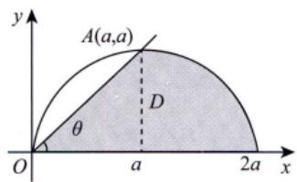  
图1-3

$$
P \{(x, y) \in D \} = \left(\frac {\pi a ^ {2}}{4} + \frac {a ^ {2}}{2}\right) / \frac {\pi a ^ {2}}{2} = \frac {1}{2} + \frac {1}{\pi}.
$$

1.7 $\frac{15}{32} -\frac{1}{2}\ln 2$ 解从[0,1]中随机地取两个数 $x$ 与 $y$ ，可以看成从图1-4所示正方形区域中任取一点，满足几何概型的两个特点.记 $\Omega = \{(x,y)|0\leqslant x\leqslant 1,$ $0\leqslant y\leqslant 1\} ,A = \left\{(x,y)\Bigg{|}x + y <   \frac{5}{4},xy > \frac{1}{4}\right\}$ ，对应图1-4中阴影部分.

$$
\begin{array}{l} P (A) = \frac {S _ {A}}{S _ {\Omega}} = \frac {\int_ {\frac {1}{4}} ^ {1} \left(\frac {5}{4} - x - \frac {1}{4 x}\right) \mathrm {d} x}{1} = \left(\frac {5}{4} x - \frac {1}{2} x ^ {2} - \frac {1}{4} \ln x\right) \Bigg | _ {\frac {1}{4}} ^ {1} \\ = \frac {1 5}{3 2} - \frac {1}{2} \ln 2. \\ \end{array}
$$

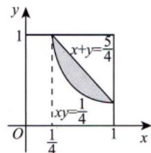  
图1-4

1.8 $1 - p$ 解因为

$$
P (A B) = P (\bar {A} \cap \bar {B}) = P (\overline {{A \cup B}}) = 1 - P (A \cup B) = 1 - P (A) - P (B) + P (A B),
$$

由此得 $1 - P(A) - P(B) = 0,$

所以 $P(B) = 1 - P(A) = 1 - p.$

1.9 0.6 解 因为 $0.3 = P(A - B) = P(A) - P(AB) = 0.7 - P(AB)$ ，由此得 $P(AB) = 0.7 - 0.3 = 0.4$ 所以

$$
P (\overline {{A B}}) = 1 - P (A B) = 0. 6.
$$

1.10 0.25 解由条件概率的定义知 $P(B \mid A \cup \overline{B}) = \frac{P(AB)}{P(A \cup \overline{B})}$ ，其中

$$
P (A \cup \bar {B}) = P (A) + P (\bar {B}) - P (A \bar {B}) = 0. 7 + 0. 6 - 0. 5 = 0. 8.
$$

又由 $P(\overline{A}\overline{B}) = P(A) - P(AB)$ ，可得

$$
P (A B) = P (A) - P (A \bar {B}) = 0. 7 - 0. 5 = 0. 2.
$$

代回原式，可得 $P(B\mid A\bigcup \overline{B}) = \frac{P(AB)}{P(A\bigcup\overline{B})} = \frac{0.2}{0.8} = 0.25.$

1.11 0.3；0.5；0.7解由加法公式，有 $P(A\bigcup B) = P(A) + P(B) - P(AB)$ ，于是：

若 $A, B$ 互不相容，则 $P(AB) = 0, P(B) = P(A \cup B) - P(A) = 0.3$

若 $A, B$ 相互独立，则 $P(AB) = P(A)P(B), P(A \cup B) = P(A) + P(B) - P(A)P(B)$ ，解得

$$
P (B) = \frac {P (A \bigcup B) - P (A)}{1 - P (A)} = 0. 5;
$$

若 $A$ 发生 $B$ 必发生，则 $P(B) = P(A \cup B) = 0.7$

1.12 $\frac{3}{5}$ 解 记事件 $A_{i}$ 为“第 $i$ 个人译出密码”， $i = 1, 2, 3$ ，事件 $B$ 为“密码被译出”。则

$$
\begin{array}{l} P (B) = P \left(A _ {1} \bigcup A _ {2} \bigcup A _ {3}\right) = 1 - P \left(\bar {A} _ {1} \bar {A} _ {2} \bar {A} _ {3}\right) \\ = 1 - \frac {4}{5} \times \frac {2}{3} \times \frac {3}{4} = \frac {3}{5}. \\ \end{array}
$$

注 互不相容可简化并事件的概率计算，相互独立可简化交事件的概率计算。这里为了利用相互独立性，把事件的并在对偶律下转化为事件的交，这一方法会经常用到。

1.13 0.682 解 记事件 $A$ 为“目标被击中”，事件 $B_{1}$ 为“甲射中目标”，事件 $B_{2}$ 为“乙射中目标”，因为 $A = B_{1} \cup B_{2}$ ，所以

$$
\begin{array}{l} P (A) = P \left(B _ {1} \cup B _ {2}\right) = P \left(B _ {1}\right) + P \left(B _ {2}\right) - P \left(B _ {1} B _ {2}\right) \\ = 0. 6 + 0. 7 - 0. 6 \times 0. 7 = 0. 8 8. \\ \end{array}
$$

考虑到 $B_{1} \subset A$ ，故有

$$
P \left(B _ {1} \mid A\right) = \frac {P \left(A B _ {1}\right)}{P (A)} = \frac {P \left(B _ {1}\right)}{P (A)} = \frac {0 . 6}{0 . 8 8} \approx 0. 6 8 2.
$$

1.14 解 ① $\{A, B, C$ 都不发生 $\} = \{A$ 不发生，且 $B$ 不发生，且 $C$ 不发生\}

$$
= \bar {A} \bar {B} \bar {C} = \bar {A} \bigcup B \bigcup C.
$$

② $\{A, B, C$ 不都发生 $\} = \{A, B, C$ 至少有一个不发生 $\}$

$= \{A,B,C$ 都发生}的逆事件

$$
= \bar {A} \cup \bar {B} \cup \bar {C} = \bar {A B C}.
$$

# 考研数学基础30讲·概率论与数理统计分册

③ $\{A, B, C$ 不多于一个发生 $\} = \{A, B, C$ 至多有一个发生 $\}$

$$
\begin{array}{l} = \{A, B, C \text {至 少 有 两 个 不 发 生} \} \\ = \bar {A} \bar {B} \cup \bar {A} \bar {C} \cup \bar {B} \bar {C} = A \bar {B} \bar {C} \cup \bar {A} B \bar {C} \cup \bar {A} \bar {B} C \cup \bar {A} \bar {B} \bar {C}. \\ \end{array}
$$

1.15 解 $D = A \cup B$ （即 $X, Y$ 中至少有一个 $\geqslant c$ ）

$E = A\cap B$ （即 $X,Y$ 都要 $\geqslant c$ ）

$F = \overline{D} = \overline{A}\cap \overline{B}$ （即 $X$ ，Y都要 $<  c$ ）

$G = \overline{E} = \overline{A}\bigcup \overline{B}$ （即 $X,Y$ 中至少有一个 $<  c$

1.16 解 (1) 不成立. $A - (B - C) = A - B\overline{C} = A\overline{B}\overline{C} = A(\overline{B}\bigcup C) = A\overline{B}\bigcup AC = (A - B)\bigcup AC \neq (A - B)\bigcup C;$ 也可由图1-5快速判断.

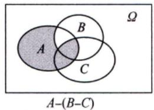  
(a)

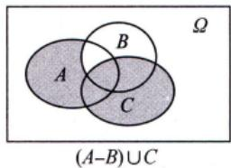  
(b)   
图1-5

(2) 成立. 因 $C \subset A$ , 有 $BC \subset AB = \emptyset$ , 故 $BC = \emptyset$ .  
(3) 不成立. 因 $(A \cup B) - B = (A \cup B)\overline{B} = A\overline{B} \cup B\overline{B} = A\overline{B} = A - B \neq A$   
(4) 不成立. 因 $(A - B) \cup B = A \overline{B} \cup B = (A \cup B)(\overline{B} \cup B) = A \cup B \neq A$

注 考生可再做练习，证明下列事件的运算公式：

(1) $A = AB \cup A\overline{B}$ ;   
(2) $A \cup B = A \cup \overline{A} B$ .

证 (1) $AB \cup A\overline{B} = A(B \cup \overline{B}) = A\Omega = A$   
(2) $A \cup \overline{A} B = (A \cup \overline{A})(A \cup B) = \Omega(A \cup B) = A \cup B$ .

1.17解记事件 $A$ 为“取出的是白球”，事件 $B$ 为“原来那个球是白球”.容易看出

$$
P (A \mid B) = 1, P (A \mid \bar {B}) = \frac {1}{2}.
$$

另外，由于不知道袋中原来那个球的颜色，故 $P(B) = P(\overline{B}) = \frac{1}{2}$ ，由贝叶斯公式得

$$
\begin{array}{l} P (B \mid A) = \frac {P (B) P (A \mid B)}{P (B) P (A \mid B) + P (\bar {B}) P (A \mid \bar {B})} \\ = \frac {\frac {1}{2} \times 1}{\frac {1}{2} \times 1 + \frac {1}{2} \times \frac {1}{2}} = \frac {2}{3}. \\ \end{array}
$$

1.18 解 记 $A = \{$ 第一次取出的产品是一等品 $\}$ , $B = \{$ 第二次取出的产品是一等品 $\}$ , 则

$$
p = P (A), q = P (B \mid A) = \frac {P (A B)}{P (A)}.
$$

要计算 $p, q$ ，仅需求出 $P(A), P(AB)$ 。而事件 $A, AB$ 都是试验的结果，它与其前提条件产品取自哪一箱有关。因此我们自然想到：写出前提条件，应用全概率公式计算 $P(A), P(AB)$ 。

记 $C_i = \{$ 产品取自第 $i$ 箱 $\} (i = 1,2)$ ，则

$$
C _ {1} C _ {2} = \varnothing , C _ {1} \cup C _ {2} = \Omega , A = A C _ {1} + A C _ {2}, A B = A B C _ {1} + A B C _ {2},
$$

故 $P(A) = P(AC_{1}) + P(AC_{2})$

$$
= P \left(C _ {1}\right) P \left(A \mid C _ {1}\right) + P \left(C _ {2}\right) P \left(A \mid C _ {2}\right)
$$

$$
= \frac {1}{2} \times \frac {1 0}{5 0} + \frac {1}{2} \times \frac {1 8}{3 0} = \frac {2}{5},
$$

$$
\begin{array}{l} P (A B) = P \left(A B C _ {1}\right) + P \left(A B C _ {2}\right) \\ = P \left(C _ {1}\right) P \left(A B \mid C _ {1}\right) + P \left(C _ {2}\right) P \left(A B \mid C _ {2}\right) \\ = \frac {1}{2} \times \frac {1 0}{5 0} \times \frac {9}{4 9} + \frac {1}{2} \times \frac {1 8}{3 0} \times \frac {1 7}{2 9} = \frac {2 7 6}{1 4 2 1}, \\ p = P (A) = \frac {2}{5}, q = \frac {P (A B)}{P (A)} = \frac {2 7 6}{1 4 2 1} \times \frac {5}{2} = \frac {6 9 0}{1 4 2 1}. \\ \end{array}
$$

1.19 解 题中有两个完备事件组：一是箱中次品的件数为 0, 1, 2；二是通过验收是在抽取正品和抽取次品这两种情况下发生。设 $A_{i} (i = 0, 1, 2)$ 为“箱中有 $i$ 个次品”， $B$ 为“通过验收”， $B_{1}$ 为“抽取正品”，于是有

$$
P \left(A _ {i}\right) = \frac {1}{3} (i = 0, 1, 2),
$$

$$
P \left(B _ {1} \mid A _ {i}\right) = \frac {1 0 - i}{1 0},
$$

从而由全概率公式得

$$
\begin{array}{l} P \left(B _ {1}\right) = \sum_ {i = 0} ^ {2} P \left(A _ {i}\right) P \left(B _ {1} \mid A _ {i}\right) \\ = \frac {1}{3} \sum_ {i = 0} ^ {2} \frac {1 0 - i}{1 0} = 0. 9, \\ \end{array}
$$

$$
P \left(\bar {B} _ {1}\right) = 0. 1,
$$

因此由全概率公式得

$$
\begin{array}{l} P (B) = P \left(B _ {1}\right) P \left(B \mid B _ {1}\right) + P \left(\bar {B} _ {1}\right) P \left(B \mid \bar {B} _ {1}\right) \\ = 0. 9 \times 0. 9 8 + 0. 1 \times 0. 0 5 = 0. 8 8 7. \\ \end{array}
$$

注 本题中，通过验收是在完备事件组 $B_{1}$ ， $\overline{B}_{1}$ 背景下发生的，抽取正品则是在完备事件组 $A_{0}$ ， $A_{1}$ ， $A_{2}$ 背景下实现的，因此，具备全概率概型的特征。
