# 第2讲

# 一维随机变量及其分布

# 基础知识结构

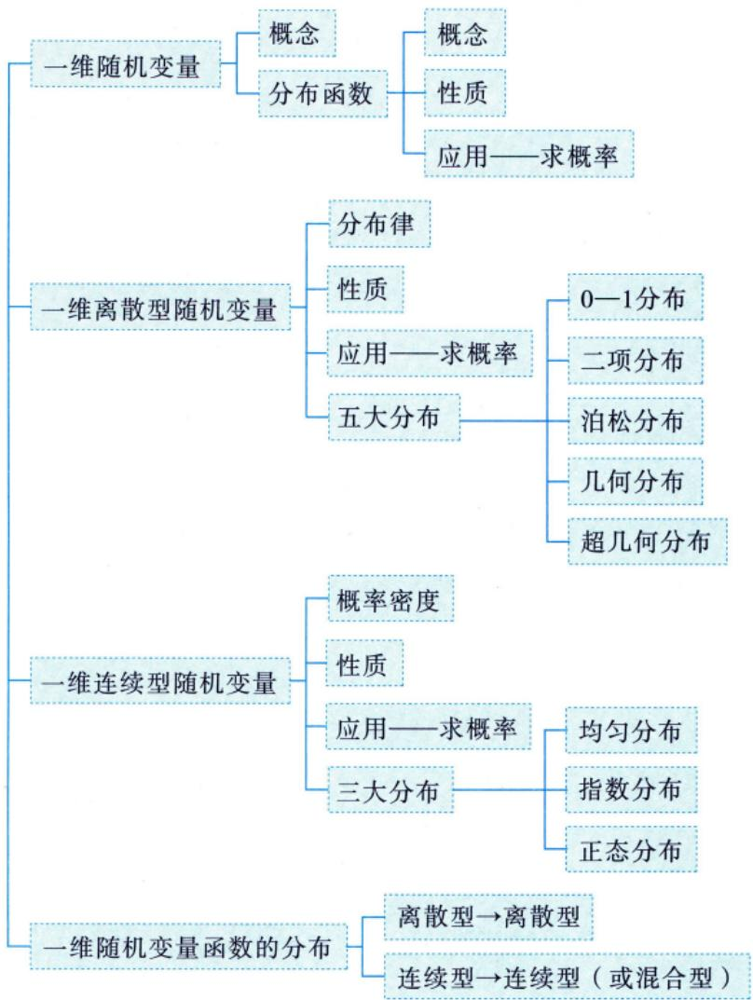

# 随机变量及其分布函数的概念、性质及应用

# 随机变量的概念

对 $y = y(x)$ 而言， $x$ 是确定性变量， $y$ 是确定性函数值.

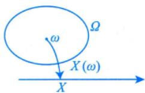

对 $X = X(\omega)$ 而言， $X$ 是不确定性变量．具有可能性，例也投篮是否投中

随机变量就是“其值会随机而定”的变量。设随机试验 $E$ 的样本空间为 $\Omega = \{\omega\}$ ，如果对每一个 $\omega \in \Omega$ ，都有唯一的实数 $X(\omega)$ 与之对应，并且对任意实数 $x$ ， $\{\omega | X(\omega) \leqslant x, \omega \in \Omega\}$ 是随机事件，则称定义在 $\Omega$ 上的实值单值函数 $X(\omega)$ 为随机变量，简记为随机变量 $X$ 。一般用大写字母 $X, Y, Z, \cdots$ 或希腊字母 $\xi, \eta, \zeta, \cdots$ 来表示随机变量。

注 (1)随机事件是从静态的观点来研究随机现象, 而随机变量则是一种动态的观点, 如高等数学中常量与变量的区别.

(2)随机变量的实质是“实值单值函数”，这个定义不同于高等数学中函数的定义（其“定义域”一般是实数集），它的“定义域”不一定是实数集，这点需要考生注意.

# 2 分布函数的概念及性质

(1) 概念.

当 $x$ 从 $-\infty$ 到 $+\infty$ 取遍所有实数时， $\{X \leq x\}$ 就相应从不可能事件 $\varnothing$ 取到必然事件 $\Omega$ ，即分布函数完整地描述了随机变量的概率规律

设 $X$ 是随机变量， $x$ 是任意实数，称函数 $F(x) = P\{X \leqslant x\} (x \in \mathbf{R})$ 为随机变量 $X$ 的分布函数，或称 $X$ 服从 $F(x)$ 分布，记为 $X \sim F(x)$ ： $\Omega : \{\omega_1, \omega_2, \dots, \omega_6\}$ 公布函数 $F(x)$ 图像如图所示

(2)性质. 一克要条件

① $F(x)$ 是 $x$ 的单调不减函数，即对任意实数 $x_{1} < x_{2}$ ，有 $F(x_{1}) \leqslant F(x_{2})$

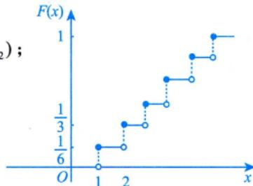

② $F\left( x\right)$ 是 $x$ 的右连续函数,即对任意 ${x}_{0} \in  \mathbf{R}$ ,有 $\mathop{\lim }\limits_{{x \rightarrow  {x}_{0}^{ + }}}F\left( x\right)  = F\left( {{x}_{0} + 0}\right)  = F\left( {x}_{0}\right)$ ;

③ $F(-\infty) = \lim_{x \to -\infty} F(x) = 0, F(+\infty) = \lim_{x \to +\infty} F(x) = 1.$ 分布函数是事件的概率，由此知 $0 \leqslant F(x) \leqslant 1$ 即 $F(x)$ 是有界函数

注 满足以上三条性质的函数 $F(x)$ 必是某个随机变量 $X$ 的分布函数，所以，这三条性质也是判断函数 $F(x)$ 是否为某一随机变量 $X$ 的分布函数的充要条件。

# 3 分布函数的应用——求概率

$$
P \{X \leqslant a \} = F (a);
$$

$$
P \{X <   a \} = F (a - 0);
$$

$$
P \{X = a \} = F (a) - F (a - 0);
$$

$$
P \{a <   X <   b \} = F (b - 0) - F (a);
$$

$$
P \{a \leqslant X <   b \} = F (b - 0) - F (a - 0);
$$

$$
P \{a <   X \leqslant b \} = F (b) - F (a);
$$

$$
P \{a \leqslant X \leqslant b \} = F (b) - F (a - 0).
$$

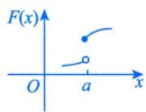

★★★ $F(x) = P\{X\leqslant x\}$ ， $x\in (-\infty , + \infty)$

针对离散型： $F(a) = P\{X \leqslant a\} = P\{x < a\} + P\{X = a\}$

$$
\begin{array}{c c} \downarrow & \downarrow \\ F (a - 0) & F (a) - F (a - 0) \end{array}
$$

例2.1 设随机变量 $X$ 的分布函数为

$$
X \sim F (x) = \left\{ \begin{array}{l l} a + b \mathrm {e} ^ {- x}, & x > 0, \\ 0, & x \leqslant 0. \end{array} \right.
$$

求常数 $a, b$ 及概率 $P\{|X| < 2\}$

分析 $F(x)$ 中含有2个未知参数，依据分布函数的性质建立两个独立方程解之.

解 由分布函数的性质，有

$$
F (+ \infty) = \lim  _ {x \rightarrow + \infty} F (x) = \lim  _ {x \rightarrow + \infty} (a + b e ^ {- x}) = 1,
$$

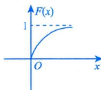

满足：① 单调不减；

② 右连续；

③ 极限性质

得 $a = 1$ .又 $F(x)$ 在 $x = 0$ 处右连续，有

$$
\lim  _ {x \rightarrow 0 ^ {+}} F (x) = \lim  _ {x \rightarrow 0 ^ {+}} (a + b e ^ {- x}) = a + b = 0,
$$

得 $b = -1$ .所以 $F(x) = \left\{ \begin{array}{ll}1 - \mathrm{e}^{-x}, & x > 0,\\ 0, & x\leqslant 0, \end{array} \right.$

从而有

$$
P \{\left| X \right| <   2 \} = P \{- 2 <   X <   2 \} = F (2 - 0) - F (- 2) = 1 - e ^ {- 2} - 0 = 1 - e ^ {- 2}.
$$

# 常见的两类随机变量——离散型随机变量和连续型随机变量

# 离散型随机变量及其概率分布

如果随机变量 $X$ 只可能取有限个或可列无限个值 $x_{1}, x_{2}, \cdots$ ，则称 $X$ 为离散型随机变量，称

$$
P \left\{X = x _ {i} \right\} = p _ {i}, i = 1, 2, \dots
$$

为 $X$ 的分布列、分布律或概率分布，记为 $X\sim p_i$ ，概率分布常常用表格形式或矩阵形式表示，即

<table><tr><td>X</td><td>x1</td><td>x2</td><td>...</td></tr><tr><td>P</td><td>p1</td><td>p2</td><td>...</td></tr></table>

或 $X\sim \left( \begin{array}{lll}x_{1} & x_{2} & \dots \\ p_{1} & p_{2} & \dots \end{array} \right).$

如掷骰子， $X$ 的概率分布为 $X\sim \left( \begin{array}{ccccccc}1 & 2 & 3 & 4 & 5 & 6\\ \frac{1}{6} & \frac{1}{6} & \frac{1}{6} & \frac{1}{6} & \frac{1}{6} & \frac{1}{6} \end{array} \right).$

数列 $\{p_i\} (i = 1,2,\dots)$ 是离散型随机变量的概率分布的充要条件： $p_i\geqslant 0(i = 1,2,\dots)$ ，且 $\sum_{i}p_{i} = 1$ 设离散型随机变量 $X$ 的概率分布为 $P\{X = x_i\} = p_i,i = 1,2,\dots$ ，则 $X$ 的分布函数 归一性

某点概率 $F(x) = P\{X\leqslant x\} = \sum_{x_i\leqslant x}P\{X = x_i\},$

$$
P \{X = x _ {i} \} = P \{X \leqslant x _ {i} \} - P \{X <   x _ {i} \} = F (x _ {i}) - F (x _ {i} - 0),
$$

并且对实数轴上的任一集合 $B$ ，有

区间概率 $P\{X \in B\} = \sum_{x_i \in B} P\{X = x_i\},$

特别地， $P\{a <   X\leqslant b\} = P\{X\leqslant b\} -P\{X\leqslant a\} = F(b) - F(a).$

# 2 连续型随机变量及其概率密度

如果随机变量 $X$ 的分布函数可以表示为

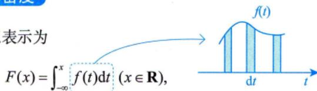

其中 $f(x)$ 是非负可积函数，则称 $X$ 为连续型随机变量，称 $f(x)$ 为 $X$ 的概率密度函数，简称概率密度，记为 $X \sim f(x)$ ：

离散型随机变量 $X\sim p_i$ ， $F(x) = P\{X\leqslant x\} = \sum_{x_i\leqslant x}p_i,$

对比

连续型随机变量 $X\sim f(x),F(x) = P\{X\leqslant x\} = \int_{-\infty}^{x}f(t)\mathrm{d}t.$

$f\left( x\right)$ 为某一随机变量 $X$ 的概率密度的充分必要条件： $f\left( x\right)  \geq  0$ ,且 ${\int }_{-\infty }^{+\infty }f\left( x\right) \mathrm{d}x = 1$ (由此可知,在保

证非负的条件下，改变 $f(x)$ 有限个点的值， $f(x)$ 仍然是概率密度）

一个点的值改变，不会改变面积

一点概率

设 $X$ 为连续型随机变量， $X \sim f(x)$ ，则对任意实数 $c$ ，有 $P\{X = c\} = 0$ ；对实数轴上任一集合 $B$ ，有

区间概率

$$
P \{X \in B \} = \int_ {B} f (x) d x,
$$

特别地，

$$
P \{a <   X <   b \} = P \{a \leqslant X <   b \} = P \{a <   X \leqslant b \} = P \{a \leqslant X \leqslant b \} = \int_ {a} ^ {b} f (x) d x = F (b) - F (a).
$$

注 (1) “概率密度”这个名词的由来可解释如下：取定一个点 $x$ ，则按分布函数的定义，事件 $\{x < X \leqslant x + h\} (h > 0$ ，为常数）的概率应为 $F(x + h) - F(x)$ . 所以，比值 $[F(x + h) - F(x)] / h$ 可以解释为在点 $x$ 附近长为 $h$ 的区间 $(x, x + h]$ 内，单位长所占的概率. 令 $h \to 0$ ，则这个比值的极限，即 $F'(x) = f(x)$ ，也就是在点 $x$ 处（无穷小区间内）单位长的概率. 或者说，它反映了概率在点 $x$ 处的“密集程度”. 设想一条极细的无穷长的金属杆，总质量为 1，概率密度相当于杆上各点的质量密度.

(2) $P\{a < X < b\} = \int_{a}^{b} f(x) \mathrm{d}x$ 意味着 $X$ 落入某一区间的概率等于该区间上概率密度曲线之下的曲边梯形的面积. 应用概率的这种几何意义，常常有助于问题的分析与求解.  
(3) 设 $X \sim f(x)$ ，则 $X$ 的分布函数 $F(x)$ 是 $x$ 的连续函数，在 $f(x)$ 的连续点 $x_0$ 处有 $F'(x_0) = f(x_0)$ 。如果 $F(x)$ 是连续函数，除有限个点外， $F'(x)$ 存在且连续，则 $X$ 为连续型随机变量，且 $f(x) = F'(x)$ （在 $F'(x)$ 不存在的地方可以令 $f(x) = 0$ 或取其他值）。

例2.2 设 $F_{1}(x), F_{2}(x)$ 是随机变量的分布函数， $f_{1}(x), f_{2}(x)$ 是相应的概率密度，则（ ）

(A) $F_{1}(x) + F_{2}(x)$ 是分布函数  
(B) $F_{1}(x)\cdot F_{2}(x)$ 是分布函数  
(C) $f_{1}(x) + f_{2}(x)$ 是概率密度  
(D) $f_{1}(x)\cdot f_{2}(x)$ 是概率密度

分析

$F(x)$ 是分布函数 $\Leftrightarrow$ $\begin{array}{l}\left\{ \begin{array}{ll}1F(x) \text{单调不减},\\ 2F(x_0 + 0) = F(x_0), \end{array} \right.\\ \left\{ \begin{array}{ll}F(+\infty) = 1,\\ 3F(-\infty) = 0. \end{array} \right. \end{array}$

$f(x)$ 是概率密度 $\Leftrightarrow \left\{ \begin{array}{l}1f(x)\geqslant 0,\\ 2\int_{-\infty}^{+\infty}f(x)\mathrm{d}x = 1. \end{array} \right.$

# 解 应选(B).

根据连续型随机变量分布函数和概率密度的性质，有

$$
F _ {1} (+ \infty) + F _ {2} (+ \infty) = 2, \int_ {- \infty} ^ {+ \infty} [ f _ {1} (x) + f _ {2} (x) ] d x = 2,
$$

$$
\int_ {- \infty} ^ {+ \infty} f _ {1} (x) f _ {2} (x) d x \neq \int_ {- \infty} ^ {+ \infty} f _ {1} (x) d x \int_ {- \infty} ^ {+ \infty} f _ {2} (x) d x = 1,
$$

应排除选项(A)，(C)，(D)，故选择(B).事实上，由于 $F_{1}(x)\cdot F_{2}(x)$ 是单调不减的右连续函数，且

$$
F _ {1} (- \infty) \cdot F _ {2} (- \infty) = 0, F _ {1} (+ \infty) \cdot F _ {2} (+ \infty) = 1,
$$

可直接判断选项(B)正确.

注 判断 $\sqrt{f_1(x)f_2(x)}$ 是不是概率密度. 易知 $\frac{f_1(x) + f_2(x)}{2} \geqslant \sqrt{f_1(x)f_2(x)}$ , $f_1(x) \neq f_2(x)$ , 故

$$
1 > \int_ {- \infty} ^ {+ \infty} \sqrt {f _ {1} (x) f _ {2} (x)} d x,
$$

不满足归一性，所以 $\sqrt{f_1(x)f_2(x)}$ 不是概率密度.

# 例2.3 已知随机变量 $X$ 的概率分布为

<table><tr><td>X</td><td>1</td><td>2</td><td>3</td></tr><tr><td>P{X=k}</td><td>θ²</td><td>2θ(1-θ)</td><td>(1-θ)²</td></tr></table>

且 $P\{X\geqslant 2\} = \frac{3}{4}$ ，求未知参数 $\theta$ 及 $X$ 的分布函数 $F(x)$ ：

分析此题若利用归一性， $\theta^2 + 2\theta (1 - \theta) + (1 - \theta)^2 = 1$ ，发现解不出 $\theta$ ：

解 由 $P\{X \geqslant 2\} = P\{X = 2\} + P\{X = 3\} = 2\theta (1 - \theta) + (1 - \theta)^{2} = 1 - \theta^{2} = \frac{3}{4}$ ，解得 $\theta = \pm \frac{1}{2}$ .

又 $P\{X = 2\} = 2\theta (1 - \theta)\geqslant 0$ ，故取 $\theta = \frac{1}{2}$ ，从而得 $X$ 的概率分布为 利用概率不能为负值

<table><tr><td>X</td><td>1</td><td>2</td><td>3</td></tr><tr><td>P{X=k}</td><td>1/4</td><td>1/2</td><td>1/4</td></tr></table>

$X$ 的分布函数

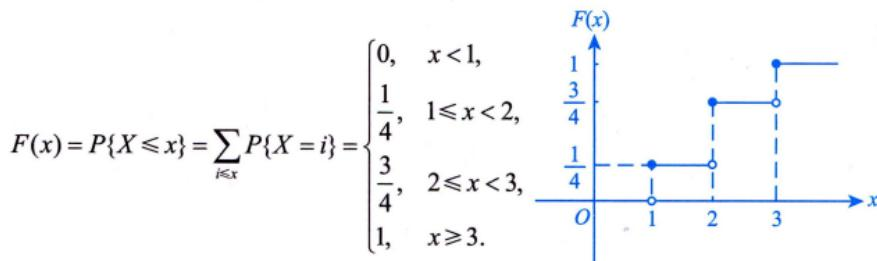

例2.4 已知 $X$ 的分布函数为 $F(x)$ ，概率密度为 $f(x)$ .当 $x\leqslant 0$ 时， $f(x)$ 连续，且 $f(x) = F(x)$ 若 $F(0) = 1$ ，则 $f(x) = \_ \_$

解 应填 $\left\{ \begin{array}{ll}\mathrm{e}^x, & x\leqslant 0,\\ 0, & x > 0. \end{array} \right.$

由于 $F(x)$ 是单调不减的函数，且 $F(0) = 1$ ，故对任意的 $x > 0$ ，均有 $F(x) = 1$ .又当 $x\leqslant 0$ 时， $f(x)$ 连续，故 $f(x) = F^{\prime}(x)$ .已知 $f(x) = F(x)$ ，由微分方程 $F^{\prime}(x) = F(x)$ 及 $F(0) = 1$ ，解得 $F(x) = \mathrm{e}^{x}(x\leqslant 0)$ ，从而得

$$
F (x) = \left\{ \begin{array}{l l} \mathrm {e} ^ {x}, & x <   0, \\ 1, & x \geqslant 0, \end{array} \right.
$$

$$
f (x) = \left\{ \begin{array}{l l} \mathrm {e} ^ {x}, & x \leqslant 0, \\ 0, & x > 0. \end{array} \right.
$$

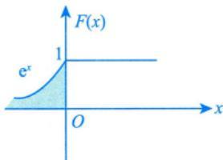

注 当分布函数是不连续的分段函数时，为保证其右连续性，自变量 $x$ 的分段小区间除第一个区间之外，其余都应是左闭右开的，即等号跟着大于号。连续情况下等号跟谁都可以

例2.5 已知随机变量 $X$ 的概率密度为

正概率密度区间

$$
f (x) = \left\{ \begin{array}{l l} 2 \left(1 - \frac {1}{x ^ {2}}\right), & 1 \leqslant x \leqslant 2, \\ 0, & \text {其 他}. \end{array} \right.
$$

求 $X$ 的分布函数 $F(x)$ ：

解当 $x <   1$ 时，

$$
F (x) = \int_ {- \infty} ^ {x} f (t) \mathrm {d} t = \int_ {- \infty} ^ {x} 0 \mathrm {d} t = 0;
$$

当 $1 \leqslant x < 2$ 时，

$$
\begin{array}{l} F (x) = \int_ {- \infty} ^ {x} f (t) d t = \int_ {1} ^ {x} 2 \left(1 - \frac {1}{t ^ {2}}\right) d t = 2 \left(t + \frac {1}{t}\right) \Bigg | _ {1} ^ {x} \\ = 2 \left(x + \frac {1}{x}\right) - 4 = 2 \left(x + \frac {1}{x} - 2\right); \\ \end{array}
$$

当 $x \geqslant 2$ 时，

$$
F (x) = \int_ {- \infty} ^ {x} f (t) d t = \int_ {1} ^ {2} 2 \left(1 - \frac {1}{t ^ {2}}\right) d t = 2 \left(t + \frac {1}{t}\right) | _ {1} ^ {2} = 2 \times \frac {1}{2} = 1.
$$

故

$$
F (x) = \left\{ \begin{array}{l l} 0, & x <   1, \\ 2 \left(x + \frac {1}{x} - 2\right), & 1 \leqslant x <   2, \\ 1, & x \geqslant 2. \end{array} \right.
$$

# 常见的随机变量分布类型

# 1 离散型

(1)0—1分布 $B(1,p)(\mathrm{Ber} - E_1)$

只有0与1两个点，0一1分布是二项分布的一种特殊情况

1.伯努利计数变量——发生计1，不发生计0

如果 $X$ 的概率分布为 $X \sim \left( \begin{array}{cc} 1 & 0 \\ p & 1 - p \end{array} \right)$ ，即 $P\{X = 1\} = p, P\{X = 0\} = 1 - p$ ，则称 $X$ 服从参数为 $p$ 的0-1分布，记为 $X \sim B(1, p) (0 < p < 1)$ 。

(2)二项分布 $B\left( {n,p}\right) \left( {\operatorname{Ber} - {E}_{n}}\right)$ . $\rightarrow  n$ 重伯努利试验中事件 $A$ 发生的次数,其中 $p = P\left( A\right)$

如果 $X$ 的概率分布为 $P\{X = k\} = \mathrm{C}_n^k p^k (1 - p)^{n - k}(k = 0,1,\dots ,n;0 <   p <   1)$ ，则称 $X$ 服从参数为 $(n,p)$ 的二项分布，记为 $X\sim B(n,p)$ ：

举例：投篮投中打√，投不中打×， $X = k$ 即表示有 $k$ 个√， $n - k$ 个×.

则 $X\sim B(n,p)$ ， $P = \{X = k\} = C_n^k p^k (1 - p)^{n - k},k = 0,1,\dots ,n.$

若 $n = 1$ ，则 $X_{i}\sim B(1,p),i = 1,2,\dots ,n,X = X_{1} + X_{2} + \dots +X_{n}$ 随机变量的分解

稀有事件发生概率

(3) 泊松分布 $P(\lambda)$ .

如果 $X$ 的概率分布为

单位时间源源不断的质点来流的个数，也常用于描述稀有事件发生的次数

$$
P \{X = k \} = \frac {\lambda^ {k}}{k !} e ^ {- \lambda} (k = 0, 1, \dots ; \quad \lambda > 0),
$$

$\lambda$ 表示来流强度. $EX = \lambda$ ，期望代表随机变量取值的中心水平，可以理解为强度

则称 $X$ 服从参数为 $\lambda$ 的泊松分布，记为 $X\sim P(\lambda)$

定义 $k$ 为非负整数

注 泊松定理 若 $X \sim B(n, p)$ ，当 $n$ 很大， $p$ 很小， $\lambda = np$ 适中时，二项分布可用泊松分布近似表示，即

例如, ${C}_{100}^{1}{\left( \frac{1}{500}\right) }^{1}{\left( 1 - \frac{1}{500}\right) }^{99} \approx  \frac{{\left( \frac{1}{5}\right) }^{1}}{1!}{\mathrm{e}}^{-\frac{1}{5}} = \frac{1}{5}{\mathrm{e}}^{-\frac{1}{5}}$

$$
C _ {n} ^ {k} p ^ {k} (1 - p) ^ {n - k} \approx \frac {\lambda^ {k}}{k !} e ^ {- \lambda}.
$$

一般地，当 $n \geqslant 20$ ， $p \leqslant 0.05$ 时，用泊松近似公式逼近二项分布效果比较好，特别当 $n \geqslant 100$ ， $np \leqslant 10$ 时，逼近效果更佳。

此处《全国硕士研究生招生考试数学考试大纲》的要求是“会用泊松分布近似表示二项分布”，考生应予以重视.

参数只有 $p$ ，首中即停止

(4) 几何分布 $G(p)(\mathrm{Ber} - E_{\infty})$

如果 $X$ 的概率分布为

$n$ 重伯努利试验中，事件 $A$ 首次出现即停止时的试验次数，其中 $p = P(A)$

$$
P \{X = \widehat {k} \} = (1 - p) ^ {k - 1} p (k = 1, 2, \dots ; 0 <   p <   1),
$$

$k - 1$

则称 $X$ 服从参数为 $p$ 的几何分布,记为 $X \sim  G\left( p\right)$ . 离散型等待分布：守株待兔

(5) 超几何分布 $H(n, N, M)$ .

·见注

如果 $X$ 的概率分布为 $P\{X = k\} = \frac{\mathrm{C}_M^k\mathrm{C}_{N - M}^{n - k}}{\mathrm{C}_N^n} (\max \{0,n - N + M\} \leqslant k\leqslant \min \{M,n\} ;M,N,n$ 为正整数且 $M\leqslant N$ ， $n\leqslant N$ ， $k$ 为整数），则称 $X$ 服从参数为 $(n,N,M)$ 的超几何分布，记为 $X\sim H(n,N,M)$ ：

古典概型

注设由 $N$ 个产品组成的总体，其中含有 $M$ 个不合格品.若从中随机不放回地抽取 $_n$ 个，则其中含有不合格品的个数 $X$ 是一个离散型随机变量.假如 $n\leqslant M$ ，则 $X$ 可能取0,1，…， $n$ ；若 $n > M$ 则 $X$ 可能取0,1，…， $M$ .由古典概型概率公式容易算得

$$
P \{X = k \} = \frac {\mathrm {C} _ {M} ^ {k} \mathrm {C} _ {N - M} ^ {n - k}}{\mathrm {C} _ {N} ^ {n}},
$$

其中 $\max \{0, n - N + M\} \leqslant k \leqslant \min \{M, n\}$ ; $M, N, n$ 为正整数且 $M \leqslant N, n \leqslant N, k$ 为整数.

这个分布就是超几何分布，它含有三个参数 $N$ ， $M$ 和 $n$ ，记为 $H(n,N,M)$ ：

当 $n \ll N$ （即抽取个数 $n$ 远远小于产品总数 $N$ ）时，每次抽取后，总体中的不合格品率 $p = \frac{M}{N}$ 改变甚微，这时不放回抽样可近似看作放回抽样，超几何分布可用二项分布近似.

# 2 连续型

(1) 均匀分布 $U(a, b)$ .

如果随机变量 $X$ 的概率密度和分布函数（见图2-1，图2-2)分别为

$$
f (x) = \left\{ \begin{array}{l l} \frac {1}{b - a}, & a <   x <   b, \\ 0, & \text {其 他 ,} \end{array} \right. F (x) = \left\{ \begin{array}{l l} 0, & x <   a, \\ \frac {x - a}{b - a}, & a \leqslant x <   b, \\ 1, & x \geqslant b, \end{array} \right. \begin{array}{l} F (x) = \int_ {- \infty} ^ {x} f (t)   \mathrm {d} t \\ \text {面 积 的 思 想} \end{array}
$$

则称 $X$ 在区间 $(a,b)$ 上服从均匀分布，记为 $X\sim U(a,b)$ ：

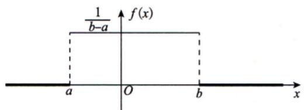  
图2-1

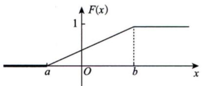  
图2-2

注 区间 $(a, b)$ 可以是闭区间 $[a, b]$ ，记为 $X \sim U[a, b]$ ；几何概型是均匀分布的实际背景，几何概型可以用均匀分布函数计算概率。对于连续型随机变量，取一点的概率是测不到的

(2) 指数分布 $E\left( \lambda \right)$ . 连续型等待分布

如果 $X$ 的概率密度和分布函数（见图2-3，图2-4)分别为

$$
f (x) = \left\{ \begin{array}{l l} \lambda \mathrm {e} ^ {- \lambda x}, & x > 0, \\ 0, & \text {其 他 ,} \end{array} \right. F (x) = \left\{ \begin{array}{l l} 1 - \mathrm {e} ^ {- \lambda x}, & x \geqslant 0, \\ 0, & x <   0 \end{array} \right. (\lambda > 0),
$$

$\lambda$ 叫失效频率，后

面会知道 ${EX} = \frac{1}{\lambda }$

则称 $X$ 服从参数为 $\lambda$ 的指数分布，记为 $X\sim E(\lambda)$ ：

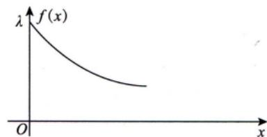  
图2-4

图2-3

记 $\{N_{t}, t \geqslant 0\}$ ， $N_{t}$ ——质点来流的个数，泊松分布中 $\lambda$ 表示单位时间质点来流的强度，所以 $t$ 时间内质点来流的强度为 $\lambda t$ 。

令 $T$ 表示等待时间(第一个质点出现)，则

$$
T \sim F (t) = P \{T \leqslant t \} = 1 - P \{T > t \},
$$

由 $\{N_t, t \geqslant 0\}$ 知 $[0, t]$ 时，

$$
P \{T > t \} = P \{N _ {t} = 0 \} = e ^ {- \lambda t},
$$

$$
\begin{array}{l} \text {故} T \sim F (t) = P \{T <   t \} = 1 - P \{T > t \} \\ = \left\{ \begin{array}{l l} 1 - \mathrm {e} ^ {- \lambda t}, & t > 0, \\ 0, & t <   0 \end{array} \right. \\ \end{array}
$$

注 当 $t > 0, s > 0$ 时， $P\{X \geqslant t + s \mid X \geqslant t\} = P\{X \geqslant s\}$ 称为指数分布的无记忆性 (Memoryless Property).

(3) 正态分布 $N(\mu, \sigma^2)$ .

如果 $X$ 的概率密度为

这是由于 $\lambda$ 是常数，失放频率不变，也即研究对象（如元件、产品等）被视为理想状态，无任何损耗。

$$
f (x) = \frac {1}{\sqrt {2 \pi} \sigma} e ^ {- \frac {1}{2} \left(\frac {x - \mu}{\sigma}\right) ^ {2}} (- \infty <   x <   + \infty),
$$

其中 $-\infty < \mu < +\infty, \sigma > 0$ ，则称 $X$ 服从参数为 $(\mu, \sigma^2)$ 的正态分布或称 $X$ 为正态变量，记为 $X \sim N(\mu, \sigma^2)$ 。此时 $f(x)$ 的图形关于直线 $x = \mu$ 对称，即 $f(\mu - x) = f(\mu + x)$ ，并在 $x = \mu$ 处有唯一最大

值 $f(\mu) = \frac{1}{\sqrt{2\pi}\sigma}$ .如图2-5所示.

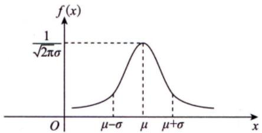  
图2-5

称 $\mu = 0, \sigma = 1$ 时的正态分布 $N(0,1)$ 为标准正态分布，通常记标准正态分布的概率密度为 $\varphi(x) = \frac{1}{\sqrt{2\pi}} \mathrm{e}^{-\frac{1}{2} x^2}$ ，分布函数为 $\Phi(x) = \frac{1}{\sqrt{2\pi}} \int_{-\infty}^{x} \mathrm{e}^{-\frac{t^2}{2}} \mathrm{d}t$ 。显然 $\varphi(x)$ 为偶函数，则

$$
\Phi (0) = \frac {1}{2}, \Phi (- x) = 1 - \Phi (x).
$$

如图2-6所示.

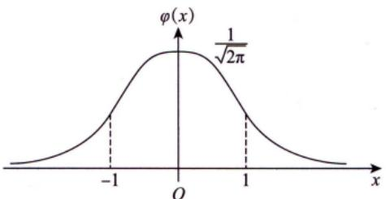  
图2-6

若 $X\sim N(0,1)$ ， $P\{X > \mu_{\alpha}\} = \alpha$ ，则称 $\mu_{\alpha}$ 为标准正态分布的上侧 $\alpha$ 分位数（上 $\alpha$ 分位点）.

如果 $X \sim N(\mu, \sigma^2)$ ，则

为了查表方便，所以将正态分布标准化

$$
\begin{array}{l} F (x) = P \{X \leqslant x \} = \Phi \left(\frac {x - \mu}{\sigma}\right), \\ F (\mu - x) + F (\mu + x) = 1, \\ \begin{array}{l} P \{a <   X <   b \} = \Phi \left(\frac {b - \mu}{\sigma}\right) - \Phi \left(\frac {a - \mu}{\sigma}\right), \\ a X + b \sim N (a \mu + b, a ^ {2} \sigma^ {2}) (a \neq 0). \end{array} \\ \end{array}
$$

例2.6 通过某交叉路口的汽车流可以看作服从泊松分布.已知在1分钟内有汽车通过的概率为0.7，则1分钟内最多有1辆汽车通过的概率为（）

(A) $0.7(1 - \ln 0.7)$

(B) $0.3(1 - \ln 0.7)$

(C) $0.3(1 - \ln 0.3)$

(D) $0.7(1 - \ln 0.3)$

解 应选(C).

1分钟内通过路口的汽车数量 $X$ 服从参数为 $\lambda$ 的泊松分布.由已知，

$$
P \{X \geqslant 1 \} = 1 - \frac {\lambda^ {0}}{0 !} \mathrm {e} ^ {- \lambda} = 0. 7, \quad \text {首 先 求 出 参 数} \lambda , \text {再 根 据}
$$

得 $\lambda = -\ln 0.3$ ，于是 $P\{X\leqslant 1\} = \frac{\lambda^0}{0!}\mathrm{e}^{-\lambda} + \frac{\lambda^1}{1!}\mathrm{e}^{-\lambda} = \mathrm{e}^{\ln 0.3}(1 - \ln 0.3) = 0.3(1 - \ln 0.3)$ ，故选择(C).

首中停止

首中停止例2.7 设随机变量 $X$ 的概率密度为 $f(x) = \left\{ \begin{array}{ll} 2^{-x}\ln 2, & x > 0, \\ 0, & \text{其他}. \end{array} \right.$ 对 $X$ 进行独立重复的观测，直到第2个大于3的观测值出现时停止，记Y为观测次数.求Y的概率分布.

分析 $2^{-x}\ln 2 = \mathrm{e}^{-x\ln 2}\cdot \ln 2$ .先求大于3的概率.

解 记 $p$ 为“观测值大于3”的概率，则 $p = P\{X > 3\} = \int_{3}^{+\infty}2^{-x}\ln 2\mathrm{d}x = \frac{1}{8}$

依题意， $Y$ 为离散型随机变量，而且取值为2,3，…，则 $Y$ 的概率分布为

$$
P \{Y = k _ {j} ^ {\prime} = C _ {k - 1} ^ {1} p (1 - p) ^ {k - 2} \cdot p = C _ {k - 1} ^ {1} p ^ {2} (1 - p) ^ {k - 2} = (k - 1) \left(\frac {1}{8}\right) ^ {2} \left(\frac {7}{8}\right) ^ {k - 2}, k = 2, 3, \dots .
$$

注 $k$ 只能从2开始. $\times \dots \times \sqrt{\dots \times \sqrt{}}$ ，前 $k - 1$ 次包含一个√，第 $k$ 次出现第2个√.

k-1

例2.8 已知 $X \sim U(a, b) (a > 0)$ ，且 $P\{0 < X < 3\} = \frac{1}{4}$ ， $P\{X > 4\} = \frac{1}{2}$ ，求 $X$ 的概率密度及 $P\{1 < X < 5\}$ .

解如图2-7所示， $X\sim U(a,b)$

由 $P\{X > 4\} = \frac{1}{2}$ ，且 $P\left\{X > \frac{a + b}{2}\right\} = \frac{1}{2}$ 得 $\frac{a + b}{2} = 4$ 即 $a + b = 8$

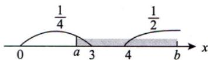  
图2-7

由于 $P\{3 <   X <   4\} = 1 - P\{X\geqslant 4\} -P\{X\leqslant 3\} = 1 - P\{X > 4\} -P\{0 <   X <   3\} = 1 - \frac{1}{2} -\frac{1}{4} = \frac{1}{4}$ ，又 $P\{3 <   X <   4\}$

$4\} = \frac{4 - 3}{b - a}$ 故 $\frac{4 - 3}{b - a} = \frac{1}{4}$ 得 $b - a = 4$

$a, b$ 值的另一种解法. 因为只在 $(a, b)$ 内取值且 $P\{0 < X < 3\}$ 不为 0，所以 3 只能大于 $a$ . 同理，4 只能小于 $b$ ，则有

联立得 $\left\{ \begin{array}{l}a + b = 8,\\ b - a = 4, \end{array} \right.$ 解得 $\left\{ \begin{array}{ll}a = 2,\\ b = 6. \end{array} \right.$

$\left\{ \begin{array}{l} P\{0 < X < 3\} = P\{a < X < 3\} = \frac{1}{4}, \\ p\{X > 4\} = P\{4 < X < b\} = \frac{1}{2}, \end{array} \right.$ 即 $\left\{ \begin{array}{l} \frac{3 - a}{b - a} = \frac{1}{4}, \\ \frac{b - 4}{b - a} = \frac{1}{2}, \end{array} \right.$ ①

① 与 ② 联立，解得 $a = 2, b = 6$

所以 $X$ 的概率密度为

$f(x) = \left\{ \begin{array}{ll} \frac{1}{4}, & 2 < x < 6, \\ 0, & \text{其他}. \end{array} \right.$

于是 $P\{1 < X < 5\} = P\{2 < X < 5\} = \frac{5 - 2}{6 - 2} = \frac{3}{4}.$

例2.9 某元件的工作寿命 $X$ （小时）服从参数为 $\lambda (\lambda >0)$ 的指数分布，

(1) 求该元件正常工作 $t$ 小时的概率；

正常工作 $\mathrm{t}$ 小时,即工作寿命肯定大于 $\mathrm{t}$ 小时.

(2)已知该元件已正常工作10小时，求在此基础上再工作10小时的概率 $(\lambda = 0.01)$ ：

解 由题意 $X\sim F(x) = \left\{ \begin{array}{ll}1 - \mathrm{e}^{-\lambda x} & x\geqslant 0,\\ 0, & \text{其他}. \end{array} \right.$

(1) $P\{X > t\} = 1 - P\{X \leqslant t\} = 1 - F(t) = 1 - (1 - \mathrm{e}^{-\lambda t}) = \mathrm{e}^{-\lambda t}$ .

(2) $P\{X > 20 \mid X > 10\} = \frac{P\{X > 20, X > 10\}}{P\{X > 10\}}$

$$
= \frac {P \{X > 2 0 \}}{P \{X > 1 0 \}} = \frac {\mathrm {e} ^ {- 0 . 0 1 \times 2 0}}{\mathrm {e} ^ {- 0 . 0 1 \times 1 0}} = \underbrace {\mathrm {e} ^ {- 0 . 1}}. = P \{X > 1 0 \}
$$

注本题第(2)问的结果， $P\{X > 20|X > 10\} = P\{X > 10\}$ ，即元件正常工作10小时的概率与在这之前的工作状态无关，说明指数分布具有无记忆性.

例2.10 设 $X \sim N(2, \sigma^2)$ ，且 $P\{2 < X < 4\} = 0.3$ ，则 $P\{X < 0\} =$

解 应填0.2.

把正态分布进行标准化处理：

已知 $X \sim N(2, \sigma^2)$ ，故

$$
P \{2 <   x <   4 \} = P \left\{\frac {2 - 2}{\sigma} <   \frac {x - 2}{\sigma} <   \frac {4 - 2}{\sigma} \right\}
$$

$$
P \{2 <   X <   4 \} = \Phi \left(\frac {4 - 2}{\sigma}\right) - \Phi \left(\frac {2 - 2}{\sigma}\right) = \Phi \left(\frac {2}{\sigma}\right) - 0. 5 = 0. 3, \Phi \left(\frac {2}{\sigma}\right) = 0. 8,
$$

所以 $P\{X < 0\} = \Phi \left(\frac{0 - 2}{\sigma}\right) = 1 - \Phi \left(\frac{2}{\sigma}\right) = 0.2$

注 结合图2-8，本题应用面积求解更为直观、简便.

已知 $P\{2 < X < 4\} = 0.3$ ，故

也可利用对称性解题

$$
P \{X <   0 \} = 0. 5 - 0. 3 = 0. 2.
$$

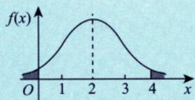  
图2-8

例2.11 设随机变量 $X$ 服从正态分布 $N(\mu, \sigma^2)$ ，则随着 $\sigma$ 的增大， $P\{|X - \mu| < 1\}$ （ ）

(A) 单调增加

(B) 单调减少

(C)保持不变

(D) 先增后减

解 应选(B). 只要不是标准正态分布, 就往标

准正态上想 $\frac{x - \mu}{\sigma} \sim N(0,1)$

讨论 $P\{|X - \mu | < 1\}$ 的单调性应在将其标准化之后进行.由 $P\{|X - \mu | < 1\} = P\left\{\left|\frac{X - \mu}{\sigma}\right| < \frac{1}{\sigma}\right\} =$

# 考研数学基础30讲·概率论与数理统计分册

$2\Phi \left(\frac{1}{\sigma}\right) - 1$ ，又 $\varPhi(u)$ 为单调增加函数， $u = \frac{1}{\sigma}$ 为单调减少函数，则随着 $\sigma$ 的增大， $\varPhi\left(\frac{1}{\sigma}\right)$ 单调减少，从而知，随着 $\sigma$ 的增大， $P\{|X - \mu | < 1\}$ 单调减少，故选择(B).

例2.12 设随机变量 $X$ 服从正态分布 $N(0,1)$ ，对给定的 $\alpha (0 < \alpha < 1)$ ，数 $u_{\alpha}$ 满足 $P\{X > u_{\alpha}\} = \alpha$ 若 $P\{|X| < x\} = \alpha$ ，则 $x$ 等于（）

(A) $u_{\frac{\alpha}{2}}$

(B) $u_{1 - \frac{\alpha}{2}}$

(C) $u_{\frac{1 - \alpha}{2}}$

(D) $u_{1 - \alpha}$

解 应选(C).

如图2-9所示，从几何直观看，条件中给出的 $u_{\alpha}$ 即为上侧 $\alpha$ 分位数.类比可得 $P\left\{\left|X\right| < u_{\frac{1 - \alpha}{2}}\right\} = \alpha$ 故选择(C).

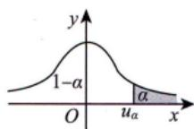  
(a)

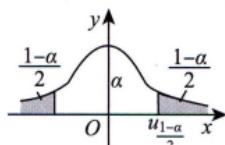  
(b)   
图2-9

例2.13 设随机变量 $X$ 满足不等式 $1 \leqslant X \leqslant 4$ ，且 $P\{X = 1\} = \frac{1}{4}$ ， $P\{X = 4\} = \frac{1}{3}$ ，当 $X$ 在区间 $(1, 4)$ 时， $X$ 服从均匀分布。求 $X$ 的分布函数。

0分析 $X$ 的分布是混合型的，则用定义法求分布函数，条件分布

解当 $x <   1$ 时， $F(x) = P\{X\leqslant x\} = 0$

当 $x = 1$ 时， $F(x) = P\{X \leqslant x\} = \frac{1}{4}$

当 $1 < x < 4$ 时，

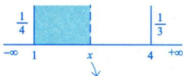

分布函数 $F(x) = P\{X \leqslant x\}$ ，且 $x$ 需取遍 $-\infty$ 到 $+\infty$

$$
F (x) = P \{X \leqslant 1 \} + P \{1 <   X \leqslant x \},
$$

其中 $P\{1 < X \leqslant x\} = P\{1 < X \leqslant x, \Omega\} = P\{1 < X \leqslant x, 1 < X < 4\} + P\{1 < X \leqslant x, \overline{1 < X < 4}\}$

$$
= P \{1 <   X \leqslant x \mid 1 <   X <   4 \} P \{1 <   X <   4 \} + P \{1 <   X \leqslant x \mid \overline {{1 <   X <   4}} \} P \{\overline {{1 <   X <   4}} \}
$$

$$
= \frac {x - 1}{4 - 1} \cdot \frac {5}{1 2} + 0 = \frac {5 (x - 1)}{3 6},
$$

注意到 $X$ 只在[1,4]取值，所以 $X$ 在(1,4)内的概率即为 $X$ 在[1,4]的概率减去两个端点.

故

$$
F (x) = \frac {1}{4} + \frac {5 (x - 1)}{3 6} = \frac {1}{9} + \frac {5}{3 6} x;
$$

$$
P \{1 <   X <   4 \} = 1 - P \{X = 1 \} - P \{X = 4 \} = 1 - \frac {7}{1 2} = \frac {5}{1 2}
$$

当 $x \geqslant 4$ 时， $F(x) = 1$

从而得 $X$ 的分布函数为

$$
F (x) = \left\{ \begin{array}{l l} 0, & x <   1, \\ \frac {1}{9} + \frac {5}{3 6} x, & 1 \leqslant x <   4, \\ 1, & x \geqslant 4. \end{array} \right.
$$

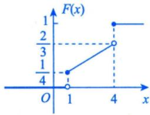

注 (1) 将 $\{1 < X \leqslant x\}$ 写成 $\{1 < X \leqslant x, \Omega\}$ ，然后作全集分解，是解决本题的关键。

(2)由图可知， $X$ 既不是离散型随机变量，也不是连续型随机变量，称为混合型随机变量.  
(3)还可知，当 $1 <   x <   4$ 时，记 $A = \{1 <   X <   4\}$ ，则

$$
f (x) = f (x \mid A) P (A) + f (\underbrace {x \mid \bar {A}} _ {\downarrow}) P (\bar {A}) = \frac {1}{3} \times \frac {5}{1 2} + 0 \times \frac {7}{1 2} = \frac {5}{3 6}.
$$

或在 $1 < x < 4$ 时， $f\left( x\right)  = {F}^{\prime }\left( x\right)  = \frac{5}{36}$ . 对立事件,所以概率为0

# 四 一维随机变量函数的分布

# 1 概念

设 $X$ 为随机变量，函数 $y = g(x)$ ，则以随机变量 $X$ 作为自变量的函数 $Y = g(X)$ 也是随机变量，称为随机变量 $X$ 的函数.例如： $Y = aX^{2} + bX + c$ ， $Y = |X - a|$ ， $Y = \left\{ \begin{array}{ll}X, & X\leqslant 1,\\ 1, & X > 1, \end{array} \right.$ 等等.

示例 设随机变量 $X \sim \left( \begin{array}{lll} 1 & 2 & 5 \\ \frac{1}{2} & \frac{1}{3} & \frac{1}{6} \end{array} \right)$ ，令 $Y = 10000X + 8$ ，则 $Y \sim \left( \begin{array}{ccc} 10008 & 20008 & 50008 \\ \frac{1}{2} & \frac{1}{3} & \frac{1}{6} \end{array} \right)$ .

# 随机变量函数的分布

(1) 离散型 $\rightarrow$ 离散型.

设 $X$ 为离散型随机变量，其概率分布为 $P\{X = x_i\} = p_i (i = 1, 2, \dots)$ ，则 $X$ 的函数 $Y = g(X)$ 也是离散型随机变量，其概率分布为 $P\{Y = g(x_i)\} = p_i (i = 1, 2, \dots)$ ，即

$$
Y \sim \left( \begin{array}{c c c} g (x _ {1}) & g (x _ {2}) & \dots \\ p _ {1} & p _ {2} & \dots \end{array} \right).
$$

如果有若干个 $g(x_{i})$ 值相同，则合并诸项为一项 $g(x_{k})$ ，并将相应概率相加作为 $Y$ 取 $g(x_{k})$ 值的概率.

示例 设随机变量 $X \sim \left( \begin{array}{ccc} -1 & 0 & 1 \\ \frac{1}{3} & \frac{1}{3} & \frac{1}{3} \end{array} \right)$ , 令 $Y = X^2$ , 则 $Y \sim \left( \begin{array}{cc} 0 & 1 \\ \frac{1}{3} & \frac{2}{3} \end{array} \right)$ .

# 考研数学基础30讲·概率论与数理统计分册

(2)连续型 $\rightarrow$ 连续型（或混合型） 注意下标的书写，说明是谁的分布函数

设 $X$ 为连续型随机变量，其分布函数、概率密度分别为 $F_{X}(x)$ 与 $f_{X}(x)$ ，随机变量 $Y = g(X)$ 是 $X$ 的函数，则 $Y$ 的分布函数或概率密度可用下面两种方法求得.

① 分布函数法 (定义法). 最可嘉

直接由定义求 $Y$ 的分布函数

此不等式的几何意义：曲线 $Y = g(X)$ 在直线 $Y = y$

下方，由此可通过作图得出 $X$ 的取值范围，在

$Y = g(X)$ 是非单调函数时，一般比解析法方便

$$
F _ {Y} (y) = P \{Y \leqslant y \} = P \underline {{\{g (X) \leqslant y \}}} = \int_ {g (x) \leqslant y} f _ {X} (x) d x,
$$

反解出 $X$ 即可

如果 $F_{Y}(y)$ 连续，且除有限个点外， $F_{Y}^{\prime}(y)$ 存在且连续，则 $Y$ 的概率密度 $f_{Y}(y) = F_{Y}^{\prime}(y)$ ：

$②$ 公式法.

根据上面的分布函数法，若 $y = g(x)$ 在 $(a, b)$ 上是关于 $x$ 的严格单调可导函数，则存在 $x = h(y)$ 是 $y = g(x)$ 在 $(a, b)$ 上的可导反函数.

若 $y = g(x)$ 严格单调增加，则 $x = h(y)$ 也严格单调增加，即 $h^{\prime}(y) > 0$ ，且

$$
F _ {Y} (y) = P \{Y \leqslant y \} = P \{g (X) \leqslant y \} = P \{X \leqslant h (y) \} = \int_ {- \infty} ^ {h (y)} f _ {X} (x) d x,
$$

故 $f_{Y}(y) = F_{Y}^{\prime}(y) = f_{X}[h(y)]\bullet h^{\prime}(y)$

若 $y = g(x)$ 严格单调减少，则 $x = h(y)$ 也严格单调减少，即 $h^\prime (y) <   0$ ，且

$$
F _ {Y} (y) = P \{Y \leqslant y \} = P \{g (X) \leqslant y \} = P \{X \geqslant h (y) \} = \int_ {h (y)} ^ {+ \infty} f _ {X} (x) d x,
$$

故 $f_{Y}(y) = F_{Y}^{\prime}(y) = -f_{X}[h(y)]\bullet h^{\prime}(y) = f_{X}[h(y)]\bullet [-h^{\prime}(y)]$

综上，

$$
f _ {Y} (y) = \left\{ \begin{array}{l l} f _ {X} [ h (y) ] \bullet \left| h ^ {\prime} (y) \right|, & \alpha <   y <   \beta , \\ 0, & \text {其 他}, \end{array} \right.
$$

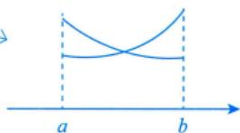

其中 $\alpha = \min \left\{\lim_{x\to a^{+}}g(x),\lim_{x\to b^{-}}g(x)\right\} ,\beta = \max \left\{\lim_{x\to a^{+}}g(x),\lim_{x\to b^{-}}g(x)\right\} .$

例2.14 设随机变量 $X$ 的分布律为

$$
P \{X = - 1 \} = \frac {1}{4}, P \{X = 0 \} = \frac {1}{2}, P \{X = 1 \} = \frac {1}{4},
$$

求 $Y = X^2$ 的分布.

$\rho$ 分析离散型随机变量的函数仍属于离散型随机变量范畴，求解其分布问题仍然按照计算离散型随机变量分布的三个步骤进行.

解 注意到 $Y$ 的可能取值为0，1，于是有

$$
P \{Y = 0 \} = P \{X ^ {2} = 0 \} = P \{X = 0 \} = \frac {1}{2},
$$

$$
P \{Y = 1 \} = P \{X ^ {2} = 1 \} = P \{X = \pm 1 \}
$$

$$
= P \{X = 1 \} + P \{X = - 1 \} = \frac {1}{4} + \frac {1}{4} = \frac {1}{2},
$$

或 $P\{Y = 1\} = 1 - P\{Y = 0\} = \frac{1}{2},$

即有 $Y\sim \left( \begin{array}{ll}0 & 1\\ \frac{1}{2} & \frac{1}{2} \end{array} \right).$

$\star \star \star$ 例2.15 设随机变量 $X$ 的分布函数 $F_{X}(x)$ 是严格单调增加函数，其反函数 $F_{X}^{-1}(y)$ 存在， $Y = F_{X}(X)$ . 证明： $Y$ 服从区间 $(0,1)$ 上的均匀分布.

证 $Y = F_{X}(X)$ 是在区间 $(0,1)$ 上取值的随机变量，故

当 $y < 0$ 时， $F_{Y}(y) = 0$

当 $y \geqslant 1$ 时， $F_{Y}(y) = 1$

当 $0 \leqslant y < 1$ 时，

$$
F _ {Y} (y) = P \{Y \leqslant y \} = P \{F _ {X} (X) \leqslant y \} = P \{X \leqslant F _ {X} ^ {- 1} (y) \} = F _ {X} [ F _ {X} ^ {- 1} (y) ] = y.
$$

综上所述， $Y = F_{X}(X)$ 的分布函数为

$$
F _ {Y} (y) = \left\{ \begin{array}{l l} 0, & y <   0, \\ y, & 0 \leqslant y <   1, \\ 1, & y \geqslant 1, \end{array} \right. \text {注 意 到 分 布 函 数 处 处 右 连 续}
$$

这是在区间 $(0,1)$ 上的均匀分布函数，所以 $Y\sim U(0,1)$

注 (1)题设条件中的“ $F_{X}(x)$ 严格单调增加”是充分条件，事实上只需要 $F_{X}(x)$ 在 $X$ 的正概率密度区间上严格单调增加即可.  
(2)本题是一个重要结论，即在满足 $F_{X}(x)$ 在 $X$ 的正概率密度区间上严格单调增加时，若 $X\sim F_X(x)$ ，则 $Y = F_{X}(X)\sim U(0,1)$ .这一结论考研中常用.

例2.16 在区间(0,2)上随机取一点，将该区间分成两段，较短一段的长度记为 $X$ ，较长一段的长度记为 $Y$ .令 $Z = \frac{Y}{X}$

(1) 求 $X$ 的概率密度；  
(2)求 $Z$ 的概率密度.

解 (1) 设随机取的点的坐标记为 $V$ ，则 $V \sim U(0, 2)$ ， $\overline{X} = \min \{V, 2 - V\}$ ， $X$ 的分布函数记为 $F_{X}(x)$ 。由于 $P\{0 \leqslant X \leqslant 1\} = 1$ ，故已知

当 $x < 0$ 时， $F_{X}(x) = 0$ ；

当 $x\geqslant 1$ 时， $F_{X}(x) = 1$

当 $0 \leqslant x < 1$ 时， $F_{X}(x) = P\{X \leqslant x\}$

$$
\begin{array}{l} = P \left\{\min  \{V, 2 - V \} \leqslant x \right\} \\ = 1 - P \{\min  \{V, 2 - V \} > x \} \quad V > x \text {且} 2 - V > x \Rightarrow x <   V <   2 - x \\ = 1 - P \{x <   V <   2 - x \} \rightarrow 0 \frac {1}{x} \frac {1}{2 - x} \\ = 1 - \frac {(2 - x) - x}{2} = x. \rightarrow \frac {2 - 2 x}{2} = 1 - x \\ \end{array}
$$

所以 $X$ 的分布函数为 $F_{X}(x) = \left\{ \begin{array}{ll}0, & x < 0,\\ x, & 0\leqslant x < 1,\\ 1, & x\geqslant 1. \end{array} \right.$

故 $X$ 的概率密度为 $f_{X}(x) = \left\{ \begin{array}{ll}1, & 0 <   x <   1,\\ 0, & \text{其他}. \end{array} \right.$

能用一元表示就不要用多元

(2) 由条件知， $Z = \frac{Y}{X} = \frac{2 - X}{X}$ . 由于函数 $z = \frac{2 - x}{x}$ 在 (0,1) 内严格单调减少且可导，反函数为 $x = \frac{2}{1 + z}$ ，且 $\frac{\mathrm{d}x}{\mathrm{d}z} = -\frac{2}{(1 + z)^2}$ ，故 $Z$ 的概率密度为

$$
\begin{array}{l} f _ {Z} (z) = \left\{\begin{array}{l l}f _ {X} \left(\frac {2}{1 + z}\right) \Bigg | - \frac {2}{(1 + z) ^ {2}} \Bigg |,&z > 1,\\0,&\text {其 他}\end{array}\quad \rightarrow z (0) \rightarrow \infty , z (1) = 1 \right. \\ = \left\{ \begin{array}{l l} \frac {2}{(1 + z) ^ {2}}, & z > 1, \\ 0, & \text {其 他}. \end{array} \right. \\ \end{array}
$$

例2.17 设随机变量 $X$ 的概率密度为 $f_{X}(x) = \begin{cases} \frac{1}{2}, & -1 < x < 0, \\ \frac{1}{4}, & 0 \leqslant x < 2, \\ 0, & \text{其他}. \end{cases}$ 令 $Y = X^2$ ，求 $Y$ 的概率密度 $f_{Y}(y)$ 。

0分析 利用定义来做. $Y\sim F_{Y}(y) = P\{Y\leqslant y\} = P\{X^{2}\leqslant y\}$

$$
F _ {Y} (y) = \left\{ \begin{array}{l l} 0, & y <   0, \\ P \{- \sqrt {y} \leqslant X \leqslant \sqrt {y} \}, & 0 \leqslant y <   1, \\ P \{- 1 \leqslant X \leqslant \sqrt {y} \}, & 1 \leqslant y <   4, \\ 1, & y \geqslant 4. \end{array} \right.
$$

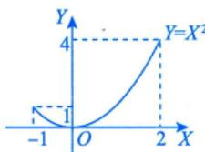

解 $Y$ 的分布函数为 $F_{Y}(y) = P\{Y \leqslant y\} = P\{X^{2} \leqslant y\}$ .

① 当 $y < 0$ 时， $F_{Y}(y) = 0$ ；  
② 当 $0 \leqslant y < 1$ 时，

$$
\begin{array}{l} F _ {Y} (y) = P \{- \sqrt {y} \leqslant X \leqslant \sqrt {y} \} = P \{- \sqrt {y} \leqslant X <   0 \} + P \{0 \leqslant X \leqslant \sqrt {y} \} \\ = \frac {1}{2} \sqrt {y} + \frac {1}{4} \sqrt {y} = \frac {3}{4} \sqrt {y}; \quad \int_ {- \sqrt {y}} ^ {0} \frac {1}{2} d x + \int_ {0} ^ {\sqrt {y}} \frac {1}{4} d x \\ \end{array}
$$

③当 $1 \leqslant y < 4$ 时，

$$
F _ {Y} (y) = P \{- 1 \leqslant X <   0 \} + P \{0 \leqslant X \leqslant \sqrt {y} \} = \frac {1}{2} + \frac {1}{4} \sqrt {y};
$$

④当 $y \geq 4$ 时， $F_{y}(y) = 1$

所以 $Y$ 的分布函数为

$$
F _ {Y} (y) = \left\{ \begin{array}{l l} 0, & y <   0, \\ \frac {3}{4} \sqrt {y}, & 0 \leqslant y <   1, \\ \frac {1}{2} + \frac {\sqrt {y}}{4}, & 1 \leqslant y <   4, \\ 1, & y \geqslant 4. \end{array} \right.
$$

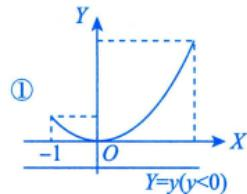

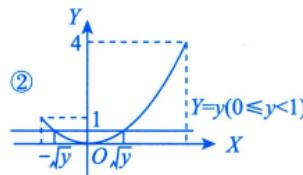

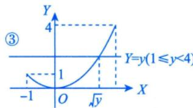

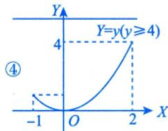

故 $Y$ 的概率密度为

$$
f _ {Y} (y) = \left\{ \begin{array}{l l} \frac {3}{8 \sqrt {y}}, & 0 <   y <   1, \\ \frac {1}{8 \sqrt {y}}, & 1 <   y <   4, \\ 0, & \text {其 他}. \end{array} \right.
$$

# 五 综合题举例

例2.18 投保人的损失事件发生时，保险公司的赔付额 $Y$ 与投保人的损失额 $X$ 的关系为

$$
Y = \left\{ \begin{array}{l l} 0, & X \leqslant 1 0 0, \\ X - 1 0 0, & X > 1 0 0. \end{array} \right.
$$

设损失事件发生时，投保人的损失额 $X$ 的概率密度为

$$
f (x) = \left\{ \begin{array}{l l} \frac {2 \times 1 0 0 ^ {2}}{(1 0 0 + x) ^ {3}}, & x > 0, \\ 0, & x \leqslant 0. \end{array} \right.
$$

（1）求 $P\{Y > 0\}$ 及 $EY$

（2）这种损失事件在一年内发生的次数记为 $N$ ，保险公司在一年内就这种损失事件产生的理赔次数记为 $M$ .假设 $N$ 服从参数为8的泊松分布，在 $N = n(n\geqslant 1)$ 的条件下， $M$ 服从二项分布 $B(n,p)$ ，其中 $p = P\{Y > 0\}$ ，求 $M$ 的概率分布.

解 (1) $P\{Y > 0\} = P\{X - 100 > 0\} = P\{X > 100\} = \int_{100}^{+\infty}\frac{2\times 100^2}{(100 + x)^3}\mathrm{d}x = \frac{1}{4}.$

$$
E Y = \int_ {1 0 0} ^ {+ \infty} (x - 1 0 0) \frac {2 \times 1 0 0 ^ {2}}{(1 0 0 + x) ^ {3}} d x = 5 0.
$$

（2）由题知， $N\sim P(8),P\{M = m|N = n\} = \mathrm{C}_n^m\left(\frac{1}{4}\right)^m\left(\frac{3}{4}\right)^{n - m}$ ，由乘法公式可得

$$
\begin{array}{l} P \{M = m, N = n \} = P \{N = n \} P \{M = m \mid N = n \} \\ = \frac {8 ^ {n}}{n !} \mathrm {e} ^ {- 8} \cdot C _ {n} ^ {m} \cdot \left(\frac {1}{4}\right) ^ {m} \cdot \left(\frac {3}{4}\right) ^ {n - m}, \\ \end{array}
$$

其中 $m = 0,1,\dots ,n;n = 1,2,\dots .$

故 $M$ 的概率分布为

$$
\begin{array}{l} P \{M = m \} = \sum_ {n = m} ^ {\infty} P \{M = m, N = n \} = \sum_ {n = m} ^ {\infty} \frac {8 ^ {n}}{n !} e ^ {- 8} \cdot C _ {n} ^ {m} \cdot \left(\frac {1}{4}\right) ^ {m} \cdot \left(\frac {3}{4}\right) ^ {n - m} \\ = \sum_ {n = m} ^ {\infty} \frac {8 ^ {n}}{n !} e ^ {- 8} \cdot \frac {n !}{m ! (n - m) !} \left(\frac {1}{4}\right) ^ {m} \cdot \left(\frac {3}{4}\right) ^ {n - m} \\ = \left(\frac {1}{4}\right) ^ {m} \mathrm {e} ^ {- 8} \frac {8 ^ {m}}{m !} \sum_ {n = m} ^ {\infty} \frac {8 ^ {n - m}}{(n - m) !} \cdot \left(\frac {3}{4}\right) ^ {n - m} \\ = \left(\frac {1}{4}\right) ^ {m} e ^ {- 8} \frac {8 ^ {m}}{m !} \sum_ {n = m} ^ {\infty} \frac {6 ^ {n - m}}{(n - m) !} = \frac {2 ^ {m}}{m !} e ^ {- 8} \cdot e ^ {6} = \frac {2 ^ {m}}{m !} e ^ {- 2}, \\ \end{array}
$$

即 $P\{M = m\} = \frac{2^m}{m!}\mathrm{e}^{-2},m = 0,1,2,\dots ,$ 即 $M\sim P(2)$

注本题第（2）问在2001年考研真题中出现过其中一部分，如下.

设某班车起点站上车人数 $X$ 服从参数为 $\lambda (\lambda >0)$ 的泊松分布，每位乘客在中途下车的概率为 $p(0 <   p <   1)$ ，且中途下车与否相互独立.以 $Y$ 表示在中途下车的人数，求：

（1）在发车时有 $n$ 个乘客的条件下，中途有 $m$ 人下车的概率；  
（2）二维随机变量 $(X,Y)$ 的概率分布.

解（1） $P\{Y = m \mid X = n\} = \mathrm{C}_n^m p^m (1 - p)^{n - m}, 0 \leqslant m \leqslant n, n = 0, 1, 2, \dots.$

(2) $P\{X = n, Y = m\} = P\{Y = m \mid X = n\} P\{X = n\}$

$$
= \mathrm {C} _ {n} ^ {m} p ^ {m} (1 - p) ^ {n - m} \cdot \frac {\mathrm {e} ^ {- \lambda}}{n !} \lambda^ {n}, 0 \leqslant m \leqslant n, n = 0, 1, 2, \dots .
$$

# 习题

2.1 已知 $F(x)$ 是分布函数，下列函数中：

① $aF(x)(a > 0, a \neq 1)$ ; ② $F(x) + F(-x)$ ; ③ $F(x) - F(-x)$ ; ④ $F(x) \cdot F(-x)$ .

不能作为分布函数的个数是（ ）

(A)1

(B)2

(C)3

(D)4

2.2 设 $X \sim B(2, p)$ , $Y \sim B(4, p)$ , 且 $P\{X \geqslant 1\} = \frac{5}{9}$ , 则 $P\{Y \geqslant 1\} = (\quad)$ .

(A) $\frac{65}{81}$

(B) $\frac{16}{81}$

(C) 1

(D) $\frac{4}{7}$

2.3 设随机变量 $X$ 服从正态分布 $N(\mu_1, \sigma_1^2)$ ，随机变量 $Y$ 服从正态分布 $N(\mu_2, \sigma_2^2), \sigma_1, \sigma_2 > 0$ ，且 $P\{|X - \mu_1| < 1\} > P\{|Y - \mu_2| < 1\}$ ，则必有（ ）.

(A) $\sigma_{1} <   \sigma_{2}$

(B) $\sigma_{1} > \sigma_{2}$

(C) $\mu_1 <   \mu_2$

(D) $\mu_1 > \mu_2$

2.4 设随机变量 $X$ 的分布函数 $F(x) = \begin{cases} 0, & x < 0, \\ \frac{1}{2}, & 0 \leqslant x < 1, \\ 1 - \mathrm{e}^{-x}, & x \geqslant 1, \end{cases}$ 则 $P\{0 \leqslant X \leqslant 1\} = \_ , P\{0 < X < 1\} = \_\ .$

2.5 离散型随机变量 $X$ 的分布函数为

$$
F (x) = \left\{ \begin{array}{l l} 0, & x <   - 1, \\ 0. 4, & - 1 \leqslant x <   2, \\ 0. 8, & 2 \leqslant x <   3, \\ 1, & x \geqslant 3, \end{array} \right.
$$

则 $X$ 的分布列为 ， $P\{X\leqslant 3.2\} = \_ ,$ 方程 $x^{2} + Xx + 1 = 0$ 有实根的概率为

2.6 设连续型随机变量 $X$ 的分布函数为

$$
F (x) = \left\{ \begin{array}{l l} 0, & x <   - a, \\ A + B \arcsin \frac {x}{a}, & - a \leqslant x <   a, \\ 1, & x \geqslant a, \end{array} \right.
$$

则 $A = \_$ ， $B = \_$ ， $X$ 的概率密度 $f(x) = \_$ ， $P\left\{-\frac{a}{2} < X < \frac{a}{2}\right\} = \_$

2.7 设连续型随机变量 $X$ 的概率密度为

$$
f (x) = \left\{ \begin{array}{l l} \frac {A}{x ^ {2}}, & x > 1 0 0, \\ 0, & x \leqslant 1 0 0, \end{array} \right.
$$

则 $A = \_$ ， $P\{100 < X \leqslant 150\} = \_$ ， $P\{X \geqslant 1000\} = \_$ ， $P\{X = 1000\} = \_$ ， $X$ 的分布函数 $F(x) = \_$

2.8 设随机变量 $X$ 服从正态分布 $N(\mu, \sigma^2)(\sigma > 0)$ ，且二次方程 $y^{2} + 4y + X = 0$ 无实根的概率为 $\frac{1}{2}$ ，则 $\mu =$   
2.9 设随机变量 $X$ 服从区间(2,5)上的均匀分布，则对 $X$ 进行3次独立观测中，至少有2次的观测值大于3的概率为  
2.10 设随机变量 $X$ 的概率密度为 $f(x) = \begin{cases} 2x, & 0 < x < 1, \\ 0, & \text{其他}, \end{cases}$ $Y$ 表示对 $X$ 的3次独立重复试验中事件 $\left\{X \leqslant \frac{1}{2}\right\}$ 出现的次数，则 $P\{Y = 2\} = \_$   
2.11 设随机变量 $X$ 和 $Y$ 同分布， $X$ 的概率密度为

$$
f (x) = \left\{ \begin{array}{l l} \frac {3}{8} x ^ {2}, & 0 <   x <   2, \\ 0, & \text {其 他}. \end{array} \right.
$$

已知事件 $A = \{X > a\}$ 和 $B = \{Y > a\}$ 独立，且 $P(A \cup B) = \frac{3}{4}$ ，则常数 $a =$

2.12 已知 $X$ 为随机变量， $Y = X^2 + X + 1$ ，已知 $X$ 的概率分布为 $P\{X = -1\} = P\{X = 0\} = P\{X = 1\} = \frac{1}{3}$ ，则 $Y$ 的分布函数 $F_Y(y) = \_$   
2.13 已知离散型随机变量 $X$ 的正概率点为 $-1, 0, 2$ ，它们各自的概率互不相等且成等差数列。

(1) 求 $X$ 的分布律；  
(2) 求 $X$ 的分布函数；  
(3) 求 $P\{|X| \leqslant 1 | X \geqslant 0\}$ .

2.14 随机变量 $X$ 的概率密度为

$$
f (x) = \left\{ \begin{array}{l l} x, & 0 \leqslant x <   1, \\ 2 - x, & 1 \leqslant x <   2, \\ 0, & \text {其 他}. \end{array} \right.
$$

求 $X$ 的分布函数 $F(x)$ ：

2.15 设连续型随机变量 $X$ 的概率密度 $f(x)$ 是一个偶函数， $F(x)$ 为 $X$ 的分布函数，证明：对任意实数 $a > 0$ ，有

(1) $F(-a) = 1 - F(a) = 0.5 - \int_{0}^{a} f(x) \, \mathrm{d}x$ ;   
(2) $P\{|X| < a\} = 2F(a) - 1$ ;   
(3) $P\{|X| > a\} = 2[1 - F(a)]$

2.16 设随机变量 $X$ 的概率密度为 $f_{X}(x) = \frac{k}{1 + x^{2}} (x\in \mathbf{R})$ .求：

(1) 常数 $k$ ；  
(2) 随机变量 $Y = 1 - \sqrt[3]{X}$ 的概率密度 $f_{Y}(y)$ .

2.17 设随机变量 $X$ 的概率密度为 $f(x) = \frac{\mathrm{e}^x}{(1 + \mathrm{e}^x)^2}, -\infty < x < +\infty$ ，令 $Y = \mathrm{e}^{X}$ .

(1) 求 $X$ 的分布函数；  
(2)求 $Y$ 的概率密度.

2.18 设随机变量 $X \sim U(-1, 2)$ ，求 $Y = |X|$ 的概率密度。

# 解答

2.1 (D) 解 应用分布函数的充要条件求解. 由于

$①$

$$
a F (+ \infty) = a \neq 1,
$$

②

$$
F (- \infty) + F (+ \infty) = 1 \neq 0,
$$

$③$

$$
F (- \infty) - F (+ \infty) = - 1 \neq 0,
$$

$④$

$$
F (+ \infty) \cdot F (- \infty) = 0 \neq 1,
$$

因此 $①$ ， $②$ ， $③$ ， $④$ 都不能作为分布函数，故选(D).

2.2 (A) 解 由题设 $P\{X \geqslant 1\} = \frac{5}{9} = 1 - P\{X = 0\} = 1 - C_2^0 p^0 (1 - p)^2$ ，即 $(1 - p)^2 = \frac{4}{9}$ ，解得 $p = \frac{1}{3}$ ，从而有

$$
P \{Y \geqslant 1 \} = 1 - P \{Y = 0 \} = 1 - C _ {4} ^ {0} p ^ {0} (1 - p) ^ {4} = 1 - \left(\frac {2}{3}\right) ^ {4} = \frac {6 5}{8 1},
$$

故选 (A).

2.3(A)解所有有关正态分布不等式的判别都应先标准化，即由

$$
P \left\{\left| X - \mu_ {1} \right| <   1 \right\} > P \left\{\left| Y - \mu_ {2} \right| <   1 \right\},
$$

有

$$
P \left\{\frac {\left| X - \mu_ {1} \right|}{\sigma_ {1}} <   \frac {1}{\sigma_ {1}} \right\} > P \left\{\frac {\left| Y - \mu_ {2} \right|}{\sigma_ {2}} <   \frac {1}{\sigma_ {2}} \right\},
$$

从而有 $\Phi \left(\frac{1}{\sigma_1}\right) > \Phi \left(\frac{1}{\sigma_2}\right).$

又由函数 $\varPhi(x)$ 的单调增加性，有 $\frac{1}{\sigma_1} >\frac{1}{\sigma_2} >0$ ，即 $\sigma_{1} <   \sigma_{2}$ ，故选(A).

2.4 $1 - \mathrm{e}^{-1}$ ；0 解 $P\{0\leqslant X\leqslant 1\} = P\{X\leqslant 1\} -P\{X <   0\} = F(1) - F(0 - 0)$

$$
= 1 - \mathrm {e} ^ {- 1} - 0 = 1 - \mathrm {e} ^ {- 1};
$$

$$
P \{0 <   X <   1 \} = P \{X <   1 \} - P \{X \leqslant 0 \} = F (1 - 0) - F (0) = \frac {1}{2} - \frac {1}{2} = 0.
$$

2.5 $X\sim \left( \begin{array}{ccc} - 1 & 2 & 3\\ 0.4 & 0.4 & 0.2 \end{array} \right);$ 1;0.6解分布函数的分段点即为离散型随机变量的正概率点，正概率点的概率即为对应点的跃度，即 $X = -1,2,3$ ，分布列为

$$
X \sim \left( \begin{array}{c c c} - 1 & 2 & 3 \\ 0. 4 & 0. 4 & 0. 2 \end{array} \right),
$$

$$
P \{X \leqslant 3. 2 \} = F (3. 2) = 1.
$$

方程 $x^{2} + Xx + 1 = 0$ 有实根，即 $X^2 -4\geqslant 0$ ，从而有

$$
P \{X ^ {2} - 4 \geqslant 0 \} = P \{X \leqslant - 2 \} + P \{X \geqslant 2 \} = F (- 2) + 1 - F (2 - 0) = 1 - 0. 4 = 0. 6.
$$

2.6 $\frac{1}{2};\frac{1}{\pi};\left\{\begin{array}{ll}\frac{1}{\pi\sqrt{a^2-x^2}},&-a< x<a,\frac{1}{3}\\0,&\text{其他};\end{array}\right.$ 解 根据连续型随机变量分布函数的连续性，有

$$
F (- a) = F (- a - 0), F (a) = F (a - 0),
$$

即有 $A + B\cdot \left(-\frac{\pi}{2}\right) = 0,$ $A + B\cdot \frac{\pi}{2} = 1,$

解得 $A = \frac{1}{2}, B = \frac{1}{\pi}$

于是

$f(x) = \left\{ \begin{array}{ll}F^{\prime}(x), & -a <   x <   a,\\ 0, & \text{其他} \end{array} \right.$ $\frac{1}{\pi\sqrt{a^2 - x^2}},\quad -a <   x <   a,$ 其他.

$$
P \left\{- \frac {a}{2} <   X <   \frac {a}{2} \right\} = \int_ {- \frac {a}{2}} ^ {\frac {a}{2}} f (x) d x = \int_ {- \frac {a}{2}} ^ {\frac {a}{2}} \frac {1}{\pi \sqrt {a ^ {2} - x ^ {2}}} d x = \frac {1}{3},
$$

或 $P\left\{-\frac{a}{2} < X < \frac{a}{2}\right\} = F\left(\frac{a}{2} - 0\right) - F\left(-\frac{a}{2}\right) = \frac{1}{\pi}\left[\arcsin \frac{1}{2} - \arcsin \left(-\frac{1}{2}\right)\right] = \frac{1}{3}.$

2.7 100; $\frac{1}{3}$ ; $\frac{1}{10}$ ; 0; $\left\{ \begin{array}{ll}0, & x < 100, \\ 1 - \frac{100}{x}, & x \geqslant 100 \end{array} \right.$ 解 根据连续型随机变量概率密度的性质，有

$$
\int_ {- \infty} ^ {+ \infty} f (x) \mathrm {d} x = \int_ {1 0 0} ^ {+ \infty} \frac {A}{x ^ {2}} \mathrm {d} x = - \left. \frac {A}{x} \right| _ {1 0 0} ^ {+ \infty} = \frac {A}{1 0 0} = 1, A = 1 0 0,
$$

于是

$$
P \{1 0 0 <   X \leqslant 1 5 0 \} = \int_ {1 0 0} ^ {1 5 0} \frac {1 0 0}{x ^ {2}} d x = - \left. \frac {1 0 0}{x} \right| _ {1 0 0} ^ {1 5 0} = \frac {1}{3},
$$

$$
P \{X \geqslant 1 0 0 0 \} = \int_ {1 0 0 0} ^ {+ \infty} \frac {1 0 0}{x ^ {2}} d x = - \left. \frac {1 0 0}{x} \right| _ {1 0 0 0} ^ {+ \infty} = \frac {1}{1 0},
$$

$$
P \{X = 1 0 0 0 \} = 0,
$$

$$
F (x) = \int_ {- \infty} ^ {x} f (t) \mathrm {d} t = \left\{ \begin{array}{l l} 0, & x <   1 0 0, \\ \int_ {1 0 0} ^ {x} \frac {1 0 0}{t ^ {2}} \mathrm {d} t, & x \geqslant 1 0 0 \end{array} = \left\{ \begin{array}{l l} 0, & x <   1 0 0, \\ 1 - \frac {1 0 0}{x}, & x \geqslant 1 0 0. \end{array} \right. \right.
$$

2.84解二次方程 $y^{2} + 4y + X = 0$ 无实根的充要条件是 $4 - X <   0$ .故由条件知

$$
P \{X > 4 \} = \frac {1}{2},
$$

于是有 $\frac{1}{2} = P\{X > 4\} = 1 - P\{X \leqslant 4\} = 1 - P\left\{\frac{X - \mu}{\sigma} \leqslant \frac{4 - \mu}{\sigma}\right\} = 1 - P\left\{Y \leqslant \frac{4 - \mu}{\sigma}\right\} = 1 - \Phi\left(\frac{4 - \mu}{\sigma}\right),$

$$
\Phi \left(\frac {4 - \mu}{\sigma}\right) = \frac {1}{2},
$$

其中 $Y = \frac{X - \mu}{\sigma} \sim N(0,1), \Phi(x) = \frac{1}{\sqrt{2\pi}} \int_{-\infty}^{x} \mathrm{e}^{-\frac{t^2}{2}} \mathrm{d}t.$ 又 $\Phi(0) = \frac{1}{2}$ ，所以 $\frac{4 - \mu}{\sigma} = 0, \mu = 4$ 。

注 事实上，根据正态分布的对称性，可直接得 $\mu = 4$

2.9 $\frac{20}{27}$ 解 在一次观测中，观测值大于3的概率为

$$
p = P \{X > 3 \} = \int_ {3} ^ {5} \frac {1}{3} d x = \frac {2}{3}.
$$

记 $Y = \{3$ 次独立观测中 $X$ 的观测值大于3的次数}，由 $Y\sim B\left(3,\frac{2}{3}\right)$ 得

$$
P \{Y \geqslant 2 \} = 1 - P \{Y = 0 \} - P \{Y = 1 \} = 1 - \left(\frac {1}{3}\right) ^ {3} - 3 \times \frac {2}{3} \times \left(\frac {1}{3}\right) ^ {2} = \frac {2 0}{2 7}.
$$

2.10 $\frac{9}{64}$ 解 依题意得 $Y\sim B(3,p)$ ，其中 $p = P\left\{X\leqslant \frac{1}{2}\right\} = \int_0^{\frac{1}{2}}2x\mathrm{d}x = \frac{1}{4}$ ，故

$$
P \{Y = 2 \} = C _ {3} ^ {2} p ^ {2} (1 - p) = \frac {9}{6 4}.
$$

2.11 $\sqrt[3]{4}$ 解 由 $X$ 和 $Y$ 同分布可得 $P(A) = P(B)$ ，从而

$$
\frac {3}{4} = P (A \cup B) = P (A) + P (B) - P (A B) = 2 P (A) - [ P (A) ] ^ {2},
$$

由此解得 $P(A) = \frac{1}{2}$ ，则 $0 < a < 2$ 。又

$$
\frac {1}{2} = P (A) = P \{X > a \} = \int_ {a} ^ {2} \frac {3}{8} x ^ {2} d x = \frac {1}{8} x ^ {3} \Bigg | _ {a} ^ {2} = 1 - \frac {1}{8} a ^ {3},
$$

解得 $a = \sqrt[3]{4}$

注 随机变量 $X$ 与 $Y$ 同分布，并不意味着 $X = Y$ ，但反之成立，即若 $X = Y$ ，则 $X$ 与 $Y$ 同分布.

2.12 $\left\{ \begin{array}{ll}0, & y < 1,\\ \frac{2}{3}, & 1\leqslant y < 3,\\ 1, & y\geqslant 3 \end{array} \right.$ 解由题设知 $Y$ 为离散型随机变量，当 $X = -1$ 时， $Y$ 取1；当 $X = 0$ 时， $Y$ 取1;

当 $X = 1$ 时， $Y$ 取3. 则 $Y$ 的概率分布为

$$
P \{Y = 1 \} = P \{X = - 1 \} + P \{X = 0 \} = \frac {2}{3}, P \{Y = 3 \} = P \{X = 1 \} = \frac {1}{3}.
$$

故 $Y$ 的分布函数为

$$
F _ {Y} (y) = P \{Y \leqslant y \} = \left\{ \begin{array}{l l} 0, & y <   1, \\ \frac {2}{3}, & 1 \leqslant y <   3, \\ 1, & y \geqslant 3. \end{array} \right.
$$

2.13解(1)设 $P\{X = -1\} = a + d$ ， $P\{X = 0\} = a$ ， $P\{X = 2\} = a - d$ ，其中 $0 < a + d < 1$ ， $0 < a < 1$ ， $0 < a - d < 1$ ，由离散型随机变量 $X$ 分布律的性质，有

$$
a + d + a + a - d = 3 a = 1,
$$

解得 $a = \frac{1}{3}$ ，且 $-\frac{1}{3} < d < \frac{1}{3}, d \neq 0$ ，因此 $X \sim \left( \begin{array}{ccc} -1 & 0 & 2 \\ \frac{1}{3} + d & \frac{1}{3} & \frac{1}{3} - d \end{array} \right)$ ，其中 $-\frac{1}{3} < d < \frac{1}{3}, d \neq 0$

(2) 由 (1) 可知，

$$
F (x) = \left\{ \begin{array}{l l} 0, & x <   - 1, \\ \frac {1}{3} + d, & - 1 \leqslant x <   0, \\ \frac {2}{3} + d, & 0 \leqslant x <   2, \\ 1, & x \geqslant 2. \end{array} \right.
$$

(3) 由条件概率公式及 (1) 可知, $P\{|X| \leqslant 1 | X \geqslant 0\} = \frac{P\{0 \leqslant X \leqslant 1\}}{P\{X \geqslant 0\}} = \frac{1}{2 - 3d}$ .

2.14 解 由题设知，当 $x < 0$ 时， $F(x) = 0$ ；

当 $0 \leqslant x < 1$ 时，

$$
F (x) = \int_ {- \infty} ^ {x} f (t) \mathrm {d} t = \int_ {0} ^ {x} t \mathrm {d} t = \frac {1}{2} t ^ {2} \Bigg | _ {0} ^ {x} = \frac {x ^ {2}}{2};
$$

当 $1 \leqslant x < 2$ 时，

$$
\begin{array}{l} F (x) = \int_ {- \infty} ^ {x} f (t) \mathrm {d} t = \int_ {1} ^ {x} (2 - t) \mathrm {d} t + \int_ {0} ^ {1} t \mathrm {d} t \\ = \left. \left(2 t - \frac {t ^ {2}}{2}\right) \right| _ {1} ^ {x} + \left. \frac {t ^ {2}}{2} \right| _ {0} ^ {1} = 2 x - \frac {x ^ {2}}{2} - 1; \\ \end{array}
$$

当 $x \geqslant 2$ 时，

$$
\begin{array}{l} F (x) = \int_ {- \infty} ^ {x} f (t) \mathrm {d} t = \int_ {0} ^ {1} t \mathrm {d} t + \int_ {1} ^ {2} (2 - t) \mathrm {d} t \\ = \left. \frac {t ^ {2}}{2} \right| _ {0} ^ {1} + \left. \left(2 t - \frac {t ^ {2}}{2}\right) \right| _ {1} ^ {2} = 1. \\ \end{array}
$$

所以

$$
F (x) = \left\{ \begin{array}{l l} 0, & x <   0, \\ \frac {x ^ {2}}{2}, & 0 \leqslant x <   1, \\ 2 x - \frac {x ^ {2}}{2} - 1, & 1 \leqslant x <   2, \\ 1, & x \geqslant 2. \end{array} \right.
$$

2.15 证明 因为 $f(x)$ 是一个偶函数，所以 $f(-x) = f(x)$ ，且 $1 = \int_{-\infty}^{+\infty} f(x) \, \mathrm{d}x = 2 \int_{0}^{+\infty} f(x) \, \mathrm{d}x$ ，可得

$$
\int_ {0} ^ {+ \infty} f (x) d x = 0. 5.
$$

(1) $F(-a) = \int_{-\infty}^{-a} f(x) \, \mathrm{d}x$ ，令 $x = -t$ ，则 $F(-a) = \int_{+\infty}^{a} f(t)(-\mathrm{d}t) = \int_{a}^{+\infty} f(t) \, \mathrm{d}t = 1 - F(a)$ .

$$
\begin{array}{l} F (- a) = \int_ {a} ^ {+ \infty} f (t) d t = \int_ {0} ^ {+ \infty} f (t) d t - \int_ {0} ^ {a} f (t) d t \\ = 0. 5 - \int_ {0} ^ {a} f (x) d x. \\ \end{array}
$$

$$
\begin{array}{l} P \{\left| X \right| <   a \} = P \{- a <   X <   a \} = F (a - 0) - F (- a) \tag {2} \\ = F (a) - [ 1 - F (a) ] \\ = 2 F (a) - 1. \\ \end{array}
$$

$$
P \{| X | > a \} = P \{X <   - a \} + P \{X > a \} = F (- a - 0) + 1 - F (a) \tag {3}
$$

$$
\begin{array}{l} = 1 - F (a) + 1 - F (a) \\ = 2 [ 1 - F (a) ] \\ \end{array}
$$

2.16 解 (1) 由于

$$
\int_ {- \infty} ^ {+ \infty} f _ {X} (x) d x = \int_ {- \infty} ^ {+ \infty} \frac {k}{1 + x ^ {2}} d x = k \arctan x | _ {- \infty} ^ {+ \infty} = k \pi = 1,
$$

因此 $k = \frac{1}{\pi}$

(2) $X$ 的概率密度为 $f_{X}(x) = \frac{1}{\pi(1 + x^{2})} (x\in \mathbf{R})$ .随机变量 $Y = 1 - \sqrt[3]{X}$ 的分布函数为

$$
\begin{array}{l} F _ {Y} (y) = P \{Y \leqslant y \} = P \{1 - \sqrt [ 3 ]{X} \leqslant y \} = P \{X \geqslant (1 - y) ^ {3} \} \\ = \int_ {(1 - y) ^ {3}} ^ {+ \infty} f _ {X} (x) d x = \int_ {(1 - y) ^ {3}} ^ {+ \infty} \frac {1}{\pi \left(1 + x ^ {2}\right)} d x \\ = \frac {1}{\pi} \arctan x \Bigg | _ {(1 - y) ^ {3}} ^ {+ \infty} = \frac {1}{\pi} \left[ \frac {\pi}{2} - \arctan (1 - y) ^ {3} \right] (y \in \mathbf {R}), \\ \end{array}
$$

由此可得 $Y = 1 - \sqrt[3]{X}$ 的概率密度为 $f_{Y}(y) = F_{Y}^{\prime}(y) = \frac{3(1 - y)^{2}}{\pi[1 + (1 - y)^{6}]} (y\in \mathbf{R})$

2.17 解 (1) $X$ 的分布函数为

$$
\begin{array}{l} F (x) = \int_ {- \infty} ^ {x} f (t) d t = \int_ {- \infty} ^ {x} \frac {e ^ {t}}{\left(1 + e ^ {t}\right) ^ {2}} d t = \int_ {- \infty} ^ {x} \frac {d \left(1 + e ^ {t}\right)}{\left(1 + e ^ {t}\right) ^ {2}}. \\ = - \frac {1}{1 + e ^ {t}} \Bigg | _ {- \infty} ^ {x} = 1 - \frac {1}{1 + e ^ {x}} (- \infty <   x <   + \infty). \\ \end{array}
$$

(2)函数 $y = \mathrm{e}^{x}$ 单调且反函数为 $x = \ln y(y > 0)$ ，从而 $Y$ 的概率密度为

$$
\begin{array}{l} f _ {Y} (y) = \left\{ \begin{array}{l l} \frac {1}{y} f (\ln y), & y > 0, \\ 0, & \text {其 他} \end{array} \right. \\ = \left\{ \begin{array}{l l} \frac {1}{(1 + y) ^ {2}}, & y > 0, \\ 0, & \text {其 他}. \end{array} \right. \\ \end{array}
$$

2.18 解 $X$ 的概率密度为

$$
f _ {X} (x) = \left\{ \begin{array}{l l} \frac {1}{3}, & - 1 <   x <   2, \\ 0, & \text {其 他}. \end{array} \right.
$$

记 $X$ 的分布函数为 $F_{X}(x)$ ，先求 $Y$ 的分布函数 $F_{Y}(y)$ ：

当 $y < 0$ 时， $F_{Y}(y) = P\{Y \leqslant y\} = 0$

当 $y\geqslant 0$ 时， $F_{Y}(y) = P\{|X|\leqslant y\} = P\{-y\leqslant X\leqslant y\} = F_{X}(y) - F_{X}(-y - 0).$

将 $F_{Y}(y)$ 关于 $y$ 求导可得 $Y$ 的概率密度为

$$
f _ {Y} (y) = \left\{ \begin{array}{l l} f _ {X} (y) + f _ {X} (- y), & y > 0, \\ 0, & \text {其 他}. \end{array} \right.
$$

当 $0 \leqslant y < 1$ 时， $-1 < -y \leqslant 0$ ，因而 $f_{X}(y) = \frac{1}{3}$ ， $f_{X}(-y) = \frac{1}{3}$ ，此时

$$
f _ {Y} (y) = \frac {1}{3} + \frac {1}{3} = \frac {2}{3};
$$

当 $1 \leqslant y < 2$ 时， $-2 < -y \leqslant -1$ ，因而 $f_{X}(y) = \frac{1}{3}$ ， $f_{X}(-y) = 0$ ，此时

$$
f _ {Y} (y) = \frac {1}{3};
$$

当 $y \geqslant 2$ 时， $-y \leqslant -2$ ，因而 $f_{X}(y) = 0, f_{X}(-y) = 0$ ，此时 $f_{Y}(y) = 0$ 。故 $Y$ 的概率密度为

$$
f _ {Y} (y) = \left\{ \begin{array}{l l} \frac {2}{3}, & 0 \leqslant y <   1, \\ \frac {1}{3}, & 1 \leqslant y <   2, \\ 0, & \text {其 他}. \end{array} \right.
$$
