# 第3讲

# 多维随机变量及其分布

在一维基础上，引入两个或更多的随机变量

基础知识结构 $\longrightarrow$ 结构与一维一致, 但需找到多维(二维)与一维的联系与区别

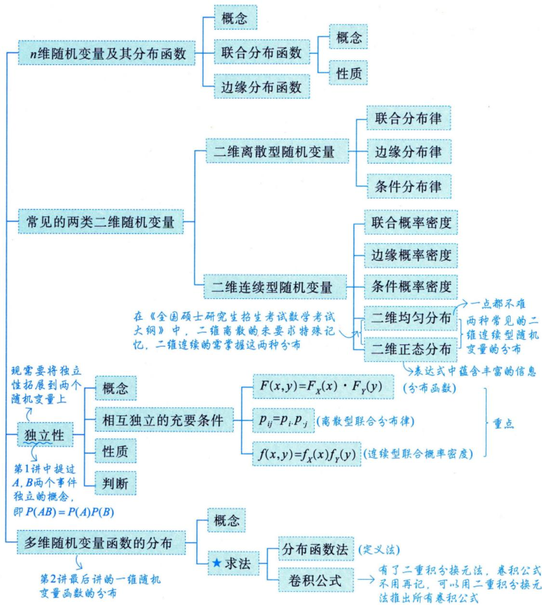

# 基础内容精讲

在一维中 $X = X(w)$ ， $w\in \Omega$ ，将事件映射 $n$ 维随机变量及其分布函数 到实数轴上使其成为一个数.数是有概率出现的，随机而定的，称之为随机变量

# $\langle 1\rangle$ $n$ 维随机变量的概念

要指出值数

如果 $X_{1}, X_{2}, \cdots, X_{n}$ 是定义在同一个样本空间 $\Omega$ 上的 $n$ 个随机变量，则称 $(X_{1}, X_{2}, \cdots, X_{n})$ 为 $n$ 维随机变量或 $n$ 维随机向量， $X_{i} (i = 1, 2, \cdots, n)$ 称为第 $i$ 个分量。将这些指标写成数组 $X_{1}, X_{2}, \cdots, X_{n}$ 的取值都是有概率的

当 $n = 2$ 时，称 $(X,Y)$ 为二维随机变量或二维随机向量. 主要考 $n = 2$ ，但 $n = 3,n = 4$ 也需要准备，学习时，主要是二维和 $n$ 维

注在实际问题中，所研究问题的数量指标往往不止一个.比如根据一个人体检的结果来反映他的健康程度.年龄越大，体检的项目就越多，这些数量指标显然可以构成一个多维向量.

比如身高、体重、血压等

# 2 $n$ 维随机变量的分布函数的概念和性质

(1) 概念.

对任意的 $n$ 个实数 $x_{1}, x_{2}, \dots, x_{n}$ ，称 $n$ 元函数

即 $P(A_{1}A_{2}\dots A_{n})$ ： $A_{1},A_{2},\dots ,A_{n}$ 同时发生的概率

$$
F \left(x _ {1}, x _ {2}, \dots , x _ {n}\right) = P \left\{X _ {1} \leqslant x _ {1}, X _ {2} \leqslant x _ {2}, \dots , X _ {n} \leqslant^ {\prime} x _ {n} \right\}
$$

多个随机变量

为 $n$ 维随机变量 $(X_{1},X_{2},\dots ,X_{n})$ 的分布函数或随机变量 $X_{1},X_{2},\dots ,X_{n}$ 的联合分布函数.

当 $n = 2$ 时，对任意的实数 $x, y$ ，称二元函数

$F(x,y)$ 是事件 $A = \{X\leqslant x\}$ 与 $B = \{Y\leqslant y\}$ 同时发生的概率

$$
F (x, y) = P \{X \leqslant x, Y \leqslant y \}
$$

为二维随机变量 $(X,Y)$ 的分布函数或随机变量 $X$ 和 $Y$ 的联合分布函数，记为 $(X,Y)\sim F(x,y)$ ：

4个性质，尤其 $④$ 最重要

(2)性质： $\rightarrow$ 有两个自变量

类似“偏”导数，固定一个字母，看另一个字母的变化

二元函数研究单调性的方法

$①$ 单调性 $F(x,y)$ 是 $x,y$ 的单调不减函数：

如固定 $y = {y}_{0}$ ,一刀切进去,研究关于 $x$ 的变化率

对任意固定的 $\frac{1}{y}$ ，当 $x_{1} <   x_{2}$ 时， $F(x_{1},y)\leqslant F(x_{2},y)$ ； $\longrightarrow$ 关于 $\mathcal{X}$ 单调不减

对任意固定的 $x$ ，当 $y_{1} < y_{2}$ 时， $F(x,y_1)\leqslant F(x,y_2)$ . $\longrightarrow$ 关于 $y$ 单调不减

② 右连续性 $F(x, y)$ 是 $x, y$ 的右连续函数：

一维中 $F(x)$ 固定y也是右连续 $\lim_{x\to x_0^+}F(x,y) = F(x_0 + 0,y) = F(x_0,y);$ 右极限值 $=$ 函数值，故右连续 $F(x,y) = F(x,y_0 + 0) = F(x,y_0).$

③有界性 $F(-\infty, y) = F(x, -\infty) = F(-\infty, -\infty) = 0$ , $F(+\infty, +\infty) = 1$ .

有一个负无穷，为不可能事件，不可能事件交任何事件都是不可能事件

$P(X\leqslant +\infty ,Y\leqslant +\infty)$ 必然事件必然事件

必然事件的交集也是必然事件,必然事件的概率为1

注 $F(x,y)$ 关于某一个自变量单调不减； $F(x,y)$ 关于某一个自变量右连续； $F(x,y)$ 的两个自变量都趋于正无穷时，概率是1.性质①，②，③与一维类似.

④非负性 对任意的 $x_{1} <   x_{2},y_{1} <   y_{2}$ ，有 $\rightarrow$ 点 $(x_{2},y_{2})$ 在点 $(x_{1},y_{1})$ 的右上方

$P\{x_{1} <   X\leqslant x_{2},y_{1} <   Y\leqslant y_{2}\} = F(x_{2},y_{2}) - F(x_{2},y_{1}) - F(x_{1},y_{2}) + F(x_{1},y_{1})\geqslant 0.$

① 实质上是 $(x, y) \in \overrightarrow{D_0}$ 的概率 $\geqslant 0$

非0区域，有面积

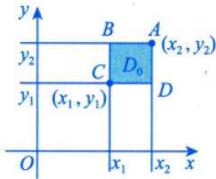

$$
② F (x, y) = P \{X \leqslant x, Y \leqslant y \}
$$

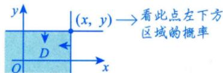

# 边缘分布函数

单独看

设二维随机变量(X,Y)的分布函数为F(x,y)，随机变量X与Y的分布函数Fx（x）与Fy（y）分别称为(X,Y)关于X和关于Y的边缘分布函数.由概率性质得

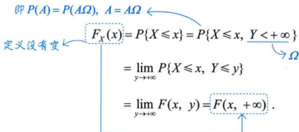  
直接写，不需要中间的过程

同理，有 $F_{Y}(y) = F(+\infty, y)$

随机变量（r.v.）

一维r.v.

$X\sim F(x)$

二维 $r, v$ .

$(X,Y)\sim F(x,y)$ $\rightarrow$ 联合分布函数

$X\sim F_{X}(x) = F(x, + \infty),$

$Y\sim F_{Y}(y) = F(+\infty ,y)$

多了边缘分布函数

# 常见的两类二维随机变量——离散型随机变量与连续型随机变量

是根据实际问题来的

# 二维离散型随机变量的概率分布、边缘分布和条件分布

(1) 概率分布.

也称分布律

考试重点

① 如果二维随机变量 $(X, Y)$ 的可能取值是有限对值或可列无限对值，则称 $(X, Y)$ 为二维离散型随机变量. 无穷可列个（比如像正整数 $1, 2, 3, \dots$ ）

称 $p_{ij} = P\{X = x_i, Y = y_j\}, i, j = 1, 2, \dots$

为 $(X,Y)$ 的分布律或随机变量 $X$ 和 $Y$ 的联合分布律，记为 $(X,Y)\sim p_{ij}$ .联合分布律常用表格形式表示.

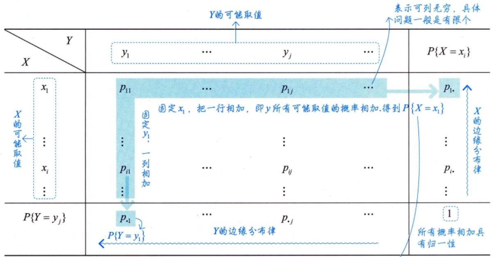

利用全集分解 $P\{X = x_1\} = P\{X = x_1,\Omega \}$ .比如Y只能取 $y_{1}$ 和 $y_{2}$ ，则

上式 $= P\{X = x_{1},(Y = y_{1}\bigcup Y = y_{2})\} = P\{X = x_{1},Y = y_{1}\} +P\{X = x_{1},Y = y_{2}\}$

② 数列 $\{p_{ij}\}$ ， $i, j = 1, 2, \cdots$ 是某一二维离散型随机变量的概率分布的充分必要条件为

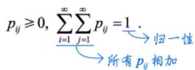

(2)联合分布函数、边缘分布、条件分布.

① 联合分布函数.

设 $(X,Y)$ 的概率分布为 $p_{ij}$ ， $i,j = 1,2,\dots$ ，则 $(X,Y)$ 的分布函数或 $X$ 和 $Y$ 的联合分布函数为

$$
F (x, y) = P \{X \leqslant x, Y \leqslant y \} = \sum_ {x _ {i} \leqslant x} \sum_ {y _ {j} \leqslant y} p _ {i j}.
$$

注 它是以 $(x, y)$ 为顶点的左下方平面上 $(X, Y)$ 取所有可能值的概率的和.

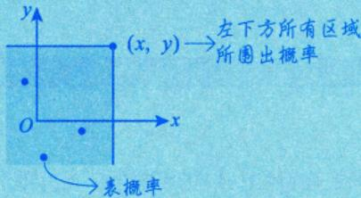

设 $G$ 是平面上的某个区域，则

$$
P \{(X, Y) \in G \} = \sum_ {(x _ {i}, y _ {j}) \in G} p _ {i j}.
$$

注 $(X,Y)$ 落入 $G$ 的概率等于 $(X,Y)$ 在 $G$ 内取所有可能值的概率的和.

离散型问题相对来讲不难，考试为了有区分度，出现的频率很低，但要注意与连续型对比.

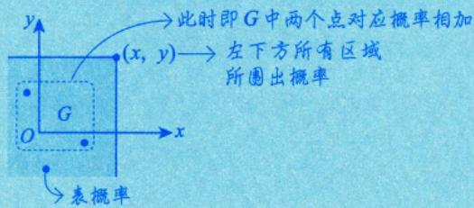

② 边缘分布.

$X, Y$ 的边缘分布分别为

固定 $x_{i}$ ，把所有 $y_{j}$ 的概率相加

$p_{i\cdot} = P\{X = x_{i}\} = \sum_{j = 1}^{\infty}P\{X = x_{i},Y = y_{j}\} = \sum_{j = 1}^{\infty}p_{ij}(i = 1,2,\dots);$ 结合表格计算 $p_{.j} = P\{Y = y_j\} = \sum_{i = 1}^{\infty}P\{X = x_i,Y = y_j\} = \sum_{i = 1}^{\infty}p_{ij}(j = 1,2,\dots).$ （2号

★③条件分布. $\longrightarrow$ 不管是离散还是连续都经常考

如果 $(X,Y)\sim p_{ij}(i,j = 1,2,\dots)$ ，对固定的 $j$ ，如果 $p_{\cdot j} = P\{Y = y_j\} >0$ ，则称

$$
P \{X = x _ {i} \bigcap Y = y _ {j} \} = \frac {P \{X = x _ {i} , Y = y _ {j} \}}{P \{Y = y _ {j} \}} = \frac {p _ {i j}}{p _ {\cdot j}} (i = 1, 2, \dots)
$$

$\rightarrow$ 看谁在帘子后边,今母就是谁

为 $X$ 在“ $Y = y_{j}$ ”条件下的条件分布.

同理，对固定的 $i$ ，如果 $p_{i.} > 0$ ，可定义 $Y$ 在“ $X = x_{i}$ ”条件下的条件分布

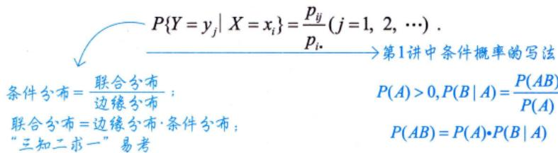

$\Rightarrow$ 在二维表格中

二维离散型随机变量 $\sim p_{ij}\rightarrow$ 联合分布律.

边缘分布 \(\left\{ \begin{array}{l}X\sim p_{i}\text{(把}j\) 的所有情况相加）,\\ Y\sim p_{j}\text{(把}i\) 的所有情况相加）. \end{array} \right.\)

条件分布 $\left\{ \begin{array}{l} P\left\{Y = y_{j} \mid X = x_{i}\right\} = \frac{p_{ij}}{p_{i}}, \\ P\left\{X = x_{i} \mid Y = y_{j}\right\} = \frac{p_{ij}}{p_{j}}. \end{array} \right.$

# 二维连续型随机变量的概率密度、边缘概率密度和条件概率密度

(1) 概率密度.

$①$ 概念.

如果二维随机变量 $(X, Y)$ 的分布函数 $F(x, y)$ 可以表示为

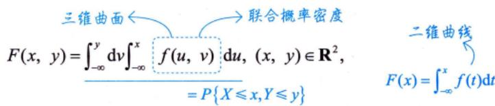

其中 $f(x, y)$ 是非负可积函数，则称 $(X, Y)$ 为二维连续型随机变量，称 $f(x, y)$ 为 $(X, Y)$ 的概率密度，记为 $(X, Y) \sim f(x, y)$ 。

注 连续,即点与点之间的距离是无穷小量.

② 二元函数 $f(x, y)$ 是概率密度的充分必要条件为

$$
\frac {f (x , y) \geqslant 0 , \int_ {- \infty} ^ {+ \infty} \mathrm {d} y \int_ {- \infty} ^ {+ \infty} f (x , y) \mathrm {d} x = 1}{\text {非 负}} \text {在 金 平 面 积 分 结 果 是} 1
$$

注 改变 $f(x, y)$ 的有限个点的值（仍取非负值）， $f(x, y)$ 仍然是概率密度。

(2)联合分布函数与概率密度、边缘概率密度、条件概率密度.

① 联合分布函数与概率密度.

设 $(X,Y)$ 的分布函数为 $F(x,y)$ ，概率密度为 $f(x,y)$ ，则

a. $F(x,y)$ 为 $(x,y)$ 的二元连续函数，且

$$
F (x, y) = P \{X \leqslant x, Y \leqslant y \} = \int_ {- \infty} ^ {y} d v \int_ {- \infty} ^ {x} f (u, v) d u;
$$

b. 设 $G$ 为平面上某个区域，则

$$
\begin{array}{r l}&{\rightarrow \text {在 某 个 区 域 上 取 值}}\\&{P \{(X, Y) \in G \} = \iint_ {G} f (x, y) \mathrm {d} x \mathrm {d} y ;}\\&{\qquad \qquad \qquad \qquad \qquad \qquad \qquad \qquad \text {体 积 对 应 概 率}}\end{array}
$$

c. 若 $f\left( {x,y}\right)$ 在点(x,y)处连续,则 $\frac{{\partial }^{2}F\left( {x,y}\right) }{\partial x\partial y} = f\left( {x,y}\right)$ ；

$\therefore$ 一维为例， $F'(x) = f(x)$ . $F(x)$ 不一定处处可导，但一定连续. 在不可导的地方给 $f(x)$ 赋值即可. 一般赋值为0，二维同理

d. 若 $F(x, y)$ 连续且可导，则 $(X, Y)$ 是连续型随机变量，且 $\frac{\partial^2 F(x, y)}{\partial x \partial y}$ 是它的概率密度。

② 边缘概率密度.

离散的是画表格找边缘

设 $(X,Y)\sim f(x,y)$ ，则 $X$ 的边缘分布函数为

$$
F _ {X} (x) = F (x, + \infty) = \int_ {- \infty} ^ {x} \left[ \int_ {- \infty} ^ {+ \infty} f (u, v) d v \right] d u, \longrightarrow = \int_ {- \infty} ^ {x} g (u) d u
$$

所以 $X$ 是连续型随机变量，其概率密度为

连续即离散得足够靠近,故两者性质应类似 $\rightarrow  x$ 不动. 累加

$f_{X}(x) = \int_{-\infty}^{+\infty}f(x,y)\mathrm{d}y,$ 称 $f_{X}(x)$ 为 $(X,Y)$ 关于 $X$ 的边缘概率密度. 求谁不积谁曲面的面积同理， $Y$ 也是连续型随机变量，其概率密度为 $f_{Y}(y) = \int_{-\infty}^{+\infty}f(x,y)\mathrm{d}x.$

③ 条件概率密度.

设 $(X,Y)\sim f(x,y)$ ，边缘概率密度 $f_{X}(x) > 0$ ，则称

$$
f _ {Y \mid X} (y \mid x) = \frac {f (x , y)}{f _ {X} (x)}
$$

为 $Y$ 在“ $X = x$ ”条件下的条件概率密度.

条件概率密度 $= \frac{\text{联合概率密度}}{\text{边缘概率密度}}$

同理，可定义 $X$ 在“ $Y = y$ ”条件下的条件概率密度

$$
f _ {X | Y} (x \mid y) = \frac {f (x , y)}{f _ {Y} (y)} \left(f _ {Y} (y) > 0\right).
$$

由以上讨论可知，若 $f_{\chi}(x) > 0$ ， $f_{Y}(y) > 0$ ，则有概率密度乘法公式

$$
f (x, y) = f _ {X} (x) f _ {Y \mid X} (y \mid x) = f _ {Y} (y) f _ {X \mid Y} (x \mid y).
$$

注1称

$$
F _ {Y \mid X} (y \mid x) = \int_ {- \infty} ^ {y} f _ {Y \mid X} (y \mid x) d y = \int_ {- \infty} ^ {y} \frac {f (x , y)}{f _ {X} (x)} d y
$$

为 $Y$ 在“ $X = x$ ”条件下的条件分布函数.

同理，可定义 $X$ 在“ $Y = y$ ”条件下的条件分布函数

为了避免字母混淆，可以写成

$$
F _ {Y \mid X} (y \mid x) = \int_ {- \infty} ^ {y} f _ {Y \mid X} (t \mid x) d t
$$

$$
F _ {X | Y} (x \mid y) = \int_ {- \infty} ^ {x} f _ {X | Y} (x \mid y) d x = \int_ {- \infty} ^ {x} \frac {f (x , y)}{f _ {Y} (y)} d x.
$$

注2

<table><tr><td></td><td>二维离散型随机变量</td><td>二维连续型随机变量</td></tr><tr><td>概率分布/概率密度</td><td>(X,Y)~pij</td><td>(X,Y)~f(x,y)</td></tr><tr><td>联合分布F(x,y)</td><td>∑xij=xyj≤ypiij</td><td>∫y-∞dv∫x-∞f(u,v)du</td></tr><tr><td>边缘分布FX(x), FY(y)</td><td>{X~pi=∑j=1∞pij, Y~pj=∑i=1∞piij}</td><td>{X~FX(x)=∫x-∞fX(u)du=f∫x-∞∫+∞f(u,v)dvdu, Y~FY(y)=∫y-∞fY(v)dv=f∫y-∞∫+∞f(u,v)du dv}</td></tr><tr><td>条件分布 FY|X(y|x), FX|Y(x|y)</td><td>{P{Y=yj|X=xi}=pi/pi, P{X=xj|Y=yj}=pi/pj}</td><td>{FY|X(y|x)=∫y-∞f(u,v)/fX(u)dv, FXY(y|x/y)=∫x-∞f(u,v)/fY(v)du}</td></tr></table>

(3) 常见的二维分布.→《全国硕士研究生招生考试数学考试大纲》要求掌握两种

$①$ 二维均匀分布.

如果 $(X,Y)$ 的概率密度为

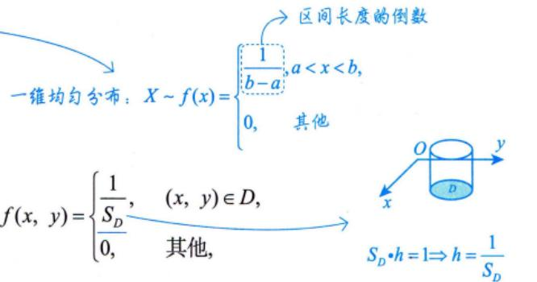  
不画图直接算面积也可以

其中 $S_{D}$ 为区域 $D$ 的面积，则称 $(X,Y)$ 在平面有界区域 $D$ 上服从均匀分布.

★★★②二维正态分布. 记住以下结论即可,不必看证明

如果 $(X,Y)$ 的概率密度为

一维正态分布： $X\sim f(x) = \frac{1}{\sqrt{2\pi}\sigma}\mathrm{e}^{\frac{(x - \mu)^{2}}{2\sigma^{2}}}\longrightarrow$ 记住！考试会考 $f(x,y) = \frac{1}{2\pi\sigma_1\sigma_2\sqrt{1 - \rho^2}}\exp \left\{-\frac{1}{2(1 - \rho^2)}\left[\left(\frac{x - \mu_1}{\sigma_1}\right)^2 -\right.\right.$

表示 $X$ 与 $Y$ 间的相关系数

X的期望、标准差1-ρ²其中μ∈R，μ∈R,σ>0,σ>0,-1<ρ<1，则称(X,Y)服从参数为μ,μ,σ²,σ²,ρ的二维正态Y的期望、标准差→若ρ=0,(X,Y)~f(x,y)=e[（x-μ）²+(y-μ）²]分布，记为(X,Y)~N(μ,μ;σ²,σ²;ρ).此时有5个参数如果ρ=0，联合概率 =1/√2πσe（x-μ）² 1 e（y-μ）²密度等于两个边缘概率密度的乘积.是最简单的情况

a.若 $(X_{1},X_{2})\sim N(\mu_{1},\mu_{2};\sigma_{1}^{2},\sigma_{2}^{2};\rho)$ ，则  
边缘分布一定是正态分布 $X_{1}\sim N(\mu_{1},\sigma_{1}^{2}),X_{2}\sim N(\mu_{2},\sigma_{2}^{2}).$ 但两个正态分布联合未必是二维正态分布恰好说明：b.若 $X_{1}\sim N(\mu_{1},\sigma_{1}^{2})$ ， $X_{2}\sim N(\mu_{2},\sigma_{2}^{2})$ 且 $X_{1}$ ， $X_{2}$ 相互独立，则相关性是指线性相关的程度.不相关即不线性相关，  
但可能有非线性关系，故不相关求必独立独立 $\Rightarrow$ 不相关，故 $\rho = 0$ $(X_1,X_2)\sim N(\mu_1,\mu_2;\sigma_1^2,\sigma_2^2;0).$ （20号 $X_{2}$ 取什么值，不影响 $X_{1}$ 取什么值的概率，反之也是.即 $X_{1}$ 与 $X_{2}$ 没有任何关系

c. $(X_{1},X_{2})\sim N\Rightarrow k_{1}X_{1} + k_{2}X_{2}\sim N(k_{1},k_{2}$ 是不全为0的常数）

线性组合依然服从正态分布

此类题几乎不考大题,如果考大题可学习本题的过程.本题

是基本问题，在传统考研题中会出现，第（1）问是随机事

件与概率，属于古典概型问题

例3.1 将两封信投入3个信箱，设 $X_{1}$ ， $X_{2}$ 分别表示第一个和第二个信箱投进的信的数量，求：

(1) $(X_{1},X_{2})$ 的分布律、边缘分布；  
(2)在条件 $X_{2} = 1$ 下， $X_{1}$ 的条件分布. 3个信箱

分析 不限定每个信箱放入信的数量， $X_{1}$ 与 $X_{2}$ 的可能取值为0,1,2.

第一封信投入3个信箱有3种可能，第二封信投入3个信箱也有3种可能

解 (1) $X_{1}$ 与 $X_{2}$ 可能取值为0,1,2，样本点总数为 $3^{2} = 9$ ，则

$$
p _ {0 0} = P \{X _ {1} = 0, X _ {2} = 0 \} = \frac {1}{9},
$$

第1个、第2个信箱没有信

即信都在第3个信箱中

$$
p _ {0 1} = P \left\{X _ {1} = 0, X _ {2} = 1 \right\} = \frac {2}{9},
$$

第1个信箱中没有，第2个信箱有1封，

第3个信箱有1封， $\mathbf{C}_2^1\mathbf{C}_1^1$ 种可能

$$
\begin{array}{l} p _ {0 2} = P \{X _ {1} = 0, X _ {2} = 2 \} = \frac {1}{9}, \\ p _ {1 0} = P \left\{X _ {1} = 1, X _ {2} = 0 \right\} = \frac {2}{9}, \\ p _ {1 1} = P \left\{X _ {1} = 1, X _ {2} = 1 \right\} = \frac {2}{9}, \\ p _ {1 2} = P \left\{X _ {1} = 1, X _ {2} = 2 \right\} = 0, \\ p _ {2 0} = P \left\{X _ {1} = 2, X _ {2} = 0 \right\} = \frac {1}{9}, \\ p _ {2 1} = p _ {2 2} = 0, \\ \end{array}
$$

于是 $(X_{1},X_{2})$ 的分布律与边缘分布为

<table><tr><td>X2
X1</td><td>0</td><td>1</td><td>2</td><td>pi.</td></tr><tr><td>0</td><td>1/9</td><td>2/9</td><td>1/9</td><td>行相加 4/9</td></tr><tr><td>1</td><td>2/9</td><td>2/9</td><td>0</td><td>→ 4/9</td></tr><tr><td rowspan="2">2</td><td rowspan="2">1/9</td><td>0</td><td>0</td><td rowspan="2">→ 1/9</td></tr><tr><td>↓</td><td>↓相加</td></tr><tr><td>p.j</td><td>4/9</td><td>4/9</td><td>1/9</td><td>1→归一性</td></tr></table>

没有独立性前提，在一个事件发生的条件下，会影响另一个事件的概率(2) $P\{X_1 = 0|X_2 = 1\} = \frac{p_{01}}{p_{,1}} = \frac{\frac{2}{9}}{\frac{4}{9}} = \frac{1}{2},$ 按数字标

$$
P \{X _ {1} = 1 \mid X _ {2} = 1 \} = \frac {p _ {1 1}}{p _ {\cdot 1}} = \frac {\frac {2}{9}}{\frac {4}{9}} = \frac {1}{2},
$$

$$
P \{X _ {1} = 2 \mid X _ {2} = 1 \} = 0,
$$

所以在条件 $X_{2} = 1$ 下， $X_{1}$ 的条件分布为

$$
X _ {1} \sim \left( \begin{array}{c c} 0 & 1 \\ \frac {1}{2} & \frac {1}{2} \end{array} \right).
$$

例3.2 二维随机变量 $(X,Y)$ 的概率分布为

<table><tr><td>X Y</td><td>0</td><td>1</td></tr><tr><td>0</td><td>0.4</td><td>a</td></tr><tr><td>1</td><td>b</td><td>0.1</td></tr></table>

若随机事件 $\{X = 0\}$ 与 $\{X + Y = 1\}$ 相互独立，则（ ）

(A) $a = 0.2, b = 0.3$

(B) $a = 0.1, b = 0.4$

(C) $a = 0.3, b = 0.2$

(D) $a = 0.4, b = 0.1$

应选(D).

由联合分布、边缘分布及条件分布的性质，有

$$
P \{X = 0 \} = p _ {0 0} + p _ {0 1} = 0. 4 + a,
$$

$$
P \{X + Y = 1 \} = p _ {0 1} + p _ {1 0} = a + b,
$$

$$
p _ {0 0} + p _ {0 1} + p _ {1 0} + p _ {1 1} = \underbrace {a + b + 0 . 5} _ {\text {归 一 性}} = 1 \Rightarrow a + b = 0. 5,
$$

$$
P \{X = 0, X + Y = 1 \} = P \{X = 0, Y = 1 \} = a.
$$

又 $\{X = 0\}$ 与 $\{X + Y = 1\}$ 相互独立，故

$$
\begin{array}{l} P \{X = 0, X + Y = 1 \} = P \{X = 0 \} \cdot \underline {{P \{X + Y = 1 \}}} \\ = (0. 4 + a) (a + b) \\ = 0. 5 (0. 4 + a). \\ \end{array}
$$

因此 $0.5(0.4 + a) = a$ ，解得 $a = 0.4$ ， $b = 0.5 - 0.4 = 0.1$ ，故选择(D).

例3.3 已知二维随机变量 $(X,Y)$ 在 $G$ 上服从均匀分布， $G$ 由直线 $x - y = 0$ $x + y = 2$ 与 $y = 0$ 围成，求： 连续型

(1) 边缘概率密度 $f_{X}(x)$ 和 $f_{Y}(y)$   
(2)条件概率密度 $f_{X|Y}(x|y)$ ：

分析 先画图，求面积，再写出联合概率密度.由联合概率密度求边缘概率密度几乎必考，很重要.

解 $(X,Y)$ 的正概率密度区域如图3-1所示.

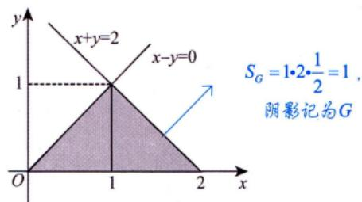  
图3-1

由题设， $(X,Y)$ 的概率密度为

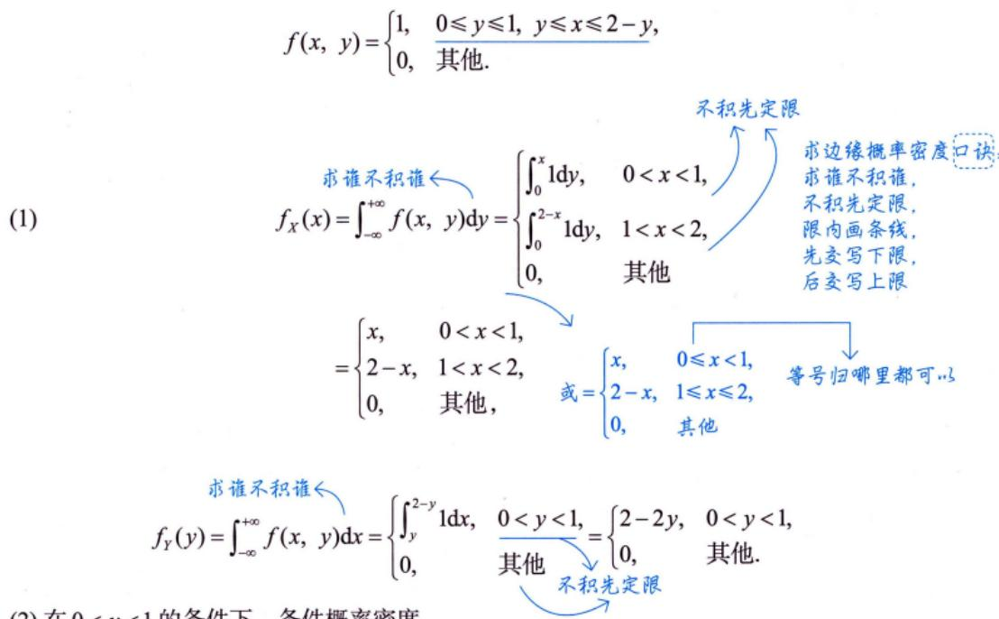

(2) 在 $0 < y < 1$ 的条件下，条件概率密度

$f_{X|Y}(x|\bar{y}) = \frac{f(x,y)}{\bar{f}_Y(y)} = \frac{1}{2 - 2y},y\leqslant x\leqslant 2 - y,$ $f_{X|Y}(x|\bar{y}) = \frac{f(x,y)}{f_Y(y)} = \frac{1}{2 - 2y},y\leqslant x\leqslant 2 - y,$ $f_{X|Y}(x|\bar{y}) = \frac{f(x,y)}{f_Y(y)} = \frac{1}{2 - 2y},y\leqslant x\leqslant 2 - y,$ $f_{X|Y}(x|\bar{z}) = \frac{f(x,y)}{f_Y(y)} = \frac{1}{2 - 2y},y\leqslant x\leqslant 2 - y,$ $f_{X|Y}(x|\bar{y}) = \frac{f(x,y)}{f_Y(y)} = \frac{1}{2 - 2y},y\leqslant x\leqslant 2 - y,\quad$ $f_{X|Y}(x|\bar{y}) = \frac{f(x,y)}{f_Y(y)} = \frac{1}{2 - 2y},y\leqslant x\leqslant 2 - y,$ $f_{X|Y}(x|\bar{y}) = \frac{f(x,y)}{f_Y(y)} = \frac{1}{2 - 2y},y\leqslANT x\leqslant 2 - y,$ $f_{X|Y}(x|\bar{y}) = \frac{f(x,y)}{f_Y(y)} = \frac{1}{2 - 2y},y\leqslant x\leqslant 2 - y,$ $f_{X|Y}(x|\bar{y}) = \frac{f(x,y)}{f_Y(y)} = \frac{1 + 1}{2 - 2y},y\leqslant x\leqslant 2 - y,$ $f_{X|Y}(x|\bar{y}) = \frac{f(x,y)}{f_Y(y)} = \frac{1 + 1}{2 - 2y},y\leqslant x\leqslant 2 - y,$ $f_{X|Y}(x|\bar{y}) = f_{X|Y}(x|\bar{y}) = \frac{1 + 1}{2 - 2y},y\leqslant x\leqslant 2 - y,$ $f_{X|Y}(x|\bar{y}) = f_{X|Y}(x|\bar{y}) = \frac{1 + 1}{2 - 2y},y\leqslant x\leqslant 2 - y,$ $f_{X|Y}(X|\bar{y}) = \frac{\left(1 + \sqrt{x^2 + y^2}\right)^{\frac{1}{2}}}{4},$ $f_{X|Y}(x|\bar{y}) = \frac{(1 + \sqrt{x^2 + y^2})^{1 / 3}}{4}.$

无条件分布 $\langle \rangle$ 0到1内任意实数

例3.4 已知随机变量 $X$ 在区间 $[0,1]$ 上服从均匀分布，在 $X = x(0 < x < 1)$ 的条件下，随机变量 $Y$ 在区间 $[0,x]$ 上服从均匀分布，求：一般写(0,1)

(1) $(X,Y)$ 的概率密度；  
(2) $Y$ 的概率密度；  
(3)概率 $P\{X + Y > 1\}$ . $\longrightarrow$ 很重要，典型问题一维： $P\{(X,Y)\in D\} = \iint_{D}f(x,y)\mathrm{d}\sigma$ 解 (1)由题设， $X$ 的边缘概率密度为

$$
f _ {X} (x) = \left\{ \begin{array}{l l} 1, & 0 <   x <   1, \\ 0, & \text {其 他}. \end{array} \right.
$$

在 $X = x(0 < x < 1)$ 的条件下，随机变量 $Y$ 的条件概率密度为

$f = \left\{  \begin{array}{ll} \frac{1}{x}, & 0 < y < x < 1, \\  0, & \text{其他. } \end{array}\right.$ $\rightarrow$ 常数

因此，当 $0 <   y <   x <   1$ 时， $f(x,y) = f_{X}(x)f_{Y|X}(y|x) = \frac{1}{x}$ 故 $(X,Y)$ 的概率密度为变量 $f(x,y) = \left\{ \begin{array}{ll} \frac{1}{x}, & 0 <   y <   x <   1,\\ 0, & \text{其他}. \end{array} \right.$

(2) $(X,Y)$ 的正概率密度区域如图3-2所示.

当 $0 < y < 1$ 时， $f_{Y}(y) = \int_{-\infty}^{+\infty} f(x, y) \, \mathrm{d}x = \int_{y}^{1} \frac{1}{x} \, \mathrm{d}x = -\ln y$ ；

当 $y \leqslant 0$ 或 $y \geqslant 1$ 时， $f_{Y}(y) = 0$

从而有 $f_{Y}(y) = \left\{ \begin{array}{ll} - \ln y, & 0 <   y <   1,\\ 0, & \text{其他}. \end{array} \right.$

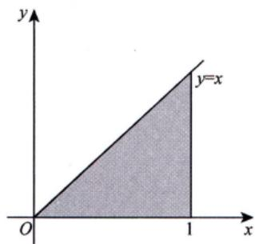  
图3-2

★★★(3) $P\{X + Y > 1\} = \iint_{x + y > 1}f(x,y)\mathrm{d}x\mathrm{d}y = \int_{\frac{1}{2}}^{1}\mathrm{d}x\int_{1 - x}^{x}\underbrace{\frac{1}{x}}_{x}\mathrm{d}y = \int_{\frac{1}{2}}^{1}(2x - 1)\bullet \frac{1}{x}\mathrm{d}x = 1 - \ln 2.$

注 (1) 第 (1) 问中, 当 $f_{X}(x) > 0$ 时, 才有 $f_{Y|X}(y|x) = \frac{f(x, y)}{f_{X}(x)}$ , 所以 $f(x, y) = f_{X}(x) \cdot f_{Y|X}(y|x)$ 是在 $f_{X}(x) > 0$ 时的表达式, 故最终结果要加上 $f_{X}(x) = 0$ 时的定义, 一般说来, 会归类到分段表达式的“其他”中, 这样就定义全面了.  
(2) 连续型: $(X, Y) \sim f(x, y)$ .

边缘概率密度 $\left\{ \begin{array}{l} f_{X}(x) = \int_{-\infty}^{+\infty}f(x,y)\mathrm{d}y, \\ f_{Y}(y) = \int_{-\infty}^{+\infty}f(x,y)\mathrm{d}x. \end{array} \right.$

条件概率密度 $\left\{ \begin{array}{l} f_{X|Y}(x|y) = \frac{f(x,y)}{f_Y(y)}, \\ f_{Y|X}(y|x) = \frac{f(x,y)}{f_X(x)}. \end{array} \right.$

一个事件的发生，不会促进，也不会抑止另一个事件的发生

# 三 随机变量的相互独立性

# 概念

(1) 设二维随机变量 $(X, Y)$ 的分布函数为 $F(x, y)$ ，边缘分布函数分别为 $F_{X}(x), F_{Y}(y)$ ，如果对任意的实数 $x, y$ ，都有

充要条件 $F(x,y) = F_{X}(x)\bullet F_{Y}(y)$ （即事件 $\{X\leqslant x\}$ 与 $\{Y\leqslant y\}$ 相互独立），则称 $X$ 与 $Y$ 相互独立，否则称 $X$ 与 $Y$ 不相互独立.

(2)如果 $n$ 维随机变量 $(X_{1},X_{2},\dots ,X_{n})$ 的分布函数等于边缘分布函数的乘积，即

$$
F \left(x _ {1}, x _ {2}, \dots , x _ {n}\right) = F _ {1} \left(x _ {1}\right) \cdot F _ {2} \left(x _ {2}\right) \dots \cdot F _ {n} \left(x _ {n}\right),
$$

其中 $F_{i}(x_{i})(i = 1,2,\dots ,n)$ 为 $X_{i}$ 的边缘分布函数， $x_{i}$ 为任意实数，则称 $X_{1},X_{2},\dots ,X_{n}$ 相互独立.

$\therefore n = 3$ 为例， $F(x_{1},x_{2},x_{3}) = F_{1}(x_{1})\bullet F_{2}(x_{2})\bullet F_{3}(x_{3}).$ ①

$F_{1}(x_{1}) = P\{X_{1}\leqslant x_{1}\}$ ， $x_{1}$ 是可以任意取值的.

这个式子其实包含了任意的两个变量独立的情况，不需要像事件的独立性，列多个式子

当 $x_{1}\rightarrow +\infty$ ， $1 = P\{\Omega \}$ ，此时

$$
F \left(x _ {1}, x _ {2}, x _ {3}\right) = F \left(x _ {2}, x _ {3}\right) = F _ {2} \left(x _ {2}\right) \cdot F _ {3} \left(x _ {3}\right).
$$

$$
F \left(x _ {1}, x _ {2}\right) = P \left\{X _ {1} \leqslant x _ {1}, X _ {2} \leqslant x _ {2} \right\};
$$

$$
F _ {1} \left(x _ {1}\right) = P \left\{X _ {1} \leqslant x _ {1} \right\};
$$

$$
F _ {1} \left(x _ {1}\right) \geqslant F \left(x _ {1}, x _ {2}\right). \quad ②
$$

①, ②的不等关系和蕴含关系, 可以取特殊值, 或把定义写出来之后, 用不定式、

单调性对式子进行处理

(3) 如果对任意实数 $x_{i}(i = 1,2,\dots ,n)$ 与 $y_{j}(j = 1,2,\dots ,m)$ ，有

分别满足了两个事件的积再取交

乘积的概率 $=$ 概率的乘积 $P\{X_{1}\leqslant x_{1},X_{2}\leqslant x_{2},\dots ,X_{n}\leqslant x_{n},Y_{1}\leqslant y_{1},Y_{2}\leqslant y_{2},\dots ,Y_{m}\leqslant y_{m}\}$ $= P\{X_1\leqslant x_1,X_2\leqslant x_2,\dots ,X_n\leqslant x_n\} \bullet P\{Y_1\leqslant y_1,Y_2\leqslant y_2,\dots ,Y_m\leqslant y_m\} ,$

即联合分布函数等于各自的分布函数相乘：

$$
F \left(x _ {1}, x _ {2}, \dots , x _ {n}, y _ {1}, y _ {2}, \dots , y _ {m}\right) = F _ {1} \left(x _ {1}, x _ {2}, \dots , x _ {n}\right) \cdot F _ {2} \left(y _ {1}, y _ {2}, \dots , y _ {m}\right),
$$

则两个多维随机变量 $\left( {{X}_{1},{X}_{2},\cdots ,{X}_{n}}\right)$ 与 $\left( {{Y}_{1},{Y}_{2},\cdots ,{Y}_{m}}\right)$ 相互独立. 理论上了解,不必验证

# 相互独立的充要条件

(1) $n$ 个随机变量 $X_{1}, X_{2}, \dots, X_{n}$ 相互独立

$\Leftrightarrow$ 对任意的 $n$ 个实数 $\{x_{i}\} (i = 1,2,\dots ,n)$ ， $n$ 个事件 $\{X_1\leqslant x_1\} ,\{X_2\leqslant x_2\} ,\dots ,\{X_n\leqslant x_n\}$ 相互独立.具有任意性， $x_{i}\in (-\infty , + \infty)$

★★★(2) $①$ 设 $(X,Y)$ 为二维离散型随机变量，则

虽然简单，但经常考 $X$ 与 $Y$ 相互独立 $\Leftrightarrow$ 联合分布律等于边缘分布相乘，

如可在例3.1中加(3) $X_{1}$ ， $X_{2}$ 是否独立？即 由于 $\overrightarrow{p_{00}}\neq \overrightarrow{p_{0,}p_{,0}}$ 故 $X_{1}$ 与 $X_{2}$ 不独立. $P\{X = x_i,Y = y_j\} = P\{X = x_i\} \bullet P\{Y = y_j\} (i,j = 1,2,\dots).$ 验证的方法很多，找一个就行实际考题一般只考二值

② $n$ 个离散型随机变量 $X_{1}, X_{2}, \dots, X_{n}$ 相互独立

$\Leftrightarrow$ 对任意的 $x_{i}\in D_{i} = \{X_{i}$ 的一切可能值 $\} (i = 1,2,\dots ,n)$ ，有

$$
P \left\{X _ {1} = x _ {1}, \dots , X _ {n} = x _ {n} \right\} = \prod_ {i = 1} ^ {n} P \left\{X _ {i} = x _ {i} \right\}.
$$

★★★(3) $①$ 设 $(X,Y)$ 为二维连续型随机变量，则

即

$X$ 与 $Y$ 相互独立 $\Leftrightarrow$ 概率密度等于边缘概率密度相乘，

$$
f (x, y) = f _ {X} (x) \cdot f _ {Y} (y).
$$

② 设 $(X_{1}, X_{2}, \dots, X_{n})$ 为 $n$ 维连续型随机变量，则

$X_{1}, X_{2}, \dots, X_{n}$ 相互独立 $\Leftrightarrow$ 概率密度等于边缘概率密度相乘，

即

$$
f (x _ {1}, x _ {2}, \dots , x _ {n}) = f _ {1} (x _ {1}) \cdot f _ {2} (x _ {2}) \cdot \dots \cdot f _ {n} (x _ {n}),
$$

其中 $f_{i}(x_{i})$ 为 $X_{i}$ 的边缘概率密度.

# 相互独立的性质

类似线性代数中的向量组，整体向量组线性无关，则部分向量组线性无关

(1) 设 $X_{1}, X_{2}, \cdots, X_{n}$ 相互独立，则其中任意 $k (2 \leqslant k \leqslant n)$ 个随机变量也相互独立. 部分

(2) ① 设 $(X, Y)$ 为二维离散型随机变量， $X$ 与 $Y$ 独立，则条件分布等于边缘分布：

类似 $P(B\mid A) = P(B),$ $P(A) > 0$ Y的取值不影响X的概率前提 第1讲事件概率中推导的基本性质

$P\{Y = y_{j} \mid X = x_{i}\} = P\{Y = y_{j}\} (P\{X = x_{i}\} > 0).$ $X$ 的取值不影响 $Y$ 的概率

② 设 $(X, Y)$ 为二维连续型随机变量， $X$ 与 $Y$ 独立，则条件概率密度等于边缘概率密度：

$$
\begin{array}{r l} & \overrightarrow {f _ {X | Y}} (x \mid y) = \frac {f (x , y)}{f _ {Y} (y)} = f _ {X} (x) (f _ {Y} (y) > 0), \\ & f _ {Y | X} (y \mid x) = \frac {f (x , y)}{f _ {X} (x)} = f _ {Y} (y) (f _ {X} (x) > 0). \end{array}
$$

③ 若 $X_{1}, X_{2}, \cdots, X_{n}$ 相互独立， $g_{1}(x), g_{2}(x), \cdots, g_{n}(x)$ 为一元连续函数，则 $g_{1}(X_{1}), g_{2}(X_{2}), \cdots, g_{n}(X_{n})$ 相互独立。分组(分成若干组，变量不重叠)

一般地，若 $X_{11},\dots ,X_{1t_1},\overline{X_{21}},\dots ,X_{2t_2},\dots ,X_{n1},\dots ,X_{nt_n}$ 相互独立， $g_{i}$ 是 $t_i(i = 1,2,\dots ,n)$ 元连续函数，则 $g_{1}(X_{11},\dots ,X_{1t_{1}}),g_{2}(X_{21},\dots ,X_{2t_{2}}),\dots ,g_{n}(X_{n1},\dots ,X_{nt_{n}})$ 也相互独立.

注 (1)所有涉及的 $n$ 维,只是为了数理统计中应用这些原理、性质.只需掌握二维中的性质即可. (2)二维随机变量 $\left( {X,Y}\right)$ .

$$
\begin{array}{r l} & {\text {独 立} \stackrel {\text {定 义}} {\Leftrightarrow} F (x, y) = F _ {X} (x) \bullet F _ {Y} (y), \text {任 意} x, y} \\ & {\quad \stackrel {\text {离 散 型}} {\Leftrightarrow} p _ {i j} = p _ {i} \bullet p _ {- j}, \text {任 意} i, j} \\ & {\quad \stackrel {\text {连 续 型}} {\Leftrightarrow} f (x, y) = f _ {X} (x) \bullet f _ {Y} (y).} \end{array}
$$

# $X$ 与 $Y$ 不独立的判断与证明

$X$ 与 $Y$ 不独立 $\Leftrightarrow$ 存在 $x_0, y_0$ ，使 $A = \{X \leqslant x_0\}$ 与 $B = \{Y \leqslant y_0\}$ 不独立，即

从分布函数判断也常考 $F\left( {{x}_{0},{y}_{0}}\right)  \neq  {F}_{X}\left( {x}_{0}\right)  \cdot  {F}_{Y}\left( {y}_{0}\right) .$ 此如前边补充的例3.1(3)

也即取合适的 $x_0, y_0$ ，使 $P\{X \leqslant x_0\} \cdot P\{Y \leqslant y_0\} \neq P\{X \leqslant x_0, Y \leqslant y_0\}$ 。如：取 $x_0, y_0$ ，使 $0 < P\{X \leqslant x_0\} < 1$ ， $0 < P\{Y \leqslant y_0\} < 1$ ，但 $\{X \leqslant x_0\} \subset \{Y \leqslant y_0\}$ 或 $\{Y \leqslant y_0\} \subset \{X \leqslant x_0\}$ 或 $\{X \leqslant x_0, Y \leqslant y_0\} = \emptyset$ 等。

三种取法应掌握.应用见例3.6

正向会推，反向也需要会写严格的证明过程。

例3.5 设随机变量 $X \sim N(0,1)$ ，在 $X = x$ 的条件下，随机变量 $Y \sim N(x,1)$ ，则 $(X,Y)$ 的概率密度 $f(x,y) = \_$

解 应填 $\frac{1}{2\pi}\mathrm{e}^{-\frac{2x^2 + y^2 - 2xy}{2}}$

由题意知 $f_{X}(x) = \frac{1}{\sqrt{2\pi}}\mathrm{e}^{-\frac{x^{2}}{2}},f_{Y|X}(y|x) = \frac{1}{\sqrt{2\pi}}\mathrm{e}^{-\frac{(y - x)^{2}}{2}},$

故 $f(x, y) = f_{X}(x) \cdot f_{Y|X}(y|x) = \frac{1}{2\pi} \mathrm{e}^{-\frac{2x^{2} + y^{2} - 2xy}{2}}.$

注 考题中不会单独考查这一点，会结合其他知识点一起命题.

$\rightarrow$ 很重要, 但真正考试不会单独作为一个大题, 一般会作为选择题 ★★★ 例3.6 设随机变量 $X$ 的概率密度为

$$
f (x) = \frac {1}{2} e ^ {- | x |}, x \in (- \infty , + \infty),
$$

证明： $X$ 与 $|X|$ 不独立.

分析 首先需要想到什么是独立、什么是不独立，再看题目已给出 $X$ 的概率密度，需要找 $|X|$ 的概率密度，可以根据前边学习的知识，求 $|X|$ 的分布函数，也可以求联合概率密度。具体选什么方法，需要结合具体问题确定，本题最优解法是根据定义找 $x_0$ ，使 $P\{X \leqslant x_0, |X| \leqslant x_0\} \neq P\{X \leqslant x_0\} \cdot P\{|X| \leqslant x_0\}$ 。

证 取 $x_0 = 1$ ，则

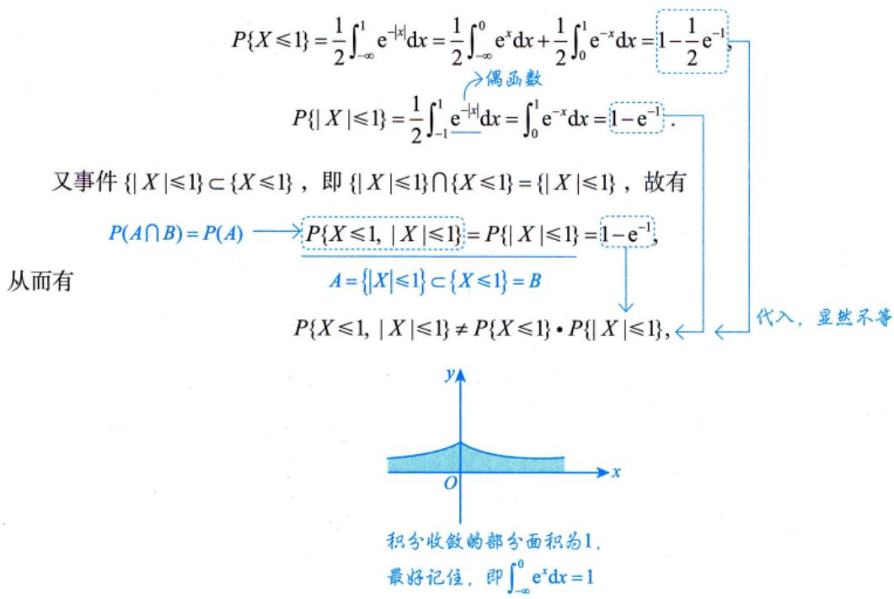

因此， $X$ 与 $|X|$ 不独立.

注 本题中 $x_0$ 可取任意正数.

作为选择题时，可以口算

$$
P \left\{X \leqslant 1, | X | \leqslant 1 \right\} = P \left\{| X | \leqslant 1 \right\},
$$

而 $P\{X \leqslant 1\} \cdot P\{|X| \leqslant 1\}$ 显然是 $P\{|X| \leqslant 1\}$ 乘上一个小于 1 的正数. 故必然有

$$
P \left\{X \leqslant 1, | X | \leqslant 1 \right\} \neq P \left\{X \leqslant 1 \right\} \cdot P \left\{| X | \leqslant 1 \right\}.
$$

基础阶段先学好基础知识，强化阶段慢慢总结做题技巧.

★★★四多维随机变量函数的分布 随机事件和概率，没有统一化的研究对象

对分布函数的考查达到顶峰，既是知识的一脉相承，也是对前边所有知识的总结。此部分内容需要考生好好掌握

概念

设 $X, Y$ 为随机变量， $g(x, y)$ 是二元函数，则以随机变量 $X, Y$ 作为变量的函数 $Z = \{g_{1}(X, Y)$ 也是 拼一起是二维 是一维 随机变量，称为随机变量 $X, Y$ 的函数。例如： $Z = X + Y, Z = \left\{ \begin{array}{ll} 1, & X < Y, \\ 0, & X \geqslant Y \end{array} \right.$ 等。输入 $(X, Y)$ ，输出一个 $Z$ 值加减乘除。有很好的实际背景，很多问题都可以抽象成线性组合

常考问题: 已知(X,Y)的分布,求Z=g(X,Y)的分布; 又U=h(X,Y),求(Z,U)的分布. 联合 由于 $Z$ 是一维的,求 $Z$ 的分布,即求一维随机变量的分布 数值函数

2 求法

已知 $(X,Y)$ 的分布，求函数 $Z = g(X,Y)$ 的分布.首先要确定 $X,Y$ 的类型，然后采用相应的公式计算.

(1) 如果 $(X, Y)$ 是二维离散型随机变量，则 $Z = \{g(X, Y)\}$ 也是离散型的，先确定 $Z$ 的值，而后求其相应的概率，即可求得 $Z$ 的分布，具体见例3.7.

此类问题比较简单

★★★(2)如果 $X,Y$ 其中一个是离散型的，另一个是非离散型的，将事件对离散型的一切可能值进行全集分解，而后应用全概率公式求得 $Z$ 的分布，具体见例3.10.

很重要高考重点考 $\left\{  \begin{array}{l} \text{ 若 }\left( {X,Y}\right)  \sim  {p}_{ij}. \\  \text{ 若 }\left( {X,Y}\right)  \sim  f\left( {x,y}\right) . \end{array}\right.$ 考研重点考若 $\left( {X,Y}\right)$ ,便没有 ${p}_{ij}$ ,也没有 $f\left( {x,y}\right)$ ,问题会复杂一些

(3)如果 $(X,Y)$ 是二维连续型随机变量，即 $(X,Y)\sim f(x,y)$ ，则 $Z = g(X,Y)$ 的分布函数

$$
F (z) = P \{g (X, Y) \leqslant z \} = \iint_ {g (x, y) \leqslant z} f (x, y) d x d y,
$$

其中 $-\infty < z < +\infty$ ，讨论起来会复杂一些

要求概率密度 $f(z)$ ，亦可直接用下面的“四、3.”中所讲公式，具体见例3.8，例3.9。

求概率密度前一般先求分布函数 $F(z)$ ，再求导得到 $f(z)$

$$
F (z) = P \{Z \leqslant z \}
$$

注设 $(X,Y)$ 是二维连续型随机变量，且 $(X,Y)\sim f(x,y)$ ，若 $\left\{ \begin{array}{ll}u = u(x,y),\\ v = v(x,y), \end{array} \right.$ 且 $u$ ，v具有一阶连续偏

导数. $\left\{  {\begin{array}{l} x = x\left( {u,v}\right) , \\  y = y\left( {u,v}\right)  \end{array}\text{是其唯一反函数,则}\left( {X,Y}\right) \text{的函数}\left\{  {\begin{array}{l} U = U\left( {X,Y}\right) , \\  V = V\left( {X,Y}\right)  \end{array}\text{的}{f}_{U,V}\left( {u,v}\right)  = f\left\lbrack  {x\left( {u,v}\right) ,y\left( {u,v}\right) }\right\rbrack   * J}\right\}  }\right.$ 已知 $f\left( {x,y}\right)$

其中 $J = \frac{\partial(x,y)}{\partial(u,v)} = \begin{vmatrix} \frac{\partial x}{\partial u} & \frac{\partial x}{\partial v}\\ \frac{\partial y}{\partial u} & \frac{\partial y}{\partial v} \end{vmatrix} = \left[ \begin{array}{cc}\frac{\partial(u,v)}{\partial(x,y)} \end{array} \right]^{-1} = \left| \begin{array}{cc}\frac{\partial u}{\partial x} & \frac{\partial u}{\partial y}\\ \frac{\partial v}{\partial x} & \frac{\partial v}{\partial y} \end{array} \right|^{-1}\neq 0$ ，那么

$$
\left. \begin{array}{l} U \sim f _ {U} (u) = \int_ {- \infty} ^ {+ \infty} f [ x (u, v), y (u, v) ] | J | \mathrm {d} v, \\ V \sim f _ {V} (v) = \int_ {- \infty} ^ {+ \infty} f [ x (u, v), y (u, v) ] | J | \mathrm {d} u. \end{array} \right\} \text {直 接 用 这 两 个}
$$

证

$$
F _ {U, V} (u, v) = P \left\{U \leqslant u, V \leqslant v \right\}
$$

$$
= P \left\{U (X, Y) \leqslant u, V (X, Y) \leqslant v \right\}
$$

即两个区域的交集 $\rightarrow  X,Y$ 的另一个范围

$$
= \iint_ {D _ {x y}} f (x, y) d x d y
$$

换元 $\frac{x = x\left( {u,v}\right) }{y = y\left( {u,v}\right) }{\iint }_{D}f\left\lbrack  {\underline{x}\left( {u,v}\right) ,y\left( {u,v}\right) }\right\rbrack  J\left| {\mathrm{d}u\mathrm{\;d}v}\right|$

换积分区域

换积分变量

换雅可比行列式的绝对值，表示从一个坐标系到另一个坐标系几何度量上的转换系数

故 $f_{U,V}(u,v) = \frac{\partial^2F_{U,V}(u,v)}{\partial u\partial v} = f[x(u,v),y(u,v)]|J|$ . 由 $U, V$ 的联合概率密度可得 $U, V$ 的边缘概率密度，如上所写.

在高等数学中，我们已经熟练掌握了二重积分的换元积分法，故在此给出换元法求 $f_{u,v}(u,v)$ 这是比卷积公式更为有用且极为简便的方法.

# 相互独立随机变量函数的分布及卷积公式

(1) 和的分布.

设 $(X,Y)\sim f(x,y)$ ，则 $Z = X + Y$ 的概率密度为

$$
\begin{array}{l} f _ {Z} (z) = \int_ {- \infty} ^ {+ \infty} f (x, z - x) d x = \int_ {- \infty} ^ {+ \infty} f (z - y, y) d y \\ \stackrel {\text {独 立}} {=} \int_ {- \infty} ^ {+ \infty} f _ {X} (x) f _ {Y} (z - x) \mathrm {d} x = \int_ {- \infty} ^ {+ \infty} f _ {X} (z - y) f _ {Y} (y) \mathrm {d} y. \\ \end{array}
$$

(2)差的分布.

设 $(X,Y)\sim f(x,y)$ ，则 $Z = X - Y$ 的概率密度为

$$
\begin{array}{l} f _ {Z} (z) = \int_ {- \infty} ^ {+ \infty} f (x, x - z) d x = \int_ {- \infty} ^ {+ \infty} f (y + z, y) d y \\ \stackrel {\text {独 立}} {=} \int_ {- \infty} ^ {+ \infty} f _ {X} (x) f _ {Y} (x - z) \mathrm {d} x = \int_ {- \infty} ^ {+ \infty} f _ {X} (y + z) f _ {Y} (y) \mathrm {d} y. \\ \end{array}
$$

注1 令 $\left\{ \begin{array}{ll}u = x - y,\\ v = y, \end{array} \right.$ 则 $\left\{ \begin{array}{ll}x = u + v,\\ y = v, \end{array} \right.$ 雅可比行列式为 $J = \left| \begin{array}{ll}1 & 1\\ 0 & 1 \end{array} \right|$ 由

$f_{U,V}(u,v) = f(u + v,v)\bullet 1,$ 得 $f_{U}(u) = \int_{-\infty}^{+\infty}f_{X}(u + v)\bullet f_{Y}(v)\mathrm{d}v.$

注2 由此处可知，卷积公式均可由换元法经简单计算得出，无须再记卷积公式，也省去了使用卷积公式后关于变量和区域的复杂讨论。如 $X \sim f_{X}(x)$ ， $Y \sim f_{Y}(y)$ ， $X$ ， $Y$ 相互独立。 $Z = aX + bY (ab \neq 0)$ 。

令 $\left\{ \begin{array}{l} u = ax + by, \\ v = y, \end{array} \right.$ 则有 $\left\{ \begin{array}{l} x = \frac{u - bv}{a}, \\ y = v. \end{array} \right.$ , $J = \left| \begin{array}{cc} \frac{\partial x}{\partial u} & \frac{\partial x}{\partial v} \\ \frac{\partial y}{\partial u} & \frac{\partial y}{\partial v} \end{array} \right| = \left| \begin{array}{cc} \frac{1}{a} & -\frac{b}{a} \\ 0 & 1 \end{array} \right| = \frac{1}{a}$ .

故 $f_{U,V}(u,v) = f\left(\frac{u - bv}{a},v\right)\cdot \frac{1}{|a|} = f_X\left(\frac{u - bv}{a}\right)\cdot f_Y(v)\cdot \frac{1}{|a|}$ 则 $f_{U}(u) = \int_{-\infty}^{+\infty}f_{X}\left(\frac{u - bv}{a}\right)f_{Y}(v)\cdot \frac{1}{|a|}\mathrm{d}v$ 将 $u$ 换为 $z$ ， $f_{Z}(z)$ 即为 $Z = aX + bY$ 的概率密度.

(3) 积的分布.

设 $(X,Y)\sim f(x,y)$ ，则 $Z = XY$ 的概率密度为

$$
f _ {Z} (z) = \int_ {- \infty} ^ {+ \infty} \frac {1}{| x |} f \left(x, \frac {z}{x}\right) d x = \int_ {- \infty} ^ {+ \infty} \frac {1}{| y |} f \left(\frac {z}{y}, y\right) d y
$$

$$
\stackrel {\text {独 立}} {=} \int_ {- \infty} ^ {+ \infty} \frac {1}{| x |} f _ {X} (x) f _ {Y} \left(\frac {z}{x}\right) \mathrm {d} x = \int_ {- \infty} ^ {+ \infty} \frac {1}{| y |} f _ {X} \left(\frac {z}{y}\right) f _ {Y} (y) \mathrm {d} y .
$$

注 令 $\left\{ \begin{array}{l} u = xy, \\ v = y, \end{array} \right.$ 则有 $\left\{ \begin{array}{l} x = \frac{u}{v}, \\ y = v, \end{array} \right.$ $J = \left| \begin{array}{cc} \frac{\partial x}{\partial u} & \frac{\partial x}{\partial v} \\ \frac{\partial y}{\partial u} & \frac{\partial y}{\partial v} \end{array} \right| = \left| \begin{array}{cc} \frac{1}{v} & -\frac{u}{v^2} \\ 0 & 1 \end{array} \right| = \frac{1}{v} \neq 0.$

故 $f_{U,V}(u,v) = f\left(\frac{u}{v},v\right)\cdot \frac{1}{|v|}\frac{\text{独立}}{}f_X\left(\frac{u}{v}\right)\cdot f_Y(v)\cdot \frac{1}{|v|}$ ，于是

$$
f _ {U} (u) = \int_ {- \infty} ^ {+ \infty} f _ {U, V} (u, v) d v = \int_ {- \infty} ^ {+ \infty} f _ {X} \left(\frac {u}{v}\right) \cdot f _ {Y} (v) \cdot \frac {1}{| v |} d v,
$$

$$
f _ {Z} (z) = \int_ {- \infty} ^ {+ \infty} f _ {X} \left(\frac {z}{v}\right) \cdot f _ {Y} (v) \cdot \frac {1}{| v |} d v.
$$

(4) 商的分布.

设 $(X, Y) \sim f(x, y)$ ，则 $Z = \frac{X}{Y}$ 的概率密度为

$$
f _ {Z} (z) = \int_ {- \infty} ^ {+ \infty} | y | f (y z,   y) \mathrm {d} y \overset {\text {独 立}} {=} \int_ {- \infty} ^ {+ \infty} | y | f _ {X} (y z) f _ {Y} (y) \mathrm {d} y .
$$

注1 令 $\left\{ \begin{array}{l} u = \frac{x}{y}, \\ v = y, \end{array} \right.$ 则 $\left\{ \begin{array}{l} x = uv, \\ y = v, \end{array} \right.$ 雅可比行列式为 $J = \left| \begin{array}{ll}v & u\\ 0 & 1 \end{array} \right| = v$ ，由

$$
f _ {U, V} (u, v) = f (u v, v) \cdot | v |,
$$

得 $f_{U}(u) = \int_{-\infty}^{+\infty}f_{X}(uv)\bullet f_{Y}(v)|v|\mathrm{d}\nu .$

会了二重积分换元，

将不再需要

注2 以上四组公式，可用“口诀”来记忆：“积谁不换谁，换完求偏导。”

如 $Z = X - Y$ 的 $f_{Z}(z) = \int_{-\infty}^{+\infty}f(x,x - z)\mathrm{d}x$ 中.

先用第一句“积谁不换谁”.对 $x$ 积分，则不换 $x$ ，写成 $f(x,\square)$ ，换 $y = x - z$ ，为 $f(x,x - z)$ ：

再用第二句“换完求偏导”. $\frac{\partial(x - z)}{\partial z} = -1$ ，因概率密度非负，要加绝对值，即为 $|-1| = 1$ .这样便记住了公式.

(5) $\max \{X, Y\}$ 分布.

设 $(X,Y)\sim F(x,y)$ ，则 $Z = \max \{X,Y\}$ 的分布函数为

$$
F _ {\max } (z) = P \left\{\max  \{X, Y \} \leqslant z \right\} = P \{X \leqslant z, Y \leqslant z \} = F (z, z).
$$

当 $X$ 与 $Y$ 独立时，

$$
F _ {\max } (z) = F _ {X} (z) \cdot F _ {Y} (z).
$$

(6) $\min \{X, Y\}$ 分布.

设 $(X,Y)\sim F(x,y)$ ，则 $Z = \min \{X,Y\}$ 的分布函数为

$$
\begin{array}{l} F _ {\min } (z) = P \{\min  \{X, Y \} \leqslant z \} = P \{\{X \leqslant z \} \cup \{Y \leqslant z \} \} \\ = P \{X \leqslant z \} + P \{Y \leqslant z \} - P \{X \leqslant z, Y \leqslant z \} \\ = F _ {X} (z) + F _ {Y} (z) - F (z, z). \\ \end{array}
$$

当 $X$ 与 $Y$ 独立时，

${F}_{\min }\left( z\right)  = {F}_{X}\left( z\right)  + {F}_{Y}\left( z\right)  - {F}_{X}\left( z\right) {F}_{Y}\left( z\right)$ $= 1 - \left\lbrack  {1 - {F}_{X}\left( z\right) }\right\rbrack  \left\lbrack  {1 - {F}_{Y}\left( z\right) }\right\rbrack$ . $= 1 - \left\lbrack  {1 - {F}_{x}\left( z\right) }\right\rbrack   \cdot  \left\lbrack  {1 - {F}_{y}\left( z\right) }\right\rbrack$ 一般不考,或放数理统计里考 $= 1 - P\{ \min \{ X,Y\}  > z\}$ 生存函数

注上述结果容易推广到 $n$ 个相互独立的随机变量 $X_{1}, X_{2}, \dots, X_{n}$ 的情况，即

$$
\begin{array}{l} F _ {\max } (z) = F _ {X _ {1}} (z) F _ {X _ {2}} (z) \dots F _ {X _ {n}} (z), \\ F _ {\min } (z) = 1 - \left[ 1 - F _ {X _ {1}} (z) \right] \left[ 1 - F _ {X _ {2}} (z) \right] \dots \left[ 1 - F _ {X _ {n}} (z) \right]. \\ \end{array}
$$

特别地，当 $X_{i}(i = 1,2,\dots ,n)$ 相互独立且有相同的分布函数 $F(x)$ 与概率密度 $f(x)$ 时，

见例3.11应用

$$
\begin{array}{l} F _ {\max } (x) = [ F (x) ] ^ {n}, \\ f _ {\max } (x) = n [ F (x) ] ^ {n - 1} f (x). \\ F _ {\min } (x) = 1 - [ 1 - F (x) ] ^ {n}, \\ f _ {\min } (x) = n \left[ 1 - F (x) \right] ^ {n - 1} f (x). \\ \end{array}
$$

这些结果在数理统计部分是要用到的。

(7) 常见分布的可加性.

有些相互独立且服从同类型分布的随机变量，其和的分布也是同类型的，它们是二项分布、泊松分布、正态分布与 $\chi^2$ 分布.

设随机变量 $X$ 与 $Y$ 相互独立，则

若 $X\sim B(n,p),Y\sim B(m,p)$ ，则 $X + Y\sim B(\underline{n} +m,p)$ （注意 $p$ 相同）；

若 $X\sim P(\lambda_1),Y\sim P(\lambda_2)$ ，则 $X + Y\sim P(\lambda_1 + \lambda_2)$

强度相加

若 $X \sim N(\mu_1, \sigma_1^2), Y \sim N(\mu_2, \sigma_2^2)$ ，则 $X + Y \sim N(\mu_1 + \mu_2, \sigma_1^2 + \sigma_2^2)$ ；

若 $X\sim \chi^2 (n),Y\sim \chi^2 (m)$ ，则 $X + Y\sim \chi^{2}(n + m)$ 第6讲再讲自由度 自由度相加

注上述结果对 $n$ 个相互独立的随机变量也成立.

是对“四、2(1)”的应用.

(离散，离散) $\rightarrow$ 离散

例3.7 将两封信投入3个信箱，设 $X_{1}, X_{2}$ 分别表示第一个和第二个信箱投进的信的数量，求随机变量 $Y_{1} = X_{1} + X_{2}$ 和 $Y_{2} = X_{1} - X_{2}$ 的分布。分别对应“四、2(1)”中的 $X$ 和 $Y$

$\mathcal{O}$ 分析 利用例3.1的联合分布律，再计算 $Y_{1} = X_{1} + X_{2}$ 的所有可能取值：0,1,2,3,4.

但概率为0的可以去掉，即得答案上 $Y_{1}$ 的分布律， $Y_{2}$ 的分布律同理.

解 由例3.1知 $(X_{1}, X_{2})$ 的分布律，则 $Y_{1} = X_{1} + X_{2}$ 的可能取值为0,1,2，于是

$$
P \{Y _ {1} = 0 \} = p _ {0 0} = \frac {1}{9}, P \{Y _ {1} = 1 \} = p _ {0 1} + p _ {1 0} = \frac {4}{9}, P \{Y _ {1} = 2 \} = p _ {0 2} + p _ {1 1} + p _ {2 0} = \frac {4}{9},
$$

从而有 $Y_{1}\sim \left( \begin{array}{lll}0 & 1 & 2\\ \frac{1}{9} & \frac{4}{9} & \frac{4}{9} \end{array} \right).$

又 $Y_{2} = X_{1} - X_{2}$ 的可能取值为 $-2, -1, 0, 1, 2$ ，于是

$$
P \{Y _ {2} = - 2 \} = p _ {0 2} = \frac {1}{9}, P \{Y _ {2} = - 1 \} = p _ {0 1} = \frac {2}{9}, P \{Y _ {2} = 0 \} = p _ {0 0} + p _ {1 1} = \frac {1}{3},
$$

$$
P \{Y _ {2} = 1 \} = p _ {1 0} = \frac {2}{9}, P \{Y _ {2} = 2 \} = p _ {2 0} = \frac {1}{9},
$$

从而有 $Y_{2}\sim \left( \begin{array}{ccccc} - 2 & -1 & 0 & 1 & 2\\ \frac{1}{9} & \frac{2}{9} & \frac{1}{3} & \frac{2}{9} & \frac{1}{9} \end{array} \right).$

例3.8 设随机变量 $X, Y$ 相互独立，它们的概率密度分别为

引导大家走第(2)步

(1)求 $(X,Y)$ 的概率密度； 联合概率密度 $=$ 边缘概率密度的乘积但现在考题不会这样送分  
(2) 求 $Z = X + Y$ 的概率密度.

解 (1) 由于 $X, Y$ 相互独立，则 $(X, Y)$ 的概率密度为

$$
f (x, y) = f _ {X} (x) f _ {Y} (y) = \left\{ \begin{array}{l} 2 y e ^ {- x}, \\ 0, \end{array} \right.
$$

(2)方法一在 $X$ ，Y相互独立的条件下，用公式 $f_{Z}(z) = \int_{-\infty}^{+\infty}f_{X}(x)f_{Y}(z - x)\mathrm{d}x$ 计算，有

用卷积公式“三部曲”：

① 换字母. $x > 0, 0 < z - x < 1 \Rightarrow x > 0, x < z < x + 1$ .

$②$ 换区域.

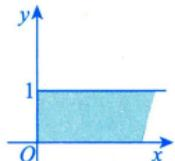

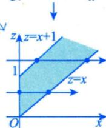

$$
f _ {X} (x) f _ {Y} (z - x) = \left\{ \begin{array}{l l} 2 (z - x) \mathrm {e} ^ {- x}, & x > 0, 0 <   z - x <   1, \\ 0, & \text {其 他}. \end{array} \right.
$$

当 $z < 0$ 时， $f_{Z}(z) = 0$

当 $0 < z < 1$ 时， $f_{Z}(z) = \int_{0}^{z} 2(z - x)\mathrm{e}^{-x}\mathrm{d}x = 2z + 2\mathrm{e}^{-z} - 2;$

当 $z > 1$ 时， $f_{Z}(z) = \int_{z - 1}^{z}2(z - x)\mathrm{e}^{-x}\mathrm{d}x = 2\mathrm{e}^{-z}$ .

③ 背口诀。

求 $z$ 不积 $z$

不积先定限，

限内画条线.

先卖写下限，

后交写上限

因此 $Z = X + Y$ 的概率密度为

$$
f _ {Z} (z) = \left\{ \begin{array}{l l} 2 z + 2 \mathrm {e} ^ {- z} - 2, & 0 <   z <   1, \\ 2 \mathrm {e} ^ {- z}, & z > 1, \\ 0, & \text {其 他}. \end{array} \right.
$$

方法二 先记 $U = X + Y\sim f_U(u)$ ，令 $\left\{ \begin{array}{l}u = x + y,\\ \bar{v} = \bar{y}, \end{array} \right.$ 换元法保证两边同维 保证二重积分换元，二元到二元，几元到几元，元不  
够，凑.类似线性代数中二次型，换元保证维数相同一定有一阶连续偏导数.且  
反函数是唯一的 $\left\{ \begin{array}{ll}x = u - v,\\ y = v, \end{array} \right.$ 再计算 $|J| = \left\| \begin{array}{ll}\frac{\partial x}{\partial u} & \frac{\partial x}{\partial v}\\ \frac{\partial y}{\partial u} & \frac{\partial y}{\partial v} \end{array} \right\| = \left\| \begin{array}{ll}1 & -1\\ 0 & 1 \end{array} \right\| = 1$

则 $f_{u,v}(u,v) = f(u - v,v)\cdot 1$ ，故

说明两个坐标系转

换后，测度相同

$$
f _ {U} (u) = \int_ {- \infty} ^ {+ \infty} f (u - v, v) d v = \int_ {- \infty} ^ {+ \infty} f _ {X} (u - v) \cdot f _ {Y} (v) d v,
$$

又因为 $\left\{ \begin{array}{l}x > 0,\\ 0 <   y <   1, \end{array} \right.$ 则 $\left\{ \begin{array}{ll}u - v > 0,\\ 0 <   v <   1, \end{array} \right.$ 解得 $\left\{ \begin{array}{ll}u > v,\\ 0 <   v <   1. \end{array} \right.$

故

$f_{U}(u) = \left\{ \begin{array}{ll}\int_{0}^{u}\mathrm{e}^{-(u - v)}\bullet 2v\mathrm{d}v = 2u - 2 + 2\mathrm{e}^{-u}, & 0 <   u <   1,\\ 2\mathrm{e}^{-u}, & u > 1,\\ 0, & \text{其他}. \end{array} \right.$

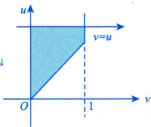

将 $u$ 换为 $z$ 即为答案

$$
\begin{array}{l} 2 \mathrm {e} ^ {- u} \int_ {0} ^ {u} \mathrm {e} ^ {v} \cdot v \mathrm {d} v \\ = 2 e ^ {- u} \left[ \left(v e ^ {v} - e ^ {v}\right) \bigg | _ {0} ^ {u} \right] \\ = 2 \mathrm {e} ^ {- u} \left[ (v - 1) \mathrm {e} ^ {v} \Big | _ {0} ^ {u} \right] = 2 \mathrm {e} ^ {- u} \left[ (u - 1) \mathrm {e} ^ {u} + 1 \right] \\ = 2 (u - 1) + 2 \mathrm {e} ^ {- u} \\ \end{array}
$$

即

$$
f _ {Z} (z) = \left\{ \begin{array}{l l} 2 z + 2 \mathrm {e} ^ {- z} - 2, & 0 <   z <   1, \\ 2 \mathrm {e} ^ {- z}, & z > 1, \\ 0, & \text {其 他}. \end{array} \right.
$$

注本题亦可用分布函数法. $(X,Y)$ 的正概率区域 $D$ 与所求概率 $F_{Z}(z) = P\{X + Y\leqslant z\}$ 的积分区域的公共部分有三种不同的组合形式（见图3-3)，于是：

当 $z < 0$ 时， $F_{z}(z) = 0$ ；

当 $0 \leqslant z < 1$ 时， $F_{z}(z) = \int_{0}^{z} \mathrm{d}x \int_{0}^{z - x} 2y \mathrm{e}^{-x} \mathrm{d}y = z^{2} - 2z - 2\mathrm{e}^{-z} + 2;$

当 $z\geqslant 1$ 时， $F_{Z}(z) = 1 - \int_{0}^{1}\mathrm{d}y\int_{z - y}^{+\infty}2ye^{-x}\mathrm{d}x = 1 - 2e^{-z}.$

因此 $Z = X + Y$ 的概率密度为

$$
f _ {Z} (z) = \left\{ \begin{array}{l l} 2 z + 2 \mathrm {e} ^ {- z} - 2, & 0 <   z <   1, \\ 2 \mathrm {e} ^ {- z}, & z > 1, \\ 0, & \text {其 他}. \end{array} \right.
$$

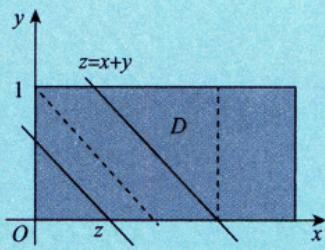  
图3-3

例3.9 设二维随机变量 $(X, Y)$ 在矩形区域 $D = \{(x, y) | 0 \leqslant x \leqslant 2, 0 \leqslant y \leqslant 1\}$ 上服从均匀分布，求边长为 $X$ 和 $Y$ 的矩形面积 $Z$ 的概率密度。

解方法一令 $\left\{ \begin{array}{l}u = xy,\\ v = y, \end{array} \right.$ 则 $x = \frac{u}{v}$ 则雅可比行列式为 $y = v,$

$$
J = \left| \begin{array}{c c} \frac {1}{v} & - \frac {u}{v ^ {2}} \\ 0 & 1 \end{array} \right| = \frac {1}{v},
$$

则 $f(u,v) = \frac{1}{2}\cdot \frac{1}{|v|} = \frac{1}{2v},$

所以

$$
= \frac {1}{2} (\ln 2 - \ln u), 0 <   u <   2,
$$

即 $f_{z}(z) = \left\{ \begin{array}{ll} \frac{1}{2} (\ln 2 - \ln z), & 0 < z < 2, \\ 0, & \text{其他}. \end{array} \right.$

方法二 由题设 $Z = XY$ ， $(X,Y)$ 的概率密度为

$$
f (x, y) = \left\{\begin{array}{l l}\frac {1}{S _ {D}}&0 \leqslant x \leqslant 2, 0 \leqslant y \leqslant 1,\\0,&\text {其 他 .}\end{array}\right. \quad y \rightarrow \frac {z}{x}
$$

用卷积公式

$$
f _ {Z} (z) = \int_ {- \infty} ^ {+ \infty} \frac {1}{| x |} f \left(x, \frac {z}{x}\right) d x, 0 \leqslant z \leqslant x \leqslant 2.
$$

用卷积公式“三部曲”：

① 换字母.

$$
0 <   x \leqslant 2, 0 \leqslant \frac {z}{x} \leqslant 1 \Rightarrow 0 <   x \leqslant 2, 0 \leqslant z \leqslant x.
$$

$②$ 换区域.

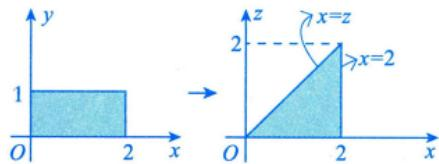

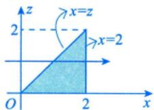

当 $z\leqslant 0$ 或 $z\geqslant 2$ 时， $f_{Z}(z) = 0$ ；③背口诀求 $z$ 不积不积先写下限，  
当 $0 <   z <   2$ 时， $f_{Z}(z) = \frac{1}{2}\int_{z}^{2}\frac{1}{x}\mathrm{d}x = \frac{1}{2} (\ln 2 - \ln z).$ 后麦写上限

因此 $Z = XY$ 的概率密度为

$$
f _ {Z} (z) = \left\{ \begin{array}{l l} \frac {1}{2} (\ln 2 - \ln z), & 0 <   z <   2, \\ 0, & \text {其 他}. \end{array} \right.
$$

注 本题亦可用分布函数法.

正概率密度区域 $D$ 与所求概率 $F_{Z}(z) = P\{XY \leqslant z\}$ 的积分区域的公共部分有三种不同的组合形式（见图3-4），于是

当 $z \leqslant 0$ 时， $F_{z}(z) = 0$ ；

当 $0 < z < 2$ 时，

$$
\begin{array}{l} F _ {z} (z) = \int_ {0} ^ {z} d x \int_ {0} ^ {1} \frac {1}{2} d y + \int_ {z} ^ {2} d x \int_ {0} ^ {\frac {z}{x}} \frac {1}{2} d y \\ = \frac {1}{2} z (1 - \ln z + \ln 2); \\ \end{array}
$$

当 $z \geqslant 2$ 时， $F_{Z}(z) = 1$

因此 $Z = XY$ 的概率密度为

$$
f _ {Z} (z) = \left\{ \begin{array}{l l} \frac {1}{2} (\ln 2 - \ln z), & 0 <   z <   2, \\ 0, & \text {其 他}. \end{array} \right.
$$

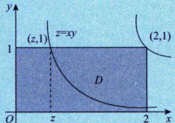  
图3-4

→此类型为考研最后一个大题，但不难

例3.10 设随机变量 $X_{1}$ ， $X_{2}$ ， $X_{3}$ 相互独立，其中 $X_{1}$ 与 $X_{2}$ 均服从标准正态分布， $X_{3}$ 的概率

分布为 $P\{X_{3} = 0\} = P\{X_{3} = 1\} = \frac{1}{2},Y = X_{3}X_{1} + (1 - X_{3})X_{2}$ .→ {X=0时，Y=X2,所以Y有一的概率取X离散的两点分布，即0-1分布有一的概率取 $X_{2}$

(1)求二维随机变量 $(X_{1},Y)$ 的分布函数，结果用标准正态分布函数 $\varPhi(x)$ 表示；  
(2) 证明随机变量 $Y$ 服从标准正态分布.

(1)解记 $(X_{1},Y)$ 的分布函数为 $F(x,y)$ ，则对任意实数 $x$ 和 $y$ ，有

$F\left( {x,y}\right)  = P\left\{  {{X}_{1} \leq  x,\frac{Y \leq  y}{\downarrow }\text{事件复杂}}\right\}$ $= P\left\{  {{X}_{1} \leq  x,{X}_{3}{X}_{1} + \left( {1 - {X}_{3}}\right) {X}_{2} \leq  y,\Omega }\right\}$ 分解 $= P\left\{  {{X}_{1} \leq  x,{X}_{3}{X}_{1} + \left( {1 - {X}_{3}}\right) {X}_{2} \leq  y,\left( {{X}_{3} = 0 \cup  {X}_{3} = 1}\right) }\right\}$ $= P\left\{  {{X}_{1} \leq  x,{X}_{3}{X}_{1} + \left( {1 - {X}_{3}}\right) {X}_{2} \leq  y}\right\}$ 完备事件组

$$
\begin{array}{l} \begin{array}{r l} & = P \{X _ {3} = 0 \} P \{X _ {1} \leqslant x, X _ {3} X _ {1} + (1 - X _ {3}) X _ {2} \leqslant y | X _ {3} = 0 \} + \\ & \quad P \{X _ {3} = 1 \} P \{X _ {1} \leqslant x, X _ {3} X _ {1} + (1 - X _ {3}) X _ {2} \leqslant y | X _ {3} = 1 \} \end{array} \\ = \frac {1}{2} P \left\{X _ {1} \leqslant x, X _ {2} \leqslant y \mid X _ {3} = 0 \right\} + \frac {1}{2} P \left\{X _ {1} \leqslant x, X _ {1} \leqslant y \mid X _ {3} = 1 \right\} \\ = \frac {1}{2} P \{X _ {1} \leqslant x, X _ {2} \leqslant y \} + \frac {1}{2} P \{\underbrace {X _ {1} \leqslant x , X _ {1} \leqslant y} _ {\text {取 交 集}} \} \\ = \frac {1}{2} P \{X _ {1} \leqslant x, X _ {2} \leqslant y \} + \frac {1}{2} P \{X _ {1} \leqslant \min  \{x, y \} \} \\ = \frac {1}{2} \Phi (x) \Phi (y) + \frac {1}{2} \Phi (\min  \{x, y \}). \\ \end{array}
$$

(2) 证 由 (1) 知, $Y$ 的分布函数为

$$
\begin{array}{l} F _ {Y} (y) = \lim  _ {x \rightarrow + \infty} F (x, y) \quad \text {找 边 缘 ， 取 极 限} \\ = \lim  _ {x \rightarrow + \infty} \left[ \frac {1}{2} \Phi (x) \Phi (y) + \frac {1}{2} \Phi (\min  \{x, y \}) \right] \\ = \frac {1}{2} \Phi (y) + \frac {1}{2} \Phi (y) = \Phi (y), \\ \end{array}
$$

所以 $Y$ 服从标准正态分布.

注 本题较简单，考研题不会考这么单一，但核心都是全集分解思想，热点题型。

例3.11 设随机变量 $X, Y$ 相互独立，且都在区间 $[a, b]$ 上服从均匀分布，求 $Z = \max \{X, Y\}$ 的概率密度。

解方法一由题设，有

$$
f (x) = \left\{ \begin{array}{l l} \frac {1}{b - a}, & a \leqslant x \leqslant b, \\ 0, & \text {其 他}, \end{array} \right.
$$

则 $F(x) = \left\{ \begin{array}{ll}0, & x <   a,\\ \frac{x - a}{b - a}, & a\leqslant x <   b,\\ 1, & x\geqslant b, \end{array} \right.$

故 $f_{z}(z) = f_{\max}(z) = 2F(z)f(z) = \left\{ \begin{array}{ll}\frac{2(z - a)}{(b - a)^{2}}, & a\leqslant z\leqslant b,\\ 0, & \text{其他}. \end{array} \right.$

方法二由题意可知 $X,Y$ 相互独立，且

$\rightarrow$ 很重要,会写公式,把握解题方法

$$
f (x) = \left\{ \begin{array}{l l} \frac {1}{b - a}, & a \leqslant x \leqslant b, \\ 0, & \text {其 他}, \end{array} \right.
$$

$$
f (y) = \left\{ \begin{array}{l l} \frac {1}{b - a}, & a \leqslant y \leqslant b, \\ 0, & \text {其 他}, \end{array} \right.
$$

所以 $(X,Y)$ 的概率密度为

$$
f (x, y) = \left\{ \begin{array}{l l} { \frac {1}{(b - a) ^ {2}},} & {a \leqslant x \leqslant b, a \leqslant y \leqslant b,} \\ {0,} & {\text {其 他}.} \end{array} \right.
$$

由 $(X,Y)$ 的取值区域 $\{(x,y)|a\leqslant x\leqslant b,a\leqslant y\leqslant b\}$ ，可知 $Z = \max \{X,Y\}$ 的取值区间为 $[a,b]$ ：

当 $z < a$ 或 $z > b$ 时，有 $f_{Z}(z) = 0$

当 $a \leqslant z \leqslant b$ 时，有

$$
\begin{array}{l} F _ {Z} (z) = P \{Z \leqslant z \} = P \{\max  \{X, Y \} \leqslant z \} = P \{X \leqslant z, Y \leqslant z \} \\ = \iint_ {x \leqslant z, y \leqslant z} f (x, y) d x d y = \int_ {a} ^ {z} d x \int_ {a} ^ {z} \frac {1}{(b - a) ^ {2}} d y \\ = \frac {(z - a) ^ {2}}{(b - a) ^ {2}}, \\ \end{array}
$$

所以

$$
f _ {Z} (z) = F _ {Z} ^ {\prime} (z) = \frac {2 (z - a)}{(b - a) ^ {2}}.
$$

综上， $Z = \max \{X,Y\}$ 的概率密度为

$$
f _ {Z} (z) = \left\{ \begin{array}{l l} \frac {2 (z - a)}{(b - a) ^ {2}}, & a \leqslant z \leqslant b, \\ 0, & \text {其 他}. \end{array} \right.
$$

# 五 综合题举例

例3.12 设二维随机变量 $(X,Y)$ 的概率密度为

$$
f (x, y) = \left\{ \begin{array}{l l} \frac {2}{\pi} (x ^ {2} + y ^ {2}), & x ^ {2} + y ^ {2} \leqslant 1, \\ 0, & \text {其 他}. \end{array} \right.
$$

（1）求 $X$ 与 $Y$ 的协方差；  
（2） $X$ 与 $Y$ 是否相互独立？

（3）求 $Z = X^{2} + Y^{2}$ 的概率密度.

解 （1）因为

$$
E X = \iint_ {x ^ {2} + y ^ {2} \leqslant 1} x \cdot \frac {2}{\pi} \left(x ^ {2} + y ^ {2}\right) d x d y = 0,
$$

$$
E Y = \iint_ {x ^ {2} + y ^ {2} \leqslant 1} y \cdot \frac {2}{\pi} \left(x ^ {2} + y ^ {2}\right) d x d y = 0,
$$

$$
E (X Y) = \iint_ {x ^ {2} + y ^ {2} \leqslant 1} x y \cdot \frac {2}{\pi} \left(x ^ {2} + y ^ {2}\right) d x d y = 0,
$$

所以 $X$ 与 $Y$ 的协方差为

$$
\operatorname {C o v} (X, Y) = E (X Y) - E X E Y = 0.
$$

（2）当 $x\geqslant 1$ 或 $x\leq -1$ 时， $X$ 的边缘概率密度 $f_{X}(x) = 0$

当 $-1 < x < 1$ 时，

$$
f _ {X} (x) = \int_ {- \sqrt {1 - x ^ {2}}} ^ {\sqrt {1 - x ^ {2}}} \frac {2}{\pi} \left(x ^ {2} + y ^ {2}\right) d y = \frac {4}{3 \pi} \left(1 + 2 x ^ {2}\right) \sqrt {1 - x ^ {2}},
$$

所以

$$
f _ {X} (x) = \left\{ \begin{array}{l l} \frac {4}{3 \pi} (1 + 2 x ^ {2}) \sqrt {1 - x ^ {2}}, & - 1 <   x <   1, \\ 0, & \text {其 他}. \end{array} \right.
$$

同理得

$$
f _ {Y} (y) = \left\{ \begin{array}{l l} \frac {4}{3 \pi} (1 + 2 y ^ {2}) \sqrt {1 - y ^ {2}}, & - 1 <   y <   1, \\ 0, & \text {其 他}. \end{array} \right.
$$

由于 $f(x,y)\neq f_{X}(x)f_{Y}(y)$ ，故 $X$ 与 $Y$ 不相互独立.

（3）记 $Z$ 的分布函数为 $F_{Z}(z)$

因为 $P\{0 \leqslant Z \leqslant 1\} = 1$ ，所以当 $z < 0$ 时， $F_{Z}(z) = 0$ ；当 $z \geqslant 1$ 时， $F_{Z}(z) = 1$ 。

当 $0 \leqslant z < 1$

$$
\begin{array}{l} F _ {Z} (z) = P \{Z \leqslant z \} \\ = P \left\{X ^ {2} + Y ^ {2} \leqslant z \right\} \\ = \iint_ {x ^ {2} + y ^ {2} \leqslant z} \frac {2}{\pi} \left(x ^ {2} + y ^ {2}\right) d x d y \\ = \int_ {0} ^ {2 \pi} \mathrm {d} \theta \int_ {0} ^ {\sqrt {z}} \frac {2}{\pi} r ^ {3} \mathrm {d} r \\ = z ^ {2}. \\ \end{array}
$$

所以 $Z$ 的概率密度为

$$
f _ {Z} (z) = \left\{ \begin{array}{l l} 2 z, & 0 <   z <   1. \\ 0, & \text {其 他}. \end{array} \right.
$$

# 基础习题精练

# 习题

3.1 设二维随机变量 $(X_{1},Y_{1})$ 和 $(X_{2},Y_{2})$ 的概率密度分别为 $f_{1}(x,y)$ 与 $f_{2}(x,y)$ ，令

$$
f (x, y) = a f _ {1} (x, y) + b f _ {2} (x, y),
$$

若 $f(x,y)$ 是某二维连续型随机变量的概率密度，则 $a,b$ 满足条件（ ）

(A) $a + b = 1$   
(B) $a > 0$ 且 $b > 0$   
(C) $0\leqslant a\leqslant 1,0\leqslant b\leqslant 1$   
(D) $a \geqslant 0, b \geqslant 0$ 且 $a + b = 1$

3.2 设随机变量 $X_{i}\sim \left( \begin{array}{ccc} - 1 & 0 & 1\\ \frac{1}{4} & \frac{1}{2} & \frac{1}{4} \end{array} \right)(i = 1,2)$ ，且满足 $P\{X_1X_2 = 0\} = 1$ 则 $P\{X_{1} = X_{2}\}$ 等于（ ）

(A) 0

(B) $\frac{1}{4}$

(C) $\frac{1}{2}$

(D) 1

3.3 设随机变量 $X, Y$ 相互独立，且均服从标准正态分布 $N(0,1)$ ，则（ ）

(A) $P\{X + Y\geqslant 1\} = \frac{1}{2}$

(B) $P\{X - Y\geqslant 1\} = \frac{1}{2}$

(C) $P\{\max \{X,Y\} \geqslant 0\} = \frac{1}{4}$

(D) $P\{\min \{X,Y\} \geqslant 0\} = \frac{1}{4}$

3.4 设随机变量 $X$ 和 $Y$ 独立同分布，且 $X$ 的分布函数为 $F(x)$ ，则 $Z = \max \{X, Y\}$ 的分布函数为（ ）.

(A) $F^2 (z)$   
(B) $F(x)F(y)$   
(C) $1 - [1 - F(z)]^2$   
(D) $[1 - F(x)][1 - F(y)]$

3.5 如果二维随机变量 $(X,Y)$ 的分布函数为

$$
F (x, y) = \left\{ \begin{array}{l l} 1 - \mathrm {e} ^ {- \lambda_ {1} x} - \mathrm {e} ^ {- \lambda_ {2} y} + \mathrm {e} ^ {- \lambda_ {1} x - \lambda_ {2} y - \lambda_ {1 2} \max  \{x, y \}}, & x > 0, y > 0, \\ 0, & \text {其 他}, \end{array} \right.
$$

其中 $\lambda_1, \lambda_2, \lambda_{12} > 0$ ，则 $X$ 和 $Y$ 的边缘分布函数分别为

3.6 设随机变量 $(X, Y)$ 的概率密度为

$$
f (x, y) = \frac {1 + \sin x \sin y}{2 \pi} e ^ {- \frac {1}{2} (x ^ {2} + y ^ {2})} (- \infty <   x, y <   + \infty),
$$

则两个边缘概率密度 $f_{X}(x),f_{Y}(y)$ 分别为

3.7 设随机变量 $X_{1}, X_{2}, X_{3}, X_{4}$ 相互独立且同分布， $P\{X_{i} = 0\} = 0.6, P\{X_{i} = 1\} = 0.4, i = 1, 2, 3, 4$ 则行列式 $X = \left| \begin{array}{ll}X_{1} & X_{2}\\ X_{3} & X_{4} \end{array} \right|$ 的概率分布为

3.8 设二维随机变量 $(X, Y)$ 的概率密度为

$$
f (x, y) = \left\{ \begin{array}{l l} 2 - x - y, & 0 <   x <   1, 0 <   y <   1, \\ 0, & \text {其 他}, \end{array} \right.
$$

则 $Z = X + Y$ 的概率密度 $f_{Z}(z) = \_ .$

3.9 设 $X$ 与 $Y$ 相互独立，下表是随机变量 $X$ 与 $Y$ 的联合分布律以及两个边缘分布律中的部分数值，请将其余数值填入表中空白处.

<table><tr><td>X Y</td><td>\( y_1 \)</td><td>\( y_2 \)</td><td>\( y_3 \)</td><td>\( P\{X=x_i\} \)</td></tr><tr><td>\( x_1 \)</td><td></td><td>\( \frac{1}{8} \)</td><td></td><td></td></tr><tr><td>\( x_2 \)</td><td>\( \frac{1}{8} \)</td><td></td><td></td><td></td></tr><tr><td>\( P\{Y=y_j\} \)</td><td>\( \frac{1}{6} \)</td><td></td><td></td><td>1</td></tr></table>

3.10 袋中有编号为 1, 1, 2, 3 的四个球，现从中无放回地取两次，每次任取一个，设 $X_{1}, X_{2}$ 分别为第一次、第二次取到的球的号码，求：

(1) $(X_{1}, X_{2})$ 的分布律，并判断 $X_{1}$ 与 $X_{2}$ 的独立性；  
(2) 在 $X_{2} = 2$ 的条件下， $X_{1}$ 的条件分布；  
(3) 随机变量 $Y = X_{1}X_{2}$ 的分布.

3.11 已知 $(X, Y)$ 的概率分布为

<table><tr><td>X Y</td><td>-1</td><td>1</td></tr><tr><td>-1</td><td>1/6</td><td>1/6</td></tr><tr><td>0</td><td>1/3</td><td>1/6</td></tr><tr><td>1</td><td>0</td><td>1/6</td></tr></table>

(1) 求 $Z = X - Y$ 的概率分布；  
(2) 设 $U_{1} = XY, V_{1} = \frac{X}{Y}$ ，求 $(U_{1}, V_{1})$ 的概率分布；  
(3) 设 $U_{2} = \max \{X, Y\}$ , $V_{2} = \min \{X, Y\}$ ，求 $(U_{2}, V_{2})$ 的概率分布， $U_{2}V_{2}$ 的概率分布.

3.12 求以下给出概率密度的 $(X, Y)$ 的边缘概率密度 $f_{X}(x)$ 和 $f_{Y}(y)$ :

(1) $f_{1}(x,y) = \left\{ \begin{array}{ll}\mathrm{e}^{-y}, & 0 <   x <   y,\\ 0, & \text{其他}; \end{array} \right.$   
(2) $f_{2}(x,y) = \left\{ \begin{array}{ll} \frac{5}{4} (x^{2} + y), & 0 < y < 1 - x^{2},\\ 0, & \text{其他}. \end{array} \right.$

3.13 设二维随机变量 $(X, Y)$ 的概率密度为

$$
f (x,   y) = \left\{ \begin{array}{l l} {k,} & {0 <   x ^ {2} <   y <   x <   1,} \\ {0,} & {\text {其 他}.} \end{array} \right.
$$

(1) 求常数 $k$ ；  
(2) 求 $P\left\{X > \frac{1}{2}\right\}$ 和 $P\left\{Y < \frac{1}{2}\right\}$ .

3.14 已知随机变量 $(X,Y)$ 的概率密度

$$
f (x,   y) = \left\{ \begin{array}{l l} {A \mathrm {e} ^ {- y},} & {0 <   x <   y,} \\ {0,} & {\text {其 他},} \end{array} \right.
$$

求常数 $A$ ，并计算概率 $P\{X + Y\geqslant 1\}$ ， $P\left\{\frac{X}{Y}\leqslant \frac{1}{2}\right\} .$

3.15 已知随机变量 $X$ 与 $Y$ 相互独立， $X$ 服从参数为 $\lambda$ 的指数分布， $P\{Y = -1\} = \frac{1}{4}$ ， $P\{Y = 1\} = \frac{3}{4}$ 求概率 $P\{X - Y \leqslant 1\}$ ， $P\{XY \leqslant 2\}$ ：

3.16 设随机变量 $X, Y$ 相互独立，且都服从指数分布，它们的概率密度分别为

$$
f _ {X} (x) = \left\{ \begin{array}{l l} \lambda \mathrm {e} ^ {- \lambda x}, & x \geqslant 0, \\ 0, & \text {其 他}, \end{array} \quad f _ {Y} (y) = \left\{ \begin{array}{l l} \lambda \mathrm {e} ^ {- \lambda y}, & y \geqslant 0, \\ 0, & \text {其 他}, \end{array} \right. \right.
$$

求 $Z = \frac{X}{Y}$ 的概率密度.

3.17 设随机变量 $X, Y$ 相互独立，且都在区间 $[a, b]$ 上服从均匀分布，求 $Z = \min \{X, Y\}$ 的概率密度.

3.18 设随机变量 $X$ 与 $Y$ 相互独立，且 $X$ 服从标准正态分布 $N(0,1)$ ， $Y$ 的概率分布为 $P\{Y = 0\} = P\{Y = 1\} = \frac{1}{2}$ ，记 $F_Z(z)$ 为随机变量 $Z = XY$ 的分布函数，求函数 $F_Z(z)$ 的间断点。

# 解答

3.1 (D) 解 函数 $f(x, y)$ 为某二维连续型随机变量的概率密度的充分必要条件是

$$
f (x, y) \geqslant 0, \int_ {- \infty} ^ {+ \infty} d x \int_ {- \infty} ^ {+ \infty} f (x, y) d y = 1,
$$

即同时有

$$
f (x, y) = a f _ {1} (x, y) + b f _ {2} (x, y) \geqslant 0,
$$

$$
\int_ {- \infty} ^ {+ \infty} d x \int_ {- \infty} ^ {+ \infty} f (x, y) d y = a \int_ {- \infty} ^ {+ \infty} d x \int_ {- \infty} ^ {+ \infty} f _ {1} (x, y) d y + b \int_ {- \infty} ^ {+ \infty} d x \int_ {- \infty} ^ {+ \infty} f _ {2} (x, y) d y = a + b = 1,
$$

故选择(D).

3.2 (A) 解 首先，列出二维随机变量 $(X_{1}, X_{2})$ 的分布律及其边缘分布律中的部分数值。

<table><tr><td>\( X_{2} \) \( X_{1} \)</td><td>-1</td><td>0</td><td>1</td><td>\( P\{X_{1}=x_{1i}\} \)</td></tr><tr><td>-1</td><td>a</td><td>b</td><td>c</td><td>\( \frac{1}{4} \)</td></tr><tr><td>0</td><td>d</td><td>e</td><td>f</td><td>\( \frac{1}{2} \)</td></tr><tr><td>1</td><td>g</td><td>h</td><td>k</td><td>\( \frac{1}{4} \)</td></tr><tr><td>\( P\{X_{2}=x_{2j}\} \)</td><td>\( \frac{1}{4} \)</td><td>\( \frac{1}{2} \)</td><td>\( \frac{1}{4} \)</td><td>1</td></tr></table>

由于 $P\{X_1X_2 = 0\} = 1$ ，故 $P\{X_1X_2 \neq 0\} = 0$ ，因此 $a = 0, c = 0, g = 0, k = 0.$ 根据边缘分布的性质

$$
b = \frac {1}{4}, h = \frac {1}{4}, d = \frac {1}{4}, f = \frac {1}{4}, e = \frac {1}{2} - (b + h) = \frac {1}{2} - \frac {1}{2} = 0,
$$

故 $(X_{1},X_{2})$ 的分布律为

<table><tr><td>\( X_{2} \) \( X_{1} \)</td><td>-1</td><td>0</td><td>1</td><td>\( P\{X_{1}=x_{1i}\} \)</td></tr><tr><td>-1</td><td>0</td><td>\( \frac{1}{4} \)</td><td>0</td><td>\( \frac{1}{4} \)</td></tr><tr><td>0</td><td>\( \frac{1}{4} \)</td><td>0</td><td>\( \frac{1}{4} \)</td><td>\( \frac{1}{2} \)</td></tr><tr><td>1</td><td>0</td><td>\( \frac{1}{4} \)</td><td>0</td><td>\( \frac{1}{4} \)</td></tr><tr><td>\( P\{X_{2}=x_{2j}\} \)</td><td>\( \frac{1}{4} \)</td><td>\( \frac{1}{2} \)</td><td>\( \frac{1}{4} \)</td><td>1</td></tr></table>

可见 $P\{X_{1} = X_{2}\} = P\{X_{1} = -1,X_{2} = -1\} +P\{X_{1} = 0,X_{2} = 0\} +P\{X_{1} = 1,X_{2} = 1\} = 0.$

故应选(A).

3.3 (D) 解 因为 $X, Y$ 相互独立，且均服从标准正态分布 $N(0,1)$ ，所以 $U = X + Y \sim N(0,2), V = X - Y \sim N(0,2)$ ，排除(A)，(B). 又

$$
P \{\max  \{X, Y \} \geqslant 0 \} = 1 - P \{\max  \{X, Y \} <   0 \} = 1 - P \{X <   0, Y <   0 \} = \frac {3}{4},
$$

$$
P \{\min  \{X, Y \} \geqslant 0 \} = P \{X \geqslant 0, Y \geqslant 0 \} = \frac {1}{4},
$$

故应选择(D).

3.4 (A) 解 由于 $X$ 和 $Y$ 独立同分布，且 $X$ 的分布函数为 $F(x)$ ，则 $Z$ 的分布函数为

$$
F _ {Z} (z) = P \{Z \leqslant z \} = P \{\max  \{X, Y \} \leqslant z \} = P \{X \leqslant z, Y \leqslant z \} = P \{X \leqslant z \} P \{Y \leqslant z \} = F ^ {2} (z),
$$

故选择(A).

3.5 $F_{X}(x) = \left\{ \begin{array}{ll}1 - \mathrm{e}^{-\lambda_{1}x}, & x > 0,\\ 0, & \text{其他}; \end{array} \right.$ $F_{Y}(y) = \left\{ \begin{array}{ll}1 - \mathrm{e}^{-\lambda_{2}y}, & y > 0,\\ 0, & \text{其他} \end{array} \right.$ 解因为

$$
\lim  _ {y \rightarrow + \infty} (1 - e ^ {- \lambda_ {1} x} - e ^ {- \lambda_ {2} y} + e ^ {- \lambda_ {1} x - \lambda_ {2} y - \lambda_ {1 2} \max  \{x, y \}}) = 1 - e ^ {- \lambda_ {1} x},
$$

$$
\lim  _ {x \rightarrow + \infty} (1 - e ^ {- \lambda_ {1} x} - e ^ {- \lambda_ {2} y} + e ^ {- \lambda_ {1} x - \lambda_ {2} y - \lambda_ {1 2} \max  \{x, y \}}) = 1 - e ^ {- \lambda_ {2} y},
$$

所以 $X$ 和 $Y$ 的边缘分布函数分别为

$$
F _ {X} (x) = F (x, + \infty) = \lim  _ {y \to + \infty} F (x, y) = \left\{ \begin{array}{l l} 1 - \mathrm {e} ^ {- \lambda_ {1} x}, & x > 0, \\ 0, & \text {其 他}, \end{array} \right.
$$

$$
F _ {Y} (y) = F (+ \infty , y) = \lim  _ {x \rightarrow + \infty} F (x, y) = \left\{\begin{array}{l l}1 - \mathrm {e} ^ {- \lambda_ {2} y},&y > 0,\\0,&\text {其 他}.\end{array}\right.
$$

3.6 $f_{X}(x) = \frac{1}{\sqrt{2\pi}}\mathrm{e}^{-\frac{x^{2}}{2}};f_{Y}(y) = \frac{1}{\sqrt{2\pi}}\mathrm{e}^{-\frac{y^{2}}{2}}$ 解由边缘概率密度的公式，有

$$
f _ {X} (x) = \int_ {- \infty} ^ {+ \infty} f (x, y) d y = \frac {1}{2 \pi} e ^ {- \frac {x ^ {2}}{2}} \int_ {- \infty} ^ {+ \infty} e ^ {- \frac {y ^ {2}}{2}} d y + \frac {\sin x}{2 \pi} e ^ {- \frac {x ^ {2}}{2}} \int_ {- \infty} ^ {+ \infty} \sin y \cdot e ^ {- \frac {y ^ {2}}{2}} d y = \frac {1}{\sqrt {2 \pi}} e ^ {- \frac {x ^ {2}}{2}},
$$

即 $f_{X}(x)$ 是标准正态概率密度. 由对称性知 $f_{Y}(y)$ 也是标准正态概率密度，所以 $f_{Y}(y) = \frac{1}{\sqrt{2\pi}} \mathrm{e}^{-\frac{y^{2}}{2}}$

3.7 $X \sim \left( \begin{array}{ccc} -1 & 0 & 1 \\ 0.1344 & 0.7312 & 0.1344 \end{array} \right)$ 解 因为 $X = X_{1}X_{4} - X_{2}X_{3}$ ，所以 $X$ 的可能取值为 $-1, 0, 1$ 。易知 $Z_{1} = X_{1}X_{4}$ 与 $Z_{2} = X_{2}X_{3}$ 独立同分布，且

$$
P \{Z _ {1} = 1 \} = P \{X _ {1} = 1, X _ {4} = 1 \} = 0. 4 ^ {2} = 0. 1 6,
$$

$$
P \{Z _ {1} = 0 \} = 1 - P \{Z _ {1} = 1 \} = 0. 8 4,
$$

同理，得 $P\{Z_2 = 1\} = 0.16$ ， $P\{Z_2 = 0\} = 0.84$ .由此得

$$
\begin{array}{l} P \{X = - 1 \} = P \{Z _ {1} = 0, Z _ {2} = 1 \} = P \{Z _ {1} = 0 \} P \{Z _ {2} = 1 \} = 0. 8 4 \times 0. 1 6 = 0. 1 3 4 4, \\ P \{X = 1 \} = P \left\{Z _ {1} = 1, Z _ {2} = 0 \right\} = P \left\{Z _ {1} = 1 \right\} P \left\{Z _ {2} = 0 \right\} = 0. 1 6 \times 0. 8 4 = 0. 1 3 4 4, \\ P \{X = 0 \} = 1 - P \{X = - 1 \} - P \{X = 1 \} = 1 - 2 \times 0. 1 3 4 4 = 0. 7 3 1 2. \\ \end{array}
$$

所以 $X$ 的概率分布为

$$
X \sim \left( \begin{array}{c c c} - 1 & 0 & 1 \\ 0. 1 3 4 4 & 0. 7 3 1 2 & 0. 1 3 4 4 \end{array} \right).
$$

3.8 $\left\{ \begin{array}{ll}z(2 - z), & 0 <   z <   1,\\ (2 - z)^2, & 1\leqslant z <   2,\\ 0, & \text{其他} \end{array} \right.$ 解 $f_{Z}(z) = \int_{-\infty}^{+\infty}f(x,z - x)\mathrm{d}x$ ，其中

$$
f (x, z - x) = \left\{ \begin{array}{l l} 2 - x - (z - x), & 0 <   x <   1, 0 <   z - x <   1, \\ 0, & \text {其 他} \end{array} \right. = \left\{ \begin{array}{l l} 2 - z, & 0 <   x <   1, 0 <   z - x <   1, \\ 0, & \text {其 他}. \end{array} \right.
$$

当 $z \leqslant 0$ 或 $z \geqslant 2$ 时， $f_{Z}(z) = 0$ ；

当 $0 < z < 1$ 时， $f_{Z}(z) = \int_{0}^{z}(2 - z)\mathrm{d}x = z(2 - z)$ ；

当 $1 \leqslant z < 2$ 时， $f_{Z}(z) = \int_{z - 1}^{1} (2 - z) \, \mathrm{d}x = (2 - z)^{2}$ .

所以 $Z$ 的概率密度为 $f_{Z}(z) = \left\{ \begin{array}{ll} z(2 - z), & 0 < z < 1, \\ (2 - z)^{2}, & 1 \leqslant z < 2, \\ 0, & \text{其他}. \end{array} \right.$

3.9 解 由于 $X$ 与 $Y$ 相互独立，因此

$$
p _ {i j} = P \{X = x _ {i}, Y = y _ {j} \} = P \{X = x _ {i} \} P \{Y = y _ {j} \} = p _ {i}. p _ {. j} (i = 1, 2; j = 1, 2, 3).
$$

由边缘分布的性质，有

$$
p _ {i \cdot} = P \{X = x _ {i} \} = \sum_ {j = 1} ^ {3} p _ {i j}, p _ {\cdot j} = P \{Y = y _ {j} \} = \sum_ {i = 1} ^ {2} p _ {i j},
$$

于是

$$
p _ {1 1} = p _ {. 1} - p _ {2 1} = \frac {1}{6} - \frac {1}{8} = \frac {1}{2 4},
$$

$$
p _ {1.} = \frac {p _ {1 1}}{p _ {. 1}} = \frac {1}{2 4} \div \frac {1}{6} = \frac {1}{4}, p _ {2.} = 1 - p _ {1.} = \frac {3}{4},
$$

$$
p _ {. 2} = \frac {p _ {1 2}}{p _ {1 .}} = \frac {1}{8} \div \frac {1}{4} = \frac {1}{2}, p _ {. 3} = 1 - p _ {. 1} - p _ {. 2} = \frac {1}{3},
$$

$$
p _ {2 2} = p _ {2}. p _ {. 2} = \frac {3}{4} \times \frac {1}{2} = \frac {3}{8}, p _ {1 3} = p _ {1}. p _ {. 3} = \frac {1}{4} \times \frac {1}{3} = \frac {1}{1 2},
$$

$$
p _ {2 3} = p _ {2}. p _ {3} = \frac {3}{4} \times \frac {1}{3} = \frac {1}{4}.
$$

因此所得数值填空如下表：

<table><tr><td>X Y</td><td>\( y_1 \)</td><td>\( y_2 \)</td><td>\( y_3 \)</td><td>\( P\{X=x_i\} \)</td></tr><tr><td>\( x_1 \)</td><td>\( \frac{1}{24} \)</td><td>\( \frac{1}{8} \)</td><td>\( \frac{1}{12} \)</td><td>\( \frac{1}{4} \)</td></tr><tr><td>\( x_2 \)</td><td>\( \frac{1}{8} \)</td><td>\( \frac{3}{8} \)</td><td>\( \frac{1}{4} \)</td><td>\( \frac{3}{4} \)</td></tr><tr><td>\( P\{Y=y_j\} \)</td><td>\( \frac{1}{6} \)</td><td>\( \frac{1}{2} \)</td><td>\( \frac{1}{3} \)</td><td>1</td></tr></table>

3.10 解 (1) $X_{1}$ 与 $X_{2}$ 的可能取值为1,2,3，则

$$
\begin{array}{l} p _ {1 1} = P \left\{X _ {1} = 1, X _ {2} = 1 \right\} = \frac {2}{4} \times \frac {1}{3} = \frac {1}{6}, p _ {1 2} = P \left\{X _ {1} = 1, X _ {2} = 2 \right\} = \frac {2}{4} \times \frac {1}{3} = \frac {1}{6}, \\ p _ {1 3} = P \left\{X _ {1} = 1, X _ {2} = 3 \right\} = \frac {2}{4} \times \frac {1}{3} = \frac {1}{6}, p _ {2 1} = P \left\{X _ {1} = 2, X _ {2} = 1 \right\} = \frac {1}{4} \times \frac {2}{3} = \frac {1}{6}, \\ p _ {2 2} = 0, p _ {2 3} = P \left\{X _ {1} = 2, X _ {2} = 3 \right\} = \frac {1}{4} \times \frac {1}{3} = \frac {1}{1 2}, p _ {3 1} = P \left\{X _ {1} = 3, X _ {2} = 1 \right\} = \frac {1}{4} \times \frac {2}{3} = \frac {1}{6}, \\ p _ {3 2} = P \{X _ {1} = 3, X _ {2} = 2 \} = \frac {1}{4} \times \frac {1}{3} = \frac {1}{1 2}, p _ {3 3} = 0. \\ \end{array}
$$

于是 $(X_{1},X_{2})$ 的分布律为

<table><tr><td>\( X_{2} \) \( X_{1} \)</td><td>1</td><td>2</td><td>3</td><td>\( p_{i} \)</td></tr><tr><td>1</td><td>\( \frac{1}{6} \)</td><td>\( \frac{1}{6} \)</td><td>\( \frac{1}{6} \)</td><td>\( \frac{1}{2} \)</td></tr><tr><td>2</td><td>\( \frac{1}{6} \)</td><td>0</td><td>\( \frac{1}{12} \)</td><td>\( \frac{1}{4} \)</td></tr><tr><td>3</td><td>\( \frac{1}{6} \)</td><td>\( \frac{1}{12} \)</td><td>0</td><td>\( \frac{1}{4} \)</td></tr><tr><td>\( p_{\cdot j} \)</td><td>\( \frac{1}{2} \)</td><td>\( \frac{1}{4} \)</td><td>\( \frac{1}{4} \)</td><td>1</td></tr></table>

因为 $p_{11} \neq p_{1} \cdot p_{1}$ , 所以 $X_{1}$ 与 $X_{2}$ 不相互独立.

(2) 由于 $P\{X_{1} = 1 \mid X_{2} = 2\} = \frac{p_{12}}{p_{2}} = \frac{\frac{1}{6}}{\frac{1}{4}} = \frac{2}{3},$

$$
P \left\{X _ {1} = 2 \mid X _ {2} = 2 \right\} = 0, P \left\{X _ {1} = 3 \mid X _ {2} = 2 \right\} = \frac {p _ {3 2}}{p _ {. 2}} = \frac {\frac {1}{1 2}}{\frac {1}{4}} = \frac {1}{3},
$$

因此在 $X_{2} = 2$ 的条件下， $X_{1}$ 的条件分布为 $X_{1}\sim \left( \begin{array}{cc}1 & 3\\ \frac{2}{3} & \frac{1}{3} \end{array} \right)$

(3) $Y = X_{1}X_{2}$ 的可能取值为1,2,3,6，于是

$$
P \{Y = 1 \} = p _ {1 1} = \frac {1}{6}, P \{Y = 2 \} = p _ {1 2} + p _ {2 1} = \frac {1}{3},
$$

$$
P \{Y = 3 \} = p _ {1 3} + p _ {3 1} = \frac {1}{3}, P \{Y = 6 \} = p _ {2 3} + p _ {3 2} = \frac {1}{6},
$$

从而有 $Y\sim \left( \begin{array}{cccc}1 & 2 & 3 & 6\\ \frac{1}{6} & \frac{1}{3} & \frac{1}{3} & \frac{1}{6} \end{array} \right).$

# 3.11 解 由题设得

<table><tr><td>\( {p}_{ij} \)</td><td>\( \frac{1}{6} \)</td><td>\( \frac{1}{6} \)</td><td>\( \frac{1}{3} \)</td><td>\( \frac{1}{6} \)</td><td>0</td><td>\( \frac{1}{6} \)</td></tr><tr><td>(X,Y)</td><td>(-1, - 1)</td><td>(-1,1)</td><td>(0, - 1)</td><td>(0,1)</td><td>(1, - 1)</td><td>(1,1)</td></tr><tr><td>\( Z = X - Y \)</td><td>0</td><td>-2</td><td>1</td><td>-1</td><td>2</td><td>0</td></tr><tr><td>\( {U}_{1} = {XY} \)</td><td>1</td><td>-1</td><td>0</td><td>0</td><td>-1</td><td>1</td></tr><tr><td>\( {V}_{1} = X/Y \)</td><td>1</td><td>-1</td><td>0</td><td>0</td><td>-1</td><td>1</td></tr><tr><td>\( {U}_{2} = \max \left\{  {X,Y}\right\} \)</td><td>-1</td><td>1</td><td>0</td><td>1</td><td>1</td><td>1</td></tr><tr><td>\( {V}_{2} = \min \left\{  {X,Y}\right\} \)</td><td>-1</td><td>-1</td><td>-1</td><td>0</td><td>-1</td><td>1</td></tr><tr><td>\( {U}_{2}{V}_{2} \)</td><td>1</td><td>-1</td><td>0</td><td>0</td><td>-1</td><td>1</td></tr></table>

(1)由上表可得 $Z = X - Y$ 的概率分布为

<table><tr><td>Z=X-Y</td><td>-2</td><td>-1</td><td>0</td><td>1</td></tr><tr><td>P{Z=k}</td><td>1/6</td><td>1/6</td><td>1/3</td><td>1/3</td></tr></table>

(2) $(U_{1},V_{1})$ 的概率分布为

<table><tr><td>\( V_1 \) \( U_1 \)</td><td>-1</td><td>0</td><td>1</td></tr><tr><td>-1</td><td>\( \frac{1}{6} \)</td><td>0</td><td>0</td></tr><tr><td>0</td><td>0</td><td>\( \frac{1}{2} \)</td><td>0</td></tr><tr><td>1</td><td>0</td><td>0</td><td>\( \frac{1}{3} \)</td></tr></table>

(3) $(U_{2},V_{2})$ 的概率分布为

<table><tr><td>\( V_2 \) \( U_2 \)</td><td>-1</td><td>0</td><td>1</td></tr><tr><td>-1</td><td>\( \frac{1}{6} \)</td><td>0</td><td>0</td></tr><tr><td>0</td><td>\( \frac{1}{3} \)</td><td>0</td><td>0</td></tr><tr><td>1</td><td>\( \frac{1}{6} \)</td><td>\( \frac{1}{6} \)</td><td>\( \frac{1}{6} \)</td></tr></table>

$U_{2}V_{2}$ 的概率分布为

<table><tr><td>\( {U}_{2}{V}_{2} \)</td><td>-1</td><td>0</td><td>1</td></tr><tr><td>\( P\left\{  {{U}_{2}{V}_{2} = k}\right\} \)</td><td>\( \frac{1}{6} \)</td><td>\( \frac{1}{2} \)</td><td>\( \frac{1}{3} \)</td></tr></table>

3.12 解 (1) 当 $x > 0$ 时，有 $f_{X}(x) = \int_{x}^{+\infty}\mathrm{e}^{-y}\mathrm{d}y = \mathrm{e}^{-x}$ ，所以 $X$ 的边缘概率密度为

$$
f _ {X} (x) = \left\{ \begin{array}{l l} {\mathrm {e} ^ {- x},} & {x > 0,} \\ {0,} & {\text {其 他},} \end{array} \right.
$$

这是指数分布 $E(1)$ ：

当 $y > 0$ 时，有 $f_{Y}(y) = \int_{0}^{y}\mathrm{e}^{-y}\mathrm{d}x = y\mathrm{e}^{-y}$ ，所以 $Y$ 的边缘概率密度为

$$
f _ {Y} (y) = \left\{ \begin{array}{l l} y \mathrm {e} ^ {- y}, & y > 0, \\ 0, & \text {其 他}. \end{array} \right.
$$

(2)因为 $f_{2}(x,y)$ 的非零区域如图3-5阴影部分所示，所以当 $-1 < x < 1$ 时，有

$$
f _ {X} (x) = \int_ {0} ^ {1 - x ^ {2}} \frac {5}{4} (x ^ {2} + y) d y = \frac {5}{4} x ^ {2} (1 - x ^ {2}) + \frac {5}{8} (1 - x ^ {2}) ^ {2} = \frac {5}{8} (1 - x ^ {4}),
$$

所以 $X$ 的边缘概率密度为

$$
f _ {X} (x) = \left\{ \begin{array}{l l} \frac {5}{8} (1 - x ^ {4}), & - 1 <   x <   1, \\ 0, & \text {其 他}. \end{array} \right.
$$

又因为当 $0 < y < 1$ 时，有

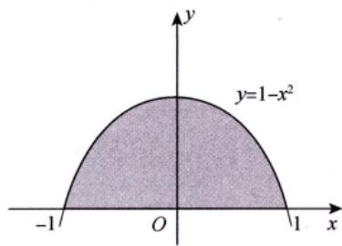  
图3-5

$$
\begin{array}{l} f _ {Y} (y) = \int_ {- \sqrt {1 - y}} ^ {\sqrt {1 - y}} \frac {5}{4} (x ^ {2} + y) d x = \frac {5}{1 2} x ^ {3} \Bigg | _ {- \sqrt {1 - y}} ^ {\sqrt {1 - y}} + \frac {5}{2} y \sqrt {1 - y} \\ = \frac {5}{6} \sqrt {1 - y} (1 + 2 y), \\ \end{array}
$$

所以 $Y$ 的边缘概率密度为 $f_{Y}(y) = \left\{ \begin{array}{ll} \frac{5}{6}\sqrt{1 - y} (1 + 2y), & 0 < y < 1,\\ 0, & \text{其他}. \end{array} \right.$

3.13 解 (1) $f(x, y)$ 的非零区域如图 3-6(a) 阴影部分所示.

由 $k\int_{0}^{1}\mathrm{d}x\int_{x^2}^{x}\mathrm{d}y = k\int_{0}^{1}(x - x^2)\mathrm{d}x = \frac{k}{6} = 1$ ，解得 $k = 6$ ：

(2) $f(x, y)$ 的非零区域与 $x > \frac{1}{2}$ 的交集如图3-6(b)阴影部分所示，所以

$$
P \left\{X > \frac {1}{2} \right\} = 6 \int_ {\frac {1}{2}} ^ {1} d x \int_ {x ^ {2}} ^ {x} d y = 6 \int_ {\frac {1}{2}} ^ {1} (x - x ^ {2}) d x = 6 \left(\frac {1}{2} x ^ {2} - \frac {1}{3} x ^ {3}\right) \Bigg | _ {\frac {1}{2}} ^ {1} = \frac {1}{2}.
$$

又因为 $f(x,y)$ 的非零区域与 $y < \frac{1}{2}$ 的交集如图3-6(c)阴影部分所示，所以

$$
P \left\{Y <   \frac {1}{2} \right\} = 6 \int_ {0} ^ {\frac {1}{2}} d y \int_ {y} ^ {\sqrt {y}} d x = 6 \int_ {0} ^ {\frac {1}{2}} (\sqrt {y} - y) d y = \sqrt {2} - \frac {3}{4}.
$$

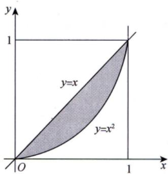  
(a)

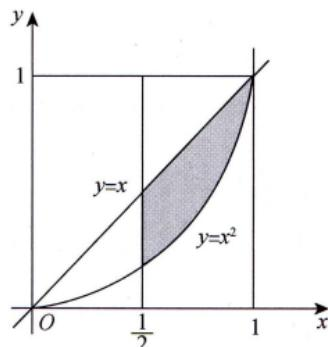  
(b)

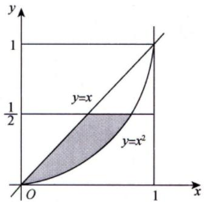  
(c)   
图3-6

3.14 解 由于

$$
1 = \int_ {- \infty} ^ {+ \infty} d x \int_ {- \infty} ^ {+ \infty} f (x, y) d y = \int_ {0} ^ {+ \infty} d x \int_ {x} ^ {+ \infty} A e ^ {- y} d y = A \int_ {0} ^ {+ \infty} e ^ {- x} d x = A,
$$

因此 $A = 1$

$$
\begin{array}{l} P \{X + Y \geqslant 1 \} = 1 - P \{X + Y <   1 \} = 1 - \iint_ {x + y <   1} f (x, y) d x d y \\ = 1 - \int_ {0} ^ {\frac {1}{2}} d x \int_ {x} ^ {1 - x} e ^ {- y} d y = 1 - \int_ {0} ^ {\frac {1}{2}} \left(e ^ {- x} - e ^ {x - 1}\right) d x \\ = 1 - \left(1 + e ^ {- 1} - 2 e ^ {- \frac {1}{2}}\right) = 2 e ^ {- \frac {1}{2}} - e ^ {- 1}, \\ \end{array}
$$

积分区域如图3-7中阴影部分所示，

$$
P \left\{\frac {X}{Y} \leqslant \frac {1}{2} \right\} = \iint_ {\frac {x}{y} \leqslant \frac {1}{2}} f (x, y) d x d y = \int_ {0} ^ {+ \infty} d x \int_ {2 x} ^ {+ \infty} e ^ {- y} d y = \frac {1}{2},
$$

积分区域如图3-8中阴影部分所示，

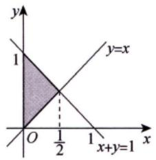  
图3-7

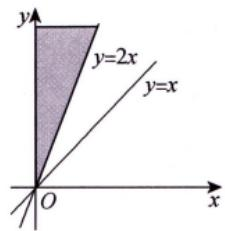  
图3-8

3.15 解 由于 $Y$ 是离散型随机变量， $X$ 与 $Y$ 相互独立，因此计算与 $X, Y$ 有关的事件 $A$ 的概率时，自然想到将 $A$ 对 $Y$ 的可能值作全集分解，应用全概率公式计算 $P(A)$ 。

已知 $X\sim f(x) = \left\{ \begin{array}{ll}\lambda \mathrm{e}^{-\lambda x}, & x > 0,\\ 0, & x\leqslant 0, \end{array} \right.$ $P\{Y = -1\} = \frac{1}{4},P\{Y = 1\} = \frac{3}{4},X$ 与 $Y$ 独立，所以由全概率公式得

$$
\begin{array}{l} P \{X - Y \leqslant 1 \} = P \{X - Y \leqslant 1, Y = 1 \} + P \{X - Y \leqslant 1, Y = - 1 \} \\ = P \{X - 1 \leqslant 1, Y = 1 \} + P \{X + 1 \leqslant 1, Y = - 1 \} \\ = P \{Y = 1 \} P \{X \leqslant 2 \} + P \{Y = - 1 \} P \{X \leqslant 0 \} \\ = \frac {3}{4} \int_ {0} ^ {2} \lambda e ^ {- \lambda x} d x = \frac {3}{4} (1 - e ^ {- 2 \lambda}), \\ \end{array}
$$

$$
\begin{array}{l} P \{X Y \leqslant 2 \} = P \{X Y \leqslant 2, Y = 1 \} + P \{X Y \leqslant 2, Y = - 1 \} \\ = P \{X \leqslant 2, Y = 1 \} + P \{- X \leqslant 2, Y = - 1 \} \\ = P \{Y = 1 \} P \{X \leqslant 2 \} + P \{Y = - 1 \} P \{X \geqslant - 2 \} \\ = \frac {3}{4} \int_ {0} ^ {2} \lambda \mathrm {e} ^ {- \lambda x} \mathrm {d} x + \frac {1}{4} \int_ {0} ^ {+ \infty} \lambda \mathrm {e} ^ {- \lambda x} \mathrm {d} x = 1 - \frac {3}{4} \mathrm {e} ^ {- 2 \lambda}. \\ \end{array}
$$

3.16 解 由于 $X, Y$ 相互独立， $(X, Y)$ 的概率密度为

$f(x,y) = f_{X}(x)f_{Y}(y) = \left\{ \begin{array}{ll}\lambda^{2}\mathrm{e}^{-\lambda (x + y)}, & x\geqslant 0,y\geqslant 0,\\ 0, & \text{其他}. \end{array} \right.$

用卷积公式

用卷积公式“三部曲”： $①$ 换字母 $yz\geqslant 0,y\geqslant 0\Rightarrow y\geqslant 0,z\geqslant 0.$

$②$ 换区域.

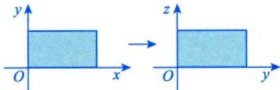

$$
f _ {Z} (z) = \int_ {- \infty} ^ {+ \infty} | y | f (y z, y) d y, y \geqslant 0, z \geqslant 0.
$$

当 $z \leqslant 0$ 时， $f_{Z}(z) = 0$ ；

当 $z > 0$ 时，

$$
\begin{array}{l} f _ {Z} (z) = \int_ {0} ^ {+ \infty} y \cdot \lambda^ {2} e ^ {- \lambda (y z + y)} d y \\ = \frac {1}{(1 + z) ^ {2}} \int_ {0} ^ {+ \infty} \lambda (1 + z) y e ^ {- \lambda (1 + z) y} d [ \lambda (1 + z) y ] \\ \xlongequal {t = \lambda (1 + z) y} \frac {1}{(1 + z) ^ {2}} \int_ {0} ^ {+ \infty} t e ^ {- t} d t \\ = \frac {1}{(1 + z) ^ {2}}. \\ \end{array}
$$

$③$ 背口诀求 $z$ 不积 $z$ 不积先定限限内画条线先交写下限后交写上限

因此 $Z = \frac{X}{Y}$ 的概率密度为

$$
f _ {Z} (z) = \left\{ \begin{array}{l l} \frac {1}{(1 + z) ^ {2}}, & z > 0, \\ 0, & \text {其 他}. \end{array} \right.
$$

3.17 解 由例3.11可知 $(X, Y)$ 的概率密度为

$$
f (x, y) = \left\{ \begin{array}{l l} { \frac {1}{(b - a) ^ {2}},} & {a \leqslant x \leqslant b, a \leqslant y \leqslant b,} \\ {0,} & {\text {其 他}.} \end{array} \right.
$$

又由 $(X,Y)$ 的取值区域 $\{(x,y)|a\leqslant x\leqslant b,a\leqslant y\leqslant b\}$ ，可知 $Z = \min \{X,Y\}$ 的取值区间为 $[a,b]$ ：当 $z < a$ 或 $z > b$ 时，有 $f_{Z}(z) = 0$ ：

当 $a \leqslant z \leqslant b$ 时，有

$$
\begin{array}{l} F _ {Z} (z) = P \{Z \leqslant z \} = P \{\min  \{X, Y \} \leqslant z \} = 1 - P \{X > z, Y > z \} \\ = 1 - \iint_ {x > z, y > z} f (x, y) d x d y = 1 - \int_ {z} ^ {b} d x \int_ {z} ^ {b} \frac {1}{(b - a) ^ {2}} d y \\ = 1 - \frac {(b - z) ^ {2}}{(b - a) ^ {2}}, \\ \end{array}
$$

所以

$$
f _ {Z} (z) = F _ {Z} ^ {\prime} (z) = \frac {2 (b - z)}{(b - a) ^ {2}}.
$$

综上， $Z = \min \{X,Y\}$ 的概率密度为

$$
f _ {Z} (z) = \left\{ \begin{array}{l l} \frac {2 (b - z)}{(b - a) ^ {2}}, & a \leqslant z \leqslant b, \\ 0, & \text {其 他}. \end{array} \right.
$$

3.18 解 $F_{Z}(z) = P\{XY \leqslant z\} = P\{XY \leqslant z | Y = 0\} P\{Y = 0\} + P\{XY \leqslant z | Y = 1\} P\{Y = 1\}$

$$
\begin{array}{l} = \frac {1}{2} \left(P \left\{X Y \leqslant z \mid Y = 0 \right\} + P \left\{X Y \leqslant z \mid Y = 1 \right\}\right) \\ = \frac {1}{2} \left(P \{0 \leqslant z \} + P \{X \leqslant z \}\right) \\ = \left\{ \begin{array}{l l} \frac {1}{2} \Phi (z), & z <   0, \\ \frac {1}{2} [ 1 + \Phi (z) ], & z \geqslant 0. \end{array} \right. \\ \end{array}
$$

所以 $z = 0$ 是唯一间断点.
