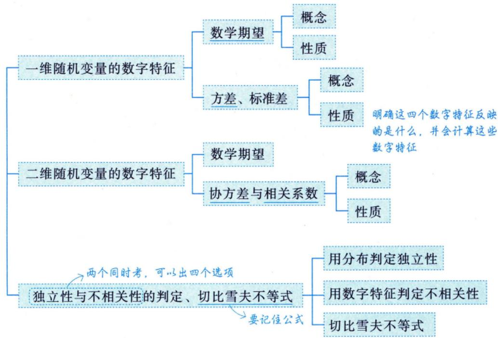
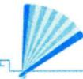
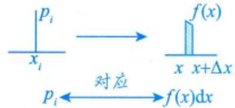
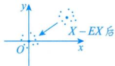
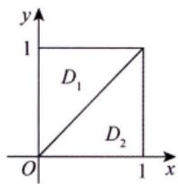
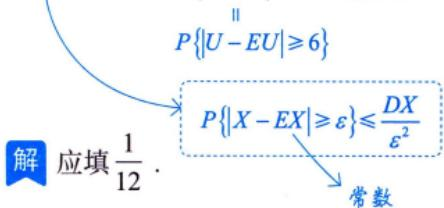

# 第4讲

# 随机变量的数字特征

# 基础知识结构

# 基础内容精讲

# 一维随机变量的数字特征

# 随机变量的数学期望

(1) 概念.

设 $X$ 是随机变量， $Y$ 是 $X$ 的函数， $Y = g(X)$ （ $g$ 为连续函数）.

① 如果 $X$ 是离散型随机变量，其分布列为 $p_i = P\{X = x_i\} (i = 1,2,\dots)$ .若级数 $\sum_{i = 1}^{\infty}x_i p_i$ 绝对收敛，则称随机变量 $X$ 的数学期望存在，并将级数 $\sum_{i = 1}^{\infty}x_i p_i$ 的和称为随机变量 $X$ 的数学期望，记为 $EX$ ，即

$$
E X = \sum_ {i = 1} ^ {\infty} x _ {i} p _ {i},
$$

否则称 $X$ 的数学期望不存在.

若级数 $\sum_{i=1}^{\infty} g(x_i)p_i$ 绝对收敛，则称 $Y = g(X)$ 的数学期望 $E[g(X)]$ 存在，且 $E[g(X)] = \sum_{i=1}^{\infty} g(x_i)p_i$ ，否则称 $g(X)$ 的数学期望不存在。

② 如果 $X$ 是连续型随机变量，其概率密度为 $f(x)$ 。若积分 $\int_{-\infty}^{+\infty} x f(x) \mathrm{d} x$ 绝对收敛，则称 $X$ 的数学期望存在，且 $E X = \int_{-\infty}^{+\infty} x f(x) \mathrm{d} x$ ，否则称 $X$ 的数学期望不存在。

若积分 $\int_{-\infty}^{+\infty}g(x)f(x)\mathrm{d}x$ 绝对收敛，则称 $g(X)$ 的数学期望存在，且 $E[g(X)] = \int_{-\infty}^{+\infty}g(x)f(x)\mathrm{d}x$ ，否则称 $g(X)$ 的数学期望不存在.

  
离散型随机变量 连续型随机变量

注 (1)数学期望又称为概率平均值, 常常简称期望或均值. 数学期望是描述随机变量平均取值状况特征的指标, 它刻画随机变量的一切可能值的集中位置.

(2)在数学期望的定义中要求级数（或积分）绝对收敛，否则称期望不存在.

(2) 性质.

$$
\begin{array}{r l} & {Y = g (X)} \\ & {\text {若} X \sim p _ {i} \Rightarrow E X =  \sum_ {i} x _ {i} p _ {i}} \\ & {X \sim f (x) \Rightarrow E X =  \int_ {- \infty} ^ {+ \infty} x f (x) \mathrm {d} x} \end{array} \Bigg \} \stackrel {{\downarrow}} {{\Rightarrow}} E Y = \left\{ \begin{array}{l l} { \sum_ {i} g (x _ {i}) p _ {i},} & {X \sim p _ {i},} \\ { \int_ {- \infty} ^ {+ \infty} g (x) f (x) \mathrm {d} x,} & {X \sim f (x)} \end{array} \right.
$$

数 ① ${Ea} = a$ , $E\left( \underline{EX}\right)  = {EX}$ . $E\left\lbrack  {E\left( {EX}\right) }\right\rbrack   = {EX}$

$②$ $E(aX + bY) = aEX + bEY$ ， $E\left(\sum_{i = 1}^{n}a_{i}X_{i}\right) = \sum_{i = 1}^{n}a_{i}EX_{i}$ 线性运算无条件打开

$③$ 若 $X,Y$ 相互独立，则 $E(XY) = EXEY$

# 随机变量的方差、标准差

现有 $A, B$ 两名射击运动员，打靶环数平均水平都为9.6，那要选择哪名运动员参加比赛呢？由此，需要引入一个衡量数据波动情况的特征量——方差

(1) 概念.

设 $X$ 是随机变量，如果 $E[(X - EX)^2 ]$ 存在，则称 $E[(X - EX)^2 ]$ 为 $X$ 的方差，记为 $DX$ ，即

$$
\begin{array}{r l} \star D X & = E [ (X - E X) ^ {2} ] = E (X ^ {2}) - (E X) ^ {2}, \\ & = E (X ^ {2}) - 2 E X \cdot E X + (E X) ^ {2} \\ & = E (X ^ {2}) - (E X) ^ {2} \end{array}
$$

称 $\sqrt{DX}$ 为 $X$ 的标准差或均方差，记为 $\sigma (X)$ ，称随机变量 $X^{*} = \frac{X - EX}{\sqrt{DX}}$ 为 $X$ 的标准化随机变量，此时

$$
E X ^ {*} = 0, D X ^ {*} = 1.
$$

去中心化, $\frac{1}{3}$ 二维为例

$$
\begin{array}{l} D X ^ {*} = D \left(\frac {X - E X}{\sqrt {D X}}\right) = \frac {1}{D X} D (X - E X) \\ = \frac {D X - 0}{D X} = 1 \\ \end{array}
$$

最早研究波动情况时，采用的是 $|X - EX|$ ，但由于绝对值不方便计算，因此选择平方这种计算方法.

(2)性质.

① ${DX} \geq  0,E{\left( {X}^{2}\right) }^{2} = {DX} + {\left( EX\right) }^{2} \geq  {\left( EX\right) }^{2}$ . ${DX} = E{\left\lbrack  {\left( X - EX\right) }^{2}\right\rbrack  }^{2}$ $= E{\left( {X}^{2}\right) }^{2} - {\left( EX\right) }^{2} \geq  0$   
② $Dc = 0$ （ $c$ 为常数）.

$DX = 0\Leftrightarrow X$ 几乎处处为某个常数 $a$ ，即 $P\{X = a\} = 1$

③ $D\left( {{aX} + b}\right)  = {a}^{2}{DX}$ . 注意这里是 ${a}^{2}$   
④ $D(X \pm Y) = DX + DY \pm 2\operatorname{Cov}(X, Y)$ , $D\left(\sum_{i=1}^{n} a_i X_i\right) = \sum_{i=1}^{n} a_i^2 DX_i + 2 \sum_{1 \leqslant i < j \leqslant n} a_i a_j \operatorname{Cov}(X_i, X_j)$ .   
⑤如果 $X$ 与 $Y$ 相互独立，则

★每两个随机变量之间都要求协方差

$$
D (a X + b Y) = a ^ {2} D X + b ^ {2} D Y,
$$

$$
D (X Y) = D X D Y + D X (E Y) ^ {2} + D Y (E X) ^ {2} \geqslant D X D Y.
$$

注证因为 $X,Y$ 相互独立，故 $X^{2}$ ， $Y^{2}$ 也相互独立，即有

$$
E (X Y) = E X E Y,
$$

$$
E \left(X ^ {2} Y ^ {2}\right) = E \left(X ^ {2}\right) E \left(Y ^ {2}\right),
$$

$$
\begin{array}{l} D (X Y) = E \left(X ^ {2} Y ^ {2}\right) - [ E (X Y) ] ^ {2} = E \left(X ^ {2}\right) E \left(Y ^ {2}\right) - (E X) ^ {2} (E Y) ^ {2} \\ = [ D X + (E X) ^ {2} ] [ D Y + (E Y) ^ {2} ] - (E X) ^ {2} (E Y) ^ {2} \\ = D X D Y + (E X) ^ {2} D Y + (E Y) ^ {2} D X. \\ \end{array}
$$

又 $(EX)^2 DY + (EY)^2 DX\geqslant 0$ ，所以 $D(XY)\geqslant DXDY$ ：

一般地，如果 $X_{1}$ ， $X_{2}$ ，…， $X_{n}$ 相互独立， $g_{i}(x)(i = 1,2,\dots ,n)$ 为 $\mathcal{X}$ 的连续函数，则

$$
\begin{array}{l} D \left(\sum_ {i = 1} ^ {n} a _ {i} X _ {i}\right) = \sum_ {i = 1} ^ {n} a _ {i} ^ {2} D X _ {i}, \\ D \left[ \sum_ {i = 1} ^ {n} g _ {i} \left(X _ {i}\right) \right] = \sum_ {i = 1} ^ {n} D \left[ g _ {i} \left(X _ {i}\right) \right]. \\ \end{array}
$$

⑥对任意常数 $c$ ,有 ${DX} = E{\left\lbrack  {\left( X - {EX}\right) }^{2}\right\rbrack  }^{2} \leq  E{\left\lbrack  {\left( X - c\right) }^{2}\right\rbrack  }^{2}$ . $\rightarrow$ 关于 $c$ 的函数

注证

$$
\begin{array}{l} E \left[ (X - c) ^ {2} \right] = E \left(X ^ {2} - 2 c X + c ^ {2}\right) \\ = E \left(X ^ {2}\right) - 2 c E X + c ^ {2} \\ \stackrel {\text {令}} {=} g (c) . \\ \end{array}
$$

由

$$
g ^ {\prime} (c) = - 2 E X + 2 c \stackrel {\text {令}} {=} 0,
$$

得 $c = EX$ ，又 $g^{\prime \prime}(c) = 2 > 0$ ，故 $c = EX$ 是 $g(c)$ 的最小值点.

我们将常用分布的数学期望和方差列表如下。要记住

<table><tr><td>分布</td><td>分布列pk或概率密度f(x)</td><td>数学期望</td><td>方差</td></tr><tr><td>0-1分布</td><td>P{X=k}=pk(1-p)^{1-k}, k=0,1</td><td>p</td><td>p(1-p)</td></tr><tr><td>二项分布B(n,p)</td><td>P{X=k}=Cnk^k p^k (1-p)^{n-k}, k=0,1, ..., n</td><td>np</td><td>np(1-p)</td></tr><tr><td>泊松分布P(λ) 泊松分布与指数分布要</td><td>P{X=k}=\frac{\lambda^k}{k!}e^{-\lambda}, k=0,1, ...,</td><td>λ</td><td>λ</td></tr><tr><td>几何分布G(p)</td><td>P{X=k}=(1-p)^{k-1}p, k=1,2, ...</td><td>1/p</td><td>1-p/p^2</td></tr><tr><td>正态分布N(μ,σ^2)</td><td>f(x)=1/√2πσ exp[-((x-μ)^2)/2σ^2], -∞&lt;x&lt;+∞</td><td>μ</td><td>σ^2</td></tr><tr><td>均匀分布U(a,b)</td><td>f(x)=1/b-a, a&lt;x&lt;b</td><td>a+b/2</td><td>(b-a)^2/12</td></tr><tr><td>指数分布E(λ)</td><td>f(x)=λe^{-λx}, x&gt;0</td><td>1/λ</td><td>1/λ^2</td></tr></table>

注：表中仅列出各分布概率密度的非零区域.

例4.1 设一次试验成功的概率为 $p$ ，进行100次独立重复试验，则成功次数的标准差的最大值为

解 应填5.

设成功次数为 $X$ ，则 $X\sim B(100,p),X$ 的标准差为 $\sqrt{DX} = \sqrt{100p(1 - p)}$

由于 $p(1 - p) \leqslant \frac{1}{4}$ ，当且仅当 $p = \frac{1}{2}$ 时等号成立，故当 $p = \frac{1}{2}$ 时成功次数的标准差最大，且其最大值为 $\sqrt{100 \times \frac{1}{4}} = 5$ 。

例4.2 设随机变量 $X$ 的概率密度为

$$
f (x) = \left\{ \begin{array}{l l} \frac {1}{2} \cos \frac {x}{2}, & 0 \leqslant x <   \pi , \\ 0, & \text {其 他}, \end{array} \right.
$$

对 $X$ 独立观察4次，用 $Y$ 表示观察值大于 $\frac{\pi}{3}$ 的次数，求 $Y^2$ 的数学期望.

解 由题意知 $P\left\{X > \frac{\pi}{3}\right\} = \int_{\frac{\pi}{3}}^{+\infty}f(x)\mathrm{d}x = \int_{\frac{\pi}{3}}^{\pi}\frac{1}{2}\cos \frac{x}{2}\mathrm{d}x = \frac{1}{2}$ 所以 $Y\sim B\left(4,\frac{1}{2}\right)$ ，于是

$$
E Y = 4 \times \frac {1}{2} = 2, D Y = 4 \times \frac {1}{2} \times \left(1 - \frac {1}{2}\right) = 1,
$$

所以 $E(Y^{2}) = DY + (EY)^{2} = 1 + 4 = 5.$

例4.3 设连续型随机变量 $X$ 的概率密度为

$$
f (x) = \frac {1}{\pi \left(1 + x ^ {2}\right)} (- \infty <   x <   + \infty),
$$

则 $EX$ （ ）.

(A)等于0

(B)等于1

(C) 等于 $\pi$

(D) 不存在

解 应选(D).

由连续型随机变量数学期望的定义，有

$$
\int_ {- \infty} ^ {+ \infty} \frac {x}{\pi \left(1 + x ^ {2}\right)} d x = \frac {1}{2 \pi} \ln \left(1 + x ^ {2}\right) \Bigg | _ {- \infty} ^ {+ \infty},
$$

由于该积分发散，因此 $EX$ 不存在.

例4.4 设连续型随机变量 $X$ 的概率密度为

$$
f (x) = \frac {1}{\sqrt {\pi}} \mathrm {e} ^ {- x ^ {2} + 2 x - 1} (- \infty <   x <   + \infty),
$$

则 $EX\cdot \sqrt{DX} =$

解 应填 $\frac{1}{\sqrt{2}}$

形如 $A\mathrm{e}^{-ax^2 +bx + c}(a > 0)$ 的概率密度

由 $f(x) = \frac{1}{\sqrt{\pi}}\mathrm{e}^{-x^2 +2x - 1} = \frac{1}{\sqrt{2\pi}\cdot\frac{1}{\sqrt{2}}}\exp \left\{-\frac{(x - 1)^2}{2\left(\frac{1}{\sqrt{2}}\right)^2}\right\} ,$ $\Rightarrow \mu = 1,\sigma^2 = \frac{1}{2}$

知 $EX = 1,\sqrt{DX} = \frac{1}{\sqrt{2}}$ 故 $EX\cdot \sqrt{DX} = \frac{1}{\sqrt{2}}$

例4.5 设随机变量 $X$ 的概率分布为 $P\{X = k\} = \frac{C}{k!}$ $k = 0,1,2,\dots$ ，则 $E(|X - EX|) = .$

解 应填 $\frac{2}{\mathrm{e}}$

形似泊松分布 $P\{X = k\} = \frac{\lambda^k}{k!}\mathrm{e}^{-\lambda},k = 0,1,2,\dots$ ，且 $\mathrm{e}^{x} = \sum_{n = 0}^{\infty}\frac{x^{n}}{n!}$ 结合起来解题

利用性质 $\sum_{k=0}^{\infty} P\{X=k\}=1$ 。因为 $\sum_{k=0}^{\infty} P\{X=k\}=\sum_{k=0}^{\infty} \frac{C}{k!}=Ce=1$ ，所以 $C=e^{-1}$ 。可知随机变量 $X$ 服从参数为 1 的泊松分布。于是

$$
E X = 1, E (X - E X) = E (X - 1) = E X - 1 = 0,
$$

而 $E(|X - EX|) = E(|X - 1|)$

$$
\begin{array}{l} = P \{X = 0 \} \cdot | 0 - 1 | + \sum_ {k = 1} ^ {\infty} P \{X = k \} \cdot | k - 1 | \\ = \frac {\mathrm {e} ^ {- 1}}{0 !} + \sum_ {k = 1} ^ {\infty} P \{X = k \} \cdot (k - 1) \\ = \frac {1}{\mathrm {e}} + \underbrace {\left[ \sum_ {k = 0} ^ {\infty} P \{X = k \} \cdot (k - 1) - P \{X = 0 \} \cdot (0 - 1) \right]} _ {\downarrow} \\ E (X - 1) = 0 \\ = \frac {1}{e} + \left(0 + \frac {1}{e}\right) \\ = \frac {2}{\mathrm {e}}. \\ \end{array}
$$

注 由泊松分布的分布列 $P\{X = k\} = \frac{\lambda^k}{k!}\mathrm{e}^{-\lambda}, k = 0,1,2,\dots$ ，与本题给出的分布列 $P\{X = k\} = \frac{C}{k!}, k = 0,1,2,\dots$ ，比较可以看出题目中的随机变量 $X$ 就是服从参数 $\lambda = 1$ 的泊松分布。

例4.6 设随机变量 $X$ 的概率密度为 $f(x) = \begin{cases} \frac{x}{2}, & 0 < x < 2, \\ 0, & \text{其他}, \end{cases}$ $F(x)$ 为 $X$ 的分布函数， $EX$ 为 $X$ 的数学期望，则 $P\{F(X) > EX - 1\} =$

解 应填 $\frac{2}{3}$

方法一 令 $Y = F(X)$ ，因为 $F(x)$ 严格单调增加，所以 $Y \sim U(0,1)$ ，又 $EX = \int_{-\infty}^{+\infty}xf(x)\mathrm{d}x =$ $\int_0^2\frac{x^2}{2}\mathrm{d}x = \frac{4}{3}$ 则 由例2.15可得

$$
P \{F (X) > E X - 1 \} = P \left\{Y > \frac {1}{3} \right\} = \frac {2}{3}.
$$

方法二 由题意知，

$$
E X = \int_ {- \infty} ^ {+ \infty} x f (x) d x = \int_ {0} ^ {2} \frac {x ^ {2}}{2} d x = \frac {4}{3}.
$$

由 $F(x) = \int_{-\infty}^{x}f(t)\mathrm{d}t$ ，得

$$
F (x) = \left\{ \begin{array}{l l} 0, & x <   0, \\ \frac {x ^ {2}}{4}, & 0 \leqslant x <   2, \\ 1, & x \geqslant 2. \end{array} \right.
$$

从而，

$$
\begin{array}{l} P \{F (X) > E X - 1 \} = P \{F (X) > E X - 1, X <   0 \} + P \{F (X) > E X - 1, 0 \leqslant X <   2 \} + \\ P \{F (X) > E X - 1, X \geqslant 2 \} = P \left\{\frac {X ^ {2}}{4} > \frac {1}{3}, 0 \leqslant X <   2 \right\} \\ = P \left\{\frac {2}{\sqrt {3}} <   X <   2 \right\} = \int_ {\frac {2}{\sqrt {3}}} ^ {2} \frac {x}{2} d x = \frac {2}{3}. \\ \end{array}
$$

注 显然方法二解法比较复杂.

# 二维随机变量的数字特征

二维随机变量函数的数学期望 $Z = g(X,Y)$ 仍然是一维，期望，方差都是对一维变量进行研究

设 $X, Y$ 为随机变量， $g(X, Y)$ 为 $X, Y$ 的函数（ $g$ 是连续函数）

(1) 如果 $(X, Y)$ 为离散型随机变量，其联合分布律为

$$
p _ {i j} = P \{X = x _ {i}, Y = y _ {j} \} (i, j = 1, 2, \dots),
$$

若级数 $\sum_{i}\sum_{j}g(x_{i},y_{j})p_{ij}$ 绝对收敛，则定义

概率取值设变

$$
E [ g (X, Y) ] \xlongequal {Z = g (X, Y)} E Z = \sum_ {i} \sum_ {j} g \left(x _ {i}, y _ {j}\right) p _ {i j}.
$$

(2)如果 $(X,Y)$ 为连续型随机变量，其概率密度为 $f(x,y)$ ，若积分 $\int_{-\infty}^{+\infty}\int_{-\infty}^{+\infty}g(x,y)f(x,y)\mathrm{d}x\mathrm{d}y$ 绝对收敛，则定义

二重积分

$$
E [ g (X, Y) ] \stackrel {Z = g (X, Y)} {=} E Z = \int_ {- \infty} ^ {+ \infty} \int_ {- \infty} ^ {+ \infty} g (x, y) f (x, y) \mathrm {d} x \mathrm {d} y.
$$

$$
D Z = E \left(Z ^ {2}\right) - (E Z) ^ {2}.
$$

$$
E \left(Z ^ {2}\right) = \int_ {- \infty} ^ {+ \infty} \int_ {- \infty} ^ {+ \infty} g ^ {2} (x, y) f (x, y) d x d y
$$

# 两个随机变量的协方差与相关系数

(1) 概念. 描述两个随机变量之间的关系

如果随机变量 $X$ 与 $Y$ 的方差存在且 $DX > 0$ ， $DY > 0$ ，则称 $E[(X - EX)(Y - EY)]$ 为随机变量 $X$ 与 $Y$ 的协方差，并记为 $\operatorname{Cov}(X,Y)$ ，即

$$
\begin{array}{r l}&{\quad \rightarrow \text {若} X = Y, \text {则} \operatorname {C o v} (X, Y) = E \big [ (X - E X) ^ {2} \big ] = D X}\\&{\quad \operatorname {C o v} (X, Y) = E [ (X - E X) (Y - E Y) ] = E (X Y) - E X \bullet E Y,}\end{array}
$$

其中

$$
E (X Y) = \left\{ \begin{array}{l l} \sum_ {i} \sum_ {j} x _ {i} y _ {j} P \{X = x _ {i}, Y = y _ {j} \} (\text {离 散 型}), \\ \int_ {- \infty} ^ {+ \infty} \int_ {- \infty} ^ {+ \infty} x y f (x, y) \mathrm {d} x \mathrm {d} y (\text {连 续 型}). \end{array} \right.
$$

称 $\rho_{XY} = \frac{\operatorname{Cov}(X,Y)}{\sqrt{DX}\sqrt{DY}}$ 为随机变量 $X$ 与 $Y$ 的相关系数.如果 $\rho_{XY} = 0$ ，则称 $X$ 与 $Y$ 不相关；如果 $\rho_{XY}\neq 0$ 则称 $X$ 与 $Y$ 相关.

若有随机变量 $X$ ，数字特征为 $EX$ ， $DX$ ，有 $X^{*} = \frac{X - EX}{\sqrt{DX}}$ 为 $X$ 的标准化；类似的，有随机变量 $Y$ $Y^{*}$ 为 $Y$ 的标准化，则 $EX^{*} = 0$ （去中心化）， $DX^{*} = 1$ （去扰动，去量纲）

$$
\begin{array}{l} \operatorname {C o v} \left(X ^ {*}, Y ^ {*}\right) = \operatorname {C o v} \left(\frac {X - E X}{\sqrt {D X}}, \frac {Y - E Y}{\sqrt {D Y}}\right) \\ = \frac {\operatorname {C o v} (X - E X , Y - E Y)}{\sqrt {D X} \sqrt {D Y}} = \frac {\operatorname {C o v} (X , Y)}{\sqrt {D X} \sqrt {D Y}} = \rho_ {X Y}. \\ \end{array}
$$

注 (1) 协方差 $\operatorname{Cov}(X, Y)$ 是描述随机变量 $X$ 与 $Y$ 之间偏差的关联程度的特征，比如研究父亲身高 $X$ 与孩子身高 $Y$ 之间的偏差程度，便可用 $\operatorname{Cov}(X, Y)$ 来刻画。相关系数 $\rho_{XY}$ 描述随机变量 $X$ 与 $Y$ 之间的线性相依性， $|\rho_{XY}|$ 是刻画 $X$ 与 $Y$ 之间线性相关程度的一种度量。 $\rho_{XY} = 0$ 表示 $X$ 与 $Y$ 之间不存在线性关系，故称 $X$ 与 $Y$ 不相关，但这并不意味着 $X$ 与 $Y$ 之间不存在相依关系，它们之间还可能存在某种非线性关系。

$$
\begin{array}{l} \text {如} X \sim U (- 1, 1), Y = \cos X, \text {则} \\ E X = 0, E (X Y) = E (X \cos X) = \int_ {- 1} ^ {1} x \cos x \cdot \frac {1}{2} d x = 0. \\ \end{array}
$$

故 $\rho_{XY} = 0$ , 说明 $X$ 与 $Y$ 之间没有线性关系, 但它们有函数关系.

(2) 随机变量的矩.

设 $(X,Y)$ 是二维随机变量.如果 $E(X^{k}Y^{l})$ 存在，则称 $E(X^{k})(k = 1,2,\dots)$ 为 $X$ 的 $k$ 阶原点矩；称 $E[(X - EX)^{k}] (k = 2,3,\dots)$ 为 $X$ 的 $k$ 阶中心矩；称 $E(X^{k}Y^{l})(k,l = 1,2,\dots)$ 为 $X$ 与 $Y$ 的 $k + l$ 阶混合原点矩；称 $E[(X - EX)^{k}(Y - EY)^{l}] (k,l = 1,2,\dots)$ 为 $X$ 与 $Y$ 的 $k + l$ 阶混合中心矩.

从上述定义看出：数学期望 $EX$ 是 $X$ 的一阶原点矩，方差 $DX$ 是 $X$ 的二阶中心矩，协方差 $\operatorname{Cov}(X, Y)$ 是 $X$ 与 $Y$ 的二阶混合中心矩.

(2)性质.

$① \operatorname {C o v} (X, Y) = \operatorname {C o v} (Y, X).$   
② $\operatorname{Cov}(aX, bY) = ab\operatorname{Cov}(X, Y)$ .   
③ $\operatorname{Cov}(X_1 + X_2, Y) = \operatorname{Cov}(X_1, Y) + \operatorname{Cov}(X_2, Y)$ .   
④ $|\rho_{XY}| \leqslant 1$   
⑤ $\rho_{XY} = 1\Leftrightarrow P\{Y = aX + b\} = 1(a > 0)$

$$
\rho_ {X Y} = - 1 \Leftrightarrow P \{Y = a X + b \} = 1 (a <   0).
$$

注 $Y = aX + b$ ， $a > 0\Rightarrow \rho_{XY} = 1$

$Y = {aX} + b,a < 0 \Rightarrow  {\rho }_{XY} =  - 1$ . 一 $\rightarrow$ 作为结论记住

例4.7 设随机变量 $X$ 与 $Y$ 的概率分布分别为

<table><tr><td>X</td><td>0</td><td>1</td></tr><tr><td>P</td><td>1/3</td><td>2/3</td></tr></table>

<table><tr><td>Y</td><td>-1</td><td>0</td><td>1</td></tr><tr><td>P</td><td>1/3</td><td>1/3</td><td>1/3</td></tr></table>

且 $P\{X^2 = Y^2\} = 1$

(1) 求随机变量 $(X, Y)$ 的概率分布；  
(2)求 $Z = XY$ 的概率分布；  
(3) 求 $X$ 与 $Y$ 的相关系数 $\rho_{XY}$ .

解 (1) 由 $P\{X^2 = Y^2\} = 1$ ，知 $P\{X^2 \neq Y^2\} = 0$ ，即

$$
P \{X = 0, Y = - 1 \} = P \{X = 0, Y = 1 \} = P \{X = 1, Y = 0 \} = 0,
$$

从而有

$$
P \{X = 0, Y = 0 \} = P \{X = 0 \} = \frac {1}{3},
$$

$$
P \{X = 1, Y = - 1 \} = P \{Y = - 1 \} = \frac {1}{3},
$$

$$
P \{X = 1, Y = 1 \} = P \{Y = 1 \} = \frac {1}{3},
$$

因此， $(X,Y)$ 的概率分布为

<table><tr><td>X Y</td><td>-1</td><td>0</td><td>1</td><td>pi.</td></tr><tr><td>0</td><td>0</td><td>1/3</td><td>0</td><td>1/3</td></tr><tr><td>1</td><td>1/3</td><td>0</td><td>1/3</td><td>2/3</td></tr><tr><td>p.j</td><td>1/3</td><td>1/3</td><td>1/3</td><td>1</td></tr></table>

(2) $Z = XY$ 的可能取值为 $-1, 0, 1$ .

$$
\begin{array}{l l} \downarrow & P \{Z = - 1 \} = P \{X = 1, Y = - 1 \} = \frac {1}{3}, \\ X = 1, Y = - 1 \Rightarrow Z = - 1, \\ X = 0, Y = - 1, 0, 1 \\ X = 1, Y = 0 \\ X = 1, Y = 1 \Rightarrow Z = 1 \end{array}
$$

$$
P \{Z = 0 \} = 1 - \frac {1}{3} - \frac {1}{3} = \frac {1}{3},
$$

所以 $Z\sim \left( \begin{array}{ccc} - 1 & 0 & 1\\ \frac{1}{3} & \frac{1}{3} & \frac{1}{3} \end{array} \right).$

(3)由于

$$
E X = 0 \times \frac {1}{3} + 1 \times \frac {2}{3} = \frac {2}{3}, E \left(X ^ {2}\right) = \frac {2}{3}, D X = \frac {2}{3} - \left(\frac {2}{3}\right) ^ {2} = \frac {2}{9},
$$

$$
E Y = - 1 \times \frac {1}{3} + 0 \times \frac {1}{3} + 1 \times \frac {1}{3} = 0, E \left(Y ^ {2}\right) = \frac {2}{3}, D Y = \frac {2}{3},
$$

$$
E (X Y) = - 1 \times 1 \times \frac {1}{3} + 1 \times 1 \times \frac {1}{3} = 0,
$$

因此

$$
\rho_ {X Y} = \frac {E (X Y) - E X E Y}{\sqrt {D X} \sqrt {D Y}} = 0.
$$

例4.8 甲、乙两人相约于某地在 $12:00\sim 13:00$ 会面，设 $X,Y$ 分别是甲、乙到达超过12：00的时间（单位：小时），且假设 $X$ 和 $Y$ 相互独立，已知 $X,Y$ 的概率密度分别为

$$
f _ {X} (x) = \left\{ \begin{array}{l l} 3 x ^ {2}, & 0 <   x <   1, \\ 0, & \text {其 他}, \end{array} \right. f _ {Y} (y) = \left\{ \begin{array}{l l} 2 y, & 0 <   y <   1, \\ 0, & \text {其 他}. \end{array} \right.
$$

求先到达者需要等待的时间的数学期望.

→|X-Y|

解 由题意可得 $f(x,y) = \left\{ \begin{array}{ll}6x^{2}y, & 0 <   x <   1,0 <   y <   1,\\ 0, & \text{其他}. \end{array} \right.$ 由于 $X,Y$ 相互独立

根据题意可知，所求即为 $|X - Y|$ 的数学期望，如图4-1所示，有

$$
\begin{array}{l} E \left(\left| X - Y \right|\right) = \int_ {0} ^ {1} \int_ {0} ^ {1} | x - y | 6 x ^ {2} y d x d y \\ = \iint_ {D _ {1}} [ - (x - y) 6 x ^ {2} y ] d x d y + \iint_ {D _ {2}} (x - y) 6 x ^ {2} y d x d y \\ = \frac {1}{1 2} + \frac {1}{6} = \frac {1}{4} (\text {小 时}). \\ \end{array}
$$

  
图4-1

# 三 独立性与不相关性的判定、切比雪夫不等式

# 独立性与不相关性的判定

(1)随机变量 $X$ 与 $Y$ 相互独立，意指对任意实数 $x,y$ ，事件 $\{X\leqslant x\}$ 与 $\{Y\leqslant y\}$ 相互独立，即 $(X,Y)$ 的分布等于边缘分布相乘： $F(x,y) = F_{X}(x)\bullet F_{Y}(y)$ ：

若 $(X,Y)$ 是离散型的，则 $X$ 与 $Y$ 独立的充要条件是

$$
P \{X = x _ {i}, Y = y _ {j} \} = P \{X = x _ {i} \} \cdot P \{Y = y _ {j} \}; \quad \text {存 在} x _ {0}, y _ {0} \text {， 使 得}
$$

若 $(X,Y)$ 是连续型的，则 $X$ 与 $Y$ 独立的充要条件是

$$
F \left(x _ {0}, y _ {0}\right) \neq F _ {X} \left(x _ {0}\right) \cdot F _ {Y} \left(y _ {0}\right)
$$

#

$X,Y$ 不独立

$$
f (x, y) = f _ {X} (x) \cdot f _ {Y} (y).
$$

一般通过分布判定独立性.

(2)随机变量 $X$ 与 $Y$ 不相关，意指 $X$ 与 $Y$ 之间不存在线性相依性，即 $\rho_{XY} = 0$ ，其充要条件是

$$
\rho_ {X Y} = 0 \Leftrightarrow \operatorname {C o v} (X, Y) = 0 \Leftrightarrow E (X Y) = E X \cdot E Y \Leftrightarrow D (X \pm Y) = D X + D Y.
$$

一般通过数字特征判定不相关性.

$$
\rightarrow D (X \pm Y) = D X + D Y \pm 2 \operatorname {C o v} (X, Y)
$$

# 考研数学基础30讲·概率论与数理统计分册

(3)几个重要结论： $\neg$ 没有任何关系

① 如果 $X$ 与 $Y$ 独立，则 $X, Y$ 不相关，反之不然；  
② 如果 $(X, Y)$ 服从二维正态分布，则 $X, Y$ 独立 $\Leftrightarrow X, Y$ 不相关；  
③由①知，如果 $X$ 与 $Y$ 相关，则 $X, Y$ 不独立.

综上所述，我们在讨论随机变量 $X$ 与 $Y$ 的不相关性、独立性时，总是先计算 $\operatorname{Cov}(X, Y)$ ，而后按下列程序进行判断或再计算：

$\begin{array}{r}\mathrm{Cov}(X,Y) = E(XY) - EXEY \end{array}$ $\neq 0\Leftrightarrow X$ 与 $Y$ 相关 $\Rightarrow X$ 与 $Y$ 不独立， $= 0\Leftrightarrow X$ 与 $Y$ 不相关，通过分布推断 $\left\{ \begin{array}{ll}X,Y\\ X,Y \end{array} \right.$ 独立，

注 上述讨论均假设方差存在且不为零.

# 切比雪夫不等式

如果随机变量 $X$ 的期望 $EX$ 和方差 $DX$ 存在，则对任意 $\varepsilon > 0$ ，有

$$
P \{| X - E X | \geqslant \varepsilon \} \leqslant \frac {D X}{\varepsilon^ {2}} \text {或} P \{| X - E X | <   \varepsilon \} \geqslant 1 - \frac {D X}{\varepsilon^ {2}}.
$$

随机变量离中心点应当相差不远

注 由切比雪夫不等式知，当 $DX$ 越小时，概率 $P\{|X - EX| < \varepsilon\}$ 越大，这表明方差是刻画随机变量与其期望值偏离程度的量，是描述随机变量 $X$ “分散程度”特征的指标。

例4.9 设随机变量 $(X, Y)$ 服从二维正态分布，则随机变量 $U = X + Y$ ， $V = X - Y$ 不相关的充分必要条件为（ ）.

(A) $EX = EY$

(B) $E(X^{2}) - (EX)^{2} = E(Y^{2}) - (EY)^{2}$

(C) $E(X^{2}) = E(Y^{2})$

(D) $E(X^{2}) + (EX)^{2} = E(Y^{2}) + (EY)^{2}$

分析 $\operatorname {Cov}(X + Y,X - Y) = 0\Leftrightarrow E[(X + Y)(X - Y)] = E(X + Y)\bullet E(X - Y)\Leftrightarrow E(X^2) - E(Y^2) = (EX)^2 -(EY)^2.$

解 应选(B).

随机变量 $U, V$ 不相关的充分必要条件是协方差 $\operatorname{Cov}(U, V) = 0$ ，由

$$
E (U V) = E \left(X ^ {2}\right) - E \left(Y ^ {2}\right), E U = E X + E Y, E V = E X - E Y,
$$

得 $\operatorname {Cov}(U,V) = E(UV) - EUEV = E(X^2) - E(Y^2) - (EX + EY)(EX - EY)$

$$
= E \left(X ^ {2}\right) - (E X) ^ {2} - \left[ E \left(Y ^ {2}\right) - (E Y) ^ {2} \right],
$$

因此，随机变量 $U, V$ 不相关的充分必要条件为 $E(X^2) - (EX)^2 - [E(Y^2) - (EX)^2] = 0$ ，即 $E(X^2) - (EX)^2 = E(Y^2) - (EX)^2$ ，故选择(B).

例4.10

设随机变量 $X$ 的概率密度为

常考题,研究 $X$ , $\left| X\right|$ 的独立性、相关性

$$
f (x) = \frac {1}{2} \mathrm {e} ^ {- | x |}, x \in (- \infty , + \infty),
$$

则（ ）.

(A) $X$ 与 $|X|$ 不相关， $X$ 与 $|X|$ 不独立

(B) $X$ 与 $|X|$ 不相关， $X$ 与 $|X|$ 独立

(C) $X$ 与 $|X|$ 相关， $X$ 与 $|X|$ 不独立

(D) $X$ 与 $|X|$ 相关， $X$ 与 $|X|$ 独立

应选(A).

①由对称性，有

$$
E X = \int_ {- \infty} ^ {+ \infty} x f (x) \mathrm {d} x = 0, E (X | X |) = \int_ {- \infty} ^ {+ \infty} x | x | f (x) \mathrm {d} x = 0,
$$

因此， $\operatorname {Cov}(X,\left|X\right|) = E(X\left|X\right|) - EXE(\left|X\right|) = 0$ ，知 $X$ 与 $\left|X\right|$ 不相关.

② 由例3.6知， $X$ 与 $\left|X\right|$ 不独立，故选(A).

例4.11 设 $X, Y$ 为随机变量，数学期望都是2，方差分别为1和4，相关系数为0.5，则由切比雪夫不等式， $P\{|X - Y| \geqslant 6\} \leqslant$

已知 $EX = EY = 2,DX = 1, DY = 4,\rho_{XY} = 0.5 = \frac{\operatorname{Cov}(X,Y)}{\sqrt{DX}\cdot\sqrt{DY}} = \frac{\operatorname{Cov}(X,Y)}{2}$ .记 $U = X - Y$ ，则

$$
E U = 0, D U = D (X - Y) = D X + D Y - 2 \operatorname {C o v} (X, Y) = 1 + 4 - 2 \times 0. 5 \times 2 = 3.
$$

取 $\varepsilon = 6$ ，由切比雪夫不等式，得

$$
P \{| X - Y | \geqslant 6 \} \leqslant \frac {D (X - Y)}{6 ^ {2}} = \frac {3}{3 6} = \frac {1}{1 2}.
$$

综合题举例

例4.12 在区间(0,2)上随机取一点，将该区间分成两段，较短一段的长度记为 $X$ ，较长一段的长度记为 $Y$ ，令 $Z = \frac{Y}{X}$

（1）求 $X$ 的概率密度；  
（2）求 $Z$ 的概率密度；

（3）求 $E\left(\frac{X}{Y}\right)$

解（1）设随机取的点的坐标记为 $V$ ，则 $V\sim U(0,2),X = \min \{V,2 - V\} .X$ 的分布函数记为 $F_{X}(x)$ 由于 $P\{0\leqslant X\leqslant 1\} = 1$ ，故

当 $x < 0$ 时， $F_{X}(x) = 0$

当 $x\geqslant 1$ 时， $F_{X}(x) = 1$

当 $0 \leqslant x < 1$ 时，

$$
\begin{array}{l} F _ {X} (x) = P \{X \leqslant x \} \\ = P \left\{\min  \{V, 2 - V \} \leqslant x \right\} \\ = 1 - P \left\{\min  \{V, 2 - V \} > x \right\} \\ = 1 - P \{x <   V <   2 - x \} \\ = 1 - \frac {(2 - x) - x}{2} = x. \\ \end{array}
$$

所以 $X$ 的分布函数为

$$
F _ {X} (x) = \left\{ \begin{array}{l l} 0, & x <   0, \\ x, & 0 \leqslant x <   1, \\ 1, & x \geqslant 1. \end{array} \right.
$$

故 $X$ 的概率密度为

$$
f _ {X} (x) = \left\{ \begin{array}{l l} 1, & 0 <   x <   1. \\ 0, & \text {其 他}. \end{array} \right.
$$

（2）由条件，知 $Z = \frac{Y}{X} = \frac{2 - X}{X}$ 由于函数 $z = \frac{2 - x}{x}$ 在(0,1)内严格单调且可导，反函数为 $x = \frac{2}{1 + z}$ ， $\frac{\mathrm{d}x}{\mathrm{d}z} = -\frac{2}{(1 + z)^2}$ ，故 $Z$ 的概率密度为

$$
\begin{array}{l} f _ {Z} (z) = \left\{ \begin{array}{l l} f _ {X} \left(\frac {2}{1 + z}\right) \Bigg | - \frac {2}{(1 + z) ^ {2}} \Bigg |, & z > 1, \\ 0, & \text {其 他} \end{array} \right. \\ = \left\{ \begin{array}{l l} \frac {2}{(1 + z) ^ {2}}, & z > 1, \\ 0, & \text {其 他}. \end{array} \right. \\ \end{array}
$$

(3) $E\left(\frac{X}{Y}\right) = E\left(\frac{X}{2 - X}\right) = \int_{0}^{1} \frac{x}{2 - x} \, \mathrm{d}x = 2 \ln 2 - 1.$

# 习题

4.1 已知连续型随机变量 $X$ 与 $Y$ 有相同的概率密度，且

$$
X \sim f (x) = \left\{ \begin{array}{l l} {2 x \theta^ {2},} & {0 <   x <   \frac {1}{\theta}, (\theta > 0), E [ a (X + 2 Y) ] = \frac {1}{\theta},} \\ {0,} & {\text {其 他}} \end{array} \right.
$$

则 $a =$ （ ）.

(A) $\frac{2}{3}$

(B) $\frac{1}{2}$

(C) $\frac{1}{3}$

(D) $\frac{1}{6}$

4.2 设随机变量 $(X, Y)$ 服从二维正态分布， $X$ 与 $Y$ 的期望值均为 $\mu$ ，方差均为 $\sigma^2$ ， $X, Y$ 的相关系数为 $\rho_{XY} = 0$ ，记 $Z_1 = 2X + Y$ ， $Z_2 = 2X - Y$ ，则 $Z_1, Z_2$ 的相关系数为（ ）.

(A) 0

(B) $\frac{3}{5}$

(C) $\frac{3}{\sqrt{15}}$

(D) $\frac{3}{\sqrt{10}}$

4.3 设二维随机变量 $(X, Y)$ 的概率分布为

<table><tr><td>X Y</td><td>0</td><td>1</td><td>2</td></tr><tr><td>-1</td><td>0.1</td><td>0.1</td><td>b</td></tr><tr><td>1</td><td>a</td><td>0.1</td><td>0.1</td></tr></table>

若事件 $\{\max \{X,Y\} = 2\}$ 与事件 $\{\min \{X,Y\} = 1\}$ 相互独立，则 $\operatorname {Cov}(X,Y) =$ （ ）.

(A)-0.6

(B)-0.36

(C) 0

(D) 0.48

4.4 设随机变量 $X$ 在 $[-1, 1]$ 上服从均匀分布， $Y = X^3$ ，则 $X$ 与 $Y$ （ ）.

(A) 不相关且相互独立

(B) 不相关且不相互独立

(C) 相关且相互独立

(D) 相关且不相互独立

4.5 设随机变量 $X$ 的分布函数为

$$
F (x) = \left\{ \begin{array}{l l} 0, & x <   - 1, \\ 0. 2, & - 1 \leqslant x <   0, \\ 0. 8, & 0 \leqslant x <   1, \\ 1, & x \geqslant 1, \end{array} \right.
$$

则 $D(X^{2}) = \underline{\quad}$

4.6 设连续型随机变量 $X$ 服从参数为1的指数分布，则 $D(\mathrm{e}^{-2X}) =$

4.7 已知连续型随机变量 $Y$ 的概率密度为

$$
f (y) = \left\{ \begin{array}{l l} \frac {y}{a ^ {2}} \mathrm {e} ^ {- \frac {y ^ {2}}{2 a ^ {2}}}, & y > 0, \\ 0, & y \leqslant 0, \end{array} \right. a > 0,
$$

则随机变量 $Z = \frac{1}{Y}$ 的数学期望 $E Z =$

4.8 设随机变量 $X$ 服从参数为 $\lambda$ 的泊松分布，且已知 $E[(X - 1)(X - 2)] = 1$ ，则 $\lambda =$

4.9 设连续型随机变量 $X$ 的概率密度为

$$
f (x) = \frac {1}{\pi \left(1 + x ^ {2}\right)} (- \infty <   x <   + \infty),
$$

则 $E(\min \{|X|, 1\}) =$

4.10 已知随机变量 $(X, Y) \sim N(0, 0; 1, 1; 0.5)$ ， $U = \max\{X, Y\}$ ， $V = \min\{X, Y\}$ ，则 $E(U + V) =$ ______， $E(UV) =$ ______.  
4.11 设 $X$ 为随机变量， $P\{|X - EX| < \varepsilon\} \geqslant 0.9, DX = 0.009$ ，用切比雪夫不等式估计 $\varepsilon$ 的取值范围为  
4.12 设随机变量

$$
X \sim \left( \begin{array}{c c} 0 & 1 \\ \frac {1}{4} & \frac {3}{4} \end{array} \right), Y \sim \left( \begin{array}{c c} 0 & 1 \\ \frac {1}{2} & \frac {1}{2} \end{array} \right),
$$

且 $\operatorname {Cov}(X,Y) = \frac{1}{8}$ $X$ 与 $Y$ 的联合分布律为

4.13 设 $A, B$ 为两个随机事件，且 $P(A) = \frac{1}{4}, P(B|A) = \frac{1}{3}, P(A|B) = \frac{1}{2}$ . 令

$$
X = \left\{ \begin{array}{l l} 1, & A \text {发 生}, \\ 0, & A \text {不 发 生}, \end{array} \right. Y = \left\{ \begin{array}{l l} 1, & B \text {发 生}, \\ 0, & B \text {不 发 生}, \end{array} \right.
$$

求：(1)二维随机变量 $(X,Y)$ 的概率分布；

(2) $X, Y$ 的相关系数 $\rho_{XY}$ ;  
(3) $Z = X^{2} + Y^{2}$ 的概率分布.

4.14 设 $X \sim N(0, \sigma^2)(\sigma > 0), Y = X^3$

(1)求 ${EY}$ ;   
(2) 判断 $X$ 与 $Y$ 是否相关？是否独立？说明理由.

# 解答

4.1 (B) 解 由于 $X$ 与 $Y$ 有相同的概率密度，因此 $EX = EY$ ，于是

$$
\begin{array}{l} E [ a (X + 2 Y) ] = a (E X + 2 E Y) = 3 a E X \\ = 3 a \int_ {- \infty} ^ {+ \infty} x f (x) d x = 3 a \int_ {0} ^ {\frac {1}{\theta}} 2 x ^ {2} \theta^ {2} d x \\ = 3 a \cdot \frac {2}{3} x ^ {3} \theta^ {2} \Bigg | _ {0} ^ {\frac {1}{\theta}} = \frac {2 a}{\theta} = \frac {1}{\theta}, \\ \end{array}
$$

解得 $a = \frac{1}{2}$ ，故选择(B).

4.2 (B) 解 利用已有的关系计算，不必从 $(Z_{1}, Z_{2})$ 的分布去考虑。

由 $\rho_{XY} = 0$ ，知 $X$ 与 $Y$ 不相关且相互独立.于是

$$
D Z _ {1} = 4 D X + D Y = 5 \sigma^ {2}, D Z _ {2} = 4 D X + D Y = 5 \sigma^ {2},
$$

$$
\begin{array}{l} \operatorname {C o v} \left(Z _ {1}, Z _ {2}\right) = E \left[ (2 X + Y) (2 X - Y) \right] - E (2 X + Y) E (2 X - Y) \\ = 4 E \left(X ^ {2}\right) - 4 (E X) ^ {2} - E \left(Y ^ {2}\right) + (E Y) ^ {2} \\ = 4 D X - D Y = 3 \sigma^ {2}, \\ \end{array}
$$

因此， $Z_{1},Z_{2}$ 的相关系数 $\rho = \frac{\operatorname{Cov}(Z_1,Z_2)}{\sqrt{DZ_1}\sqrt{DZ_2}} = \frac{3}{5}$ 故选择(B).

4.3 (B) 解 $P\{\max \{X, Y\} = 2\} = P\{Y = 2\} = b + 0.1,$

$$
P \{\min  \{X, Y \} = 1 \} = P \{X = 1, Y = 1 \} + P \{X = 1, Y = 2 \} = 0. 2 ,
$$

$$
P \left\{\max  \{X, Y \} = 2, \min  \{X, Y \} = 1 \right\} = P \{X = 1, Y = 2 \} = 0. 1,
$$

由于事件 $\{\max \{X,Y\} = 2\}$ 与事件 $\{\min \{X,Y\} = 1\}$ 相互独立，从而有

$$
P \{\max  \{X, Y \} = 2, \min  \{X, Y \} = 1 \} = P \{\max  \{X, Y \} = 2 \} P \{\min  \{X, Y \} = 1 \},
$$

即 $0.1 = (b + 0.1)\times 0.2$ ，解得 $b = 0.4$ ：

由分布律的性质知 $0.1 + 0.1 + b + a + 0.1 + 0.1 = 1$ ，解得 $a = 0.2$ .从而有

$$
E X = - 1 \times (0. 1 + 0. 1 + 0. 4) + 1 \times (0. 2 + 0. 1 + 0. 1) = - 0. 2,
$$

$$
E Y = 0 + 1 \times (0. 1 + 0. 1) + 2 \times (0. 4 + 0. 1) = 1. 2,
$$

$$
E (X Y) = - 1 \times 1 \times 0. 1 + 1 \times 1 \times 0. 1 + (- 1) \times 2 \times 0. 4 + 1 \times 2 \times 0. 1 = - 0. 6,
$$

所以 $\operatorname {Cov}(X,Y) = E(XY) - EXEY = -0.6 - (-0.2)\times 1.2 = -0.36.$

故选 (B).

4.4 (D) 解 显然，结论(C)对任意两个随机变量都不正确。又 $X$ 与 $Y$ 之间存在函数关系，因而

不可能独立，结论(A)不正确.由题设， $EX = 0$ ， $E(XY) = \int_{-1}^{1}x^{4}\cdot \frac{1}{2}\mathrm{d}x\neq 0$ ，从而知 $\operatorname {Cov}(X,Y)\neq 0$ ，则 $X$ 与 $Y$ 必相关，也必不相互独立，故选择(D).

4.5 0.24 解 先求 $X$ 的分布列，即有

$$
X \sim \left( \begin{array}{c c c} - 1 & 0 & 1 \\ 0. 2 & 0. 6 & 0. 2 \end{array} \right).
$$

因此

$$
\begin{array}{l} E \left(X ^ {2}\right) = (- 1) ^ {2} \times 0. 2 + 0 ^ {2} \times 0. 6 + 1 ^ {2} \times 0. 2 = 0. 4, \\ E \left(X ^ {4}\right) = (- 1) ^ {4} \times 0. 2 + 0 ^ {4} \times 0. 6 + 1 ^ {4} \times 0. 2 = 0. 4, \\ D \left(X ^ {2}\right) = E \left(X ^ {4}\right) - \left[ E \left(X ^ {2}\right) \right] ^ {2} = 0. 4 - 0. 4 ^ {2} = 0. 2 4. \\ \end{array}
$$

4.6 $\frac{4}{45}$ 解 因为 $E(\mathrm{e}^{-2X}) = \int_0^{+\infty}\mathrm{e}^{-2x}\mathrm{e}^{-x}\mathrm{d}x = \int_0^{+\infty}\mathrm{e}^{-3x}\mathrm{d}x = \frac{1}{3}$ ，且

$$
\begin{array}{l} E \left[ \left(\mathrm {e} ^ {- 2 X}\right) ^ {2} \right] = E \left(\mathrm {e} ^ {- 4 X}\right) = \int_ {0} ^ {+ \infty} \mathrm {e} ^ {- 4 x} \mathrm {e} ^ {- x} \mathrm {d} x \\ = \int_ {0} ^ {+ \infty} e ^ {- 5 x} d x = \frac {1}{5}, \\ \end{array}
$$

所以 $D(\mathrm{e}^{-2X}) = E[(\mathrm{e}^{-2X})^2 ] - [E(\mathrm{e}^{-2X})]^2 = \frac{1}{5} -\left(\frac{1}{3}\right)^2 = \frac{4}{45}.$

4.7 $\frac{\sqrt{2\pi}}{2a}$ 解 $EZ = E\left(\frac{1}{Y}\right) = \int_{-\infty}^{+\infty}\frac{1}{y}\bullet f(y)\mathrm{d}y = \int_{0}^{+\infty}\frac{1}{a^{2}}\mathrm{e}^{-\frac{y^{2}}{2a^{2}}}\mathrm{d}y$

$$
= \frac {1}{2 a ^ {2}} \int_ {- \infty} ^ {+ \infty} \mathrm {e} ^ {- \frac {y ^ {2}}{2 a ^ {2}}} \mathrm {d} y = \frac {\sqrt {2 \pi} a}{2 a ^ {2}} \int_ {- \infty} ^ {+ \infty} \frac {1}{\sqrt {2 \pi} a} \mathrm {e} ^ {- \frac {y ^ {2}}{2 a ^ {2}}} \mathrm {d} y = \frac {\sqrt {2 \pi}}{2 a}.
$$

注上面是凑正态分布来处理 $\int_0^{+\infty}\frac{1}{a^2}\mathrm{e}^{-\frac{y^2}{2a^2}}\mathrm{d}y$ 的，也可利用泊松积分 $\int_0^{+\infty}\mathrm{e}^{-x^2}\mathrm{d}x = \frac{\sqrt{\pi}}{2}$ 来完成.

4.81 解 由于随机变量 $X$ 服从参数为 $\lambda$ 的泊松分布，因此 $EX = DX = \lambda$ ，从而有

$$
\begin{array}{l} E [ (X - 1) (X - 2) ] = E \left(X ^ {2}\right) - 3 E X + 2 \\ = D X + (E X) ^ {2} - 3 E X + 2 = \lambda^ {2} - 2 \lambda + 2 = 1, \\ \end{array}
$$

解得 $\lambda = 1$

4.9 $\frac{1}{\pi}\ln 2 + \frac{1}{2}$ 解由对称性知，

$$
\begin{array}{l} E (\min  \{| X |, 1 \}) = \int_ {- \infty} ^ {+ \infty} \min  \{| x |, 1 \} f (x) d x \\ = 2 \int_ {0} ^ {+ \infty} \min  \{x, 1 \} f (x) d x \\ \end{array}
$$

$$
\begin{array}{l} = 2 \left[ \int_ {0} ^ {1} x f (x) d x + \int_ {1} ^ {+ \infty} f (x) d x \right] \\ = \frac {2}{\pi} \left(\int_ {0} ^ {1} \frac {x}{1 + x ^ {2}} d x + \int_ {1} ^ {+ \infty} \frac {1}{1 + x ^ {2}} d x\right) \\ = \frac {1}{\pi} \ln (1 + x ^ {2}) \Bigg | _ {0} ^ {1} + \frac {2}{\pi} \arctan x \Bigg | _ {1} ^ {+ \infty} \\ = \frac {1}{\pi} \ln 2 + \frac {1}{2}. \\ \end{array}
$$

4.10 0; 0.5 解 由于

$$
U = \max  \{X, Y \} = \frac {1}{2} \left[ (X + Y) + | X - Y | \right],
$$

$$
V = \min  \{X, Y \} = \frac {1}{2} \left[ (X + Y) - | X - Y | \right],
$$

则 $U + V = X + Y, UV = XY.$

所以 $E(U + V) = EX + EY = 0$

$$
\begin{array}{l} E (U V) = E (X Y) = \operatorname {C o v} (X, Y) + E X E Y \\ = 0. 5 + 0 = 0. 5. \\ \end{array}
$$

4.11 $\varepsilon \geqslant 0.3$ 解 应用切比雪夫不等式 $P\{|X - EX| < \varepsilon\} \geqslant 1 - \frac{DX}{\varepsilon^2}$ 求解.由题设得

$$
\begin{array}{l} P \{\left| X - E X \right| <   \varepsilon \} \geqslant 1 - \frac {0 . 0 0 9}{\varepsilon^ {2}} \geqslant 0. 9, \\ \varepsilon^ {2} \geqslant 0. 0 9, \\ \varepsilon \geqslant 0. 3. \\ \end{array}
$$

4.12

<table><tr><td>X Y</td><td>0</td><td>1</td><td>pi.</td></tr><tr><td>0</td><td>1/4</td><td>0</td><td>1/4</td></tr><tr><td>1</td><td>1/4</td><td>1/2</td><td>3/4</td></tr><tr><td>p.j</td><td>1/2</td><td>1/2</td><td>1</td></tr></table>

解依题设， $EX = \frac{3}{4},EY = \frac{1}{2}$ ，于是

$$
\operatorname {C o v} (X, Y) = E (X Y) - E X E Y = E (X Y) - \frac {3}{8} = \frac {1}{8},
$$

得 $E(XY) = \frac{1}{2}$ ，即有

$$
E (X Y) = \frac {1}{2} = P \{X = 1, Y = 1 \},
$$

$$
P \{X = 0, Y = 1 \} = P \{Y = 1 \} - P \{X = 1, Y = 1 \} = 0,
$$

$$
P \{X = 0, Y = 0 \} = P \{X = 0 \} - P \{X = 0, Y = 1 \} = \frac {1}{4},
$$

$$
P \{X = 1, Y = 0 \} = 1 - \frac {1}{4} - \frac {1}{2} - 0 = \frac {1}{4}.
$$

因此， $X$ 与 $Y$ 的联合分布律为

<table><tr><td>X Y</td><td>0</td><td>1</td><td>pi.</td></tr><tr><td>0</td><td>1/4</td><td>0</td><td>1/4</td></tr><tr><td>1</td><td>1/4</td><td>1/2</td><td>3/4</td></tr><tr><td>p.j</td><td>1/2</td><td>1/2</td><td>1</td></tr></table>

4.13 解 (1) $(X, Y)$ 的所有取值为 $(0, 0), (0, 1), (1, 0), (1, 1)$ ，并有

$$
\begin{array}{l} P \{X = 0, Y = 0 \} = P (\overline {{A}} \overline {{B}}) = P (\overline {{A \bigcup B}}) \\ = 1 - P (A) - P (B) + P (A B), \\ \end{array}
$$

其中， $P(AB) = P(A)P(B|A) = \frac{1}{12},P(B) = \frac{P(AB)}{P(A|B)} = \frac{\frac{1}{12}}{\frac{1}{2}} = \frac{1}{6}$ ，因此

$$
\begin{array}{l} P \{X = 0, Y = 0 \} = 1 - \frac {1}{4} - \frac {1}{6} + \frac {1}{1 2} = \frac {2}{3}, \\ P \{X = 0, Y = 1 \} = P (\overline {{A}} B) = P (B) - P (A B) \\ = \frac {1}{6} - \frac {1}{1 2} = \frac {1}{1 2}, \\ \end{array}
$$

$$
\begin{array}{l} P \{X = 1, Y = 0 \} = P (A \bar {B}) = P (A) - P (A B) \\ = \frac {1}{4} - \frac {1}{1 2} = \frac {1}{6}, \\ \end{array}
$$

$$
P \{X = 1, Y = 1 \} = P (A B) = \frac {1}{1 2},
$$

从而 $(X,Y)$ 的概率分布为

<table><tr><td>X Y</td><td>0</td><td>1</td><td>pi.</td></tr><tr><td>0</td><td>2/3</td><td>1/12</td><td>3/4</td></tr><tr><td>1</td><td>1/6</td><td>1/12</td><td>1/4</td></tr><tr><td>pj</td><td>5/6</td><td>1/6</td><td>1</td></tr></table>

(2)由 $X$ 与 $Y$ 的联合分布律，得 $X$ 与 $Y$ 的边缘分布律分别为

$$
X \sim \left( \begin{array}{c c} 0 & 1 \\ \frac {3}{4} & \frac {1}{4} \end{array} \right), Y \sim \left( \begin{array}{c c} 0 & 1 \\ \frac {5}{6} & \frac {1}{6} \end{array} \right),
$$

从而 $EX = \frac{1}{4},E(X^{2}) = \frac{1}{4},$

$$
\begin{array}{l} D X = \frac {1}{4} - \left(\frac {1}{4}\right) ^ {2} = \frac {3}{1 6}, \\ E Y = \frac {1}{6}, E \left(Y ^ {2}\right) = \frac {1}{6}, \\ D Y = \frac {1}{6} - \left(\frac {1}{6}\right) ^ {2} = \frac {5}{3 6}, \\ \end{array}
$$

$$
E (X Y) = \frac {2}{3} \times 0 \times 0 + \frac {1}{1 2} \times 0 \times 1 + \frac {1}{6} \times 1 \times 0 + \frac {1}{1 2} \times 1 \times 1 = \frac {1}{1 2},
$$

$$
\operatorname {C o v} (X, Y) = E (X Y) - E X E Y = \frac {1}{2 4},
$$

因此 $\rho_{XY} = \frac{\operatorname{Cov}(X,Y)}{\sqrt{DX}\sqrt{DY}} = \frac{1}{\sqrt{15}} = \frac{\sqrt{15}}{15}.$

(3) $Z = X^{2} + Y^{2}$ 的可能取值为0,1,2，因此

$$
P \{Z = 0 \} = P \{X = 0, Y = 0 \} = \frac {2}{3},
$$

$$
P \{Z = 1 \} = P \{X = 0, Y = 1 \} + P \{X = 1, Y = 0 \} = \frac {1}{4},
$$

$$
P \{Z = 2 \} = P \{X = 1, Y = 1 \} = \frac {1}{1 2},
$$

从而 $Z\sim \left( \begin{array}{lll}0 & 1 & 2\\ \frac{2}{3} & \frac{1}{4} & \frac{1}{12} \end{array} \right).$

4.14 解 (1) 已知 $X$ 的概率密度为 $f(x) = \frac{1}{\sqrt{2\pi}\sigma} \mathrm{e}^{-\frac{1}{2}\left(\frac{x}{\sigma}\right)^2}, -\infty < x < +\infty, f(x)$ 为 $x$ 的偶函数，故

$$
E Y = E \left(X ^ {3}\right) = \int_ {- \infty} ^ {+ \infty} x ^ {3} f (x) d x = 0.
$$

(2) $E(XY) = E(X^4) = \int_{-\infty}^{+\infty}x^4\cdot \frac{1}{\sqrt{2\pi}\sigma}\mathrm{e}^{-\frac{1}{2}\left(\frac{x}{\sigma}\right)^2}\mathrm{d}x$

$$
= \frac {2}{\sqrt {2 \pi} \sigma} \int_ {0} ^ {+ \infty} x ^ {4} e ^ {- \frac {1}{2} \left(\frac {x}{\sigma}\right) ^ {2}} d x \neq 0,
$$

故 $EX\cdot EY\neq E(XY)$ ，因此 $X$ 与 $Y$ 相关，从而可知 $X$ 与 $Y$ 不独立.
