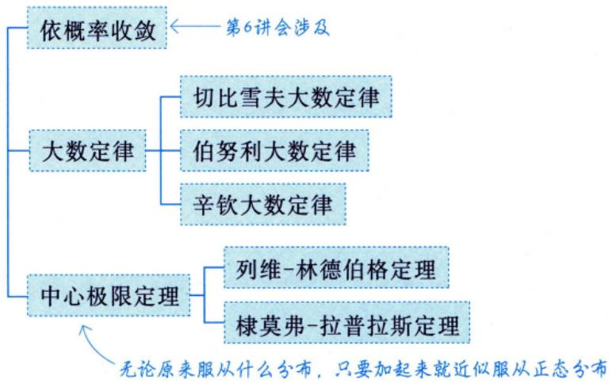
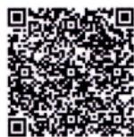

# 第5讲

# 大数定律与中心极限定理

# 基础知识结构

# 基础内容精讲

# 依概率收敛

若 $x_{n}\longrightarrow a$ ，则对于任意的 $\varepsilon >0$ ，当 $n\to \infty$ 时，有 $\left|x_n - a\right| <   \varepsilon$

若 $X_{n}\xrightarrow{P}a$ ，则对于任意的 $\varepsilon >0$ ，当 $n\to \infty$ 时，有 $P\left\{\left|X_n - a\right| <   \varepsilon \right\} \to 1$

依据概率的

设随机变量 $X$ 与随机变量序列 $\{X_{n}\} (n = 1,2,\dots)$ ，如果对任意的 $\varepsilon >0$ ，有

$$
\lim  _ {n \to \infty} P \big \{| X _ {n} - X | \geqslant \varepsilon \big \} = 0 \text {或} \lim  _ {n \to \infty} P \big \{| X _ {n} - X | <   \varepsilon \big \} = 1,
$$

则称随机变量序列 $\{X_{n}\}$ 依概率收敛于随机变量 $X$ ，记为

$$
\lim  _ {n \to \infty} X _ {n} = X (P) \text {或} X _ {n} {\xrightarrow {P}} X (n \to \infty) .
$$

(1) 以上定义中将随机变量 $X$ 写成数 $a$ 也成立.

(2) 设 $X_{n} \xrightarrow{P} X$ ， $Y_{n} \xrightarrow{P} Y$ ， $g(x, y)$ 是二元连续函数，则 $g(X_{n}, Y_{n}) \xrightarrow{P} g(X, Y)$ .

一般地，对 $m$ 元连续函数 $g(x_{1},x_{2},\dots ,x_{m})$ ，上述结论亦成立.

# 三 大数定律

总而言之： $\overline{X}\xrightarrow{P}E\overline{X}(\overline{X}$ 依概率收敛到 $E\overline{X}$

①

定理1（切比雪夫大数定律）假设 $\{X_{n}\} (n = 1,2,\dots)$ 是相互独立的随机变量序列，如果方差 $DX_{i}$ $(i\geqslant 1)$ 存在且一致有上界，即存在常数 $C$ ，使 $DX_{i}\leqslant C$ 对一切 $i\geqslant 1$ 均成立，则 $\{X_{n}\}$ 服从大数定律：

随机变量的平均值 $\rightarrow \frac{1}{n}\sum_{i = 1}^{n}X_{i}\xrightarrow{p}\frac{1}{n}\sum_{i = 1}^{n}EX_{i}$ 期望的均值

定理2（伯努利大数定律）假设 $\mu_{n}$ 是 $n$ 重伯努利试验中事件 $A$ 发生的次数，在每次试验中事件 $A$ 发生的概率为 $p(0 < p < 1)$ ，则 $\frac{\mu_n}{n} \xrightarrow{P} p$ ，即对任意 $\varepsilon > 0$ ，有

$$
\lim  _ {n \rightarrow \infty} P \left\{\left| \frac {\mu_ {n}}{n} - p \right| <   \varepsilon \right\} = 1.
$$

若 $\mu_{n}$ 表示投篮投中的次数， $n$ 表示投篮总次数，则 $\frac{\mu_n}{n}$ 表示投中的频率.当 $n$ 足够大时，频率依概率收敛到概率本身

注（仅数学三）在数理统计中，若 $(x_{1}, x_{2}, \dots, x_{n})$ 为总体样本 $(X_{1}, X_{2}, \dots, X_{n})$ 的一个观测值，按大小顺序排列为 $x_{(1)} \leqslant x_{(2)} \leqslant \dots \leqslant x_{(n)}$ 。对任意实数 $x$ ，称函数

$$
\begin{array}{l} F _ {n} (x) = \frac {x _ {1} , x _ {2} , \cdots , x _ {n} \text {中 小 于 等 于} x \text {的 样 本 值 个 数}}{n} \\ = \left\{ \begin{array}{l l} 0, & x <   x _ {(1)}, \\ \frac {k}{n}, & x _ {(k)} \leqslant x <   x _ {(k + 1)} (k = 1, 2, \dots , n - 1), \\ 1, & x \geqslant x _ {(n)} \end{array} \right. \\ \end{array}
$$

为样本 $(X_{1},X_{2},\dots ,X_{n})$ 的经验分布函数.

事实上， $F_{n}(x)$ 就是事件 $\{X \leqslant x\}$ 在 $n$ 次试验中出现的频率，而 $P\{X \leqslant x\} = F(x)$ 是事件 $\{X \leqslant x\}$ 出现的概率，由伯努利大数定律（即频率收敛于概率）可知，当 $n$ 充分大时， $F_{n}(x)$ 可作为未知分布函数 $F(x)$ 的一个近似， $n$ 越大，近似效果越好。

$\Rightarrow$ 这种考题是经常出现的.

考得比较多

$①$ $②$

(3)

★定理3（辛钦大数定律）假设 $\{X_{n}\} (n = 1,2,\dots)$ 是独立同分布的随机变量序列，如果数学期望

[ EX_{i} = \mu (i = 1,2,\dots) ] 存在，则 $\frac{1}{n}\sum_{i = 1}^{n}X_{i}\xrightarrow{P}\mu$ ，即对任意 $\varepsilon >0$ ，有

$$
\lim  _ {n \rightarrow \infty} P \left\{\left| \frac {1}{n} \sum_ {i = 1} ^ {n} X _ {i} - \mu \right| <   \varepsilon \right\} = 1.
$$

$$
\bar {X} \xrightarrow {P} E \bar {X} = \mu
$$

注（仅数学一）在考查未知参数估计量是否具有一致性（相合性）时，常常要用到依概率收敛和大数定律.

①

例5.1 设 $X_{1}, X_{2}, \dots, X_{n}, \dots$ 是相互独立的随机变量序列， $X_{n}$ 服从参数为 $n (n \geqslant 1)$ 的指数分布，则下列随机变量序列中不服从切比雪夫大数定律的是（ ）.

(A) $X_{1},\frac{1}{2} X_{2},\dots ,\frac{1}{n} X_{n},\dots$

(B) $X_{1},X_{2},\dots ,X_{n},\dots$

(C) $X_{1}, 2X_{2}, \dots, nX_{n}, \dots$

(D) $X_{1}, 2^{2}X_{2}, \dots, n^{2}X_{n}, \dots$

解 应选(D).

切比雪夫大数定律要求 $\{X_{n}\}$ 相互独立，方差存在且一致有界，即 $DX_{n} \leqslant C$ 。逐一验证各选项是否满足这一条件，从而确定正确选项。

由题设知 $\{X_{n}\}$ 相互独立，且 $DX_{n} = \frac{1}{n^{2}}\leqslant 1$ ，所以选项(B)满足切比雪夫大数定律的条件.

又

$$
D \left(\frac {1}{n} X _ {n}\right) = \frac {1}{n ^ {2}} D X _ {n} = \frac {1}{n ^ {4}} \leqslant 1, D (n X _ {n}) = n ^ {2} D X _ {n} = 1 \leqslant 2,
$$

由此可知，选项(A)，(C)均满足切比雪夫大数定律的条件，然而 $D(n^{2}X_{n}) = n^{4}DX_{n} = n^{2}$ ，选项(D)不满足切比雪夫大数定律的条件，故选择(D).

例5.2（仅数学三）设(2,1,5,2,1,3,1)是来自总体 $X$ 的简单随机样本值，求总体 $X$ 的经验分布函数 $F_{7}(x)$ ：

解 将各观测值按从小到大的顺序排列，得1，1，1，2，2，3，5，则经验分布函数为

$$
F _ {7} (x) = \left\{ \begin{array}{l l} 0, & x <   1, \\ \frac {3}{7}, & 1 \leqslant x <   2, \\ \frac {5}{7}, & 2 \leqslant x <   3, \\ \frac {6}{7}, & 3 \leqslant x <   5, \\ 1, & x \geqslant 5. \end{array} \right.
$$

例5.3 设随机变量序列 $X_{1}, X_{2}, \dots, X_{n}, \dots$ 独立同分布，且 $X_{1}$ 的概率密度为

$$
f (x) = \left\{ \begin{array}{l l} 1 - | x |, & | x | <   1, \\ 0, & \text {其 他}, \end{array} \right.
$$

满足辛钦大数定律： $①$ 独立； $②$ 同分布； $③ EX$ 存在，则 $\overline{X}\xrightarrow{p}E\overline{X}$ ，即

则当 $n\to \infty$ 时， $\frac{1}{n}\sum_{i = 1}^{n}X_{i}^{2}$ 依概率收敛于（

$$
\frac {1}{n} \sum_ {i = 1} ^ {n} X _ {i} ^ {2} \xrightarrow {p} E \left(\frac {1}{n} \sum_ {i = 1} ^ {n} X _ {i} ^ {2}\right)
$$

(A) $\frac{1}{8}$

(B) $\frac{1}{6}$

(C) $\frac{1}{3}$

(D) $\frac{1}{2}$

解 应选(B).

$$
E \left(X _ {1} ^ {2}\right) = \int_ {- \infty} ^ {+ \infty} x ^ {2} f (x) d x = \int_ {- 1} ^ {1} x ^ {2} (1 - | x |) d x = 2 \int_ {0} ^ {1} x ^ {2} (1 - x) d x = \frac {1}{6}.
$$

依题意知随机变量序列 $X_{1}^{2}, X_{2}^{2}, \dots, X_{n}^{2}, \dots$ 独立同分布，从而由辛钦大数定律知，当 $n \to \infty$ 时， $\frac{1}{n}\sum_{i=1}^{n} X_{i}^{2}$ 依概率收敛于 $E(X_{1}^{2})$ ，即依概率收敛于 $\frac{1}{6}$ . 故选 (B).

# 三 中心极限定理

定理4（列维-林德伯格定理）假设 $\{X_{n}\} (n = 1,2,\dots)$ 是独立同分布的随机变量序列，如果

$$
E X _ {i} = \mu , D X _ {i} = \sigma^ {2} > 0 (i = 1, 2, \dots)
$$

存在，则对任意的实数 $x$ ，有

$$
\lim  _ {n \rightarrow \infty} P \left\{\frac {\sum_ {i = 1} ^ {n} X _ {i} - n \mu}{\sqrt {n} \sigma} \leqslant x \right\} = \frac {1}{\sqrt {2 \pi}} \int_ {- \infty} ^ {x} e ^ {- \frac {t ^ {2}}{2}} d t = \Phi (x).
$$

注 (1)定理的三个条件“独立、同分布、期望和方差存在”,缺一不可.

(2) 只要 $X_{n}$ 满足定理条件，那么当 $n$ 很大时，独立同分布随机变量的和 $\sum_{i=1}^{n} X_{i}$ 近似服从正态分布 $N(n\mu, n\sigma^{2})$ ，由此可知，当 $n$ 很大时，有

$$
P \left\{a <   \sum_ {i = 1} ^ {n} X _ {i} <   b \right\} \approx \Phi \left(\frac {b - n \mu}{\sqrt {n} \sigma}\right) - \Phi \left(\frac {a - n \mu}{\sqrt {n} \sigma}\right),
$$

这常常是解题的依据. 只要题目涉及独立同分布随机变量的和 $\sum_{i=1}^{n} X_i$ ，我们就要考虑独立同分布中心极限定理.

定理5(棣莫弗-拉普拉斯定理）假设随机变量 $Y_{n}\sim B(n,p)(0 < p < 1,n\geqslant 1)$ ，则对任意实数 $x$ ，有

$$
\lim  _ {n \rightarrow \infty} P \left\{\frac {Y _ {n} - n p}{\sqrt {n p (1 - p)}} \leqslant x \right\} = \frac {1}{\sqrt {2 \pi}} \int_ {- \infty} ^ {x} \mathrm {e} ^ {- \frac {t ^ {2}}{2}} \mathrm {d} t = \Phi (x).
$$

注 (1) 如果记 $X_{i} \sim B(1, p)(0 < p < 1, i = 1, 2, \dots)$ , 即 $X_{i} \sim \left( \begin{array}{cc} 1 & 0 \\ p & 1 - p \end{array} \right)$ 且相互独立, 则

$$
Y _ {n} = \sum_ {i = 1} ^ {n} X _ {i} \sim B (n, p),
$$

由列维－林德伯格定理推出棣莫弗－拉普拉斯定理.

(2)二项分布概率计算的三种方法.

设 $X\sim B(n,p)$ ：

① 当 $n$ 不太大时（ $n \leqslant 10$ ），直接计算

$$
P \{X = k \} = \mathrm {C} _ {n} ^ {k} p ^ {k} (1 - p) ^ {n - k}, k = 0, 1, \dots , n;
$$

② 当 $n$ 较大且 $p$ 较小时 $(n > 10, p < 0.1)$ ， $\lambda = np$ 适中，根据泊松定理有近似公式

$$
P \{X = k \} = C _ {n} ^ {k} p ^ {k} (1 - p) ^ {n - k} \approx \frac {\lambda^ {k}}{k !} e ^ {- \lambda}, k = 0, 1, \dots , n;
$$

③当 $n$ 较大而 $p$ 不太大时 $(p < 0.1, np \geqslant 10)$ ，根据中心极限定理，有近似公式

$$
P \{a <   X <   b \} \approx \Phi \left(\frac {b - n p}{\sqrt {n p (1 - p)}}\right) - \Phi \left(\frac {a - n p}{\sqrt {n p (1 - p)}}\right).
$$

例5.4 设随机变量 $X_{1}, X_{2}, \dots, X_{n}$ 相互独立， $S_{n} = X_{1} + X_{2} + \dots + X_{n}$ ，则根据列维-林德伯格定理，当 $n$ 充分大时， $S_{n}$ 近似服从正态分布，只要 $X_{1}, X_{2}, \dots, X_{n}$ （ ）.

(A)有相同的期望和方差 $\leftarrow$ 不一定同分布

(B) 服从同一离散型分布 $\leftarrow$ 同分布但期望或方差

(C) 服从同一指数分布

(D) 服从同一连续型分布 $\prec$ 不一定存在

解 应选(C).

列维-林德伯格定理的条件：随机变量 $X_{1}, X_{2}, \dots, X_{n}$ 独立同分布，并且其数学期望和方差均存在。由于有相同的数学期望和方差未必服从相同的分布，可见选项(A)不满足定理条件。满足选项(B)和选项(D)的随机变量的数学期望或方差未必存在，故选项(B)和选项(D)也不满足定理条件。于是，只有选项(C)成立（指数分布的数学期望和方差都存在）。

例5.5 设 $X_{n}$ 表示将一枚硬币随意投掷 $n$ 次出现“正面”的次数，则（ ）.

(A) $\lim_{n\to \infty}P\left\{\frac{X_n - n}{\sqrt{n}}\leqslant x\right\} = \Phi (x)$

(B) $\lim_{n\to \infty}P\left\{\frac{2X_n - n}{\sqrt{n}}\leqslant x\right\} = \Phi (x)$

(C) $\lim_{n\to \infty}P\left\{\frac{X_n - 2n}{\sqrt{n}}\leqslant x\right\} = \Phi (x)$

(D) $\lim_{n\to \infty}P\left\{\frac{2X_n - 2n}{\sqrt{n}}\leqslant x\right\} = \Phi (x)$

解 应选(B).

由题设知 $X_{n}\sim B\left(n,\frac{1}{2}\right)$ ，根据棣莫弗－拉普拉斯定理，得

$$
\lim  _ {n \rightarrow \infty} P \left\{\frac {X _ {n} - \frac {1}{2} n}{\sqrt {\frac {1}{4} n}} \leqslant x \right\} = \lim  _ {n \rightarrow \infty} P \left\{\frac {2 X _ {n} - n}{\sqrt {n}} \leqslant x \right\} = \Phi (x),
$$

故选择(B).

例5.6 生产线生产的产品成箱包装，每箱质量是随机的。假设平均每箱重50千克，标准差为5千克，若用载重为5吨的汽车承运，试用中心极限定理说明每辆汽车最多可以装多少箱，才能保证不超载的概率大于0.977。（ $\Phi(2) = 0.977$ ）

解设 $X_{i}(i = 1,2,\dots ,n)$ 为“第 $i$ 箱产品的质量（千克）”，由题意， $X_{i}$ 独立同分布，且 $EX_{i} = 50$ $\sqrt{DX_i} = 5,n$ 箱总质量为 $T_{n} = \sum_{i = 1}^{n}X_{i}$ ，从而有 平均每箱重50千克

$$
E T _ {n} = 5 0 n, \sqrt {D T _ {n}} = 5 \sqrt {n}.
$$

由列维-林德伯格定理，知 $T_{n}$ 近似 $N(50n,25n)$ ，因此有

$$
P \left\{T _ {n} \leqslant 5 0 0 0 \right\} = P \left\{\frac {T _ {n} - 5 0 n}{5 \sqrt {n}} \leqslant \frac {5 0 0 0 - 5 0 n}{5 \sqrt {n}} \right\} \approx \Phi \left(\frac {1 0 0 0 - 1 0 n}{\sqrt {n}}\right) > 0. 9 7 7,
$$

即 $\frac{1000 - 10n}{\sqrt{n}} > 2, n < 98.0199$ ，所以每辆汽车最多可以装98箱，才能保证不超载的概率大于0.977.

# 基础习题精练

# 习题

5.1 设 $X_{1}, X_{2}, \dots, X_{n}, \dots$ 为独立同分布随机变量序列，且均服从参数为 $\lambda (\lambda > 1)$ 的指数分布，记 $\Phi(x)$ 为标准正态分布函数，则（ ）.

(A) $\lim_{n\to \infty}P\left\{\frac{\sum_{i = 1}^{n}X_{i} - n\lambda}{\lambda\sqrt{n}}\leqslant x\right\} = \Phi (x)$

(B) $\lim_{n\to \infty}P\left\{\frac{\sum_{i = 1}^{n}X_i - n\lambda}{\sqrt{\lambda n}}\leqslant x\right\} = \Phi (x)$

(C) $\lim_{n\to \infty}P\left\{\frac{\lambda\sum_{i = 1}^{n}X_{i} - n}{\sqrt{n}}\leqslant x\right\} = \Phi (x)$

(D) $\lim_{n\to \infty}P\left\{\frac{\sum_{i = 1}^{n}X_i - \lambda}{\sqrt{n\lambda}}\leqslant x\right\} = \Phi (x)$

5.2 设 $X_{1}, X_{2}, \cdots, X_{100}$ 为来自总体 $X$ 的简单随机样本，其中 $P\{X = 0\} = P\{X = 1\} = \frac{1}{2}$ . $\Phi(x)$ 表示标准正态分布函数，则利用中心极限定理可得 $P\left\{\sum_{i=1}^{100} X_{i} \leqslant 55\right\}$ 的近似值为（ ）.

(A) $1 - \varPhi (1)$

(B) $\varPhi(1)$

(C) $1 - \varPhi (0.2)$

(D) $\varPhi(0.2)$

5.3 设某种电气元件不能承受超负荷试验的概率为 0.05。现在对 100 个这样的元件进行超负荷试验，以 $X$ 表示“不能承受试验而烧毁的元件数”，则根据中心极限定理， $P\{5 \leqslant X \leqslant 10\} \approx$ ______。（ $\Phi(2.29) = 0.989$ ）

5.4 将一枚骰子重复掷 $n$ 次，则当 $n \to \infty$ 时， $n$ 次掷出点数的算术平均值 $\overline{X}_n$ 依概率收敛于

5.5 假设 $X_{1}, X_{2}, \dots, X_{n}$ 是来自总体 $X$ 的简单随机样本，已知 $E(X^{k}) = \alpha_{k} (k = 1, 2, 3, 4)$ . 证明：当 $n$ 充分大时，随机变量 $Z_{n} = \frac{1}{n} \sum_{i=1}^{n} X_{i}^{2}$ 近似服从正态分布，并指出其分布参数.

# 解答

5.1 (C) 解 由于 $E\left(\sum_{i=1}^{n} X_{i}\right) = \frac{n}{\lambda}, D\left(\sum_{i=1}^{n} X_{i}\right) = \frac{n}{\lambda^{2}}$ ，因此 $\lim_{n \to \infty} P\left\{\frac{\sum_{i=1}^{n} X_{i} - \frac{n}{\lambda}}{\sqrt{n}} \leqslant x\right\} = \Phi(x)$ ，即

$$
\lim  _ {n \rightarrow \infty} P \left\{\frac {\lambda \sum_ {i = 1} ^ {n} X _ {i} - n}{\sqrt {n}} \leqslant x \right\} = \Phi (x) ,
$$

故选择(C).

5.2 (B) 解 由总体的概率分布得总体的期望、方差分别为 $EX = \frac{1}{2}$ , $DX = \frac{1}{4}$ ，故

$$
E \left(\sum_ {i = 1} ^ {1 0 0} X _ {i}\right) = 5 0, D \left(\sum_ {i = 1} ^ {1 0 0} X _ {i}\right) = 2 5.
$$

由中心极限定理， $\sum_{i = 1}^{100}X_i$ 近似服从正态分布 $N(50,25)$ ，从而有

$$
P \left\{\sum_ {i = 1} ^ {1 0 0} X _ {i} \leqslant 5 5 \right\} = P \left\{\frac {\sum_ {i = 1} ^ {1 0 0} X _ {i} - 5 0}{5} \leqslant \frac {5 5 - 5 0}{5} \right\} \approx \Phi \left(\frac {5 5 - 5 0}{\sqrt {2 5}}\right) = \Phi (1),
$$

故选 (B).

5.3 0.489 解不能承受试验而烧毁的元件数 $X \sim B(n, p)$ . 根据棣莫弗-拉普拉斯定理， $X$ 近似服从正态分布 $N(np, npq)$ ，其中 $n = 100, p = 0.05, q = 0.95$ . 因此

$$
\begin{array}{l} P \{5 \leqslant X \leqslant 1 0 \} = P \left\{\frac {5 - n p}{\sqrt {n p q}} \leqslant \frac {X - n p}{\sqrt {n p q}} \leqslant \frac {1 0 - n p}{\sqrt {n p q}} \right\} = P \left\{0 \leqslant \frac {X - 5}{\sqrt {4 . 7 5}} \leqslant \frac {1 0 - 5}{\sqrt {4 . 7 5}} \right\} \\ = P \left\{0 \leqslant \frac {X - 5}{\sqrt {4 . 7 5}} \leqslant 2. 2 9 \right\} \approx \Phi (2. 2 9) - \Phi (0) = 0. 4 8 9. \\ \end{array}
$$

5.4 $\frac{7}{2}$ 解 设 $X_{1}, X_{2}, \cdots, X_{n}$ 是各次掷出的点数，显然它们独立同分布，每次掷出点数的数学期望等于 $\frac{7}{2}$ . 因此，根据辛钦大数定律， $\overline{X}_{n}$ 依概率收敛于 $\frac{7}{2}$ .

5.5 证明 依题意 $X_{1}, X_{2}, \dots, X_{n}$ 独立同分布，可知 $X_{1}^{2}, X_{2}^{2}, \dots, X_{n}^{2}$ 也独立同分布且有

$$
E \left(X _ {i} ^ {2}\right) = \alpha_ {2}, D \left(X _ {i} ^ {2}\right) = E \left(X _ {i} ^ {4}\right) - \left[ E \left(X _ {i} ^ {2}\right) \right] ^ {2} = \alpha_ {4} - \alpha_ {2} ^ {2}.
$$

由列维-林德伯格定理， $V_{n} = \frac{\sum_{i = 1}^{n}X_{i}^{2} - n\alpha_{2}}{\sqrt{n(\alpha_{4} - \alpha_{2}^{2})}} = \frac{\frac{1}{n}\sum_{i = 1}^{n}X_{i}^{2} - \alpha_{2}}{\sqrt{(\alpha_{4} - \alpha_{2}^{2}) / n}} = \frac{Z_{n} - \alpha_{2}}{\sqrt{(\alpha_{4} - \alpha_{2}^{2}) / n}}$ 的极限分布是标准正态分布，所以当 $n$ 充分大时， $V_{n}$ 近似服从标准正态分布，从而 $Z_{n} = \sqrt{\frac{\alpha_{4} - \alpha_{2}^{2}}{n}}\cdot V_{n} + \alpha_{2}$ 近似服从参数为 $\mu = \alpha_{2},\sigma^{2} = \frac{\alpha_{4} - \alpha_{2}^{2}}{n}$ 的正态分布.
