# 第6讲

# 数理统计

# 基础知识结构

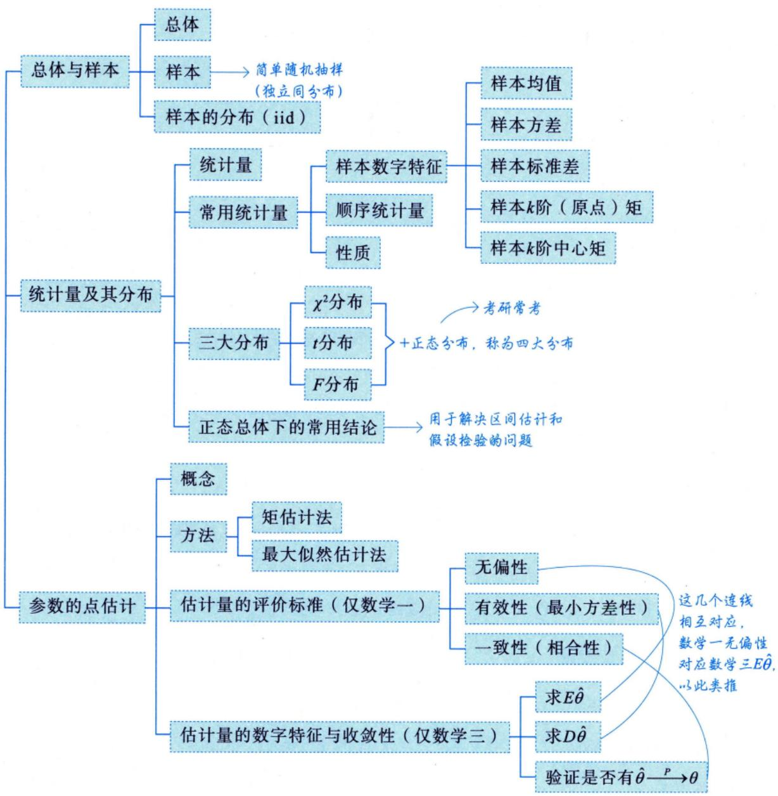

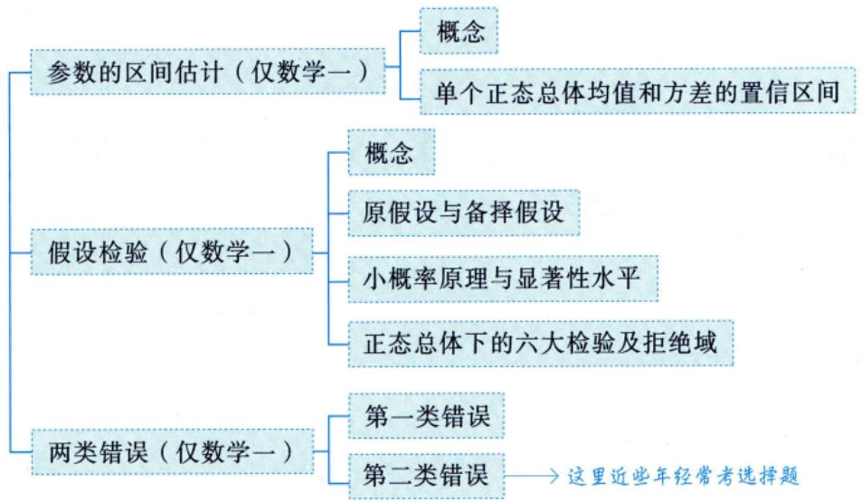

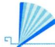

# 基础内容精讲

# 总体与样本

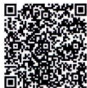

# 1 总体

研究对象的全体称为总体，组成总体的每一个元素称为个体。在对总体进行统计研究时，我们所关心的是表征总体状况的某个（或某几个）数量指标 $X$ （可以是向量）和该指标在总体中的分布情况。我们把总体与随机变量 $X$ 等同起来，说“总体 $X$ ”，所谓总体的分布就是随机变量 $X$ 的分布。

大样本下,其他分布收敛于正态分布,所以常考的是正态分布

$n$ 个相互独立且与总体 $X$ 具有相同概率分布的随机变量 $X_{1}, X_{2}, \ldots, X_{n}$ 所组成的整体 $(X_{1}, X_{2}, \ldots, X_{n})$ 称为来自总体 $X$ 、容量为 $n$ 的一个简单随机样本，简称样本。一次抽样结果的 $n$ 个具体数值 $(x_{1}, x_{2}, \ldots, x_{n})$ 称为样本 $X_{1}, X_{2}, \ldots, X_{n}$ 的一个观测值（或样本值）。简单随机样本都是独立同分布的，数学写法 $X_{i}^{\mathrm{iid}} F(x)$

# 样本的分布（iid）

对于容量为 $n$ 的样本 $X_{1}, X_{2}, \dots, X_{n}$ ，有如下定理：

假设总体 $X$ 的分布函数为 $F(x)$ （概率密度为 $f(x)$ ，或概率分布为 $p_i = P\{X = x_i\}$ ，则 $(X_{1},X_{2},\dots ,$ $X_{n})$ 的分布函数为

$$
F \left(x _ {1}, x _ {2}, \dots , x _ {n}\right) = \prod_ {i = 1} ^ {n} F \left(x _ {i}\right).
$$

相应地：

$\rightarrow$ 因为独立,所以可以拆成连乘形式

(1) 对于离散型随机变量的样本 $X_{1}, X_{2}, \dots, X_{n}$ ，联合分布为

$$
P \left\{X _ {1} = x _ {1}, X _ {2} = x _ {2}, \dots , X _ {n} = x _ {n} \right\} = \prod_ {i = 1} ^ {n} P \left\{X _ {i} = x _ {i} \right\}.
$$

$\Rightarrow$ 因为独立,所以可以拆成连乘形式

(2)对于连续型随机变量的样本 $X_{1},X_{2},\dots ,X_{n}$ ，联合概率密度为

$$
f \left(x _ {1}, x _ {2}, \dots , x _ {n}\right) = \prod_ {i = 1} ^ {n} f \left(x _ {i}\right).
$$

$\overrightarrow{a} = \left( {{x}_{1},{y}_{1}}\right) ,\overrightarrow{b} = \left( {{x}_{2},{y}_{2}}\right)$

# 二 统计量及其分布

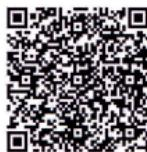

# 统计量

设 $X_{1}, X_{2}, \cdots, X_{n}$ 为来自总体 $X$ 的一个样本， $g(x_{1}, x_{2}, \cdots, x_{n})$ 为 $n$ 元函数，如果 $g$ 中不含任何未知参数，则称 $g(X_{1}, X_{2}, \cdots, X_{n})$ 为样本 $X_{1}, X_{2}, \cdots, X_{n}$ 的一个统计量。若 $(x_{1}, x_{2}, \cdots, x_{n})$ 为样本值，则称 $g(x_{1}, x_{2}, \cdots, x_{n})$ 为 $g(X_{1}, X_{2}, \cdots, X_{n})$ 的观测值。注意统计量是大写的 $X$

注意是小写的 $x$

注 (1) 直观上, 统计量就是由统计数据计算得来的量. 数学上, 统计量是样本 $X_{1}, X_{2}, \cdots, X_{n}$ 的函数: $T = g(X_{1}, X_{2}, \cdots, X_{n})$ . 统计量不依赖于任何未知参数.

(2) 统计量也是随机变量，且是样本的函数. 只能有样本 $X_{1}, X_{2}, \cdots, X_{n}$

# 常用统计量

样本数字特征和顺序统计量都是常用的统计量. 统计量是统计分析和统计推断的重要工具.

(1) 样本数字特征.

数学期望（均值）、方差和标准差、矩等都是总体 $X$ 最重要的数字特征.设 $X_{1},X_{2},\dots ,X_{n}$ 是来自总体 $X$ 的简单随机样本，则相应的样本数字特征定义如下：

样本均值 $\overline{X} = \frac{1}{n}\mathop{\sum }\limits_{{i = 1}}^{n}{X}_{i}$ ; (将所有的随机变量加起来再除以 $n$ )

就是样本一阶（原点）矩

② 样本方差 $S^{2} = \frac{1}{n - 1}\sum_{i = 1}^{n}(X_{i} - \overline{X})^{2};$ $E(X - EX)^2 = DX$ 随机变量的方差是样本二阶中心矩的修正值 取的值 自己的波动中心注意是“n-1”，而不是“n”.因 $\frac{1}{n}\sum_{i = 1}^{n}(X_i - \overline{X})^2$ 不满足无偏性

样本标准差 $S = \sqrt{\frac{1}{n - 1}\sum_{i = 1}^{n}(X_i - \overline{X})^2};$

$③$ 样本 $k$ 阶（原点）矩 $A_{k} = \frac{1}{n}\sum_{i = 1}^{n}X_{i}^{k}(k = 1,2,\dots);$ $\frac{1}{n}\sum_{i = 1}^{n}(X_i - 0)^k$   
④样本 $k$ 阶中心矩 ${B}_{k} = \frac{1}{n}\mathop{\sum }\limits_{{i = 1}}^{n}{\left( {X}_{i} - \overline{X}\right) }^{k}\left( {k = 2,3,\cdots }\right)$ . 减去中心值

★(2)顺序统计量.

将样本 $X_{1}, X_{2}, \dots, X_{n}$ 的 $n$ 个观测值按其取值从小到大的顺序排列，得

$$
X _ {(1)} \leqslant X _ {(2)} \leqslant \dots \leqslant X _ {(n)}.
$$

随机变量 $X_{(k)}(k = 1,2,\dots ,n)$ 称作第 $k$ 顺序统计量，其中 $X_{(1)}$ 是最小顺序统计量，而 $X_{(n)}$ 是最大顺序统计量：

$$
X _ {(1)} = \min  \left\{X _ {1}, X _ {2}, \dots , X _ {n} \right\}, X _ {(n)} = \max  \left\{X _ {1}, X _ {2}, \dots , X _ {n} \right\}.
$$

注 (1) $X_{(n)} = \max \{X_1, X_2, \dots, X_n\}$ 的分布函数为 $X_i \overset{\mathrm{id}}{\underset{i=1}{}^{\mathrm{id}}} F$

$$
F _ {(n)} (x) = [ F (x) ] ^ {n}
$$

（概率密度为 $f_{(n)}(x) = n[F(x)]^{n - 1}f(x)$ ）

(2) $X_{(1)} = \min \{X_1, X_2, \dots, X_n\}$ 的分布函数为

$$
F _ {(1)} (x) = 1 - [ 1 - F (x) ] ^ {n}
$$

（概率密度为 $f_{(1)}(x) = n[1 - F(x)]^{n - 1}f(x)$ ）

(3)性质.

设总体 $X$ 的期望 $EX = \mu$ ，方差 $DX = \sigma^2$ ， $X_{1}$ ， $X_{2}$ ，…， $X_{n}$ 是取自总体 $X$ 、容量为 $n$ 的一个样本， $\overline{X}$ ， $S^2$ 分别为样本均值和样本方差，则

$E X_{i} = \mu ,D X_{i} = \sigma^{2}(i = 1,2,\dots ,n),$ $E\overline{X} = EX = \mu ,D\overline{X} = \frac{1}{n} DX = \frac{\sigma^2}{n},E(S^2) = DX = \sigma^2.$ 因 $X_{i}$ 独立同分布，故有相同的数字特征 例：若 $\overline{X} = \frac{X_1 + X_2}{2}$ ，则 举例：若 $\overline{X} = \frac{X_1 + X_2}{2}$ ，则

$$
\begin{array}{r l} E \overline {{X}} = E \left(\frac {X _ {1} + X _ {2}}{2}\right) & = \frac {1}{2} (E X _ {1} + E X _ {2}) \\ & = \frac {1}{2} \cdot 2 \mu = \mu \end{array} D \overline {{X}} = D \left(\frac {X _ {1} + X _ {2}}{2}\right) = \frac {1}{2 ^ {2}} (D X _ {1} + D X _ {2})
$$

★★★ 3 三大分布—— $\chi^2$ 分布、 $t$ 分布和 $F$ 分布

$$
= \frac {1}{2} \sigma^ {2}
$$

$\chi^2$ 分布、 $t$ 分布和 $F$ 分布是统计推断中最常用的抽样分布.考生不必记忆 $\chi^2$ 分布、 $t$ 分布和 $F$ 分布的概率密度，只需了解相应统计量的概念，以及它们的分布曲线的示意图和分位数，会查相应分位数的数值表.

(1) $\chi^2$ 分布.

$①$ 概念.

若随机变量 $X_{1}, X_{2}, \cdots, X_{n}$ 相互独立，且都服从标准正态分布，则随机变量 $X = \sum_{i=1}^{n} X_{i}^{2}$ 服从自由度为 $n$ 的 $\chi^2$ 分布，记为 $X \sim \chi^2(n)$ 。 $X = X_{1}^{2} + X_{2}^{2} + \cdots + X_{n}^{2} \sim \chi^2(n)$ 和式中独立变量的个数为自由度

$②$ 上 $\alpha$ 分位数.

对于给定的 $\alpha (0 <   \alpha <  1)$ ，称满足

$$
P \{\chi^ {2} > \chi_ {\alpha} ^ {2} (n) \} = \int_ {\chi_ {\alpha} ^ {2} (n)} ^ {+ \infty} f (x) d x = \alpha
$$

的 $\chi_{\alpha}^{2}(n)$ 为 $\chi^2 (n)$ 分布的上 $\alpha$ 分位数（见图6-1）.对于不同的 $\alpha ,n$ $\chi^2 (n)$ 分布上 $\alpha$ 分位数可通过查表求得.

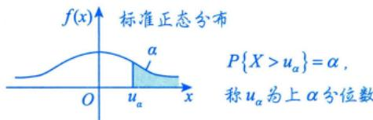

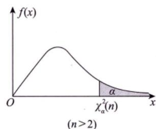  
图6-1

$③$ 性质.

a. 若 $X_{1} \sim \chi^{2}(n_{1})$ ， $X_{2} \sim \chi^{2}(n_{2})$ ， $X_{1}$ 与 $X_{2}$ 相互独立，则

$$
X _ {1} + X _ {2} \sim \chi^ {2} \left(n _ {1} + n _ {2}\right).
$$

此结论可推广至有限多个的和.

b. 若 $X \sim \chi^2(n)$ , 则 $EX = n$ , $DX = 2n$ . 期望是 方差是 自由度 的自由

# 考研数学基础30讲·概率论与数理统计分册

# (2) $t$ 分布.

$①$ 概念.

设随机变量 $X \sim N(0,1)$ ， $Y \sim \chi^2(n)$ ，且 $X$ 与 $Y$ 相互独立，则随机变量 $t = \frac{X}{\sqrt{Y / n}}$ 服从自由度为 $n$ 的分布，记为 $t \sim t(n)$ 。保证上下“公平”

$②$ 上 $\alpha$ 分位数.

对于给定的 $\alpha (0 <   \alpha <  1)$ ，称满足

$$
P \{t > t _ {\alpha} (n) \} = \alpha
$$

的 $t_{\alpha}(n)$ 为 $t(n)$ 分布的上 $\alpha$ 分位数（见图6-2）.

$③$ 性质.

a. $t$ 分布的概率密度 $f(x)$ 的图形关于 $x = 0$ 对称（见图6-3），因此

$$
\frac {E t = 0 (n \geqslant 2)}{\text {因 为} f (x) \text {为 偶 函 数}}.
$$

b.由t分布的概率密度f(x)图形的对称性，知P{t-ta(n)}=P{t-ta(n)}，故 $t_{1 - \alpha}(n) = -t_{\alpha}(n)$ 当 $\alpha$ 值在表中没有时，可用此式求得上 $\alpha$ 分位数.

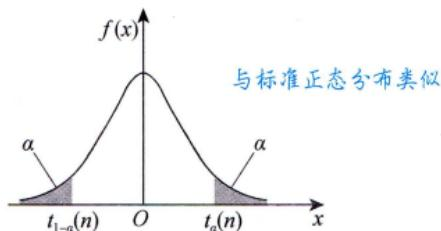  
图6-2 需要查2个数： $\alpha ,n$

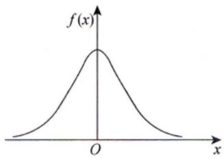  
图6-3

(3) $F$ 分布.

$①$ 概念.

设随机变量 $X \sim \chi^2(n_1)$ ， $Y \sim \chi^2(n_2)$ ，且 $X$ 与 $Y$ 相互独立，则 $F = \frac{X / n_1}{Y / n_2}$ 服从自由度为 $(n_1, n_2)$ 的 $F$ 分布，记为 $F \sim F(\bar{n}_1, \bar{n}_2)$ ，其中 $n_1$ 称为第一自由度， $n_2$ 称为第二自由度。 $F$ 分布的概率密度 $f(x)$ 的图形如图6-4所示。分子的自由度

$②$ 上 $\alpha$ 分位数.

对于给定的 $\alpha (0 <   \alpha <  1)$ ，称满足

$$
P \{F > F _ {\alpha} (n _ {1}, n _ {2}) \} = \alpha
$$

的 $F_{\alpha}(n_1,n_2)$ 为 $F(n_{1},n_{2})$ 分布的上 $\alpha$ 分位数（见图6-5）.

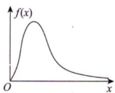  
图6-4

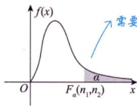  
图6-5

需要查3个数： $\alpha ,n_{1},n_{2}$

证明：设 $F \sim F(n_{2}, n_{1})$ ，则

$$
P \{F > F _ {\alpha} (n _ {2}, n _ {1}) \} = \alpha ,
$$

$$
P \left\{F \leqslant F _ {\alpha} \left(n _ {2}, n _ {1}\right) \right\} = 1 - \alpha ,
$$

$$
P \left\{\frac {1}{F} \geqslant \frac {1}{F _ {\alpha} \left(n _ {2} , n _ {1}\right)} \right\} = 1 - \alpha ,
$$

$③$ 性质.

a. 若 $F \sim F(n_{1}, n_{2})$ ，则 $\frac{1}{F} \sim F(n_{2}, n_{1})$   
b. $F_{1 - \alpha}(n_1,n_2) = \frac{1}{F_\alpha(n_2,n_1)}$ ，常用来求 $F$ 分布表中未列出的上 $\alpha$ 分位数.  
c. 若 $t \sim t(n)$ , 则 $t^2 \sim F(1, n)$ .

因为 $\frac{1}{F} \sim F(n_{1}, n_{2})$ ，结合上 $\alpha$ 分位数

的定义，可知 $\frac{1}{F_{\alpha}(n_2,n_1)} = F_{1 - \alpha}(n_1,n_2)$

$$
t = \frac {X}{\sqrt {Y / n}}, t ^ {2} = \frac {X ^ {2}}{Y / n} \sim F (1, n)
$$

自由度位置调换了

4 正态总体条件下的常用结论（将4个结论当成4个例题）

设 $X_{1}, X_{2}, \dots, X_{n}$ 是来自正态总体 $N(\mu, \sigma^{2})$ 的一个样本， $\overline{X}, S^{2}$ 分别是样本均值和样本方差，则

① $\overline{X} \sim N\left(\mu, \frac{\sigma^2}{n}\right)$ ，即 $\frac{\overline{X} - \mu}{\frac{\sigma}{\sqrt{n}}} = \frac{\sqrt{n} (\overline{X} - \mu)}{\sigma} \sim N(0, 1)$ ；在正态总体下， $\frac{\overline{X} - X$ 的期望}{X的标准差/ $\sqrt{n}$ } $\sim N(0, 1)$   
② $\frac{1}{\sigma^2}\sum_{i = 1}^{n}(X_i - \bar{\mu})^2\sim \chi^2 (n)$

客观， $\mu = EX = \int_{-\infty}^{+\infty}xf(x)\mathrm{d}x.$

$$
\begin{array}{l} X \sim N (\mu , \sigma^ {2}), \\ \frac {X _ {i} - \mu}{\sigma} \sim N (0, 1), \\ \left(\frac {X _ {i} - \mu}{\sigma}\right) ^ {2} \sim \chi^ {2} (1), \\ \sum_ {i = 1} ^ {n} \left(\frac {X _ {i} - \mu}{\sigma}\right) ^ {2} = \frac {1}{\sigma^ {2}} \sum_ {i = 1} ^ {n} (X _ {i} - \mu) ^ {2} \sim \chi^ {2} (n) \\ \end{array}
$$

③ $\frac{(n - 1)S^2}{\sigma^2} = \sum_{i = 1}^{n}\left(\frac{X_i - \overline{X}}{\sigma}\right)^2\sim \chi^2 (n - 1)(\mu$ 未知时，在 $②$ 中用 $\overline{X}$ 替代 $\mu$ ）；

$$
S ^ {2} = \frac {1}{n - 1} \sum_ {i = 1} ^ {n} (X _ {i} - \overline {{X}}) ^ {2} \Rightarrow \frac {(n - 1) S ^ {2}}{\sigma^ {2}} = \sum_ {i = 1} ^ {n} \frac {(X _ {i} - \overline {{X}}) ^ {2}}{\sigma^ {2}} = \sum_ {i = 1} ^ {n} \left(\frac {X _ {i} - \overline {{X}}}{\sigma}\right) ^ {2}
$$

④ $\bar{X}$ 与 ${S}^{2}$ 相互独立, $\frac{\sqrt{n}\left( {\bar{X} - \mu }\right) }{S} \sim  t\left( {n - 1}\right)$ ( $\sigma$ 未知时,在①中用 $S$ 替代 $\sigma$ ). 进一步有

★ 正态总体下才有此结论

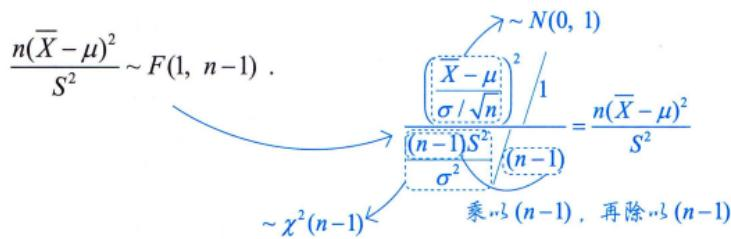

例6.1 设 $X_{1}, X_{2}, \cdots, X_{n} (n > 2)$ 为独立同分布的随机变量，且均服从正态分布 $N(0,1)$ ，记 $\overline{X} = \frac{1}{n}\sum_{i=1}^{n} X_{i}, Y_{i} = X_{i} - \overline{X}, i = 1, 2, \cdots, n$ 。则 $Y_{i}$ 的方差 $DY_{i} =$ _______. 考点：结合第4讲 随机变量的数字特征

解 应填 $\frac{n - 1}{n}$

$$
\begin{array}{l} D Y _ {i} = D (X _ {i} - \overline {{X}}) = D (\underbrace {\overline {{X}} _ {i} - \frac {\overline {{X}} _ {1} + X _ {2} + \cdots + X _ {n}}} _ {n}) \\ = D \left[ \left(1 - \frac {1}{n}\right) X _ {i} - \frac {1}{n} \sum_ {k \neq i} X _ {k} \right] = \left(1 - \frac {1}{n}\right) ^ {2} + \frac {n - 1}{n ^ {2}} \\ = \frac {n - 1}{n}, i = 1, 2, \dots , n. \\ \end{array}
$$

例6.2 已知总体 $X$ 的期望 $EX = 0$ ，方差 $DX = \sigma^2$ ，从总体 $X$ 中抽取容量为 $n$ 的简单随机样本，其样本均值、样本方差分别为 $\overline{X}$ ， $S^2$ .记 $S_{k}^{2} = \frac{n}{k}\overline{X}^{2} + \frac{1}{k} S^{2}(k = 1,2,3,4)$ ，则（）. $X_{1},\dots ,X_{n}\stackrel {\mathrm{i.i.d}}{\sim}X$

(A) $E(S_1^2) = \sigma^2$

(B) $E(S_2^2) = \sigma^2$

(C) $E(S_3^2) = \sigma^2$

(D) $E(S_4^2) = \sigma^2$

解 应选(B).

解应选(B). $S^2 = \frac{1}{n - 1}\sum_{i = 1}^{n}(X_i - \overline{X})^2$ 由 $E\overline{X} = EX = 0,D\overline{X} = \frac{DX}{n} = \frac{\sigma^2}{n},E(S^2) = \sigma^2$ ，且 $E(\overline{X}^2) = D\overline{X} +(E\overline{X})^2 = D\overline{X} = \frac{\sigma^2}{n}$ 故

$$
E \left(S _ {k} ^ {2}\right) = \frac {n}{k} E \left(\overline {{X}} ^ {2}\right) + \frac {1}{k} E \left(S ^ {2}\right) = \frac {n}{k} \cdot \frac {\sigma^ {2}}{n} + \frac {1}{k} \sigma^ {2} = \frac {2}{k} \sigma^ {2}.
$$

当 $k = 2$ 时， $E(S_2^2) = \sigma^2$ ，选择(B).

例6.3 设 $X_{1}, X_{2}, X_{3}, X_{4}$ 是来自正态总体 $N(0, 2^{2})$ 的简单随机样本，记

$$
X = a \left(X _ {1} - 2 X _ {2}\right) ^ {2} + b \left(3 X _ {3} - 4 X _ {4}\right) ^ {2},
$$

若统计量 $X$ 服从自由度为2的 $\chi^2$ 分布，则 $ab =$

分析 若 $X_{i}\stackrel {\mathrm{id}}{\sim}N(0,1)$ ，则 $X_{1}^{2} + \dots +X_{n}^{2}\sim \chi^{2}(n)$ ，故

$$
X = \boxed {a (X _ {1} - 2 X _ {2}) ^ {2} + b (3 X _ {3} - 4 X _ {4}) ^ {2}}
$$

自变量无重叠，故独立

$$
= \left(\frac {X _ {1} - 2 X _ {2}}{\frac {1}{\sqrt {a}}}\right) ^ {2} + \left(\frac {3 X _ {3} - 4 X _ {4}}{\frac {1}{\sqrt {b}}}\right) ^ {2} \sim \chi^ {2} (2).
$$

解 应填 $\frac{1}{2000}$

$$
D \left(X _ {1} - 2 X _ {2}\right) = D X _ {1} + 4 D X _ {2} = 2 0
$$

由条件知 $X_{1}, X_{2}, X_{3}, X_{4}$ 相互独立且同服从正态分布 $N(0, 2^{2})$ 。因此 $X_{1} - 2X_{2}$ 服从正态分布 $N(0, 20)$ ，而 $3X_{3} - 4X_{4}$ 服从正态分布 $N(0, 100)$ ，并且相互独立。由 $\chi^2$ 分布的概念，知

$$
\begin{array}{l} D (3 X _ {3} - 4 X _ {4}) = 9 D X _ {3} + 1 6 D X _ {4} \\ = 1 0 0 \end{array} T = \frac {\left(X _ {1} - 2 X _ {2}\right) ^ {2}}{2 0} + \frac {\left(3 X _ {3} - 4 X _ {4}\right) ^ {2}}{1 0 0}
$$

服从自由度为2的 $\chi^2$ 分布，从而 $a = \frac{1}{20}, b = \frac{1}{100}$ ，于是 $ab = \frac{1}{2000}$ 。

例6.4 设总体 $X \sim N(0, 3^2)$ , $X_1, X_2, \dots, X_8$ 是来自总体 $X$ 的简单随机样本，则统计量

$$
Y = \frac {X _ {1} + X _ {2} + X _ {3} + X _ {4}}{\sqrt {X _ {5} ^ {2} + X _ {6} ^ {2} + X _ {7} ^ {2} + X _ {8} ^ {2}}}
$$

若 $X\sim N(0,1),Y\sim \chi^2 (n)$

则 $\frac{X}{\sqrt{Y / n}}\sim t(n)$

服从（ ）.

(A) $\chi^2 (4)$

(B) $t(4)$

(C) $F(4,4)$

(D) $N(0,4^2)$

解 应选(B).

由于相互独立且服从正态分布的随机变量的线性组合仍然服从正态分布，易见

$$
\begin{array}{l} U = \frac {X _ {1} + X _ {2} + X _ {3} + X _ {4}}{\sqrt {D (X _ {1} + X _ {2} + X _ {3} + X _ {4})}} \\ = \frac {X _ {1} + X _ {2} + X _ {3} + X _ {4}}{6} \sim N (0, 1). \\ \end{array}
$$

作为相互独立且服从标准正态分布的随机变量的平方和，

$$
V = \frac {X _ {5} ^ {2}}{9} + \frac {X _ {6} ^ {2}}{9} + \frac {X _ {7} ^ {2}}{9} + \frac {X _ {8} ^ {2}}{9}
$$

服从 $\chi^2$ 分布，自由度为4.随机变量 $U$ 和 $V$ 显然相互独立，且随机变量 $Y$ 可以表示为

$$
Y = \frac {\left(X _ {1} + X _ {2} + X _ {3} + X _ {4}\right) / 6}{\sqrt {\frac {X _ {5} ^ {2} + X _ {6} ^ {2} + X _ {7} ^ {2} + X _ {8} ^ {2}}{9}} / 4} = \frac {U}{\sqrt {V / 4}},
$$

由 $t$ 分布的概念，可知随机变量 $Y$ 服从自由度为4的 $t$ 分布，故选(B).

例6.5 设 $X_{1}, X_{2}, \dots, X_{15}$ 是来自正态总体 $N(0, 9)$ 的简单随机样本，则统计量

$$
\frac {X _ {i} - 0}{3} \sim N (0, 1), \left(\frac {X _ {i}}{3}\right) ^ {2} \sim \chi^ {2} (1) \quad Y = \frac {1}{2} \frac {X _ {1} ^ {2} + X _ {2} ^ {2} + \cdots + X _ {1 0} ^ {2}}{X _ {1 1} ^ {2} + X _ {1 2} ^ {2} + \cdots + X _ {1 5} ^ {2}}
$$

服从（ ）.

(A) $t(10)$

(B) $t(15)$

(C) $F(10,5)$

(D) $F(5,10)$

解 应选(C).

由 $\chi^2$ 分布的概念，知

$$
\chi_ {1} ^ {2} = \frac {X _ {1} ^ {2} + X _ {2} ^ {2} + \cdots + X _ {1 0} ^ {2}}{9} \text {和} \chi_ {2} ^ {2} = \frac {X _ {1 1} ^ {2} + X _ {1 2} ^ {2} + \cdots + X _ {1 5} ^ {2}}{9}
$$

分别服从自由度为10和5的 $\chi^2$ 分布，且相互独立.从而，由 $F$ 分布的概念，知

$$
Y = \frac {1}{2} \frac {X _ {1} ^ {2} + X _ {2} ^ {2} + \cdots + X _ {1 0} ^ {2}}{X _ {1 1} ^ {2} + X _ {1 2} ^ {2} + \cdots + X _ {1 5} ^ {2}} = \frac {\frac {\chi_ {1} ^ {2}}{1 0}}{\frac {\chi_ {2} ^ {2}}{5}}
$$

服从自由度为(10,5)的 $F$ 分布，故选(C).

例6.6 设随机变量 $X \sim t(n), Y \sim F(1, n)$ ，给定 $\alpha (0 < \alpha < 0.5)$ ，常数 $c$ 满足 $P\{X > c\} = \alpha$ ，则 $P\{Y > c^2\} = (\quad)$ 。

(A) $\alpha$

(B) $1 - \alpha$

(C) $2\alpha$

(D) $1 - 2\alpha$

解 应选(C).

由 $X\sim t(n)$ ，可得 $X^{2}\sim F(1,n)$ ，从而

$$
P \{Y > c ^ {2} \} = P \{X ^ {2} > c ^ {2} \} = P \{X > c \} + P \{X <   - c \} = 2 \alpha ,
$$

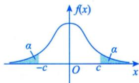

故正确选项为 (C).

注此题只能有概率 $P\{Y > c^2\}$ 与 $P\{X^2 >c^2\}$ 相等，而不能说 $Y = X^{2}$ ，因为服从相同分布的随机变量并不一定相同.

例6： $X\sim U(0,1)$

$$
Y = 1 - X \sim U (0, 1),
$$

$X$ 和 $Y$ 服从相同的分布但 $X \neq Y$

属于必考知识点参数的点估计

估计客观存在的未知参数，接近实际参数值

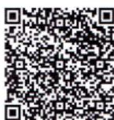

设总体 $X$ 的分布函数为 $F(x;\theta)$ （可以是多维的），其中 $\theta$ 是一个未知参数， $X_{1}, X_{2}, \dots, X_{n}$ 是取自总体 $X$ 的一个样本。由样本构造一个适当的统计量 $\hat{\theta}(X_{1}, X_{2}, \dots, X_{n})$ 作为参数 $\theta$ 的估计，则称统计量 $\hat{\theta}(X_{1}, X_{2}, \dots, X_{n})$ 为 $\theta$ 的估计量。

大写的样本 $X$

如果 ${x}_{1},{x}_{2},\cdots ,{x}_{n}$ 是样本的一个观测值,将其代入估计量 $\widehat{\theta }$ 中得值 $\widehat{\theta }\left( {{x}_{1},{x}_{2},\cdots ,{x}_{n}}\right)$ ,统计学中称这个值为未知参数 $\theta$ 的估计值. 小写的样本 $x$ 小写时为样本值 $\widehat{\theta }$ 为估计值

建立一个适当的统计量作为未知参数 $\theta$ 的估计量，并以相应的观测值作为未知参数估计值的问题，称为参数 $\theta$ 的点估计问题.

“点估点”,即由样本求出参数 $\theta$ 的估计值.

两者是不等的，因为当 $\hat{\theta}$ 为连续型变量时， $P\{\hat{\theta} = \theta \} = 0$ 估计值 客观参数

# 矩估计

均值 $\overline{X}$ 与期望 $EX$ 是不相等的，若令

(1) 对于一个参数

$①$ 用一阶矩建立方程：令 $\overline{X} = EX$   
一阶原点矩  
②若“①”不能用，用二阶矩建立方程：令 $\frac{1}{n}\sum_{i = 1}^{n}X_{i}^{2} = E(X^{2})$

①中等式没有参数 $\theta$ 或解出 $\theta$ 很困难

求解方法： $① Y = X^2$ ，求 $EY$

② $E(X^{2}) = DX + (EX)^{2}$

一个方程解出一个参数即可作为矩估计.

(2)对于两个参数，用一阶矩与二阶矩建立两个方程，即 $① \overline { { X } } = E X$ 与 $② \frac { 1 } { n } \sum _ { i = 1 } ^ { n } X _ { i } ^ { 2 } = E ( X ^ { 2 } )$ ，两个方程解出两个参数即可作为矩估计. $k$ 不是随便取的，优先用低阶的，能用一阶绝不用二阶，一阶不能

显然，一般情况下，将 $\frac{1}{n}\sum_{i = 1}^{n}X_{i}^{k} = E(X^{k})(k = 1,2,\dots ,m)$ 联立，即可求 $m$ 个参数的矩估计.那么，若求一个参数的矩估计，是否 $k$ 可任取一个正整数呢？答案是否定的，在统计的问题中，一般以低阶为原则，即取能解出含参数的方程的最小 $k$ 值.

# 最大似然估计

对未知参数 $\theta$ 进行估计时，在该参数可能的取值范围内选取，使“样本获此观测值 $x_{1}, x_{2}, \cdots, x_{n}$ ”的概率最大的参数值 $\hat{\theta}$ 作为 $\theta$ 的估计，这样选定的 $\hat{\theta}$ 最有利于 $x_{1}, x_{2}, \cdots, x_{n}$ 的出现，即“参数 $\theta = ?$ 时，观测值出现的概率最大”。

即 $P\{x_1,x_2,\dots ,x_n|\theta = ?\}$ 为最大.

$X_{i}\overset {\mathrm{ii}}{\sim}F(i = 1,2,3)$ 为连续型随机变量时， $(x_{1},x_{2},x_{3})$ 出现的概率 $= f(x_{1},x_{2},x_{3};\theta)\mathrm{d}x_{1}\mathrm{d}x_{2}\mathrm{d}x_{3}$

(1)写似然函数 $L(x_{1},x_{2},\dots ,x_{n};\theta)$ 为方便求解 $\hat{\theta}$ ，也可取对数，即

$$
\ln L (\theta) = \left\{ \begin{array}{l} \sum_ {i = 1} ^ {n} \ln p (x _ {i}; \theta), \\ \sum_ {i = 1} ^ {n} \ln f (x _ {i}; \theta) \end{array} \right.
$$

$\prod_{i = 1}^{n}p(x_i;\theta)$ （这是离散型总体 $X$ 取 $x_{1},x_{2},\dots ,x_{n}$ 的概率），独立同分布 $p(x_1,x_2,\dots x_n;\theta) = p_1(x_i;\theta)p_2(x_2;\theta)\dots p_n(x_n;\theta) = \prod_{i = 1}^{n}p(x_i;\theta)$ $\prod_{i = 1}^{n}f(x_{i};\theta)$ （这是连续型总体 $X$ 取 $x_{1},x_{2},\dots ,x_{n}$ 的联合概率密度）.

$f(x_{1},x_{2},\dots x_{n};\theta) = f_{1}(x_{1};\theta)f_{2}(x_{2};\theta)\dots f_{n}(x_{n};\theta) = \prod_{i = 1}^{n}f(x_{i};\theta)$ 同分布

# 考研数学基础30讲·概率论与数理统计分册

若似然函数有驻点，则令 $\frac{\mathrm{d}L}{\mathrm{d}\theta} = 0$ 或 $\frac{\mathrm{d}(\ln L)}{\mathrm{d}\theta} = 0$ ，解出 $\hat{\theta}$ (2)求参数若似然函数无驻点(单调)，则用定义求 $\hat{\theta}$ 若似然函数为常数，则用定义求 $\hat{\theta}$ ，此时 $\hat{\theta}$ 不唯一.

(3) 最大似然估计量的不变性原则.

充分条件

设 $\hat{\theta}$ 是总体分布中未知参数 $\theta$ 的最大似然估计，函数 $u = u(\theta)$ 具有反函数，则 $\hat{u} = u(\hat{\theta})$ 是 $u(\theta)$ 的最大似然估计，如 $\hat{\theta}$ 是 $\theta$ 的最大似然估计，则 $\mathrm{e}^{\hat{\theta}}$ 是 $\mathrm{e}^{\theta}$ 的最大似然估计.

# 3 估计量的评价标准（仅数学一）

(1) 无偏性.

对于估计量 $\hat{\theta}$ ，若 $E\hat{\theta} = \theta$ ，则称 $\hat{\theta}$ 为 $\theta$ 的无偏估计量.

(2) 有效性（最小方差性）

判断有效性的前提

若 $E\hat{\theta}_1 = \theta$ ， $E\hat{\theta}_2 = \theta$ ，即 $\hat{\theta}_{1}$ ， $\hat{\theta}_{2}$ 均是 $\theta$ 的无偏估计量，当 $D\hat{\theta}_1 < D\hat{\theta}_2$ 时，称 $\hat{\theta}_{1}$ 比 $\hat{\theta}_{2}$ 有效.

一般用 $n$ 下两种方法：  
(3)一致性（相合性）（只针对大样本 $n\to \infty$ ）：若 $\hat{\theta}$ 为 $\theta$ 的估计量，对任意 $\varepsilon >0$ ，有 $①$ 切比雪夫不等式 $P\{|X - EX|\geqslant \varepsilon \} \leqslant \frac{DX}{\varepsilon^2},$ $②$ 辛钦大数定律（独立同分布、EX存在） $\star \lim_{n\to \infty}P\{|\hat{\theta} -\theta |\geqslant \varepsilon \} = 0,$ 均值依概率收敛到数学期望

或

$$
\star \lim  _ {n \rightarrow \infty} P \{\left| \hat {\theta} - \theta \right| <   \varepsilon \} = 1,
$$

即当 $\hat{\theta}\longrightarrow \theta$ 时，称 $\hat{\theta}$ 为 $\theta$ 的一致（或相合）估计.

$\hat{\theta}$ 依概率收敛到 $\theta$

# 4 估计量的数字特征与收敛性（仅数学三）

主要考计算

(1)求 $E\hat{\theta}$   
(2)求 $D\hat{\theta}$   
(3) 验证 $\hat{\theta}$ 是否依概率收敛到 $\theta$ ，即是否有 $\hat{\theta} \xrightarrow{P} \theta$ ，即对任意 $\varepsilon > 0$ ，有

$$
\lim  _ {n \to \infty} P \{\vert \hat {\theta} - \theta \vert \geqslant \varepsilon \} = 0   \text {或}   \lim  _ {n \to \infty} P \{\vert \hat {\theta} - \theta \vert <   \varepsilon \} = 1 .
$$

例6.7 设总体 $X$ 的概率分布为

<table><tr><td>X</td><td>0</td><td>1</td><td>2</td><td>3</td></tr><tr><td>P</td><td>θ²</td><td>2θ(1-θ)</td><td>θ²</td><td>1-2θ</td></tr></table>

其中 $\theta \left(0 < \theta < \frac{1}{2}\right)$ 是未知参数，从总体 $X$ 中抽取容量为8的一组样本，其样本值为3,1,3,0,3,1,2,3. 求 $\theta$ 的矩估计值和最大似然估计值.

解 由于总体分布仅含一个未知参数，因此矩法方程为 $EX = \overline{X}$ ，其中

$$
\bar {x} = \frac {1}{8} \sum_ {i = 1} ^ {8} x _ {i},
$$

概率论知识去计算 $EX = 0 \times \theta^{2} + 1 \times 2\theta (1 - \theta) + 2\theta^{2} + 3(1 - 2\theta) = 3 - 4\theta,$

令 $3 - 4\theta = \overline{X}$ ，解得 $\theta$ 的矩估计量为 $\hat{\theta} = \frac{3 - \overline{X}}{4}$

估计值

$$
\overline {{x}} = \frac {1}{8} \times (3 + 1 + 3 + 0 + 3 + 1 + 2 + 3) = 2,
$$

所以 $\theta$ 的矩估计值为 $\hat{\theta} = \frac{3 - 2}{4} = \frac{1}{4}$

已知总体 $X$ 的概率分布为 $p_i = P\{X = x_i\} = p(x_i;\theta)$ ，故样本值 $x_{i}(1\leqslant i\leqslant 8)$ 的似然函数为

$$
\begin{array}{l} L (\theta) = L \left(x _ {1}, \dots , x _ {8}; \theta\right) = \prod_ {i = 1} ^ {8} p \left(x _ {i}; \theta\right) = \theta^ {2} \left[ 2 \theta (1 - \theta) \right] ^ {2} \theta^ {2} (1 - 2 \theta) ^ {4} \\ = 4 \theta^ {6} (1 - \theta) ^ {2} (1 - 2 \theta) ^ {4}, \\ \end{array}
$$

取对数， $\ln L(\theta) = \ln 4 + 6\ln \theta +2\ln (1 - \theta) + 4\ln (1 - 2\theta),$

令 $\frac{\mathrm{d}[\ln L(\theta)]}{\mathrm{d}\theta} = \frac{6}{\theta} -\frac{2}{1 - \theta} -\frac{8}{1 - 2\theta} = \frac{24\theta^2 - 28\theta + 6}{\theta(1 - \theta)(1 - 2\theta)} = 0,$

即 $12\theta^{2} - 14\theta +3 = 0$ ，解得 $\theta = \frac{7\pm\sqrt{13}}{12}$ 因为 $\frac{7 + \sqrt{13}}{12} >\frac{1}{2}$ 不合题意，故 $\theta$ 最大似然估计值为 $\hat{\theta} = \frac{7 - \sqrt{13}}{12}$

注 似然方程满足条件的解 $\hat{\theta}$ 一般就认为是最大似然估计而不加以验证。原则上是需要证明的，然而有些问题证明是不容易的，甚至是不可能的。如果能断言 $L(\theta)$ 有最大值点，而且似然方程只有唯一解 $\hat{\theta}$ ，则 $\hat{\theta}$ 为最大似然估计。此外有些问题可用微积分方法来验证，如本例。事实上，由于

$$
\frac {\mathrm {d} ^ {2} [ \ln L (\theta) ]}{\mathrm {d} \theta^ {2}} = \frac {- 6}{\theta^ {2}} - \frac {2}{(1 - \theta) ^ {2}} - \frac {1 6}{(1 - 2 \theta) ^ {2}} <   0,
$$

因此 $\hat{\theta} = \frac{7 - \sqrt{13}}{12}$ 使 $L(\theta)$ 达到最大，因而满足条件的解为 $\hat{\theta} = \frac{7 - \sqrt{13}}{12}$ .

例6.8 设某种产品的使用寿命 $T$ 的分布函数 $F(t)$ 满足方程 $F^{\prime}(t) + \frac{2t}{\theta^{2}} [F(t) - 1] = 0, t \geqslant 0,$ $F(0) = 0$ ，其中 $\theta$ 为大于1的参数，且产品性能 $Q(\theta) = \frac{\theta^2}{2}\ln \theta -\frac{3}{4}\theta^2 +\theta .$

(1) 求概率 $P\{T > t\}$ 与 $P\{T > s + t \mid T > s\}$ ，其中 $s > 0, t > 0$ ；  
(2) 任取 $n$ 个这种产品做寿命试验，测得它们的寿命分别为 $t_1, t_2, \dots, t_n$ ，求 $\theta$ 的最大似然估计值 $\hat{\theta}$ ；  
(3)求产品性能 $Q$ 的最大似然估计值 $\hat{Q}$

解 首先求 $F(t)$ ，由 $F^{\prime}(t) + \frac{2t}{\theta^{2}} F(t) = \frac{2t}{\theta^{2}}$ ，知

一阶线性微分方程，直接用公式法求解

$$
\begin{array}{l} F (t) = \mathrm {e} ^ {- \int \frac {2 t}{\theta^ {2}} \mathrm {d} t} \left(\int \mathrm {e} ^ {\int \frac {2 t}{\theta^ {2}} \mathrm {d} t} \frac {2 t}{\theta^ {2}} \mathrm {d} t + C\right) \\ = \mathrm {e} ^ {- \frac {t ^ {2}}{\theta^ {2}}} \left[ \int \mathrm {e} ^ {\frac {t ^ {2}}{\theta^ {2}}} \mathrm {d} \left(\frac {t ^ {2}}{\theta^ {2}}\right) + C \right] \\ = \mathrm {e} ^ {- \frac {t ^ {2}}{\theta^ {2}}} \left(\mathrm {e} ^ {\frac {t ^ {2}}{\theta^ {2}}} + C\right) = 1 + C \mathrm {e} ^ {- \frac {t ^ {2}}{\theta^ {2}}}, t \geqslant 0. \\ \end{array}
$$

由 $F(0) = 0$ ，知 $C = -1$ ，故

$$
F (t) = \left\{ \begin{array}{l l} 1 - \mathrm {e} ^ {- \frac {t ^ {2}}{\theta^ {2}}}, & t \geqslant 0, \\ 0, & \text {其 他}. \end{array} \right.
$$

(1) 由条件知

$$
P \{T > t \} = e ^ {- \frac {t ^ {2}}{\theta^ {2}}}
$$

条件概率公式

$$
\begin{array}{l} P \{T > s + t \mid T > s \} = \frac {P \{T > s + t , T > s \}}{P \{T > s \}} \\ = \frac {P \{T > s + t \}}{P \{T > s \}} \\ = e ^ {- \frac {t ^ {2} + 2 t s}{\theta^ {2}}}. \\ \end{array}
$$

(2)总体 $T$ 的概率密度为

$$
f (t; \theta) = \left\{ \begin{array}{l l} \frac {2 t}{\theta^ {2}} \mathrm {e} ^ {- \frac {t ^ {2}}{\theta^ {2}}}, & t > 0, \\ 0, & \text {其 他}. \end{array} \right.
$$

似然函数为

$$
L (\theta) = \left\{ \begin{array}{l l} 2 ^ {n} \theta^ {- 2 n} t _ {1} t _ {2} \dots t _ {n} \mathrm {e} ^ {- \frac {1}{\theta^ {2}} \sum_ {i = 1} ^ {n} t _ {i} ^ {2}}, & t _ {1}, t _ {2}, \dots , t _ {n} > 0, \\ 0, & \text {其 他}. \end{array} \right.
$$

当 $t_1, t_2, \dots, t_n > 0$ 时， $\ln L(\theta) = n \ln 2 - 2n \ln \theta + \sum_{i=1}^{n} \ln t_i - \frac{1}{\theta^2} \sum_{i=1}^{n} t_i^2.$

两边同时取对数

令 $\frac{\mathrm{d}[\ln L(\theta)]}{\mathrm{d}\theta} = 0$ ，得

$$
- \frac {2 n}{\theta} + \frac {2}{\theta^ {3}} \sum_ {i = 1} ^ {n} t _ {i} ^ {2} = 0,
$$

从而 $\theta$ 的最大似然估计值为 $\hat{\theta} = \left(\frac{1}{n}\sum_{i = 1}^{n}t_i^2\right)^{\frac{1}{2}}$

(3)由

$$
\begin{array}{l} Q ^ {\prime} (\theta) = \theta \ln \theta + \frac {\theta}{2} - \frac {3}{2} \theta + 1 = \theta \ln \theta - \theta + 1 \\ \underline {{\underline {{\text {令} \theta - 1 = u}}}} (u + 1) \ln (u + 1) - u, \\ \end{array}
$$

根据不等式 $\frac{u}{u + 1} < \ln (u + 1), u > 0$ ，知 $Q^{\prime}(\theta) > 0$ .于是 $Q = Q(\theta)$ 有反函数，且由(2)可知， $Q$ 的最大似然估计值

$$
\hat {Q} = \left(\frac {1}{2 n} \sum_ {i = 1} ^ {n} t _ {i} ^ {2}\right) \ln \left(\frac {1}{n} \sum_ {i = 1} ^ {n} t _ {i} ^ {2}\right) ^ {\frac {1}{2}} - \frac {3}{4 n} \sum_ {i = 1} ^ {n} t _ {i} ^ {2} + \left(\frac {1}{n} \sum_ {i = 1} ^ {n} t _ {i} ^ {2}\right) ^ {\frac {1}{2}}.
$$

例6.9 设总体 $X$ 的概率密度为

$$
f (x; \theta) = \left\{ \begin{array}{l l} \frac {1}{1 - \theta}, & \theta \leqslant x \leqslant 1, \\ 0, & \text {其 他}, \end{array} \right.
$$

其中 $\theta$ 为未知参数， $X_{1},X_{2},\dots ,X_{n}$ 为来自该总体的简单随机样本.

(1)求 $\theta$ 的矩估计量；  
(2)求 $\theta$ 的最大似然估计量.

解 (1) 由于总体 $X$ 服从区间 $[\theta, 1]$ 上的均匀分布，因此 $EX = \frac{1 + \theta}{2}$ .

由 $\frac{1 + \theta}{2} = \overline{X}$ ，其中 $\overline{X}$ 为样本均值，得 $\theta$ 的矩估计量 $\hat{\theta} = 2\overline{X} - 1$

(2) 设 $x_{1}, x_{2}, \cdots, x_{n}$ 为样本 $X_{1}, X_{2}, \cdots, X_{n}$ 的观测值，则似然函数为

$$
\begin{array}{l} L (\theta) = \prod_ {i = 1} ^ {n} f (x _ {i}; \theta) = \left\{ \begin{array}{l l} \frac {1}{(1 - \theta) ^ {n}}, & \theta \leqslant x _ {i} \leqslant 1 (i = 1, 2, \dots , n), \\ 0, & \text {其 他} \end{array} \right. \\ = \left\{ \begin{array}{l l} \frac {1}{(1 - \theta) ^ {n}}, & \theta \leqslant \min  \{x _ {1}, x _ {2}, \dots , x _ {n} \}, x _ {i} \leqslant 1, \\ 0, & \text {其 他}. \end{array} \right. \\ \end{array}
$$

由此可知，当 $\theta = \min \{x_1, x_2, \dots, x_n\}$ 时， $L(\theta)$ 达到最大，故 $\theta$ 的最大似然估计量为

$$
\hat {\theta} = \min  \left\{X _ {1}, X _ {2}, \dots , X _ {n} \right\}.
$$

例6.10 （仅数学一）设 $X_{1}, X_{2}, \dots, X_{n}$ 是来自正态总体 $X \sim N(\mu, \sigma^{2})$ 的简单随机样本，为使

$$
D = k \sum_ {i = 1} ^ {n - 1} \left(X _ {i + 1} - X _ {i}\right) ^ {2}
$$

成为总体方差 $\sigma^2$ 的无偏估计量，则 $k = (\quad)$

(A) $\frac{1}{n - 1}$ 即 ${ED} = {\sigma }^{2}$

(B) $\frac{1}{n}$

(C) $\frac{1}{2(n - 1)}$

(D) $\frac{1}{2n}$

解 应选(C).

由条件知 $E(X^{2}) = \sigma^{2} + \mu^{2}$ .假如统计量 $D$ 是总体方差 $\sigma^2$ 的无偏估计量，则

$$
\begin{array}{l} E D = k \sum_ {i = 1} ^ {n - 1} E \left[ \left(X _ {i + 1} - X _ {i}\right) ^ {2} \right] = k \sum_ {i = 1} ^ {n - 1} E \left(X _ {i + 1} ^ {2} + X _ {i} ^ {2} - 2 X _ {i} X _ {i + 1}\right) \\ = k \sum_ {i = 1} ^ {n - 1} \left[ 2 E \left(X _ {i} ^ {2}\right) - 2 E X _ {i} E X _ {i + 1} \right] = k \sum_ {i = 1} ^ {n - 1} \left(2 \sigma^ {2} + 2 \mu^ {2} - 2 \mu^ {2}\right) \\ = 2 k (n - 1) \sigma^ {2} = \sigma^ {2}, \\ \end{array}
$$

于是 $k = \frac{1}{2(n - 1)}$ ，故选(C).

（仅数学三）设 $X_{1}, X_{2}, \dots, X_{n}$ 是来自正态总体 $X \sim N(\mu, \sigma^{2})$ 的简单随机样本，记

$$
D = k \sum_ {i = 1} ^ {n - 1} \left(X _ {i + 1} - X _ {i}\right) ^ {2},
$$

若 $ED = \sigma^2$ ，则 $k = (\quad)$

(A) $\frac{1}{n - 1}$

(B) $\frac{1}{n}$

(C) $\frac{1}{2(n - 1)}$

(D) $\frac{1}{2n}$

解 应选(C).

由条件知 $E(X^2) = \sigma^2 +\mu^2$ .又 $ED = \sigma^2$ ，则

[ ED = k\sum_{i=1}^{n-1} E[(X_{i+1} - X_i)^2] = k\sum_{i=1}^{n-1} E(X_{i+1}^2 + X_i^2 - 2X_iX_{i+1}) ]
[ E(X_i^2) = DX_i + (EX_i)^2 ]
[ = k\sum_{i=1}^{n-1}\left[2E(X_i^2) - 2EX_iEX_{i+1}\right] = k\sum_{i=1}^{n-1}(2\sigma^2 + 2\mu^2 - 2\mu^2) ]
[ = 2k(n-1)\sigma^2 = \sigma^2, ]

于是 $k = \frac{1}{2(n - 1)}$ ，故选(C).

例6.11 设总体 $X \sim N(\mu, \sigma^2)$ , $X_1, X_2, X_3$ 是来自总体 $X$ 的简单随机样本，记

$$
\hat {\mu} _ {1} = \frac {1}{5} X _ {1} + \frac {3}{1 0} X _ {2} + \frac {1}{2} X _ {3},
$$

$$
\hat {\mu} _ {2} = \frac {1}{3} X _ {1} + \frac {1}{4} X _ {2} + \frac {5}{1 2} X _ {3},
$$

$$
\hat {\mu} _ {3} = \frac {1}{3} X _ {1} + \frac {1}{6} X _ {2} + \frac {1}{2} X _ {3}.
$$

（仅数学一）证明估计量 $\hat{\mu}_1, \hat{\mu}_2, \hat{\mu}_3$ 都是 $\mu$ 的无偏估计，并指出它们中哪一个最有效.

（仅数学三）求估计量 $\hat{\mu}_1, \hat{\mu}_2, \hat{\mu}_3$ 的数学期望与方差.

（仅数学一）证 因

$$
E \hat {\mu} _ {1} = \frac {1}{5} E X _ {1} + \frac {3}{1 0} E X _ {2} + \frac {1}{2} E X _ {3} = \left(\frac {1}{5} + \frac {3}{1 0} + \frac {1}{2}\right) \mu = \mu ,
$$

直接线性拆开

$$
E \hat {\mu} _ {2} = \left(\frac {1}{3} + \frac {1}{4} + \frac {5}{1 2}\right) \mu = \mu ,
$$

$$
E \hat {\mu} _ {3} = \left(\frac {1}{3} + \frac {1}{6} + \frac {1}{2}\right) \mu = \mu ,
$$

故 $\hat{\mu}_1, \hat{\mu}_2, \hat{\mu}_3$ 都是 $\mu$ 的无偏估计.

又

$$
D \hat {\mu} _ {1} = \frac {1}{2 5} D X _ {1} + \frac {9}{1 0 0} D X _ {2} + \frac {1}{4} D X _ {3} = \frac {1 9}{5 0} \sigma^ {2},
$$

$$
D \hat {\mu} _ {2} = \left(\frac {1}{9} + \frac {1}{1 6} + \frac {2 5}{1 4 4}\right) \sigma^ {2} = \frac {2 5}{7 2} \sigma^ {2},
$$

$$
D \hat {\mu} _ {3} = \left(\frac {1}{9} + \frac {1}{3 6} + \frac {1}{4}\right) \sigma^ {2} = \frac {7}{1 8} \sigma^ {2},
$$

$$
D \hat {\mu} _ {2} <   D \hat {\mu} _ {1} <   D \hat {\mu} _ {3},
$$

所以 $\hat{\mu}_2$ 最有效.

（仅数学三）解 $E\hat{\mu}_1 = \frac{1}{5} EX_1 + \frac{3}{10} EX_2 + \frac{1}{2} EX_3 = \left(\frac{1}{5} +\frac{3}{10} +\frac{1}{2}\right)\mu = \mu ,$

$$
E \hat {\mu} _ {2} = \left(\frac {1}{3} + \frac {1}{4} + \frac {5}{1 2}\right) \mu = \mu ,
$$

$$
E \hat {\mu} _ {3} = \left(\frac {1}{3} + \frac {1}{6} + \frac {1}{2}\right) \mu = \mu ,
$$

$$
D \hat {\mu} _ {1} = \frac {1}{2 5} D X _ {1} + \frac {9}{1 0 0} D X _ {2} + \frac {1}{4} D X _ {3} = \frac {1 9}{5 0} \sigma^ {2},
$$

$$
D \hat {\mu} _ {2} = \left(\frac {1}{9} + \frac {1}{1 6} + \frac {2 5}{1 4 4}\right) \sigma^ {2} = \frac {2 5}{7 2} \sigma^ {2},
$$

$$
D \hat {\mu} _ {3} = \left(\frac {1}{9} + \frac {1}{3 6} + \frac {1}{4}\right) \sigma^ {2} = \frac {7}{1 8} \sigma^ {2}.
$$

例6.12 设 $X_{1}, X_{2}, \dots, X_{n}$ 是来自总体 $X$ 的一个简单随机样本， $EX = \mu, DX = \sigma^{2}$ .

（仅数学一）证明统计量 $Y = \frac{2}{n(n + 1)}\sum_{i = 1}^{n}iX_{i}$ 是 $\mu$ 的无偏相合估计量.

（仅数学三）求统计量 $Y = \frac{2}{n(n + 1)}\sum_{i = 1}^{n}iX_{i}$ 的数学期望，并证明 $Y$ 依概率收敛到 $\mu$ ：

（仅数学一）证 由于

$$
\begin{array}{l} E Y = \frac {2}{n (n + 1)} \sum_ {i = 1} ^ {n} E \left(i X _ {i}\right) = \frac {2}{n (n + 1)} \sum_ {i = 1} ^ {n} i E X _ {i} \\ = \frac {2}{n (n + 1)} (\mu + 2 \mu + \dots + n \mu) \\ = \mu , \\ \end{array}
$$

从而知， $Y$ 是 $\mu$ 的无偏估计量.

又因

$$
\begin{array}{l} D Y = \left[ \frac {2}{n (n + 1)} \right] ^ {2} \sum_ {i = 1} ^ {n} i ^ {2} D X _ {i} = \frac {4 \sigma^ {2}}{n ^ {2} (n + 1) ^ {2}} \left(1 ^ {2} + 2 ^ {2} + \dots + n ^ {2}\right) \\ = \frac {4 \sigma^ {2}}{n ^ {2} (n + 1) ^ {2}} \cdot \frac {1}{6} n (n + 1) (2 n + 1) \\ = \frac {2}{3} \cdot \frac {2 n + 1}{n (n + 1)} \sigma^ {2}, \\ \end{array}
$$

于是由切比雪夫不等式，对任意实数 $\varepsilon > 0$ ，有

$$
1 \geqslant P \left\{\left| Y - \mu \right| <   \varepsilon \right\} \geqslant 1 - \frac {D Y}{\varepsilon^ {2}} = 1 - \frac {2}{3} \cdot \frac {(2 n + 1) \sigma^ {2}}{n (n + 1) \varepsilon^ {2}},
$$

两边取极限，由 $\lim_{n\to \infty}1\geqslant \lim_{n\to \infty}\left[1 - \frac{2}{3}\cdot \frac{(2n + 1)\sigma^2}{n(n + 1)\varepsilon^2}\right] = 1$ ，有

$\lim  _{n \rightarrow \infty} P\left\{\left|Y - \mu \right|< \varepsilon \right\}=1,$ 这是我们的目标

所以 $Y$ 是 $\mu$ 的无偏相合估计量.

（仅数学三）解 $EY = \frac{2}{n(n + 1)}\sum_{i = 1}^{n}E(iX_{i}) = \frac{2}{n(n + 1)}\sum_{i = 1}^{n}iEX_{i}$

$$
\begin{array}{l} = \frac {2}{n (n + 1)} (\mu + 2 \mu + \dots + n \mu) \\ = \mu , \\ \end{array}
$$

$$
D Y = \left[ \frac {2}{n (n + 1)} \right] ^ {2} \sum_ {i = 1} ^ {n} i ^ {2} D X _ {i} = \frac {4 \sigma^ {2}}{n ^ {2} (n + 1) ^ {2}} \left(1 ^ {2} + 2 ^ {2} + \dots + n ^ {2}\right)
$$

$$
\begin{array}{l} = \frac {4 \sigma^ {2}}{n ^ {2} (n + 1) ^ {2}} \cdot \frac {1}{6} n (n + 1) (2 n + 1) \\ = \frac {2}{3} \cdot \frac {2 n + 1}{n (n + 1)} \sigma^ {2}, \\ \end{array}
$$

于是由切比雪夫不等式，对任意实数 $\varepsilon > 0$ ，有

$$
1 \geqslant P \left\{\left| Y - \mu \right| <   \varepsilon \right\} \geqslant 1 - \frac {D Y}{\varepsilon^ {2}} = 1 - \frac {2}{3} \cdot \frac {(2 n + 1) \sigma^ {2}}{n (n + 1) \varepsilon^ {2}},
$$

两边取极限，由 $\lim_{n\to \infty}1\geqslant \lim_{n\to \infty}\left[1 - \frac{2}{3}\cdot \frac{(2n + 1)\sigma^2}{n(n + 1)\varepsilon^2}\right] = 1$ ，有

$$
\lim  _ {n \rightarrow \infty} P \left\{\left| Y - \mu \right| <   \varepsilon \right\} = 1,
$$

$n\to \infty$ 时，趋向于0

所以 $Y$ 依概率收敛到 $\mu$

# 四 参数的区间估计（仅数学一）

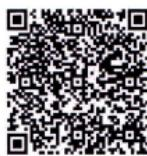

$\overset{\theta }{ \rightarrow  }$ 0.5 $\frac{\theta }{2}$ 0.4

# 概念

设 $\theta$ 是总体 $X$ 的分布函数的一个未知参数，对于给定 $\alpha (0 < \alpha < 1)$ ，如果由样本 $X_{1}, X_{2}, \dots, X_{n}$ 确定的两个统计量 $\hat{\theta}_{1} = \hat{\theta}_{1}(X_{1}, X_{2}, \dots, X_{n})$ ， $\hat{\theta}_{2} = \hat{\theta}_{2}(X_{1}, X_{2}, \dots, X_{n})$ ，使

$$
P \left\{\hat {\theta} _ {1} \left(X _ {1}, X _ {2}, \dots , X _ {n}\right) <   \theta <   \hat {\theta} _ {2} \left(X _ {1}, X _ {2}, \dots , X _ {n}\right) \right\} = 1 - \alpha ,
$$

即 $\theta$ 落在区间 $(\hat{\theta}_1, \hat{\theta}_2)$ 上的可能性为 $1 - \alpha$

则称随机区间 $(\hat{\theta}_1,\hat{\theta}_2)$ 是 $\theta$ 的置信度为 $1 - \alpha$ 的置信区间， $\hat{\theta}_{1}$ 和 $\hat{\theta}_{2}$ 分别称为 $\theta$ 的置信度为 $1 - \alpha$ 的双侧置信区间的置信下限和置信上限， $1 - \alpha$ 称为置信度或置信水平， $\alpha$ 称为显著性水平.如果

$P\{\theta < \hat{\theta}_1\} = P\{\theta > \hat{\theta}_2\} = \frac{\alpha}{2}$ ，则称这种置信区间为等尾置信区间。

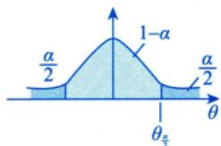

中考前记一记，喝前摇一摇，即可

# 2 单个正态总体均值和方差的置信区间

设 $X \sim N(\mu, \sigma^2)$ ，从总体 $X$ 中抽取样本 $X_1, X_2, \dots, X_n$ ，样本均值为 $\overline{X}$ ，样本方差为 $S^2$ 。

(1) $\sigma^2$ 已知， $\mu$ 的置信水平是 $1 - \alpha$ 的置信区间为

也称置信度

$$
\left(\overline {{X}} - \frac {\sigma}{\sqrt {n}} z _ {\frac {\alpha}{2}}, \overline {{X}} + \frac {\sigma}{\sqrt {n}} z _ {\frac {\alpha}{2}}\right) \xrightarrow [ \Delta ]{\text {记 为} I _ {1}} P \{\mu \in I _ {1} \} = 1 - \alpha = P \{\overline {{X}} - \Delta <   \mu <   \overline {{X}} + \Delta \}
$$

(2) $\sigma^2$ 未知， $\mu$ 的置信水平是 $1 - \alpha$ 的置信区间为

用样本方差 $S^{2}$ 代替方差 $\sigma^2$ ， $S$ 是可以继续抽样的数据

$$
\left(\overline {{X}} - \underbrace {\frac {S}{\sqrt {n}} t _ {\frac {\alpha}{2}} (n - 1)} _ {\Delta}, \overline {{X}} + \underbrace {\frac {S}{\sqrt {n}} t _ {\frac {\alpha}{2}} (n - 1)} _ {\Delta}\right) ^ {\text {记 为} I _ {2}} \rightarrow P \{\mu \in I _ {2} \} = 1 - \alpha = P \{\overline {{X}} - \Delta <   \mu <   \overline {{X}} + \Delta \}
$$

(3) $\mu$ 已知， $\sigma^2$ 的置信水平是 $1 - \alpha$ 的置信区间为

$$
\left(\sum_ {i = 1} ^ {n} (X _ {i} - \mu) ^ {2} \quad \sum_ {i = 1} ^ {n} (X _ {i} - \mu) ^ {2}\right) \xrightarrow {\text {记 为} I _ {3}} P \{\sigma^ {2} \in I _ {3} \} = 1 - \alpha = P \{\Delta_ {1} <   \sigma^ {2} <   \Delta_ {2} \},
$$

此种情况一般不出现

(4) $\mu$ 未知, $\sigma^2$ 的置信水平是 $1 - \alpha$ 的置信区间为

$$
\left(\underbrace {\frac {(n - 1) S ^ {2}}{\chi_ {\frac {\alpha}{2}} ^ {2} (n - 1)} , \frac {(n - 1) S ^ {2}}{\chi_ {1 - \frac {\alpha}{2}} ^ {2} (n - 1)}} _ {\text {记 为} I _ {4}}\right) \xrightarrow {} P \{\sigma^ {2} \in I _ {4} \} = 1 - \alpha
$$

A

$\Delta_{2}$

注 (1) $\sigma^2$ 已知时，估 $\mu$ 。

令 $P\left\{  {\left| {\bar{X} - {EX}}\right|  < \Delta }\right\}   = 1 - \alpha$ (人为给定的),即令 $\overline{X}$ 到 $\mu$ 的距离小于某个正数的概率为 $1 - \alpha$ .

抽样数据. 某个正数

由于 $\overline{X} \sim N\left(\mu, \frac{\sigma^2}{n}\right)$ ，记 $Z = \frac{\overline{X} - \mu}{\sqrt{n}} \sim N(0, 1)$ 。

则 $P\left\{\left|\frac{\bar{X} - \mu}{\sigma / \sqrt{n}}\right| < \frac{\Delta}{\sigma / \sqrt{n}}\right\} = 1 - \alpha$ ，即 $\frac{\Delta}{\sigma / \sqrt{n}} = z_{\frac{\alpha}{2}}$ ，解得 $\Delta = \frac{z_{\frac{\alpha}{2}}}{\sqrt{n}} \cdot \frac{\sigma}{\sqrt{n}} \Rightarrow P\left\{\bar{X} - \Delta < \mu < \bar{X} + \Delta\right\} = 1 - \alpha$

上 $\alpha$ 分位数 $\downarrow$ 个 $\frac{\sigma }{2}\sqrt{n}$ $\mu  \in  \left( {\bar{X} - {z}_{\frac{\alpha }{2}}\frac{\sigma }{\sqrt{n}}}\right) ,\bar{X} + {z}_{\frac{\alpha }{2}}\frac{\sigma }{\sqrt{n}}$

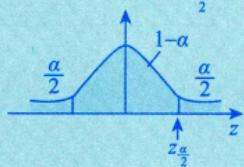

故称 $\left(\overline{X} - z_{\frac{\alpha}{2}} \frac{\sigma}{\sqrt{n}}, \overline{X} + z_{\frac{\alpha}{2}} \frac{\sigma}{\sqrt{n}}\right)$ 为置信度为 $1 - \alpha$ 的置信区间.

(2) $\sigma^2$ 未知时，估 $\mu$

令 $P\left\{\left|\frac{\overline{X} - \mu}{S / \sqrt{n}}\right| < \frac{\Delta}{S / \sqrt{n}}\right\} = 1 - \alpha$ ，则 $P\left\{|T| < \frac{\Delta}{S / \sqrt{n}}\right\} = 1 - \alpha$ ，即 $\frac{\Delta}{S / \sqrt{n}} = t_{\frac{\alpha}{2}}(n - 1)$ ，解得 $\Delta = 1$

$$
t _ {\frac {\alpha}{2}} (n - 1) \frac {S}{\sqrt {n}}. ^ {T} \sim t (n - 1)
$$

(3) $\mu$ 已知时，估 $\sigma^2$

若 $P\left\{\Delta_1 < \sigma^2 < \Delta_2\right\} = 1 - \alpha$ ，则

$$
\begin{array}{l} P \left\{\frac {1}{\Delta_ {2}} <   \frac {1}{\sigma^ {2}} <   \frac {1}{\Delta_ {1}} \right\} = 1 - \alpha \\ = P \left\{\frac {\sum_ {i = 1} ^ {n} (X _ {i} - \mu) ^ {2}}{\Delta_ {2}} <   \frac {\sum_ {i = 1} ^ {n} (X _ {i} - \mu) ^ {2}}{\sigma^ {2}} <   \frac {\sum_ {i = 1} ^ {n} (X _ {i} - \mu) ^ {2}}{\Delta_ {1}} \right\}, \\ \chi_ {1 - \frac {\alpha}{2}} ^ {2} (n) \quad \sum_ {i = 1} ^ {n} \frac {\left(X _ {i} - \mu\right) ^ {2}}{\sigma^ {2}} \sim \chi^ {2} (n) \quad \chi_ {\frac {\alpha}{2}} ^ {2} (n) \\ \end{array}
$$

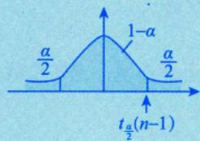

故 $\Delta_{1} = \frac{\sum_{i = 1}^{n}(X_{i} - \mu)^{2}}{\chi_{\frac{\alpha}{2}}^{2}(n)},\Delta_{2} = \frac{\sum_{i = 1}^{n}(X_{i} - \mu)^{2}}{\chi_{1 - \frac{\alpha}{2}}^{2}(n)}.$

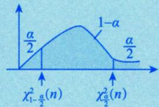

(4) $\mu$ 未知时，估 $\sigma^2$

若 $P\left\{\Delta_1 < \sigma^2 < \Delta_2\right\} = 1 - \alpha$ ，则

$$
\begin{array}{l} P \left\{\frac {1}{\Delta_ {2}} <   \frac {1}{\sigma^ {2}} <   \frac {1}{\Delta_ {1}} \right\} = 1 - \alpha \\ = P \left\{\frac {\sum_ {i = 1} ^ {n} (X _ {i} - \bar {X}) ^ {2}}{\Delta_ {2}} <   \frac {\sum_ {i = 1} ^ {n} (X _ {i} - \bar {X}) ^ {2}}{\sigma^ {2}} <   \frac {\sum_ {i = 1} ^ {n} (X _ {i} - \bar {X}) ^ {2}}{\Delta_ {1}} \right\}, \\ \chi_ {1 - \frac {\alpha}{2}} ^ {2} (n - 1) \quad \text {服 从} \chi^ {2} (n - 1) \quad \chi_ {\frac {\alpha}{2}} ^ {2} (n - 1) \\ \end{array}
$$

故 $\Delta_{1} = \frac{\sum_{i = 1}^{n}(X_{i} - \overline{X})^{2}}{\chi_{\frac{\alpha}{2}}^{2}(n - 1)},\Delta_{2} = \frac{\sum_{i = 1}^{n}(X_{i} - \overline{X})^{2}}{\chi_{1 - \frac{\alpha}{2}}^{2}(n - 1)}.$

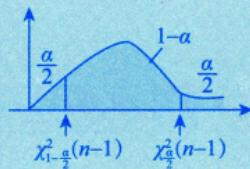

例6.13 设总体 $X \sim N(\mu, \sigma^2)$ ( $\sigma^2$ 已知)，则在给定样本容量 $n$ 及置信度 $1 - \alpha$ 的情况下，未知参数 $\mu$ 的置信区间长度随着样本均值 $\overline{X}$ 的增加而（ ）.

(A) 增加

(B) 减少

(C) 不变

(D) 不能确定增或减

$\frac{\mu}{X - \Delta}$ 故区间长度 $L = 2\Delta = 2z_{\frac{\alpha}{2}}\frac{\sigma}{\sqrt{n}}.$ 与 $\overline{X}$ 无关

解 应选(C).

在给定条件下，未知参数 $\mu$ 的置信区间为 $\left(\overline{X} -\frac{\sigma}{\sqrt{n}} z_{\frac{\alpha}{2}},\overline{X} +\frac{\sigma}{\sqrt{n}} z_{\frac{\alpha}{2}}\right)$ ，其中 $\Phi \left(z_{\frac{\alpha}{2}}\right) = 1 - \frac{\alpha}{2}$ 可见该区间长度 $2\frac{\sigma}{\sqrt{n}} z_{\frac{\alpha}{2}}$ 与 $\overline{X}$ 无关，故选择(C).

例6.14 设总体 $X$ 的方差为1，根据来自 $X$ 的容量为100的简单随机样本测得样本均值为5，又 $\Phi (1.96) = 0.975$ ，则 $X$ 的数学期望的置信度近似等于0.95的置信区间为

分析 由中心极限定理，若 $X_{i}^{\mathrm{id}}F$ ，则当 $n\to \infty$ 时， $\sum_{i = 1}^{n}X_{i}$ 服从 $N(n\mu ,n\sigma^2)$ ，故

$$
\sum_ {i = 1} ^ {1 0 0} X _ {i} \sim N (1 0 0 \mu , 1 0 0), \bar {X} = \frac {1}{1 0 0} \sum_ {i = 1} ^ {1 0 0} X _ {i} \sim N \left(\mu , \frac {1}{1 0 0}\right).
$$

$\frac{\mu}{X - \Delta}\overline{X + \Delta}$ ，已知 $\sigma^2 = 1$ ，故 $\Delta = z_{\frac{\alpha}{2}}\frac{\sigma}{\sqrt{n}} = z_{\frac{\alpha}{2}}\cdot \frac{1}{10} = 1.96\times 0.1 = 0.196.$ （5-0.196，5+0.196）

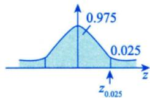

解 应填(4.804,5.196).

$$
\left. \begin{array}{l} 1 - \alpha = 0. 9 5, \alpha = 0. 0 5, \frac {\alpha}{2} = 0. 0 2 5 \\ 1 - \Phi (1. 9 6) = 0. 0 2 5 \end{array} \right\} \Rightarrow z _ {\frac {\alpha}{2}} = z _ {0. 0 2 5} = 1. 9 6
$$

尽管未说明 $X$ 是否为正态总体，但是由于样本容量 $n = 100$ 属于大样本，因此由中心极限定理易得

$$
Z = \frac {\overline {{X}} - \mu}{1 / \sqrt {1 0 0}} \stackrel {\text {近 似}} {\sim} N (0, 1),
$$

又由 $\Phi (1.96) = 0.975$ ，故 $P\{-1.96 < Z < 1.96\} = 0.95$ ，即 $\mu$ 的置信度近似为0.95的置信区间为

$$
\left(\bar {X} - \frac {1}{1 0} \times 1. 9 6, \bar {X} + \frac {1}{1 0} \times 1. 9 6\right),
$$

将 $\overline{x} = 5$ 代入上式得置信区间为(4.804,5.196).

# 五 假设检验（仅数学一）

与估计的区别：估计是通过实测数据（样本值）来反映背后客观存在的未知参数；假设检验是对已有的说法（命题）进行检验，判断是否正确

# 概念

关于总体（分布中的未知参数，分布的类型、特征、不相关性、独立性……）的每一种论断（“看法”）称为统计假设，然后根据样本观察数据或试验结果所提供的信息去推断（检验）这个“看法”（即假设）是否成立，这类统计推断问题称为假设检验。

# 原假设与备择假设

常常把没有充分理由不能轻易否定的假设取为原假设（基本假设或零假设），记为 $H_0$ ，将其否定的陈述（假设）称为对立假设或备择假设，记为 $H_{1}$ ：

# 小概率原理与显著性水平

(1)小概率原理.

对假设进行检验的基本思想是采用某种带有概率性质的反证法.这种方法的依据是小概率原理——概率很接近于0的事件在一次试验或观察中认为不会发生.若小概率事件发生了,则拒绝原假设.

(2)显著性水平 $\alpha$ ．人为给定的

小概率事件中的“小概率”的值没有统一规定, 通常是根据实际问题的要求, 规定一个界限 $\alpha (0 < \alpha < 1)$ , 当一个事件的概率不大于 $\alpha$ 时, 即认为它是小概率事件. 在假设检验问题中, $\alpha$ 称为显著性水平, 通常取 $\alpha = 0.1$ , 0.05, 0.01 等.

# 4 正态总体下的六大检验及拒绝域

考前记一记，喝前摇一摇，即可

(1) $\sigma^2$ 已知， $\mu$ 未知： $H_0: \mu = \mu_0$ ， $H_1: \mu \neq \mu_0$ ，则拒绝域为 $\left(-\infty, \mu_0 - \frac{\sigma}{\sqrt{n}} z_{\frac{\alpha}{2}}\right] \cup \left[\mu_0 + \frac{\sigma}{\sqrt{n}} z_{\frac{\alpha}{2}}, +\infty\right)$ 。 $\Delta = z_{\frac{\alpha}{2}} \frac{\sigma}{\sqrt{n}}$ 原假设 备择假设

注 应熟知四、2中 $\mu$ 的区间估计的相关知识.以 $\sigma^2$ 已知，估 $\mu$ 为例.

$$
P \left\{\left| \frac {\bar {X} - \mu_ {0}}{\sigma / \sqrt {n}} \right| <   \frac {\Delta}{\sigma / \sqrt {n}} \right\} = 1 - \alpha , \Delta = z _ {\frac {\alpha}{2}} \frac {\sigma}{\sqrt {n}},
$$

则

$$
P \left\{\left| \frac {\bar {X} - \mu_ {0}}{\sigma / \sqrt {n}} \right| \geqslant \frac {\Delta}{\sigma / \sqrt {n}} \right\} = \alpha ,
$$

故令

$$
\left| \bar {X} - \mu_ {0} \right| \geqslant z _ {\frac {\alpha}{2}} \frac {\sigma}{\sqrt {n}},
$$

解得 $\overline{X} \geqslant \mu_0 + \Delta$ 或 $\overline{X} \leqslant \mu_0 - \Delta$ .

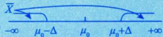

则当小概率事件发生，即 $\overline{X}$ 落到 $(-\infty, \mu_0 - \Delta] \cup [\mu_0 + \Delta, +\infty)$ 时，拒绝原假设.

(2) $\sigma^2$ 未知， $\mu$ 未知。 $H_0: \mu = \mu_0$ ， $H_1: \mu \neq \mu_0$ ，则拒绝域为

$$
\Delta = t _ {\frac {\alpha}{2}} (n - 1) \frac {S}{\sqrt {n}}
$$

★★★不同情况下，仅换 $\Delta$ 就行 $\left(-\infty ,\mu_0 - \frac{S}{\sqrt{n}} t_\frac{\alpha}{2} (n - 1)\right)\bigcup \left[\mu_0 + \frac{S}{\sqrt{n}} t_\frac{\alpha}{2} (n - 1), + \infty\right).$

$$
\left. \frac {(- \infty - \mu_ {0} - \frac {S}{\sqrt {n}} t _ {\frac {2}{8}} (n - 1)}{\mu_ {0} + \frac {S}{\sqrt {n}} t _ {\frac {2}{8}} (n - 1)} \right. + \infty
$$

(3) $\sigma^2$ 已知， $\mu$ 未知。 $H_0: \mu \leqslant \mu_0$ ， $H_1: \mu > \mu_0$ ，则拒绝域为 $\left[\mu_0 + \frac{\sigma}{\sqrt{n}} z_\alpha, +\infty\right)$ 。

（或写 $\mu = \mu_0$ ）

$$
\frac {1}{\mu_ {0}} \xrightarrow [ \mu_ {0} + \sqrt {\frac {\sigma}{n}} z _ {\alpha} ]{(\infty)} + \infty
$$

(4) $\sigma^2$ 已知， $\mu$ 未知. $H_0: \mu \geqslant \mu_0$ ， $H_1: \mu < \mu_0$ ，则拒绝域为 $\left(-\infty, \mu_0 - \frac{\sigma}{\sqrt{n}} z_\alpha\right]$ .

（或写 $\mu = \mu_0$ ）

$$
- \frac {(\mu_ {0} - \frac {\sigma^ {2}}{\sqrt {n}} z _ {a}}{\mu_ {0}} \quad \mu_ {0}
$$

(5) $\sigma^2$ 未知， $\mu$ 未知. $H_0: \mu \leqslant \mu_0, H_1: \mu > \mu_0$ ，则拒绝域为 $\left[\mu_0 + \frac{S}{\sqrt{n}} t_\alpha(n - 1), +\infty\right)$ .

（或写 $\mu = \mu_0$ ）

$$
\frac {\mu_ {0} \left[ \frac {S}{\sqrt {n}} t _ {\alpha} (n - 1) ^ {2} + \infty \right.}{\mu_ {0} + \frac {S}{\sqrt {n}} t _ {\alpha} (n - 1)}
$$

(6) $\sigma^2$ 未知， $\mu$ 未知. $H_0: \mu \geqslant \mu_0$ ， $H_1: \mu < \mu_0$ ，则拒绝域为 $\left(-\infty, \mu_0 - \frac{S}{\sqrt{n}} t_\alpha(n - 1)\right]$ .

（或写 $\mu = \mu_0$ ）

$$
- \frac {(\quad)}{\infty} \frac {]}{\mu_ {0} - \frac {S}{\sqrt {n}} t _ {\alpha} (n - 1) ^ {\prime}}
$$

注拒绝域的“形式”与备择假设 $H_{1}$ 的“形式”一致，便于记忆.

例6.15 已知某机器生产出的零件长度 $X$ （单位：cm）服从正态分布 $N(\mu, \sigma^2)$ ，其中 $\mu, \sigma^2$ 均未知，现从中随意抽取一个容量为16的样本，测得样本均值 $\overline{x} = 10$ ，样本方差 $s^2 = 0.16$ . $(t_{0.025}(15) = 2.132)$

(1) 求总体均值 $\mu$ 置信水平为 0.95 的置信区间；  
(2)在显著性水平为0.05下检验假设 $H_0$ ： $\mu = 9.7$ ， $H_{1}$ ： $\mu \neq 9.7$

解 (1) 在总体方差未知条件下，总体均值 $\mu$ 的置信水平为 $1 - \alpha$ 的置信区间为

$$
\left(\overline {{X}} - \frac {S}{\sqrt {n}} t _ {\frac {\alpha}{2}} (n - 1), \overline {{X}} + \frac {S}{\sqrt {n}} t _ {\frac {\alpha}{2}} (n - 1)\right).
$$

$t_{0.025}(15) = 2.132$

由样本均值 $\overline{x} = 10$ ，样本方差 $s^2 = 0.16 = 0.4^2$ ，求得置信区间为

$$
\left(1 0 - \frac {2 . 1 3 2 \times 0 . 4}{4}, 1 0 + \frac {2 . 1 3 2 \times 0 . 4}{4}\right) = (9. 7 8 6 8, 1 0. 2 1 3 2).
$$

(2)在方差 $\sigma^2$ 未知的条件下对总体均值进行检验.拒绝域为

$$
\left(- \infty , \mu_ {0} - \frac {S}{\sqrt {n}} t _ {\frac {\alpha}{2}} (n - 1) \right] \cup \left[ \mu_ {0} + \frac {S}{\sqrt {n}} t _ {\frac {\alpha}{2}} (n - 1), + \infty\right),
$$

代入数值，计算得 $(- \infty, 9.4868] \cup [9.9132, + \infty)$ ，由 $\overline{x} = 10$ 知，落入拒绝域，故否定 $H_0$ ，即认为 $\mu \neq 9.7$ 。

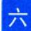

# 两类错误（仅数学一）

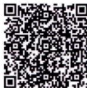

第一类错误(“弃真”): 若 $H_{0}$ 为真, 按检验法则否定 $H_{0}$ , 此时犯了 “弃真” 的错误, 这种错误称为第一类错误, 犯第一类错误的概率为 $\alpha = P\{\text{拒绝} H_{0} \mid H_{0}\text{为真}\}$ . 小概率事件的概率, 也称为显著性水平

第二类错误（“取伪”）：若 $H_0$ 不真，按检验法则接受 $H_0$ ，此时犯了“取伪”的错误，这种错误称为第二类错误，犯第二类错误的概率为 $\beta = P$ {接受 $H_0|H_0$ 为假} $= P$ {接受 $H_0|H_1$ 为真}.

# 即两类错误不是对立事件

注犯两类错误的概率 $\alpha$ 与 $\beta$ ，并不满足 $\beta = 1 - \alpha$ ，在固定样本容量 $n$ 的条件下， $\alpha$ 小， $\beta$ 就大； $\beta$ 小， $\alpha$ 就大.在实际应用中，我们总是在控制 $\alpha$ 的条件下，尽量使 $\beta$ 小，这是因为人们常常把拒绝 $H_0$ 比错误地接受 $H_0$ 看得更重要些.

例6.16

假定 $X$ 是连续型随机变量， $U$ 是对 $X$ 的一次观测值.关于其概率密度 $f(x)$ 有如下假设：

$$
H _ {0}: f (x) = \left\{ \begin{array}{l l} \frac {1}{2}, & 0 \leqslant x \leqslant 2, \\ 0, & \text {其 他 ,} \end{array} H _ {1}: f (x) = \left\{ \begin{array}{l l} \frac {x}{2}, & 0 \leqslant x \leqslant 2, \\ 0, & \text {其 他 ,} \end{array} \right. \right.
$$

检验规则：当事件 $V = \left\{U > \frac{3}{2}\right\}$ 出现时，否定假设 $H_{0}$ ，接受 $H_{1}$ . 则犯第一类错误的概率 $\alpha$ 与犯第二类错误的概率 $\beta$ 分别为（ ）.

(A) $\frac{3}{4}, \frac{7}{16}$

(B) $\frac{7}{16}, \frac{3}{4}$

(C) $\frac{9}{16}, \frac{1}{4}$

(D) $\frac{1}{4},\frac{9}{16}$

应选(D).

由 $\alpha$ 和 $\beta$ 的意义，知

$$
\alpha = P \left\{U > \frac {3}{2} \mid H _ {0} \right\} = \int_ {\frac {3}{2}} ^ {2} \frac {1}{2} d x = \frac {1}{4},
$$

$$
\beta = P \left\{U \leqslant \frac {3}{2} \mid H _ {1} \right\} = \int_ {0} ^ {\frac {3}{2}} \frac {x}{2} d x = \frac {9}{1 6}.
$$

故选 (D).

例6.17 设 $X_{1}, X_{2}, \dots, X_{16}$ 是来自总体 $N(\mu, 4)$ 的简单随机样本，考虑假设检验问题： $H_{0}: \mu \leqslant 10$ ， $H_{1}: \mu > 10$ 。 $\Phi(x)$ 表示标准正态分布函数。若该检验问题的拒绝域为 $W = \{\overline{X} > 11\}$ ，其中 $\overline{X} = \frac{1}{16} \sum_{i=1}^{16} X_{i}$ ，则 $\mu = 11.5$ 时，该检验犯第二类错误的概率为（ ）.

(A) $1 - \varPhi (1)$

(B) $1 - \varPhi (0.5)$

(C) $1 - \Phi (1.5)$

(D) $1 - \Phi (2)$

解 应选(A).

检验犯第二类错误的概率为落在接受域的概率，即

$$
P = \{\overline {{X}} \leqslant 1 1 \} = P \left\{\frac {\overline {{X}} - \mu}{\sigma / \sqrt {n}} \leqslant \frac {1 1 - 1 1 . 5}{2 / 4} \right\} = \Phi (- 1) = 1 - \Phi (1).
$$

故选 (A).

# 基础习题精练

# 习题

6.1 设总体 $X$ 服从正态分布 $N(\mu, \sigma^2)$ ，其中 $\mu$ 已知， $\sigma^2$ 未知。 $X_1, X_2, \dots, X_n$ 是取自总体 $X$ 的简单随机样本，则下列样本函数中不是统计量的是（ ）.

(A) $\frac{1}{n}\sum_{i = 1}^{n}X_{i}$

(B) $\max_{1\leqslant i\leqslant n}\{X_i\}$

(C) $\sum_{i = 1}^{n}\left(\frac{X_i - \mu}{\sigma}\right)^2$

(D) $\frac{1}{n}\sum_{i = 1}^{n}(X_i - \mu)^2$

6.2 设总体 $X$ 与 $Y$ 相互独立且都服从正态分布 $N(\mu, \sigma^2)$ ， $\overline{X}$ ， $\overline{Y}$ 是分别来自总体 $X$ ， $Y$ ，容量都为 $n$ 的样本的样本均值，则当 $n$ 固定时，概率 $P\{\left|\overline{X} - \overline{Y}\right| > \sigma\}$ 的值随 $\sigma$ 的增大而（ ）.

(A) 单调增大

(B) 单调减小

(C)保持不变

(D) 增减不定

6.3 设 $X_{1}, X_{2}, X_{3}, X_{4}$ 为来自总体 $N\left(0, \frac{1}{2}\right)$ 的简单随机样本，则统计量 $Y = \frac{X_{1} - X_{2}}{\sqrt{X_{3}^{2} + X_{4}^{2}}}$ 服从（ ）

(A) $N(0,1)$

(B) $\chi^2 (2)$

(C) $t(2)$

(D) $F(2,2)$

6.4 设总体 $X \sim N(\mu_1, 4), Y \sim N(\mu_2, 5), X$ 与 $Y$ 相互独立， $X_1, \dots, X_8$ 和 $Y_1, \dots, Y_{10}$ 是分别来自总体 $X$ 和 $Y$ 的两个样本， $S_X^2$ 与 $S_Y^2$ 分别为两个样本的样本方差，则（ ）.

(A) $\frac{2S_X^2}{5S_Y^2}\sim F(7,9)$

(B) $\frac{5S_X^2}{2S_Y^2}\sim F(7,9)$

(C) $\frac{4S_X^2}{5S_Y^2}\sim F(7,9)$

(D) $\frac{5S_X^2}{4S_Y^2}\sim F(7,9)$

6.5 设总体 $X$ 的概率分布为 $P\{X = 1\} = \frac{1 - \theta}{2}$ , $P\{X = 2\} = P\{X = 3\} = \frac{1 + \theta}{4}$ . 利用来自总体 $X$ 的样本值 1, 3, 2, 2, 1, 3, 1, 2，可得 $\theta$ 的最大似然估计值为（ ）.

(A) $\frac{1}{4}$

(B) $\frac{3}{8}$

(C) $\frac{1}{2}$

(D) $\frac{5}{8}$

6.6（仅数学一）一批零件的长度服从正态分布 $N(\mu, \sigma^2)$ ，其中 $\mu, \sigma^2$ 均未知。现从中随机抽取16个零件，测得样本均值 $\overline{x} = 20\mathrm{cm}$ ，样本标准差 $s = 1\mathrm{cm}$ ，则 $\mu$ 的置信水平为0.90的置信区间为（ ）.

(A) $\left(20 - \frac{1}{4} t_{0.05}(16), 20 + \frac{1}{4} t_{0.05}(16)\right)$

(B) $\left(20 - \frac{1}{4} t_{0.1}(16), 20 + \frac{1}{4} t_{0.1}(16)\right)$

(C) $\left(20 - \frac{1}{4} t_{0.05}(15), 20 + \frac{1}{4} t_{0.05}(15)\right)$

(D) $\left(20 - \frac{1}{4} t_{0,1}(15), 20 + \frac{1}{4} t_{0,1}(15)\right)$

6.7（仅数学一）在假设检验中，显著性水平 $\alpha$ 的意义是（ ）.

(A) 原假设 $H_0$ 成立，经检验被拒绝的概率  
(B) 原假设 $H_{0}$ 成立，经检验被接受的概率  
(C) 原假设 $H_{0}$ 不成立，经检验被拒绝的概率  
(D) 原假设 $H_{0}$ 不成立，经检验被接受的概率

6.8 设总体 $X$ 的概率密度为 $f(x) = \frac{1}{2}\mathrm{e}^{-|x|}(-\infty < x < +\infty), X_1, X_2, \dots, X_n$ 为来自总体 $X$ 的简单随机样本，其样本方差为 $S^2$ ，则 $E(S^2) = \_$

6.9 设总体 $X$ 的概率密度为

$$
f (x) = \left\{ \begin{array}{l l} \frac {6 x}{\theta^ {3}} (\theta - x), & 0 <   x <   \theta , \\ 0, & \text {其 他}, \end{array} \right.
$$

$X_{1}, X_{2}, \dots, X_{n}$ 是取自总体 $X$ 的简单随机样本. 求：

(1) $\theta$ 的矩估计量 $\hat{\theta}$   
(2) $\hat{\theta}$ 的方差 $D\hat{\theta}$

6.10 已知总体 $X$ 的概率密度为

$$
f (x) = \left\{ \begin{array}{l l} (1 + \theta) x ^ {\theta}, & 0 <   x <   1, \\ 0, & \text {其 他}, \end{array} \right.
$$

其中 $\theta > -1$ 是未知参数，设 $X_{1}, X_{2}, \dots, X_{n}$ 为来自总体 $X$ 的简单随机样本，求 $\theta$ 的矩估计量和最大似然估计量.

6.11 设总体 $X$ 的概率密度为 $f(x) = \begin{cases} \frac{2x}{\alpha^2}, & 0 \leqslant x \leqslant \alpha, \\ 0, & \text{其他}, \end{cases}$ 其中 $\alpha > 1$ 未知， $X_1, X_2, \dots, X_n$ 是来自总体 $X$ 的简单随机样本。

(1) 求 $p = P\{0 < X < \sqrt{\alpha}\}$ ;   
(2) 求 $p$ 的最大似然估计量 $\hat{p}$ .

6.12 设 $X_{1}, X_{2}, \dots, X_{n}$ 是来自正态总体 $N(\mu, \sigma^{2})$ 的一个简单随机样本，记

$$
\bar {X} = \frac {1}{n} \sum_ {i = 1} ^ {n} X _ {i}, S ^ {2} = \frac {1}{n - 1} \sum_ {i = 1} ^ {n} (X _ {i} - \bar {X}) ^ {2}, T = \bar {X} ^ {2} - \frac {1}{n} S ^ {2}.
$$

（仅数学一）证明： $T$ 是 $\mu^2$ 的无偏估计量.

（仅数学三）求 $ET$

# 解答

6.1 (C) 解由统计量的定义“不含任何未知参数的样本函数”，即知不是统计量的选项应该是(C)，因为选项(C)中含有未知参数 $\sigma$ ，故选择(C).  
6.2 (C) 解 要计算概率需要知道 $\overline{X} - \overline{Y}$ 的分布。依题意 $\overline{X} \sim N\left(\mu, \frac{\sigma^2}{n}\right)$ ， $\overline{Y} \sim N\left(\mu, \frac{\sigma^2}{n}\right)$ 且相互独立，故 $\overline{X} - \overline{Y} \sim N\left(0, \frac{2\sigma^2}{n}\right)$ ，由此可知当 $n$ 固定时， $P\{| \overline{X} - \overline{Y} | > \sigma\} = P\left\{\left|\frac{\overline{X} - \overline{Y}}{\sqrt{2}\sigma / \sqrt{n}}\right| > \sqrt{\frac{n}{2}}\right\}$ 与 $\sigma$ 无关，故所求概率值保持不变，选择(C)。事实上，

$$
\begin{array}{l} P \{| \overline {{X}} - \overline {{Y}} | > \sigma \} = 1 - P \left\{\left| \frac {\overline {{X}} - \overline {{Y}}}{\sqrt {2} \sigma / \sqrt {n}} \right| \leqslant \sqrt {\frac {n}{2}} \right\} = 1 - \left[ \Phi \left(\sqrt {\frac {n}{2}}\right) - \Phi \left(- \sqrt {\frac {n}{2}}\right) \right] \\ = 2 \left[ 1 - \Phi \left(\sqrt {\frac {n}{2}}\right) \right]. \\ \end{array}
$$

6.3 (C) 解 取 $X = X_{1} - X_{2}$ , 则 $EX = 0$ , $DX = DX_{1} + DX_{2} = 1$ , $X \sim N(0, 1)$ .

又 $E(\sqrt{2} X_{i}) = 0, D(\sqrt{2} X_{i}) = 2DX_{i} = 1$ ，知 $\sqrt{2} X_{i}\sim N(0,1)$ ，从而

$$
Y _ {1} = (\sqrt {2} X _ {3}) ^ {2} + (\sqrt {2} X _ {4}) ^ {2} \sim \chi^ {2} (2),
$$

又 $X$ 与 $Y_{1}$ 相互独立，因此 $Y = \frac{X}{\sqrt{\frac{Y_1}{2}}}\sim t(2)$ ，即 $Y$ 服从自由度为2的 $t$ 分布.

6.4 (D) 解 如果 $aQ \sim \chi^2(m)$ , $bT \sim \chi^2(n)$ , $Q$ 与 $T$ 独立, 则 $\frac{aQ / m}{bT / n} = \frac{naQ}{mbT} \sim F(m, n)$ . 依题意

$$
\frac {7 S _ {X} ^ {2}}{4} \sim \chi^ {2} (7), \frac {9 S _ {Y} ^ {2}}{5} \sim \chi^ {2} (9).
$$

$S_{X}^{2}$ 与 $S_{Y}^{2}$ 相互独立，因此服从 $F(7,9)$ 分布的统计量 $A\frac{S_X^2}{S_Y^2}$ ，其系数应是 $A = \frac{\frac{7}{4} / 7}{\frac{9}{5} / 9} = \frac{5}{4}$ ，选择(D).

通过 $F$ 分布系数与自由度的关系确定选项.

6.5 (A) 解 由题意可知，似然函数为

$$
\begin{array}{l} L (\theta) = P \left\{X _ {1} = 1, X _ {2} = 3, X _ {3} = 2, X _ {4} = 2, X _ {5} = 1, X _ {6} = 3, X _ {7} = 1, X _ {8} = 2 \right\} \\ = \left(\frac {1 - \theta}{2}\right) ^ {3} \left(\frac {1 + \theta}{4}\right) ^ {3} \left(\frac {1 + \theta}{4}\right) ^ {2} \\ = \frac {1}{2 ^ {1 3}} (1 - \theta) ^ {3} (1 + \theta) ^ {5}, \\ \end{array}
$$

对数似然函数为

$$
\ln L (\theta) = - 1 3 \ln 2 + 3 \ln (1 - \theta) + 5 \ln (1 + \theta),
$$

令 $\frac{\mathrm{d}[\ln L(\theta)]}{\mathrm{d}\theta} = -\frac{3}{1 - \theta} +\frac{5}{1 + \theta} = 0,$

解得 $\theta = \frac{1}{4}$ ，从而 $\theta$ 的最大似然估计值为 $\hat{\theta} = \frac{1}{4}$ .故选(A).

6.6 (C) 解 $\sigma^2$ 未知，均值 $\mu$ 的置信水平为 $1 - \alpha$ 的置信区间为

$$
\left(\overline {{X}} - \frac {S}{\sqrt {n}} t _ {\frac {\alpha}{2}} (n - 1), \overline {{X}} + \frac {S}{\sqrt {n}} t _ {\frac {\alpha}{2}} (n - 1)\right),
$$

其中，在给定条件下， $\overline{x} = 20$ ， $s = 1$ ， $t_{\frac{\alpha}{2}}(n - 1) = t_{0.05}(15)$ ，则所求参数 $\mu$ 的置信水平为0.90的置信区间为

$$
\left(2 0 - \frac {1}{4} t _ {0. 0 5} (1 5), 2 0 + \frac {1}{4} t _ {0. 0 5} (1 5)\right),
$$

故选择(C).

6.7 (A) 解 显著性水平 \(\alpha\) 是确定小概率事件的一个界限，由检验法则知，\(\alpha = P\{\text{拒绝} H_0 \mid H_0\) 为真}\)，所以正确选项是(A). 选项(B)是 \(P\{\text{接受} H_0 \mid H_0\) 为真} = 1 - \(\alpha\)；选项(D)是 \(P\{\text{接受} H_0 \mid H_0\) 不成立\} = P\{\text{犯第二类错误} \} = \beta\)；选项(C)是 \(P\{\text{拒绝} H_0 \mid H_0\) 不成立\} = 1 - \(\beta\)。

6.82解因为样本方差的数学期望等于总体的方差，即 $E(S^2) = DX$ ，而

$$
E X = \int_ {- \infty} ^ {+ \infty} x f (x) d x = \int_ {- \infty} ^ {+ \infty} x \cdot \frac {1}{2} e ^ {- | x |} d x = 0,
$$

$$
E \left(X ^ {2}\right) = \int_ {- \infty} ^ {+ \infty} x ^ {2} f (x) d x = \int_ {0} ^ {+ \infty} x ^ {2} e ^ {- x} d x = 2,
$$

故 $E(S^{2}) = DX = E(X^{2}) - (EX)^{2} = 2 - 0 = 2.$

6.9 解 (1) $EX = \int_{-\infty}^{+\infty} x f(x) \, \mathrm{d}x = \int_{0}^{\theta} \frac{6x^2}{\theta^3} (\theta - x) \, \mathrm{d}x = \frac{\theta}{2}$ .

记 $\overline{X} = \frac{1}{n}\sum_{i = 1}^{n}X_{i}$ ，由 $\frac{\theta}{2} = \overline{X}$ ，得 $\theta$ 的矩估计量为 $\hat{\theta} = 2\overline{X}$ ：

(2) 由于 $E(X^2) = \int_{-\infty}^{+\infty}x^2 f(x)\mathrm{d}x$

$$
= \int_ {0} ^ {\theta} \frac {6 x ^ {3}}{\theta^ {3}} (\theta - x) d x = \frac {3 \theta^ {2}}{1 0},
$$

$$
\begin{array}{l} D X = E \left(X ^ {2}\right) - (E X) ^ {2} \\ = \frac {3 \theta^ {2}}{1 0} - \left(\frac {\theta}{2}\right) ^ {2} = \frac {\theta^ {2}}{2 0}, \\ \end{array}
$$

因此 $\hat{\theta} = 2\overline{X}$ 的方差为 $D\hat{\theta} = D(2\overline{X}) = 4D\overline{X} = \frac{4}{n} DX = \frac{\theta^2}{5n}.$

6.10 解 $\mu_{1} = EX = \int_{-\infty}^{+\infty}xf(x)\mathrm{d}x = \int_{0}^{1}(1 + \theta)x^{\theta +1}\mathrm{d}x = \frac{1 + \theta}{2 + \theta},\overline{X} = \frac{1}{n}\sum_{i = 1}^{n}X_{i}.$

令 $\mu_{1} = \overline{X}$ ，即 $\frac{1 + \theta}{2 + \theta} = \overline{X}$ ，解得 $\theta$ 的矩估计量为 $\hat{\theta} = \frac{2\overline{X} - 1}{1 - \overline{X}}$

设 $x_{1}, x_{2}, \dots, x_{n}$ 为样本值，则似然函数为

$$
L (\theta) = (1 + \theta) ^ {n} \prod_ {i = 1} ^ {n} x _ {i} ^ {\theta} (0 <   x _ {i} <   1, i = 1, 2, \dots , n),
$$

取对数得 $\ln L(\theta) = n\ln (1 + \theta) + \theta \sum_{i = 1}^{n}\ln x_{i},$

令 $\frac{\mathrm{d}[\ln L(\theta)]}{\mathrm{d}\theta} = \frac{n}{1 + \theta} +\sum_{i = 1}^{n}\ln x_{i} = 0,$

解得唯一解 $\hat{\theta} = -\frac{n}{\sum_{i=1}^{n}\ln x_i} - 1$ ，则 $\theta$ 的最大似然估计量为 $\hat{\theta} = -\frac{n}{\sum_{i=1}^{n}\ln X_i} - 1$ 。

6.11 解 (1) $p = P\{0 < X < \sqrt{\alpha}\} = \int_{0}^{\sqrt{\alpha}} f(x) \, \mathrm{d}x = \frac{1}{\alpha}$ .

(2) 当 $0 \leqslant x_{1} \leqslant \alpha, 0 \leqslant x_{2} \leqslant \alpha, \dots, 0 \leqslant x_{n} \leqslant \alpha$ 时，似然函数为

$$
\begin{array}{l} L (\alpha) = f \left(x _ {1}\right) f \left(x _ {2}\right) \dots f \left(x _ {n}\right) \\ = \frac {2 ^ {n}}{\alpha^ {2 n}} x _ {1} x _ {2} \dots x _ {n}, \\ \end{array}
$$

显然 $L(\alpha)$ 关于 $\alpha$ 单调减少，且 $\alpha \geqslant \max \{x_1, x_2, \dots, x_n\}$ ，则 $\alpha$ 的最大似然估计量为

$$
\hat {\alpha} = \max  \left\{X _ {1}, X _ {2}, \dots , X _ {n} \right\}.
$$

又由(1)知 $p = \frac{1}{\alpha}$ 关于 $\alpha$ 是单调函数，根据最大似然估计的不变性，有 $p$ 的最大似然估计量为

$$
\hat {p} = \frac {1}{\max  \left\{X _ {1} , X _ {2} , \cdots , X _ {n} \right\}}.
$$

6.12（仅数学一）证明 由于

$$
\begin{array}{l} E T = E \left(\bar {X} ^ {2} - \frac {1}{n} S ^ {2}\right) = E \left(\bar {X} ^ {2}\right) - \frac {1}{n} E \left(S ^ {2}\right) \\ = D \bar {X} + (E \bar {X}) ^ {2} - \frac {1}{n} E (S ^ {2}) = \frac {\sigma^ {2}}{n} + \mu^ {2} - \frac {\sigma^ {2}}{n} \\ = \mu^ {2}, \\ \end{array}
$$

从而知， $T$ 是 $\mu^2$ 的无偏估计量.

（仅数学三）解 $ET = E\left(\overline{X}^2 - \frac{1}{n} S^2\right) = E(\overline{X}^2) - \frac{1}{n} E(S^2)$

$$
\begin{array}{l} = D \bar {X} + (E \bar {X}) ^ {2} - \frac {1}{n} E (S ^ {2}) = \frac {\sigma^ {2}}{n} + \mu^ {2} - \frac {\sigma^ {2}}{n} \\ = \mu^ {2}. \\ \end{array}
$$
