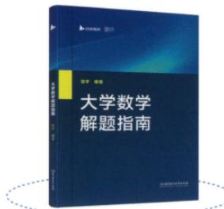
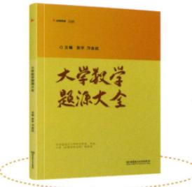
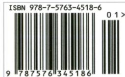
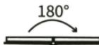

# 张宇大学数学图书推荐

  
20年教学精华

  
刷题巩固培养解题思维   
20年习题精选

张宇

博士，知名数学教育专家，从教二十余年，培养了大批学生考入清华、北大等名校攻读研究生，带出了不少年轻有为的教学能手，撰写了数十本全国畅销数学教材、习题书、模考卷等，曾任高等教育出版社《全国硕士研究生入学统一考试数学考试大纲解析》编者之一，命题经验丰富。

张宇数学系列

# 考研教材类

考研数学基础30讲·高等数学分册 书稿包邮

考研数学基础30讲·线性代数分册

考研数学基础30讲·概率论与数理统计分册 市版位

高等数学18讲 卡塔它

线性代数9讲 书课包

概率论与数理统计9讲 卷读艺

# 考研题集类

张宇考研数学题源探析经典1000题（分数学一、数学二、数学三）

考研数学真题大全解·基础篇-【1987—2012年】（分数学一、数学二、数学三）

考研数学真题大全解·强化篇-【2013—2026年】（分数学一、数学二、数学三）

考研数学命题人终极预测8套卷（分数学一、数学二、数学三）

张宇考研数学最后4套卷（分数学一、数学二、数学三）

# ○大学教材类

大学数学解题指南

大学数学题源大全

高等数学习题全解（同济八版·上册）

高等数学习题全解（同济八版·下册）

线性代数习题全解（同济七版）

概率论与数理统计习题全解（浙大五版）

高等数学同步检测卷（上册）

高等数学同步检测卷（下册）

线性代数同步检测卷

概率论与数理统计同步检测卷

  
定价：99.90元

启航书课包

2027 新版

主编张宇

# 考研数学基础30讲

# 线性代数分册

主编张宇  
副主编 高昆轮

  
用“启航考研”小程序刷题  
免费听《30讲》配套习题讲解

  
微信扫一扫   
加入专属学习群

备考资料

交流答疑

社群带学

学习奖励

# 温馨提示：

本书采用裸脊锁线的装帧工艺，制作精良，牢固且不易掉页，可 $180^{\circ}$ 平摊，学习阅读体验更佳！

图书外封为护封，用于保护书籍，不易被损坏，可任意拆装，请不要随意丢弃哦~

# 张宇考研数学全家桶

一套完整的考研数学复习攻略

# 02 强化进阶

掌握高频考点和常考题型，提高解题能力

学习时间：2026年6月—9月

学习用书：

书课包 《高等数学18讲》

书课包《线性代数9讲》

书课包《概率论与数理统计9讲》

《张宇考研数学题源探析经典1000题》强化篇&综合篇

# 04 冲刺拔高

模考测试，科学预测，查漏补缺

学习时间：2026年10月—12月

学习用书：

《考研数学命题人终极预测8套卷》

《张宇考研数学最后4套卷》

# 01 基础夯实

系统学习基础知识点，配合基础习题练习

学习时间：现在—2026年5月

学习用书：

书课包《考研数学基础30讲·高等数学分册》

书课包 《考研数学基础30讲·线性代数分册》

书课包 《考研数学基础30讲·概率论与数理统计分册》

《张宇考研数学题源探析经典1000题》基础篇

# 03 真题演练

真题带练，把握命题规律，积累解题经验

学习时间：2026年3月—10月

学习用书：

《考研数学真题大全解·基础篇》

《考研数学真题大全解·强化篇》

这个世界

蕴含的客观规律

是美妙的,

谨以此书

献给努力探寻世界的人们。

# 考研数学基础30讲

# 线性代数分册

主编张宇  
副主编 高昆轮

# 图书在版编目（CIP）数据

考研数学基础30讲.线性代数分册/张宇主编.北京：北京理工大学出版社，2024.10（2025.9重印）ISBN978-7-5763-4518-6I．013中国国家版本馆CIP数据核字第20245E9821号

责任编辑：多海鹏 文案编辑：多海鹏责任校对：周瑞红 责任印制：李志强

出版发行/北京理工大学出版社有限责任公司  
社址/北京市丰台区四合庄路6号  
邮编/100070  
电话/（010）68944451（大众售后服务热线）（010）68912824（大众售后服务热线）  
网址/http://www.bitpress.com.cn

版印次/2025年9月第1版第5次印刷  
印 刷/三河市文阁印刷有限公司  
开 本 $/787\mathrm{mm}\times 1092\mathrm{mm}1 / 16$ 印 张/13.75  
字 数/343千字  
定 价/99.90元

# 前言

《考研数学基础30讲》（简称《30讲》）按照《全国硕士研究生招生考试数学考试大纲》，并结合考研数学命题趋势编写，其中高等数学分册分为18讲，线性代数分册分为6讲，概率论与数理统计分册分为6讲，共30讲。学完这些内容，即可达到传统意义上的“基础阶段”与“强化阶段”的全部要求。

线性代数分册的第一部分为考研数学“零基础”，旨在提出线性代数研究的对象、工具和方法。这些基础知识和想法，关系到之后线性代数学习的方向。由于线性代数知识点众多，也比较零散，考生在今后的学习中把握好方向，捋清主线十分重要，这样才能越学越清晰。

第二部分为考研数学基础全程内容，每一讲都由基础知识结构、基础内容精讲、基础习题精练三部分组成，涵盖《全国硕士研究生招生考试数学考试大纲》中所有知识点，循序渐进，由浅入深，最后达到考研数学对试题要求的难度水平。这里需要特别指出的是，数学学习是一环扣一环的，上一个环节的知识和想法，直接影响到下一个环节的知识和想法，任何环节都不能囿囿吞枣或降低要求，必须深刻掌握，否则越往下学习就会越困难。反之，若在初始阶段多下些功夫，搞明白原理，捋清楚关系，看似进度不快，却能为后面的学习加速打下坚实的基础。

《30讲》是书课包，即本书作者会对书中全部内容进行系统讲解，考生扫描书中二维码即可快速定位对应知识点的视频讲解。2027版的《30讲》根据课程讲解，标注了全程的学习笔记，既能防止考生漏记、错记笔记，又节省做笔记的时间，考生只需集中精力认真听即可。

建议考生结合课程反复研读本书，有些知识的掌握是需要反复琢磨的，要养成独立思考的习惯，逐渐达到知识、思路、题型和方法皆会以清晰的结构呈现眼前的效果。本书是作者多年基础阶段教学经验的总结，愿助潜心研读者打好地基、夯实基础，勇攀考研数学高峰。

本书自出版以来，承蒙广大师生厚爱，在考研数学基础阶段起到了一定的积极作用。限于作者水平，书中不足或错误之处，望各位不吝赐教，多提意见与建议，特此致谢！

# 目录

第0讲 零基础课——线性代数入门  
第1讲行列式 11  
第2讲 矩阵 45  
第3讲 向量组 82  
第4讲 线性方程组 114  
第5讲 特征值与特征向量 139  
第6讲 二次型 … 178
