# 第0讲

# 零基础课线性代数入门

本书是按照《全国硕士研究生招生考试数学考试大纲》编写的线性代数教材，是基础阶段用书。但事实上，学完本书，考生即学完了所谓“基础”和“强化”的内容，可以开始研究解题了。本书共分为6讲，可以按以下三大版块进行学习：

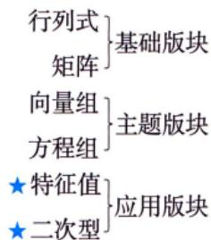

那么，究竟什么是线性代数呢？

线性代数是一种代数结构。通俗来讲，向量空间是这个结构的基石，我们要在向量空间中研究向量与向量的关系。

# 对象（元素）：向量

① 定义：拼在一起的有序数组，如 $[-1, 1]$ 。  
② 维数：向量中数的个数，如 $[-1, 1]$ 是 2 维向量.  
③意义：数据可以表达信息.如下例：

假设一个人对于运动和音乐的兴趣程度均分为不喜欢、无所谓和喜欢三种，其中不喜欢用-1表示，无所谓用0表示，喜欢用1表示，则可用以下向量来表示某人对于运动和音乐的兴趣程度：

[运动兴趣程度，音乐兴趣程度].

那么，向量[-1,1]代表不喜欢运动，喜欢音乐，即 $\left\lbrack  \begin{array}{lll} \text{运动：} &  - 1 & 0 \\  \text{音乐：} &  - 1 & 0 \end{array}\right\rbrack$

向量[0,1]代表对运动无所谓，喜欢音乐，即 $\left[ \begin{array}{lll}\text{运动: - 1} & 0 & 1\\ \text{音乐: - 1} & 0 & 1 \end{array} \right].$

# 运算

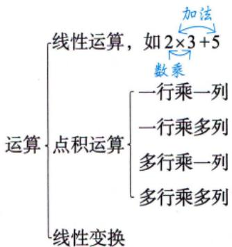

# 线性运算

$①$ 加法： $a + b$ ：  
②数乘：ka.

# 点积运算

$(\alpha, \beta)$ 称为向量 $\alpha$ 与向量 $\beta$ 的点积运算，即将 $\alpha$ ， $\beta$ 的所有分量对应相乘再相加.如 $\alpha = [-1,1]$ ， $\beta = [0, -1]$ ，则 $(\alpha, \beta) = -1 \times 0 + 1 \times (-1) = -1$ ：

$①$ 一行乘一列.

如 $[a_1, a_2] \begin{bmatrix} b_1 \\ b_2 \end{bmatrix} = (a_1 b_1 + a_2 b_2)$ ,

或 $[a_1, a_2] \left[ \begin{array}{c} c_1 \\ c_2 \end{array} \right] = \overbrace{a_1 c_1 + a_2 c_2}^{\left[ \begin{array}{l} c_1 \\ c_2 \end{array} \right]}.$

②一行乘多列.

如 $\left[a_{1}, a_{2}\right]\left[ \begin{array}{ll}b_{1} & c_{1}\\ b_{2} & c_{2} \end{array} \right] = \underbrace{\left[a_{1}b_{1} + a_{2}b_{2},a_{1}c_{1} + a_{2}c_{2}\right]}_{\text{数乘}}.$

③多行乘一列.

如 $\begin{bmatrix} a_1 & a_2 \\ b_1 & b_2 \end{bmatrix} \begin{bmatrix} c_1 \\ c_2 \end{bmatrix} = \begin{bmatrix} a_1c_1 + a_2c_2 \\ b_1c_1 + b_2c_2 \end{bmatrix}.$

④多行乘多列.

如 $\begin{bmatrix} a_1 & a_2 \\ b_1 & b_2 \end{bmatrix} \begin{bmatrix} c_1 & d_1 \\ c_2 & d_2 \end{bmatrix} = \begin{bmatrix} a_{11} & a_{12} \\ a_{21} & a_{22} \end{bmatrix},$

其中， $a_{11} = a_1c_1 + a_2c_2$ ， $a_{12} = a_1d_1 + a_2d_2$ ， $a_{21} = b_1c_1 + b_2c_2$ ， $a_{22} = b_1d_1 + b_2d_2$ ，即

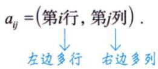

# 注 练习：计算如下式子.

1 1 1 [1,1] -1   
② $[2,0]\left[ \begin{array}{l}0\\ -2 \end{array} \right] = \underline{\quad}$   
2 1 3   
$④ \left[ \begin{array} { c c } { 2 } & { 1 } \\ { - 1 } & { 3 } \end{array} \right] \left[ \begin{array} { c } { 1 } \\ { - 1 } \end{array} \right] =$   
⑤ $\left[ \begin{array}{l}1\\ 1 \end{array} \right][1, - 1] = \underline{\quad}$   
⑥ $\left[ \begin{array}{l}2\\ 0 \end{array} \right][0, - 2] = \underline{\quad}$   
1 1 2 1 1 -1 1 -1 3   
2 1 1 1 1 1

答案：①0.②0.③[3，-2].④ $\begin{bmatrix} 1\\ -4 \end{bmatrix}$ .⑤ $\begin{bmatrix} 1 & -1\\ 1 & -1 \end{bmatrix}$ .⑥ $\begin{bmatrix} 0 & -4\\ 0 & 0 \end{bmatrix}$ .⑦ $\begin{bmatrix} 1 & 4\\ -3 & 2 \end{bmatrix}$ .⑧ $\begin{bmatrix} 1 & 3\\ -4 & 2 \end{bmatrix}$

# 线性变换

(1) 预备知识——矩阵：用于表达系统信息。

如矩阵 $\left[ \begin{array}{ll}1 & 0\\ 0 & -1 \end{array} \right]$

表达信息1.

若横着看，结合研究对象中的例子：

[1,0]可代表一个人喜欢运动，对音乐无所谓；  
$[0, -1]$ 可代表一个人对运动无所谓，且不喜欢音乐。

表达信息2.

假设一个人投篮两次，投中记为1，未投中记为0，卡在篮筐上记为-1，则矩阵 $\begin{bmatrix} 1 & 0 \\ 0 & -1 \end{bmatrix}$ 也可理解为：[1,0]代表一个人投篮，第一次投中，第二次未投中；  
[0, -1]代表一个人投篮，第一次未投中，第二次卡在篮筐上.

需要注意的是：矩阵中数的位置不能随便改动，否则会影响信息的表达。

商品

价格卡路里

如 $\begin{bmatrix} 40 & 15 \\ 12 & 8 \end{bmatrix}$ 可赋予如下信息：

[40,15]可表示商品价格为40，卡路里为15；  
[12,8]可表示商品价格为12，卡路里为8

商品

价格卡路里

若调整为 $\begin{bmatrix} 40 & 12 \\ 15 & 8 \end{bmatrix}$ ，则

[40,12]可表示商品价格为40，卡路里为12；  
[15,8]可表示商品价格为15，卡路里为8

练习：计算下列式子.

0 1 1 0 1 1 0

② $\begin{bmatrix} 2 & 0 \\ 0 & 1 \end{bmatrix} \begin{bmatrix} 0 & 1 & 1 & 0 \\ 1 & 1 & 0 & 0 \end{bmatrix} = \underline{\quad}$

答案： $① \left[ \begin{array} { c c c c } { 1 } & { 1 } & { 0 } & { 0 } \\ { 0 } & { 1 } & { 1 } & { 0 } \end{array} \right] .$ $② \left[ \begin{array} { c c c c } { 0 } & { 2 } & { 2 } & { 0 } \\ { 1 } & { 1 } & { 0 } & { 0 } \end{array} \right].$

(2) 线性变换举例.

理解为[1,1]或

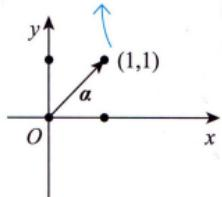

$$
A \alpha = \beta .
$$

把 $A$ 作用在 $\alpha$ 上输出一个 $\beta$

$$
\left[ \begin{array}{l l} 1 & 0 \\ 0 & - 1 \end{array} \right] \left[ \begin{array}{l} 1 \\ 1 \end{array} \right] = \left[ \begin{array}{l} 1 \\ - 1 \end{array} \right]
$$

矩阵 向量 $=$ 向量

A a β↑↑↑

对应法则自变量输出

$f$ $(x) = y$ $\downarrow \downarrow \downarrow A$ $(\alpha) = \beta$

改为向量 由纯数α=β

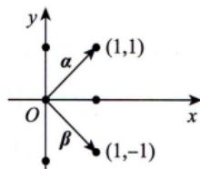

①对称变换.

a. $\left[ \begin{array}{ll}1 & 0\\ 0 & -1 \end{array} \right].$

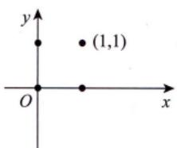

$$
\left[ \begin{array}{l l} 1 & 0 \\ 0 & - 1 \end{array} \right] \left[ \begin{array}{l l l l} 0 & 1 & 1 & 0 \\ 1 & 1 & 0 & 0 \end{array} \right] = \left[ \begin{array}{l l l l} 0 & 1 & 1 & 0 \\ - 1 & - 1 & 0 & 0 \end{array} \right]
$$

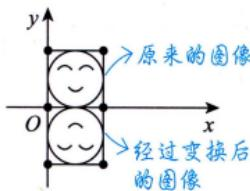  
关于 $x$ 轴对称

对称变换

b. $\left[ \begin{array}{cc} - 1 & 0\\ 0 & 1 \end{array} \right].$

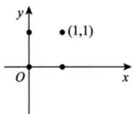

$$
\left[ \begin{array}{l l} - 1 & 0 \\ 0 & 1 \end{array} \right] \left[ \begin{array}{l l l l} 0 & 1 & 1 & 0 \\ 1 & 1 & 0 & 0 \end{array} \right] = \left[ \begin{array}{l l l l} 0 & - 1 & - 1 & 0 \\ 1 & 1 & 0 & 0 \end{array} \right]
$$

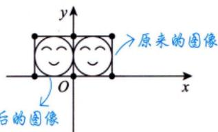

经过变换后的图像

关于y轴对称

c. $\left[ \begin{array}{cc} - 1 & 0\\ 0 & -1 \end{array} \right].$

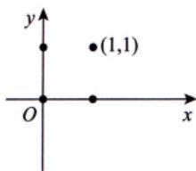

$$
\left[ \begin{array}{l l} - 1 & 0 \\ 0 & - 1 \end{array} \right] \left[ \begin{array}{l l l l} 0 & 1 & 1 & 0 \\ 1 & 1 & 0 & 0 \end{array} \right] = \left[ \begin{array}{l l l l} 0 & - 1 & - 1 & 0 \\ - 1 & - 1 & 0 & 0 \end{array} \right]
$$

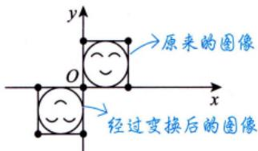

关于原点对称

d. $\left[ \begin{array}{ll}0 & 1\\ 1 & 0 \end{array} \right]$

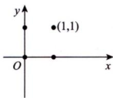

$$
\left[ \begin{array}{l l} 0 & 1 \\ 1 & 0 \end{array} \right] \left[ \begin{array}{l l l l} 0 & 1 & 1 & 0 \\ 1 & 1 & 0 & 0 \end{array} \right] = \left[ \begin{array}{l l l l} 1 & 1 & 0 & 0 \\ 0 & 1 & 1 & 0 \end{array} \right]
$$

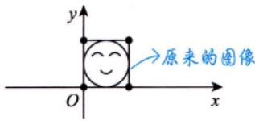

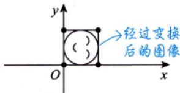

关于 $y = x$ 对称

e. $\left[ \begin{array}{cc}0 & -1\\ -1 & 0 \end{array} \right]$

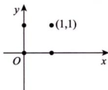

$$
\left[ \begin{array}{l l} 0 & - 1 \\ - 1 & 0 \end{array} \right] \left[ \begin{array}{l l l l} 0 & 1 & 1 & 0 \\ 1 & 1 & 0 & 0 \end{array} \right] = \left[ \begin{array}{l l l l} - 1 & - 1 & 0 & 0 \\ 0 & - 1 & - 1 & 0 \end{array} \right]
$$

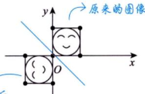

经过变换后的图像

关于 $y = -x$ 对称

$②$ 伸缩变换.

a. $\left[ \begin{array}{ll}2 & 0\\ 0 & 1 \end{array} \right]$

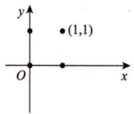

$$
\left[ \begin{array}{l l} 2 & 0 \\ 0 & 1 \end{array} \right] \left[ \begin{array}{l l l l} 0 & 1 & 1 & 0 \\ 1 & 1 & 0 & 0 \end{array} \right] = \left[ \begin{array}{l l l l} 0 & 2 & 2 & 0 \\ 1 & 1 & 0 & 0 \end{array} \right]
$$

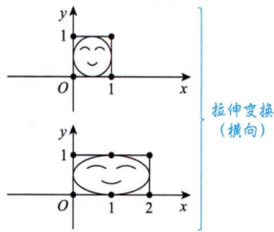

b. $\left[ \begin{array}{ll}1 & 0\\ 0 & 2 \end{array} \right]$

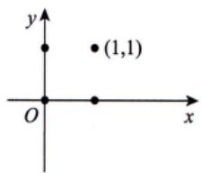

$$
\left[ \begin{array}{l l} 1 & 0 \\ 0 & 2 \end{array} \right] \left[ \begin{array}{l l l l} 0 & 1 & 1 & 0 \\ 1 & 1 & 0 & 0 \end{array} \right] = \left[ \begin{array}{l l l l} 0 & 1 & 1 & 0 \\ 2 & 2 & 0 & 0 \end{array} \right]
$$

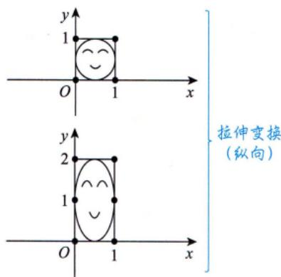

c. $\left[ \begin{array}{ll} \frac{1}{2} & 0 \\ 0 & 1 \end{array} \right]$ .

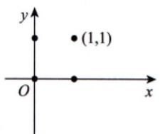

$$
\left[ \begin{array}{l l} \frac {1}{2} & 0 \\ 0 & 1 \end{array} \right] \left[ \begin{array}{l l l l} 0 & 1 & 1 & 0 \\ 1 & 1 & 0 & 0 \end{array} \right] = \left[ \begin{array}{l l l l} 0 & \frac {1}{2} & \frac {1}{2} & 0 \\ 1 & 1 & 0 & 0 \end{array} \right]
$$

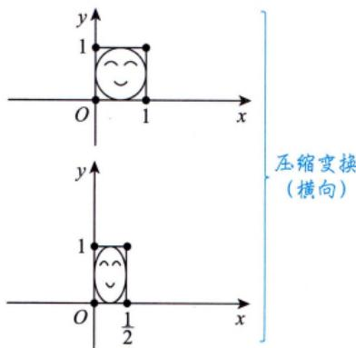

d. $\left[ \begin{array}{cc}1 & 0\\ 0 & \frac{1}{2} \end{array} \right].$

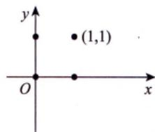

$$
\left[ \begin{array}{l l} 1 & 0 \\ 0 & \frac {1}{2} \end{array} \right] \left[ \begin{array}{l l l l} 0 & 1 & 1 & 0 \\ 1 & 1 & 0 & 0 \end{array} \right] = \left[ \begin{array}{l l l l} 0 & 1 & 1 & 0 \\ \frac {1}{2} & \frac {1}{2} & 0 & 0 \end{array} \right]
$$

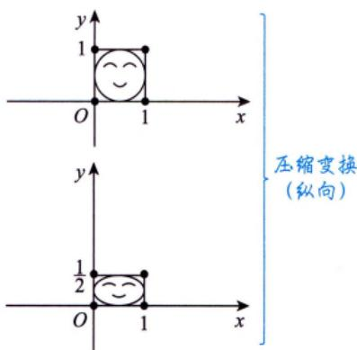

$③$ 剪切变换.

a. $\left[ \begin{array}{ll}1 & -1\\ 0 & 1 \end{array} \right].$

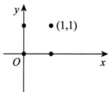

$$
\left[ \begin{array}{l l} 1 & - 1 \\ 0 & 1 \end{array} \right] \left[ \begin{array}{l l l l} 0 & 1 & 1 & 0 \\ 1 & 1 & 0 & 0 \end{array} \right] = \left[ \begin{array}{l l l l} - 1 & 0 & 1 & 0 \\ 1 & 1 & 0 & 0 \end{array} \right]
$$

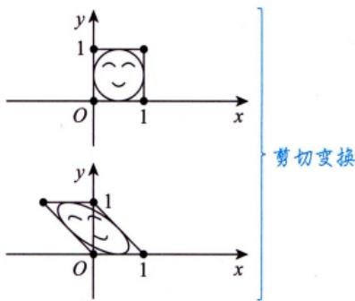

b. $\left[ \begin{array}{ll}1 & 0\\ -1 & 1 \end{array} \right].$

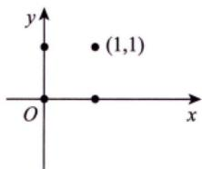

$$
\left[ \begin{array}{l l} 1 & 0 \\ - 1 & 1 \end{array} \right] \left[ \begin{array}{l l l l} 0 & 1 & 1 & 0 \\ 1 & 1 & 0 & 0 \end{array} \right] = \left[ \begin{array}{l l l l} 0 & 1 & 1 & 0 \\ 1 & 0 & - 1 & 0 \end{array} \right]
$$

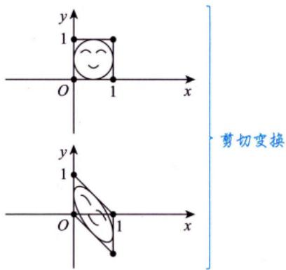

④ 旋转变换.

$$
\left[ \begin{array}{c c} \frac {\sqrt {2}}{2} & - \frac {\sqrt {2}}{2} \\ \frac {\sqrt {2}}{2} & \frac {\sqrt {2}}{2} \end{array} \right].
$$

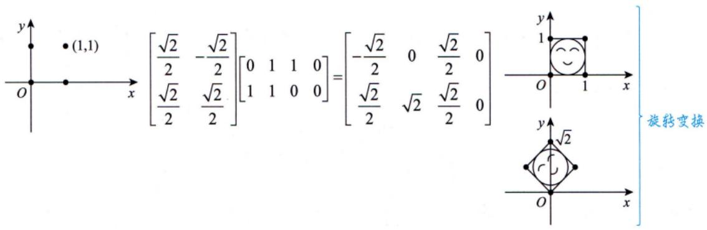

# 4 方程组求解

线性代数主要是运用了线性变换这样一个对应法则来作运算. 事实上, 线性变换相当于高等数学中的对应法则, 即函数 $f$ , 对应到线性代数里就是矩阵 $\mathbf{A}$ .

例如，对于一个方程组 $\left\{ \begin{array}{l} x_{1} + 2x_{2} = 3, \\ 4x_{1} + 7x_{2} = 10, \end{array} \right.$ 中学阶段的解法为高斯消元法，大学阶段的解法为线性变换法.

线性变换法中，把 $x_{1} + 2x_{2}$ 、 $4x_{1} + 7x_{2}$ 写为向量点积形式 $1\cdot x_1 + 2\cdot x_2$ 、 $4\cdot x_{1} + 7\cdot x_{2}$ ，则方程改写为：

$$
\begin{array}{l} \left[ \begin{array}{l l} 1 & 2 \\ 4 & 7 \end{array} \right] \left[ \begin{array}{l} x _ {1} \\ x _ {2} \end{array} \right] = \left[ \begin{array}{l} 3 \\ 1 0 \end{array} \right], \\ A \quad \alpha = \beta \\ \end{array}
$$

即已知一个矩阵 $A$ ，作用在某个向量 $\alpha$ 上，得到一个向量 $\beta$ ，那么如何反求出 $\alpha$ 呢？

类比中学阶段求 $2x = 3$ 的解的方法，两边乘以 $2^{-1}$ ，得 $2^{-1} \cdot 2x = 2^{-1} \cdot 3$ ，即 $x = \frac{3}{2}$ 故大学阶段求前提是A可逆 $Ax = \beta$ 的解，等式两端同时左边乘“A-”，得 $A^{-1}Ax = A^{-1}\beta$ ，即 $x = A^{-1}\beta$ ，如 $f(x) = y$ ，在 $f^{-1}$ 存在时，两边复合 $f^{-1}$ ，得 $f^{-1}[f(x)] = f^{-1}(y)$ ，即 $x = f^{-1}(y)$ ：

于是，计算“ $A^{-1}$ ”（叫作 $\pmb{A}$ 的逆矩阵）就成为了关键.中学知识告诉我们， $a\cdot a^{-1} = a^{-1}\cdot a = 1(a\neq 0)$ 那么，在矩阵运算中，有没有 $A\bullet A^{-1} = A^{-1}\bullet A = 1$ 呢？

事实上，记 $E_{1} = 1$ ， $\pmb{E}_{2} = \begin{bmatrix} 1 & 0\\ 0 & 1 \end{bmatrix}$ ， $\pmb {E}_3 = \left[ \begin{array}{lll}1 & 0 & 0\\ 0 & 1 & 0\\ 0 & 0 & 1 \end{array} \right],\dots .$

若 $A^{-1} \cdot A = 1$ ，则 $A = a$ ，此时称 $A$ 为一阶矩阵，就是代数中的一个数，而若 $A = \begin{bmatrix} 1 & 2 \\ 4 & 7 \end{bmatrix}$ ，则 $A^{-1}$ 是什么呢？请考生计算 $\begin{bmatrix} 1 & 2 \\ 4 & 7 \end{bmatrix} \begin{bmatrix} -7 & 2 \\ 4 & -1 \end{bmatrix}$ 的值.

计算可知， $\left[ \begin{array}{ll}1 & 2\\ 4 & 7 \end{array} \right]\left[ \begin{array}{ll} - 7 & 2\\ 4 & -1 \end{array} \right] = \left[ \begin{array}{ll} - 7 & 2\\ 4 & -1 \end{array} \right]\left[ \begin{array}{ll}1 & 2\\ 4 & 7 \end{array} \right] = \left[ \begin{array}{ll}1 & 0\\ 0 & 1 \end{array} \right],$ 即 $AA^{-1} = E_{2}$ ：

此时 $A^{-1} = \begin{bmatrix} -7 & 2 \\ 4 & -1 \end{bmatrix}$ （至于这个 $A^{-1}$ 如何计算出来，留待后面的第2讲来揭晓），于是在下式两端左边同时乘以 $A^{-1}$ ，有

$$
\left[ \begin{array}{l l} - 7 & 2 \\ 4 & - 1 \end{array} \right] \left[ \begin{array}{l l} 1 & 2 \\ 4 & 7 \end{array} \right] \left[ \begin{array}{l} x _ {1} \\ x _ {2} \end{array} \right] = \left[ \begin{array}{l l} - 7 & 2 \\ 4 & - 1 \end{array} \right] \left[ \begin{array}{l} 3 \\ 1 0 \end{array} \right],
$$

于是可得 $\left[ \begin{array}{l}x_{1}\\ x_{2} \end{array} \right] = \left[ \begin{array}{l} - 1\\ 2 \end{array} \right]$ ，即方程组 $\left\{ \begin{array}{l}x_{1} + 2x_{2} = 3,\\ 4x_{1} + 7x_{2} = 10 \end{array} \right.$ 的解为 $x_{1} = -1$ ， $x_{2} = 2$ ：

用 $A^{-1}$ 来求解方程组可称为“逆矩阵解法”

注 练习：按要求解下列方程组.

（1）用高斯消元法解方程组 $\left\{ \begin{array}{l}x_{1} + 2x_{2} = 3,\\ 4x_{1} + 7x_{2} = 10, \end{array} \right.$ 并与前述逆矩阵解法做一下对比.

解：令 $\left\{ \begin{array}{l}x_{1} + 2x_{2} = 3,\\ 4x_{1} + 7x_{2} = 10, \end{array} \right.$ （20 ①

$① \times 4 - ②$ ，得 $(4 - 4)x_{1} + (8 - 7)x_{2} = 3\times 4 - 10$ ，即得 $x_{2} = 2$ ：

代回①得 $x_{1} = 3 - 2 \times 2 = -1$ ，即解为 $x_{1} = -1$ ， $x_{2} = 2$

对比下来，前述逆矩阵法并未体现出简洁性。

（2）分别用高斯消元法和逆矩阵解法解方程组 $\left\{ \begin{array}{l}x_{1} + x_{2} + x_{3} = 2,\\ x_{1} + 2x_{2} + 4x_{3} = 3,\\ x_{1} + 3x_{2} + 9x_{3} = 5, \end{array} \right.$ 并将两种解法做一下对比.

解：高斯消元法：

令 $\left\{ \begin{array}{l}x_{1} + 2x_{2} + 4x_{3} = 3,\\ x_{1} + 3x_{2} + 9x_{3} = 5, \end{array} \right.$ （20 ②

$② - ①$ 得 $x_{2} + 3x_{3} = 1$ ， $④$

$③ - ②$ 得 $x_{2} + 5x_{3} = 2$ ， $⑤$

⑤ - ④得 $2x_{3} = 1$ ，解得 $x_{3} = \frac{1}{2}$

代回④解得 $x_{2} = 1 - 3x_{3} = -\frac{1}{2}$

将 $x_{3} = \frac{1}{2}$ ， $x_{2} = -\frac{1}{2}$ 代回①得， $x_{1} = 2 - x_{2} - x_{3} = 2$ ，即解为 $x_{1} = 2$ ， $x_{2} = -\frac{1}{2}$ ， $x_{3} = \frac{1}{2}$

逆矩阵解法：

由于

$$
\left[ \begin{array}{l l l} 1 & 1 & 1 \\ 1 & 2 & 4 \\ 1 & 3 & 9 \end{array} \right] \left[ \begin{array}{c c c} 3 & - 3 & 1 \\ - \frac {5}{2} & 4 & - \frac {3}{2} \\ \frac {1}{2} & - 1 & \frac {1}{2} \end{array} \right] = \left[ \begin{array}{c c c} 3 & - 3 & 1 \\ - \frac {5}{2} & 4 & - \frac {3}{2} \\ \frac {1}{2} & - 1 & \frac {1}{2} \end{array} \right] \left[ \begin{array}{l l l} 1 & 1 & 1 \\ 1 & 2 & 4 \\ 1 & 3 & 9 \end{array} \right] = \left[ \begin{array}{l l l} 1 & 0 & 0 \\ 0 & 1 & 0 \\ 0 & 0 & 1 \end{array} \right],
$$

即 $AA^{-1} = A^{-1}A = E_3$ ，于是在

$$
\left[ \begin{array}{l l l} 1 & 1 & 1 \\ 1 & 2 & 4 \\ 1 & 3 & 9 \end{array} \right] \left[ \begin{array}{l} x _ {1} \\ x _ {2} \\ x _ {3} \end{array} \right] = \left[ \begin{array}{l} 2 \\ 3 \\ 5 \end{array} \right]
$$

两边的左边同时乘以 $A^{-1}$ ，得

$$
\left[ \begin{array}{r r r} 3 & - 3 & 1 \\ - \frac {5}{2} & 4 & - \frac {3}{2} \\ \frac {1}{2} & - 1 & \frac {1}{2} \end{array} \right] \left[ \begin{array}{l l l} 1 & 1 & 1 \\ 1 & 2 & 4 \\ 1 & 3 & 9 \end{array} \right] \left[ \begin{array}{l} x _ {1} \\ x _ {2} \\ x _ {3} \end{array} \right] = \left[ \begin{array}{r r r} 3 & - 3 & 1 \\ - \frac {5}{2} & 4 & - \frac {3}{2} \\ \frac {1}{2} & - 1 & \frac {1}{2} \end{array} \right] \left[ \begin{array}{l} 2 \\ 3 \\ 5 \end{array} \right],
$$

即 $\left[ \begin{array}{l}x_{1}\\ x_{2}\\ x_{3} \end{array} \right] = \left[ \begin{array}{l}2\\ -\frac{1}{2}\\ \frac{1}{2} \end{array} \right].$

由此可以看出，当方程组未知数和方程个数越来越多时，高斯消元法将越来越难以求解。而逆矩阵解法则越来越体现其优越性。在现代科技中，“大型”方程组的求解越来越普遍且实用。学习线性代数，可以为学好现代科技打下良好的基础。
