# 第1讲

# 行列式

# 基础知识结构

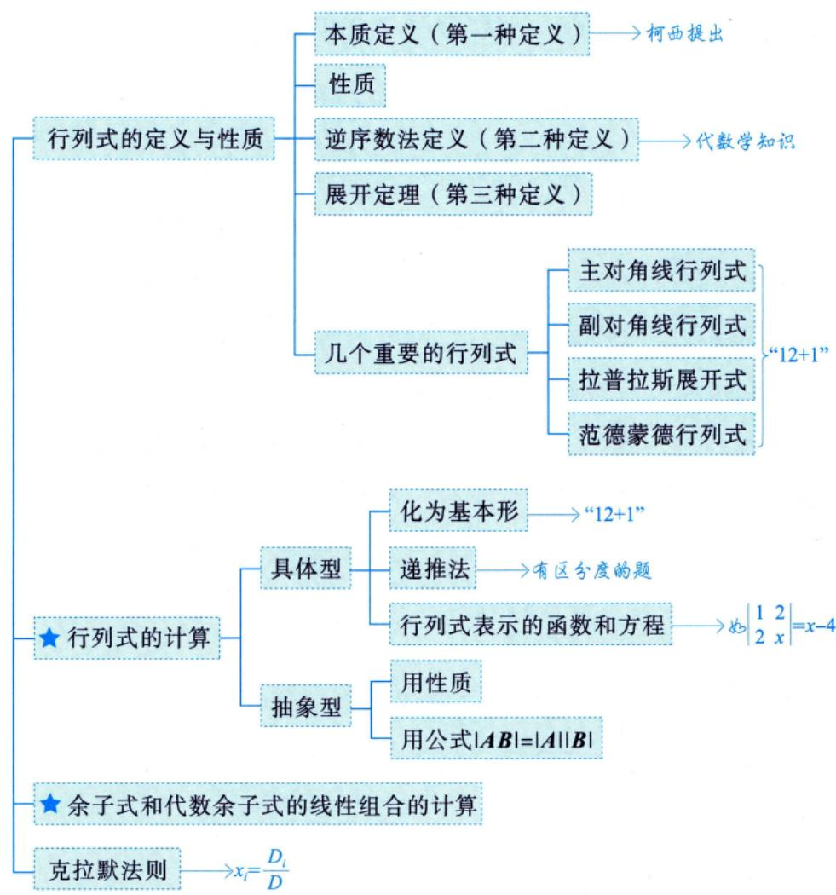

# 行列式的本质定义（第一种定义）

大多数教材都是从“纯粹”的代数学角度来定义行列式的，较为抽象，难于理解和接受。我们先详细通俗地给出行列式的本质定义，并且告诉考生，我们将要开始的线性代数这门课程到底要学什么。

先看一个式子： $D_{2} = \left| \begin{array}{ll}a_{11} & a_{12}\\ a_{21} & a_{22} \end{array} \right|$ .我们称其为2阶行列式，其中 $a_{ij}$ 的第一个下标i表示此元素所在的行数，第二个下标j表示此元素所在的列数， $i = 1,2,j = 1,2$ ，于是此行列式中有四个元素，并且 $\begin{array}{rlr}{\left| \begin{array}{ll}a_{11} & a_{12}\\ a_{21} & a_{22} \end{array} \right| = a_{11}a_{22} - a_{12}a_{21}.} & \text{这是一个什么样的计算规则？它背后有什么样的意义？} & \\ {\text{列的元素，如} a_{23}\text{位于第}} & \\ {2\text{行、第3列}} & \end{array}$

将此行列式的第1行的两个元素 $a_{11}, a_{12}$ 看成一个2维向量 $[a_{11}, a_{12}] = \alpha_1$ （线性代数中，向量不需要在字母上加箭头写成 $\vec{\alpha}_1$ ，只要写 $\alpha_1$ 即可，此后类同，不再重复）. 将此行列式的第2行的两个元素 $a_{21}, a_{22}$ 看成另一个2维向量 $[a_{21}, a_{22}] = \alpha_2$ . 不失一般性，将这两个向量标在直角坐标系中，且以这两个向量为邻边作出一个 $\square OABC$ ，则 $S_{\square OABC} = ?$

不妨设 $\alpha_{1}$ 的长度（模）为 $l$ ， $\alpha_{2}$ 的长度（模）为 $m$ ， $\alpha_{1}$ 与 $x$ 轴正向的夹角为 $\alpha$ ， $\alpha_{2}$ 与 $x$ 轴正向的夹角为 $\beta$ ，如图1-1所示.

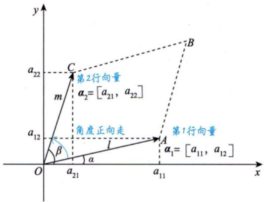  
图1-1

则 $S_{\square OABC} = l \cdot m \cdot \sin (\beta - \alpha)$

$$
\begin{array}{l} = l \cdot m (\sin \beta \cos \alpha - \cos \beta \sin \alpha) \\ = l \cos \alpha \cdot m \sin \beta - l \sin \alpha \cdot m \cos \beta \\ = a _ {1 1} a _ {2 2} - a _ {1 2} a _ {2 1}, \\ \end{array}
$$

于是

$$
\begin{array}{l} \text {2 阶 行 列 式 特 殊 算 法 (巧 合)} \\ \text {主 对 角 线 元 素 之 积 减 去 副 对 角 线 元 素 之 积} \\ \left| \begin{array}{l l} a _ {1 1} & a _ {1 2} \\ a _ {2 1} & a _ {2 2} \end{array} \right| = a _ {1 1} a _ {2 2} - a _ {1 2} a _ {2 1} = S _ {\square O A B C}. \end{array}
$$

我们看到了一个极其直观有趣的结论：2阶行列式是由两个2维向量组成的，其（运算规则的）结果为以这两个向量为邻边的平行四边形的面积.这不仅得出了2阶行列式的计算规则，也能够清楚地看到其几何意义. 行列式的本质属性是测度——体积(面积是特殊的体积)

示例1 对于行列式 $\left| \begin{array}{ll}1 & 2\\ 2 & 5 \end{array} \right|$ ，利用2阶行列式计算方式，有

$$
5 \times 1 - 2 \times 2 = 1.
$$

也可画出以向量[1,2]和[2,5]为邻边的平行四边形，求其面积，即为行列式的值，如图1-2所示.（求面积较复杂）

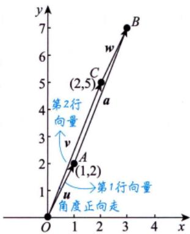  
图1-2

示例2 行列式 $\left| \begin{array}{ll}1 & 2\\ 2 & 3 \end{array} \right| = -1$

向量[1,2]，[2,3]如图1-3所示.这里行列式是负值，因为从向量[1,2]到[2,3]是顺时针走的．要注意，代数学里面积可以是负值.

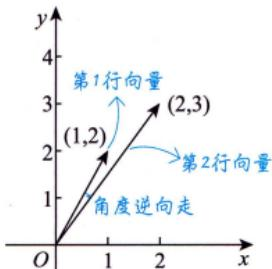  
图1-3

示例3 行列式 $\left| \begin{array}{ll}1 & 2\\ 2 & 4 \end{array} \right| = 0$

向量 $[1,2]$ ， $[2,4]$ 如图1-4所示，两个向量重合，夹角为0，故平行四边形面积为0.

这也反映了行列式的一个性质：若行列式两行成比例，则行列式为0.

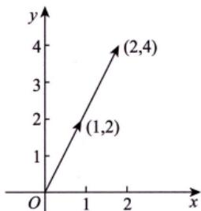  
图1-4

示例4 行列式 $\left| \begin{array}{ll}1 & 2\\ 0 & 0 \end{array} \right| = 0$

从图1-5可以看出，图中只有一个向量[1,2]，另一个向量缩回原点，无法组成平行四边形，此时2维平面退化为1维直线段，是没有2维测度的.同样地，2维平面无3维测度——体积.

也就是说，低维物体是不能用高维来衡量的，用高维测度低维必然为0.这也反映了行列式的一个性质：若行列式中有一行或一列为0，则行列式为0.

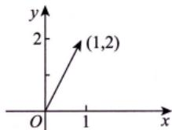  
图1-5

线性代数可以作“线性推广”——3阶行列式 $D_{3} = \begin{vmatrix} a_{11} & a_{12} & a_{13}\\ a_{21} & a_{22} & a_{23}\\ a_{31} & a_{32} & a_{33} \end{vmatrix}$ 是什么？我希望考生能够仿照上述定义回答出：3阶行列式是由三个3维向量 $\alpha_{1} = [a_{11},a_{12},a_{13}],\alpha_{2} = [a_{21},a_{22},a_{23}],\alpha_{3} = [a_{31},a_{32},a_{33}]$ 组成的，其（运算规则的）结果为以这三个向量为邻边的平行六面体的体积.如图1-6所示.

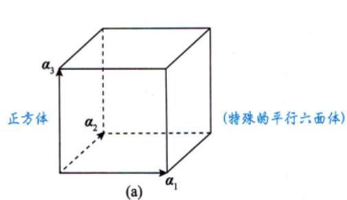

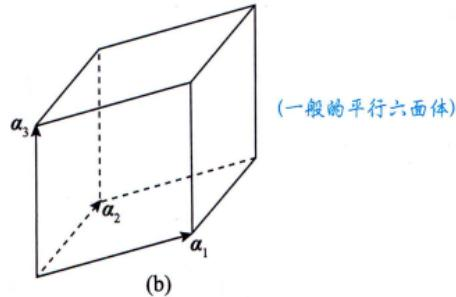  
图1-6

拓展 计算3阶行列式：画线法（或沙路法）.

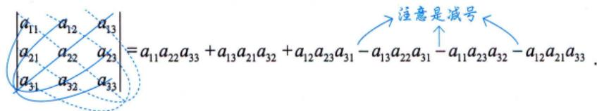

如

$$
\left| \begin{array}{l l l} 5 & 2 & 1 \\ 1 & 2 & 5 \\ 3 4 & 1 & 3 4 \end{array} \right| = 5 \times 2 \times 3 4 + 1 \times 1 \times 1 + 2 \times 5 \times 3 4 - 1 \times 2 \times 3 4 - 5 \times 5 \times 1 - 2 \times 1 \times 3 4 = 5 2 0.
$$

再如

$$
\begin{array}{l} {\text {我} \quad 0 \quad \text {生}} \\ {\text {有} \quad 0} \\ {\text {你} \quad 0 \quad \text {幸}} \end{array} \xrightarrow {\text {若 把 减 号 ＂ ＂ 看 为 汉 字 ＂ ＂} _ {\text {一}}}
$$

依次类推，我们便可以给出 $n$ 阶行列式 $D_{n} = \begin{vmatrix} a_{11} & \dots & a_{1n}\\ \vdots & & \vdots \\ a_{n1} & \dots & a_{nn} \end{vmatrix}$ 的本质定义：

$n(n\geqslant 3)$ 阶行列式是由 $n$ 个 $n$ 维向量 $\alpha_{1} = [a_{11},a_{12},\dots ,a_{1n}],\alpha_{2} = [a_{21},a_{22},\dots ,a_{2n}],\dots ,\alpha_{n} =$ $[a_{n1},a_{n2},\dots ,a_{nn}]$ 组成的，其（运算规则的）结果为以这 $n$ 个向量为邻边的 $n$ 维图形的体积.

由此看来，一个重要观点出现了：考生一开始就应该把行列式看作是由若干个向量拼成的，并且要把这些向量作运算。以3阶行列式为例，若 $D_{3} \neq 0$ ，则意味着体积不为0，则称组成该行列式的三个向量线性无关；若 $D_{3} = 0$ ，则称线性相关。 行列式为0，向量组线性相关；行列式不为0，向量组线性无关

拓展 行列式的概念由矩阵而来，是变换的一种性质。如何体现这种变换的性质呢？以线性变换 $A = \begin{bmatrix} 1 & 0 \\ 0 & -1 \end{bmatrix}$ 为例进行说明。

首先，明确矩阵 $\mathbf{A}$ 与行列式 $|\mathbf{A}|$ 之间的区别与联系。

① 矩阵 $\mathbf{A}$ 不表示数值，它只是在表达信息，只有作用在一个向量 $\alpha$ 时，它才会产生对这个向量的作用。  
$②$ 行列式 $|\pmb {A}|$ 是将矩阵 $\pmb{A}$ 放进两竖线后，计算矩阵 $\pmb{A}$ 的某个性质或某个特点.

如 $A = \begin{bmatrix} 1 & 0\\ 0 & -1 \end{bmatrix}$ ， $|\pmb {A}| = \left| \begin{array}{ll}1 & 0\\ 0 & -1 \end{array} \right| = 1\times (-1) - 0\times 0 = -1$

对于线性变换 $\mathbf{A} = \begin{bmatrix} 1 & 0\\ 0 & -1 \end{bmatrix}$ ，将其作用在矩阵 $\left[ \begin{array}{lll}0 & 1 & 1 & 0\\ 1 & 1 & 0 & 0 \end{array} \right]$ 上，有

$$
\left[ \begin{array}{c c} 1 & 0 \\ 0 & - 1 \end{array} \right] \left[ \begin{array}{c c c c} 0 & 1 & 1 & 0 \\ 1 & 1 & 0 & 0 \end{array} \right] = \left[ \begin{array}{c c c c} 0 & 1 & 1 & 0 \\ - 1 & - 1 & 0 & 0 \end{array} \right],
$$

此线性变换 $\pmb{A}$ 是关于 $x$ 轴对称的变换，如图1-7所示.原来图像的面积是1，以常识来说，翻下去的图像面积是多少？是1还是-1呢？

联系高等数学中的内容，定积分与所围图像的面积是有区别的（见图1-8）类比可知，原来图形的面积为1，翻转后的图形面积应为-1.从这个角度来看，行列式的值实际上是对变换的面积改变的一个度量.

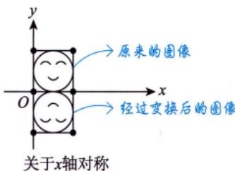

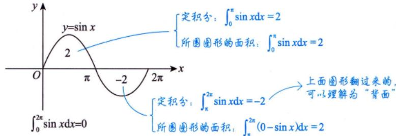  
图1-7  
图1-8

示例 线性变换 $\left[ \begin{array}{rr} - 1 & 0\\ 0 & -1 \end{array} \right]$ 作用在 $\left[ \begin{array}{rrr}0 & 1 & 1 & 0\\ 1 & 1 & 0 & 0 \end{array} \right]$ 上，有

$$
\left[ \begin{array}{c c} - 1 & 0 \\ 0 & - 1 \end{array} \right] \left[ \begin{array}{c c c c} 0 & 1 & 1 & 0 \\ 1 & 1 & 0 & 0 \end{array} \right] = \left[ \begin{array}{c c c c} 0 & - 1 & - 1 & 0 \\ - 1 & - 1 & 0 & 0 \end{array} \right],
$$

如图1-9所示.原来图像的面积为1，向下翻转面积变为-1，再向左翻转得到最终图像，面积变为1.故变换后原图像的面积未改变，不难发现 $\left| \begin{array}{cc} - 1 & 0\\ 0 & -1 \end{array} \right| = 1$

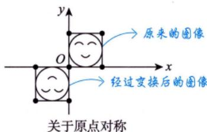  
图1-9

# 二 行列式的性质

行列式的柯西定义法, 主要结论: 对 $n$ 阶矩阵 $\mathbf{A}$ 的行列式 $|\mathbf{A}|$ , 从测度的角度来看, 表示的是 $n$ 维体积.

问：测度是什么？

答：曲边梯形的面积,旋转体的体积,曲线的弧长,旋转曲面的表面积,等等. 一般用积分学研究.

问：性态是什么？

答：单调性,凹凸性,等等。一般用微分学研究.

著名的公式：若 $A$ ， $\pmb{B}$ 为 $n$ 阶矩阵，则 $|\mathbf{AB}| = |\mathbf{A}||\mathbf{B}| = |\mathbf{B}||\mathbf{A}| = |\mathbf{BA}|$

几何测度相同<

性质1行列互换,其值不变,即 $\left| A\right|  = \left| {A}^{\mathrm{T}}\right|  \Rightarrow$ 行列地位等价(行上成立的性质,列上也成立),因此下列性质只需证一组

注 该性质的几何意义是转置之后图形的测度保持不变.

将行向量竖着写示例1 把 $A = \begin{bmatrix} 1 & 2\\ 2 & 5 \end{bmatrix}$ 的行列互换，得 $A^{\mathrm{T}} = \begin{bmatrix} 1 & 2\\ 2 & 5 \end{bmatrix}$ . 新概念，字母T意为转置，指交换行与列

一般地， $n$ 阶矩阵 $\mathbf{A}$ 与 $\mathbf{A}^{\mathrm{T}}$ 表达的系统信息不一定相同，即 $A\neq A^{\mathrm{T}}$ ，但 $|\pmb {A}| = |\pmb{A}^{\mathrm{T}}|$ .但此例属于特殊

情况，有 $A = A^{\mathrm{T}}$ ，且 $|\mathbf{A}| = |\mathbf{A}^{\mathrm{T}}|$

角度： $|\pmb{A}|$ 表示以 $\pmb{A}$ 的两个行向量[1,2]，[2,5]为邻边拼成的平行四边形的面积，如图1-10所示. $|\pmb{A}^{\mathrm{T}}|$ 也表示一个平行四边形的面积.如果换一个角度，把 $\pmb{A}$ 的两列看成两个行向量，那这两个向量同样也是[1,2]，[2,5].可知两个平行四边形面积一致，故 $|\pmb {A}| = |\pmb{A}^{\mathrm{T}}|$

此例中, $\mathbf{A}$ 满足 $\mathbf{A} = {\mathbf{A}}^{\mathrm{T}}$ ,称 $\mathbf{A}$ 为对称矩阵. 常见于二次型大题中

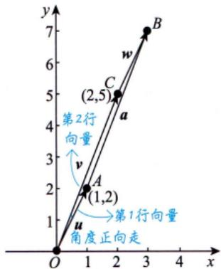  
图1-10

示例2 $A = \begin{bmatrix} 1 & 2\\ 3 & 7 \end{bmatrix}$ 其转置矩阵为 $A^{\mathrm{T}} = \begin{bmatrix} 1 & 3\\ 2 & 7 \end{bmatrix}$ 它们的行向量组成的平行四边形如图1-11所示.

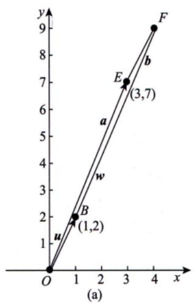

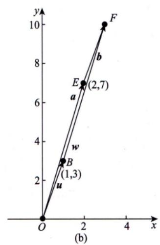  
图1-11

图1-11(a)，1-11(b)所示的平行四边形的面积分别为 $1 \times 7 - 3 \times 2$ ， $1 \times 7 - 2 \times 3$ ，即行列式行向量组成的平行四边形的面积和列向量组成的平行四边形的面积相等，故 $|A| = |A^{\mathrm{T}}|$ ：

性质2若行列式中某行（列）元素全为零，则行列式为零 $\rightarrow$ 至少有1个 零行（列）

注至少有1个零行（列）意味着 $\pmb{n}$ 维空间图形至少降一维，故行列式直接为零.因为高维空间中是测不出低维测度的.比如，3维空间中测不出平面的体积，2维平面里测不出直线的面积.

示例 若三个向量线性无关，则一定能拼出有体积的平行六面体，如图1-12(a)所示.若有一个向量为零，如图1-12(b)所示，则只能拼出平行四边形，是平面，无体积.

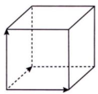  
(a)

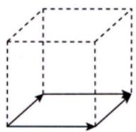  
(b)   
图1-12

性质3 若行列式中某行（列）元素有公因子 $k(k\neq 0)$ ，则 $k$ 可提到行列式外面，即

$$
\left| \begin{array}{c c c c} a _ {1 1} & a _ {1 2} & \dots & a _ {1 n} \\ \vdots & \vdots & & \vdots \\ k a _ {i 1} & k a _ {i 2} & \dots & k a _ {i n} \\ \vdots & \vdots & & \vdots \\ a _ {n 1} & a _ {n 2} & \dots & a _ {n n} \end{array} \right| = k \left| \begin{array}{c c c c} a _ {1 1} & a _ {1 2} & \dots & a _ {1 n} \\ \vdots & \vdots & & \vdots \\ a _ {i 1} & a _ {i 2} & \dots & a _ {i n} \\ \vdots & \vdots & & \vdots \\ a _ {n 1} & a _ {n 2} & \dots & a _ {n n} \end{array} \right|.
$$

逆用，若用 $k$ 乘行列式 $|A|$ ，则 $k$ 只能乘到其中某一行（列）上

注 上述等式从右到左的运算称为“倍乘”性质.

示例

1 2 1 2 1 2 1 5 3 1 5 1 5 1 3

从几何（面积）的角度来理解：将第2行乘以3是将平行四边形的一条边变成3倍，则其面积（即行列式）会相应变成原来的3倍.如图1-13(a)，图1-13(b)所示.逆用此性质时要注意：只能将 $k$ 乘到其中某一行（列）上，而不能乘到每一行（列）上.如该示例中，若将3也乘到第1行上，则平行四边形的两条边都变成原来的3倍，面积（即行列式）就会变成原来的 $3^{2}$ 倍了，如图1-13(c)所示.

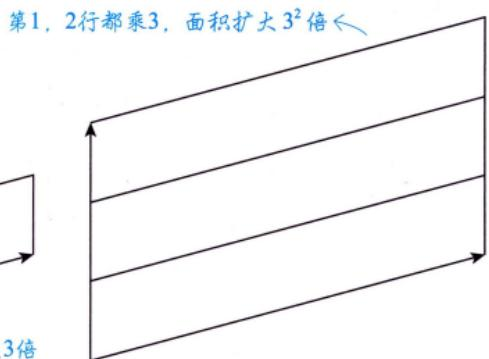  
(c)

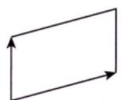  
(a)

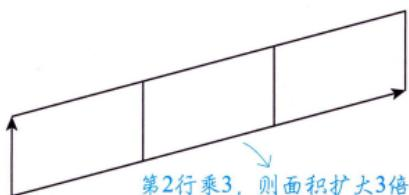  
(b)   
图1-13

拓展 注意区别 $k|\mathbf{A}|$ 与 $k\mathbf{A}$ ： $k \begin{bmatrix} a & b \\ c & d \end{bmatrix} = \begin{bmatrix} ka & kb \\ kc & kd \end{bmatrix}.$

性质4行列式中某行（列）元素均是两个数之和，则可拆成两个行列式之和，即

$$
\left| \begin{array}{c c c c} a _ {1 1} & a _ {1 2} & \dots & a _ {1 n} \\ \vdots & \vdots & & \vdots \\ \hline a _ {i 1} + b _ {i 1} & a _ {i 2} + b _ {i 2} & \dots & a _ {i n} + b _ {i n} \\ \hline \vdots & \vdots & & \vdots \\ a _ {n 1} & a _ {n 2} & \dots & a _ {n n} \end{array} \right| = \left| \begin{array}{c c c c} a _ {1 1} & a _ {1 2} & \dots & a _ {1 n} \\ \vdots & \vdots & & \vdots \\ a _ {i 1} & a _ {i 2} & \dots & a _ {i n} \\ \vdots & \vdots & & \vdots \\ a _ {n 1} & a _ {n 2} & \dots & a _ {n n} \end{array} \right| + \left| \begin{array}{c c c c} a _ {1 1} & a _ {1 2} & \dots & a _ {1 n} \\ \vdots & \vdots & & \vdots \\ b _ {i 1} & b _ {i 2} & \dots & b _ {i n} \\ \vdots & \vdots & & \vdots \\ a _ {n 1} & a _ {n 2} & \dots & a _ {n n} \end{array} \right|.
$$

正用单行可拆（加）性均要掌握逆用

注等式从右到左是两个行列式相加的运算.如果两个行列式的其他元素对应相等，只有一行（列）不同时，可以相加，相加时其他元素不变，不同元素的行（列）对应相加即可.

示例

$$
\left| \begin{array}{l l l} 1 & 2 & 1 \\ 2 & 1 & 4 \\ 5 & 7 & 1 1 \end{array} \right| = \left| \begin{array}{l l l} 1 & 2 & 1 \\ - 1 & 1 & 2 \\ 5 & 7 & 1 1 \end{array} \right| + \left| \begin{array}{l l l} 1 & 2 & 1 \\ 3 & 0 & 2 \\ 5 & 7 & 1 1 \end{array} \right|.
$$

拆的形式有无数种, 拆成哪些数由题决定

几何上理解：一个平行六面体的体积 拆成两个平行六面体的体积之和.

易错

$$
\left| A \right| + \left| B \right| \neq \left| A + B \right|.
$$

其实只拆了一个边，也只能拆一个边。

拓展

注意与矩阵作区分.

$$
\left[ \begin{array}{l l} {1 + 2} & {3 + 4} \\ {5 + 6} & {7 + 8} \end{array} \right] = \left[ \begin{array}{l l} {1} & {3} \\ {5} & {7} \end{array} \right] + \left[ \begin{array}{l l} {2} & {4} \\ {6} & {8} \end{array} \right],   \text {但}   \left| \begin{array}{l l} {1 + 2} & {3 + 4} \\ {5 + 6} & {7 + 8} \end{array} \right| = \left| \begin{array}{l l} {1 + 2} & {3} \\ {5 + 6} & {7} \end{array} \right| + \left| \begin{array}{l l} {1 + 2} & {4} \\ {5 + 6} & {8} \end{array} \right|.
$$

性质5行列式中两行（列）互换，行列式变号.

注

上述运算称为“互换”性质.

换奇数次，则行列式反号；换偶数次，则行列式不变。

若 $|\pmb{A}|$ 换行（列） $n$ 次，则行列式值为 $(-1)^n |A|$

示例

$\left| \begin{array}{ll}1 & 2\\ 2 & 3 \end{array} \right| = -1$ （负向面积），如图1-14(a)所示.

互换1，2行

$\left| \begin{array}{ll}2 & 3\\ 1 & 2 \end{array} \right| = 1$ （正向面积），如图1-14(b)所示.

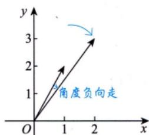  
(a)

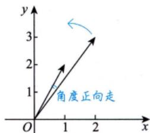  
图1-14

(b)

代数学中，面积看方向，即面积有正负

性质6行列式中的两行（列）元素相等或对应成比例，则行列式为零.

示例 $\left| \begin{array}{ll}1 & 2\\ 2 & 4 \end{array} \right| = 0$ ，如图1-15所示.

几何解释：共线的两个向量，未构成平行四边形，故面积为零.

性质7行列式中某行（列）的 $k$ 倍加到另一行（列），行列式不变.

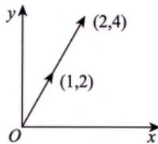  
图1-15

注 上述运算称为“倍加”性质.

以2阶为例说明：

$$
\left| \begin{array}{c c} a _ {1 1} & a _ {1 2} \\ k a _ {1 1} + a _ {2 1} & k a _ {1 2} + a _ {2 2} \end{array} \right| \xlongequal {\text {性 质} 4} \left| \begin{array}{c c} a _ {1 1} & a _ {1 2} \\ k a _ {1 1} & k a _ {1 2} \end{array} \right| + \left| \begin{array}{c c} a _ {1 1} & a _ {1 2} \\ a _ {2 1} & a _ {2 2} \end{array} \right| \xlongequal {\text {性 质} 3} k \left| \begin{array}{c c} a _ {1 1} & a _ {1 2} \\ a _ {1 1} & a _ {1 2} \end{array} \right| + \left| \begin{array}{c c} a _ {1 1} & a _ {1 2} \\ a _ {2 1} & a _ {2 2} \end{array} \right| \xlongequal {\text {性 质} 6} \left| \begin{array}{c c} a _ {1 1} & a _ {1 2} \\ a _ {2 1} & a _ {2 2} \end{array} \right|.
$$

示例 $\left| \begin{array}{ll}1 & 2\\ 2 & 3 \end{array} \right| = 1\times 3 - 2\times 2 = -1.$

$\left| \begin{array}{ll}1 & 2\\ 2 & 3 \end{array} \right|\frac{\text{第1行的-2倍}}{\text{加到第2行}}\left| \begin{array}{ll}1 & 2\\ 0 & -1 \end{array} \right| = -1.$

目的：把0化出来

注 可以看出，以上七个性质均可由“一、行列式的本质定义（第一种定义）”所介绍的行列式的几何背景直观地得到，而无须复杂抽象的分析。

# 三 行列式的逆序数法定义（第二种定义）

# 排列和逆序

排列 由 $n$ 个数1,2，…， $n$ 组成的一个有序数组称为一个 $n$ 级排列，如23145是一个5级排列，41352也是一个5级排列. $n$ 级排列共有 $n!$ 个. 排前面的数大于排后面的数

逆序 在一个 $n$ 级排列 $i_1i_2\dots i_s\dots i_t\dots i_n$ 中，若 $i_{s} > i_{t}$ ，且 $i_{s}$ 排在 $i_{t}$ 前面，则称这两个数构成一个逆序.

顺序的对立。

有1个比3小, 有1个比5小

有1个比2小

$\left( 2\right)$

逆序数一个排列中,逆序的总数称为该排列的逆序数,记作 $\tau \left( {{i}_{1}{i}_{2}\cdots {i}_{n}}\right)$ ,如 $\tau \left( {231546}\right)  = 3$ , $\tau \left( {621534}\right)  = 8$ . 由小到大顺排的排列称为自然排序,如 12345,显然,自然排序的逆序数为 0.

有5个比6小, $5 + 1 + 2$

有1个比2小,有2个比5小.

奇排列和偶排列 排列的逆序数为奇数时，该排列称为奇排列；排列的逆序数为偶数时，该排列称为偶排列.

# 2 $n$ 阶行列式的定义

$n(n\geqslant 2)$ 阶行列式

1~n的1个n级排列，也意味 着j,，…，各不相同第1行 第2行…第n行取自不同行a12 10 a22 1 第1行…第n行取自不同行a22 1 a22 1 a22 1 a1n

2阶行列式有2项；3阶行列式有 $3! = 6$ 项这里 $\sum_{j_1j_2\dots j_n}$ 表示对所有 $n$ 个列下标排列求和，故为 $n!$ 项之和.注意到行下标已经顺排，而列下标是任一个 $n$ 级排列，故每项由取自不同行、不同列的 $n$ 个元素的乘积组成，每项的正、负号取决于 $(-1)^{\tau (j_1j_2\dots j_n)}$ .当列下标为奇排列时，应附加负号；当列下标为偶排列时，应附加正号.

示例 $\begin{array}{l}\left| \begin{array}{ll}a_{11} & a_{12}\\ a_{21} & a_{22} \end{array} \right| = +a_{11}a_{22} - a_{12}a_{21}.\\ \tau (12) = 0\tau (21) = 1\\ \left| \begin{array}{lll}a_{11} & a_{12} & a_{13}\\ a_{21} & a_{22} & a_{23}\\ a_{31} & a_{32} & a_{33} \end{array} \right| = +a_{11}a_{22}a_{33} + a_{13}a_{21}a_{32} + a_{12}a_{23}a_{31} - a_{13}a_{22}a_{31} - a_{12}a_{21}a_{33} - a_{11}a_{23}a_{32}.\\ \tau (123) = 0\tau (312) = 2\tau (231) = 2\tau (231) = 2\tau (213) = 1\tau (132) = 1 \end{array}$

注 (1) 规定 1 阶行列式 $\left| {a}_{11}\right|  = {a}_{11}$ . 如 $\left| {-2}\right|$ , $\left. \begin{array}{l} 1 \\  1 \end{array}\right\rbrack   \times  1$

特别注意，1阶行列式本身为一个数字 $|a| = a$ ，故可正可负，这点要与绝对值符号区分开.

(2)如：请确定“ $a_{12}a_{31}a_{54}a_{43}a_{25}$ ”这一展开项前的正、负号.

答：首先将行下标顺排为 $a_{12}a_{25}a_{31}a_{43}a_{54}$ ，然后计算 $\tau (25134) = 4$ ，为偶排列，故该项前为正号.

有1个比2小, 有3个比5小.

# 四行列式的展开定理（第三种定义） $\rightarrow$ “降阶”思想★

若有4阶,则降为3阶、2阶计算若为 $n$ 阶,则 $n$ 阶要有规律,本质上用的是逆序数法.

阶数超过3的行列式，若还用“一”“三”的方法，就太麻烦了，为此，提出行列式的展开定理.

余子式 “子式 $=$ 行列式”,子式是原行列式的一部分

在 $n$ 阶行列式中,去掉元素 ${a}_{ij}$ 所在的第 $i$ 行、第 $j$ 列元素,由剩下的元素按原来的位置与顺序组成的 $n - 1$ 阶行列式称为元素 ${a}_{ij}$ 的余子式,记作 ${M}_{ij}$ ,即 相对位置,不能动顺序

$$
M _ {i j} = \left| \begin{array}{c c c c c c c c} a _ {1 1} & \dots & a _ {1, j - 1} & a _ {1} & a _ {1, j + 1} & \dots & a _ {1 n} \\ \vdots & & \vdots & \vdots & \vdots & & \vdots \\ a _ {i - 1, 1} & \dots & a _ {i - 1, j - 1} & a _ {i - 1, j} & a _ {i - 1, j + 1} & \dots & a _ {i - 1, n} \\ a _ {i, 1} & \dots & a _ {i, j - 1} & a _ {i, j} & a _ {i, j + 1} & \dots & a _ {i, n} \\ a _ {i + 1, 1} & \dots & a _ {i + 1, j - 1} & a _ {i + 1, j} & a _ {i + 1, j + 1} & \dots & a _ {i + 1, n} \\ \vdots & & \vdots & \vdots & \vdots & & \vdots \\ a _ {n 1} & \dots & a _ {n, j - 1} & a _ {n, j} & a _ {n, j + 1} & \dots & a _ {n n} \end{array} \right| _ {(n - 1) \times (n - 1)}
$$

示例

1 2 1 2 5 7 -6 4 9

$a_{23}$ 的余子式 $M_{23} = \left| \begin{array}{ll}1 & 2\\ -6 & 4 \end{array} \right|$

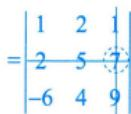

2

代数余子式

余子式 $M_{ij}$ 乘 $(-1)^{i + j}$ 后称为 $a_{ij}$ 的代数余子式，记作 $A_{ij}$ ，即

$$
\begin{array}{l} A _ {i j} = (- 1) ^ {i + j} M _ {i j}, \quad \rightarrow \text {两 边 同 乘} (- 1) ^ {i + j} \\ (- 1) ^ {i + j} A _ {i j} = (- 1) ^ {2 (i + j)} M _ {i j} = M _ {i j} \\ \end{array}
$$

显然也有 $M_{ij} = (-1)^{i + j}A_{ij}$

示例

1 2 1 2 5 7 a23的代数余子式A=-M

目的：降阶，即 $n$ 阶降成 $n$ 个 $n - 1$ 阶；

★展开原则：某一行（列）为0的元素越多越好

3

行列式按某一行（列）展开的展开公式

行列式等于行列式的某行（列）元素分别乘其相应的代数余子式后再求和，即

$$
\left| A \right| = \left\{ \begin{array}{l} a _ {i 1} A _ {i 1} + a _ {i 2} A _ {i 2} + \dots + a _ {i n} A _ {i n} = \sum_ {j = 1} ^ {n} a _ {i j} A _ {i j} (i = 1, 2, \dots , n), \\ a _ {1 j} A _ {1 j} + a _ {2 j} A _ {2 j} + \dots + a _ {n j} A _ {n j} = \sum_ {i = 1} ^ {n} a _ {i j} A _ {i j} (j = 1, 2, \dots , n). \end{array} \right.
$$

示例

$$
\left| A \right| _ {3 \times 3} \xlongequal {\text {按 第} 1 \text {行 展 开}} a _ {1 1} A _ {1 1} + a _ {1 2} A _ {1 2} + a _ {1 3} A _ {1 3},
$$

1个3阶 代价：个数增多3个2阶.

减少代价的办法：找0元素最多的行进行展开

$$
\left| A \right| _ {4 \times 4} \xlongequal {\text {按 第} 2 \text {行 展 开}} a _ {2 1} A _ {2 1} + a _ {2 2} A _ {2 2} + a _ {2 3} A _ {2 3} + a _ {2 4} A _ {2 4},
$$

代价：个数增多1个4阶 4个3阶.

注

行列式的某行（列）元素分别乘另一行（列）元素的代数余子式后再求和，结果为零.即

$$
a _ {i 1} A _ {k 1} + a _ {i 2} A _ {k 2} + \dots + a _ {i n} A _ {k n} = 0, i \neq k;
$$

$$
a _ {1 j} A _ {1 k} + a _ {2 j} A _ {2 k} + \dots + a _ {n j} A _ {n k} = 0, j \neq k.
$$

例1.1

$$
D _ {4} = \left| \begin{array}{c c c c} 2 & - 1 & 0 & 0 \\ 0 & 2 & - 1 & 0 \\ 0 & 0 & 2 & - 1 \\ - 1 & 0 & 0 & 2 \end{array} \right| = (\quad).
$$

(A)17

(B)15

(C)13

(D)11

解

应选(B).

按此列展开 $D_{4} = \begin{bmatrix} 2 & -1 & 0 & 0\\ 0 & 2 & -1 & 0\\ 0 & 0 & 2 & -1\\ -1 & 0 & 0 & 2 \end{bmatrix}$

$= 2\left| \begin{array}{rrr}2 & -1 & 0\\ 0 & 2 & -1\\ 0 & 0 & 2 \end{array} \right| + 0\times (-1)^{2 + 1}\left| \begin{array}{rrr} - 1 & 0 & 0\\ 0 & 2 & -1\\ 0 & 0 & 2 \end{array} \right| + 0\times (-1)^{3 + 1}\left| \begin{array}{rrr} - 1 & 0 & 0\\ 2 & -1 & 0\\ 0 & 0 & 2 \end{array} \right| - 1\times (-1)^{4 + 1}\left| \begin{array}{rrr} - 1 & 0 & 0\\ 2 & -1 & 0\\ 0 & 2 & -1 \end{array} \right|$ 左下三角行列式右上三角行列式 $= 16 - 1 = 15$

故选 (B).

计算4阶具体型行列式，属于必会题目

方法总结

高阶具体型行列式，通常找0元素最多的行（列），运用行列式的展开定理.

当展开到“ $12 + 1$ ”型行列式时，就不用再展开了，用“ $12 + 1$ ”型行列式公式即可。

# 五 几个重要的行列式

$12 + 1$ 型行列式

# 主对角线行列式（上（下）三角形行列式）

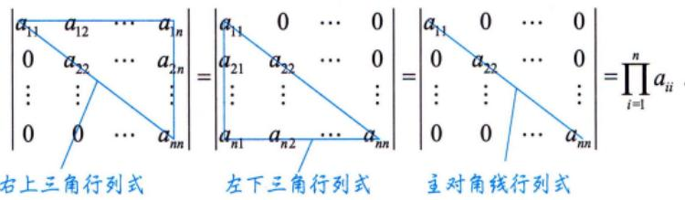

可用逆序数法证明：

$$
\sum_ {j _ {1} j _ {2} \dots j _ {n}} (- 1) ^ {\tau (j _ {1} j _ {2} \dots j _ {n})} a _ {1 j _ {1}} a _ {2 j _ {2}} \dots a _ {n j _ {n}},
$$

除了主对角线外，剩下所有的项，至少都会有1个0元素，故只有1项，且为

$$
a _ {1 1} a _ {2 2} \dots a _ {n n} = \prod_ {i = 1} ^ {n} a _ {i i}.
$$

以3阶为例：

$$
\begin{array}{l} \left| \begin{array}{l l l} a _ {1 1} & a _ {1 2} & a _ {1 3} \\ 0 & a _ {2 2} & a _ {2 3} \\ 0 & 0 & a _ {3 3} \end{array} \right| = + a _ {1 1} a _ {2 2} a _ {3 3} + a _ {1 2} a _ {2 3} \cdot 0 + a _ {1 3} \cdot 0 \cdot 0 - a _ {1 3} a _ {2 2} \cdot 0 - a _ {1 2} \cdot 0 \cdot a _ {3 3} - a _ {1 1} \cdot a _ {2 3} \cdot 0 = a _ {1 1} a _ {2 2} a _ {3 3}. \\ \left| \begin{array}{l l l} a _ {1 1} & 0 & 0 \\ a _ {2 1} & a _ {2 2} & 0 \\ a _ {3 1} & a _ {3 2} & a _ {3 3} \end{array} \right| = + a _ {1 1} a _ {2 2} a _ {3 3} + 0 \cdot 0 \cdot a _ {3 1} + 0 \cdot a _ {2 1} \cdot a _ {3 2} - 0 \cdot a _ {2 2} \cdot a _ {3 1} - 0 \cdot a _ {2 1} \cdot a _ {3 3} - a _ {1 1} \cdot 0 \cdot a _ {3 2} = a _ {1 1} a _ {2 2} a _ {3 3}. \\ \left| \begin{array}{c c c} a _ {1 1} & 0 & 0 \\ 0 & a _ {2 2} & 0 \\ 0 & 0 & a _ {3 3} \end{array} \right| = + a _ {1 1} a _ {2 2} a _ {3 3} + 0 \cdot 0 \cdot 0 + 0 \cdot 0 \cdot 0 - 0 \cdot a _ {2 2} \cdot 0 - 0 \cdot 0 \cdot a _ {3 3} - a _ {1 1} \cdot 0 \cdot 0 = a _ {1 1} a _ {2 2} a _ {3 3}. \\ \end{array}
$$

# 2副对角线行列式

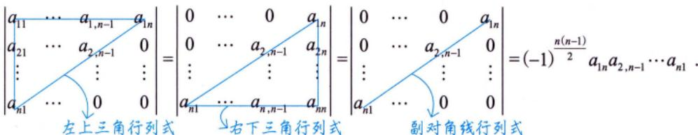

同样，可用逆序数法证明.

除了副对角线外，剩下的所有项，至少都会有一个0元素，故只有一项，且为

$$
(- 1) ^ {\tau (n (n - 1) \dots 1)} a _ {1 n} a _ {2, n - 1} \dots a _ {n 1} = (- 1) ^ {\frac {n (n - 1)}{2}} a _ {1 n} a _ {2, n - 1} \dots a _ {n 1},
$$

其中 $\tau (n(n - 1)\dots 1) = (n - 1) + (n - 2) + \dots +1 = \frac{(n - 1 + 1)(n - 1)}{2} = \frac{n(n - 1)}{2}$

# 3 拉普拉斯展开式 →分块矩阵求行列式

设 $A$ 为 $m$ 阶矩阵， $\pmb{B}$ 为 $n$ 阶矩阵，则

$$
\left| \begin{array}{l l} A & O \\ O & B \end{array} \right| = \left| \begin{array}{l l} A & C \\ O & B \end{array} \right| = \left| \begin{array}{l l} A & O \\ C & B \end{array} \right| = | A | | B |,
$$

对角线上,交换的次数

示例

$$
\left[ \begin{array}{c c} 1 & 0 \\ 0 & 2 \end{array} \right].
$$

$$
\left[ \begin{array}{c c c c c} 1 & 0 & 1 & 0 & 0 \\ 2 & 0 & 4 & 0 & 0 \\ 5 & 1 & 1 & 0 & 0 \\ 0 & 0 & 0 & 2 & 3 \\ 0 & 0 & 0 & 7 & 9 \end{array} \right] = \left[ \begin{array}{c c} A _ {3 \times 3} & O \\ O & B _ {2 \times 2} \end{array} \right].
$$

注1

$\left[ \begin{array}{lll}0 & 0 & 0\\ 0 & 0 & 0 \end{array} \right]$ 与 $\left[ \begin{array}{ll}0 & 0\\ 0 & 0\\ 0 & 0 \end{array} \right]$ 均可用矩阵 $o$ 表示.

注2 以后称以上12个行列式为“基本形”行列式，加上下面的“4.范德蒙德行列式”，简称为“ $12 + 1$ ”型行列式。

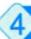

# 范德蒙德行列式

盯着第2行，后一项减前一项的所有项的乘积

$$
\left| \begin{array}{c c c c} 1 & 1 & \dots & 1 \\ x _ {1} & x _ {2} & \dots & x _ {n} \\ x _ {1} ^ {2} & x _ {2} ^ {2} & \dots & x _ {n} ^ {2} \\ \vdots & \vdots & & \vdots \\ x _ {1} ^ {n - 1} & x _ {2} ^ {n - 1} & \dots & x _ {n} ^ {n - 1} \end{array} \right| = \prod_ {1 \leqslant i <   j \leqslant n} \left(x _ {j} - x _ {i}\right).
$$

示例1

$$
D _ {3} = \left| \begin{array}{l l l} 1 & 1 & 1 \\ x _ {1} & x _ {2} & x _ {3} \\ x _ {1} ^ {2} & x _ {2} ^ {2} & x _ {3} ^ {2} \end{array} \right| = \left| \begin{array}{l l l} x _ {1} ^ {0} & x _ {2} ^ {0} & x _ {3} ^ {0} \\ x _ {1} ^ {1} & x _ {2} ^ {1} & x _ {3} ^ {1} \\ x _ {1} ^ {2} & x _ {2} ^ {2} & x _ {3} ^ {2} \end{array} \right| = (x _ {3} - x _ {2}) (x _ {3} - x _ {1}) (x _ {2} - x _ {1}).
$$

示例2

$$
\begin{array}{r} {\left| \begin{array}{l l l} {1} & {a} & {a ^ {2}} \\ {1} & {b} & {b ^ {2}} \\ {1} & {c} & {c ^ {2}} \end{array} \right|   \frac {\text {性 质}   1}{\text {性 质}   1}   \left| \begin{array}{l l l} {1} & {1} & {1} \\ {a} & {b} & {c} \\ {a ^ {2}} & {b ^ {2}} & {c ^ {2}} \end{array} \right| = (c - b) (c - a) (b - a)    .} \end{array}
$$

总结

行列式的计算方法

(1)几何画图，基本行不通，一般是定性分析．（不推荐）  
(2)行列式的七大性质.  
(3)逆序数法 $\xrightarrow{\text{一般研究}}$ 某一项.  
(4)展开公式 ①用性质：化出尽可能多的0；②通过性质 $+$ 展开公式 化为 基本形（“12+1”型）；③找差别不大的行作变换；④找规律（比如范德蒙德行列式）；⑤归纳法/递推法.低阶→高阶 高阶→低阶a. $n = 1$ （20 $D_{n}$ 与 $D_{n - 1}$ 的关系b. $n = k$ c. $n = k + 1$

# 六 具体型行列式的计算

# 化为基本形 $\rightarrow 12 + 1$ 型

例1.2 计算行列式 $\begin{array}{r}\left| \begin{array}{cccc}1 & 1 & 1 & 1\\ 1 & 2 & 0 & 0\\ 1 & 0 & 3 & 0\\ 1 & 0 & 0 & 4 \end{array} \right| \end{array}$

分析 此为爪形行列式，与三角行列式相似，属于必会题目.

a22消a12为0 (-1)倍 a33消a13为0 1 -1-1-14 0 0 0 1 2 3 4 1 0 0 解 $\begin{array}{l} \left| \begin{array}{llll} 1 & 1 & 1 & 1 \\  1 & 2 & 0 & 0 \\  1 & 0 & 3 & 0 \\  1 & 0 & 0 & 4 \end{array}\right| \end{array}$ 提出2 $= 2\times 3\times 4$ 加至 $= {24}$ $\frac{1}{3}$ $\frac{1}{3}$ $\frac{1}{3}$ $\frac{1}{3}$ $\frac{1}{4}$

$$
= 2 4 \times \left(1 - \frac {1}{2} - \frac {1}{3} - \frac {1}{4}\right) = 2 4 - 1 2 - 8 - 6 = - 2.
$$

方法总结本题的行列式是“爪形行列式”（除了第1列、第1行及主对角线元素，其余元素均为零的行列式），这种行列式都可以利用行列式的性质化为“基本形”行列式. $\longrightarrow$ 利用斜爪消竖爪或平爪，即用 $a_{ii}$ 消 $a_{i1}$ 或 $a_{1i}$ 为0

必背行列式 四种爪形行列式.

1 -1 1 x-1 1 -1 x+1 -1 1 x-1 1 -1 x+1 -1

分析此行列式中虽包含未知数 $x$ ，但仍可将其看作常数，计算此4阶具体型行列式.不难发现，此行列式非爪形行列式，且每行元素差别不大，可考虑用行列式“倍加”性质解题，属于必会题目.

解 应填 $x^4$

1倍加至 瓜形行列式 1 +1 -1 x-1 0x0 -x 000 000 000 000 000

方法总结 当行列式的行元素差别不大，且第1列元素大部分相同时，则：

① 将第1行的（-1）倍加至其余行，化简行列式；  
②对化简整理后的行列式利用行列式的性质，将其化为“ $12 + 1$ ”型行列式.

必背行列式 (*) 处来自 $\begin{array}{c|cccccc}a_{11} & a_{12} & \dots & a_{1,n - 1} & a_{1n}\\ a_{21} & a_{22} & \dots & a_{2,n - 1} & 0\\ \vdots & \vdots & & \vdots & \vdots \\ a_{n1} & 0 & \dots & 0 & 0 \end{array} = (-1)^{\frac{n(n - 1)}{2}}a_{1n}a_{2,n - 1}\dots a_{n1}.$

例1.4 计算 $n$ 阶行列式

$$
D _ {n} = \left| \begin{array}{c c c c c} a & b & b & \dots & b \\ b & a & b & \dots & b \\ b & b & a & \dots & b \\ \vdots & \vdots & \vdots & & \vdots \\ b & b & b & \dots & a \end{array} \right|.
$$

分析 先找行列式规律.不难发现，此 $n$ 阶行列式每行元素差别不大，故可用上题思路解题.但更精确一点，会发现每行元素都是由1个 $a$ ， $n - 1$ 个 $b$ 构成，故每行元素相加，和都相等，即此为“行和相等”行列式.

解

(主流方法)

提出 $[a + (n - 1)b]$

1倍加至 $D_{n} = \begin{bmatrix} a & b & b & \dots & b\\ b & a & b & \dots & b\\ b & b & a & \dots & b\\ \vdots & \vdots & \vdots & & \vdots \\ b & b & b & \dots & a \end{bmatrix} = \begin{bmatrix} a + (n - 1)b & b & b & \dots & b\\ a + (n - 1)b & a & b & \dots & b\\ a + (n - 1)b & b & a & \dots & b\\ \vdots & \vdots & \vdots & & \vdots \\ a + (n - 1)b & b & b & \dots & a \end{bmatrix} = [a + (n - 1)b]$ 1bbb…b[-1]倍1加至（-1）倍加至1倍加至1倍加至

$$
= [ a + (n - 1) b ] \left| \begin{array}{c c c c c} 1 & b & b & \dots & b \\ 0 & a - b & 0 & \dots & 0 \\ 0 & 0 & a - b & \dots & 0 \\ \vdots & \vdots & \vdots & & \vdots \\ 0 & 0 & 0 & \dots & a - b \end{array} \right| = [ a + (n - 1) b ] (a - b) ^ {n - 1}.
$$

方法总结 当行列式中每行（列）元素之和相等时，将其余各列（行）加到第1列（行），然后提出公因子是可取的方法.

必背行列式 这类字母抽象型行列式具有代表性.如

(1)当 $a = 0,b = 1$ 时， $\begin{array}{r}\left| \begin{array}{cccccc}0 & 1 & 1 & \dots & 1\\ 1 & 0 & 1 & \dots & 1\\ 1 & 1 & 0 & \dots & 1\\ \vdots & \vdots & \vdots & & \vdots \\ 1 & 1 & 1 & \dots & 0 \end{array} \right|_{n\times n}\xrightarrow{}\\ = (n - 1)(-1)^{n - 1}; \end{array}$ （20 $\begin{cases} 0\bullet x_1 + 1\bullet x_2 + 1\bullet x_3 + \dots +1\bullet x_n = 0,\\ 1\bullet x_1 + 0\bullet x_2 + 1\bullet x_3 + \dots +1\bullet x_n = 0,\\ 1\bullet x_1 + 1\bullet x_2 + 0\bullet x_3 + \dots +1\bullet x_n = 0,\\ \dots \dots \\ 1\bullet x_1 + 1\bullet x_2 + 1\bullet x_3 + \dots +0\bullet x_n = 0. \end{cases}$

当 $a = 2, b = 1$ 时， $\left| \begin{array}{cccc}2 & 1 & 1 & \dots & 1\\ 1 & 2 & 1 & \dots & 1\\ 1 & 1 & 2 & \dots & 1\\ \vdots & \vdots & \vdots & & \vdots \\ 1 & 1 & 1 & \dots & 2 \end{array} \right|_{n\times n} = n + 1.$

(2) 当 $a = x$ 时， $\begin{array}{r}\left| \begin{array}{ccccc}x & b & b & \dots & b\\ b & x & b & \dots & b\\ b & b & x & \dots & b\\ \vdots & \vdots & \vdots & & \vdots \\ b & b & b & \dots & x \end{array} \right|_{n\times n} = [x + (n - 1)b](x - b)^{n - 1}. \end{array}$

若视 $x$ 为变量， $b$ 为常数，则行列式是 $x$ 的 $n$ 次多项式，其根是 $x_{1} = x_{2} = \dots = x_{n - 1} = b, x_{n} = (1 - n)b$ ：

当a取λ-a时， $\begin{array}{r}\left| \begin{array}{ccccc}\lambda -a & b & b & \dots & b\\ b & \lambda -a & b & \dots & b\\ b & b & \lambda -a & \dots & b\\ \vdots & \vdots & \vdots & & \vdots \\ b & b & b & \dots & \lambda -a \end{array} \right|_{n\times n} \end{array}$ 后续章节，求特征值.=[λ-a+(n-1)b](λ-a-b)n-1

若视 $\lambda$ 为变量， $a,b$ 为常数，则行列式是 $\lambda$ 的 $n$ 次多项式，其根是 $\lambda_1 = \lambda_2 = \dots = \lambda_{n - 1} = a + b,\lambda_n = a - (n - 1)b$ ：

(3)当 $a$ 在副对角线上时，

$$
\begin{array}{r l} & G _ {n} = \left| \begin{array}{l l l l l} b & b & \dots & b & a \\ b & b & \dots & a & b \\ \vdots & \vdots & & \vdots & \vdots \\ b & a & \dots & b & b \\ a & b & \dots & b & b \end{array} \right| \xlongequal {(*)} (- 1) ^ {\frac {n (n - 1)}{2}} \left| \begin{array}{l l l l l} a & b & \dots & b & b \\ b & a & \dots & b & b \\ \vdots & \vdots & & \vdots & \vdots \\ b & b & \dots & a & b \\ b & b & \dots & b & a \end{array} \right| \\ & = (- 1) ^ {\frac {n (n - 1)}{2}} [ a + (n - 1) b ] (a - b) ^ {n - 1}. \end{array}
$$

(*)处是将最后1列和前面相邻列对换，对换 $n - 1$ 次到第1列，再将最新的行列式的最后1列和相邻列对换，对换 $n - 2$ 次到第2列，…，直到换成 $D_{n}$ ，共交换 $(n - 1) + (n - 2) + \dots +1 = \frac{n(n - 1)}{2}$ 次，故得

$$
G _ {n} = (- 1) ^ {\frac {n (n - 1)}{2}} [ a + (n - 1) b ] (a - b) ^ {n - 1}.
$$

注意，上述结果不要当作公式去记忆，而是要学会分析行列式中元素分布的规律性，并掌握相应的计算方法.

$①$ 有规律的 考试考n阶（ $n$ 可3很大）可总结规律 $\Rightarrow$ 得到公式所有有规律的行列式，将公式总结出来，记住即可，推理不用掌握 $②$ 无规律的 3阶为主，最多4阶不需要公式 $\Rightarrow$ 化为“12+1”型即可

例1.5 计算行列式

$$
D _ {4} = \left| \begin{array}{c c c c} a _ {1} & 0 & 0 & b _ {1} \\ 0 & a _ {2} & b _ {2} & 0 \\ 0 & b _ {3} & a _ {3} & 0 \\ b _ {4} & 0 & 0 & a _ {4} \end{array} \right|.
$$

分析此行列式属于“有规律的”，称为“X”型，属于必会题目.不难看出，“0”元素是分散的，想办法集中起来，方法不唯一.行列式的问题不必担心，要么有规律，要么低阶无规律，不会在行列式的计算上为难大家.

解

$$
\begin{array}{l} D _ {4} = \left| \begin{array}{l l l l} a _ {1} & 0 & 0 & b _ {1} \\ 0 & a _ {2} & b _ {2} & 0 \\ 0 & b _ {3} & a _ {3} & 0 \\ b _ {4} & 0 & 0 & a _ {4} \end{array} \right| = (- 1) \left| \begin{array}{l l l l} a _ {1} & b _ {1} & 0 & 0 \\ 0 & 0 & b _ {2} & a _ {2} \\ 0 & 0 & a _ {3} & b _ {3} \\ b _ {4} & a _ {4} & 0 & 0 \end{array} \right| = (- 1) \times (- 1) \text {互 换} \left| \begin{array}{l l l l} a _ {1} & b _ {1} & 0 & 0 \\ b _ {4} & a _ {4} & 0 & 0 \\ 0 & 0 & a _ {3} & b _ {3} \\ 0 & 0 & b _ {2} & a _ {2} \end{array} \right| \\ = \left| \begin{array}{l l} a _ {1} & b _ {1} \\ b _ {4} & a _ {4} \end{array} \right| \left| \begin{array}{l l} a _ {3} & b _ {3} \\ b _ {2} & a _ {2} \end{array} \right| = (a _ {1} a _ {4} - b _ {1} b _ {4}) (a _ {2} a _ {3} - b _ {2} b _ {3}) \\ = a _ {1} a _ {2} a _ {3} a _ {4} + b _ {1} b _ {2} b _ {3} b _ {4} - a _ {1} b _ {2} b _ {3} a _ {4} - b _ {1} a _ {2} a _ {3} b _ {4}. \quad \rightarrow \text {由 此 预 告 ，} D _ {n} \text {表 达 式 .} \\ \end{array}
$$

注注意，

$$
D _ {4} = \left| \begin{array}{l l l l} a _ {1} & 0 & 0 & b _ {1} \\ 0 & a _ {2} & b _ {2} & 0 \\ 0 & b _ {3} & a _ {3} & 0 \\ b _ {4} & 0 & 0 & a _ {4} \end{array} \right| = a _ {1} a _ {2} a _ {3} a _ {4} - b _ {1} b _ {2} b _ {3} b _ {4}
$$

是错误的. 不要当作 2 阶行列式计算. 展开式共有 4 项, 且副对角线元素乘积的那一项取正号.

总结 ①若行列式为“X”型，则

a. 主副对角线上元素相同。

$$
\left| \begin{array}{c c c c c} a & & & & b \\ & \ddots & & & \ddots \\ & & a & b & \\ & & b & a & \\ & \ddots & & & \ddots \\ b & & & & a \end{array} \right| _ {2 n} = (a ^ {2} - b ^ {2}) ^ {n}.
$$

b. 主副对角线上元素不同。

$$
\left| \begin{array}{c c c c c c} a _ {1} & & & & & b _ {1} \\ & \ddots & & & \ddots \\ & & a _ {k} & b _ {k} & & \\ & & b _ {k + 1} & a _ {k + 1} & & \\ & \ddots & & & \ddots \\ b _ {2 k} & & & & & a _ {2 k} \end{array} \right| = \prod_ {i = 1} ^ {k} \left(a _ {i} a _ {2 k + 1 - i} - b _ {i} b _ {2 k + 1 - i}\right).
$$

当 $2k = 4$ ，即 $k = 2$ 时， $D_{4} = \prod_{i = 1}^{2}(a_{i}a_{5 - i} - b_{i}b_{5 - i}) = (a_{1}a_{4} - b_{1}b_{4})(a_{2}a_{3} - b_{2}b_{3})$

以上两个公式通常用于后续矩阵的正定问题、二次型问题，而非只用于计算行列式。

②如类对称（主对角线元素相同，左下、右上各元素相同）行列式，可通过递推法、归纳法计算。

$$
\left| \begin{array}{c c c c} a & b & \dots & b \\ c & a & \dots & b \\ \vdots & \vdots & & \vdots \\ c & c & \dots & a \end{array} \right| _ {n} = \left\{ \begin{array}{l l} [ a + (n - 1) b ] (a - b) ^ {n - 1}, & b = c, \\ \frac {b (a - c) ^ {n} - c (a - b) ^ {n}}{b - c}, & b \neq c. \end{array} \right.
$$

行和相等：其余所有列加到第1列，提出公因式，然后从上面往下加，化为右上三角形行列式.

不需要背诵结果，多用几次就记住了

例如，当 $x + 1 \neq 0$ 时，

$$
\left| \begin{array}{c c c c} 1 & x & \dots & x \\ - 1 & 1 & \dots & x \\ \vdots & \vdots & & \vdots \\ - 1 & - 1 & \dots & 1 \end{array} \right| = \frac {x \cdot 2 ^ {n} + 1 \cdot (1 - x) ^ {n}}{x + 1}.
$$

# 例1.6

计算行列式

$$
\left| \begin{array}{c c c} a & b & c \\ a ^ {2} & b ^ {2} & c ^ {2} \\ b + c & a + c & a + b \end{array} \right|.
$$

分析

将第1行加到第3行，即可产生规律.

解

1倍加至

$$
\left| \begin{array}{c c c} a & b & c \\ a ^ {2} & b ^ {2} & c ^ {2} \\ b + c & a + c & a + b \end{array} \right| = \left| \begin{array}{c c c} a & b & c \\ a ^ {2} & b ^ {2} & c ^ {2} \\ \hline a + b + c & a + b + c & a + b + c \end{array} \right|
$$

提出 $(a + b + c)$

$$
= (a + b + c) \left| \begin{array}{c c c} a & b & c \\ a ^ {2} & b ^ {2} & c ^ {2} \\ \hline 1 & 1 & 1 \end{array} \right|
$$

“12+1”型，范德蒙德行列式是我们的目标互换，行列式交换两行，添负号

$= (a + b + c)(-1)\left|\begin{array}{ccc} a & b & c \\ \hline 1 & 1 & 1 \\ a^2 & b^2 & c^2 \end{array}\right|$ 互换，行列式交换两行，添负号

$$
\begin{array}{l} = (a + b + c) (- 1) ^ {2} \left| \begin{array}{c c c} 1 & 1 & 1 \\ a & b & c \\ a ^ {2} & b ^ {2} & c ^ {2} \end{array} \right| \\ = (a + b + c) (b - a) (c - b) (c - a). \\ \end{array}
$$

简单应用

# 拓展

范德蒙德行列式实际用处：

研究二次函数 $f(x)$ （可表示质点的运动轨迹、发射导弹的运动轨迹）的表达式.

例如，已知质点 $(x,y)$ 的运动轨迹为 $f(x) = a + bx + cx^2$ ，现有3个点：

在曲线 $y = f(x)$ 上，求 $f(x)$ 表达式.

代入3个点得到方程组：

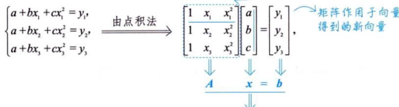

若 $A$ 可逆,两端同时左边乘 ${A}^{-1}$ ,可得 ${A}^{-1}{Ax} = {A}^{-1}b$

其中系数行列式为 $\left| \begin{array}{lll}1 & x_1 & x_1^2\\ 1 & x_2 & x_2^2\\ 1 & x_3 & x_3^2 \end{array} \right|$ ，且 $\left[ \begin{array}{l}a\\ b\\ c \end{array} \right]$ 相当于自变量.

2 递推法 建立 $D_{n}$ 与 $D_{n - 1}$ 的关系式，实现递推 $\left\{ \begin{array}{l}1\text{元素分布规律相同；}\\ 2D_{n - 1}\text{比} D_n\text{少一阶} \end{array} \right.$ 递指法（涉及更复杂的情况用此方法）：给出 $n$ 阶，推 $n - 1$ 阶， $n - 2$ 阶，…，一直往下推，推到首项的表达式（即1阶的情况）数学归纳法：从1阶，2阶，…，找到基本规律，然后往上（即高阶）假设，假设命题对 $n = k - 1$ 时成立，最后证明命题对 $n = k$ 时成立.

除了这三条线上的元素，其余元素全为0例1.7 $D_{4} = \begin{vmatrix} 1 - a & a & 0 & 0\\ -1 & 1 - a & a & 0\\ 0 & -1 & 1 - a & a\\ 0 & 0 & -1 & 1 - a \end{vmatrix} = ()$ 元素金为a元素金为-1 主对角线元素金为1-a

(A) $a^4 +2a^3 +6a^2 +2a + 1$

(B) $a^4 - 2a^3 + 6a^2 + a$

(C) $a^4 + a^3 + a^2 + a + 1$

(D) $a^4 - a^3 + a^2 - a + 1$

分析 称此类型行列式为宽对角行列式.

解 应选(D).

也可以直接展开

对这类行列式，适宜采用递推法计算.计算的关键是找到上、下阶行列式之间的关系式，即递推公式.

1 倍加至 1 -a a 0 0 1-a a 0 0-1 1-a a 0 -1 1-a a 0 -1 1-a a  
1倍加至 1-1 1-a a 0 -1 1-a a  
→按此行展开 $= (-1)^{4 + 1}\cdot (-a)\cdot \left| \begin{array}{lll}a & 0 & 0\\ 1 - a & a & 0\\ -1 & 1 - a & a \end{array} \right| + D_3$ 下三角形行列式值为主对角线元素乘积 $= -(-1)^{4 + 1}a^4 +D_3 = a^4 -(1)^{3 + 1}a^3 +D_2 = a^4 -a^3 -(1)^{2 + 1}a^2 +D_1$ 再少一阶 $= a^{4} - a^{3} + a^{2} - a + 1,$

故选 (D).

注1 本题也可考虑用归纳法. 考虑到行列式排列有序, 可以从低阶计算, 逐步升阶找出规律. 由

$$
D _ {1} = 1 - a, D _ {2} = \left| \begin{array}{c c} 1 - a & a \\ - 1 & 1 - a \end{array} \right| = 1 - a + a ^ {2},
$$

按此列展开.

$$
D _ {3} = \left| \begin{array}{c c c} 1 - a & a & 0 \\ - 1 & 1 - a & a \\ 0 & - 1 & 1 - a \end{array} \right| = (1 - a) D _ {2} - 1 \times (- 1) ^ {2 + 1} a (1 - a) = 1 - a + a ^ {2} - a ^ {3},
$$

可类推得 $D_{4} = a^{4} - a^{3} + a^{2} - a + 1$ ，故选(D).

注2 对于 $n$ 阶行列式，记 $\triangle = k^2 - 4bc$ ，有

$$
\left| \begin{array}{c c c c} k & b & & \\ c & \ddots & \ddots & \\ & \ddots & \ddots & b \\ & & c & k \end{array} \right| _ {n} = \left\{ \begin{array}{l} (n + 1) \cdot \left(\frac {k}{2}\right) ^ {n}, k ^ {2} = 4 b c, \\ \frac {(k + \sqrt {\triangle}) ^ {n + 1} - (k - \sqrt {\triangle}) ^ {n + 1}}{2 ^ {n + 1} \sqrt {\triangle}}, k ^ {2} \neq 4 b c. \end{array} \right.
$$

将此结论用于例1.7，当 $a = -1$ 时， $(1 - a)^{2} = -4a$ ， $D_{4} = (4 + 1)\left(\frac{1 - a}{2}\right)^{4} = 5$ .当 $a\neq -1$ 时， $(1 - a)^{2}\neq -4a,\triangle = (1 - a)^{2} + 4a = (1 + a)^{2}$ ，则

$$
D _ {4} = \frac {(1 - a + | 1 + a |) ^ {5} - (1 - a - | 1 + a |) ^ {5}}{2 ^ {5} | 1 + a |} = \frac {2 ^ {5} + 2 ^ {5} a ^ {5}}{2 ^ {5} (1 + a)} = \frac {1 + a ^ {5}}{1 + a}.
$$

再如(真题中考过), ${a}^{2} + 1 > {\left( a\right) }^{2}$

$$
\left| \begin{array}{c c c c} 2 a & a ^ {2} & & \\ 1 & \ddots & \ddots & \\ & \ddots & \ddots & a ^ {2} \\ & & 1 & 2 a \end{array} \right| = (n + 1) \cdot \left(\frac {2 a}{2}\right) ^ {n} = (n + 1) \cdot a ^ {n}.
$$

# 3 行列式表示的函数和方程

行列式在特殊情况下是数字，考研线代试题中大多是 $\lambda$ 的函数，即关于 $\lambda$ 的多项式.

这类问题的行列式元素 $a_{ij}$ 往往不是具体数值，而是含 $x$ 或 $\lambda$ 等的函数，可能会在计算之外给考生带来新的困难和麻烦，自然也会给命题人带来新的角度。请考生重视对此类问题的研究。

若 $a_{ij}$ 是具体数值，则行列式也是一个具体数值。

若 $a_{ij}$ 是含有 $x$ 或 $\lambda$ 等的函数，则行列式可能是自变量为 $x$ 或 $\lambda$ 等的函数.

例1.8 设 $f(x) = \left| \begin{array}{lll}1 & 0 & x\\ 1 & 2 & x^2\\ 1 & 3 & x^3 \end{array} \right|$ ，求 $f(x + 1) - f(x)$

$\mathcal{P}$ 分析 属于无规律的行列式.

解

$$
\begin{array}{l} f (x + 1) - f (x) = \left| \begin{array}{l l l} 1 & 0 & x + 1 \\ 1 & 2 & (x + 1) ^ {2} \\ 1 & 3 & (x + 1) ^ {3} \end{array} \right| - \left| \begin{array}{l l l} 1 & 0 & x \\ 1 & 2 & x ^ {2} \\ 1 & 3 & x ^ {3} \end{array} \right| \\ = \left| \begin{array}{l l l} 1 & 0 & x + 1 \\ 1 & 2 & x ^ {2} + 2 x + 1 \\ 1 & 3 & x ^ {3} + 3 x ^ {2} + 3 x + 1 \end{array} \right| - \left| \begin{array}{l l l} 1 & 0 & x \\ 1 & 2 & x ^ {2} \\ 1 & 3 & x ^ {3} \end{array} \right| \text {注 意 ： 行 列 式 只 有 对} \\ \end{array}
$$

(-1)倍加至

前两列不动

$$
= \left| \begin{array}{l l l} 1 & 0 & 1 \\ 1 & 2 & 2 x + 1 \\ 1 & 3 & 3 x ^ {2} + 3 x + 1 \end{array} \right| = \left| \begin{array}{l l l} 1 & 0 & 0 \\ 1 & 2 & 0 \\ 1 & 3 & 3 x ^ {2} \end{array} \right| = 6 x ^ {2}.
$$

$(-x)$ 倍加至

主对角线元素乘积

注 函数可以用含有变量的行列式表示，因此，对这类行列式当然也可以求极限、导数、积分等，如本题 $[f(x + 1) - f(x)]' = (6x^2)' = 12x$ ， $\int [f(x + 1) - f(x)] \, \mathrm{d}x = 2x^3 + C$ 。

例1.9 设关于 $\lambda$ 的方程

$\left| \begin{array}{rrr}\lambda -1 & -2 & 3\\ 1 & \lambda -4 & 3\\ -1 & a & \lambda -5 \end{array} \right| = 0$ 此行列式是关于的多项式，并且根据行列式的定义，行列式是来自不同行不同列元素之积再求和，故也能观察出此行列式为的三次多项式，并且的系数是1

分析 (1)涉及后面矩阵关于特征值、特征向量的问题.

★★★(2)特征值、特征向量的出现才会真正展现线性代数的用途.

(3)3阶无规律的行列式需要自己找相同的或相反的元素，优先处理变成0.

(-1)倍 加至 $\left| \begin{array}{rrr}\lambda -1 & -2 & 3\\ 1 & \lambda -4 & 3\\ -1 & a & \lambda -5 \end{array} \right| = \left| \begin{array}{rrr}\lambda -2 & 2 - \lambda & 0\\ 1 & \lambda -4 & 3\\ -1 & a & \lambda -5 \end{array} \right|$

$a_{13}$ 和 $a_{23}$ 位置的元素相同，可将第2行(-1)倍加至第1行

按此行展开

$= \left( {\lambda  - 2}\right) \left\lbrack  {\left( {\lambda  - 3}\right) \left( {\lambda  - 5}\right)  - 3\left( {a - 1}\right) }\right\rbrack$ 二次多项式易处理 $= \left( {\lambda  - 2}\right) \left( {{\lambda }^{2} - {8\lambda } + {18} - {3a}}\right)  = 0.$

$①$ 若 $\lambda = 2$ 是二重根，则

$$
\left. (\lambda^ {2} - 8 \lambda + 1 8 - 3 a) \right| _ {\lambda = 2} = 4 - 1 6 + 1 8 - 3 a = 0,
$$

得 $a = 2$ ，经验证 $\lambda = 2$ 是二重根.

② 若 $\lambda = 2$ 不是二重根，则 $\lambda^2 - 8\lambda + 18 - 3a = 0$ 有两个相等的根，故 $\Delta = (-8)^2 - 4(18 - 3a) = 0$ ，得 $a = \frac{2}{3}$ 此时， $\lambda = 4$ 是二重根.

综上所述， $a = 2$ 或 $a = \frac{2}{3}$

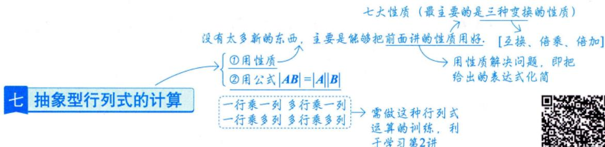

对于公式 $|\mathbf{A}\mathbf{B}| = |\mathbf{A}||\mathbf{B}|$ ，从变换的角度来看：

$\widehat{BX}$ ： $\pmb{B}$ 作用在 $X$ 上，相当于作一次图像的变换；

$A(BX)$ ： $A$ 作用在 $BX$ 上，相当于再作一次图像的变换.

上述过程相似于高等数学中的复合函数 $f[g(x)]$ ： $g$ 先作用在 $x$ 上， $f$ 再作用在 $g(x)$ 上，作用顺序都是从右向左.

示例1 对于第0讲中讲过的拉伸变换 $A = \begin{bmatrix} 2 & 0 \\ 0 & 1 \end{bmatrix}$ 和对称变换 $B = \begin{bmatrix} 1 & 0 \\ 0 & -1 \end{bmatrix}$ ，若先把 $B$ 作用在图片 $X$ 上，相当于作了一次对称变换，如图1-16(a)所示，再把 $A$ 作用在图片 $BX$ 上，相当于作了一次拉伸变换，如图1-16(b)所示。若调换作用顺序，先把 $A$ 作用在 $X$ 上，作一次拉伸变换，如图1-16(c)所示，再把 $B$ 作用在 $AX$ 上，作一次对称变换，如图1-16(d)所示。

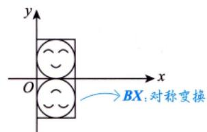  
(a)

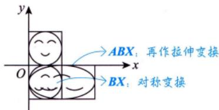  
(b)

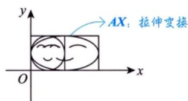  
(c)

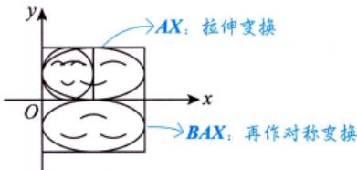  
(d)   
图1-16

比较图1-16(b)与图1-16(d)可以看出，两种变换顺序的效果是一样的，即 $ABX = BAX$ ，这是因为此时恰好有 $AB = BA$ ，即 $\left[ \begin{array}{ll}2 & 0\\ 0 & 1 \end{array} \right]\left[ \begin{array}{ll}1 & 0\\ 0 & -1 \end{array} \right] = \left[ \begin{array}{ll}2 & 0\\ 0 & -1 \end{array} \right] = \left[ \begin{array}{ll}1 & 0\\ 0 & -1 \end{array} \right]\left[ \begin{array}{ll}2 & 0\\ 0 & 1 \end{array} \right].$

那么，对于任意的两个变换，调整顺序前后，是不是都有相同的效果呢？当然不是了。

示例2 对于第0讲中讲过的拉伸变换 $A = \begin{bmatrix} 2 & 0\\ 0 & 1 \end{bmatrix}$ 和剪切变换 $B = \begin{bmatrix} 1 & 0\\ -1 & 1 \end{bmatrix}$ ，先剪切变换再拉伸变换（即 $AB$ ）和先拉伸变换再剪切变换（即 $BA$ ）的作用效果是不同的，如图1-17所示。这是因为

$$
\boldsymbol {A B} = \left[ \begin{array}{l l} 2 & 0 \\ 0 & 1 \end{array} \right] \left[ \begin{array}{l l} 1 & 0 \\ - 1 & 1 \end{array} \right] = \left[ \begin{array}{l l} 2 & 0 \\ - 1 & 1 \end{array} \right],
$$

而

$$
\boldsymbol {B} \boldsymbol {A} = \left[ \begin{array}{l l} 1 & 0 \\ - 1 & 1 \end{array} \right] \left[ \begin{array}{l l} 2 & 0 \\ 0 & 1 \end{array} \right] = \left[ \begin{array}{l l} 2 & 0 \\ - 2 & 1 \end{array} \right],
$$

显然 $AB \neq BA$

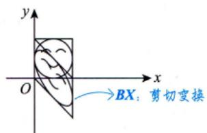  
(a)

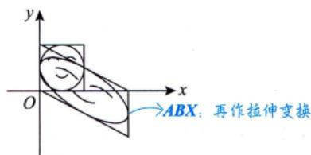  
(b)

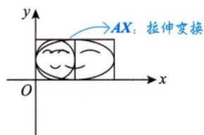  
(c)

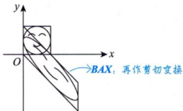  
(d)   
图1-17

总结 矩阵中的运算， $AB = BA$ 不一定成立，这从变换的角度来看很容易理解.而中学代数中， $ab = ba$ 一定成立.

若 $A$ ， $\pmb{B}$ 均为方阵，则 $|\mathbf{AB}| = |\mathbf{A}||\mathbf{B}|$ 的意义为

复合变换之后的面积测度 $|\mathbf{AB}| = \mathbf{A}$ 的面积值 $|\mathbf{A}|\times \mathbf{B}$ 的面积值 $|\pmb {B}|$

$$
\begin{array}{l} = \boldsymbol {B} \text {的 面 积 值} | \boldsymbol {B} | \times \boldsymbol {A} \text {的 面 积 值} | \boldsymbol {A} | \\ = | \boldsymbol {B A} |. \\ \end{array}
$$

例1.10 已知4阶行列式 $\left|\pmb{\alpha}_{1},\pmb{\alpha}_{2},\pmb{\alpha}_{3},\pmb{\beta}\right| = a,\left|\pmb{\beta} + \gamma ,\pmb{\alpha}_{2},\pmb{\alpha}_{3},\pmb{\alpha}_{1}\right| = b$ ，则 $\left|\pmb {\alpha}_2 + \pmb {\alpha}_3,\pmb {\alpha}_1,\pmb {\alpha}_3,\gamma \right| = \underline{\quad}$

分析此题为抽象型行列式（行列式中元素未知，仅仅把4个列用向量表示）.

已知两个抽象型行列式的值，去求另一个抽象型行列式的值，属于抽象型行列式的基本问题.

现在寻找列与列之间的关系，显然，所求的行列式可以利用行列式的单列可拆性.

解 应填 $a + b$ ：

$$
\left| \boldsymbol {\alpha} _ {2} + \boldsymbol {\alpha} _ {3}, \quad \boldsymbol {\alpha} _ {1}, \quad \boldsymbol {\alpha} _ {3}, \quad \gamma \right| = \left| \boldsymbol {\alpha} _ {2}, \quad \boldsymbol {\alpha} _ {1}, \quad \boldsymbol {\alpha} _ {3}, \quad \gamma \right| + \left| \boldsymbol {\alpha} _ {3}, \quad \boldsymbol {\alpha} _ {1}, \quad \boldsymbol {\alpha} _ {3}, \quad \gamma \right|,
$$

同理， $\left|\pmb {\beta} + \gamma ,\pmb {\alpha}_2,\pmb {\alpha}_3,\pmb {\alpha}_1\right| = \left|\pmb {\beta},\pmb {\alpha}_2,\pmb {\alpha}_3,\pmb {\alpha}_1\right| + \left|\gamma ,\pmb {\alpha}_2,\pmb {\alpha}_3,\pmb {\alpha}_1\right| = b$ ，其中 $\left|\beta ,\alpha_{2},\alpha_{3},\alpha_{1}\right|$ 与题干中 $\left|\alpha_1,\alpha_2,\alpha_3,\beta \right|$ 的顺序不同，但可通过行列式性质把列互换.

互换对于 $\left|\pmb {\beta},\pmb {\alpha}_2,\pmb {\alpha}_3,\pmb {\alpha}_1\right| = -\left|\pmb {\alpha}_1,\pmb {\alpha}_2,\pmb {\alpha}_3,\pmb {\beta}\right| = -a$ ，故有 $b = -a + |\gamma ,\alpha_{2},\alpha_{3},\alpha_{1}|$ ，即

$$
\left| \gamma , \quad \alpha_ {2}, \quad \alpha_ {3}, \quad \alpha_ {1} \right| = a + b. \tag {* *}
$$

对 $(\ast)$ 式等号右边第一个式子作列变换，

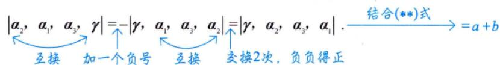

然后，看 $(\ast)$ 式等号右边第二个式子 $\left|\alpha_{3}, \alpha_{1}, \alpha_{3}, \gamma\right|$ ，第1，3列相等，根据行列式性质，两列成比例，行列式为0，故 $(\ast)$ 式等号右边第二个式子为0.

综上，本题结果为 $a + b$ ：

总结 线性代数比高等数学的解题方法更容易训练.盯住要求的，转化为与已知有联系的，一步步去解决.

注 高阶带字母行列式，通常指4阶及4阶以上带字母的行列式，比较抽象。有两种基本类型，一种与高阶数值型行列式类似，元素排列有序，有一定规律性，且计算有一定规律，可通过初等变换最终化为三角形行列式定值，这类题一般阶数不大，即使大一些，但计算量不大，大家通过一定练习即可掌握。另一种如本题，主要通过行、列变换，与已知行列式对应，代值计算。

例1.11 设 $a_1, a_2, a_3$ 均为3维列向量，已知

$$
\boldsymbol {A} = \left[ \boldsymbol {\alpha} _ {1}, \boldsymbol {\alpha} _ {2}, \boldsymbol {\alpha} _ {3} \right], \boldsymbol {B} = \left[ \boldsymbol {\alpha} _ {1} - \boldsymbol {\alpha} _ {2} + 2 \boldsymbol {\alpha} _ {3}, 2 \boldsymbol {\alpha} _ {1} + 3 \boldsymbol {\alpha} _ {2} - 5 \boldsymbol {\alpha} _ {3}, \boldsymbol {\alpha} _ {1} + 2 \boldsymbol {\alpha} _ {2} - \boldsymbol {\alpha} _ {3} \right],
$$

且 $|\mathbf{A}| = 2$ ，则 $|\pmb {B} - \pmb {A}| = \underline{\quad}$

分析 本题 $\pmb{A}$ ， $\pmb{B}$ 都是3维列向量拼起来的矩阵，虽然也是抽象的列与列之间的关系，但与上题不同，本题希望考生掌握向量与向量之间点积（内积）的情况.来实践一下，如果能够凑出来两个方阵相乘，那么 $|AB| = |A|\cdot |B|$ （此公式考试常用）.

解 应填10.

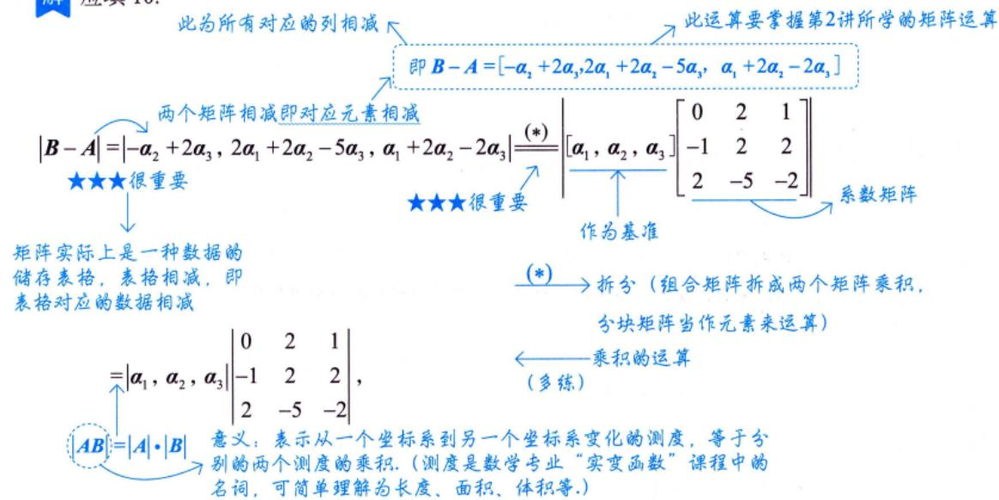

其中 $|\alpha_{1},\alpha_{2},\alpha_{3}| = |A| = 2$ .又

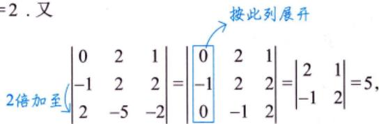

故 $|\pmb {B} - \pmb {A}| = 10$ ：

$\pmb{\mathcal{O}}$ 补充 设 $\pmb {A} = \left[ \begin{array}{ll}a & b\\ c & d \end{array} \right],\quad \pmb {B} = \left[ \begin{array}{ll}x_1 & x_2\\ x_3 & x_4 \end{array} \right].$

对于 $A$ ， $\pmb{B}$ 两个矩阵，若 $A = B$ ，则两个表格存储的数据相同，与 $A - B = O$ 相同，即 $A = B\Leftrightarrow A - B = O$ ，有

$$
\left\{ \begin{array}{l} a - x _ {1} = 0, \\ b - x _ {2} = 0, \\ c - x _ {3} = 0, \\ d - x _ {4} = 0, \end{array} \right.
$$

故 $A - B = \begin{bmatrix} a & b \\ c & d \end{bmatrix} - \begin{bmatrix} a & b \\ c & d \end{bmatrix} = \begin{bmatrix} 0 & 0 \\ 0 & 0 \end{bmatrix}$ .

注意，要区别于矩阵的加减法，行列式加减要求两个行列式只有对应的某一行（列）不同，加减的是元素不同的行（列），其他元素不动。

注 分块矩阵,分成4块,每一块都是原来矩阵的子块

例： $\left\lbrack  \begin{matrix} \cdots & \cdots & \cdots \\  \cdots & \cdots & \cdots  \end{matrix}\right\rbrack   = \left\lbrack  \begin{matrix} A & B \\  C & D \end{matrix}\right\rbrack$ ,当作 $\left\lbrack  \begin{matrix} 1 & 2 \\  3 & 4 \end{matrix}\right\rbrack$ 类似具体的数来计算. 当作元素 ${a}_{y}$ 来看待,进行计算. 要习惯这种记法,代数学有这种形式上运算的变化, 跟高等数学的计算不是一个方向上的

本题中，向量 $\alpha_{1},\alpha_{2},\alpha_{3}$ 是列矩阵，即 $\left[ \begin{array}{lll}\bullet & \bullet & \bullet \\ \bullet & \bullet & \bullet \\ \bullet & \bullet & \bullet \\ \bullet & \bullet & \bullet \end{array} \right],$ 三个列分块.

★即 $(\ast)$ 处的处理，一定要搞清楚，解释了背景，但没完全理解也正常，后边要讲线性空间，变换是它的主旋律

注2 能够熟练地将线性组合表示成矩阵乘积的形式：

$$
x _ {1} \boldsymbol {\alpha} _ {1} + x _ {2} \boldsymbol {\alpha} _ {2} + x _ {3} \boldsymbol {\alpha} _ {3} = \left[ \begin{array}{l l l} \boldsymbol {\alpha} _ {1}, & \boldsymbol {\alpha} _ {2}, & \boldsymbol {\alpha} _ {3} \end{array} \right] \left[ \begin{array}{l} x _ {1} \\ x _ {2} \\ x _ {3} \end{array} \right].
$$

本题中，

$$
0 \alpha_ {1} - \alpha_ {2} + 2 \alpha_ {3} = [ \alpha_ {1}, \alpha_ {2}, \alpha_ {3} ] \left[ \begin{array}{l} 0 \\ - 1 \\ 2 \end{array} \right], 2 \alpha_ {1} + 2 \alpha_ {2} - 5 \alpha_ {3} = [ \alpha_ {1}, \alpha_ {2}, \alpha_ {3} ] \left[ \begin{array}{l} 2 \\ 2 \\ - 5 \end{array} \right],
$$

掌握计算规则

$$
\boldsymbol {\alpha} _ {1} + 2 \boldsymbol {\alpha} _ {2} - 2 \boldsymbol {\alpha} _ {3} = \left[ \begin{array}{l} \boldsymbol {\alpha} _ {1}, \boldsymbol {\alpha} _ {2}, \boldsymbol {\alpha} _ {3} \end{array} \right] \left[ \begin{array}{l} 1 \\ 2 \\ - 2 \end{array} \right],
$$

再合并成矩阵乘积的行列式，其中 $(\ast)$ 处是解决此类问题的关键.

拓展 线性代数与高等数学学习思路和方法不一样，线性代数更多的是讲一种规则，每一个章节出现的概念和方法都是通过某种规则在处理数据，随着不断学习，处理数据的工具和方法会越来越多，那么对数据的处理就会越来越精彩，现在需掌握计算规则.

# 余子式和代数余子式的线性组合的计算

（基础公式： $A_{ij} = (-1)^{i + j}M_{ij}$ ）

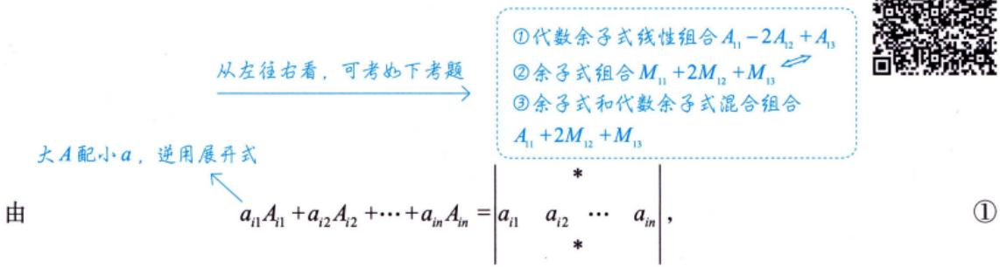

# 从右往左是展开

大 $A$ 配小 $k$ . $k$ 把小 $a$ 吃 此为降阶运算. ${A}_{1},{A}_{2},\cdots ,{A}_{n}$ 为 $n$ 个 $n - 1$ 阶行列式

则 $k_{1}A_{i1} + k_{2}A_{i2} + \dots +k_{n}A_{in} = \left|k_{1}\begin{array}{ccc}*\\ & k_{2} & \dots \\ & * & k_{n} \end{array} \right|,$ ②

其中 $*$ 处表示元素不变，①，②的区别仅仅在于第 $i$ 行的元素 $a_{i1}, a_{i2}, \dots, a_{in}$ 换成了 $k_1, k_2, \dots, k_n$ ，这样，给出不同的系数 $k_1, k_2, \dots, k_n$ ，即得到了不同的行列式。而若要求 $k_1M_{i1} + k_2M_{i2} + \dots + k_nM_{in}$ ，只需用 $M_{ij} = (-1)^{i+j}A_{ij}$ 化为关于 $A_{ij}$ 的线性组合即可。

例1.12 设 $|A| = \begin{vmatrix} 2 & -1 & 2 & 3\\ 0 & 1 & -1 & 0\\ 2 & 3 & 4 & 5\\ 1 & 1 & 1 & 1 \end{vmatrix}$ 则 $A_{31} + A_{32} + A_{33} + M_{34} = (\quad)$ .

(A)8

(B) 6

(C) 4

(D) 2

分析 本题代数余子式前面的系数与行列式第3行不一样，所以本题属于大 $A$ 配小 $k$ ， $k$ 把小 $a$ 吃.

解 应选(B).

本题即计算 $A_{31} + A_{32} + A_{33} - A_{34}$ ，结果是将组合系数置换行列式中第3行元素后的行列式.

$$
A _ {3 1} + A _ {3 2} + A _ {3 3} + M _ {3 4} = A _ {3 1} + A _ {3 2} + A _ {3 3} - A _ {3 4}
$$

(-2)倍加至 $\begin{array}{r}\left| \begin{array}{cccc}2 & -1 & 2 & 3\\ 0 & 1 & -1 & 0\\ 1 & 1 & 1 & -1\\ 1 & 1 & 1 & 1 \end{array} \right| = \\ \left| \begin{array}{cccc}0 & -3 & 0 & 5\\ 0 & 1 & -1 & 0\\ 1 & 1 & 1 & -1\\ 0 & 0 & 0 & 2 \end{array} \right| = 6, \end{array}$ （-1）倍

故选 (B).

注 与余子式、代数余子式相关的问题主要有两个角度：一是余子式与代数余子式之间的转换，注意符号上的变换；二是计算某行（列）的余子式或代数余子式的线性组合，关键查看其组合系数与其他行（列）的元素是否一致，若一致，则取值为零，否则，将代数余子式的线性组合系数置换行列式中对应行（列）的元素后计算行列式.

# 九克拉默法则

随着计算机的发展，克拉默法则的地位逐渐降低，能对结论作简单识记即可

(1) 对 $n$ 个方程 $n$ 个未知数（这是前提）的非齐次线性方程组

使用条件

指自由项 $b_{1}, b_{2}, \dots, b_{n}$ 不全为0的线性方程组

$$
\left\{ \begin{array}{l} a _ {1 1} x _ {1} + a _ {1 2} x _ {2} + \dots + a _ {1 n} x _ {n} = b _ {1}, \\ a _ {2 1} x _ {1} + a _ {2 2} x _ {2} + \dots + a _ {2 n} x _ {n} = b _ {2}, \\ \dots \dots \\ a _ {n 1} x _ {1} + a _ {n 2} x _ {2} + \dots + a _ {n n} x _ {n} = b _ {n}, \end{array} \right.
$$

若系数行列式 $D = \left| \begin{array}{cccc}a_{11} & a_{12} & \dots & a_{1n}\\ a_{21} & a_{22} & \dots & a_{2n}\\ \vdots & \vdots & & \vdots \\ a_{n1} & a_{n2} & \dots & a_{nn} \end{array} \right|\neq 0$ ，则方程组有唯一解，且解为

$$
x _ {i} = \frac {D _ {i}}{D}, i = 1, 2, \dots , n,
$$

式中， $D_{i}$ 是由常数项 $b_{1}, b_{2}, \dots, b_{n}$ 替换 $D$ 中第 $i$ 列元素得到的行列式.

用

$\begin{bmatrix} b_1 \\ b_2 \\ \vdots \\ b_n \end{bmatrix}$ 替换 $\begin{bmatrix} a_{1i} \\ a_{2i} \\ \vdots \\ a_{ni} \end{bmatrix}$

得 $D_{i}$

注 若行列式 $D = 0$ ，则非齐次方程组无解或有无穷多解，这一点要切记.

示例 $\left\{ \begin{array}{l} x_{1} + 0x_{2} + 0x_{3} = 2, \\ 0x_{1} + x_{2} + 0x_{3} = 5, \end{array} \right.$ 这个题比较好的是可口算验证 $\left\{ \begin{array}{l} x_{1} = 2, \\ x_{2} = 5 \end{array} \Rightarrow x_{3} = 9 \right.$

由 $D = |A| = \begin{vmatrix} 1 & -2 & 1\\ 1 & 0 & 0\\ 0 & 1 & 0 \end{vmatrix} = 1\neq 0$ ，推出这个方程组有唯一解 $x_{i} = \frac{D_{i}}{D}$ 则

克拉默法则的意义就在于无论这个方阵多么复杂，只要方阵的行列式不为0，就可以用这个法则求解未知数

$$
x _ {1} = \frac {D _ {1}}{D} = \frac {\left| \begin{array}{l l l} 1 & - 2 & 1 \\ 2 & 0 & 0 \\ 5 & 1 & 0 \end{array} \right|}{1} = \frac {2}{1} = 2, x _ {2} = \frac {D _ {2}}{D} = \frac {\left| \begin{array}{l l l} 1 & 1 & 1 \\ 1 & 2 & 0 \\ 0 & 5 & 0 \end{array} \right|}{1} = \frac {5}{1} = 5, x _ {3} = \frac {D _ {3}}{D} = \frac {\left| \begin{array}{l l l} 1 & - 2 & 1 \\ 1 & 0 & 2 \\ 0 & 1 & 5 \end{array} \right|}{1} = \frac {9}{1} = 9.
$$

(2)对 $n$ 个方程 $n$ 个未知数（这是前提）的齐次线性方程组

$$
\left\{ \begin{array}{c} a _ {1 1} x _ {1} + a _ {1 2} x _ {2} + \dots + a _ {1 n} x _ {n} = 0, \\ a _ {2 1} x _ {1} + a _ {2 2} x _ {2} + \dots + a _ {2 n} x _ {n} = 0, \\ \dots \dots \\ a _ {n 1} x _ {1} + a _ {n 2} x _ {2} + \dots + a _ {n n} x _ {n} = 0, \end{array} \right.
$$

$b_{1}, b_{2}, \cdots, b_{n}$ 都为0

我们称这样的方程组为齐次线性方程组

若 $D \neq 0$ ，则齐次方程组只有零解；若 $D = 0$ ，则齐次方程组有非零解.

如果用克拉默法则： $x_{i} = \frac{D_{i}}{D}$ 中 $D_{i}$ 的

以后研究的问题（有无穷多解）克拉默不解决它

第 $i$ 列都为0，由行列式的线性性质

可知 $D_{i} = 0\Rightarrow x_{j} = 0\Rightarrow$ 只有零解

注 以上两个关于齐次方程组的结论实际上反过来也成立，也就是说它们之间是充分必要关系。  
就近几年考试风格来看，线性代数的考法越来越与现代技术发展相结合。  
在学习线性代数时，要转变以往学习高等数学的学习方式，善用线性代数的技巧与思考方式。

例1.13 已知3阶矩阵 $B \neq 0$ ，且 $B$ 的每一个列向量都是以下方程组的解：

$B$ 是非零矩阵

$$
\left\{ \begin{array}{l} x _ {1} + 2 x _ {2} - 2 x _ {3} = 0, \\ 2 x _ {1} - x _ {2} + \lambda x _ {3} = 0, \\ 3 x _ {1} + x _ {2} - x _ {3} = 0. \end{array} \right.
$$

像这样有9个元素的矩阵 $\pmb{B} =$

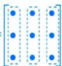

(1)求 $\lambda$ 的值；

每块都是一个列向量，且每个列向量都是方程组的解

(2) 证明 $|\pmb{B}| = 0$

补充 解的概念：对于方程而言（无论方程、方程组、线性方程组、微分方程和积分方程），把解代入方程中，使得等式恒成立，就被称为解。

分析 由于 $\pmb{B}$ 的每个列向量都是方程组的解，根据解的性质，把矩阵列分块代入方程组，方程组成立.

(1) 解 把齐次线性方程组记为 $Ax = 0$ ，并记 $\pmb{B} = [\pmb{\beta}_1, \pmb{\beta}_2, \pmb{\beta}_3]$ .

系数矩阵 $A = \begin{bmatrix} 1 & 2 & -2\\ 2 & -1 & \lambda \\ 3 & 1 & -1 \end{bmatrix}$ ， $x = \left[ \begin{array}{l}x_{1}\\ x_{2}\\ x_{3} \end{array} \right]$ 则 $Ax = \begin{bmatrix} 1 & 2 & -2\\ 2 & -1 & \lambda \\ 3 & 1 & -1 \end{bmatrix} \begin{bmatrix} x_1\\ x_2\\ x_3 \end{bmatrix} = \begin{bmatrix} 0\\ 0\\ 0 \end{bmatrix} = \mathbf{0}\Rightarrow [1,2, - 2]\begin{bmatrix} x_1\\ x_2\\ x_3 \end{bmatrix} = 0$ 又 $\pmb{B}$ 的每一列都是方程组 $A\begin{bmatrix} x_1\\ x_2\\ x_3 \end{bmatrix} = \mathbf{0}$ 的解，故应有 $A\beta_{i} = \mathbf{0}(i = 1,2,3)$ .方程 $x_{1} + 2x_{2} - 2x_{3} = 0$ 代入 $\beta_{1},\beta_{2},\beta_{3}$

$$
A \beta_ {1} = 0, A \beta_ {2} = 0, A \beta_ {3} = 0
$$

由于 $B \neq O$ ，故 $\beta_{1}, \beta_{2}, \beta_{3}$ 不全为零向量，即 $Ax = 0$ 有非零解，则其系数行列式为零，即

至少有一个非零向量 至少有一个非零解注意这个基本定义

$$
\begin{array}{r l} & {\left| A \right| = \left| \begin{array}{l l l} {1} & {2} & {- 2} \\ {2} & {- 1} & {\lambda} \\ {3} & {1} & {- 1} \end{array} \right| = \left| \begin{array}{l l l} {1} & {2} & {0} \\ {2} & {- 1} & {\lambda - 1} \\ {3} & {1} & {0} \end{array} \right| = (- 1) ^ {2 + 3} (\lambda - 1) (1 - 6) = 5 (\lambda - 1) = 0,} \\ & {\quad \quad \quad \quad \quad \quad \quad \quad \quad \quad \quad \quad \quad \quad \quad \quad \quad \quad \quad \quad \quad \quad \quad \quad \quad \quad \quad \quad \quad \quad \quad \quad \quad \quad \quad \quad \quad \quad \quad \quad \quad \quad \quad \quad \quad \quad \quad \quad \quad \quad \quad} \\ & {\qquad \qquad \qquad \qquad \qquad \qquad \qquad \qquad \qquad \qquad \qquad \qquad \qquad \qquad \qquad \qquad \qquad \qquad \qquad \qquad \qquad \qquad \qquad 1 倍 加 至} \\ & {\qquad \qquad \qquad \qquad \qquad \qquad \qquad \qquad \qquad \qquad \qquad \qquad \qquad \qquad \qquad \qquad \qquad \qquad \qquad \qquad \qquad \qquad \qquad \qquad \qquad \qquad \qquad \qquad = O} \\ & {\qquad \qquad \qquad \qquad \qquad \qquad \qquad \qquad \qquad \qquad \qquad \qquad \qquad \qquad \qquad \qquad = O.} \\ & {\qquad \qquad \qquad \qquad \qquad \qquad \qquad \qquad \qquad \qquad 0.} \\ & {\qquad 0.} \\ & {\qquad 0.} \\ & {\qquad 0.} \\ & {\qquad 0.} \\ & {\qquad 0.} \\ & {\qquad 0.} \\ & {\qquad 0.} \\ & {\qquad 0.} \\ & {\qquad 0.} \\ & {\qquad 0.} \\ & {\qquad 0.} \\ & {\mathbf {A}} \\ & {\mathbf {B}} \\ & {\mathbf {C}} \\ & {\mathbf {D}} \\ & {\mathbf {E}} \\ & {\mathbf {F}} \\ & {\mathbf {G}} \\ & {\mathbf {H}} \\ & {\mathbf {I}} \\ & {\mathbf {J}} \\ & {\mathbf {K}} \\ & {\mathbf {L}} \\ & {\mathbf {M}} \\ & {\mathbf {N}} \\ & {\mathbf {O}} \\ & {\mathbf {P}} \\ & {\mathbf {Q}} \\ & {\mathbf {R}} \\ & {\mathbf {S}} \\ & {\mathbf {T}} \\ & {\mathbf {U}} \\ & {\mathbf {V}} \\ & {\mathbf {W}} \\ & {\mathbf {X}} \\ & {\mathbf {Y}} \\ & {\mathbf {Z}} \\ & {\mathbf {O}} \\ & {\mathbf {P}} \\ & {\mathbf {Q}} \\ & {\mathbf {R}} \\ & {\mathbf {S}} \\ & {\mathbf {T}} \\ & {\mathbf {U}} \\ & {\mathbf {V}} \\ & {\mathbf {W}} \\ & {\mathbf {O}} \\ & {\mathbf {P}} \\ & {\mathbf {Q}} \\ & {\mathbf {R}} \\ & {\mathbf {S}} \\ & {\mathbf {T}} \\ & {\mathbf {U}} \\ & {\mathbf {V}} \\ & {\mathbf {W}} \\ & {\mathbf {O}} \\ & {\mathbf {P}} \\ & {\mathbf {Q}} \\ &{\mathbf{R}}\\ &{\mathbf{S}}\\ &{\mathbf{T}}\\ &{\mathbf{U}}\\ &{\mathbf{V}}\\ &{\mathbf{W}}\\ &{\mathbf{O}}\\ &{\mathbf{P}}\\ &{\mathbf{Q}}\\ &{\mathbf{R}}\\ &{\mathbf{S}}\\ &{\mathbf{T}}\\ &{\mathbf{U}}\\ &{\mathbf{V}}\\ &{\mathbf{W}}\\ &{\mathbf{O}}\\ &{\mathbf{P}}\\ &{\mathbf{Q}}\\ &{\mathbf{R}}\\ &{\mathbf{S}}\\ &{\mathbf{T}}\\ &{\mathbb {O}}\\ &{\mathbb {P}}\\ &{\mathbb {Q}}\\ &{\mathbb {S}}\\ &{\mathbb {T}}\\ &{\mathbb {O}}\\ &{\mathbb {P}}\\ &{\mathbb {Q}}\\ &{\mathbb {S}}\\ &{\mathbb {T}}\\ &{\mathbb {O}}\\ &{\mathbb {P}}\\ &{\mathbb {Q}}\\ &{\mathbb {S}}\\ &{\mathbb {T}}\\ &{\mathbb {O}}\\ &{\mathbb {P}}\\ &{\mathbb {Q}}\\ &{\mathbb {S}}\\ &{\text {(i)}}\\ &{\text {(i)}}\\ &{\text {(i)}}\\ &{\text {(i)}}\\ &{\text {(i)}}\\ &{\text {(i)}}\\ &{\text {(i)}}\\ &{\text {(i)}}\\ &{\text {(i)}}\\ &{\text {(i)}}\\ &{\text {(i)}}\\ &{\text {(i)}}\\ &{\text {(i)}}\\ &{\text {(i)}}\\ &{\text {(i)}}\\ &
\end{array}
$$

(2) 证 $O = [A\beta_{1}, A\beta_{2}, A\beta_{3}] = \underbrace{A[\beta_{1}, \beta_{2}, \beta_{3}]}_{\text{多行乘多列}} = AB$ ，即 $AB = O$ 。

（反证法）设 $|\pmb {B}|\neq 0$ ，则 $\pmb{B}$ 可逆，在 $AB = O$ 的两端右边乘 $B^{-1}$ ，得 $A = O$ ，这与 $A = \begin{bmatrix} 1 & 2 & -2\\ 2 & -1 & 1\\ 3 & 1 & -1 \end{bmatrix} \neq 0$ 类比数：若 $b\neq 0$ ，则 $bb^{-1} = 1$ （1阶）矛盾，可见必有 $|\pmb {B}| = 0$ ：

对于矩阵：若 $|\pmb {B}|\neq 0$ ，则 $\pmb{BB}^{-1} = \pmb{E}$ （n阶）

$\Rightarrow AB = O \Rightarrow AB \cdot B^{-1} = O \cdot B^{-1} = O \Rightarrow A = O$ （矛盾），所 $3|B| = 0$

注 ① $A\beta$ 形状是一列,把矩阵当成作用于 $\beta$ 上的函数(对应法则).

② $|AB| = 0 \Rightarrow |A||B| = 0$ ，从正面解是解不出来的，因为 $|A| = 0$ ，无法判断 $|B|$ 是否为0.当从正面无计可施时，不妨考虑反证法.

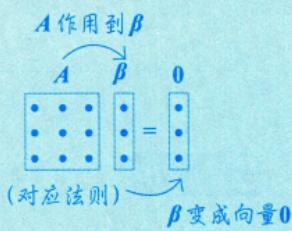

必背结论 ① $AB = O \Rightarrow B$ 的列向量均是方程组 $Ax = 0$ 的解.

② $AB = O \Rightarrow$ 若 $|B| \neq 0$ ，则 $A = O$ 。

# 基础习题精练

# 习题

1.1 设 $f(x) = \begin{vmatrix} x - 2 & x - 1 & x - 2 & x - 3 \\ 2x - 2 & 2x - 1 & 2x - 2 & 2x - 3 \\ 3x - 3 & 3x - 2 & 4x - 5 & 3x - 5 \\ 4x & 4x - 3 & 5x - 7 & 4x - 3 \end{vmatrix}$ ，则方程 $f(x) = 0$ 的根的个数为（ ）.

(A) 1

(B) 2

(C) 3

(D) 4

1.2 设 $|A| = \begin{vmatrix} 1 & -1 & 0 & 1 \\ -2 & 1 & -1 & 1 \\ 3 & -2 & 2 & -1 \\ 0 & 0 & 3 & 4 \end{vmatrix}$ , $A_{1j}$ 是元素 $a_{1j}(j = 1,2,3,4)$ 的代数余子式，则 $A_{11} - A_{12} = (\quad)$ .

(A) 4

(B)-4

(C) 2

(D)-2

1.3 多项式 $f(x) = \begin{vmatrix} x & x & 1 & 2x \\ 1 & x & 2 & -1 \\ 2 & 1 & x & 1 \\ 2 & -1 & 1 & x \end{vmatrix}$ 中 $x^3$ 项的系数为

1.4 行列式

$$
D _ {4} = \left| \begin{array}{c c c c} 1 & a & 0 & 0 \\ 0 & 1 & a & 0 \\ 0 & 0 & 1 & a \\ a & 0 & 0 & 1 \end{array} \right| = \underline {{\quad}}.
$$

1.5 行列式

$$
D _ {4} = \left| \begin{array}{l l l l} 4 & 1 & 2 & 3 \\ 3 & 4 & 1 & 2 \\ 2 & 3 & 4 & 1 \\ 1 & 2 & 3 & 4 \end{array} \right| = \underline {{\quad}}.
$$

1.6 行列式

$$
D _ {4} = \left| \begin{array}{c c c c} 1 & a & 0 & 0 \\ - 1 & 2 - a & b & 0 \\ 0 & - 2 & 3 - b & c \\ 0 & 0 & - 3 & 4 - c \end{array} \right| = \underline {{\quad}}.
$$

1.7 已知 $\left| \begin{array}{ccc}\lambda & 2 & 2\\ -2 & \lambda -2 & 2\\ 2 & 2 & \lambda -2 \end{array} \right| = 0$ ，则 $\lambda =$

1.8 已知 $\alpha_{1},\alpha_{2},\alpha_{3},\beta ,\gamma$ 均为4维列向量，且

$$
\left| \gamma , \alpha_ {1}, \alpha_ {2}, \alpha_ {3} \right| = n, \left| \alpha_ {1}, \beta + \gamma , \alpha_ {2}, \alpha_ {3} \right| = m,
$$

则 $\left|\alpha_{1},\alpha_{2},\alpha_{3},3\beta \right| =$

1.9 已知 $\alpha_{1},\alpha_{2},\alpha_{3}$ 是3维列向量，且 $|\pmb {\alpha}_1,\pmb {\alpha}_2,\pmb {\alpha}_3|\neq 0,A$ 是3阶矩阵，满足

$$
A \alpha_ {1} = \alpha_ {2} - 2 \alpha_ {3}, A \alpha_ {2} = \alpha_ {1} - \alpha_ {2} + 2 \alpha_ {3}, A \alpha_ {3} = 2 \alpha_ {1} + \alpha_ {2},
$$

则 $|\mathbf{A}| =$

1.10 若齐次线性方程组 $\left\{ \begin{array}{l} \lambda x_{1} + x_{2} + x_{3} = 0, \\ x_{1} + \lambda x_{2} + x_{3} = 0, \\ x_{1} + x_{2} + x_{3} = 0 \end{array} \right.$ 只有零解，则 $\lambda$ 应满足的条件是

1.11 设线性方程组 $\left\{ \begin{array}{l} x_{1} + 2x_{2} - 2x_{3} = 0, \\ 2x_{1} - x_{2} + \lambda x_{3} = 0, \\ 3x_{1} + x_{2} - x_{3} = 0 \end{array} \right.$ 的系数矩阵为 $A$ ，3阶矩阵 $B \neq O$ ，且 $AB = O$ ，则 $\lambda =$

# 解答

1.1 (B) 解此题实质上是计算行列式，观察计算出的关于 $x$ 的多项式的次数。在计算过程中要充分运用行列式的性质。

(-1)倍加至

$$
\begin{array}{l} f (x) = \underbrace {\left| \begin{array}{l l l l} x - 2 & x - 1 & x - 2 & x - 3 \\ 2 x - 2 & 2 x - 1 & 2 x - 2 & 2 x - 3 \\ 3 x - 3 & 3 x - 2 & 4 x - 5 & 3 x - 5 \\ 4 x & 4 x - 3 & 5 x - 7 & 4 x - 3 \end{array} \right|} _ {(- 1) \text {倍 加 垄}} = \left| \begin{array}{c c c c} x - 2 & 1 & 0 & - 1 \\ 2 x - 2 & 1 & 0 & - 1 \\ 3 x - 3 & 1 & x - 2 & - 2 \\ 4 x & - 3 & x - 7 & - 3 \end{array} \right| = \left| \begin{array}{c c c c} x - 2 & 1 & 0 & 0 \\ 2 x - 2 & 1 & 0 & 0 \\ 3 x - 3 & 1 & x - 2 & - 1 \\ 4 x & - 3 & x - 7 & - 6 \end{array} \right| \\ = \left| \begin{array}{l l l} x - 2 & 1 \end{array} \right| \left| \begin{array}{l l} x - 2 & - 1 \\ 2 x - 2 & 1 \end{array} \right| = 5 x (x - 1), \\ \end{array}
$$

由此可知 $f(x)$ 是二次多项式，故应选(B).

注 不要错误地认为 $f(x)$ 一定是四次多项式.

1.2 (B) 解

$$
A _ {1 1} - A _ {1 2} = A _ {1 1} - A _ {1 2} + 0 A _ {1 3} + 0 A _ {1 4} = \left| \begin{array}{c c c c} 1 & - 1 & 0 & 0 \\ - 2 & 1 & - 1 & 1 \\ 3 & - 2 & 2 & - 1 \\ 0 & 0 & 3 & 4 \end{array} \right| = \left| \begin{array}{c c c c} 1 & 0 & 0 & 0 \\ - 2 & - 1 & - 1 & 1 \\ 3 & 1 & 2 & - 1 \\ 0 & 0 & 3 & 4 \end{array} \right| = \left| \begin{array}{c c c} - 1 & - 1 & 1 \\ 1 & 2 & - 1 \\ 0 & 3 & 4 \end{array} \right| = - 4.
$$

1.3 -5 解 将 $f(x)$ 按第一行展开，有

$$
f (x) = \left| \begin{array}{c c c c} x & x & 1 & 2 x \\ 1 & x & 2 & - 1 \\ 2 & 1 & x & 1 \\ 2 & - 1 & 1 & x \end{array} \right| = x \left| \begin{array}{c c c} x & 2 & - 1 \\ 1 & x & 1 \\ - 1 & 1 & x \end{array} \right| - x \left| \begin{array}{c c c} 1 & 2 & - 1 \\ 2 & x & 1 \\ 2 & 1 & x \end{array} \right| + \left| \begin{array}{c c c} 1 & x & - 1 \\ 2 & 1 & 1 \\ 2 & - 1 & x \end{array} \right| - 2 x \left| \begin{array}{c c c} 1 & x & 2 \\ 2 & 1 & x \\ 2 & - 1 & 1 \end{array} \right|.
$$

只有在第二项与第四项中含有 $x^{3}$ 的项，而

$$
- x \left| \begin{array}{c c c} 1 & 2 & - 1 \\ 2 & x & 1 \\ 2 & 1 & x \end{array} \right| \text {和} - 2 x \left| \begin{array}{c c c} 1 & x & 2 \\ 2 & 1 & x \\ 2 & - 1 & 1 \end{array} \right|
$$

中含有 $x^{3}$ 的项分别为 $-x^{3}$ 和 $-4x^{3}$ ，所以 $f(x)$ 中 $x^{3}$ 项的系数为-5.

$$
\begin{array}{r l} & {\text {按 此 行 展 开}} \\ & {\left| \begin{array}{l l l l} 1 & a & 0 & 0 \\ 0 & 1 & a & 0 \\ 0 & 0 & 1 & a \\ a & 0 & 0 & 1 \end{array} \right| = \left| \begin{array}{l l l} 1 & a & 0 \\ 0 & 1 & a \\ 0 & 0 & 1 \end{array} \right| - a \left| \begin{array}{l l l} 0 & a & 0 \\ 0 & 1 & a \\ a & 0 & 1 \end{array} \right| = 1 - a ^ {4}.} \end{array}
$$

$$
\begin{array}{l} \text {1 倍 加 至} \\ 1 6 0 \quad \text {解} \quad D _ {4} = \left| \begin{array}{c c c c} 4 & 1 & 2 & 3 \\ 3 & 4 & 1 & 2 \\ 2 & 3 & 4 & 1 \\ 1 & 2 & 3 & 4 \end{array} \right| = \left| \begin{array}{c c c c} 1 0 & 1 & 2 & 3 \\ 1 0 & 4 & 1 & 2 \\ 1 0 & 3 & 4 & 1 \\ 1 0 & 2 & 3 & 4 \end{array} \right| = \left| \begin{array}{c c c c} 1 & 1 & 2 & 3 \\ 1 & 4 & 1 & 2 \\ 1 & 3 & 4 & 1 \\ 1 & 2 & 3 & 4 \end{array} \right| = \left| \begin{array}{c c c c} (- 1) \text {倍 加 至} \\ \text {加 至} \\ - (- 1) \text {倍 加 至} \end{array} \right| = 1 0 \left| \begin{array}{c c c c} 1 & 1 & 2 & 3 \\ 0 & 3 & - 1 & - 1 \\ 0 & 2 & 2 & - 2 \\ 0 & 1 & 1 & 1 \end{array} \right| \text {互 换} \end{array}
$$

$$
= - 1 0 \left| \begin{array}{c c c c} 1 & 1 & 2 & 3 \\ 0 & 1 & 1 & 1 \\ 0 & 2 & 2 & - 2 \\ 0 & 3 & - 1 & - 1 \end{array} \right| = 1 0 \text {互 换} \left| \begin{array}{c c c c} 1 & 1 & 2 & 3 \\ 0 & 1 & 1 & 1 \\ 0 & 3 & - 1 & - 1 \\ 0 & 2 & 2 & - 2 \end{array} \right| \stackrel {(- 2) \text {倍 加 至}} {\underset {- \text {加 至}} {\left(- 3\right) \text {倍}}} = 1 0 \left| \begin{array}{c c c c} 1 & 1 & 2 & 3 \\ 0 & 1 & 1 & 1 \\ 0 & 0 & - 4 & - 4 \\ 0 & 0 & 0 & - 4 \end{array} \right| = 1 6 0.
$$

1.6 24 解

$$
\begin{array}{l} D _ {4} = \left| \begin{array}{c c c c c} 1 & a & 0 & 0 & 1 \text {倍} \\ - 1 & 2 - a & b & 0 & \downarrow \text {加 至} \\ 0 & - 2 & 3 - b & c & 1 \text {倍} \\ 0 & 0 & - 3 & 4 - c & \text {加 至} \end{array} \right| \begin{array}{c c c c} 1 & a & 0 & 0 \\ 0 & 2 & b & 0 \\ 0 & - 2 & 3 - b & c \\ 0 & 0 & - 3 & 4 - c \end{array} \\ = \left| \begin{array}{c c c c} 1 & a & 0 & 0 \\ 0 & 2 & b & 0 \\ 0 & 0 & 3 & c \\ 0 & 0 & - 3 & 4 - c \end{array} \right| = \left| \begin{array}{c c c c} 1 & a & 0 & 0 \\ 0 & 2 & b & 0 \\ 0 & 0 & 3 & c \\ 0 & 0 & 0 & 4 \end{array} \right| = 2 4. \\ \end{array}
$$

1.7 0或4解

$$
\begin{array}{l} 1 \text {倍} \quad \lambda \quad 2 \quad 2 \quad \lambda \quad 2 \quad 2 \quad \lambda \quad 2 \quad 2 \quad \lambda \quad 2 \quad 2 \quad 2 \quad 2 \quad 2 \quad 2 \quad 2 \quad 2 \quad 2 \quad 2 \quad 2 \quad 2 \quad 2 \quad 2 \quad 2 \quad 2 \quad 2 \quad 2 \quad 2 \quad 2 \quad 2 \quad 2 \quad 2 \quad 2 \quad 2 \quad 1 \\ \begin{array}{r l} \text {按 此 行 展 开} & = \lambda \left| \begin{array}{l l l} \lambda & 0 & 0 \\ 0 & 1 & 1 \\ 2 & 2 & \lambda - 2 \end{array} \right| = \lambda^ {2} (\lambda - 4) = 0, \end{array} \\ \end{array}
$$

故 $\lambda = 0$ 或4.

1.8 $3(m + n)$ 解因为

$$
\begin{array}{l} m = \left| \alpha_ {1}, \beta + \gamma , \alpha_ {2}, \alpha_ {3} \right| = \left| \alpha_ {1}, \overleftrightarrow {\beta}, \overleftrightarrow {\alpha_ {2}}, \alpha_ {3} \right| + \left| \overleftrightarrow {\alpha_ {1}}, \gamma , \alpha_ {2}, \alpha_ {3} \right| \\ = - \left| \alpha_ {1}, \alpha_ {2}, \beta , \overline {{\alpha}} _ {3} \right| - \left| \gamma , \alpha_ {1}, \alpha_ {2}, \alpha_ {3} \right| \\ = \left| \alpha_ {1}, \alpha_ {2}, \alpha_ {3}, \beta \right| - \left| \gamma , \alpha_ {1}, \alpha_ {2}, \alpha_ {3} \right| \\ = \left| \alpha_ {1}, \alpha_ {2}, \alpha_ {3}, \beta \right| - n, \\ \end{array}
$$

所以 $\left|\pmb{\alpha}_{1},\pmb{\alpha}_{2},\pmb{\alpha}_{3},\pmb{\beta}\right| = m + n,$

故 $\left|\pmb{\alpha}_{1},\pmb{\alpha}_{2},\pmb{\alpha}_{3},\widehat{3\beta}\right| = 3\left|\pmb{\alpha}_{1},\pmb{\alpha}_{2},\pmb{\alpha}_{3},\pmb{\beta}\right| = 3(m + n).$

利用行列式的性质将未知行列式化成已知行列式是解决此类问题的关键.

1.9 -2 解 $A[\pmb{\alpha}_1, \pmb{\alpha}_2, \pmb{\alpha}_3] = [\pmb{A}\pmb{\alpha}_1, \pmb{A}\pmb{\alpha}_2, \pmb{A}\pmb{\alpha}_3] = [\pmb{\alpha}_2 - 2\pmb{\alpha}_3, \pmb{\alpha}_1 - \pmb{\alpha}_2 + 2\pmb{\alpha}_3, 2\pmb{\alpha}_1 + \pmb{\alpha}_2]$ ,

等式两边取行列式，有

$$
\left| A \right| \left| \alpha_ {1}, \alpha_ {2}, \alpha_ {3} \right| = \left| \alpha_ {2} - 2 \alpha_ {3}, \alpha_ {1} - \alpha_ {2} + 2 \alpha_ {3}, 2 \alpha_ {1} + \alpha_ {2} \right|
$$

$$
= \left| \begin{array}{l l l} \alpha_ {1}, & \alpha_ {2}, & \alpha_ {3} \end{array} \right| \left| \begin{array}{l l l} 0 & 1 & 2 \\ 1 & - 1 & 1 \\ - 2 & 2 & 0 \end{array} \right|.
$$

因 $\left|\alpha_{1},\alpha_{2},\alpha_{3}\right| \neq 0$ ，故

$$
\begin{array}{r} {\left| \boldsymbol {A} \right| = \left| \begin{array}{l l l} {0} & {1} & {2} \\ {1} & {- 1} & {1} \\ {- 2} & {2} & {0} \end{array} \right| = \left| \begin{array}{l l l} {0} & {1} & {2} \\ {1} & {- 1} & {1} \\ {0} & {0} & {2} \end{array} \right| = - 2 .} \end{array}
$$

1.10 $\lambda \neq 1$ 解 方程组的系数行列式为

$$
D = \left| \begin{array}{c c c} \lambda & 1 & 1 \\ 1 & \lambda & 1 \\ 1 & 1 & 1 \end{array} \right| = \left| \begin{array}{c c c} \lambda - 1 & 0 & 0 \\ 0 & \lambda - 1 & 0 \\ 1 & 1 & 1 \end{array} \right| = (\lambda - 1) ^ {2}.
$$

由于该齐次线性方程组只有零解 $\Leftrightarrow D\neq 0$ ，故得 $\lambda \neq 1$ ：

1.11 1 解设 $B = \left[\beta_{1},\beta_{2},\beta_{3}\right]$ ，其中 $\beta_{1},\beta_{2},\beta_{3}$ 是3维列向量.由于 $B\neq O$ ，故至少存在一个非零的列向量，不妨设 $\beta_{1}\neq 0$ .由 $AB = A\left[\beta_1,\beta_2,\beta_3\right] = 0$ ，知 $A\beta_{1} = 0$ .因此线性方程组有非零解 $\beta_{1}$ ，所以

$$
\left| \boldsymbol {A} \right| = \left| \begin{array}{c c c} 1 & 2 & - 2 \\ 2 & - 1 & \lambda \\ 3 & 1 & - 1 \end{array} \right| = 5 (\lambda - 1) = 0,
$$

从而解得 $\lambda = 1$
