# 第2讲

矩阵

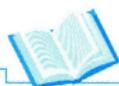

# 基础知识结构

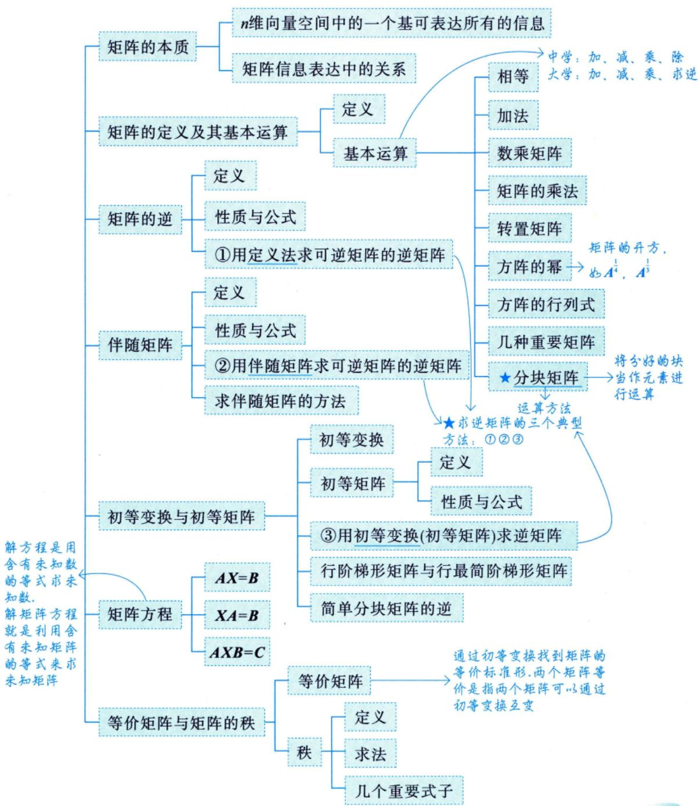

# 一 矩阵的本质

假如英语系有98个女生，2个男生；机械系有95个男生，5个女生.你能把这个系统信息表达出来吗？这个问题的回答是显然而且简单的：

英语系 机械系

男生人数 2 女生人数 98

$$
\left. \begin{array}{l} 9 5 \\ 5 \end{array} \right] _ {2 \times 2}.
$$

在这个数表中，我们可以看到：第1列表达了英语系的男、女生人数，第2列表达了机械系的男、女生人数，而第1行表达了不同系的男生人数，第2行表达了不同系的女生人数.

这就是考生对矩阵的初步认识——表达系统信息★.

思考 如何体现“系统”两字？

示例

已知 $A = \begin{bmatrix} a_{11} & a_{12}\\ a_{21} & a_{22} \end{bmatrix}$ ，则 $k\mathbf{A} = \begin{bmatrix} ka_{11} & ka_{12}\\ ka_{21} & ka_{22} \end{bmatrix}$

注（1）数乘矩阵要将矩阵中的每一个元素都乘 $k$ ，保证系统性不变，即两行、两列间比例未发生变化.故对矩阵 $\mathbf{A} = (a_{ij})_{n\times n}$ ，则

先用数 $k$ 乘矩阵 $\mathbf{A}$ ，再求行列式 $|k\mathbf{A}| = \begin{vmatrix} ka_{11} & ka_{12} & \dots & ka_{1n}\\ ka_{21} & ka_{22} & \dots & ka_{2n}\\ \vdots & \vdots & & \vdots \\ ka_{n1} & ka_{n2} & \dots & ka_{nn} \end{vmatrix} = k^n |A|$

（2）数乘行列式只需将行列式的某一列（行）元素乘 $k$ ，即 $k|A| = \begin{vmatrix} ka_{11} & ka_{12}\\ a_{21} & a_{22} \end{vmatrix}$ .

$n$ 维向量空间中的一个基可表达所有信息

示例 现有两个研究指标 $a, b$ ，且取4组数据，构成矩阵 $\mathbf{A} = \begin{bmatrix} 1 & 0 \\ 0 & 1 \\ 2 & 5 \\ 4 & 7 \end{bmatrix}_{4\times 2}$

将 $i = [1,0], j = [0,1]$ 代入2维平面， $i$ ， $j$ 为基，可以形成任何向量，即 $i$ ， $j$ 张成一个2维平面（2维空间），如图2-1所示.

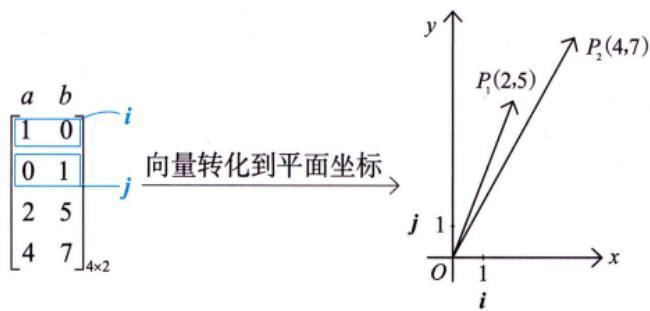  
图2-1

此时 $\overrightarrow{OP}_1 = 2\mathbf{i} + 5\mathbf{j} = [2,5]$ ， $\overrightarrow{OP}_2 = 4\mathbf{i} + 7\mathbf{j} = [4,7]$

总结 $①$ 只要平面上的两个向量是正交垂直的，就可以作为2维平面上的一个基来表达平面上的所有向量.

后续学习中,会发现不需要正交垂直,只需要两个向量线性无关(不平行),就可以作为2维平面的一个基. 垂直只是一种特殊情况

②任何一个矩阵，一定可以通过代数的方法找到它的基，即可以找到一个矩阵中的一种信息（一组向量），这些向量（作为基）能张成一个空间，剩下的矩阵中的信息，都可以由这个基（向量）表示出来。

# $\Theta$ 矩阵信息表达中的关系

从实际问题来讲，一个矩阵具有奇奇怪怪的形状，不一定是方形，比如矩阵 $\mathbf{A}$ 与转置 $\mathbf{A}^{\mathrm{T}}$ ：

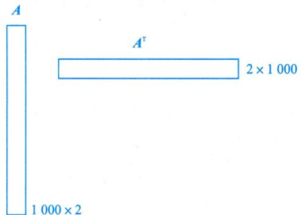

示例 现在取矩阵中的数据，如何求图2-2曲边梯形的面积？

在高等数学中，直接积分即可，但牛顿-莱布尼茨公式往往只有理论上的意义

$\rightarrow$ 曲边梯形的面积

利用高等数学的方法我们直接用 $\int_0^1 f(x)\mathrm{d}x = F(1) - F(0)$ ，但实际中并不是所有的函数都能找到原函数。

高等数学中还留有余地，能找到原函数

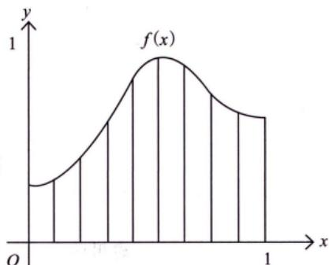  
图2-2

① 写出一个 $1000 \times 2$ 的矩阵，将 $x \in (0,1), y \in (0,1)$ 的坐标放入矩阵，可得

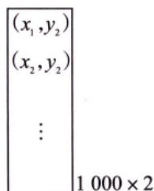

② 取1000个点 $(x_{i},y_{i})$ ，随机出现在 $[0,1]\times [0,1]$ 平面内，每个点等可能、均匀地分布（见图2-3），故 $f(x)$ 下方的点个数就是曲边梯形的面积.（精度越高，越准确）总点个数

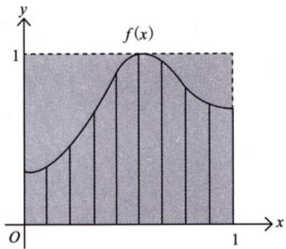  
图2-3

$$
\int_ {0} ^ {1} f (x) \mathrm {d} x = F (1) - F (0) = 1 \cdot \frac {n}{1 0 0 0}. \quad \text {曲 线} f (x) \text {下 面 的 点 的 个 数}
$$

此种方法脱离了分析法，不用去找原函数，也不用去大量计算，交给计算机处理即可（数值模拟容易实现）.

思考 但有些时候，数据的出现我们要求它服从某种规律，并不要求是均匀的，这种情况就需要对矩阵表达式进行信息的转换和提取，可能会涉及矩阵中数据与数据之间的关系，那么怎么去找这个关系呢？

$\pmb{\mathcal{O}}$ 补充 Gram矩阵（以下是最简单的矩阵）.

示例1 已知 $A = \begin{bmatrix} a\\ b \end{bmatrix} = \alpha$ ，怎么进行研究呢？

不妨取一个转置 $A^{\mathrm{T}} = [a,b] = \alpha^{\mathrm{T}}$ ，则

$$
\boldsymbol {A} ^ {\mathrm {T}} \boldsymbol {A} = [ a, b ] \left[ \begin{array}{l} a \\ b \end{array} \right] = \boldsymbol {\alpha} ^ {\mathrm {T}} \cdot \boldsymbol {\alpha} = | | \boldsymbol {\alpha} | | ^ {2} \longrightarrow \text {内 积}
$$

$$
\begin{array}{r l} & {\alpha \text {的 模}} \\ & {= \| \alpha \| \| \alpha \| \cdot \cos \theta .} \end{array}
$$

$\pmb{\alpha}$ 与 $\pmb{\alpha}$ 之间的夹角的余弦，也可表示两个向量间的相关程度

示例2 若 $A = \begin{bmatrix} a_1 & a_2 \\ b_1 & b_2 \end{bmatrix} = [\pmb{a}_1, \pmb{a}_2]$

则

$$
\boldsymbol {A} ^ {\mathrm {T}} = \left[ \begin{array}{l} \boldsymbol {a} _ {1} ^ {\mathrm {T}} \\ \boldsymbol {a} _ {2} ^ {\mathrm {T}} \end{array} \right] = \left[ \begin{array}{l l} a _ {1} & b _ {1} \\ a _ {2} & b _ {2} \end{array} \right],
$$

此时，

$$
\boldsymbol {A} ^ {\mathrm {T}} \boldsymbol {A} = \left[ \begin{array}{l} \boldsymbol {\alpha} _ {1} ^ {\mathrm {T}} \\ \boldsymbol {\alpha} _ {2} ^ {\mathrm {T}} \end{array} \right] \left[ \begin{array}{l} \boldsymbol {\alpha} _ {1}, \boldsymbol {\alpha} _ {2} \end{array} \right] = \left[ \begin{array}{l l} \| \boldsymbol {\alpha} _ {1} \| \| \boldsymbol {\alpha} _ {1} \| \cos \theta_ {1 1} & \| \boldsymbol {\alpha} _ {1} \| \| \boldsymbol {\alpha} _ {2} \| \cos \theta_ {1 2} \\ \| \boldsymbol {\alpha} _ {2} \| \| \boldsymbol {\alpha} _ {1} \| \cos \theta_ {2 1} & \| \boldsymbol {\alpha} _ {2} \| \| \boldsymbol {\alpha} _ {2} \| \cos \theta_ {2 2} \end{array} \right].
$$

注1 矩阵的转置与矩阵本身相乘，属于易考点。

注2实际上， $A^{\mathrm{T}}A$ 是所要研究的这个矩阵信息中的一个非常典型的代表.因为它们相乘后，丰富的信息就出来了.我们可以知道，在这样一个矩阵中可以看到每个向量的长度，即每个向量的大小；每个向量之间的相关程度也找到了，即 $\cos \theta$ ：

其中， $\cos \theta$ 在分析学里叫位置关系；在代数里表示向量间的相关程度，或者叫相依程度，也称为余弦的相似度。

相似度很关键，坐标系中只能表示2维、3维向量的长度和方向，但实际数据一般会出现超过2维、3维的情况.

比如，数据指标多一点，4维、5维的情况就出现了，但4维情况下向量的大小是测量不出来的。而且，这两个向量之间的关系也是未知的，比如向量的方向是什么？向量的夹角是多少？在高维空间中是不可能画出这些的。

怎么研究呢？作一个矩阵的简单运算即可.把这些向量的模长划掉，就可以直接找到它们之间的相似度的一个矩阵.

$$
\left[ \begin{array}{l l} \| \boldsymbol {\alpha} _ {1} \| \| \boldsymbol {\alpha} _ {1} \| \cos \theta_ {1 1} & \| \boldsymbol {\alpha} _ {1} \| \| \boldsymbol {\alpha} _ {2} \| \cos \theta_ {1 2} \\ \| \boldsymbol {\alpha} _ {2} \| \| \boldsymbol {\alpha} _ {1} \| \cos \theta_ {2 1} & \| \boldsymbol {\alpha} _ {2} \| \| \boldsymbol {\alpha} _ {2} \| \cos \theta_ {2 2} \end{array} \right]
$$

模长划掉

$$
\left[ \begin{array}{l l} \cos \theta_ {1 1} & \cos \theta_ {1 2} \\ \cos \theta_ {2 1} & \cos \theta_ {2 2} \end{array} \right]
$$

此时，向量中数据之间的相关性就可以通过余弦相似度矩阵很好地分析出来了。

后续还会学习，为什么要求特征值与特征向量？因为一个矩阵，不仅可以如 $A^{\mathrm{T}}A$ 这样乘，还可以分解.一个矩阵分解后，就能看出哪些数据是主要的，这样可以作主成分分析，也可以去找这些数据中的最值.

在传统意义上，比如工程中的材料，它在各方向上的受力是不一样的。因为不同的材料，即使给它一个总的作用力，其内部各个方向上所产生的反应力都是不一样的。所以，其受力最值点的方向是我们最关注的。为什么呢？因为这个方向是材料最薄弱的方向。在加固材料时，要考虑怎样对它加强，而不是所有方向都要加强。有些方向加强是没有意义的，如果最弱的那个方向没有加强，则这个材料还是容易被破坏的。

同样地，经济上有经济量的最值的问题。

注 (1)正交矩阵其实就是作数据的一个旋转；

(2) 上三角矩阵、下三角矩阵，实际上是作数据的一个剪切变形；  
(3) 矩阵 $A + B$ 、矩阵 $A - B$ ，实际上是作数据平移.

但考生对矩阵的认识不可止步于此. 再看一个矩阵：

$$
\left[ \begin{array}{c c c} 1 & 2 & 3 \\ 6 & 7 & 9 \\ 2 & 4 & 6 \end{array} \right].
$$

事实上，我们不必再给这个矩阵赋予具体背景了，因为可以抽象地认为这是一个系统信息的表达。以下两个重要观点，供大家在学习相关知识后参考。

重要观点1 矩阵是由若干行（列）向量拼成的——上面那个矩阵可以看作是由三个行向量[1,2,3],

[6, 7, 9]与[2, 4, 6]组成的，也可以看作是由三个列向量 $[1, 6, 2]^{\mathrm{T}}$ ， $[2, 7, 4]^{\mathrm{T}}$ 与 $[3, 9, 6]^{\mathrm{T}}$ 组成的.

重要观点2 矩阵不能运算, 但是其若干行 (列) 向量之间可能存在着某种关系——你是否看到 [1, 2, 3] 与 [2, 4, 6] 这两个向量是平行的 (存在线性关系), 而 [1, 2, 3] 与 [6, 7, 9], [2, 4, 6] 与 [6, 7, 9] 之间却不存在这种线性关系. 这种关系反映了矩阵的本质——矩阵的秩——这个矩阵的秩是 2.

行列式的两竖线就相当于一个对应法则，但是矩阵没有，它只能表达系统信息，本身不涉及运算

# 二 矩阵的定义及其基本运算

# $\langle \rangle$ 矩阵的定义

由 $m \times n$ 个数 $a_{ij} (i = 1, 2, \dots, m; j = 1, 2, \dots, n)$ 排成的 $m$ 行 $n$ 列的矩形表格

$$
\left[ \begin{array}{c c c c} a _ {1 1} & a _ {1 2} & \dots & a _ {1 n} \\ a _ {2 1} & a _ {2 2} & \dots & a _ {2 n} \\ \vdots & \vdots & & \vdots \\ a _ {m 1} & a _ {m 2} & \dots & a _ {m n} \end{array} \right] \cdot m \text {行}
$$

称为一个 $m \times n$ 矩阵, 简记为 $\mathbf{A}$ 或 $(a_{ij})_{m \times n} (i = 1, 2, \dots, m; j = 1, 2, \dots, n)$ . 当 $m = n$ 时, 称 $\mathbf{A}$ 为 $n$ 阶方阵. 两个矩阵 $\mathbf{A} = (a_{ij})_{m \times n}, \mathbf{B} = (b_{ij})_{s \times k}$ , 若 $m = s, n = k$ , 则称 $\mathbf{A}$ 与 $\mathbf{B}$ 为同型矩阵. (两个矩阵的行数、列数相等)

# $\Theta$ 矩阵的基本运算

注意 $A, B$ 不一定是方阵，但 $A^{\mathrm{T}}A, B^{\mathrm{T}}B$ 一定是方阵.

反映出两个矩阵包含的信息完全一致。

(1) 相等 $A = (a_{ij})_{m \times n} = B = (b_{ij})_{s \times k} \Leftrightarrow m = s, n = k$ ，且 $a_{ij} = b_{ij} (i = 1, 2, \dots, m; j = 1, 2, \dots, n)$ ，即 $A, B$ 是同型矩阵，且对应元素相等。（ $a_{11} = b_{11}, a_{12} = b_{12}, \dots$ ）

(2)加法 两个矩阵是同型矩阵时，可以相加，即

$$
\boldsymbol {C} = \boldsymbol {A} + \boldsymbol {B} = \left(a _ {i j}\right) _ {m \times n} + \left(b _ {i j}\right) _ {m \times n} = \left(c _ {i j}\right) _ {m \times n},
$$

其中， $c_{ij} = a_{ij} + b_{ij}(i = 1,2,\dots ,m;j = 1,2,\dots ,n)$ ，即对应元素相加.

(3) 数乘矩阵 设 $k$ 是一个数， $A$ 是一个 $m \times n$ 矩阵。数 $k$ 和 $A$ 的乘积称为数乘矩阵，即

$$
\begin{array}{l} k A = A k = k \left[ \begin{array}{c c c c} a _ {1 1} & a _ {1 2} & \dots & a _ {1 n} \\ a _ {2 1} & a _ {2 2} & \dots & a _ {2 n} \\ \vdots & \vdots & & \vdots \\ a _ {m 1} & a _ {m 2} & \dots & a _ {m n} \end{array} \right] = \left[ \begin{array}{c c c c} k a _ {1 1} & k a _ {1 2} & \dots & k a _ {1 n} \\ k a _ {2 1} & k a _ {2 2} & \dots & k a _ {2 n} \\ \vdots & \vdots & & \vdots \\ k a _ {m 1} & k a _ {m 2} & \dots & k a _ {m n} \end{array} \right] \\ = \left(k a _ {i j}\right) _ {m \times n}, \\ \end{array}
$$

即 $\pmb{A}$ 的每个元素都乘以 $k$ ：

加法运算和数乘运算统称为矩阵的线性运算，满足下列运算规律：

① 交换律 $A + B = B + A$   
②结合律 $(A + B) + C = A + (B + C)$   
③分配律 $k(A + B) = kA + kB, (k + l)A = kA + lA;$   
④ 数和矩阵相乘的结合律 $k(L\mathbf{A}) = (kl)\mathbf{A} = l(k\mathbf{A}).$

基本运算（跟中学代数计算无区别）

其中， $A,B,C$ 是同型矩阵， $k,l$ 是任意常数．（使用条件）

（作乘法的条件）

(4) 矩阵的乘法 设 $A$ 是 $\frac{m \times s}{m}$ 矩阵， $B$ 是 $s \times n$ 矩阵（矩阵 $A$ 的列数必须与矩阵 $B$ 的行数相等），则 $A, B$ 可以相乘，乘积 $AB$ 是 $m \times n$ 矩阵，记 $C = AB = (c_{ij})_{m \times n}$ . $C$ 的第 $i$ 行第 $j$ 列元素 $c_{ij}$ 是 $A$ 的第 $i$ 行的 $s$ 个元素与 $B$ 的第 $j$ 列的 $s$ 个对应元素两两乘积之和，即

$$
c _ {i j} = \sum_ {k = 1} ^ {s} a _ {i k} b _ {k j} = a _ {i 1} b _ {1 j} + a _ {i 2} b _ {2 j} + \dots + a _ {i s} b _ {s j} (i = 1, 2, \dots , m; j = 1, 2, \dots , n).
$$

$$
\boldsymbol {C} = \boldsymbol {A} \times \boldsymbol {B}
$$

$$
= \left[ \begin{array}{l l} \square & \square \\ \square & \square \\ \square & \square \end{array} \right] _ {3 \times 2} \times \left[ \begin{array}{l l l l} \square & \square & \square & \square \\ \square & \square & \square & \square \end{array} \right] _ {2 \times 4}
$$

$A$ 的第1行乘 $B$ 的第1列 $\rightarrow$ 多行乘多列

$$
= \left[ \begin{array}{l l l l} c _ {1 1} & c _ {1 2} & c _ {1 3} & c _ {1 4} \\ c _ {2 1} & c _ {2 2} & c _ {2 3} & c _ {2 4} \\ c _ {3 1} & c _ {3 2} & c _ {3 3} & c _ {3 4} \end{array} \right] _ {3 \times 4},
$$

其中， $c_{11}$ 代表 $\pmb{A}$ 的第1行与 $\pmb{B}$ 的第1列对应元素相乘之和， $c_{ij}$ 代表 $\pmb{A}$ 的第 $i$ 行与 $\pmb{B}$ 的第 $j$ 列对应元素相乘之和. 行向量与列向量作内积

回想前面的Gram矩阵.

$$
\underline {{\left[ \boldsymbol {a} _ {1} , \boldsymbol {a} _ {2} \right] ^ {\mathrm {T}} \left[ \boldsymbol {a} _ {1} , \boldsymbol {a} _ {2} \right]}} = \underline {{\left[ \begin{array}{l} \boldsymbol {a} _ {1} ^ {\mathrm {T}} \\ \boldsymbol {a} _ {2} ^ {\mathrm {T}} \end{array} \right]}} \left[ \boldsymbol {a} _ {1}, \boldsymbol {a} _ {2} \right] = \underline {{\left[ \begin{array}{l l} \left(\boldsymbol {a} _ {1} , \boldsymbol {a} _ {1}\right) & \left(\boldsymbol {a} _ {1} , \boldsymbol {a} _ {2}\right) \\ \left(\boldsymbol {a} _ {2} , \boldsymbol {a} _ {1}\right) & \left(\boldsymbol {a} _ {2} , \boldsymbol {a} _ {2}\right) \end{array} \right]}}
$$

矩阵乘法满足下列运算规律：

乘法之后得到的每一个元素都是向量内积的结果

① 结合律 $(A_{m\times s}B_{s\times r})C_{r\times n} = A_{m\times s}(B_{s\times r}C_{r\times n})$   
②分配律 $A_{m\times s}(B_{s\times n} + C_{s\times n}) = A_{m\times s}B_{s\times n} + A_{m\times s}C_{s\times n},$

$$
\left(\boldsymbol {A} _ {m \times s} + \boldsymbol {B} _ {m \times s}\right) \boldsymbol {C} _ {s \times n} = \boldsymbol {A} _ {m \times s} \boldsymbol {C} _ {s \times n} + \boldsymbol {B} _ {m \times s} \boldsymbol {C} _ {s \times n};
$$

③数乘与矩阵乘积的结合律

$$
\left(k \boldsymbol {A} _ {m \times s}\right) \boldsymbol {B} _ {s \times n} = \boldsymbol {A} _ {m \times s} \left(k \boldsymbol {B} _ {s \times n}\right) = k \left(\boldsymbol {A} _ {m \times s} \boldsymbol {B} _ {s \times n}\right).
$$

注 (1) 矩阵的乘法一般情况下不满足交换律, 即 $AB \neq BA$ . ★ (一定要牢记. 极易弄错)

例如

$$
\boldsymbol {A} = \left[ \begin{array}{l l} 1 & 1 \\ - 1 & - 1 \end{array} \right], \boldsymbol {B} = \left[ \begin{array}{l l} 1 & - 1 \\ - 1 & 1 \end{array} \right],
$$

则

$$
\boldsymbol {A B} = \left[ \begin{array}{l l} 1 & 1 \\ - 1 & - 1 \end{array} \right] \left[ \begin{array}{l l} 1 & - 1 \\ - 1 & 1 \end{array} \right] = \left[ \begin{array}{l l} 0 & 0 \\ 0 & 0 \end{array} \right],
$$

$$
\boldsymbol {B} \boldsymbol {A} = \left[ \begin{array}{l l} 1 & - 1 \\ - 1 & 1 \end{array} \right] \left[ \begin{array}{l l} 1 & 1 \\ - 1 & - 1 \end{array} \right] = \left[ \begin{array}{l l} 2 & 2 \\ - 2 & - 2 \end{array} \right], \boldsymbol {A} \boldsymbol {B} \neq \boldsymbol {B} \boldsymbol {A}.
$$

★★★（经常出考题）

(2)由上面的例子知，存在 $A\neq O,B\neq O$ ，而 $AB = 0$ 的情况，故 $AB = 0\neq A = 0$ 或 $B = 0$

$\pi$ 不满足消去律

(3) $AB = AC \Rightarrow A(B - C) = 0$ ，此时即使有 $A \neq 0$ ，一般也得不出 $B = C$ 。

(5) 转置矩阵 将 $m \times n$ 矩阵 $A = (a_{ij})_{m \times n}$ 的行与列互换得到的 $n \times m$ 矩阵，称为矩阵 $A$ 的转置矩阵，记为 $A^{\mathrm{T}}$ ，即

$$
\boldsymbol {A} ^ {\mathrm {T}} = \left[ \begin{array}{c c c c} a _ {1 1} & a _ {2 1} & \dots & a _ {m 1} \\ a _ {1 2} & a _ {2 2} & \dots & a _ {m 2} \\ \vdots & \vdots & & \vdots \\ a _ {1 n} & a _ {2 n} & \dots & a _ {m n} \end{array} \right].
$$

若A=[a a12 a13]，则A=T[a11 a21]，αT[α11 α21]，A²A=αβa22a23] [a11 a12 a13] = [（α1，α）（α1，α）（α1，α）（α2，α）（α2，α）（α2，α）（α3，α）]

转置矩阵满足下列运算规律：

$$
\star (A B C) ^ {\mathrm {T}} = C ^ {\mathrm {T}} B ^ {\mathrm {T}} A ^ {\mathrm {T}}
$$

① $(\mathbf{A}^{\mathrm{T}})^{\mathrm{T}} = \mathbf{A}$ ；② $(k\mathbf{A})^{\mathrm{T}} = k\mathbf{A}^{\mathrm{T}}$ ；③ $(\mathbf{A} + \mathbf{B})^{\mathrm{T}} = \mathbf{A}^{\mathrm{T}} + \mathbf{B}^{\mathrm{T}}$ ；④ $(\mathbf{AB})^{\mathrm{T}} = \mathbf{B}^{\mathrm{T}}\mathbf{A}^{\mathrm{T}}$

(6)方阵的幂 $A$ 是一个 $n$ 阶方阵， $A^{m} = \overbrace{AA\cdots A}^{m\text{个}}$ 称为 $A$ 的 $m$ 次幂.

“穿脱”原则：先穿内再穿外，先脱外再脱内。

注 (1)因矩阵乘法不满足交换律，故一般地，

$$
(A + B) ^ {2} = (A + B) (A + B) = A ^ {2} + A B + B A + B ^ {2} \neq A ^ {2} + 2 A B + B ^ {2},
$$

$$
(\mathbf {A} - \mathbf {B}) ^ {2} = \mathbf {A} ^ {2} - \mathbf {A B} - \mathbf {B A} + \mathbf {B} ^ {2} \neq \mathbf {A} ^ {2} - 2 \mathbf {A B} + \mathbf {B} ^ {2},
$$

$$
(\boldsymbol {A} + \boldsymbol {B}) (\boldsymbol {A} - \boldsymbol {B}) = \boldsymbol {A} ^ {2} + \boldsymbol {B} \boldsymbol {A} - \boldsymbol {A} \boldsymbol {B} - \boldsymbol {B} ^ {2} \neq \boldsymbol {A} ^ {2} - \boldsymbol {B} ^ {2},
$$

$$
(\boldsymbol {A B}) ^ {m} = \overbrace {(\boldsymbol {A B}) (\boldsymbol {A B}) \cdots (\boldsymbol {A B})} ^ {m \text {个}} \neq \boldsymbol {A} ^ {m} \boldsymbol {B} ^ {m}.
$$

$AB \neq BA$

★(2)若 $f(x) = a_{0} + a_{1}x + \dots +a_{m}x^{m}$ ，则

$f\left( A\right)  = {a}_{0}E + {a}_{1}A + \cdots  + {a}_{m}{A}^{m}$ . 因为 ${AE} = {EA} = A$ ,满足交换律

(7)方阵的行列式.

当用 $n$ 阶方阵 $\mathbf{A}$ 计算行列式时，记成 $|\mathbf{A}|$

注 $1|kA| = k^{n}|A|\neq k|A|(n\geqslant 2,k\neq 0,1)$

$②$ 一般地， $|\pmb {A} + \pmb {B}|\neq |\pmb {A}| + |\pmb {B}|$

★★ $③ A \neq O \neq |A| \neq 0$   
④ $A \neq B \Rightarrow |A| \neq |B|$   
$5\left|A^{\mathrm{T}}\right| = \left|A\right|$

理解：对应法则不相等，不能推出它们的某个测度不相等

⑥设 $A, B$ 是同阶方阵，则 $\left|AB\right| = \left|A\right|\left|B\right|$

总结 矩阵的加减法需要是同型矩阵，数乘矩阵要乘到矩阵的每个元素上，加减法和数乘运算与中学的代数运算是一样的，都满足加法的交换律、结合律还有分配律，但矩阵乘法不满足交换律。 $AB$ 相当于 $A$ 矩阵的每一行都要乘上 $B$ 矩阵的每一列，而每一行乘每一列都是内积，结果体现出向量的大小，也体现出向量夹角的余弦（即位置关系）。

(8) 几种重要矩阵.

①零矩阵 每个元素均为零的矩阵，记为 $\pmb{O}$

$E_{n}$ ：代表 $n$ 阶单位矩阵

②单位矩阵 主对角线元素均为1,其余元素全为零的n阶方阵，称为n阶单位矩阵，记成E（或I）.  
③数量矩阵 数 $\overrightarrow{k}$ 和单位矩阵的乘积称为数量矩阵. (与任何矩阵相乘都可交换, ${kE}{A}_{1} = A{kE}.$ )

★★★ $④$ 对角矩阵 非主对角线元素均为零的矩阵称为对角矩阵.

⑤上（下）三角矩阵 当 $i > (<)j$ 时， $a_{ij} = 0$ 的矩阵称为上（下）三角矩阵.

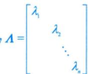

  
左下三角矩阵

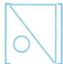  
右上三角矩阵

  
右下三角矩阵

  
左上三角矩阵

后面经常会遇到，有很多性质

$$
\text {如} A = \left[ \begin{array}{r r r} 1 & - 2 & 1 \\ - 2 & 0 & 3 \\ 1 & 3 & - 1 \end{array} \right],
$$

$$
\left(\boldsymbol {A} ^ {\intercal} \boldsymbol {A}\right) ^ {\intercal} = \boldsymbol {A} ^ {\intercal} \left(\boldsymbol {A} ^ {\intercal}\right) ^ {\intercal} = \boldsymbol {A} ^ {\intercal} \boldsymbol {A},
$$

$A^{\mathrm{T}} A$ 必为对称矩阵，无论 $A$ 是不是方阵

★★★⑥对称矩阵 满足条件 $A^{\mathrm{T}} = A$ 的矩阵 $\pmb{A}$ 称为对称矩阵， $A^{\mathrm{T}} = A\Leftrightarrow a_{ij} = a_{ji}$

⑦ 反对称矩阵 满足条件 $A^{\mathrm{T}} = -A$ 的矩阵 $\pmb{A}$ 称为反对称矩阵，

$$
\mathbf {A} = \left[ \begin{array}{c c c} 0 & - 2 & 1 \\ 2 & 0 & 3 \\ - 1 & - 3 & 0 \end{array} \right],
$$

主对角线元素都是零，对称位置互为相反数

⑧行矩阵 只有一行元素的矩阵，也称行向量.

线性代数中, 向量 $\alpha$ 一般为列向量, $\mathbf{a}^{\mathrm{T}}$ 为

⑨列矩阵 只有一列元素的矩阵，也称列向量.

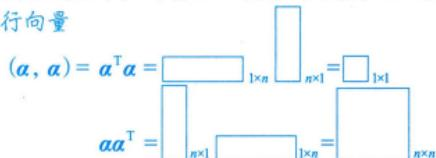

★★★(9)分块矩阵.

① 矩阵的分块.

用几条纵线和横线把一个矩阵分成若干小块，每一小块称为原矩阵的子块. 把子块看作原矩阵的一个元素，就得到了分块矩阵.

如 $A$ 按行分块：

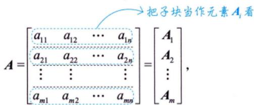

其中， $A_{i} = [a_{i1}, a_{i2}, \dots, a_{in}](i = 1, 2, \dots, m)$ 是 $\pmb{A}$ 的一个子块.

$\pmb{B}$ 按列分块：

$$
\boldsymbol {B} = \left[ \begin{array}{c c c c} b _ {1 1} & b _ {1 2} & \dots & b _ {1 n} \\ b _ {2 1} & b _ {2 2} & \dots & b _ {2 n} \\ \vdots & \vdots & & \vdots \\ b _ {m 1} & b _ {m 2} & \dots & b _ {m n} \end{array} \right] = \left[ \boldsymbol {B} _ {1}, \boldsymbol {B} _ {2}, \dots , \boldsymbol {B} _ {n} \right],
$$

其中， $B_{j} = [b_{1j}, b_{2j}, \dots, b_{mj}]^{\mathrm{T}} (j = 1, 2, \dots, n)$ 是 $\pmb{B}$ 的一个子块.

②分块矩阵的基本运算（以 $2 \times 2$ 型分块矩阵为例）.

其中 $A$ ， $\pmb{B}$ 同型

加法：同型，且分法一致，则 $\left[ \begin{array}{l} A_{1} \\ A_{3} \end{array} \right] + \left[ \begin{array}{l} B_{1} \\ B_{3} \end{array} \right] = \left[ \begin{array}{l} A_{1} + B_{1} \\ A_{3} + B_{3} \end{array} \right]$ 把 $A_{i}, B_{i}$ 当作元素相加各分块必须也是同型的

数乘： $k\left[ \begin{array}{ll}A & B\\ C & D \end{array} \right] = \left[ \begin{array}{ll}kA & kB\\ kC & kD \end{array} \right].$

★★★乘法： $\begin{bmatrix} A & B \\ C & D \end{bmatrix} \begin{bmatrix} X & Y \\ Z & W \end{bmatrix} = \begin{bmatrix} AX + BZ & AY + BW \\ CX + DZ & CY + DW \end{bmatrix}$ ，要可乘、可加.

注意：对于乘法的运算要注意，分块相乘后，左边的矩阵仍在左边，右边的矩阵仍在右边.

若 $A, B$ 分别为 $m, n$ 阶方阵，则分块对角矩阵的幂为

$$
\boldsymbol {A} = \left[ \begin{array}{l} a _ {1} \\ a _ {2} \\ a _ {3} \end{array} \right] \left[ \begin{array}{l l l} b _ {1}, & b _ {2}, & b _ {3} \end{array} \right] = \left[ \begin{array}{l l l} a _ {1} b _ {1} & a _ {1} b _ {2} & a _ {1} b _ {3} \\ a _ {2} b _ {1} & a _ {2} b _ {2} & a _ {2} b _ {3} \\ a _ {3} b _ {1} & a _ {3} b _ {2} & a _ {3} b _ {3} \end{array} \right]
$$

列向量 [O B] [O Bn] ★★★A是秩为1的方阵，几何意义是3  
维空间里的某条直线，非常重要  
例2.1 设 $\pmb{\alpha} = [a_{1}, a_{2}, a_{3}]^{\mathrm{T}}, \pmb{\beta} = [b_{1}, b_{2}, b_{3}]^{\mathrm{T}}, \pmb{A} = \pmb{\alpha}\pmb{\beta}^{\mathrm{T}}$ 则 $A^n =$ ① $[a_1, a_2, \dots, a_n]_{\times n} \begin{bmatrix} b_1 \\ b_2 \\ \vdots \\ b_n \end{bmatrix}_{n\times 1} = u_{1\times 1}$ 例2.1~例2.3，求 $A^n$ 的基本功：① $A$ 是方阵， $r(A) = 1 \Rightarrow A^n = [\operatorname{tr}(A)]^{n-1}A$ ；②试算 $A^2, A^3$ 等，归纳出结果；③ $A^n = (B + C)^n$ ，且满足 $BC = CB$ ，用二项展开式。② $\begin{bmatrix} b_1 \\ b_2 \\ \vdots \\ b_n \end{bmatrix}_{n\times 1} [a_1, a_2, \dots, a_n]_{1\times n} = A_{n\times n} \end{bmatrix}$

解 应填 $\left(\sum_{i=1}^{3} a_{i} b_{i}\right)^{n-1} A$ .

例2.1~例2.3，求 $A^n$ 的基本功：

① $A$ 是方阵， $r(A) = 1 \Rightarrow A^n = [\operatorname{tr}(A)]^{n-1} A$ ；  
②试算 $A^2, A^3$ 等，归纳出结果：  
③ $A^n = (B + C)^n$ ，且满足 $BC = CB$ ，用二项展开式

$$
\boldsymbol {A} ^ {n} = (\boldsymbol {\alpha} \boldsymbol {\beta} ^ {\mathrm {T}}) (\boldsymbol {\alpha} \boldsymbol {\beta} ^ {\mathrm {T}}) \dots (\boldsymbol {\alpha} \boldsymbol {\beta} ^ {\mathrm {T}}) = \boldsymbol {\alpha} (\boldsymbol {\beta} ^ {\mathrm {T}} \boldsymbol {\alpha}) (\boldsymbol {\beta} ^ {\mathrm {T}} \boldsymbol {\alpha}) \dots (\boldsymbol {\beta} ^ {\mathrm {T}} \boldsymbol {\alpha}) \boldsymbol {\beta} ^ {\mathrm {T}}
$$

$$
= (\boldsymbol {\beta} ^ {T} \boldsymbol {\alpha}) ^ {n - 1} \boldsymbol {\alpha} \boldsymbol {\beta} ^ {T} = \left(\left[ b _ {1}, b _ {2}, b _ {3} \right] \left[ \begin{array}{l} a _ {1} \\ a _ {2} \\ a _ {3} \end{array} \right]\right) ^ {n - 1} \boldsymbol {A} = \left(\sum_ {i = 1} ^ {3} a _ {i} b _ {i}\right) ^ {n - 1} \boldsymbol {A}.
$$

公式：对秩为1的 $m$ 阶方阵 $A$ ， $A^n = [\operatorname{tr}(A)]^{n-1} A = (\sum_{i=1}^{m} a_i b_i)^{n-1} \alpha \beta^{\mathrm{T}}$ ，其中 $A = \alpha \beta^{\mathrm{T}}$

注 (1) 矩阵乘法没有交换律, 但结合律、分配律是成立的, 要充分运用. 利用结合律是本题简化运算的关键, 因 $\boldsymbol{\beta}^{\mathrm{T}}\boldsymbol{\alpha}$ 是数 (1 阶矩阵), 故可提到前面.

(2) 本题显然具有代表性.

若 $\pmb{\alpha} = [1,2,3]^{\mathrm{T}},\pmb{\beta} = \left[1,\frac{1}{2},\frac{1}{3}\right]^{\mathrm{T}}$ 则 $(\pmb {\alpha}\pmb{\beta}^{\mathrm{T}})^{n} = (\pmb{\beta}^{\mathrm{T}}\pmb {\alpha})^{n - 1}\pmb{\alpha}\pmb{\beta}^{\mathrm{T}} = 3^{n - 1}\left[ \begin{array}{ccc}1 & \frac{1}{2} & \frac{1}{3}\\ 2 & 1 & \frac{2}{3}\\ 3 & \frac{3}{2} & 1 \end{array} \right].$

若 $\pmb{\alpha} = \pmb{\beta} = [a_{1}, a_{2}, a_{3}]^{\mathrm{T}}$ ，则 $(\pmb{\alpha}\pmb{\beta}^{\mathrm{T}})^{n} = (\pmb{\alpha}^{\mathrm{T}}\pmb{\alpha})^{n - 1}\pmb{\alpha}\pmb{\alpha}^{\mathrm{T}} = \left(\sum_{i = 1}^{3}a_{i}^{2}\right)^{n - 1}\pmb{\alpha}\pmb{\alpha}^{\mathrm{T}}$ 。

(3) $r(A) = r\left(\begin{bmatrix} a_1b_1 & a_1b_2 & a_1b_3 \\ a_2b_1 & a_2b_2 & a_2b_3 \\ a_3b_1 & a_3b_2 & a_3b_3 \end{bmatrix}\right) = 1$ ，行向量（或列向量）成比例，列向量与 $\alpha = [a_{1},a_{2},a_{3}]^{\mathrm{T}}$ 成比例，比例系数为 $b_{1}, b_{2}, b_{3}$ ，提出比例系数，有

$$
\boldsymbol {A} = \left[ \begin{array}{l l l} a _ {1} b _ {1} & a _ {1} b _ {2} & a _ {1} b _ {3} \\ a _ {2} b _ {1} & a _ {2} b _ {2} & a _ {2} b _ {3} \\ a _ {3} b _ {1} & a _ {3} b _ {2} & a _ {3} b _ {3} \end{array} \right] = \left[ \begin{array}{l} a _ {1} \\ a _ {2} \\ a _ {3} \end{array} \right] [ b _ {1}, b _ {2}, b _ {3} ].
$$

上式从右到左是作乘法，从左到右是将 $\pmb{A}$ 分解.当 $r(A) = 1$ 时，都可作这种分解.以后可以看到，众多题目用到这种分解方法，考生需牢记.

例2.2 设 $A = \begin{bmatrix} 1 & -1 & -1 & -1\\ -1 & 1 & -1 & -1\\ -1 & -1 & 1 & -1\\ -1 & -1 & -1 & 1 \end{bmatrix}$ 则 $A^9 =$

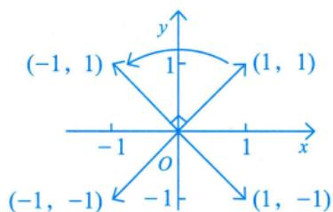

$\mathcal{P}$ 分析 计算 $\pmb{A}^{2}$ 或 $\pmb{A}^{3}$ 等寻找规律.

如对于2阶矩阵 $\begin{bmatrix} 0 & -1 \\ 1 & 0 \end{bmatrix}$ ，把它作用在向量 $\begin{bmatrix} 1 \\ 1 \end{bmatrix}$ 上可得 $\begin{bmatrix} 0 & -1 \\ 1 & 0 \end{bmatrix}^2 \begin{bmatrix} 1 \\ 1 \end{bmatrix} = \begin{bmatrix} -1 \\ -1 \end{bmatrix}$ $\begin{bmatrix} 0 & -1 \\ 1 & 0 \end{bmatrix}^3 \begin{bmatrix} 1 \\ 1 \end{bmatrix} = \begin{bmatrix} 1 \\ -1 \end{bmatrix}$ $\begin{bmatrix} 0 & -1 \\ 1 & 0 \end{bmatrix}^4$ ，即向量 $\begin{bmatrix} 1 \\ 1 \end{bmatrix}$ 经过变换 $\begin{bmatrix} 0 & -1 \\ 1 & 0 \end{bmatrix}$ 后旋转了 $90^\circ$ ，那么 $\begin{bmatrix} 0 & -1 \\ 1 & 0 \end{bmatrix}$ 的效果相当于旋转了4次 $90^\circ$ ，又回到原来的位置，所以 $\begin{bmatrix} 0 & -1 \\ 1 & 0 \end{bmatrix}^4 = \begin{bmatrix} 1 & 0 \\ 0 & 1 \end{bmatrix}$ .

解 应填 $256A$

因为

$$
\boldsymbol {A} ^ {2} = \boldsymbol {A A} = \left[ \begin{array}{r r r r} 1 & - 1 & - 1 & - 1 \\ - 1 & 1 & - 1 & - 1 \\ - 1 & - 1 & 1 & - 1 \\ - 1 & - 1 & - 1 & 1 \end{array} \right] \left[ \begin{array}{r r r r} 1 & - 1 & - 1 & - 1 \\ - 1 & 1 & - 1 & - 1 \\ - 1 & - 1 & 1 & - 1 \\ - 1 & - 1 & - 1 & 1 \end{array} \right] = \left[ \begin{array}{r r r r} 4 & 0 & 0 & 0 \\ 0 & 4 & 0 & 0 \\ 0 & 0 & 4 & 0 \\ 0 & 0 & 0 & 4 \end{array} \right] = 4 \boldsymbol {E},
$$

故有 $A^9 = (A^2)^4 A = 4^4 A = 256A$

例2.3 已知 $A = \begin{bmatrix} 1 & 1 & 0\\ 0 & 1 & 1\\ 0 & 0 & 1 \end{bmatrix}$ ，求 $A^n$

分析 通过计算 $A^2$ 或 $A^3$ 发现没有规律，但我们发现 $\left[ \begin{array}{lll}1 & 1 & 0\\ 0 & 1 & 1\\ 0 & 0 & 1 \end{array} \right]$ 可以拆成 $\left[ \begin{array}{lll}1 & 0 & 0\\ 0 & 1 & 0\\ 0 & 0 & 1 \end{array} \right] + \left[ \begin{array}{lll}0 & 1 & 0\\ 0 & 0 & 1\\ 0 & 0 & 0 \end{array} \right]$ ，对这两个简单的矩阵，再利用二项式展开式求 $A^n$ 。

解 $A = \left[ \begin{array}{lll}1 & 1 & 0\\ 0 & 1 & 1\\ 0 & 0 & 1 \end{array} \right] = \left[ \begin{array}{lll}1 & 0 & 0\\ 0 & 1 & 0\\ 0 & 0 & 1 \end{array} \right] + \left[ \begin{array}{lll}0 & 1 & 0\\ 0 & 0 & 1\\ 0 & 0 & 0 \end{array} \right] = E + B,\quad A^{n} = (B + C)^{n}\text{,当} C = kE\text{时},$ $BC = CB$ ，是可交换的

则 $A^n = (E + B)^n = E^n + nE^{n - 1}B + \frac{n(n - 1)}{2!} E^{n - 2}B^2 + \frac{n(n - 1)(n - 2)}{3!} E^{n - 3}B^3 + \dots + B^n,$

因 $\pmb{E}$ 和任何矩阵可交换，故展开式和初等代数中的展开式一样.又因为

$$
\pmb {B} = \left[ \begin{array}{l l l} 0 & 1 & 0 \\ 0 & 0 & 1 \\ 0 & 0 & 0 \end{array} \right], \pmb {B} ^ {2} = \left[ \begin{array}{l l l} 0 & 1 & 0 \\ 0 & 0 & 1 \\ 0 & 0 & 0 \end{array} \right] \left[ \begin{array}{l l l} 0 & 1 & 0 \\ 0 & 0 & 1 \\ 0 & 0 & 0 \end{array} \right] = \left[ \begin{array}{l l l} 0 & 0 & 1 \\ 0 & 0 & 0 \\ 0 & 0 & 0 \end{array} \right],
$$

$$
\boldsymbol {B} ^ {3} = \boldsymbol {B} ^ {2} \boldsymbol {B} = \left[ \begin{array}{l l l} 0 & 0 & 1 \\ 0 & 0 & 0 \\ 0 & 0 & 0 \end{array} \right] \left[ \begin{array}{l l l} 0 & 1 & 0 \\ 0 & 0 & 1 \\ 0 & 0 & 0 \end{array} \right] = \left[ \begin{array}{l l l} 0 & 0 & 0 \\ 0 & 0 & 0 \\ 0 & 0 & 0 \end{array} \right],
$$

故 $\pmb{B}^{k} = \pmb{0}$ $k\geqslant 3$ ，所以

$$
\begin{array}{l} \boldsymbol {A} ^ {n} = \boldsymbol {E} + n \boldsymbol {B} + \frac {n (n - 1)}{2} \boldsymbol {B} ^ {2} \\ = \left[ \begin{array}{l l l} 1 & 0 & 0 \\ 0 & 1 & 0 \\ 0 & 0 & 1 \end{array} \right] + \left[ \begin{array}{l l l} 0 & n & 0 \\ 0 & 0 & n \\ 0 & 0 & 0 \end{array} \right] + \left[ \begin{array}{l l l} 0 & 0 & \frac {n (n - 1)}{2} \\ 0 & 0 & 0 \\ 0 & 0 & 0 \end{array} \right] = \left[ \begin{array}{l l l} 1 & n & \frac {n (n - 1)}{2} \\ 0 & 1 & n \\ 0 & 0 & 1 \end{array} \right]. \\ \end{array}
$$

注因单位矩阵和任何同阶方阵可交换，故本题将 $\pmb{A}$ 分解成 $A = E + B$ ，再利用主对角线元素为零的上三角矩阵 $\pmb{B}$ ，有 $B^n = O(n\geqslant 3)$ 的特性，来求解 $A^n$ 是非常方便的.

# 三 矩阵的逆

$A_{m \times n}$ 可以作加法、减法、乘法，此时 $m$ 不一定等于 $n$ ，但涉及逆矩阵时，必须满足矩阵 $A$ 为方阵，即 $A_{n \times n}$ .

(1) $A, B$ 是 $n$ 阶方阵， $E$ 是 $n$ 阶单位矩阵，若 $AB = BA = E$ ，则称 $A$ 是可逆矩阵，并称 $B$ 是 $A$ 的逆矩阵，且逆矩阵是唯一的，记作 $A^{-1}$ ：

(2) $A$ 可逆的充分必要条件是 $|A| \neq 0$ . $|A| \neq 0$ . 则 $A$ 可逆 $\Rightarrow A^{-1}A = E, AA^{-1} = E$

# 2 逆矩阵的性质与重要公式

设 $A, B$ 是同阶可逆方阵，则

(1) $(A^{-1})^{-1} = A$ 同记 $\left\{ \begin{array}{l}(A^{\mathrm{T}})^{\mathrm{T}} = A,\\ (A^{-1})^{-1} = A,\\ \| A\| = |A| \end{array} \right.$   
(2) 若 $k \neq 0$ ，则 $(kA)^{-1} = \frac{1}{k} A^{-1}$ . 同记 $\begin{cases} (kA)^{\mathrm{T}} = kA^{\mathrm{T}}, \\ (kA)^{-1} = \frac{1}{k} A^{-1}, \\ |kA| = k^n |A| \end{cases}$ ， $k \neq 0, k \neq 0$ ,  
(3) $\mathbf{AB}$ 也可逆,且 ${\left( \mathbf{AB}\right) }^{-1} = {\mathbf{B}}^{-1}{\mathbf{A}}^{-1}$ . “穿脱”原则 $\left\{  \begin{array}{l} {\left( \mathbf{{AB}}\right) }^{\mathrm{T}} = {\mathbf{B}}^{\mathrm{T}}{\mathbf{A}}^{\mathrm{T}}, \\  {\left( \mathbf{{AB}}\right) }^{-1} = {\mathbf{B}}^{-1}{\mathbf{A}}^{-1}, \\  \left| \mathbf{{AB}}\right|  = \left| \mathbf{A}\right| \left| \mathbf{B}\right|  = \left| \mathbf{B}\right| \left| \mathbf{A}\right|  \end{array}\right.$ (4) ${\mathbf{A}}^{\mathrm{T}}$ 也可逆,且 ${\left( {\mathbf{A}}^{\mathrm{T}}\right) }^{-1} = {\left( {\mathbf{A}}^{-1}\right) }^{\mathrm{T}}$ .   
(5) ${\left| \mathbf{A}^{-1}\right| }^{ = }\left| \mathbf{A}\right| {}^{-1}$ . $= \frac{1}{\left| A\right| }$ $\rightarrow  {A}^{\mathrm{T}} \cdot  \square  = E$ . 因 ${\left( {A}^{-1} \cdot  A\right) }^{\mathrm{T}} = E$ ,故 ${A}^{\mathrm{T}}{\left( {A}^{-1}\right) }^{\mathrm{T}} = E$

注 $A + B$ 不一定可逆，且 $(A + B)^{-1}\neq A^{-1} + B^{-1}$ .★ $(A + B)^{\mathrm{T}} = A^{\mathrm{T}} + B^{\mathrm{T}}$

# 用定义法求可逆矩阵的逆矩阵

方法一 定义法. 依定义进行求解，即求一个矩阵 $\pmb{B}$ ，使 $AB = E$ ，则 $\pmb{A}$ 可逆，且 $A^{-1} = B$

方法二 将 $A$ 分解成若干个可逆矩阵的乘积. 因两个可逆矩阵的积仍是可逆矩阵, 即若 $A = BC$ , 其中, $B, C$ 均可逆, 则 $A$ 可逆, 且

$$
\boldsymbol {A} ^ {- 1} = (\boldsymbol {B C}) ^ {- 1} = \boldsymbol {C} ^ {- 1} \boldsymbol {B} ^ {- 1}.
$$

例2.4 设 $A, B$ 均是 $n$ 阶矩阵，且 $AB = A + B$ ，则（ ）.

(A) $A - E$ 为可逆矩阵  
(B) $A + E$ 为可逆矩阵   
(C) $A - 2E$ 为可逆矩阵   
(D) $B + E$ 为可逆矩阵

分析 $ab = a + b\Rightarrow ab - a - b = 0\Rightarrow a(b - 1) - b = 0\Rightarrow a(b - 1) - (b - 1) = 1\Rightarrow (a - 1)(b - 1) = 1.$

$$
A B = A + B \Rightarrow A B - A - B = O \Rightarrow A (B - E) - B = O \Rightarrow A (B - E) - (B - E) = E \Rightarrow (A - E) (B - E) = E.
$$

解 应选(A).

因 $AB = A + B$ ，即

$$
\begin{array}{l} A B - A - B = O, A B - A - B + E = E, \\ \boldsymbol {A} (\boldsymbol {B} - \boldsymbol {E}) - (\boldsymbol {B} - \boldsymbol {E}) = \boldsymbol {E}, \\ \end{array}
$$

即

$$
(\boldsymbol {A} - \boldsymbol {E}) (\boldsymbol {B} - \boldsymbol {E}) = \boldsymbol {E}, \tag {*}
$$

故 $A - E$ 可逆，且 $(A - E)^{-1} = B - E$ ，应选(A).

对于其他选项，可举反例排除。

取 $A = -E, B = \frac{E}{2}$ ，则 $AB = A + B$ ，而 $A + E$ 不是可逆矩阵，故 (B) 不成立.

取 $A = 2E$ ， $B = 2E$ ，则 $AB = A + B$ ，而 $A - 2E$ 不是可逆矩阵，故(C)不成立.

取 $A = \frac{E}{2}$ ， $B = -E$ ，则 $AB = A + B$ ，而 $B + E$ 不是可逆矩阵，故(D)不成立.

注 (1)利用定义求逆矩阵，要求将矩阵满足的关系式 $AB = A + B$ 作恒等变形，化成“左端为待求逆的矩阵与另一个矩阵的乘积，右端为单位矩阵”的形式.  
(2) 把矩阵的和、差关系化成乘积的一种方法是提取公因子，提公因子时，左边的矩阵（如 $\mathbf{A}$ ）往左边提，右边的矩阵（如 $\mathbf{B} - \mathbf{E}$ ）往右边提。  
(3) 本题中 (*) 式成立已经说明 $A - E$ 可逆，当然也可在 (*) 式两边取行列式，说明 $|A - E| \neq 0$ ，从而先证 $A - E$ 可逆，再求 $(A - E)^{-1}$ 。

# 想办法联系起来

例2.5 设 $A, B$ 是同阶可逆方阵，且 $\overline{A^{-1} + B^{-1}}$ 可逆，证明 $\overline{A + B}$ 是可逆矩阵，并求 $(A + B)^{-1}$

$$
a + b = a (1 + a ^ {- 1} b) = a \left(b ^ {- 1} + a ^ {- 1}\right) b \Rightarrow A + B = A \left(E + A ^ {- 1} B\right) = A \left(B ^ {- 1} + A ^ {- 1}\right) B,
$$

而

$$
\begin{array}{r l}&{\quad \rightarrow A + B \text {可 逆}}\\&{\quad | A + B | = | A | | B ^ {- 1} + A ^ {- 1} | | B | \neq 0 \Rightarrow (A + B) ^ {- 1} = B ^ {- 1} (B ^ {- 1} + A ^ {- 1}) ^ {- 1} A ^ {- 1}.}\end{array}
$$

证 因 $A, B$ 是可逆矩阵，故

$$
\boldsymbol {A} + \boldsymbol {B} = \boldsymbol {A} (\boldsymbol {E} + \boldsymbol {A} ^ {- 1} \boldsymbol {B}) = \boldsymbol {A} (\boldsymbol {B} ^ {- 1} + \boldsymbol {A} ^ {- 1}) \boldsymbol {B}.
$$

又因 $A, A^{-1} + B^{-1}, B$ 可逆，故 $A + B$ 可逆，且

$$
\left(\boldsymbol {A} + \boldsymbol {B}\right) ^ {- 1} = \left[ \boldsymbol {A} \left(\boldsymbol {B} ^ {- 1} + \boldsymbol {A} ^ {- 1}\right) \boldsymbol {B} \right] ^ {- 1} = \boldsymbol {B} ^ {- 1} \left(\boldsymbol {A} ^ {- 1} + \boldsymbol {B} ^ {- 1}\right) ^ {- 1} \boldsymbol {A} ^ {- 1}.
$$

注 (1) 要证 $A + B$ 可逆，并求 $(A + B)^{-1}$ ，应设法将 $A + B$ 化成已知可逆矩阵 $A, B, A^{-1} + B^{-1}$ 的乘积。这里表面上 $A + B$ 没有公因子，但由于 $A$ 可逆，故有

$$
\boldsymbol {A} + \boldsymbol {B} = \boldsymbol {A} + \boldsymbol {E B} = \boldsymbol {A} + \boldsymbol {A A ^ {- 1}} \boldsymbol {B} = \boldsymbol {A} (\boldsymbol {E} + \boldsymbol {A ^ {- 1}} \boldsymbol {B}).
$$

同理， $\pmb{B}$ 可逆，有

$$
\boldsymbol {A} (\boldsymbol {E} + \boldsymbol {A} ^ {- 1} \boldsymbol {B}) = \boldsymbol {A} (\boldsymbol {B} ^ {- 1} \boldsymbol {B} + \boldsymbol {A} ^ {- 1} \boldsymbol {B}) = \boldsymbol {A} (\boldsymbol {B} ^ {- 1} + \boldsymbol {A} ^ {- 1}) \boldsymbol {B},
$$

从而将 $A + B$ 化成了已知可逆矩阵的乘积. 提公因子是和、差化积的一个好办法.

(2) 由 $A, B$ 均可逆，并不能得出 $A + B$ 可逆，在增加条件 $A^{-1} + B^{-1}$ 可逆时，才能保证 $A + B$ 可逆.

# 四伴随矩阵

# 伴随矩阵的定义

将行列式 $|\pmb{A}|$ 的 $n^2$ 个元素的代数余子式按如下形式排成的矩阵称为 $\pmb{A}$ 的伴随矩阵，记作 $\pmb{A}^{*}$ ，即

注意下标 $A^{\star} = \begin{bmatrix} A_{11} & A_{21} & \dots & A_{n1}\\ A_{12} & A_{22} & \dots & A_{n2}\\ \vdots & \vdots & & \vdots \\ A_{1n} & A_{2n} & \dots & A_{nn} \end{bmatrix},$

(1) $A_{ij} = (-1)^{i + j}M_{ij}$ ， $M_{ij}$ 是去掉 $i$ 行 $j$ 列的行列式.(2)注意 $A_{ij}$ 在 $\pmb{A}^{\star}$ 中的位置： $\pmb{A}$ 的第 $i$ 行元素的代数余子式写在 $\pmb{A}^{\star}$ 的第 $i$ 列上.

且有 $AA^{*} = A^{*}A = |A|E.$

例2.6 已知 $A = \begin{bmatrix} a_{11} & a_{12}\\ a_{21} & a_{22} \end{bmatrix}$ ， $A^{\star} = \begin{bmatrix} A_{11}\\ A_{12}\\ A_{22} \end{bmatrix}$ 计算 $AA^{*}$

解 由行列式展开定理，有

$$
\left\{ \begin{array}{l} a _ {1 1} A _ {1 1} + a _ {1 2} A _ {1 2} = | A |, \\ a _ {2 1} A _ {2 1} + a _ {2 2} A _ {2 2} = | A |, \end{array} \right.
$$

又 $a_{11}A_{21} + a_{12}A_{22} = \left| \begin{array}{ll}a_{11} & a_{12}\\ a_{11} & a_{12} \end{array} \right| = 0$ ， $a_{21}A_{11} + a_{22}A_{12} = \left| \begin{array}{ll}a_{21} & a_{22}\\ a_{21} & a_{22} \end{array} \right| = 0$ ，故

$$
A A ^ {*} = \left[ \begin{array}{c c} | A | & 0 \\ 0 & | A | \end{array} \right] = | A | \left[ \begin{array}{c c} 1 & 0 \\ 0 & 1 \end{array} \right] = | A | E.
$$

伴随矩阵的性质与重要公式可交换的公式 $\left\{ \begin{array}{l}A\bullet kE = kE\bullet A,\\ AA^{-1} = A^{-1}A = E,\\ AA^{*} = A^{*}A = |A|E \end{array} \right.$ (1)对任意 $n$ 阶方阵 $A$ ，都有伴随矩阵 $A^{\star}$ ，且有公式 $AA^{*} = A^{*}A = |A|E,\left|A^{*}\right| = \left|A\right|^{n - 1}.\left|AA^{*}\right| = \| A|E| = |A|^{n}\Rightarrow \left|A^{*}\right| = |A|^{n - 1}$ 当 $|\textbf{A} |\neq 0$ 时，有

# 考研数学基础30讲·线性代数分册

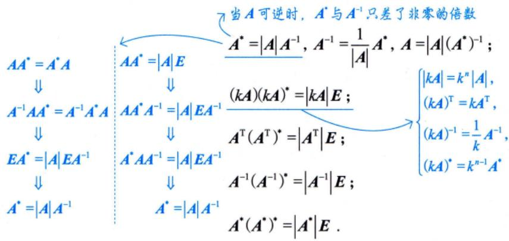

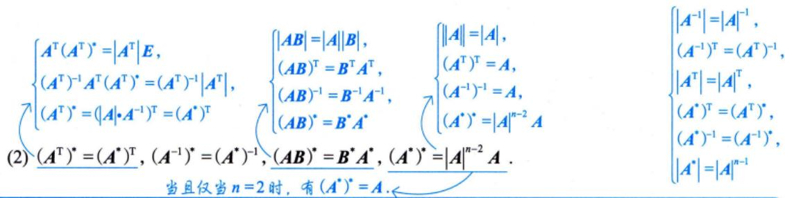

注 $(A + B)^{*}\neq A^{*} + B^{*},\left|A + B\right|\neq \left|A\right| + \left|B\right|,$ $(A + B)^{-1}\neq A^{-1} + B^{-1},(A + B)^{\mathrm{T}} = A^{\mathrm{T}} + B^{\mathrm{T}}.$

# 用伴随矩阵求可逆矩阵的逆矩阵

步骤：① 判断 $|\mathcal{A}|$ 是否为0；

$②$ 写出 $A^{\star}$

$$
\text {③} A ^ {- 1} = \frac {1}{| A |} A ^ {*} = \frac {1}{| A |} \left[ \begin{array}{c c c c} A _ {1 1} & A _ {2 1} & \dots & A _ {n 1} \\ A _ {1 2} & A _ {2 2} & \dots & A _ {n 2} \\ \vdots & \vdots & & \vdots \\ A _ {1 n} & A _ {2 n} & \dots & A _ {n n} \end{array} \right].
$$

注意 $A_{ij}$ 的位置及正、负号.

即 $|A| \neq 0$ 例2.7 已知 $A = \begin{bmatrix} a & b \\ c & d \end{bmatrix}$ ，写出 $A$ 可逆的一个充要条件，当 $A$ 可逆时，求 $A^{-1}$ 。

$\mathcal{P}$ 分析 利用 $\pmb{A}$ 可逆 $\Leftrightarrow |A|\neq 0$ 解题即可.

解 $A$ 可逆 $\Leftrightarrow |A| = \left| \begin{array}{ll}a & b\\ c & d \end{array} \right| = ad - bc\neq 0$ ，且当 $ad - bc\neq 0$ 时，

$$
\boldsymbol {A} ^ {- 1} = \frac {1}{| \boldsymbol {A} |} \boldsymbol {A} ^ {*} = \frac {1}{a d - b c} \left[ \begin{array}{l l} d & - b \\ - c & a \end{array} \right]. \quad A _ {1 2} = (- 1) ^ {2 + 2} | c | = - c, A _ {2 1} = (- 1) ^ {2 + 1} | b | = - b, A _ {2 2} = (- 1) ^ {2 + 2} | a | = a
$$

注 利用公式 $A^{-1} = \frac{1}{|A|} A^{*}$ 求 $A^{-1}$ 时，应注意：

(1) 不要忘记 $A^*$ 要除以 $|\mathbf{A}|$   
(2) $A^{\star}$ 的元素是 $|\pmb{A}|$ 中元素的代数余子式，注意正、负号；  
(3) $A_{ij}$ 位于矩阵 $A^*$ 中相对于矩阵 $\pmb{A}$ 的元素 $a_{ji}$ 的位置上. 对于2阶矩阵求 $A^{*}$ ，只需将 $a_{11},a_{22}$ 互换， $a_{12},a_{21}$ 上添加负号，所以对于2阶矩阵，有 $(A^{*})^{*} = A$ ：

例2.8 求矩阵 $A = \begin{bmatrix} 1 & 0 & 1\\ 2 & 1 & 0\\ -3 & 2 & -5 \end{bmatrix}$ 的逆矩阵.

分析 利用公式 $A^{-1} = \frac{1}{|A|} A^*$ 解题即可.

解 由 $|\mathbf{A}| = \begin{vmatrix} 1 & 0 & 1\\ 2 & 1 & 0\\ -3 & 2 & -5 \end{vmatrix} = 2\neq 0$ ，知 $\pmb{A}$ 可逆.

伴随法求逆矩阵  
的关键，求 $A^{\star}$ $A_{11} = \left| \begin{array}{ll}1 & 0\\ 2 & -5 \end{array} \right| = -5,A_{12} = -\left| \begin{array}{ll}2 & 0\\ -3 & -5 \end{array} \right| = 10,A_{13} = \left| \begin{array}{ll}2 & 1\\ -3 & 2 \end{array} \right| = 7,$ $A_{21} = -\left| \begin{array}{ll}0 & 1\\ 2 & -5 \end{array} \right| = 2,A_{22} = \left| \begin{array}{ll}1 & 1\\ -3 & -5 \end{array} \right| = -2,A_{23} = -\left| \begin{array}{ll}1 & 0\\ -3 & 2 \end{array} \right| = -2,$ $A_{31} = \left| \begin{array}{ll}0 & 1\\ 1 & 0 \end{array} \right| = -1,A_{32} = -\left| \begin{array}{ll}1 & 1\\ 2 & 0 \end{array} \right| = 2,A_{33} = \left| \begin{array}{ll}1 & 0\\ 2 & 1 \end{array} \right| = 1,$

因此

$$
\boxed {A ^ {- 1} = \frac {1}{| A |} A ^ {*}} = \frac {1}{2} \left[ \begin{array}{l l l} - 5 & 2 & - 1 \\ 1 0 & - 2 & 2 \\ 7 & - 2 & 1 \end{array} \right] = \left[ \begin{array}{l l l} - \frac {5}{2} & 1 & - \frac {1}{2} \\ 5 & - 1 & 1 \\ \frac {7}{2} & - 1 & \frac {1}{2} \end{array} \right].
$$

# 4求伴随矩阵的方法

方法一 用定义.先求 $A_{ij}$ ，再拼成 $\pmb{A}^{\star}$

方法二 用公式.若 $\mathbf{A}$ 可逆,则 ${\mathbf{A}}^{ * } = \left| \mathbf{A}\right| {\mathbf{A}}^{-1}$ . ${\left( {\mathbf{A}}^{ * }\right) }^{-1} = {\left( \left| \mathbf{A}\right| {\mathbf{A}}^{-1}\right) }^{-1} = \frac{1}{\left| \mathbf{A}\right| }$

例2.9 设 $A = \begin{bmatrix} 1 & 2 & 0\\ 2 & 2 & 0\\ 3 & 4 & 5 \end{bmatrix}, A^{\star}$ 是 $A$ 的伴随矩阵，则 $(A^{\star})^{-1} = \underline{\quad}$

$\mathcal{P}$ 分析 利用公式 $AA^{*} = |A|E$ .当 $|\pmb {A}|\neq 0$ 时，有 $\frac{A}{|A|} A^{\star} = E$ ，故 $(A^{\bullet})^{-1} = \frac{A}{|A|}$ 这样不需要先求出 $A^{\star}$ 再求 $(A^{\bullet})^{-1}$ ：

解

$$
\text {应 填} - \frac {1}{1 0} \left[ \begin{array}{l l l} 1 & 2 & 0 \\ 2 & 2 & 0 \\ 3 & 4 & 5 \end{array} \right].
$$

$$
\left| \boldsymbol {A} \right| = \left| \begin{array}{l l l} 1 & 2 & 0 \\ 2 & 2 & 0 \\ 3 & 4 & 5 \end{array} \right| = - 1 0 \neq 0,
$$

由公式 $AA^{*} = |A|E$ ，得 $\frac{A}{|A|} A^{*} = E$ ，故 $A^{*}$ 可逆，且 $(A^{*})^{-1} = \frac{A}{|A|} = -\frac{1}{10}\left[ \begin{array}{lll}1 & 2 & 0\\ 2 & 2 & 0\\ 3 & 4 & 5 \end{array} \right].$

例2.10 设 $A, B$ 均为2阶方阵， $A^{*}, B^{*}$ 分别为 $A, B$ 的伴随矩阵，若 $|A| = 2, |B| = 3$ ，则分块矩阵 $\begin{bmatrix} O & A \\ B & O \end{bmatrix}$ 的伴随矩阵为（ ）.

(A) $\left[ \begin{array}{cc}\pmb {O} & 3\pmb{B}^{\star}\\ 2\pmb{A}^{\star} & \pmb{0} \end{array} \right]$

(B) $\left[ \begin{array}{cc}O & 2B^{\star}\\ 3A^{\star} & O \end{array} \right]$

(C) $\left[ \begin{array}{cc} \boldsymbol{O} & 3\boldsymbol{A}^* \\ 2\boldsymbol{B}^* & \boldsymbol{O} \end{array} \right]$

(D) $\left[ \begin{array}{cc} \boldsymbol{O} & 2\boldsymbol{A}^* \\ 3\boldsymbol{B}^* & \boldsymbol{O} \end{array} \right]$

分析 令 $C = \begin{bmatrix} O & A \\ B & O \end{bmatrix}$ ，设 $C^{-1} = \begin{bmatrix} X_1 & X_2 \\ X_3 & X_4 \end{bmatrix}$ ，则 $C^* = |C| \cdot C^{-1}$ 。

① $|\mathbf{C}| = (-1)^{2 + 2}|\mathbf{A}||\mathbf{B}|$

$②$ 由 $\left[ \begin{array}{ll}O & A\\ B & O \end{array} \right]\left[ \begin{array}{ll}X_1 & X_2\\ X_3 & X_4 \end{array} \right] = \left[ \begin{array}{ll}E & O\\ O & E \end{array} \right],$ 得 $\left\{ \begin{array}{l}AX_{3} = E,\\ BX_{1} = O,\\ AX_{4} = O,\\ BX_{2} = E, \end{array} \right.$ 则 $\left\{ \begin{array}{l}X_{1} = O,\\ X_{2} = B^{-1},\\ X_{3} = A^{-1},\\ X_{4} = O, \end{array} \right.$ 故 $C^{-1} = \left[ \begin{array}{ll}O & B^{-1}\\ A^{-1} & O \end{array} \right].$

解 应选(B).

$\left| \begin{array}{ll}O & A\\ B & O \end{array} \right| = (-1)^{2\times 2}\left|A\right|\bullet \left|B\right| = 6$ ，则 $\left[ \begin{array}{ll}O & A\\ B & O \end{array} \right]$ 可逆，于是

$$
\left[ \begin{array}{l l} \boldsymbol {O} & \boldsymbol {A} \\ \boldsymbol {B} & \boldsymbol {O} \end{array} \right] ^ {*} = \left| \begin{array}{l l} \boldsymbol {O} & \boldsymbol {A} \\ \boldsymbol {B} & \boldsymbol {O} \end{array} \right| \cdot \left[ \begin{array}{l l} \boldsymbol {O} & \boldsymbol {A} \\ \boldsymbol {B} & \boldsymbol {O} \end{array} \right] ^ {- 1} = 6 \left[ \begin{array}{l l} \boldsymbol {O} & \boldsymbol {B} ^ {- 1} \\ \boldsymbol {A} ^ {- 1} & \boldsymbol {O} \end{array} \right] = \left[ \begin{array}{l l} \boldsymbol {O} & 2 \times 3 \boldsymbol {B} ^ {- 1} \\ 3 \times 2 \boldsymbol {A} ^ {- 1} & \boldsymbol {O} \end{array} \right] = \left[ \begin{array}{l l} \boldsymbol {O} & 2 \boldsymbol {B} ^ {*} \\ 3 \boldsymbol {A} ^ {*} & \boldsymbol {O} \end{array} \right],
$$

选 (B).

例2.11 设 $A, B$ 是 $n$ 阶方阵， $|A| = 2, |B| = -4$ ，则 $\left|2B^{*}A^{-1}\right| =$

解 应填 $(-8)^{n - 1}$

因 $|kA| = k^{n}|A|$ ， $\left|AB\right| = \left|A\right|\left|B\right|$ ， $\left|A^{-1}\right| = \frac{1}{\left|A\right|},\left|B^{*}\right| = \left|B\right|^{n - 1}$ ，故

$$
\left| 2 \boldsymbol {B} ^ {*} \boldsymbol {A} ^ {- 1} \right| = 2 ^ {n} \left| \boldsymbol {B} ^ {*} \right| \left| \boldsymbol {A} ^ {- 1} \right| = 2 ^ {n} \left| \boldsymbol {B} \right| ^ {n - 1} \cdot \frac {1}{\left| \boldsymbol {A} \right|} = (- 8) ^ {n - 1}.
$$

# 1 初等变换

(1)一个非零常数乘矩阵的某一行（列）；  
(2)互换矩阵中某两行（列）的位置；  
(3) 将矩阵的某一行（列）的 $k$ 倍加到另一行（列）.

以上三种变换称为矩阵的初等行（列）变换，且分别称为倍乘、互换、倍加初等行（列）变换.

注不要把矩阵的初等变换与矩阵的运算相混，也不要与行列式的性质、运算相混.要掌握矩阵的初等变换，应能熟练地用来求秩（行、列变换可混用），求逆矩阵（只用行或只用列变换），求线性方程组的解（只能用行变换）.

作用在任何向量上，等于★★★ 初等矩阵的定义无作用.如 $\begin{bmatrix} 1 & 0 \\ 0 & 1 \end{bmatrix} \begin{bmatrix} 1 \\ 1 \end{bmatrix} = \begin{bmatrix} 1 \\ 1 \end{bmatrix}$

由单位矩阵经过一次初等变换得到的矩阵称为初等矩阵. 以3阶矩阵为例.

(1) $E_{2}(k) = \begin{bmatrix} 1 & 0 & 0\\ 0 & k & 0\\ 0 & 0 & 1 \end{bmatrix}$ ，E的第2行（或第2列）乘k倍，称为倍乘初等矩阵.

定义： $E_{i}(k)(k\neq 0)$ 表示单位矩阵 $\pmb{E}$ 的第 $i$ 行（或第 $i$ 列）乘以非零常数 $k$ 所得的初等矩阵.

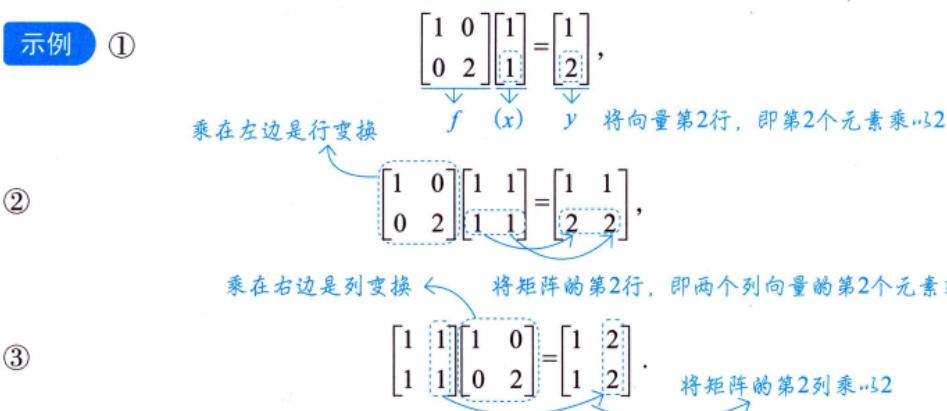

(2) 对 $n$ 阶矩阵 $\mathbf{A}$ 进行初等行变换，相当于在矩阵 $\mathbf{A}$ 的左边乘相应的初等矩阵。同样，对 $\mathbf{A}$ 进行初等列变换，相当于在矩阵 $\mathbf{A}$ 的右边乘相应的初等矩阵。

(3) $E_{12} = \begin{bmatrix} 0 & 1 & 0\\ 1 & 0 & 0\\ 0 & 0 & 1 \end{bmatrix}$ ， $\pmb{E}$ 的第1，2行（或第1，2列）互换，称为互换初等矩阵.

定义： $E_{ij}$ 表示单位矩阵 $\pmb{E}$ 交换第 $i$ 行与第 $j$ 行（或交换第 $i$ 列与第 $j$ 列）所得的初等矩阵.

# 示例

$$
\left[ \begin{array}{l l} 0 & 1 \\ 1 & 0 \end{array} \right] \left[ \begin{array}{l l} 1 & 2 \\ 3 & 4 \end{array} \right] = \left[ \begin{array}{l l} 3 & 4 \\ 1 & 2 \end{array} \right], \quad \left[ \begin{array}{l l} 1 & 2 \\ 3 & 4 \end{array} \right] \left[ \begin{array}{l l} 0 & 1 \\ 1 & 0 \end{array} \right] = \left[ \begin{array}{l l} 2 & 1 \\ 4 & 3 \end{array} \right],
$$

使右边矩阵的第1行与第2行互换

$$
\left[ \begin{array}{r r r} 1 & 2 & - 4 \\ 2 & 3 & 2 \\ - 1 & - 2 & 0 \end{array} \right] \left[ \begin{array}{r r r} 1 & 0 & 0 \\ 0 & 0 & 1 \\ 0 & 1 & 0 \end{array} \right] = \left[ \begin{array}{r r r} 1 & - 4 & 2 \\ 2 & 2 & 3 \\ - 1 & 0 & - 2 \end{array} \right].
$$

使左边矩阵的第1列与第2列互换

使左边矩阵第2列与第3列互换

(4) $E_{31}(k) = \begin{bmatrix} 1 & 0 & 0 \\ 0 & 1 & 0 \\ k & 0 & 1 \end{bmatrix}$ , $E$ 的第1行的 $k$ 倍加到第3行（或第3列的 $k$ 倍加到第1列），称为倍加初矩阵.

定义： $E_{ij}(k)$ 表示单位矩阵 $\pmb{E}$ 的第 $j$ 行的 $k$ 倍加到第 $i$ 行（或第 $i$ 列的 $k$ 倍加到第 $j$ 列）所得的初等矩阵.

# 示例

$$
\left[ \begin{array}{l l} 1 & 0 \\ - 1 & 1 \end{array} \right] \left[ \begin{array}{l l} 1 & 2 \\ 3 & 4 \end{array} \right] = \left[ \begin{array}{l l} 1 & 2 \\ 2 & 2 \end{array} \right].
$$

使右边矩阵的第1行的-1倍加到第2行

# 3 初等矩阵的性质与重要公式

(1) 初等矩阵的转置仍是初等矩阵.

(2)因

$$
\text {如} \left[ \begin{array}{l l} 0 & 1 \\ 1 & 0 \end{array} \right] ^ {\mathrm {T}} = \left[ \begin{array}{l l} 0 & 1 \\ 1 & 0 \end{array} \right], \quad \left[ \begin{array}{l l} 1 & 0 \\ 0 & 2 \end{array} \right] ^ {\mathrm {T}} = \left[ \begin{array}{l l} 1 & 0 \\ 0 & 2 \end{array} \right], \quad \left[ \begin{array}{l l} 1 & 0 \\ 1 & 1 \end{array} \right] ^ {\mathrm {T}} = \left[ \begin{array}{l l} 1 & 1 \\ 0 & 1 \end{array} \right].
$$

$$
\frac {\left| \boldsymbol {E} _ {i} (k) \right|}{\downarrow} = k \neq 0, \frac {\left| \boldsymbol {E} _ {i j} \right|}{\downarrow} = - 1 \neq 0, \frac {\left| \boldsymbol {E} _ {i j} (k) \right|}{\downarrow} = 1 \neq 0,
$$

$$
\begin{array}{r} \left| \begin{array}{l l} 1 & 0 \\ 0 & k \end{array} \right| = k \quad \left| \begin{array}{l l} 0 & 1 \\ 1 & 0 \end{array} \right| = - 1 \quad \left| \begin{array}{l l} 1 & 0 \\ k & 1 \end{array} \right| = 1 \end{array}
$$

故初等矩阵都是可逆矩阵，且

$$
\underbrace {\left[ \boldsymbol {E} _ {i} (\boldsymbol {k}) \right] ^ {- 1}} _ {\downarrow} = \boldsymbol {E} _ {i} \left(\frac {1}{\boldsymbol {k}}\right), \underline {{\boldsymbol {E} _ {i j} ^ {- 1}}} = \boldsymbol {E} _ {i j}, \underline {{\left[ \boldsymbol {E} _ {i j} (\boldsymbol {k}) \right] ^ {- 1}}} = \boldsymbol {E} _ {i j} (- \boldsymbol {k}),
$$

$$
\begin{array}{r l} {\left[ \begin{array}{l l} 1 & 0 \\ 0 & 2 \end{array} \right] ^ {- 1}} & {= \frac {1}{2} \left[ \begin{array}{l l} 2 & 0 \\ 0 & 1 \end{array} \right] = \left[ \begin{array}{l l} 1 & 0 \\ 0 & \frac {1}{2} \end{array} \right]} \\ {\left[ \begin{array}{l l} 0 & 1 \\ 1 & 0 \end{array} \right] ^ {- 1}} & {= \left[ \begin{array}{l l} 0 & 1 \\ 1 & 0 \end{array} \right] \quad \quad \quad \quad \quad \quad \quad \quad \quad \quad \quad \quad \quad \quad \quad \quad \quad \quad \quad \quad \quad \quad \quad \quad \quad \quad \quad \quad \quad \quad \quad \quad \quad \quad \quad \quad \quad \quad \quad \quad \quad \quad \quad \quad \quad \quad \quad \quad \quad \quad \left[ \begin{array}{l l} 1 & 0 \\ k & 1 \end{array} \right] ^ {- 1}} \\ {\left[ \begin{array}{l l} 1 & 0 \\ - k & 1 \end{array} \right] ^ {- 1}} & {= \left[ \begin{array}{l l} 1 & 0 \\ - k & 1 \end{array} \right]} \end{array}
$$

其逆矩阵仍是同一类型的初等矩阵.

$A\alpha = P_{1}P_{2}\dots P_{s}\alpha$ ，其中 $P_{i}$ 结合，可产生对图形的各种变换手段，如剪切、旋转、平移、压缩

# 矩阵分解

(3)若 $\pmb{A}$ 是可逆矩阵，则 $\pmb{A}$ 可以表示成有限个初等矩阵的乘积，即 $A = P_{1}P_{2}\dots P_{s}$ ，其中 $P_{1},P_{2},\dots$ $P_{s}$ 是初等矩阵. 若 $\pmb{A}$ 可逆，则 $\pmb{A}$ 一定可以通过若干（有限）次初等行变换化为同阶单位矩阵 $\pmb{E}$ ，即 $Q_{s}\dots Q_{2}Q_{1}A = E$

# 用初等变换求逆矩阵的方法

$$
[ A: E ] \xrightarrow {\text {初 等 行 变 换}} [ E: A ^ {- 1} ]
$$

$$
\begin{array}{l} Q _ {s} \dots Q _ {2} Q _ {1} A = E <  \\ \Rightarrow Q _ {s} \dots Q _ {2} Q _ {1} A A ^ {- 1} = A ^ {- 1} \\ \Rightarrow Q _ {s} \dots Q _ {2} Q _ {1} E = A ^ {- 1} \\ \end{array}
$$

$$
\left[ \begin{array}{l} {A} \\ {E} \end{array} \right] {\xrightarrow {\text {初 等 列 变 换}}} \left[ \begin{array}{l} {E} \\ {A ^ {- 1}} \end{array} \right].
$$

例2.12 设 $A = \begin{bmatrix} 0 & 2 & -1\\ 1 & 1 & 2\\ -1 & -1 & -1 \end{bmatrix}$ ，求 $A^{-1}$

$\mathbb{O}$ 分析 利用 $[A:E]\xrightarrow{\text{初等行变换}}[E:A^{-1}]$ 解题即可.

解 $\left[\boldsymbol {A}:\boldsymbol {E}\right] =$ 互换 $\begin{bmatrix} 0 & 2 & -1 & 1 & 0 & 0\\ \hline 1 & 1 & 2 & 0 & 1 & 0\\ \hline -1 & -1 & -1 & 0 & 0 & 1 \end{bmatrix} \to \begin{bmatrix} 1 & 1 & 2 & 0 & 1 & 0\\ 0 & 2 & -1 & 1 & 0 & 0\\ -1 & -1 & -1 & 0 & 0 & 1 \end{bmatrix} 1$ 倍加至

(-2)倍加至 1倍 加至 $\rightarrow  \left\lbrack  \begin{array}{rrrrr} 1 & 1 & 2 & 0 & 1 & 0 \\  0 & 2 &  - 1 & 1 & 0 & 0 \\  0 & 0 & 1 & 0 & 1 & 1 \end{array}\right\rbrack   \rightarrow  \left\lbrack  \begin{array}{rrrrr} 1 & 1 & 0 & 0 &  - 1 &  - 2 \\  0 & 2 & 0 & 1 & 1 & 1 \\  0 & 0 & 1 & 0 & 1 & 1 \end{array}\right\rbrack   \rightarrow   \times  \frac{1}{2}$

(-1)倍加至 $\rightarrow \left[ \begin{array}{lll}1 & 1 & 0\\ 0 & 1 & 0\\ 0 & 0 & 1 \end{array} \right]\rightarrow \left[ \begin{array}{lll}1 & 0 & 0\\ 0 & 1 & 0\\ 0 & 0 & 1 \end{array} \right]\rightarrow \left[ \begin{array}{lll} - \frac{1}{2} & -\frac{3}{2} & -\frac{5}{2}\\ \frac{1}{2} & \frac{1}{2} & \frac{1}{2}\\ 0 & 1 & 1 \end{array} \right],$

故

$$
\boldsymbol {A} ^ {- 1} = \left[ \begin{array}{c c c} - \frac {1}{2} & - \frac {3}{2} & - \frac {5}{2} \\ \frac {1}{2} & \frac {1}{2} & \frac {1}{2} \\ 0 & 1 & 1 \end{array} \right].
$$

注 (1) 关于用公式求数值矩阵的逆矩阵，由于求解 $A^{*}$ 要计算 $n^2$ 个 $n - 1$ 阶行列式，同时还要计算 $|\mathbf{A}|$ ，计算量较大，一般只适用于一些特殊的或阶数较低的矩阵。但公式本身及矩阵可逆的充要条件在理论上很重要，要充分重视，且无论 $|\mathbf{A}|$ 是否为零， $AA^{*} = |A|E$ 总是成立的。用初等行变换求逆矩阵则是一种更方便且实用的方法，应熟练掌握。注意运算正确，每年的试卷中这类数值运算的出错率是很高的。

(2)为了保证计算正确，求出的逆矩阵应予以验证： $AA^{-1} = E$ 或 $A^{-1}A = E$ ：

# 5 行阶梯形矩阵与行最简阶梯形矩阵

(1) 具有如下特征的矩阵称为行阶梯形矩阵：

①若有零行（即元素全为零的行），则零行全都位于非零行的下方；

②各非零行左起第一个非零元素的列指标由上至下是严格增大的.

(2)一个行阶梯形矩阵称为行最简阶梯形矩阵,如果其非零行的第一个非零元素为 1 ,并且这些非零元素所在列的其他元素均为 0 . 在求线性方程组时,不必将系数矩阵化为行最简阶梯形

注对于任何非零矩阵 $\pmb{A}$ ，总可以经过有限次初等行变换把它化为行阶梯形矩阵和行最简阶梯形矩阵.对于可逆矩阵，它的行最简阶梯形矩阵为单位矩阵.

# 考研要求较高

# 6 简单分块矩阵的逆

若 $A, B$ 均是可逆方阵，则

副对角线注意换位置

$$
\left[ \begin{array}{l l} \boldsymbol {A} & \boldsymbol {O} \\ \boldsymbol {O} & \boldsymbol {B} \end{array} \right] ^ {- 1} = \left[ \begin{array}{l l} \boldsymbol {A} ^ {- 1} & \boldsymbol {O} \\ \boldsymbol {O} & \boldsymbol {B} ^ {- 1} \end{array} \right], \left[ \begin{array}{l l} \boldsymbol {O} & \boldsymbol {A} \\ \boldsymbol {B} & \boldsymbol {O} \end{array} \right] ^ {- 1} = \left[ \begin{array}{l l} \boldsymbol {O} & \boldsymbol {B} ^ {- 1} \\ \boldsymbol {A} ^ {- 1} & \boldsymbol {O} \end{array} \right].
$$

例2.13 设 $\pmb{A}$ 是3阶可逆矩阵，将 $\pmb{A}$ 的第1行和第2行互换后得到矩阵 $\pmb{B}$ ，其中 $A^{-1} = \begin{bmatrix} a_{11} & a_{12} & a_{13} \\ a_{21} & a_{22} & a_{23} \\ a_{31} & a_{32} & a_{33} \end{bmatrix}$ ，则 $\pmb{B}^{-1} = \_$

分析 左乘是行变换，右乘是列变换.

解 应填 $\begin{bmatrix} a_{12} & a_{11} & a_{13}\\ a_{22} & a_{21} & a_{23}\\ a_{32} & a_{31} & a_{33} \end{bmatrix} .$

因 $B = E_{12}A,$ 1行，2行互换 A-E是A-右乘E，所以是A-的第1，2列互换其中 $\pmb{E}_{12} = \begin{bmatrix} 0 & 1 & 0\\ 1 & 0 & 0\\ 0 & 0 & 1 \end{bmatrix}$ 故 $\pmb {B}^{-1} = (\pmb {E}_1\pmb {A})^{-1} = \pmb {A}^{-1}\pmb {E}_1^{-1} = \pmb {A}^{-1}\pmb {E}_2^{-1} = \begin{bmatrix} a_{12} & a_{11} & a_{13}\\ a_{22} & a_{21} & a_{23}\\ a_{32} & a_{31} & a_{33} \end{bmatrix} .$

例2.14 设 $A$ 是3阶矩阵，将 $A$ 的第1列与第2列互换得到 $B$ ，再将 $B$ 的第2列加到第3列得到 $C$ ，则满足 $AQ = C$ 的可逆矩阵 $Q$ 为（ ）.

(A) $\begin{bmatrix} 0 & 1 & 0\\ 1 & 0 & 0\\ 1 & 0 & 1 \end{bmatrix}$

(B) $\begin{bmatrix} 0 & 1 & 0\\ 1 & 0 & 1\\ 0 & 0 & 1 \end{bmatrix}$

(C) $\begin{bmatrix} 0 & 1 & 0\\ 1 & 0 & 0\\ 0 & 1 & 1 \end{bmatrix}$

(D) $\begin{bmatrix} 0 & 1 & 1 \\ 1 & 0 & 0 \\ 0 & 0 & 1 \end{bmatrix}$

解 应选(D).

将 $\pmb{A}$ 的第1列与第2列互换得到 $\pmb{B}$ ，即

$$
\boldsymbol {A} \boldsymbol {E} _ {1 2} = \boldsymbol {A} \left[ \begin{array}{l l l} 0 & 1 & 0 \\ 1 & 0 & 0 \\ 0 & 0 & 1 \end{array} \right] = \boldsymbol {B}.
$$

再将 $\pmb{B}$ 的第2列加到第3列得到 $C$ ，即

$$
\boldsymbol {B} \boldsymbol {E} _ {2 3} (1) = \boldsymbol {B} \left[ \begin{array}{l l l} 1 & 0 & 0 \\ 0 & 1 & 1 \\ 0 & 0 & 1 \end{array} \right] = \boldsymbol {C}, \quad \begin{array}{l} \boldsymbol {E} _ {i j} (k), \text {第} i \text {列 的} k \text {倍 加} \\ \text {到 第} j \text {列 ， 或 第} j \text {行 的} k \\ \text {倍 加 到 第} i \text {行} \end{array}
$$

从而有

$$
\left(\boldsymbol {A} \boldsymbol {E} _ {1 2}\right) \boldsymbol {E} _ {2 3} (1) = \boldsymbol {A} \boldsymbol {E} _ {1 2} \boldsymbol {E} _ {2 3} (1) = \boldsymbol {A} \left[ \begin{array}{l l l} 0 & 1 & 0 \\ 1 & 0 & 0 \\ 0 & 0 & 1 \end{array} \right] \left[ \begin{array}{l l l} 1 & 0 & 0 \\ 0 & 1 & 1 \\ 0 & 0 & 1 \end{array} \right] = \boldsymbol {A} \left[ \begin{array}{l l l} 0 & 1 & 1 \\ 1 & 0 & 0 \\ 0 & 0 & 1 \end{array} \right] = \boldsymbol {A} \boldsymbol {Q} = \boldsymbol {C},
$$

其中 $\pmb{Q} = \begin{bmatrix} 0 & 1 & 1\\ 1 & 0 & 0\\ 0 & 0 & 1 \end{bmatrix}$ ，故应选(D).

例2.15 设

$$
\boldsymbol {A} = \left[ \begin{array}{c c c c c} 0 & 0 & 0 & 2 & - 1 \\ 0 & 0 & 1 & 1 & 2 \\ 0 & 0 & - 1 & - 1 & - 1 \\ 1 & 3 & 0 & 0 & 0 \\ - 1 & 2 & 0 & 0 & 0 \end{array} \right],
$$

求 $A^{-1}$

观察发现矩阵左上方一块和右下方一块都为零矩阵，我们可以运用分块矩阵的知识求逆，将矩阵分为 $\begin{bmatrix} \mathbf{O} & \mathbf{B} \\ \mathbf{C} & \mathbf{O} \end{bmatrix}$ ，则 $\begin{bmatrix} \mathbf{O} & \mathbf{B} \\ \mathbf{C} & \mathbf{O} \end{bmatrix}^{-1} = \begin{bmatrix} \mathbf{O} & \mathbf{C}^{-1} \\ \mathbf{B}^{-1} & \mathbf{O} \end{bmatrix}$ .

解 将 $A$ 分块如下，

$$
\boldsymbol {A} = \left[ \begin{array}{l l l l l} 0 & 0 & 0 & 2 & - 1 \\ 0 & 0 & 1 & 1 & 2 \\ 0 & 0 & - 1 & - 1 & - 1 \\ \hline 1 & 3 & 0 & 0 & 0 \\ - 1 & 2 & 0 & 0 & 0 \end{array} \right] \xlongequal {\text {记}} \left[ \begin{array}{l l} \boldsymbol {O} & \boldsymbol {B} \\ \boldsymbol {C} & \boldsymbol {O} \end{array} \right],
$$

其中，

$$
\boldsymbol {B} = \left[ \begin{array}{c c c} 0 & 2 & - 1 \\ 1 & 1 & 2 \\ - 1 & - 1 & - 1 \end{array} \right], \boldsymbol {C} = \left[ \begin{array}{c c} 1 & 3 \\ - 1 & 2 \end{array} \right].
$$

由例2.12知

$$
\pmb {B} ^ {- 1} = \left[ \begin{array}{c c c} {- \frac {1}{2}} & {- \frac {3}{2}} & {- \frac {5}{2}} \\ {\frac {1}{2}} & {\frac {1}{2}} & {\frac {1}{2}} \\ {0} & {1} & {1} \end{array} \right], \quad \text {利 用} [ B: E ] \xrightarrow {\text {此 时} E \text {就 变 成} B ^ {- 1}} [ E: B ^ {- 1} ]
$$

又 $C^{-1} = \frac{C^{*}}{|C|}$ $C^{-1} = \begin{bmatrix} \frac{2}{5} & -\frac{3}{5}\\ \frac{1}{5} & \frac{1}{5} \end{bmatrix},$ 主对调，副变号，乘行列式的倒数 $C^{-1} = \frac{1}{5}\left[ \begin{array}{ll}2 & -3\\ 1 & 1 \end{array} \right]$

故

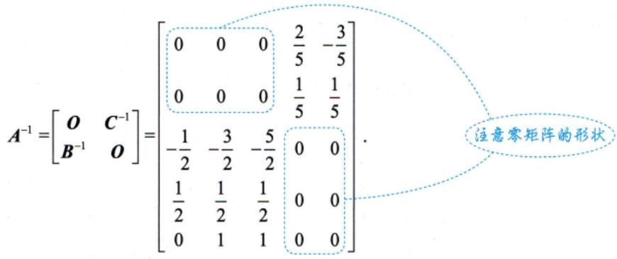

注 副对角线分块矩阵的逆，可推广如下：

$$
A = \left[ \begin{array}{c c c c} & & & A _ {1} \\ & & A _ {2} \\ & \ddots & & \\ A _ {s} & & & \end{array} \right],
$$

其中 $A_{i}(i = 1,2,\dots ,s)$ 可逆，则 $\pmb{A}$ 可逆，且

$$
\boldsymbol {A} ^ {- 1} = \left[ \begin{array}{c c c c} & & & \boldsymbol {A} _ {s} ^ {- 1} \\ & & \ddots & \\ & \boldsymbol {A} _ {2} ^ {- 1} & & \\ \boldsymbol {A} _ {1} ^ {- 1} & & & \end{array} \right].
$$

若

$$
\boldsymbol {A} = \left[ \begin{array}{c c c c} \boldsymbol {A} _ {1} & & & \\ & \boldsymbol {A} _ {2} & & \\ & & \ddots & \\ & & & \boldsymbol {A} _ {s} \end{array} \right],
$$

则

$$
\boldsymbol {A} ^ {- 1} = \left[ \begin{array}{c c c c} \boldsymbol {A} _ {1} ^ {- 1} & & & \\ & \boldsymbol {A} _ {2} ^ {- 1} & & \\ & & \ddots & \\ & & & \boldsymbol {A} _ {s} ^ {- 1} \end{array} \right].
$$

例2.16 已知 $A = \begin{bmatrix} B & O \\ D & C \end{bmatrix}$ ，其中 $B$ 是 $r \times r$ 可逆矩阵， $C$ 是 $s \times s$ 可逆矩阵。证明 $A$ 可逆，并求 $A^{-1}$ 分块三角矩阵 $\rho$ 分析 ① 证明 $A$ 可逆，只需证 $|A| \neq 0$ 即可。

② 用定义法求 $A^{-1}$ . 因为 $AA^{-1} = E$ ，即

$$
\left[ \begin{array}{c c} B & O \\ D & C \end{array} \right] A ^ {- 1} = \left[ \begin{array}{c c} E & O \\ O & E \end{array} \right],
$$

所以只需设 $A^{-1} = \begin{bmatrix} X & Y \\ Z & W \end{bmatrix}$ ，上式左侧进行乘法运算，与右侧对应相等，即可求出 $A^{-1}$ 。

解 因 $|\mathbf{A}| = \begin{vmatrix} \mathbf{B} & \mathbf{O}\\ \mathbf{D} & \mathbf{C} \end{vmatrix} = |\mathbf{B}||\mathbf{C}|\neq 0$ ，故 $\pmb{A}$ 可逆.设 $A^{-1} = \left[ \begin{array}{ll}X & Y\\ Z & W \end{array} \right]$ ，由定义，有

# 矩阵乘法运算

$$
A A ^ {- 1} = \left[ \begin{array}{l l} B & O \\ D & C \end{array} \right] \left[ \begin{array}{l l} X & Y \\ Z & W \end{array} \right] = \left[ \begin{array}{c c} B X & B Y \\ D X + C Z & D Y + C W \end{array} \right] = \left[ \begin{array}{l l} E & O \\ O & E \end{array} \right],
$$

得 $BX = E$ ，即 $X = B^{-1}$ ， $BY = 0$ ，即 $Y = O(B$ 可逆），

$DX + CZ = 0$ ，即 $Z = -C^{-1}DB^{-1}(X = B^{-1})$ $D Y + C W = E$ ，即 $W = C^{-1}(Y = O)$

故 $A^{-1} = \begin{bmatrix} B^{-1} & O \\ -C^{-1}DB^{-1} & C^{-1} \end{bmatrix} .$

注若

$$
A _ {1} = \left[ \begin{array}{c c} B & D \\ O & C \end{array} \right], A _ {2} = \left[ \begin{array}{c c} O & B \\ C & D \end{array} \right], A _ {3} = \left[ \begin{array}{c c} D & B \\ C & O \end{array} \right],
$$

其中 $\pmb{B},\pmb{C}$ 可逆，则有

$$
A _ {1} ^ {- 1} = \left[ \begin{array}{c c} B ^ {- 1} & - B ^ {- 1} D C ^ {- 1} \\ O & C ^ {- 1} \end{array} \right], A _ {2} ^ {- 1} = \left[ \begin{array}{c c} - C ^ {- 1} D B ^ {- 1} & C ^ {- 1} \\ B ^ {- 1} & O \end{array} \right], A _ {3} ^ {- 1} = \left[ \begin{array}{c c} O & C ^ {- 1} \\ B ^ {- 1} & - B ^ {- 1} D C ^ {- 1} \end{array} \right].
$$

请考生用本题的方法推得此类求逆公式，不必记忆，但应理解推导方法，要用时，临时推导即可.

# 矩阵方程

含有未知函数的,是函数方程；含有未知函数的导数,称为导数方程,导数也可以写成微分,所以我们也称之为微分方程. 含有未知函数的积分的等式,称为积分方程；含有偏导函数的,称为偏导数方程,即偏微分方程. 一个等式中未知对象是什么,就把那个等式称为未知对象的方程.

含有未知矩阵的方程称为矩阵方程.

解矩阵方程，应先根据题设条件和矩阵的运算规则，将方程进行恒等变形，使方程化成 $AX = B$

$\mathbf{{XA}} = \mathbf{B}$ 或 $\mathbf{{AXB}} = \mathbf{C}$ 的形式. 两边同时左乘 ${A}^{-1}$ ,右乘 ${B}^{-1}$ . ${A}^{-1}{AXBB}^{-1} = {A}^{-1}C{B}^{-1} \Rightarrow  {EXE} = {A}^{-1}C{B}^{-1}$ 两边同时右乘 ${A}^{-1}$ . $\Rightarrow  X = {A}^{-1}C{B}^{-1}.$

矩阵乘法没有交换律，若想求 $X$ ， $\leftarrow$ 就要两边同时左乘 $A^{-1}$ ： $A^{-1}AX = A^{-1}B \Rightarrow EX = A^{-1}B \Rightarrow X = A^{-1}B.$

$$
X A A ^ {- 1} = B A ^ {- 1} \Rightarrow X E = B A ^ {- 1} \Rightarrow X = B A ^ {- 1}.
$$

若 $A$ 可逆，或 $A$ ， $\pmb{B}$ 均可逆，则分别可得解为 $X = A^{-1}B$ ， $X = BA^{-1}$ ， $X = A^{-1}CB^{-1}$

# 例2.17 设矩阵 $\pmb{A}$ 的伴随矩阵

典型的矩阵方程问题，但是现在的考研中不可能当大题来出题，不过填空题是可以出的.

# 现阶段遇到伴随矩阵应想到的公式

$$
A ^ {\prime} = | A | A ^ {- 1},
$$

$$
\left| A ^ {*} \right| = \left| A \right| ^ {n - 1},
$$

$$
\left(\boldsymbol {A} ^ {*}\right) ^ {- 1} = \left(\boldsymbol {A} ^ {- 1}\right) ^ {*},
$$

$$
\left(\boldsymbol {A} ^ {\prime}\right) ^ {\mathrm {T}} = \left(\boldsymbol {A} ^ {\mathrm {T}}\right) ^ {*},
$$

$$
\left(A ^ {*}\right) ^ {*} = \left| A \right| ^ {n - 2} A,
$$

$$
\left(\boldsymbol {A} \boldsymbol {B}\right) ^ {*} = \boldsymbol {B} ^ {*} \boldsymbol {A} ^ {*},
$$

$$
\left(k A ^ {*}\right) ^ {*} = k ^ {n - 1} A ^ {*}.
$$

$$
\boldsymbol {A} ^ {*} = \left[ \begin{array}{c c c c} 1 & 0 & 0 & 0 \\ 0 & 1 & 0 & 0 \\ 1 & 0 & 1 & 0 \\ 0 & - 3 & 0 & 8 \end{array} \right],
$$

且 $ABA^{-1} = BA^{-1} + 3E$ ，其中 $\pmb{E}$ 是4阶单位矩阵，求矩阵 $\pmb{B}$ ：

分析 先化简再计算.

解 由题设条件得

$$
\begin{array}{l} \begin{array}{r l} & {(A - E) B A ^ {- 1} = 3 E,} \\ & {B = 3 (A - E) ^ {- 1} A} \end{array} \quad \text {同 时 左 乘} (A - E) ^ {- 1}, \text {右 乘} (A ^ {- 1}) ^ {- 1} (①) \\ = 3 (\boldsymbol {A} - \boldsymbol {E}) ^ {- 1} (\boldsymbol {A} ^ {- 1}) ^ {- 1} \\ = 3 [ \boldsymbol {A} ^ {- 1} (\boldsymbol {A} - \boldsymbol {E}) ] ^ {- 1} = 3 (\boldsymbol {E} - \boldsymbol {A} ^ {- 1}) ^ {- 1} (2) \\ = 3 \left(E - \frac {A ^ {*}}{| A |}\right) ^ {- 1}, \xrightarrow [ A ^ {- 1} = \frac {A ^ {*}}{| A |} ]{A ^ {*} = | A | A ^ {- 1}} \text {伴 随 矩 阵 和 逆 矩 阵 关 系 更 紧 密} \\ \end{array}
$$

由 $AA^{*} = |A|E, |A^{*}| = |A|^{n - 1}$ ，得 $\left|\boldsymbol {A}\right|^3 = \left|\boldsymbol {A}^*\right| = 8$ ，即 $|\pmb {A}| = 2$ ，故 $\pmb {B} = 3\left(\pmb {E} - \frac{\pmb{A}^*}{|\pmb{A}|}\right)^{-1} = 6(2\pmb {E} - \pmb{A}^*)^{-1}$ 。

由

$$
2 \boldsymbol {E} - \boldsymbol {A} ^ {*} = \left[ \begin{array}{c c c c} 1 & 0 & 0 & 0 \\ 0 & 1 & 0 & 0 \\ - 1 & 0 & 1 & 0 \\ 0 & 3 & 0 & - 6 \end{array} \right], (2 \boldsymbol {E} - \boldsymbol {A} ^ {*}) ^ {- 1} = \left[ \begin{array}{c c c c} 1 & 0 & 0 & 0 \\ 0 & 1 & 0 & 0 \\ 1 & 0 & 1 & 0 \\ 0 & \frac {1}{2} & 0 & - \frac {1}{6} \end{array} \right],
$$

可得

$$
\boldsymbol {B} = \left[ \begin{array}{c c c c} 6 & 0 & 0 & 0 \\ 0 & 6 & 0 & 0 \\ 6 & 0 & 6 & 0 \\ 0 & 3 & 0 & - 1 \end{array} \right].
$$

注 化简到表达式①或②，即可直接计算 $B$ ，但要先求出 $A$ 或 $A^{-1}$ ，此时还必须利用 $AA^{*} = |A|E$ 及 $|\pmb {A}|^3 = |\pmb {A}^*$ 求出 $|\pmb {A}|$ ，并由 $\pmb{A}^{\star}$ 求出 $\pmb{A}$ 或 $A^{-1}$ ：

# 等价矩阵和矩阵的等价标准形

$A$ 经过初等变换后得到 $B$ ，则 $A, B$ 等价

设 $A,B$ 均是 $m\times n$ 矩阵，若存在可逆矩阵 $P_{m\times m}$ ， $\pmb{Q}_{n\times n}$ ，使得 $\overline{PAQ} = B$ ，则称 $A,B$ 是等价矩阵，记作

$$
A \cong B.
$$

等价标准形

行变换

列变换

$A$ 是一个 $m \times n$ 矩阵, 则 $A$ 等价于形如 $\left[ \begin{array}{ll}E_r & 0\\ 0 & 0 \end{array} \right]$ 的矩阵（ $E_r$ 中的 $r$ 恰是 $r(A)$ ）, 后者称为 $A$ 的等价

关于秩，在前面讲过

标准形.等价标准形是唯一的，即若 $r(A) = r$ ，则存在可逆矩阵 $\pmb {P},\pmb{Q}$ ，使得

$$
P A Q = \left[ \begin{array}{c c} E _ {r} & O \\ O & O \end{array} \right].
$$

$PAQ$ 不再看成3个矩阵相乘，而是看作将 $P$ 作用在 $A$ 上，使得 $A$ 作相应的初等行变换，得到新矩阵 $PA$ 。再将 $Q$ 作用在新矩阵 $PA$ 上，使得作了行变换的矩阵继续作列变换

示例 已知可逆矩阵 $P_{1}, P_{2}, P_{3}, Q_{1}, Q_{2}, Q_{3}$ , 若 $P_{1}AQ_{1} = \begin{bmatrix} E_{r} & O \\ O & O \end{bmatrix}$ , 且 $P_{2}AQ_{2} = B$ , $P_{3}BQ_{3} = C$ , 则有

$$
P _ {1} A Q _ {1} = P _ {3} B Q _ {3} \Rightarrow P _ {3} ^ {- 1} P _ {1} A Q _ {1} Q _ {3} ^ {- 1} = B \Rightarrow P _ {2} = P _ {3} ^ {- 1} P _ {1}, Q _ {2} = Q _ {1} Q _ {3} ^ {- 1}.
$$

例2.18 设矩阵

$$
\boldsymbol {A} = \left[ \begin{array}{c c c} 1 & 0 & 1 \\ - 1 & - 1 & 1 \\ 0 & 2 & a \end{array} \right], \boldsymbol {B} = \left[ \begin{array}{c c c} 1 & 0 & 1 \\ 0 & - 1 & 2 \\ 0 & 0 & 0 \end{array} \right].
$$

(1)当 $a$ 为何值时，矩阵 $\pmb{A}$ 和 $\pmb{B}$ 等价；  
(2)当 $\pmb{A}$ 和 $\pmb{B}$ 等价时，求一个可逆矩阵 $\pmb{P}$ ，使得 $PA = B$ ：

$\mathcal{P}$ 分析 当 $\pmb{A}$ 和 $\pmb{B}$ 等价时， $\pmb{A}$ 的秩和 $\pmb{B}$ 的秩相同.

我们可以算出 $B$ 的秩，发现 $r(B) = 2$ ，则 $|B| = 0$ ，故 $|\mathbf{A}| = 0$ ，计算 $\pmb{A}$ 的行列式，可以算出 $a$ ，再把 $a$ 代入 $\pmb{A}$ 计算 $\pmb{A}$ 的秩，看是否符合 $r(A) = 2$ ，有的题目会求出多个 $a$ ，但并不是每个 $a$ 都符合题目中的条件.

也可以利用等价标准形来求 $a$ .因为

$$
\begin{array}{l} \boldsymbol {B} = \left[\begin{array}{c c c}1&0&1\\0&- 1&2\\0&0&0\end{array}\right]\rightarrow \left[\begin{array}{c c c}1&0&0\\0&1&0\\0&0&0\end{array}\right] = \left[\begin{array}{c c}\boldsymbol {E} _ {2}&\boldsymbol {O}\\\boldsymbol {O}&\boldsymbol {O}\end{array}\right], \\ A = \left[\begin{array}{c c c}1&0&1\\- 1&- 1&1\\0&2&a\end{array}\right]\rightarrow \left[\begin{array}{c c c}1&0&0\\0&1&0\\0&0&a + 4\end{array}\right], \\ \end{array}
$$

所以 $a + 4 = 0$ ，故 $a = -4$

解 (1) $A, B$ 同型， $A$ 等价于 $B \Leftrightarrow r(A) = r(B)$

对于 $\pmb{B}$ ，显然有 $r(B) = 2$ ：

对于 $\pmb{A}$ ，因 $\left| \begin{array}{ll}1 & 0\\ -1 & -1 \end{array} \right|\neq 0$ ，要求 $r(A) = r(B) = 2$ ，故应有设 $A_{n\times n}$ ，若 $r(A) <   n$ ，则 $|\textbf{A}| = 0$

1倍加至

$$
| A | = \left| \begin{array}{c c c} 1 & 0 & 1 \\ - 1 & - 1 & 1 \\ 0 & 2 & a \end{array} \right| = \left| \begin{array}{c c c} 1 & 0 & 1 \\ 0 & - 1 & 2 \\ 0 & 2 & a \end{array} \right| = \left| \begin{array}{c c c} 1 & 0 & 1 \\ 0 & - 1 & 2 \\ 0 & 0 & a + 4 \end{array} \right| = - (a + 4) = 0,
$$

2倍加至

解得 $a = -4$

因此，当 $a = -4$ 时，有 $r(A) = r(B) = 2$ ，矩阵 $\mathbf{A}$ 和 $\pmb{B}$ 等价.

(2)当 $a = -4$ 时，

$$
\boldsymbol {A} = \left[ \begin{array}{c c c} 1 & 0 & 1 \\ - 1 & - 1 & 1 \\ 0 & 2 & - 4 \end{array} \right].
$$

对 $\pmb{A}$ 作初等行变换，消 $a_{21}, a_{32}$ 为零. 因

$$
\begin{array}{l} \boldsymbol {E} _ {2 1} (1) \boldsymbol {A} = \left[ \begin{array}{l l l} 1 & 0 & 0 \\ 1 & 1 & 0 \\ 0 & 0 & 1 \end{array} \right] \boldsymbol {A} = \left[ \begin{array}{l l l} 1 & 0 & 0 \\ 1 & 1 & 0 \\ 0 & 0 & 1 \end{array} \right] \left[ \begin{array}{r r r} 1 & 0 & 1 \\ - 1 & - 1 & 1 \\ 0 & 2 & - 4 \end{array} \right] \\ = \left[ \begin{array}{r r r} 1 & 0 & 1 \\ 0 & - 1 & 2 \\ 0 & 2 & - 4 \end{array} \right] = C, \\ \end{array}
$$

$$
\boldsymbol {E} _ {3 2} (2) \boldsymbol {C} = \left[ \begin{array}{l l l} 1 & 0 & 0 \\ 0 & 1 & 0 \\ 0 & 2 & 1 \end{array} \right] \left[ \begin{array}{l l l} 1 & 0 & 1 \\ 0 & - 1 & 2 \\ 0 & 2 & - 4 \end{array} \right] = \left[ \begin{array}{l l l} 1 & 0 & 1 \\ 0 & - 1 & 2 \\ 0 & 0 & 0 \end{array} \right] = \boldsymbol {B},
$$

故有

$$
\boldsymbol {B} = \boldsymbol {E} _ {3 2} (2) \boldsymbol {C} = \boldsymbol {E} _ {3 2} (2) \boldsymbol {E} _ {2 1} (1) \boldsymbol {A}.
$$

取

$$
\boldsymbol {P} = \boldsymbol {E} _ {3 2} (2) \boldsymbol {E} _ {2 1} (1) = \left[ \begin{array}{l l l} 1 & 0 & 0 \\ 0 & 1 & 0 \\ 0 & 2 & 1 \end{array} \right] \left[ \begin{array}{l l l} 1 & 0 & 0 \\ 1 & 1 & 0 \\ 0 & 0 & 1 \end{array} \right] = \left[ \begin{array}{l l l} 1 & 0 & 0 \\ 1 & 1 & 0 \\ 2 & 2 & 1 \end{array} \right],
$$

使得 $PA = B$ ：

# 以后方程组再讲

注本题(2)若改为求满足条件的全部可逆矩阵 $\mathbf{P}$ ，可用下述方法.

解考虑 $\pmb{A}^{\mathrm{T}}\pmb{P}^{\mathrm{T}} = \pmb{B}^{\mathrm{T}}$ ，将 $P^{\mathrm{T}}$ 按列分块为 $[\xi_1,\xi_2,\xi_3]$

$$
\begin{array}{l} [ \boldsymbol {A} ^ {\mathrm {T}}: \boldsymbol {B} ^ {\mathrm {T}} ] = \left[\begin{array}{l l l l l l}1&- 1&0&1&0&0\\0&- 1&2&0&- 1&0\\1&1&- 4&1&2&0\end{array}\right]\rightarrow \left[\begin{array}{l l l l l l}1&- 1&0&1&0&0\\0&- 1&2&0&- 1&0\\0&2&- 4&0&2&0\end{array}\right] \\ \rightarrow \left[\begin{array}{c c c c c c}1&- 1&0&1&0&0\\0&- 1&2&0&- 1&0\\0&0&0&0&0&0\end{array}\right] \leftarrow \times (- 1) \rightarrow \left[\begin{array}{c c c c c c}1&- 1&0&1&0&0\\0&1&- 2&0&1&0\\0&0&0&0&0&0\end{array}\right], \\ \end{array}
$$

解得

$$
\boldsymbol {\xi} _ {1} = k _ {1} \left[ \begin{array}{l} 2 \\ 2 \\ 1 \end{array} \right] + \left[ \begin{array}{l} 1 \\ 0 \\ 0 \end{array} \right], \boldsymbol {\xi} _ {2} = k _ {2} \left[ \begin{array}{l} 2 \\ 2 \\ 1 \end{array} \right] + \left[ \begin{array}{l} 1 \\ 1 \\ 0 \end{array} \right], \boldsymbol {\xi} _ {3} = k _ {3} \left[ \begin{array}{l} 2 \\ 2 \\ 1 \end{array} \right],
$$

则有

$$
\boldsymbol {P} ^ {\mathrm {T}} = \left[ \begin{array}{c c c} 2 k _ {1} + 1 & 2 k _ {2} + 1 & 2 k _ {3} \\ 2 k _ {1} & 2 k _ {2} + 1 & 2 k _ {3} \\ k _ {1} & k _ {2} & k _ {3} \end{array} \right],
$$

此时，

$$
\boldsymbol {P} = \left[ \begin{array}{c c c} 2 k _ {1} + 1 & 2 k _ {1} & k _ {1} \\ 2 k _ {2} + 1 & 2 k _ {2} + 1 & k _ {2} \\ 2 k _ {3} & 2 k _ {3} & k _ {3} \end{array} \right],
$$

其中，因为 $P$ 可逆，则 $k_{3} \neq 0$ ，即 $k_{1}, k_{2}$ 为任意常数， $k_{3}$ 为任意非零常数.

# 八 矩阵的秩

定义 只要有一个就行 任取 $k$ 行、 $k$ 列构成的 $k$ 阶行列式

设 $A$ 是 $m \times n$ 矩阵，若存在 $k$ 阶子式不为零，而任意 $k + 1$ 阶子式（如果有的话）全为零，则 $r(A) = k$ ，且若 $A$ 为 $n \times n$ 矩阵，则 换言之，若矩阵 $A$ 存在 $k$ 个线性无关的维数，则有

$r(A_{n\times n}) = n\Leftrightarrow |A|\neq 0\Leftrightarrow A$ 可逆.

换言之，若矩阵 $A$ 存在 $k$ 个线性无关的行（列）向量，任意 $k + 1$ 个向量线性相关，则 $r(A) = k.$

# 2 求法

$$
A = \left[ \begin{array}{l l l} 1 & 2 & 3 \\ 4 & 5 & 6 \end{array} \right],
$$

将 $A$ 用初等行变换化为行阶梯形矩阵, 其非零行数便为 $A$ 的秩. 行, 2 列组成的行列式, $A$ 的 2 阶子式为

则 $k = 2$ ，2阶子式表示从矩阵中任取2行，2列组成的行列式， $A$ 的2阶子式为

# 3 有关秩的几个重要式子

$$
\left| \begin{array}{c c} 1 & 2 \\ 4 & 5 \end{array} \right|, \quad \left| \begin{array}{c c} 1 & 3 \\ 4 & 6 \end{array} \right|, \quad \left| \begin{array}{c c} 2 & 3 \\ 5 & 6 \end{array} \right|
$$

设 $\pmb{A}$ 是 $m\times n$ 矩阵， $\pmb{B}$ 是满足有关矩阵运算要求的矩阵，则

① $0 \leqslant r(A) \leqslant \min \{m, n\}$ （由定义）； $r(A) = 0 \Leftrightarrow A = 0$   
② $r(kA) = r(A)(k \neq 0)$ （由定义）；

★ ③ $r(\mathbf{AB}) \leqslant \min \{r(\mathbf{A}), r(\mathbf{B})\}$ （见例3.9）；  
★ ④ $r(\mathbf{A} + \mathbf{B}) \leqslant r(\mathbf{A}) + r(\mathbf{B})$ （见例3.10）；

$r(A^{*}) = \left\{ \begin{array}{ll}n, & r(A) = n,\\ 1, & r(A) = n - 1,\\ 0, & r(A) <   n - 1, \end{array} \right.$ 其中 $A$ 为 $n(n\geqslant 2)$ 阶方阵（见例3.11）；

$AA^{*} = |A|E,\frac{1}{|A|} AA^{*} = E$ ，若 $A$ 可逆，则 $A^{\star}$ 可逆

⑥ 设 $A$ 是 $m \times n$ 矩阵， $P, Q$ 分别是 $m$ 阶、 $n$ 阶可逆矩阵，则

对 $\mathbf{A}$ 进行列变换 $r\left( \mathbf{A}\right)  = r\left( {\mathbf{{PA}}}\right)  = r\left( {\mathbf{{AQ}}}\right)  = r\left( {\mathbf{{PAQ}}}\right)$ ;

★⑦若 $A_{m\times n}B_{n\times s} = O$ ，则 $r(A) + r(B)\leqslant n$   
★ $⑧ r(A) = r(A^{\mathrm{T}}) = r(A^{\mathrm{T}}A) = r(A A^{\mathrm{T}})$

例2.19 若矩阵 $\begin{bmatrix} 1 & 2 & -1 & 1 \\ 2 & 0 & t & 0 \\ 0 & -4 & 5 & -2 \end{bmatrix}$ 的秩为2，则 $t = (\quad)$ .

(A) 0

(B) 1

(C) 2

(D) 3

解 应选(D).

方法一 已知该矩阵的秩为2，因此，它的所有3阶子式都为零，于是只要计算出其中含待定常数 $t$ 的一个3阶子式即可求出 $t$ 的值.

由 $\left| \begin{array}{ccc}1 & 2 & -1\\ 2 & 0 & t\\ 0 & -4 & 5 \end{array} \right| = -12 + 4t = 0$ ，得 $t = 3$ ：

方法二 对该矩阵作初等变换，有

(-2)倍加至 $\begin{bmatrix} 1 & 2 & -1 & 1 \\ 2 & 0 & t & 0 \\ 0 & -4 & 5 & -2 \end{bmatrix} \rightarrow \begin{bmatrix} 1 & 2 & -1 & 1 \\ 0 & -4 & t + 2 & -2 \\ 0 & -4 & 5 & -2 \end{bmatrix} \rightarrow \begin{bmatrix} 1 & 2 & -1 & 1 \\ 0 & -4 & t + 2 & -2 \\ 0 & 0 & 3 - t & 0 \end{bmatrix},$

知当 $t = 3$ 时，该矩阵的秩为2

(-1)倍

加至

例2.20 设 $A$ 为 $m \times n$ 矩阵， $B$ 为 $n \times m$ 矩阵， $E$ 为 $m$ 阶单位矩阵。若 $AB = E$ ，则（ ）.

(A) $r(\mathbf{A}) = m,r(\mathbf{B}) = m$

(B) $r(A) = m, r(B) = n$

(C) $r(\mathbf{A}) = n, r(\mathbf{B}) = m$

(D) $r(A) = n, r(B) = n$

不妨设 $A = \left[ \begin{array}{ll}E_{m} & O \end{array} \right],B = \left[ \begin{array}{l}E_{m}\\ O \end{array} \right]$ 则

解 应选(A). $AB = [E_m \quad O][\begin{array}{c} E_m \\ O \end{array} ] = E_m \Rightarrow r(A) = m, r(B) = m.$

由已知可得 $r(A) \leqslant \min \{m, n\} \leqslant m, r(B) \leqslant \min \{m, n\} \leqslant m$ ，又 $m = r(E) = r(AB) \leqslant \min \{r(A), r(B)\}$ ，即有 $r(A) \geqslant m$ 及 $r(B) \geqslant m$ 。所以 $r(A) = r(B) = m$ ，应选（A）。

# 基础习题精练

# 习题

2.1 设 $A = \begin{bmatrix} 3 & 4 \\ -1 & -2 \end{bmatrix}, B = \begin{bmatrix} 1 & 1 \\ -3 & -2 \end{bmatrix}$ ，则 $A^2 - B^2$ ， $(A - B)(A + B)$ 的结果分别是（ ）.

(A) $\left[ \begin{array}{ll}7 & 5\\ -4 & -1 \end{array} \right],\left[ \begin{array}{ll}7 & 5\\ -4 & -1 \end{array} \right]$

(B) $\left[ \begin{array}{cc} - 4 & -2\\ 8 & 10 \end{array} \right],\left[ \begin{array}{cc} - 4 & -2\\ 8 & 10 \end{array} \right]$

(C) $\left[ \begin{array}{ll}7 & 5\\ -4 & -1 \end{array} \right],\left[ \begin{array}{ll} - 4 & -2\\ 8 & 10 \end{array} \right]$

$\left[ \begin{array}{ll} - 4 & -2\\ 8 & 10 \end{array} \right],\left[ \begin{array}{ll}7 & 5\\ -4 & -1 \end{array} \right]$

2.2 设 $f(x) = x^{2} - 5x + 3$ ， $A = \begin{bmatrix} 2 & -1 \\ -3 & 3 \end{bmatrix}$ ，定义 $f(A) = A^{2} - 5A + 3E$ ，称其为矩阵 $A$ 的多项式，则 $f(A) = (\quad)$ 。

(A) $\begin{bmatrix} 3 & 0 \\ 0 & 2 \end{bmatrix}$   
(B) $\left[ \begin{array}{ll}2 & 0\\ 3 & 3 \end{array} \right]$   
(C) $\left[ \begin{array}{ll}0 & 0\\ 0 & 0 \end{array} \right]$   
(D) $\left[ \begin{array}{ll}2 & 3\\ -1 & 0 \end{array} \right]$

2.3设 $n$ 阶方阵 $A,B,C$ 满足关系式 $ABC = E$ ，其中 $\pmb{E}$ 是 $n$ 阶单位阵，则必有（ ）.

(A) $ACB = E$

(B) $CBA = E$

(C) $B A C = E$

(D) $BCA = E$

2.4 设 $A$ 为3阶矩阵，将 $A$ 的第2行加到第1行得到 $B$ ，再将 $B$ 的第1列的-1倍加到第2列得到 $C$ ，记

$$
\boldsymbol {P} = \left[ \begin{array}{c c c} 1 & 1 & 0 \\ 0 & 1 & 0 \\ 0 & 0 & 1 \end{array} \right],
$$

则（ ）.

(A) $C = P^{-1}AP$   
(B) $C = PAP^{-1}$   
(C) $\pmb{C} = \pmb{P}^{\mathrm{T}}\pmb {A}\pmb{P}$   
(D) $\pmb{C} = \pmb{P}\pmb{A}\pmb{P}^{\mathrm{T}}$

2.5 设3阶矩阵 $A = \begin{bmatrix} a & b & b\\ b & a & b\\ b & b & a \end{bmatrix}$ ，其中 $b\neq 0$ ，已知 $\pmb{A}$ 的伴随矩阵 $A^{\star}$ 的秩为 $r(A^{*}) = 1$ ，则 $a,b$ 应满

足关系（ ）.

(A) $a = b$   
(B) $a = -2b$   
(C) $a = 0$   
(D) $a = 2b$

2.6 设 $A$ 是 $4 \times 3$ 矩阵， $B$ 是 $3 \times 4$ 的非零矩阵，且满足 $AB = O$ ，其中

$$
\boldsymbol {A} = \left[ \begin{array}{c c c} 1 & 2 & t \\ 3 & t & 1 8 \\ 2 & 4 & 2 t \\ 1 & 8 - t & 4 t - 1 8 \end{array} \right],
$$

则（ ）.

(A)当 $t\neq 6$ 时，必有 $r(B) = 1$   
(B)当 $t = 6$ 时，必有 $r(\pmb {B}) = 2$   
(C)当 $t\neq 6$ 时，必有 $r(B) = 2$   
(D)当 $t = 6$ 时，必有 $r(B) = 1$

2.7 设 $A = \begin{bmatrix} 1 & 2 & -1\\ -2 & -4 & 2\\ 3 & 6 & -3 \end{bmatrix}$ 则 $A^n =$

2.8 设 $A = \begin{bmatrix} 0 & 1 & 0\\ 1 & 0 & -1\\ 0 & -1 & 0 \end{bmatrix}$ 则当 $n\geqslant 2$ 时， $A^n = \underline{\quad}$

2.9 设矩阵 $A$ 满足 $A^2 + A - 4E = 0$ ，其中 $E$ 为单位矩阵，则 $(A - E)^{-1} =$

2.10 设 $A = \begin{bmatrix} 1 & 0 & 0 & 0 \\ -2 & 3 & 0 & 0 \\ 0 & -4 & 5 & 0 \\ 0 & 0 & -6 & 7 \end{bmatrix}$ , $E$ 为4阶单位矩阵, 且 $B = (E + A)^{-1}(E - A)$ , 则 $(E + B)^{-1} =$

2.11 设矩阵 $A = (a_{ij})_{3\times 3}$ 满足 $A^{\mathrm{T}} = A^{\mathrm{T}}$ ，其中 $A^{\mathrm{T}}$ 为 $\pmb{A}$ 的伴随矩阵， $A^{\mathrm{T}}$ 为 $\pmb{A}$ 的转置矩阵.若 $a_{11}$ ， $a_{12}$ ， $a_{13}$ 为三个相等的正数，则 $a_{11} = \_ .$

2.12 设矩阵 $\left[ \begin{array}{rrr}a & -1 & -1\\ -1 & a & -1\\ -1 & -1 & a \end{array} \right]$ 与 $\left[ \begin{array}{rrr}1 & 1 & 0\\ 0 & -1 & 1\\ 1 & 0 & 1 \end{array} \right]$ 等价，则 $a =$

2.13 设 $A = E - 2\xi \xi^{\mathrm{T}}$ ，其中 $\xi = [x_1, x_2, \dots, x_n]^{\mathrm{T}}$ ，且 $\xi^{\mathrm{T}}\xi = 1$ . 证明：

(1) $\pmb{A}$ 是对称矩阵；  
(2) $A^2 = E$

2.14 设3阶方阵 $A, B$ 满足 $A^{-1}BA = 6A + BA$ ，且

$$
\boldsymbol {A} = \left[ \begin{array}{l l l} \frac {1}{3} & 0 & 0 \\ 0 & \frac {1}{4} & 0 \\ 0 & 0 & \frac {1}{5} \end{array} \right],
$$

求 $\pmb{B}$ ：

2.15 设4阶矩阵

$$
\boldsymbol {B} = \left[ \begin{array}{c c c c} 0 & - 1 & 0 & 0 \\ 0 & 0 & - 1 & 0 \\ 0 & 0 & 0 & - 1 \\ 0 & 0 & 0 & 0 \end{array} \right], \boldsymbol {C} = \left[ \begin{array}{c c c c} 2 & 1 & 3 & 4 \\ 0 & 2 & 1 & 3 \\ 0 & 0 & 2 & 1 \\ 0 & 0 & 0 & 2 \end{array} \right],
$$

且矩阵 $\mathbf{A}$ 满足关系式 $A(E - C^{-1}B)^{\mathrm{T}}C^{\mathrm{T}} = E + A$ ，求矩阵 $\mathbf{A}$ ：

# 解答

2.1 (C) 解本题涉及矩阵的乘法运算，需严格按照相关的运算律进行，尤其要注意相乘时矩阵的左右位置。

$$
\begin{array}{l} \boldsymbol {A} ^ {2} - \boldsymbol {B} ^ {2} = \left[ \begin{array}{l l} 3 & 4 \\ - 1 & - 2 \end{array} \right] \left[ \begin{array}{l l} 3 & 4 \\ - 1 & - 2 \end{array} \right] - \left[ \begin{array}{l l} 1 & 1 \\ - 3 & - 2 \end{array} \right] \left[ \begin{array}{l l} 1 & 1 \\ - 3 & - 2 \end{array} \right] \\ = \left[ \begin{array}{l l} 5 & 4 \\ - 1 & 0 \end{array} \right] - \left[ \begin{array}{l l} - 2 & - 1 \\ 3 & 1 \end{array} \right] = \left[ \begin{array}{l l} 7 & 5 \\ - 4 & - 1 \end{array} \right], \\ (\boldsymbol {A} - \boldsymbol {B}) (\boldsymbol {A} + \boldsymbol {B}) = \left(\left[ \begin{array}{l l} 3 & 4 \\ - 1 & - 2 \end{array} \right] - \left[ \begin{array}{l l} 1 & 1 \\ - 3 & - 2 \end{array} \right]\right) \left(\left[ \begin{array}{l l} 3 & 4 \\ - 1 & - 2 \end{array} \right] + \left[ \begin{array}{l l} 1 & 1 \\ - 3 & - 2 \end{array} \right]\right) \\ = \left[ \begin{array}{l l} 2 & 3 \\ 2 & 0 \end{array} \right] \left[ \begin{array}{l l} 4 & 5 \\ - 4 & - 4 \end{array} \right] = \left[ \begin{array}{l l} - 4 & - 2 \\ 8 & 1 0 \end{array} \right]. \\ \end{array}
$$

注 本题的结果表明 ${A}^{2} - {B}^{2} \neq  \left( {A - B}\right) \left( {A + B}\right)$ ,这是因为由乘法的分配律,有

$$
(\boldsymbol {A} - \boldsymbol {B}) (\boldsymbol {A} + \boldsymbol {B}) = \boldsymbol {A} ^ {2} + \boldsymbol {A} \boldsymbol {B} - \boldsymbol {B} \boldsymbol {A} - \boldsymbol {B} ^ {2}.
$$

由于矩阵乘法无交换律，即在一般情况下， $AB\neq BA$ ，故有上面不等式.类似地，一般情况下，对于任意 $_n$ 阶矩阵 $A,B$ ，有

$$
\left(\boldsymbol {A} \pm \boldsymbol {B}\right) ^ {2} \neq \boldsymbol {A} ^ {2} \pm 2 \boldsymbol {A B} + \boldsymbol {B} ^ {2},
$$

$$
\left(A \pm B\right) ^ {3} \neq A ^ {3} \pm 3 A ^ {2} B + 3 A B ^ {2} \pm B ^ {3}.
$$

但任意 $n$ 阶矩阵 $\pmb{A}$ 与 $n$ 阶单位矩阵 $\pmb{E}$ 可交换，故总有

$$
\begin{array}{l} \boldsymbol {A} ^ {2} - \boldsymbol {E} = (\boldsymbol {A} - \boldsymbol {E}) (\boldsymbol {A} + \boldsymbol {E}), \\ \left(\boldsymbol {A} \pm \boldsymbol {E}\right) ^ {2} = \boldsymbol {A} ^ {2} \pm 2 \boldsymbol {A} + \boldsymbol {E}, \\ \left(A \pm E\right) ^ {3} = A ^ {3} \pm 3 A ^ {2} + 3 A \pm E. \\ \end{array}
$$

可见当且仅当矩阵乘积可交换时，我们学习过的代数公式才可扩展到矩阵的情况。

2.2 (C) 解 矩阵 $A$ 的多项式是将多项式 $f(x)$ 中变量 $x$ 用矩阵 $A$ 置换得到，注意其中常数项改为 $3A^0 = 3E$ ，计算要严格按照先做幂和数乘运算，再做加法运算的顺序．

$$
\begin{array}{l} f (\boldsymbol {A}) = \left[ \begin{array}{l l} 2 & - 1 \\ - 3 & 3 \end{array} \right] \left[ \begin{array}{l l} 2 & - 1 \\ - 3 & 3 \end{array} \right] - 5 \left[ \begin{array}{l l} 2 & - 1 \\ - 3 & 3 \end{array} \right] + 3 \left[ \begin{array}{l l} 1 & 0 \\ 0 & 1 \end{array} \right] \\ = \left[ \begin{array}{l l} 7 & - 5 \\ - 1 5 & 1 2 \end{array} \right] - \left[ \begin{array}{l l} 1 0 & - 5 \\ - 1 5 & 1 5 \end{array} \right] + \left[ \begin{array}{l l} 3 & 0 \\ 0 & 3 \end{array} \right] = \left[ \begin{array}{l l} 0 & 0 \\ 0 & 0 \end{array} \right], \\ \end{array}
$$

故选 (C).

2.3 (D) 解 因为 $ABC = E$ ，即 $A(BC) = E$ ，故方阵 $A$ 与 $BC$ 互为逆矩阵，从而有 $(BC)A = E$ ，即 $BCA = E$ ：

注实际上， $ABC = E \Leftrightarrow BCA = E \Leftrightarrow CAB = E$ ，把 $A, B, C$ 顺时针围成一圈，任意三者顺时针相乘都等于 $E$ ：

2.4 (B) 解 将 $A$ 的第 2 行加到第 1 行得到 $B$ ，即

$$
\boldsymbol {B} = \left[ \begin{array}{l l l} 1 & 1 & 0 \\ 0 & 1 & 0 \\ 0 & 0 & 1 \end{array} \right] \boldsymbol {A} = \boldsymbol {P A}.
$$

将 $\pmb{B}$ 的第1列的-1倍加到第2列得到 $C$ ，即

$$
\boldsymbol {C} = \boldsymbol {B} \left[ \begin{array}{c c c} 1 & - 1 & 0 \\ 0 & 1 & 0 \\ 0 & 0 & 1 \end{array} \right] \stackrel {\text {记}} {=} \boldsymbol {B Q}.
$$

因

$$
\boldsymbol {P Q} = \left[ \begin{array}{l l l} 1 & 1 & 0 \\ 0 & 1 & 0 \\ 0 & 0 & 1 \end{array} \right] \left[ \begin{array}{l l l} 1 & - 1 & 0 \\ 0 & 1 & 0 \\ 0 & 0 & 1 \end{array} \right] = \left[ \begin{array}{l l l} 1 & 0 & 0 \\ 0 & 1 & 0 \\ 0 & 0 & 1 \end{array} \right] = \boldsymbol {E},
$$

故 $Q = P^{-1}$ ，从而有 $C = BQ = BP^{-1} = PAP^{-1}$ ，故应选(B).

2.5 (B) 解 由 $r(A^{*}) = 1$ ，则 $r(A) = 2$ . 对 $A$ 作初等变换，有

# 1倍加至

# 1倍加至

$$
\begin{array}{r}\underbrace {(- 1) \text {倍 加 至}} _ {A =} \left[\begin{array}{l l l}a&b&b\\b&a&b\\b&b&a\end{array}\right]\rightarrow \left[\begin{array}{c c c}a&b&b\\b - a&a - b&0\\b - a&0&a - b\end{array}\right]\rightarrow \left[\begin{array}{c c c}a + 2 b&b&b\\0&a - b&0\\0&0&a - b\end{array}\right].\end{array}
$$

$r(A) = 2\Leftrightarrow a\neq b$ 且 $a = -2b$ ，因 $b\neq 0$ ，故 $a = -2b(a\neq 0)$ ：

2.6 (A) 解 由 $AB = O$ ，得 $r(A) + r(B) \leqslant 3, B$ 是非零矩阵，故 $r(B) \geqslant 1$ ：

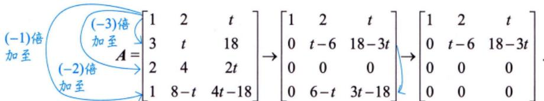

1倍加至

当 $t \neq 6$ 时， $r(A) = 2$ ，则 $r(B) = 1$ ，故 (A) 成立，(C) 不成立；

当 $t = 6$ 时， $r(A) = 1$ ，则 $r(B) = 1$ 或 $r(B) = 2$ ，故(B)，(D)不成立.

2.7 $(-6)^{n - 1}\left[ \begin{array}{rrr}1 & 2 & -1\\ -2 & -4 & 2\\ 3 & 6 & -3 \end{array} \right]$ 解

$$
\boldsymbol {A} = \left[ \begin{array}{c c c} 1 & 2 & - 1 \\ - 2 & - 4 & 2 \\ 3 & 6 & - 3 \end{array} \right] = \left[ \begin{array}{l} 1 \\ - 2 \\ 3 \end{array} \right] \left[ \begin{array}{l l l} 1, & 2, & - 1 \end{array} \right] \stackrel {\text {记}} {=} \boldsymbol {\alpha} \boldsymbol {\beta} ^ {\mathrm {T}},
$$

则 $A^n = (\pmb{\alpha}\pmb{\beta}^{\mathrm{T}})^n = (\pmb{\alpha}\pmb{\beta}^{\mathrm{T}})(\pmb{\alpha}\pmb{\beta}^{\mathrm{T}})\dots (\pmb{\alpha}\pmb{\beta}^{\mathrm{T}}) = \pmb{\alpha}(\pmb{\beta}^{\mathrm{T}}\pmb {\alpha})\dots (\pmb{\beta}^{\mathrm{T}}\pmb {\alpha})\pmb{\beta}^{\mathrm{T}} = (\pmb{\beta}^{\mathrm{T}}\pmb {\alpha})^{n - 1}\pmb{\alpha}\pmb{\beta}^{\mathrm{T}},$

其中 $\pmb{\beta}^{\mathrm{T}}\pmb {\alpha} = [1,2, - 1]\left[ \begin{array}{l}1\\ -2\\ 3 \end{array} \right] = -6$ ，故 $A^n = (-6)^{n - 1}\left[ \begin{array}{rrr}1 & 2 & -1\\ -2 & -4 & 2\\ 3 & 6 & -3 \end{array} \right].$

2.8 $\begin{cases} 2^{k - 1}\left[ \begin{array}{rrr}1 & 0 & -1\\ 0 & 2 & 0\\ -1 & 0 & 1 \end{array} \right], & n = 2k,\\ 2^k\left[ \begin{array}{rrr}0 & 1 & 0\\ 1 & 0 & -1\\ 0 & -1 & 0 \end{array} \right], & n = 2k + 1, \end{cases}$ 解因为

$$
\boldsymbol {A} ^ {2} = \boldsymbol {A} \boldsymbol {A} = \left[ \begin{array}{l l l} 0 & 1 & 0 \\ 1 & 0 & - 1 \\ 0 & - 1 & 0 \end{array} \right] \left[ \begin{array}{l l l} 0 & 1 & 0 \\ 1 & 0 & - 1 \\ 0 & - 1 & 0 \end{array} \right] = \left[ \begin{array}{l l l} 1 & 0 & - 1 \\ 0 & 2 & 0 \\ - 1 & 0 & 1 \end{array} \right],
$$

$$
\boldsymbol {A} ^ {3} = \boldsymbol {A} ^ {2} \boldsymbol {A} = \left[ \begin{array}{l l l} 1 & 0 & - 1 \\ 0 & 2 & 0 \\ - 1 & 0 & 1 \end{array} \right] \left[ \begin{array}{l l l} 0 & 1 & 0 \\ 1 & 0 & - 1 \\ 0 & - 1 & 0 \end{array} \right] = \left[ \begin{array}{l l l} 0 & 2 & 0 \\ 2 & 0 & - 2 \\ 0 & - 2 & 0 \end{array} \right] = 2 \boldsymbol {A},
$$

$$
A ^ {4} = A ^ {3} A = 2 A A = 2 A ^ {2},
$$

所以 $A^n = \begin{cases} 2^{k - 1}A^2, & n = 2k, \\ 2^k A, & n = 2k + 1, \end{cases} k = 1, 2, \dots .$

2.9 $\frac{1}{2} (A + 2E)$ 解本题考查的要点是矩阵的简单运算. 给出某矩阵方程，来求某矩阵（或其逆矩阵）的表达式，或给出某数字矩阵，来求另一个与此相关的矩阵或其逆矩阵的具体答案，是常考题. 本题是其中比较容易的一种形式. 最简单的做法是，将一定倍数的 $E$ 移到等号右边，使左边留下的项能提出因式 $A - E$ . 按此思路，将原式写成 $A^2 + A - 2E = 2E$ ，即 $(A - E)(A + 2E) = 2E$ . 从而 $(A - E)^{-1} = \frac{1}{2} (A + 2E)$ ：

2.10 $\begin{bmatrix} 1 & 0 & 0 & 0\\ -1 & 2 & 0 & 0\\ 0 & -2 & 3 & 0\\ 0 & 0 & -3 & 4 \end{bmatrix}$ 解因为

$$
\begin{array}{l} \boldsymbol {B} + \boldsymbol {E} = (\boldsymbol {E} + \boldsymbol {A}) ^ {- 1} (\boldsymbol {E} - \boldsymbol {A}) + \boldsymbol {E} \\ = (\boldsymbol {E} + \boldsymbol {A}) ^ {- 1} (\boldsymbol {E} - \boldsymbol {A} + \boldsymbol {E} + \boldsymbol {A}) \\ = 2 (\boldsymbol {E} + \boldsymbol {A}) ^ {- 1}, \\ \end{array}
$$

所以 $(\pmb {E} + \pmb {B})^{-1} = \frac{1}{2} (\pmb {E} + \pmb {A}) = \left[ \begin{array}{cccc}1 & 0 & 0 & 0\\ -1 & 2 & 0 & 0\\ 0 & -2 & 3 & 0\\ 0 & 0 & -3 & 4 \end{array} \right].$

2.11 $\frac{\sqrt{3}}{3}$ 解 由矩阵 $A$ 与 $A^*$ 之间的关系，有 $AA^* = A^*A = |A|E$ ，其中 $E$ 为3阶单位矩阵。由题设 $A^* = A^T$ ，得 $AA^T = A^T A = |A|E$ 。两边取行列式有 $|\pmb{A}|^2 = |\pmb{A}|^3$ ，从而 $|\pmb{A}| = 0$ 或1。又由题设 $a_{11} = a_{12} = a_{13} > 0$ 知，将 $|\pmb{A}|$ 按第一行展开，得 $|\pmb{A}| = a_{11}^2 + a_{12}^2 + a_{13}^2 = 3a_{11}^2$ ，从而 $|\pmb{A}| \neq 0$ ，即 $|\pmb{A}| = 1$ 。故 $3a_{11}^2 = 1$ ，即 $a_{11} = \frac{\sqrt{3}}{3}$ 。

2.12 2 解 矩阵 $A, B$ 等价 $\Leftrightarrow r(A) = r(B)$ .

因为 $r(\pmb {B}) = r\left(\left[ \begin{array}{rrr}1 & 1 & 0\\ 0 & -1 & 1\\ 1 & 0 & 1 \end{array} \right]\right) = 2$ ，所以 $|\mathbf{A}| = \left| \begin{array}{rrr}a & -1 & -1\\ -1 & a & -1\\ -1 & -1 & a \end{array} \right| = (a - 2)(a + 1)^2 = 0.$

当 $a = -1$ 时， $r(A) = 1$ ；当 $a = 2$ 时， $r(A) = 2$ .所以当 $a = 2$ 时，矩阵 $\pmb{A}$ 和 $\pmb{B}$ 等价.

2.13 证明 (1) $A^{\mathrm{T}} = (E - 2\xi \xi^{\mathrm{T}})^{\mathrm{T}} = E^{\mathrm{T}} - 2(\xi \xi^{\mathrm{T}})^{\mathrm{T}} = E - 2\xi \xi^{\mathrm{T}} = A$ ，故 $A$ 是对称矩阵.

$$
\begin{array}{l} \boldsymbol {A} ^ {2} = (\boldsymbol {E} - 2 \xi \boldsymbol {\xi} ^ {\mathrm {T}}) (\boldsymbol {E} - 2 \xi \boldsymbol {\xi} ^ {\mathrm {T}}) = \boldsymbol {E} - 2 \xi \boldsymbol {\xi} ^ {\mathrm {T}} - 2 \xi \boldsymbol {\xi} ^ {\mathrm {T}} + 4 \xi \boldsymbol {\xi} ^ {\mathrm {T}} \boldsymbol {\xi} \boldsymbol {\xi} ^ {\mathrm {T}} \tag {2} \\ = \boldsymbol {E} - 4 \boldsymbol {\xi} \boldsymbol {\xi} ^ {\mathrm {T}} + 4 \boldsymbol {\xi} (\boldsymbol {\xi} ^ {\mathrm {T}} \boldsymbol {\xi}) \boldsymbol {\xi} ^ {\mathrm {T}} = \boldsymbol {E}. \\ \end{array}
$$

注 由这个例子知， $A^{\mathrm{T}} = A$ ， $A^2 = E$ ，得 $AA^{\mathrm{T}} = E$ ，这便是第3讲中要介绍的正交矩阵.

2.14解 显然 $\pmb{A}$ 可逆，在方程两端右边乘 $A^{-1}$ ，得

$$
A ^ {- 1} B = 6 E + B,
$$

即 $(A^{-1} - E)B = 6E, B = 6(A^{-1} - E)^{-1}$ .

又 $A^{-1} = \begin{bmatrix} 3 & 0 & 0\\ 0 & 4 & 0\\ 0 & 0 & 5 \end{bmatrix}, A^{-1} - E = \begin{bmatrix} 2 & 0 & 0\\ 0 & 3 & 0\\ 0 & 0 & 4 \end{bmatrix}, (A^{-1} - E)^{-1} = \begin{bmatrix} \frac{1}{2} & 0 & 0\\ 0 & \frac{1}{3} & 0\\ 0 & 0 & \frac{1}{4} \end{bmatrix},$

故 $\pmb{B} = 6(\pmb{A}^{-1} - \pmb{E})^{-1} = \begin{bmatrix} 3 & 0 & 0 \\ 0 & 2 & 0 \\ 0 & 0 & \frac{3}{2} \end{bmatrix}.$

2.15 解 因 $(\boldsymbol{E} - \boldsymbol{C}^{-1}\boldsymbol{B})^{\mathrm{T}}\boldsymbol{C}^{\mathrm{T}} = [\boldsymbol{C}(\boldsymbol{E} - \boldsymbol{C}^{-1}\boldsymbol{B})]^{\mathrm{T}} = (\boldsymbol{C} - \boldsymbol{B})^{\mathrm{T}}$ ，故

$$
\boldsymbol {A} (\boldsymbol {E} - \boldsymbol {C} ^ {- 1} \boldsymbol {B}) ^ {\mathrm {T}} \boldsymbol {C} ^ {\mathrm {T}} = \boldsymbol {A} (\boldsymbol {C} - \boldsymbol {B}) ^ {\mathrm {T}},
$$

从而 $A(C - B)^{\mathrm{T}} - A = E,$

则 $A[(\pmb {C} - \pmb {B})^{\mathrm{T}} - \pmb {E}] = A(\pmb {C} - \pmb {B} - \pmb {E})^{\mathrm{T}} = \pmb{E}$

故

$$
\boldsymbol {A} = \left[ (\boldsymbol {C} - \boldsymbol {B} - \boldsymbol {E}) ^ {\mathrm {T}} \right] ^ {- 1},
$$

将 $C, B, E$ 代入上式，得

$$
\begin{array}{l} \boldsymbol {A} = \left[ \left(\left[ \begin{array}{l l l l} 2 & 1 & 3 & 4 \\ 0 & 2 & 1 & 3 \\ 0 & 0 & 2 & 1 \\ 0 & 0 & 0 & 2 \end{array} \right] - \left[ \begin{array}{r r r r} 0 & - 1 & 0 & 0 \\ 0 & 0 & - 1 & 0 \\ 0 & 0 & 0 & - 1 \\ 0 & 0 & 0 & 0 \end{array} \right] - \left[ \begin{array}{l l l l} 1 & 0 & 0 & 0 \\ 0 & 1 & 0 & 0 \\ 0 & 0 & 1 & 0 \\ 0 & 0 & 0 & 1 \end{array} \right]\right) ^ {\mathrm {T}} \right] ^ {- 1} \\ = \left(\left[ \begin{array}{l l l l} 1 & 2 & 3 & 4 \\ 0 & 1 & 2 & 3 \\ 0 & 0 & 1 & 2 \\ 0 & 0 & 0 & 1 \end{array} \right] ^ {\mathrm {T}}\right) ^ {- 1} = \left[ \begin{array}{l l l l} 1 & 0 & 0 & 0 \\ 2 & 1 & 0 & 0 \\ 3 & 2 & 1 & 0 \\ 4 & 3 & 2 & 1 \end{array} \right] ^ {- 1} = \left[ \begin{array}{l l l l} 1 & 0 & 0 & 0 \\ - 2 & 1 & 0 & 0 \\ 1 & - 2 & 1 & 0 \\ 0 & 1 & - 2 & 1 \end{array} \right]. \\ \end{array}
$$

注再次提醒考生：解这类矩阵方程，应先将方程变形，再化简，最后代入具体数值矩阵进行运算.因为通过化简可使步骤清晰，并减少计算量.评分标准也是化简有化简的分数，计算有计算的分数，按步骤给分.
