# 第3讲

# 向量组

# 基础知识结构

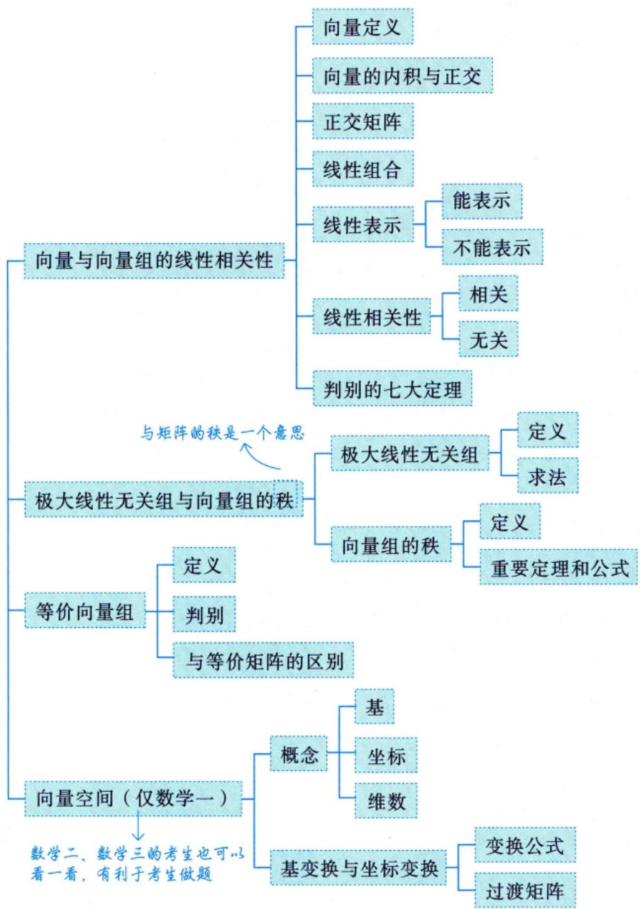

# 线性代数中的一号人物——向量

有了前面行列式和矩阵这两个话题的铺垫，可以让线性代数的主人翁——向量出场了。前面指出，矩阵中的若干个行（列）都是向量，它们之间存在着某种联系，这种联系说到底就是线性无关的向量个数（独立信息的个数）的问题，也就是在若干个向量组成的向量组中，其中的某几个就足够代表这个向量组了，其他的向量都可以由这几个向量线性表示出来。

示例 有这样的一个矩阵

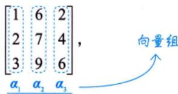

把这些列定义为列向量，这一组向量 $\alpha_{1},\alpha_{2},\alpha_{3}$ 称为向量组.

向量组 $[1,2,3]^{\mathrm{T}},[6,7,9]^{\mathrm{T}}$ 与 $[2,4,6]^{\mathrm{T}}$ 是矩阵的三个成员，可是向量 $[2,4,6]^{\mathrm{T}}$ 可以由向量 $[1,2,3]^{\mathrm{T}}$ 的2倍来表示，于是向量 $[2,4,6]^{\mathrm{T}}$ 就是“多余”的，不是独立的信息.

【问题1】向量研究什么？

答：要用相应的运算，研究数据和数据之间的关系，也就是研究向量和向量之间的关系.

在行列式的运算中，用初等变换，把一个行列式 $|A|$ 化成“ $12 + 1$ ”型行列式.

注 (1) 从性质上来讲, 用初等变换直接得出结果值, 我们只在意这个值是否为零.

(2) $|\mathbf{A}| = 0$ ，则向量组线性相关； $|\mathbf{A}|\neq 0$ ，则向量组线性无关.

在矩阵中：

(1)用矩阵运算方法（加减、数乘等）研究矩阵 $A$ 中向量与向量之间的关系；  
(2)用初等变换把矩阵化简.研究在空间里这两个向量的位置关系（是否平行）.

在示例中, 我们可以看出 $2 \alpha_{1} = \alpha_{3}$ , $\alpha_{3}$ 是 $\alpha_{1}$ 的线性倍数, 我们称 $\alpha_{1}, \alpha_{3}$ 线性相关, 而 $\alpha_{1}, \alpha_{2}$ 是线性无关的.

【问题2】在向量中，第一个要研究什么？

答：要研究向量和向量之间能否线性表示.

从专业的角度来讲，一个向量 $\alpha$ 如果在另一个向量 $\beta$ 张成的空间上， $\alpha$ 就可以被 $\beta$ 线性表示；如果不在， $\alpha$ 就不可以被 $\beta$ 线性表示。

因此, 首要任务是在一个矩阵或一个向量组中, 找到这个向量组里所有能够表达其他向量的向量, 然后剔除掉那些多余的向量. 在示例中, 可以剔除掉 $a_{3}$ , 只留下 $a_{1}, a_{2}$ , 即可构成一个平面 (3维空间中的某一个平面), 故 $a_{3}$ 属于这个平面.

进一步地, 我们可以通过仔细排查, 找到在一个向量组中, 能够代表该向量组里所有成员的一组向量, 比如示例的向量组的 $[1, 2, 3]^{\mathrm{T}}$ 和 $[6, 7, 9]^{\mathrm{T}}$ , 把它们组成的向量组叫作原向量组的极大线性无关组, 这个向量组就是原向量组的 “代表”. 往后会发现, 这个 “代表” 中的向量的个数对于同一个向量组来说, 是唯一的. 事实上, “代表” 中向量的个数就是独立信息的个数, 这个个数叫作向量组的秩. 秩就是独立信息的个数, 就是 “代表” 中这几个独立信息就足够表示所有的信息了.

因此，这个空间的维数，也就是剩下向量的个数，即这个空间是几维的，这个维数就是秩.

$a_{1}$ ， $a_{2}$ 张成的空间就是我们讲的 $n$ 蕴空间的一个子空间，或者是2蕴空间本身.那么这个子空间表达的就是我们的最简向量组，称其为极大线性无关组

极大线性无关组是向量组的“代表”，而矩阵是由向量组拼成的，所以矩阵的秩、向量组的秩都反映了“代表”中向量的个数，本质完全相同.

总结 从空间的角度：一组向量中能够张成空间的那几个向量，叫作向量组的极大线性无关组，同样，这几个向量的个数叫作向量组的秩。这些向量的信息代表了向量组的信息。

考生研读完这一部分就会得出下面这个重要结论：我们致力于搞清楚的就是向量与向量之间的关系——这种关系“非黑即白”——要么线性无关（“独立”），要么线性相关（“多余”）。在充斥着诸多抽象理论和方法的向量组问题上，只有把握住上述重要结论，才不会迷失方向。

实际上，代数学研究的主要是两个问题：

① 要把握代数表达式与几何之间的关系.  
理解清楚每个代数式及其背后的几何问题，  
用几何这一条线贯穿整个代数学习过程  
②一定要有一个向量空间的思考方式.

# 二 向量与向量组的线性相关性

# 1 向量的概念和运算

$n$ 维向量 $n$ 个数构成的一个有序数组 $[a_1, a_2, \dots, a_n]$ 称为一个 $n$ 维向量，记成 $\alpha = [a_1, a_2, \dots, a_n]$ ，并称 $\alpha$ 为 $n$ 维行向量， $\alpha^{\mathrm{T}} = [a_1, a_2, \dots, a_n]^{\mathrm{T}}$ 称为 $n$ 维列向量，其中 $a_i$ 称为向量 $\alpha$ （或 $\alpha^{\mathrm{T}}$ ）的第 $i$ 个分量。

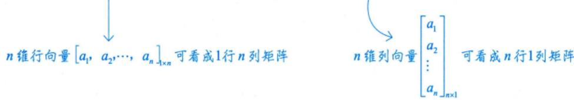

我们在研究2维、3维向量时，用空间的思想很好理解，而扩大到 $n$ 维时我们很难去理解，但有这样的一个式子：

$$
\cos \theta = \frac {(\alpha , \beta)}{\| \alpha \| \cdot \| \beta \|} \xrightarrow {\text {点 积}}
$$

其中 $\pmb{\alpha} = [a_{1}, a_{2}, \dots, a_{n}], \pmb{\beta} = [b_{1}, b_{2}, \dots, b_{n}]$ , 则

$$
\begin{array}{l} (\boldsymbol {\alpha}, \boldsymbol {\beta}) = a _ {1} b _ {1} + a _ {2} b _ {2} + \dots + a _ {n} b _ {n}. \\ \parallel \boldsymbol {a} \parallel = \sqrt {a _ {1} ^ {2} + a _ {2} ^ {2} + \dots + a _ {n} ^ {2}}, \\ \| \boldsymbol {\beta} \| = \sqrt {b _ {1} ^ {2} + b _ {2} ^ {2} + \cdots + b _ {n} ^ {2}}, \\ \end{array}
$$

由此，两向量的夹角就得出了.

相等若 $\pmb {\alpha} = [a_1,a_2,\dots ,a_n],\pmb {\beta} = [b_1,b_2,\dots ,b_n]$ 都是 $n$ 维向量，则当且仅当 $a_{i} = b_{i}(i = 1,2,\dots ,n)$ 时， $\pmb {\alpha} = \pmb{\beta}$ .（对应元素都相等）

加法 $\pmb{\alpha} + \pmb{\beta} = [a_{1} + b_{1}, a_{2} + b_{2}, \dots, a_{n} + b_{n}]$ ( $\pmb{\alpha}, \pmb{\beta}$ 同上). (对应元素相加)

数乘 $k\alpha = [ka_{1},ka_{2},\dots ,ka_{n}](\alpha$ 同上， $k$ 为实数）（用常数乘向量中每一个元素）

注 可以把向量看成 $n \times 1$ 或 $1 \times n$ 的矩阵，当然这些性质也与矩阵类似。

# 向量的内积与正交

内积设 $\pmb {\alpha} = [a_{1},a_{2},\dots ,a_{n}]^{\mathrm{T}},\pmb {\beta} = [b_{1},b_{2},\dots ,b_{n}]^{\mathrm{T}}$ ，则称

$$
(\boldsymbol {\alpha}, \boldsymbol {\beta}) = \boldsymbol {\alpha} ^ {T} \boldsymbol {\beta} = \sum_ {i = 1} ^ {n} a _ {i} b _ {i} = a _ {1} b _ {1} + a _ {2} b _ {2} + \dots + a _ {n} b _ {n}
$$

为向量α，β的内积（或点积），记作（α，β），即（α，β）=αTβ.可看成[a1，a2,…，an]b b 个 $a_{i}b_{i} = (\pmb {\alpha},\pmb {\beta}) = \| \pmb {\alpha}\| \bullet \| \pmb {\beta}\| \cos \theta \Rightarrow \cos \theta = \frac{(\pmb{\alpha},\pmb{\beta})}{\|\pmb{\alpha}\|*\|\pmb{\beta}\|}$ 可研究向量之间的位置关系这个在之前我们有提到过

回顾知识 Gram矩阵（以下是最简单的矩阵）.

① 设矩阵 $A = [a, b]$ ，则

数与数之间夹角为0

$$
\boldsymbol {A} ^ {\mathrm {T}} \boldsymbol {A} = \left[ \begin{array}{l} a \\ b \end{array} \right] \left[ \begin{array}{l l} a, & b \end{array} \right] = \left[ \begin{array}{l l} a \cdot a & a \cdot b \\ a \cdot b & b \cdot b \end{array} \right].
$$

② 有这样一个非方阵 $\mathbf{A}$ ，为了研究方便，我们对 $\mathbf{A}$ 左边乘 $\mathbf{A}^{\mathrm{T}}$ ，则 $\mathbf{A}^{\mathrm{T}}\mathbf{A}$ 是一个方阵。为了好理解，不妨设 $\mathbf{A} = [\alpha, \beta]$ （ $\alpha, \beta$ 为3维列向量），则

$$
\begin{array}{l} \boldsymbol {A} ^ {\mathrm {T}} \boldsymbol {A} = \left[ \begin{array}{l} \boldsymbol {\alpha} ^ {\mathrm {T}} \\ \boldsymbol {\beta} ^ {\mathrm {T}} \end{array} \right] \left[ \begin{array}{l l} \boldsymbol {\alpha}, & \boldsymbol {\beta} \end{array} \right] = \left[ \begin{array}{l l} \boldsymbol {\alpha} ^ {\mathrm {T}} \boldsymbol {\alpha} & \boldsymbol {\alpha} ^ {\mathrm {T}} \boldsymbol {\beta} \\ \boldsymbol {\beta} ^ {\mathrm {T}} \boldsymbol {\alpha} & \boldsymbol {\beta} ^ {\mathrm {T}} \boldsymbol {\beta} \end{array} \right] \\ = \left[ \begin{array}{l l} \| \boldsymbol {\alpha} \| ^ {2} & \| \boldsymbol {\alpha} \| \| \boldsymbol {\beta} \| \cos \theta \\ \| \boldsymbol {\alpha} \| \| \boldsymbol {\beta} \| \cos \theta & \| \boldsymbol {\beta} \| ^ {2} \end{array} \right]. \\ \end{array}
$$

正交当 $\pmb{\alpha}^{\mathrm{T}}\pmb {\beta} = 0$ 时，称向量 $\pmb{\alpha}$ ， $\pmb{\beta}$ 是正交向量.

种位置关系 $\rightarrow  \left\{  \begin{array}{l} 2\text{维，3维；垂直} \\  4\text{维及 }1\text{维，正交} \end{array}\right.$

设 $A = [\pmb {\alpha},\pmb {\beta}]$ ，若 $\pmb {\alpha}\bot \pmb{\beta}$ ，则 $A^{\mathrm{T}}A = \left[ \begin{array}{cc}\| \pmb {\alpha}\|^{2} & 0\\ 0 & \| \pmb {\beta}\|^{2} \end{array} \right];$ 又若 $\| \pmb {\alpha}\| = \| \pmb {\beta}\| = 1$ ，则 $A^{\mathrm{T}}A = \left[ \begin{array}{ll}1 & 0\\ 0 & 1 \end{array} \right] = E.$

模 $\| \pmb {\alpha}\| = \sqrt{\sum_{i = 1}^{n}a_{i}^{2}}$ 称为向量 $\pmb{\alpha}$ 的模（长度）.

当 $\| \alpha \| = 1$ 时，称 $\pmb{\alpha}$ 为单位向量.

标准正交向量组 若列向量组 $\alpha_{1},\alpha_{2},\dots ,\alpha_{s}$ 满足

$$
\boldsymbol {\alpha} _ {i} ^ {\mathrm {T}} \boldsymbol {\alpha} _ {j} = \left\{ \begin{array}{l l} 0, & i \neq j, \\ 1, & i = j, \end{array} \right.
$$

则称 $\alpha_{1},\alpha_{2},\dots ,\alpha_{s}$ 为标准或单位正交向量组，也叫规范正交基.

比如 $\pmb{a}_{1} = \begin{bmatrix} 1\\ 0\\ \vdots \\ 0 \end{bmatrix},\quad \pmb{a}_{2} = \begin{bmatrix} 0\\ 1\\ \vdots \\ 0 \end{bmatrix},\dots ,\quad \pmb{a}_{s} = \begin{bmatrix} 0\\ 0\\ \vdots \\ 1 \end{bmatrix},$

满足 $\pmb{\alpha}_{i}^{\mathrm{T}}\pmb{\alpha}_{j} = \left\{ \begin{array}{ll}0, & i\neq j,\\ 1, & i = j. \end{array} \right.$

# 正交矩阵

# 行（列）向量长度为1的单位向量，且相互正交

设 $\pmb{A}$ 是 $n$ 阶方阵，满足 $A^{\mathrm{T}}A = E$ ，则称 $\pmb{A}$ 是正交矩阵.

$A$ 是正交矩阵 $\Leftrightarrow A^{\mathrm{T}}A = E\Leftrightarrow A^{\mathrm{T}} = A^{-1}\Leftrightarrow A$ 的行（列）向量组是规范正交基.

注 设 $A = \begin{bmatrix} a_1 & a_2 & a_3 \\ b_1 & b_2 & b_3 \\ c_1 & c_2 & c_3 \end{bmatrix}$ ，且记

$$
\boldsymbol {\alpha} = \left[ a _ {1}, a _ {2}, a _ {3} \right] ^ {\mathrm {T}}, \boldsymbol {\beta} = \left[ b _ {1}, b _ {2}, b _ {3} \right] ^ {\mathrm {T}}, \boldsymbol {\gamma} = \left[ c _ {1}, c _ {2}, c _ {3} \right] ^ {\mathrm {T}},
$$

则由

$$
\boldsymbol {A} \boldsymbol {A} ^ {\mathrm {T}} = \left[ \begin{array}{l l l} a _ {1} & a _ {2} & a _ {3} \\ b _ {1} & b _ {2} & b _ {3} \\ c _ {1} & c _ {2} & c _ {3} \end{array} \right] \left[ \begin{array}{l l l} a _ {1} & b _ {1} & c _ {1} \\ a _ {2} & b _ {2} & c _ {2} \\ a _ {3} & b _ {3} & c _ {3} \end{array} \right] = \boldsymbol {E} = \left[ \begin{array}{l l l} 1 & 0 & 0 \\ 0 & 1 & 0 \\ 0 & 0 & 1 \end{array} \right],
$$

可得

$$
\left\{ \begin{array}{l l} {a _ {1} ^ {2} + a _ {2} ^ {2} + a _ {3} ^ {2} = 1 \Rightarrow \| \pmb {\alpha} \| = 1,} \\ {b _ {1} ^ {2} + b _ {2} ^ {2} + b _ {3} ^ {2} = 1 \Rightarrow \| \pmb {\beta} \| = 1,} \\ {c _ {1} ^ {2} + c _ {2} ^ {2} + c _ {3} ^ {2} = 1 \Rightarrow \| \pmb {\gamma} \| = 1,} \\ {a _ {1} b _ {1} + a _ {2} b _ {2} + a _ {3} b _ {3} = 0 \Rightarrow (\pmb {\alpha}, \pmb {\beta}) = 0, \text {即} \pmb {\alpha} \text {与} \pmb {\beta} \text {正 交},} \\ {a _ {1} c _ {1} + a _ {2} c _ {2} + a _ {3} c _ {3} = 0 \Rightarrow (\pmb {\alpha}, \pmb {\gamma}) = 0, \text {即} \pmb {\alpha} \text {与} \pmb {\gamma} \text {正 交},} \\ {b _ {1} c _ {1} + b _ {2} c _ {2} + b _ {3} c _ {3} = 0 \Rightarrow (\pmb {\beta}, \pmb {\gamma}) = 0, \text {即} \pmb {\beta} \text {与} \pmb {\gamma} \text {正 交},} \end{array} \right.
$$

即 $\pmb{A}$ 是由两两正交的单位向量组（称为规范正交基）组成的.

正交矩阵的作用：将数据进行旋转.不妨看正交矩阵 $\begin{bmatrix} \cos \theta & -\sin \theta \\ \sin \theta & \cos \theta \end{bmatrix}$ ，如果将此2阶正交矩阵作用在向量上，则可以理解为将向量旋转 $\theta$ 角.

示例1 若 $\theta = \frac{\pi}{4}$ ，则正交矩阵为 $\left[ \begin{array}{cc} \frac{\sqrt{2}}{2} & -\frac{\sqrt{2}}{2} \\ \frac{\sqrt{2}}{2} & \frac{\sqrt{2}}{2} \end{array} \right]$ ，将 $\left[ \begin{array}{cc} \frac{\sqrt{2}}{2} & -\frac{\sqrt{2}}{2} \\ \frac{\sqrt{2}}{2} & \frac{\sqrt{2}}{2} \end{array} \right] \left[ \begin{array}{l} 1 \\ 1 \end{array} \right] = \left[ \begin{array}{l} 0 \\ \sqrt{2} \end{array} \right]$ 形象表达，如图3-1

所示.

可以看到将向量逆

在正交矩阵作用下，向量模长不变，形状不变，仅改变位置.

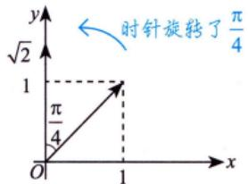  
图3-1

示例2 如图3-2所示，黑色图形是一个平面曲线，通过正交矩阵的作用，旋转到恰当位置（蓝色图形），此时可以通过图形，观察出最值.

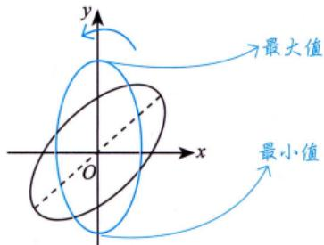  
图3-2

注 (1)2维坐标系下，两个坐标轴上的单位向量，同时朝着一个方向旋转，得到的仍是单位向量，且构成一个正交矩阵.

(2)3维坐标系同理.三个坐标轴上的单位向量，同时朝着一个方向旋转，得到的仍是单位向量，且构成一个正交矩阵.

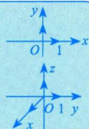

# 向量组的线性表示与线性相关的概念

线性组合 设有 $m$ 个 $n$ 维向量 $\alpha_{1},\alpha_{2},\dots ,\alpha_{m}$ 及 $m$ 个数 $k_{1},k_{2},\dots ,k_{m}$ ，则向量

$$
k _ {1} \alpha_ {1} + k _ {2} \alpha_ {2} + \dots + k _ {m} \alpha_ {m}
$$

称为向量组 $\alpha_{1},\alpha_{2},\dots ,\alpha_{m}$ 的线性组合.

若有两个向量 $\alpha_{1} = [1,0]$ ， $\alpha_{2} = [0,1]$ ，对任意的 $k_{1},k_{2}$ ，线性组合 $k_{1}\pmb{\alpha}_{1} + k_{2}\pmb{\alpha}_{2}$ 是2维平面内的所有向量，也就表示了平面内的所有点，称 $\alpha_{1},\alpha_{2}$ 张成一个2维平面.

线性表示若向量 $\pmb{\beta}$ 能表示成向量组 $a_1,a_2,\dots ,a_m$ 的线性组合，即存在 $m$ 个数 $k_{1},k_{2},\dots ,k_{m}$ ，使得

$$
\boldsymbol {\beta} = k _ {1} \boldsymbol {\alpha} _ {1} + k _ {2} \boldsymbol {\alpha} _ {2} + \dots + k _ {m} \boldsymbol {\alpha} _ {m},
$$

则称向量 $\pmb{\beta}$ 能被向量组 $\alpha_{1},\alpha_{2},\dots ,\alpha_{m}$ 线性表示.即 $\pmb{\beta}$ 就在由 $a_1,a_2,\dots ,a_m$ 张成的空间中

线性相关 对于 $m$ 个 $n$ 维向量 $\alpha_{1},\alpha_{2},\dots ,\alpha_{m}$ ，若存在一组不全为零的数 $k_{1},k_{2},\dots ,k_{m}$ ，使得

$$
k _ {1} \boldsymbol {a} _ {1} + k _ {2} \boldsymbol {a} _ {2} + \dots + k _ {m} \boldsymbol {a} _ {m} = \mathbf {0},
$$

则称向量组 $\alpha_{1},\alpha_{2},\dots ,\alpha_{m}$ 线性相关.

含有零向量或有成比例的向量的向量组必线性相关.

为了更好理解线性相关，即张成空间为0这个概念，不妨设 $k_{i}\neq 0$ ，于是

$$
- k _ {i} \boldsymbol {\alpha} _ {i} = k _ {1} \boldsymbol {\alpha} _ {1} + \dots + k _ {i - 1} \boldsymbol {\alpha} _ {i - 1} + k _ {i + 1} \boldsymbol {\alpha} _ {i + 1} + \dots + k _ {m} \boldsymbol {\alpha} _ {m},
$$

得 $\alpha_{i} = -\frac{k_{1}}{k_{i}}\alpha_{1} - \dots -\frac{k_{i - 1}}{k_{i}}\alpha_{i - 1} - \frac{k_{i + 1}}{k_{i}}\alpha_{i + 1} - \dots -\frac{k_{m}}{k_{i}}\alpha_{m},$

则称 $\alpha_{i}$ 是由 $\alpha_{1},\dots ,\alpha_{i - 1},\alpha_{i + 1},\dots ,\alpha_{m}$ 张成空间中的一个向量，即 $\alpha_{i}$ 可被表示，亦即至少有一个向量可由其他向量线性表示.

$0 \times \alpha_{1} + 0 \times \alpha_{2} + \dots + 1 \times 0 = 0$ ，则含有零向量的向量组一定线性相关.

$\pmb {\beta} = k\pmb {\alpha}\Rightarrow k\pmb {\alpha} - \pmb {\beta} = \mathbf{0}$ ，则有成比例的向量的向量组线性相关.

# 更加重要

线性无关 若不存在不全为零的数 $k_{1}, k_{2}, \cdots, k_{m}$ , 使得 $k_{1} \alpha_{1} + k_{2} \alpha_{2} + \cdots + k_{m} \alpha_{m} = 0$ 成立, 则称向量组 $\alpha_{1}, \alpha_{2}, \cdots, \alpha_{m}$ 线性无关; 亦即只有当 $k_{1} = k_{2} = \cdots = k_{m} = 0$ 时, 才有 $k_{1} \alpha_{1} + k_{2} \alpha_{2} + \cdots + k_{m} \alpha_{m} = 0$ 成立, 则称

向量组 $\alpha_{1},\alpha_{2},\dots ,\alpha_{m}$ 线性无关.

一个向量作为向量组的情形：

① 如果 $\alpha = 0$ ，叫作线性相关；

② 如果 $a \neq 0$ ，叫作线性无关.

单个非零向量，两个不成比例的向量均线性无关.

向量组或线性相关或线性无关，二者必居其一且仅居其一.

向量组中不存在任何一个向量可由其他向量线性表示的情况，则向量组线性无关.如果一组向量线性无关，说明这组向量没有一个是多余的，这些向量每一个都对它们张成的 $n$ 维空间有贡献.

线性无关的向量张成空间，与这些向量线性相关的向量在张成的空间中.

# 判别线性相关性的七大定理

# ★（不需要掌握证明）

定理1 向量组 $\alpha_{1},\alpha_{2},\dots ,\alpha_{n}(n\geqslant 2)$ 线性相关的充要条件是向量组中至少有一个向量可由其余的 $n - 1$ 个向量线性表示.

注证先证必要性.设向量组 $\alpha_{1},\alpha_{2},\dots ,\alpha_{n}(n\geqslant 2)$ 线性相关，则存在 $n$ 个不全为零的数 $k_{1},k_{2},\dots ,k_{n}$ ，使得

$$
k _ {1} \boldsymbol {a} _ {1} + k _ {2} \boldsymbol {a} _ {2} + \dots + k _ {n} \boldsymbol {a} _ {n} = \mathbf {0}.
$$

不妨设 $k_{1} \neq 0$ ，于是由向量的线性运算规则得

$$
\alpha_ {1} = - \frac {k _ {2}}{k _ {1}} \alpha_ {2} - \frac {k _ {3}}{k _ {1}} \alpha_ {3} - \dots - \frac {k _ {n}}{k _ {1}} \alpha_ {n}.
$$

再证充分性. 不妨设 $\pmb{\alpha}_{1}$ 可用 $\pmb{\alpha}_{2}, \pmb{\alpha}_{3}, \dots, \pmb{\alpha}_{n}$ 线性表示，即

$$
\boldsymbol {\alpha} _ {1} = l _ {2} \boldsymbol {\alpha} _ {2} + l _ {3} \boldsymbol {\alpha} _ {3} + \dots + l _ {n} \boldsymbol {\alpha} _ {n},
$$

于是有

$$
1 \alpha_ {1} - l _ {2} \alpha_ {2} - l _ {3} \alpha_ {3} - \dots - l _ {n} \alpha_ {n} = 0,
$$

显然 $1, -l_{2}, -l_{3}, \dots, -l_{n}$ 不全为零，故向量组 $\alpha_{1}, \alpha_{2}, \dots, \alpha_{n}$ 线性相关.

其逆否命题：向量组 $\alpha_{1},\alpha_{2},\dots ,\alpha_{n}(n\geqslant 2)$ 线性无关的充要条件是 $\alpha_{1},\alpha_{2},\dots ,\alpha_{n}$ 中任一向量都不能由其余的 $n - 1$ 个向量线性表示. $\longrightarrow \alpha_{1},\alpha_{2},\dots ,\alpha_{n}$ 刚好张成了某一个空间的子空间

设 $\pmb{\alpha}_{1} = \begin{bmatrix} a_{1}\\ a_{2}\\ \vdots \\ a_{n} \end{bmatrix}$ 是 $n$ 维空间中的一个向量，若有 $\pmb{\alpha}_{1} = \begin{bmatrix} a_{1}\\ a_{2}\\ \vdots \\ a_{n} \end{bmatrix}$ 张成一个空间，则这个空间为 $n$ 维空间里的1维子空间.

若有 $\pmb{a}_{1} = \begin{bmatrix} a_{11} \\ a_{21} \\ \vdots \\ a_{n1} \end{bmatrix}$ ， $\pmb{a}_{2} = \begin{bmatrix} a_{12} \\ a_{22} \\ \vdots \\ a_{n2} \end{bmatrix}$ ，…， $\pmb{a}_{m} = \begin{bmatrix} a_{1m} \\ a_{2m} \\ \vdots \\ a_{nm} \end{bmatrix} (n \geqslant m)$ 张成一个空间，则这个空间为 $n$ 维空间中的 $m$ 维子空间.

定理2 若向量组 $\alpha_{1},\alpha_{2},\dots ,\alpha_{n}$ 线性无关，而 $\beta ,\alpha_{1},\alpha_{2},\dots ,\alpha_{n}$ 线性相关，则 $\pmb{\beta}$ 可由 $\alpha_{1},\alpha_{2},\dots ,\alpha_{n}$ 线性表示，且表示法唯一. 至少有一个向量可由向量组中其他向量线性表示

把 $\pmb{\beta}$ 添进来后这组向量线性相关，则 $\pmb{\beta}$ 可由向量组中其他向量线性表示，即 $\pmb {\beta} = k_{1}\pmb{\alpha}_{1} + k_{2}\pmb{\alpha}_{2} + \dots +k_{n}\pmb{\alpha}_{n}$ 其中 $k_{1},k_{2},\dots ,k_{n}$ 为 $\pmb{\beta}$ 在由 $\alpha_{1},\alpha_{2},\dots ,\alpha_{n}$ 张成的空间中的坐标.

(2,3) $\begin{bmatrix} 1 \\ 0 \end{bmatrix}, \begin{bmatrix} 0 \\ 1 \end{bmatrix}$ 是线性无关的，但 $\begin{bmatrix} 2 \\ 3 \end{bmatrix} = 2 \begin{bmatrix} 1 \\ 0 \end{bmatrix} + 3 \begin{bmatrix} 0 \\ 1 \end{bmatrix}$

注证因为 $\beta ,\alpha_{1},\alpha_{2},\dots ,\alpha_{n}$ 线性相关，所以存在不全为零的数 $k,k_1,k_2,\dots ,k_n$ ，使得

$$
k \boldsymbol {\beta} + k _ {1} \boldsymbol {\alpha} _ {1} + k _ {2} \boldsymbol {\alpha} _ {2} + \dots + k _ {n} \boldsymbol {\alpha} _ {n} = \mathbf {0},
$$

其中 $k \neq 0$ （如果 $k = 0$ ，则由 $\alpha_{1}, \alpha_{2}, \dots, \alpha_{n}$ 线性无关，得 $k_{1}, k_{2}, \dots, k_{n}$ 必须全为零，这与 $k, k_{1}, k_{2}, \dots, k_{n}$ 不全为零矛盾），于是 $\beta$ 可由 $\alpha_{1}, \alpha_{2}, \dots, \alpha_{n}$ 线性表示为

$$
\boldsymbol {\beta} = - \frac {k _ {1}}{k} \alpha_ {1} - \frac {k _ {2}}{k} \alpha_ {2} - \dots - \frac {k _ {n}}{k} \alpha_ {n}.
$$

再证表示法唯一. 设有两种不同的表示法，

$$
\begin{array}{l} \boldsymbol {\beta} = l _ {1} \boldsymbol {\alpha} _ {1} + l _ {2} \boldsymbol {\alpha} _ {2} + \dots + l _ {n} \boldsymbol {\alpha} _ {n} \\ = h _ {1} \alpha_ {1} + h _ {2} \alpha_ {2} + \dots + h _ {n} \alpha_ {n}, \\ \end{array}
$$

于是

$$
\left(l _ {1} - h _ {1}\right) \alpha_ {1} + \left(l _ {2} - h _ {2}\right) \alpha_ {2} + \dots + \left(l _ {n} - h _ {n}\right) \alpha_ {n} = 0,
$$

因为 $a_1, a_2, \dots, a_n$ 线性无关，所以必有

$$
l _ {i} - h _ {i} = 0 \text {, 即} l _ {i} = h _ {i}, i = 1, 2, \dots , n,
$$

与假设矛盾，故 $\pmb{\beta}$ 由 $\alpha_{1},\alpha_{2},\dots ,\alpha_{n}$ 线性表示的表示法唯一.

定理3如果向量组β，β，…，β可由向量组α，α，…，α线性表示，且t>s，则β，β，…，β线性相关（以少表多，多的相关）.的可以由少的表示出来 不管α，α，…，α是否线性相关那么多的一定是相关的

由定理条件可知，若有 $\beta_{1},\beta_{2},\beta_{3};\alpha_{1},\alpha_{2}$ ，且 $\beta_{1},\beta_{2},\beta_{3}$ 在 $\alpha_{1},\alpha_{2}$ 张成的空间中，则在同一空间中的 $\beta_{1},\beta_{2},\beta_{3}$ 线性相关，无论 $\alpha_{1},\alpha_{2}$ 是否线性相关.

若 $\alpha_{1},\alpha_{2}$ 线性相关，则 $\alpha_{1},\alpha_{2}$ 共线，那么由 $\alpha_{1},\alpha_{2}$ 线性表示的 $\beta_{1},\beta_{2},\beta_{3}$ 也在这条线上，即 $\beta_{1},\beta_{2},\beta_{3}$ 线性相关.

注 以 $t = 3, s = 2$ 来证明，便于考生理解。

证设 $\begin{array}{l}\pmb {\beta}_1 = k_{11}\pmb {\alpha}_1 + k_{21}\pmb {\alpha}_2,\\ \pmb {\beta}_2 = k_{12}\pmb {\alpha}_1 + k_{22}\pmb {\alpha}_2,\\ \pmb {\beta}_3 = k_{13}\pmb {\alpha}_1 + k_{23}\pmb {\alpha}_2, \end{array}$ ，欲证 $\pmb {\beta}_1,\pmb {\beta}_2,\pmb {\beta}_3$ 线性相关，只需证存在不全为零的数 $l_1,l_2,l_3$ ，使得

$$
l _ {1} \boldsymbol {\beta} _ {1} + l _ {2} \boldsymbol {\beta} _ {2} + l _ {3} \boldsymbol {\beta} _ {3} = \mathbf {0},
$$

即

$$
l _ {1} \left(k _ {1 1} \boldsymbol {\alpha} _ {1} + k _ {2 1} \boldsymbol {\alpha} _ {2}\right) + l _ {2} \left(k _ {1 2} \boldsymbol {\alpha} _ {1} + k _ {2 2} \boldsymbol {\alpha} _ {2}\right) + l _ {3} \left(k _ {1 3} \boldsymbol {\alpha} _ {1} + k _ {2 3} \boldsymbol {\alpha} _ {2}\right) = \mathbf {0},
$$

整理得

$$
\left. \left(k _ {1 1} l _ {1} + k _ {1 2} l _ {2} + k _ {1 3} l _ {3}\right) \boldsymbol {\alpha} _ {1} + \left(k _ {2 1} l _ {1} + k _ {2 2} l _ {2} + k _ {2 3} l _ {3}\right) \boldsymbol {\alpha} _ {2} = \mathbf {0} \right.. \tag {*}
$$

当 $\left\{ \begin{array}{l} k_{11}l_1 + k_{12}l_2 + k_{13}l_3 = 0, \\ k_{21}l_1 + k_{22}l_2 + k_{23}l_3 = 0 \end{array} \right.$ 时，显然 (*) 式成立，而这个方程组是 3 个未知数 $l_1, l_2, l_3, 2$ 个方程的情形，未知数个数大于方程个数，必有非零解，即存在不全为零的数 $l_1, l_2, l_3$ ，故 $\pmb{\beta}_1, \pmb{\beta}_2, \pmb{\beta}_3$ 线性相关。

其等价命题：如果向量组 $\beta_{1},\beta_{2},\dots ,\beta_{t}$ 可由向量组 $\alpha_{1},\alpha_{2},\dots ,\alpha_{s}$ 线性表示，且 $\beta_{1},\beta_{2},\dots ,\beta_{t}$ 线性无关，则 $t\leqslant s$ ： 张成t维空间 高维空间能表示低维空间，低维空间不

定理4设 $m$ 个 $n$ 维向量 $\alpha_{1},\alpha_{2},\dots ,\alpha_{m}$ ，其中

$$
\boldsymbol {a} _ {1} = \left[ a _ {1 1}, a _ {2 1}, \dots , a _ {n 1} \right] ^ {\mathrm {T}},
$$

$$
\begin{array}{c} \boldsymbol {a} _ {2} = [ a _ {1 2}, a _ {2 2}, \dots , a _ {n 2} ] ^ {\mathrm {T}}, \\ \dots \dots \end{array}
$$

$$
\boldsymbol {a} _ {m} = \left[ a _ {1 m}, a _ {2 m}, \dots , a _ {n m} \right] ^ {\mathrm {T}}.
$$

方程组形式

$$
\left\{ \begin{array}{l} a _ {1 1} x _ {1} + a _ {1 2} x _ {2} + \dots + a _ {1 m} x _ {m} = 0, \\ a _ {2 1} x _ {1} + a _ {2 2} x _ {2} + \dots + a _ {2 m} x _ {m} = 0, \\ \dots \dots \\ a _ {n 1} x _ {1} + a _ {n 2} x _ {2} + \dots + a _ {n m} x _ {m} = 0. \end{array} \right.
$$

$n$ 个方程， $m$ 个未知量的方程组

向量组 $a_1, a_2, \dots, a_m$ 线性相关 $\Leftrightarrow$ 齐次线性方程组

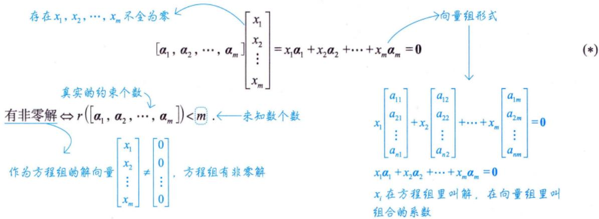

定理4的等价命题： $\alpha_{1},\alpha_{2},\dots ,\alpha_{m}$ 线性无关的充分必要条件是齐次线性方程组 $(*)$ 只有零解.

向量组 $a_1, a_2, \dots, a_m$ 线性无关

$\Leftrightarrow$ 只有全为0的 $x_{1}, x_{2}, \cdots, x_{m}$ ，使 $x_{1} \pmb{\alpha}_{1} + x_{2} \pmb{\alpha}_{2} + \cdots + x_{m} \pmb{\alpha}_{m} = \mathbf{0}$ 成立

$\Leftrightarrow [\pmb {\alpha}_1,\pmb {\alpha}_2,\dots ,\pmb {\alpha}_m]\left[ \begin{array}{c}x_1\\ x_2\\ \vdots \\ x_m \end{array} \right] = \mathbf{0}$ 只有零解

$$
\Leftrightarrow r \left(\left[ \boldsymbol {a} _ {1}, \boldsymbol {a} _ {2}, \dots , \boldsymbol {a} _ {m} \right]\right) = m.
$$

注 (1) 如果 $n < m$ ，即方程个数小于未知数个数，则齐次线性方程组 (*) 求解时必有自由未知量，即必有非零解。因此，任何 $n + 1$ 个 $n$ 维向量都是线性相关的。

(2) $n$ 个 $n$ 维列向量 $\alpha_{1},\alpha_{2},\dots ,\alpha_{n}$ 线性相关 $\Leftrightarrow \left|\pmb {\alpha}_1,\pmb {\alpha}_2,\dots ,\pmb {\alpha}_n\right| = 0$

如果 $n > m$ ,① 见第4讲；

② 用已知的结论解决.

（线性无关 $\Leftrightarrow \left|\alpha_{1},\alpha_{2},\dots ,\alpha_{n}\right|\neq 0$ ）

总结

(1)方程个数小于未知数个数.

考试中都是（1）与（2）的出题形式

形如

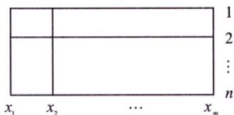

$$
(m > n)
$$

一定有非零解.

（2）方程个数等于未知数个数.

形如

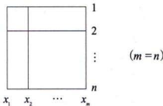

$$
(m = n)
$$

取系数行列式，行列式为0，有非零解；行列式不为0，只有零解。

（3）方程个数大于未知数个数.

形如

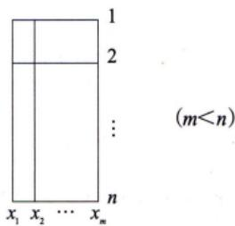

这种形式的方程组是不存在的.

定理5 向量 $\beta$ 可由向量组 $\alpha_{1},\alpha_{2},\dots ,\alpha_{s}$ 线性表示

$\pmb{\beta}$ 在由 $\alpha_{1},\alpha_{2},\dots ,\alpha_{s}$ 张成的空间中 $\Leftrightarrow$ 非齐次线性方程组 $[\pmb{\alpha}_{1},\pmb{\alpha}_{2},\dots ,\pmb{\alpha}_{s}]\left[ \begin{array}{c}x_{1}\\ x_{2}\\ \vdots \\ x_{s} \end{array} \right] = x_{1}\pmb{\alpha}_{1} + x_{2}\pmb{\alpha}_{2} + \dots +x_{s}\pmb{\alpha}_{s} = \pmb{\beta}$ 有解

$\Leftrightarrow r(\underbrace{[\pmb{\alpha}_1,\pmb{\alpha}_2,\cdots,\pmb{\alpha}_s]}_{\text{系数矩阵}}) = r(\underbrace{[\pmb{\alpha}_1,\pmb{\alpha}_2,\cdots,\pmb{\alpha}_s,\pmb{\beta}]}_{\text{增广矩阵}}).$ $\pmb{\beta}$ 的加入不影响 $\alpha_{1},\alpha_{2},\dots ,\alpha_{s}$ 的秩

反之则有，向量 $\beta$ 不能由向量组 $\alpha_{1},\alpha_{2},\dots ,\alpha_{s}$ 线性表示

$\Leftrightarrow \left[\pmb{a}_{1},\pmb{a}_{2},\dots ,\pmb{a}_{s}\right]\left[ \begin{array}{c}x_{1}\\ x_{2}\\ \vdots \\ x_{s} \end{array} \right] = x_{1}\pmb{a}_{1} + x_{2}\pmb{a}_{2} + \dots +x_{s}\pmb{a}_{s} = \pmb{\beta}$ 无解→β不在由α，α，…，α张成的空间中

$$
\Leftrightarrow r \left(\left[ \alpha_ {1}, \alpha_ {2}, \dots , \alpha_ {s} \right] \neq r \left(\left[ \alpha_ {1}, \alpha_ {2}, \dots , \alpha_ {s}, \beta \right]\right) . \Rightarrow r \left(\left[ \alpha_ {1}, \alpha_ {2}, \dots , \alpha_ {s} \right]\right) + 1 = r \left(\left[ \alpha_ {1}, \alpha_ {2}, \dots , \alpha_ {s}, \beta \right]\right) \right.
$$

定理6如果向量组 $\alpha_{1},\alpha_{2},\dots ,\alpha_{m}$ 中有一部分向量线性相关，则整个向量组也线性相关.

注证不妨设α，α，…，αj（j<m)线性相关，于是有不全为零的数k，k，…，kj，使

$$
k _ {1} \boldsymbol {a} _ {1} + k _ {2} \boldsymbol {a} _ {2} + \dots + k _ {j} \boldsymbol {a} _ {j} = \mathbf {0},
$$

从而有不全为零的数 $k_{1}, k_{2}, \dots, k_{j}, 0, \dots, 0$ ，使

$$
k _ {1} \alpha_ {1} + k _ {2} \alpha_ {2} + \dots + k _ {j} \alpha_ {j} + 0 \alpha_ {j + 1} + \dots + 0 \alpha_ {m} = 0,
$$

故 $a_1, a_2, \dots, a_m$ 也线性相关.

其逆否命题：如果 $\alpha_{1},\alpha_{2},\dots ,\alpha_{m}$ 线性无关，则其任一部分向量组都线性无关.

$\alpha_{1}, \alpha_{2}, \dots, \alpha_{m}$ 线性无关，说明这 $m$ 个向量张成 $m$ 维空间，那么即使去掉 $n (n < m)$ 个向量，剩下的 $m - n$ 个向量依然张成 $m - n$ 维空间，即这 $m - n$ 个向量线性无关.

总结 部分相关，整体必相关；整体无关，部分必无关.

定理7如果一组 $n$ 维向量 $\alpha_{1},\alpha_{2},\dots ,\alpha_{s}$ 线性无关，那么把这些向量各任意添加 $m$ 个分量所得到的新向量 $(n + m$ 维）组 $\alpha_{1}^{*},\alpha_{2}^{*},\dots ,\alpha_{s}^{*}$ 也是线性无关的.

其逆否命题：如果 $\alpha_{1},\alpha_{2},\dots ,\alpha_{s}$ 线性相关，那么它们各去掉相同的若干个分量所得到的新向量组也是线性相关的.

注 事实上，对于

$$
\boldsymbol {A} = \left[ \begin{array}{l l l l} \boldsymbol {\alpha} _ {1}, & \boldsymbol {\alpha} _ {2}, & \dots , & \boldsymbol {\alpha} _ {s} \end{array} \right], \boldsymbol {B} = \left[ \begin{array}{l l l l} \boldsymbol {\alpha} _ {1} ^ {*}, & \boldsymbol {\alpha} _ {2} ^ {*}, & \dots , & \boldsymbol {\alpha} _ {s} ^ {*} \end{array} \right],
$$

其中 $\alpha_{1}^{*},\alpha_{2}^{*},\dots ,\alpha_{s}^{*}$ 是分别在 $\alpha_{1},\alpha_{2},\dots ,\alpha_{s}$ 后面任加 $m$ 个分量得到的.如果 $\alpha_{1},\alpha_{2},\dots ,\alpha_{s}$ 线性无关，即齐次线性方程组 $Ax = 0$ 只有零解，则 $Bx = 0$ 显然也只有零解（即 $\alpha_{1}^{*},\alpha_{2}^{*},\dots ,\alpha_{s}^{*}$ 也线性无关）；反之，如果 $\alpha_{1}^{*},\alpha_{2}^{*},\dots ,\alpha_{s}^{*}$ 线性相关，即 $Bx = 0$ 有非零解，则 $Ax = 0$ 也有非零解（即 $\alpha_{1},\alpha_{2},\dots ,\alpha_{s}$ 也线性相关）.

总结 原来无关，延长必无关；原来相关，缩短必相关.

例3.1 已知 $\pmb{\alpha}_{1} = [1,4,0,2]^{\mathrm{T}}$ ， $\pmb{\alpha}_{2} = [2,7,1,3]^{\mathrm{T}}$ ， $\pmb{\alpha}_{3} = [0,1, - 1,a]^{\mathrm{T}}$ ， $\pmb {\beta} = [3,10,b,4]^{\mathrm{T}}$ ，问

(1) $a, b$ 取何值时， $\pmb{\beta}$ 不能由 $\alpha_{1}, \alpha_{2}, \alpha_{3}$ 线性表示？ $\Rightarrow r([a_{1}, a_{2}, a_{3}]) + 1 = r([a_{1}, a_{2}, a_{3}, \pmb{\beta}])$   
(2) $a, b$ 取何值时， $\pmb{\beta}$ 可由 $\alpha_{1}, \alpha_{2}, \alpha_{3}$ 线性表示？并写出此表达式. $\Rightarrow r([a_{1}, a_{2}, a_{3}]) = r([a_{1}, a_{2}, a_{3}, \beta])$

分析 $\pmb {\beta} = x_{1}\pmb{a}_{1} + x_{2}\pmb{a}_{2} + x_{3}\pmb{a}_{3}.$

若 $\pmb{\beta}$ 不能由 $\alpha_{1},\alpha_{2},\alpha_{3}$ 线性表示，则 $\pmb{\beta}$ 不在由 $\alpha_{1},\alpha_{2},\alpha_{3}$ 张成的空间中；

若 $\pmb{\beta}$ 可由 $\alpha_{1},\alpha_{2},\alpha_{3}$ 线性表示，则 $\pmb{\beta}$ 在由 $\alpha_{1},\alpha_{2},\alpha_{3}$ 张成的空间中.

$$
\left[ \begin{array}{c c c c} 1 & 2 & 0 & 3 \\ 4 & 7 & 1 & 1 0 \\ 0 & 1 & - 1 & b \\ 2 & 3 & a & 4 \end{array} \right] \xrightarrow [ \text {形 矩 阵} ]{\text {化 为 行 阶 梯}} \left[ \begin{array}{c c c c} 1 & 2 & 0 & 3 \\ 0 & - 1 & 1 & - 2 \\ 0 & 0 & a - 1 & 0 \\ 0 & 0 & 0 & b - 2 \end{array} \right],
$$

再讨论 $a$ 和 $b$ 的取值.

解 因为

(-2)倍 (-4)倍 加至 加至 $\left[ \begin{array}{rrr}1 & 2 & 0\\ 4 & 7 & 1\\ 0 & 1 & -1\\ 2 & 3 & a \end{array} \right]\rightarrow \left[ \begin{array}{rrr}1 & 2 & 0\\ 0 & -1 & 1\\ 0 & 1 & -1\\ \hline 0 & -1 & a \end{array} \right]\stackrel {3}{\text{互}}$ （-1）倍加至 +2 0 -1 1 -2 中 00a-1 00 b-2

所以

(1)当 $b\neq 2$ 时，线性方程组 $[\pmb {\alpha}_1,\pmb {\alpha}_2,\pmb {\alpha}_3]\pmb {x} = \pmb{\beta}$ 无解，此时 $\pmb{\beta}$ 不能由 $\alpha_{1},\alpha_{2},\alpha_{3}$ 线性表示.

若 $b \neq 2$ ，有 $r([a_1, a_2, a_3]) + 1 = r([a_1, a_2, a_3, \beta])$ .  
即 $\beta$ 放入 $a_1, a_2, a_3$ 中不是多余的  
$\Rightarrow [a_{1}, a_{2}, a_{3}]x = \beta$ 无解  
$\Rightarrow \beta$ 不能由 $a_1, a_2, a_3$ 线性表示.

不能由α，α，α线性表示. (2)当b=2，a≠1时，线性方程组[α，α，α]x=β有唯一解：→ [0 -1 1 -2 0 0 a-1 0 0 0 0 x=[x，x，x]T=[-1,2,0]T，

$$
\text {可 化 为} \left\{ \begin{array}{l} x _ {1} + 2 x _ {2} = 3, \\ - x _ {2} + x _ {3} = - 2, \Rightarrow \left[ \begin{array}{l} x _ {1} \\ x _ {2} \\ x _ {3} \end{array} \right] = \left[ \begin{array}{l} - 1 \\ 2 \\ 0 \end{array} \right] r ([ \alpha_ {1}, \alpha_ {2}, \alpha_ {3} ]) = r ([ \alpha_ {1}, \alpha_ {2}, \alpha_ {3}, \beta ]) = 3 \end{array} \right.
$$

于是 $\pmb{\beta}$ 可唯一表示为 $\pmb {\beta} = -\pmb {\alpha}_1 + 2\pmb {\alpha}_2$

于是 $\pmb{\beta}$ 可唯一表示为 $\pmb {\beta} = -\pmb{\alpha}_1 + 2\pmb{\alpha}_2$ 当 $b = 2,a = 1$ 时，线性方程组 $[\pmb {\alpha}_1,\pmb {\alpha}_2,\pmb {\alpha}_3]\pmb {x} = \pmb {\beta}$ 有无穷多解： $\Rightarrow \begin{bmatrix} 1 & 2 & 0 & 3\\ \hline 0 & -1 & 1 & -2\\ 0 & 0 & 0 & 0\\ 0 & 0 & 0 & 0 \end{bmatrix}$ 第4讲会详细介绍 $\pmb {x} = [x_1,x_2,x_3]^{\mathrm{T}} = k[-2,1,1]^{\mathrm{T}} + [-1,2,0]^{\mathrm{T}},$ （2号其中 $k$ 为任意常数，这时 $\pmb{\beta}$ 可由 $\pmb{\alpha}_{1},\pmb{\alpha}_{2},\pmb{\alpha}_{3}$ 线性表示为

$$
\boldsymbol {\beta} = - (2 k + 1) \boldsymbol {\alpha} _ {1} + (k + 2) \boldsymbol {\alpha} _ {2} + k \boldsymbol {\alpha} _ {3}.
$$

即 $\beta$ 放入 $a_1, a_2, a_3$ 中是多余的 $\Rightarrow \beta$ 可由 $a_1, a_2, a_3$ 线性表示.

例3.2 设向量组 $\alpha_{1},\alpha_{2},\dots ,\alpha_{s}$ 线性相关， $\pmb{a}_{2},\pmb{a}_{3},\dots ,\pmb{a}_{s},\pmb{a}_{s + 1}$ 线性无关，问：

(1) $\pmb{\alpha}_{1}$ 能否由 $\pmb{\alpha}_{2},\pmb{\alpha}_{3},\dots ,\pmb{\alpha}_{s}$ 线性表示？证明你的结论；  
(2) $\pmb{\alpha}_{s + 1}$ 能否由 $\alpha_{1},\alpha_{2},\dots ,\alpha_{s}$ 线性表示？证明你的结论.

解 (1) $a_1$ 能由 $a_2, a_3, \dots, a_s$ 线性表示.

方法一 由已知 $a_2, a_3, \dots, a_s, a_{s+1}$ 线性无关，得 $a_2, a_3, \dots, a_s$ 线性无关，而 $a_1, a_2, \dots, a_s$ 线性相关，故 $a_1$ 可由 $a_2, a_3, \dots, a_s$ 线性表示（且表示法唯一）.

方法二 因 $a_1, a_2, \dots, a_s$ 线性相关，故存在不全为零的数 $k_1, k_2, \dots, k_s$ ，使得

$$
k _ {1} \boldsymbol {\alpha} _ {1} + k _ {2} \boldsymbol {\alpha} _ {2} + \dots + k _ {s} \boldsymbol {\alpha} _ {s} = \mathbf {0},
$$

其中 $k_{1} \neq 0$ ，因为若 $k_{1} = 0$ ，则 $k_{2}, k_{3}, \dots, k_{s}$ 不全为零，可得 $\alpha_{2}, \alpha_{3}, \dots, \alpha_{s}$ 线性相关，从而 $\alpha_{2}, \alpha_{3}, \dots, \alpha_{s}, \alpha_{s+1}$ 线性相关，这和已知矛盾，故 $k_{1} \neq 0$ ，则有

$$
\pmb {\alpha} _ {1} = - \frac {1}{k _ {1}} (k _ {2} \pmb {\alpha} _ {2} + k _ {3} \pmb {\alpha} _ {3} + \dots + k _ {s} \pmb {\alpha} _ {s}) \xlongequal {\text {记}} l _ {2} \pmb {\alpha} _ {2} + l _ {3} \pmb {\alpha} _ {3} + \dots + l _ {s} \pmb {\alpha} _ {s}, \tag {*}
$$

即 $\pmb{\alpha}_{1}$ 可由 $a_2,a_3,\dots ,a_s$ 线性表示（且表示法唯一）

(2) $a_{s+1}$ 不能由 $a_1, a_2, \dots, a_s$ 线性表示.

用反证法.设 $\pmb{\alpha}_{s + 1}$ 可由 $\pmb{\alpha}_1,\pmb{\alpha}_2,\dots ,\pmb{\alpha}_s$ 线性表示，且

$$
\boldsymbol {a} _ {s + 1} = \lambda_ {1} \boldsymbol {a} _ {1} + \lambda_ {2} \boldsymbol {a} _ {2} + \dots + \lambda_ {s} \boldsymbol {a} _ {s},
$$

由(1)，将 $(\ast)$ 式代入上式，得

当我们在证明时，若正着想不好想，可以用反证法

$$
\boldsymbol {\alpha} _ {s + 1} = \left(\lambda_ {1} l _ {2} + \lambda_ {2}\right) \boldsymbol {\alpha} _ {2} + \left(\lambda_ {1} l _ {3} + \lambda_ {3}\right) \boldsymbol {\alpha} _ {3} + \dots + \left(\lambda_ {1} l _ {s} + \lambda_ {s}\right) \boldsymbol {\alpha} _ {s},
$$

则 $\alpha_{2},\alpha_{3},\dots ,\alpha_{s + 1}$ 线性相关，这和已知矛盾，故 $a_{s + 1}$ 不能由 $a_1,a_2,\dots ,a_s$ 线性表示.

考研真题“设向量组 $\alpha_{1},\alpha_{2},\alpha_{3}$ 线性相关，向量组 $\alpha_{2},\alpha_{3},\alpha_{4}$ 线性无关.问：(1) $\pmb{\alpha}_{1}$ 能否由 $\pmb{\alpha}_{2},\pmb{\alpha}_{3}$ 线性表示？证明你的结论.(2) $\pmb{\alpha}_{4}$ 能否由 $\alpha_{1},\alpha_{2},\alpha_{3}$ 线性表示？证明你的结论.”是由本题改编而得，而考生做得并不理想.

例3.3 设 $a_1, a_2, \dots, a_s$ 是 $s$ 个 $n$ 维向量，下列论断正确的是（ ）.

(A)若 $\alpha_{s}$ 不能由 $\alpha_{1},\alpha_{2},\dots ,\alpha_{s - 1}$ 线性表示，则向量组 $\alpha_{1},\alpha_{2},\dots ,\alpha_{s}$ 线性无关  
(B)已知存在不全为零的数 $k_{1}, k_{2}, \dots, k_{s - 1}$ ，使得 $k_{1}a_{1} + k_{2}a_{2} + \dots + k_{s - 1}a_{s - 1} + 0a_{s} = 0$ ，则 $\alpha_{s}$ 不能由 $\alpha_{1}, \alpha_{2}, \dots, \alpha_{s - 1}$ 线性表示  
(C)若 $\alpha_{1},\alpha_{2},\dots ,\alpha_{s}$ 线性相关，则任一向量均可由其余向量线性表示  
(D)若 $\alpha_{1},\alpha_{2},\dots ,\alpha_{s}$ 线性相关， $\pmb{\alpha}_{s}$ 不能由 $\alpha_{1},\alpha_{2},\dots ,\alpha_{s - 1}$ 线性表示，则 $\alpha_{1},\alpha_{2},\dots ,\alpha_{s - 1}$ 线性相关

解 应选(D).

(A) 不正确. 因 $\alpha_{s}$ 不能由 $\alpha_{1}, \alpha_{2}, \dots, \alpha_{s-1}$ 线性表示，并不能排除别的向量能由其余向量线性表示，如 $\alpha_{1} = [1,0]$ ， $\alpha_{2} = [2,0]$ ， $\alpha_{3} = [0,2]$ ，虽然 $\alpha_{3}$ 不能由 $\alpha_{1}, \alpha_{2}$ 线性表示，但 $\alpha_{1}, \alpha_{2}, \alpha_{3}$ 线性相关.  
(B) 不正确. 因使 $\alpha_{1}, \alpha_{2}, \dots, \alpha_{s}$ 线性相关的线性组合系数不唯一（特别是 $\alpha_{s} = 0$ 时，显然 $\alpha_{s}$ 仍可由 $\alpha_{1}, \alpha_{2}, \dots, \alpha_{s-1}$ 线性表示）. 当存在另一组不全为零的数 $l_{1}, l_{2}, \dots, l_{s} (l_{s} \neq 0)$ ，使等式

$$
l _ {1} \boldsymbol {\alpha} _ {1} + l _ {2} \boldsymbol {\alpha} _ {2} + \dots + l _ {s} \boldsymbol {\alpha} _ {s} = \mathbf {0}
$$

成立时， $\alpha_{s}$ 仍可由 $\alpha_{1}, \alpha_{2}, \dots, \alpha_{s-1}$ 线性表示。例如： $\alpha_{1} = [1,1]$ ， $\alpha_{2} = [2,2]$ ， $\alpha_{3} = [3,3]$ ，有 $2\alpha_{1} - \alpha_{2} + 0\alpha_{3} = 0$ ，但又有 $\alpha_{3} = \alpha_{1} + \alpha_{2}$ 。

(C) 不正确. 例如 $\alpha_{1} = [0,0], \alpha_{2} = [1,0]$ 线性相关， $\alpha_{1}$ 可由 $\alpha_{2}$ 线性表示，但 $\alpha_{2}$ 不能由 $\alpha_{1}$ 线性表示.  
(D) 正确. 因若 $\alpha_{1}, \alpha_{2}, \dots, \alpha_{s-1}$ 线性无关，而已知 $\alpha_{1}, \alpha_{2}, \dots, \alpha_{s}$ 线性相关，故由定理 2 知， $\alpha_{s}$ 必可由 $\alpha_{1}, \alpha_{2}, \dots, \alpha_{s-1}$ 线性表示（且表示法唯一），这和已知矛盾，故 $\alpha_{1}, \alpha_{2}, \dots, \alpha_{s-1}$ 线性相关.

4个4维列向量 $\rightarrow$ 方阵 $\rightarrow$ 行列式 $\leftarrow$

例3.4 已知4维列向量组 $\alpha_{1},\alpha_{2},\alpha_{3},\alpha_{4}$ 线性无关，则下列向量组中线性无关的是（ ）.

(A) $\alpha_{1} - \alpha_{2},\alpha_{2} - \alpha_{3},\alpha_{3} - \alpha_{4},\alpha_{4} - \alpha_{1}$

(B) $\alpha_{1} + \alpha_{2}, \alpha_{2} + \alpha_{3}, \alpha_{3} + \alpha_{4}, \alpha_{4} + \alpha_{1}$

(C) $\alpha_{1} + \alpha_{2},\alpha_{2} + \alpha_{3},\alpha_{3} - \alpha_{4},\alpha_{4} - \alpha_{1}$

(D) $\alpha_{1} + \alpha_{2},\alpha_{2} + \alpha_{3},\alpha_{3} + \alpha_{4},\alpha_{4} - \alpha_{1}$

# 考研数学基础30讲·线性代数分册

分析 题目的意思是找出一个选项，它的4个向量也可以表示由 $\alpha_{1},\alpha_{2},\alpha_{3},\alpha_{4}$ 张成的这个空间，即找出4维空间的另一个基.

解 应选(D).

方法一 排除法.

选项(A)， $(\pmb{\alpha}_1 - \pmb{\alpha}_2) + (\pmb{\alpha}_2 - \pmb{\alpha}_3) + (\pmb{\alpha}_3 - \pmb{\alpha}_4) + (\pmb{\alpha}_4 - \pmb{\alpha}_1) = \mathbf{0}$

选项（B）， $(\pmb{\alpha}_1 + \pmb{\alpha}_2) - (\pmb{\alpha}_2 + \pmb{\alpha}_3) + (\pmb{\alpha}_3 + \pmb{\alpha}_4) - (\pmb{\alpha}_4 + \pmb{\alpha}_1) = \mathbf{0}$

选项(C)， $(\pmb{a}_1 + \pmb{a}_2) - (\pmb{a}_2 + \pmb{a}_3) + (\pmb{a}_3 - \pmb{a}_4) + (\pmb{a}_4 - \pmb{a}_1) = \mathbf{0}$

故选项(A)，(B)，(C)均是线性相关的向量组，由排除法，应选(D).

方法二 $\left[\pmb{\alpha}_{1} + \pmb{\alpha}_{2},\pmb{\alpha}_{2} + \pmb{\alpha}_{3},\pmb{\alpha}_{3} + \pmb{\alpha}_{4},\pmb{\alpha}_{4} - \pmb{\alpha}_{1}\right] = \left[\pmb{\alpha}_{1},\pmb{\alpha}_{2},\pmb{\alpha}_{3},\pmb{\alpha}_{4}\right]\left[ \begin{array}{cccc}1 & 0 & 0 & -1\\ 1 & 1 & 0 & 0\\ 0 & 1 & 1 & 0\\ 0 & 0 & 1 & 1 \end{array} \right],$

两边取行列式，因 $a_1, a_2, a_3, a_4$ 线性无关，则 $\left|a_1, a_2, a_3, a_4\right| \neq 0$ 。又

$$
\left| \begin{array}{c c c c} 1 & 0 & 0 & - 1 \\ 1 & 1 & 0 & 0 \\ 0 & 1 & 1 & 0 \\ 0 & 0 & 1 & 1 \end{array} \right| = 2 \neq 0,
$$

故 $\left|\alpha_{1} + \alpha_{2},\alpha_{2} + \alpha_{3},\alpha_{3} + \alpha_{4},\alpha_{4} - \alpha_{1}\right|\neq 0$ ，向量组 $\alpha_{1} + \alpha_{2},\alpha_{2} + \alpha_{3},\alpha_{3} + \alpha_{4},\alpha_{4} - \alpha_{1}$ 线性无关，应选(D).

例3.5 设 $a_1, a_2, \dots, a_s$ 是 $s$ 个互不相同的数，试讨论 $s$ 个 $n$ 维列向量 $\pmb{\alpha}_i = [1, a_i, a_i^2, \dots, a_i^{n-1}]^{\mathrm{T}} (i = 1, 2, \dots, s)$ 的线性相关性。

1 1 1 a1 a2 a3 a4 若s<n，则A= 范德蒙德行列式 $\rightarrow \prod_{i\leqslant i <   j\leqslant s}\left(a_j - a_i\right)\neq 0$ ∑分析 a1a2a2a2a2a1a2a-s1a2a-s1a1a2a-1a2an-1

即 $\left[ \begin{array}{l}1\\ a_1\\ a_1^2\\ \vdots \\ a_1^{s - 1} \end{array} \right],\left[ \begin{array}{l}1\\ a_2\\ a_2^2\\ \vdots \\ a_2^{s - 1} \end{array} \right],\dots ,\left[ \begin{array}{l}1\\ a_s\\ a_s^2\\ \vdots \\ a_s^{s - 1} \end{array} \right]$ 线性无关 $\Rightarrow \left[ \begin{array}{l}1\\ a_1\\ a_1^2\\ \vdots \\ a_1^{s - 1}\\ \vdots \\ a_1^{n - 1} \end{array} \right],\left[ \begin{array}{l}1\\ a_2\\ a_2^2\\ \vdots \\ a_2^{s - 1}\\ \vdots \\ a_2^{n - 1} \end{array} \right],\dots ,\left[ \begin{array}{l}1\\ a_s\\ a_s^2\\ \vdots \\ a_s^{s - 1}\\ \vdots \\ a_s^{n - 1} \end{array} \right]$ 线性无关 $\Rightarrow \pmb {a}_1,\pmb {a}_2,\dots ,\pmb {a}_s$ 线性无关.

解 若 $s > n$ ，则 $a_1, a_2, \dots, a_s$ 线性相关（向量个数超过向量维数时，向量组必线性相关）.

若 $s = n$ ，则由范德蒙德行列式

$$
\begin{array}{l} \left| \boldsymbol {\alpha} _ {1}, \boldsymbol {\alpha} _ {2}, \dots , \boldsymbol {\alpha} _ {n} \right| = \left| \begin{array}{c c c c} 1 & 1 & \dots & 1 \\ a _ {1} & a _ {2} & \dots & a _ {n} \\ \vdots & \vdots & & \vdots \\ a _ {1} ^ {n - 1} & a _ {2} ^ {n - 1} & \dots & a _ {n} ^ {n - 1} \end{array} \right| \\ = \prod_ {1 \leqslant j <   i \leqslant n} \left(a _ {i} - a _ {j}\right) \neq 0 \quad a _ {1}, a _ {2}, \dots , a _ {n} \text {可 张 成} n \text {蕴 空 间}. \\ \end{array}
$$

知，方程组 $x_{1}\pmb{a}_{1} + x_{2}\pmb{a}_{2} + \dots +x_{n}\pmb{a}_{n} = \mathbf{0}$ 有唯一零解，故向量组 $\alpha_{1},\alpha_{2},\dots ,\alpha_{n}$ 线性无关.

若 $s < n$ ，则由 $\alpha_{1},\alpha_{2},\dots ,\alpha_{n}$ 线性无关（整体）知， $\alpha_{1},\alpha_{2},\dots ,\alpha_{s}(s < n)$ 线性无关（部分）.

综上，当 $s > n$ 时， $\alpha_{1},\alpha_{2},\dots ,\alpha_{s}$ 线性相关；当 $s\leqslant n$ 时， $\alpha_{1},\alpha_{2},\dots ,\alpha_{s}$ 线性无关.

例3.6 设 $A$ 是 $n$ 阶矩阵，若存在正整数 $k$ ，使线性方程组 $A^k x = 0$ 有解向量 $\alpha$ ，且 $A^{k - 1}\alpha \neq 0$ 证明：向量组 $\alpha ,A\alpha ,\dots ,A^{k - 1}\alpha$ 线性无关．（学习线性无关如何证明）

证 设有一组常数 $\lambda_1, \lambda_2, \dots, \lambda_k$ ，使得

$$
\lambda_ {1} \alpha + \lambda_ {2} A \alpha + \dots + \lambda_ {k} A ^ {k - 1} \alpha = 0, \tag {①}
$$

在式①的两端左边乘 $A^{k - 1}$ ，得

$$
\lambda_ {1} \boldsymbol {A} ^ {k - 1} \boldsymbol {\alpha} + \lambda_ {2} \boldsymbol {A} ^ {k} \boldsymbol {\alpha} + \dots + \lambda_ {k} \boldsymbol {A} ^ {2 k - 2} \boldsymbol {\alpha} = \mathbf {0}.
$$

由题设条件 $A^k\alpha = 0$ ，知 $A^{k + 1}\alpha = A^{k + 2}\alpha = \dots = A^{2k - 2}\alpha = 0$ ，从而得 $\lambda_1A^{k - 1}\alpha = 0$ ：

由于 $A^{k - 1}\alpha \neq 0$ ，故 $\lambda_1 = 0$ ，代入式①得

$$
\lambda_ {2} \boldsymbol {A} \boldsymbol {\alpha} + \lambda_ {3} \boldsymbol {A} ^ {2} \boldsymbol {\alpha} + \dots + \lambda_ {k} \boldsymbol {A} ^ {k - 1} \boldsymbol {\alpha} = \mathbf {0}. \tag {②}
$$

在式②的两端左边乘 $A^{k - 2}$ ，同上可证 $\lambda_{2} = 0$ .同理可证 $\lambda_3 = \lambda_4 = \dots = \lambda_k = 0$ ，从而得证 $\alpha ,A\alpha ,A^2\alpha ,\dots ,$ $A^{k - 1}\pmb{\alpha}$ 线性无关.

# 极大线性无关组、等价向量组、向量组的秩

# 极大线性无关组

在向量组 $\alpha_{1},\alpha_{2},\dots ,\alpha_{s}$ 中，若存在部分组 $\pmb{\alpha}_{i_1},\pmb{\alpha}_{i_2},\dots ,\pmb{\alpha}_{i_s}$ 满足：

① $\alpha_{i_1},\alpha_{i_2},\dots ,\alpha_{i_s}$ 线性无关；  
② 向量组中任一向量 $\pmb{\alpha}_{i}(i = 1,2,\dots ,s)$ 均可由 $\pmb{\alpha}_{i_1}$ ， $\pmb{\alpha}_{i_2}$ ，…， $\pmb{\alpha}_{i_s}$ 线性表示.

则称向量组 $\pmb{\alpha}_{i_1},\pmb{\alpha}_{i_2},\dots ,\pmb{\alpha}_{i_r}$ 是原向量组的极大线性无关组.

一组向量中，找出“躺平”的向量，剩下的就是我们这里的极大线性无关组。在这其中向量的“身份”可能发生转变，即极大线性无关组不唯一。

向量组的极大线性无关组一般不唯一，只由一个零向量组成的向量组不存在极大线性无关组，一个线性无关向量组的极大线性无关组就是该向量组本身.

等价向量组 $\rightarrow$ 不是所谓相等，是一组向量可由另一组向量线性表示，如 $\left\{ \begin{array}{l} \alpha_{1} = k_{11}\beta_{1} + k_{12}\beta_{2}, \\ \alpha_{2} = k_{21}\beta_{1} + k_{22}\beta_{2} \end{array} \right.$

设两个向量组：（I） $\alpha_{1},\alpha_{2},\dots ,\alpha_{s}$ ，(II) $\beta_{1},\beta_{2},\dots ,\beta_{i}$ .若(I)中每个向量 $\alpha_{i}(i = 1,2,\dots ,s)$ 均可由(Ⅱ)中向量线性表示，则称向量组(I)可由向量组(Ⅱ)线性表示；若向量组(I)，(Ⅱ)可以相互线性表示，则称向量组(I)与向量组(Ⅱ)是等价向量组，记作 $(\mathrm{I})\cong (\mathrm{II})$

充要条件： $1r(\pmb {\alpha}_1,\pmb {\alpha}_2,\dots ,\pmb {\alpha}_s) = r(\pmb {\beta}_1,\pmb {\beta}_2,\dots ,\pmb {\beta}_t)$ ，且可单方向表示. ②与①思路相同. $\star 2r(\pmb {\alpha}_1,\pmb {\alpha}_2,\dots ,\pmb {\alpha}_s) = r(\pmb {\beta}_1,\pmb {\beta}_2,\dots ,\pmb {\beta}_t) = r(\pmb {\alpha}_1,\pmb {\alpha}_2,\dots ,\pmb {\alpha}_s,\pmb {\beta}_1,\pmb {\beta}_2,\dots ,\pmb {\beta}_t)$

在学了极大线性无关组后，去掉向量组中“躺平”的向量，即两个向量组等价，意味着两个向量组的极大无关组等价.

不妨设 $\pmb{\alpha}_{1},\dots ,\pmb{\alpha}_{s}$ 可由 $\beta_{1},\dots ,\beta_{t}$ 表示 $\Rightarrow r(\pmb {\alpha}_1,\dots ,\pmb {\alpha}_s,\pmb {\beta}_1,\dots ,\pmb {\beta}_t) = r(\pmb {\beta}_1,\dots ,\pmb {\beta}_s)$

$$
= r \left(\alpha_ {1}, \dots , \alpha_ {s}\right)
$$

这个式子意味着 $\beta$ 们加入 $\alpha$ 中，向量组的秩未改变 $\Rightarrow \beta_{1},\dots ,\beta_{s}$ 也可以由 $\alpha_{1},\dots ,\alpha_{s}$ 表示 $\Rightarrow \alpha_{1},\dots ,\alpha_{s}$ 与 $\beta_{1},\dots ,\beta_{s}$ 等价

等价向量组满足：

① $(\mathrm{I}) \cong (\mathrm{I})$ （反身性）；  
② 若 $(\mathrm{I}) \cong (\mathrm{II})$ ，则 $(\mathrm{II}) \cong (\mathrm{I})$ （对称性）；  
$③$ 若 $(\mathrm{I})\cong (\mathrm{II})$ ， $(\mathrm{II})\cong (\mathrm{III})$ ，则 $(\mathrm{I})\cong (\mathrm{III})$ （传递性）.矩阵等价要同型： $A,B$ 等价 $\Leftrightarrow r(A) = r(B)$

向量组和它的极大线性无关组是等价向量组.

向量组等价要同维：

(I)，(II)等价 $\Leftrightarrow r(\mathrm{I}) = r(\mathrm{II}) = r(\mathrm{I},\mathrm{II})$

注考生应注意等价矩阵和等价向量组概念的区别.

定义： $PAQ = B(P,Q$ 可逆 $)\Rightarrow A,B$ 等价.

判别法： $A$ 与 $\pmb{B}$ 等价 $\Rightarrow r(A) = r(B)$

# 向量组的秩

向量组 $a_1, a_2, \dots, a_s$ 的极大线性无关组 $a_{i_1}, a_{i_2}, \dots, a_{i_r}$ 中所含向量的个数 $r$ 称为向量组的秩，记作

$$
r \left(\alpha_ {1}, \alpha_ {2}, \dots , \alpha_ {s}\right) = r.
$$

向量组中极大线性无关组张成的空间维数

等价向量组具有相等的秩，反之未必成立.

示例 $\pmb{\alpha}_{1} = \begin{bmatrix} 1\\ 0 \end{bmatrix},\pmb{\alpha}_{2} = \begin{bmatrix} 0\\ 1 \end{bmatrix},r(\pmb{\alpha}_{1}) = r(\pmb{\alpha}_{2}) = 1$ ，但 $\pmb{\alpha}_{1},\pmb{\alpha}_{2}$ 线性无关，即 $\pmb{\alpha}_{1},\pmb{\alpha}_{2}$ 不能相互线性表示，

不能推出等价.

# 4 有关秩的重要定理和公式

(1) 三秩相等.  
$r(A)$ （矩阵的秩） $= A$ 的行秩（ $\mathbf{A}$ 的行向量组的秩） $= A$ 的列秩（ $\mathbf{A}$ 的列向量组的秩）  
(2) 若 $A \xrightarrow{\text{初等行变换}} B$ ，则

① $A$ 的行向量组和 $\pmb{B}$ 的行向量组是等价向量组；  
② $A$ 和 $B$ 的任何相应的部分列向量组具有相同的线性相关性.

示例1

$$
\begin{array}{l} \left[ \begin{array}{l} {\pmb {a} _ {1} ^ {\mathrm {T}}} \\ {\pmb {a} _ {2} ^ {\mathrm {T}}} \end{array} \right] \xrightarrow {\text {行}} \left[ \begin{array}{l} {\pmb {\beta} _ {1} ^ {\mathrm {T}}} \\ {\pmb {\beta} _ {2} ^ {\mathrm {T}}} \end{array} \right] \\ \Rightarrow r \left(\left[ \boldsymbol {\alpha} _ {1}, \boldsymbol {\alpha} _ {2} \right]\right) = r \left(\left[ \boldsymbol {\beta} _ {1}, \boldsymbol {\beta} _ {2} \right]\right) = r \left(\left[ \boldsymbol {\alpha} _ {1}, \boldsymbol {\alpha} _ {2}, \boldsymbol {\beta} _ {1}, \boldsymbol {\beta} _ {2} \right]\right). \\ \end{array}
$$

$\pmb{\beta}_{1}^{\mathrm{T}}$ 和 $\pmb{\beta}_{2}^{\mathrm{T}}$ 都是 $\alpha_{1}^{\mathrm{T}}$ 和 $\alpha_{2}^{\mathrm{T}}$ 经互换、倍乘、一行的 $k$ 倍加到另一行而来的，而 $\pmb{\beta}_{1}^{\mathrm{T}}$ 和 $\pmb{\beta}_{2}^{\mathrm{T}}$ 又可以变回去，即可相互表示.

示例2

$$
\begin{array}{l} [ \gamma_ {1}, \gamma_ {2} ] \xrightarrow {\text {行}} [ \tau_ {1}, \tau_ {2} ], \\ \left[ \gamma_ {1}, \gamma_ {2} \right] \left[ \begin{array}{l} x _ {1} \\ x _ {2} \end{array} \right] = 0, \left[ \begin{array}{l l} \tau_ {1}, & \tau_ {2} \end{array} \right] \left[ \begin{array}{l} x _ {1} \\ x _ {2} \end{array} \right] = 0 \Rightarrow x _ {1} \gamma_ {1} + x _ {2} \gamma_ {2} = x _ {1} \tau_ {1} + x _ {2} \tau_ {2}. \\ \end{array}
$$

两个方程组的解 $\left[ \begin{array}{l}x_{1}\\ x_{2} \end{array} \right]$ 是相同的，也就是说 $\gamma_1,\gamma_2$ 与 $\tau_{1},\tau_{2}$ 前的系数相同，也就意味着它们拥有相同的线性相关性.

(3) 设向量组 $\alpha_{1}, \alpha_{2}, \dots, \alpha_{s}$ 及 $\beta_{1}, \beta_{2}, \dots, \beta_{t}$ . 若任一 $\pmb{\beta}_{i} (i = 1, 2, \dots, t)$ 均可由 $\alpha_{1}, \alpha_{2}, \dots, \alpha_{s}$ 线性表示，则

$$
r \left(\boldsymbol {\beta} _ {1}, \boldsymbol {\beta} _ {2}, \dots , \boldsymbol {\beta} _ {t}\right) \leqslant r \left(\boldsymbol {\alpha} _ {1}, \boldsymbol {\alpha} _ {2}, \dots , \boldsymbol {\alpha} _ {s}\right).
$$

# 例3.7 设向量组

$$
\begin{array}{r} {\pmb {\alpha} _ {1} = [ 1, - 1, 2, 4 ] ^ {\mathrm {T}}, \pmb {\alpha} _ {2} = [ 0, 3, 1, 2 ] ^ {\mathrm {T}}, \pmb {\alpha} _ {3} = [ 3, 0, 7, 1 4 ] ^ {\mathrm {T}}, \pmb {\alpha} _ {4} = [ 1, - 2, 2, 0 ] ^ {\mathrm {T}}, \pmb {\alpha} _ {5} = [ 2, 1, 5, 1 0 ] ^ {\mathrm {T}}, \pmb {\alpha} _ {6} = [ 3, 0, 7, 1 4 ] ^ {\mathrm {T}}.} \\ {\text {点 向 量 组 的 极 大 线 性 无 关 组 是 (}} \end{array}
$$

(A) $\alpha_{1},\alpha_{2},\alpha_{3}$

(B) $\alpha_{1},\alpha_{2},\alpha_{4}$

(C) $\alpha_{1},\alpha_{2},\alpha_{5}$

(D) $\alpha_{2},\alpha_{3},\alpha_{5}$

分析 将 $\alpha_{1},\alpha_{2},\alpha_{3},\alpha_{4},\alpha_{5}$ 拼成四行五列的矩阵，化成行阶梯形矩阵.

解

应选(B).

将向量组合并成矩阵 $A$ ，并作初等行变换，化成行阶梯形矩阵.（本题化成了行最简阶梯形矩阵）

$$
A = \left[ \begin{array}{l l l l l} \alpha_ {1}, & \alpha_ {2}, & \alpha_ {3}, & \alpha_ {4}, & \alpha_ {5} \end{array} \right] = \left[ \begin{array}{l l l l l} 1 & 0 & 3 & 1 & 2 \\ - 1 & 3 & 0 & - 2 & 1 \\ 2 & 1 & 7 & 2 & 5 \\ 4 & 2 & 1 4 & 0 & 1 0 \end{array} \right] \xleftarrow [ \text {加 至} ] {1 倍} \left[ \begin{array}{l l l l l} (- 2) \text {倍} \\ 0 & 3 & 3 & - 1 & 3 \\ 0 & 1 & 1 & 0 & 1 \\ 0 & 2 & 2 & - 4 & 2 \end{array} \right]
$$

$$
\begin{array}{l} \rightarrow \left[\begin{array}{c c c c c}1&0&3&1&2\\0&1&1&0&1\\0&3&3&- 1&3\\0&2&2&- 4&2\end{array}\right] \xrightarrow [ \text {加 至} ]{(- 3) \text {倍}} \rightarrow \left[\begin{array}{c c c c c}1&0&3&1&2\\0&1&1&0&1\\0&0&0&- 1&0\\0&0&0&- 4&0\end{array}\right] \xrightarrow [ \text {加 至} ]{1 \text {倍}} \\ \rightarrow \left[\begin{array}{c c c c c}1&0&3&0&2\\0&1&1&0&1\\0&0&0&- 1&0\\0&0&0&0&0\end{array}\right] \xleftarrow {} \times (- 1) \rightarrow \left[\begin{array}{c c c c c}1&0&3&0&2\\0&1&1&0&1\\0&0&0&1&0\\0&0&0&0&0\end{array}\right] \\ \end{array}
$$

求极大线性无关组的步骤：

① 将列向量们组成矩阵 $\mathbf{A}$ ，作切等行变换，化为行阶梯形矩阵，并确定 $r(\mathbf{A})$ ；  
② 按列找出一个秩为 $r(A)$ 的子矩阵，即为一个极大线性无关组.

$$
= \left[ \beta_ {1}, \beta_ {2}, \beta_ {3}, \beta_ {4}, \beta_ {5} \right] = B.
$$

故 $r(A) = 3$ ，又 $\pmb{B}$ 的极大线性无关组为 $\beta_{1},\beta_{2},\beta_{4}$ 或 $\beta_{1},\beta_{3},\beta_{4}$ 或 $\beta_{1},\beta_{4},\beta_{5}$ 或 $\beta_{2},\beta_{3},\beta_{4}$ 或 $\beta_{2},\beta_{4},\beta_{5}$ 或 $\beta_{3},\beta_{4},\beta_{5}$ ，故 $\alpha_{1},\alpha_{2},\alpha_{3},\alpha_{4},\alpha_{5}$ 对应的极大线性无关组为 $\alpha_{1},\alpha_{2},\alpha_{4}$ 或 $\alpha_{1},\alpha_{3},\alpha_{4}$ 或 $\alpha_{1},\alpha_{4},\alpha_{5}$ 或 $\alpha_{2},\alpha_{3},\alpha_{4}$ 或 $\alpha_{2},\alpha_{4},\alpha_{5}$ 或 $\alpha_{3},\alpha_{4},\alpha_{5}$ .对照选项可知，应选(B).

注 (1)列向量组经初等行变换，化成新的列向量组，即

有时 $[\alpha_{1},\alpha_{2},\dots ,\alpha_{s}]$ 看起来比较复杂，我们通过初等行变换化为按简单的 $[\beta_1,\beta_2,\dots ,\beta_s]$

$$
[ \pmb {\alpha} _ {1}, \pmb {\alpha} _ {2}, \dots , \pmb {\alpha} _ {s} ] \xrightarrow {\text {初 等 行 变 换}} [ \pmb {\beta} _ {1}, \pmb {\beta} _ {2}, \dots , \pmb {\beta} _ {s} ],
$$

因 $[\pmb{\alpha}_1, \pmb{\alpha}_2, \dots, \pmb{\alpha}_s]\pmb{x} = \pmb{0}$ 和 $[\pmb{\beta}_1, \pmb{\beta}_2, \dots, \pmb{\beta}_s]\pmb{x} = \pmb{0}$ 是同解方程组，故 $\pmb{\alpha}_1, \pmb{\alpha}_2, \dots, \pmb{\alpha}_s$ 和 $\pmb{\beta}_1, \pmb{\beta}_2, \dots, \pmb{\beta}_s$ 有相同的线性相关性。同样，任何对应的部分向量组

$$
[ \pmb {\alpha} _ {i _ {1}}, \pmb {\alpha} _ {i _ {2}}, \dots , \pmb {\alpha} _ {i _ {r}} ] \xrightarrow {\text {初 等 行 变 换}} [ \pmb {\beta} _ {i _ {1}}, \pmb {\beta} _ {i _ {2}}, \dots , \pmb {\beta} _ {i _ {r}} ],
$$

因 $[\pmb{\alpha}_{i_1},\pmb{\alpha}_{i_2},\dots ,\pmb{\alpha}_{i_r}]\pmb {x} = \pmb{0}$ 和 $[\pmb {\beta}_{i_1},\pmb {\beta}_{i_2},\dots ,\pmb {\beta}_{i_r}]\pmb {x} = \pmb{0}$ 同解，故 $\pmb{\alpha}_{i_1},\pmb{\alpha}_{i_2},\dots ,\pmb{\alpha}_{i_r}$ 和 $\pmb{\beta}_{i_1},\pmb{\beta}_{i_2},\dots ,\pmb{\beta}_{i_r}$ 有相同的线性相关性.

(2) 将向量组处理成行向量并作初等列变换，其效果和将向量组处理成列向量并作初等行变换是一样的。  
(3) 向量组 (或矩阵) 的秩是唯一的, 其极大线性无关组可以是不唯一的. 本题中除 $\alpha_{1}, \alpha_{2}, \alpha_{4}$ 之外, $\alpha_{1}, \alpha_{3}, \alpha_{4}$ 等均是向量组的极大线性无关组, 其余向量由极大线性无关组表示时, 表示法唯一.  
(4)求向量组的极大线性无关组时，只能都作初等行变换（或都作初等列变换），不能既作初等行变换又作初等列变换. 推荐只作行变换

★★★(5)事实上，本题 $A = \left[ \begin{array}{rrr}1 & 0 & 1\\ -1 & 3 & -2\\ 2 & 1 & 2\\ 4 & 2 & 0 \end{array} \right]\left[ \begin{array}{rrrrr}1 & 0 & 3 & 0 & 2\\ 0 & 1 & 1 & 0 & 1\\ 0 & 0 & 0 & 1 & 0 \end{array} \right].$ 你是否看出来其中的道理了？若未

1. 看出,请看例 3.8. 对矩阵作分解,不仅可使矩阵变简单,方便运算,而且能够体现矩阵的关键信息

例3.8

设 $\mathbf{A} = \begin{bmatrix} 1 & -2 & -1 & 2\\ 2 & -3 & -2 & 3\\ 2 & -2 & -2 & 2\\ 1 & -1 & -1 & 1 \end{bmatrix} = \mathbf{BC},\mathbf{B} = \begin{bmatrix} -1 & -2\\ -2 & -3\\ -2 & -2\\ -1 & -1 \end{bmatrix}$

则 $CB = (\quad)$

若用待定系数法求矩阵 $C$ 算起来很麻烦，我们只能去理解矩阵的含义

(A) $\left[ \begin{array}{ll}1 & 0\\ -1 & 2 \end{array} \right]$

(B) $\left[ \begin{array}{ll}1 & 0\\ -1 & -2 \end{array} \right]$

(C) $\left[ \begin{array}{ll} - 1 & 0\\ -1 & 2 \end{array} \right]$

(D) $\left[ \begin{array}{ll} - 1 & 0\\ -1 & -2 \end{array} \right]$

<!-- part 2 -->

4维空间中的2维子空间分析 $A = [\pmb {\alpha}_1,\pmb {\alpha}_2,\pmb {\alpha}_3,\pmb {\alpha}_4] = [\pmb {\alpha}_3,\pmb {\alpha}_4]\pmb {C}$ ，则 $\pmb {C} = \left[ \begin{array}{rrrr} - 1 & 0 & 1 & 0\\ 0 & 1 & 0 & -1 \end{array} \right].$ （20号 $\pmb{\alpha}_{1},\pmb{\alpha}_{2},\pmb{\alpha}_{3},\pmb{\alpha}_{4}$ 在基 $\pmb{\alpha}_{3},\pmb{\alpha}_{2}$

解应选(D).

下的坐标矩阵

选 $\pmb{\alpha}_{3},\pmb{\alpha}_{2}$ 的原因是 $B = [\pmb {\alpha}_3,\pmb {\alpha}_2]$ $A\stackrel {\text{记}}{=}[\pmb {\alpha}_1,\pmb {\alpha}_2,\pmb {\alpha}_3,\pmb {\alpha}_4]\xrightarrow{\text{初等行变换}}\left[ \begin{array}{cccc}1 & 0 & -1 & 0\\ 0 & 1 & 0 & -1\\ 0 & 0 & 0 & 0\\ 0 & 0 & 0 & 0 \end{array} \right],$ ，由此可知 $\pmb{\alpha}_{3}$ ， $\pmb{\alpha}_{2}$ 是 $\pmb{A}$ 的一个极大线性无关组，

且 $\pmb{a}_{3} = -\pmb{a}_{1}$ ， $\pmb{a}_{2} = -\pmb{a}_{4}$ .故

$$
\begin{array}{l} \boldsymbol {A} = \left[ \begin{array}{l l l l} \boldsymbol {\alpha} _ {1}, & \boldsymbol {\alpha} _ {2}, & \boldsymbol {\alpha} _ {3}, & \boldsymbol {\alpha} _ {4} \end{array} \right] = \left[ \begin{array}{l l} \boldsymbol {\alpha} _ {3}, & \boldsymbol {\alpha} _ {2} \end{array} \right] \left[ \begin{array}{l l l l} - 1 & 0 & 1 & 0 \\ 0 & 1 & 0 & - 1 \end{array} \right] \\ = \left[ \begin{array}{l l} - 1 & - 2 \\ - 2 & - 3 \\ - 2 & - 2 \\ - 1 & - 1 \end{array} \right] \left[ \begin{array}{l l l l} - 1 & 0 & 1 & 0 \\ 0 & 1 & 0 & - 1 \end{array} \right] = B C, \\ \end{array}
$$

于是 $\pmb{CB} = \begin{bmatrix} -1 & 0 & 1 & 0\\ 0 & 1 & 0 & -1 \end{bmatrix} \begin{bmatrix} -1 & -2\\ -2 & -3\\ -2 & -2\\ -1 & -1 \end{bmatrix} = \begin{bmatrix} -1 & 0\\ -1 & -2 \end{bmatrix}$ 故选(D).

注本题的新意在于表面上给出矩阵方程 $A = BC$ ，又告之 $A,B$ ，让考生求出 $C$ ，由于形状“怪异”，导致无从下手.但其实 $\pmb{B}$ 是由 $\pmb{A}$ 的极大线性无关组 $\alpha_{3},\alpha_{2}$ 组成的， $C$ 的第 $i(i = 1,2,3,4)$ 列是 $\pmb{\alpha}_{i}$ 由 $\alpha_{3},\alpha_{2}$ 表示的系数.命题时未直接求 $c$ ，是防止考生直接将选项代入，计算BC来排除，失去考查功能.更深层的，还可进一步考查

$$
\begin{array}{l} \boldsymbol {A} ^ {9} = (\boldsymbol {B C}) ^ {9} = \boldsymbol {B} (\boldsymbol {C B}) ^ {8} \boldsymbol {C} \\ = \boldsymbol {B} \left[ \begin{array}{l l} - 1 & 0 \\ - 1 & - 2 \end{array} \right] ^ {8} \boldsymbol {C}. \\ \end{array}
$$

至此，例3.7的注(5)你也应该看懂了。至于如何求 $\left[ \begin{array}{cc} -1 & 0\\ -1 & -2 \end{array} \right]^8$ ，留到第5讲再研究。

例3.9 证明： $r(AB)\leqslant \min \{r(A),r(B)\}$ .秩的不等式证明，结论要记住

$\mathcal{P}$ 分析 证明秩的不等式，一般用向量组作为载体.对于向量组 $\alpha_{1},\alpha_{2},\dots ,\alpha_{s}$ 及 $\beta_{1},\beta_{2},\dots ,\beta_{t}$ ，若任一 $\pmb {\beta}_i(i = 1,2,\dots ,t)$ 均可由 $\alpha_{1},\alpha_{2},\dots ,\alpha_{s}$ 线性表示，则 $r(\pmb {\beta}_1,\pmb {\beta}_2,\dots ,\pmb {\beta}_t)\leqslant r(\pmb {\alpha}_1,\pmb {\alpha}_2,\dots ,\pmb {\alpha}_s)$ .这是本题证明的依据.

两向量组，被表示的向量组秩小，即低维可用高维表示

证 不妨设 $A_{m \times n}, B_{n \times s}$ . 将 $B, AB$ 按行分块为 $B = \begin{bmatrix} \beta_1 \\ \beta_2 \\ \vdots \\ \beta_n \end{bmatrix}$ , $AB = C = \begin{bmatrix} \gamma_1 \\ \gamma_2 \\ \vdots \\ \gamma_m \end{bmatrix}$ , 于是

$$
\boldsymbol {A} \boldsymbol {B} = \left[ \begin{array}{c c c c} a _ {1 1} & a _ {1 2} & \dots & a _ {1 n} \\ a _ {2 1} & a _ {2 2} & \dots & a _ {2 n} \\ \vdots & \vdots & & \vdots \\ a _ {m 1} & a _ {m 2} & \dots & a _ {m n} \end{array} \right] \left[ \begin{array}{l} \boldsymbol {\beta} _ {1} \\ \boldsymbol {\beta} _ {2} \\ \vdots \\ \boldsymbol {\beta} _ {n} \end{array} \right] = \left[ \begin{array}{c} a _ {1 1} \boldsymbol {\beta} _ {1} + a _ {1 2} \boldsymbol {\beta} _ {2} + \dots + a _ {1 n} \boldsymbol {\beta} _ {n} \\ a _ {2 1} \boldsymbol {\beta} _ {1} + a _ {2 2} \boldsymbol {\beta} _ {2} + \dots + a _ {2 n} \boldsymbol {\beta} _ {n} \\ \vdots \\ a _ {m 1} \boldsymbol {\beta} _ {1} + a _ {m 2} \boldsymbol {\beta} _ {2} + \dots + a _ {m n} \boldsymbol {\beta} _ {n} \end{array} \right] = \left[ \begin{array}{c} \gamma_ {1} \\ \gamma_ {2} \\ \vdots \\ \gamma_ {m} \end{array} \right],
$$

所以 $AB$ 的行向量 $\pmb{\gamma}_i (i = 1, 2, \dots, m)$ 均可由 $\pmb{B}$ 的行向量线性表示，故

$r(\boldsymbol {A}\boldsymbol {B})\leqslant r(\boldsymbol {B})$ 为方便证明，有 $(AB)^{\mathrm{T}} = B^{\mathrm{T}}A^{\mathrm{T}}$ ，由原证明过程，

同理可证 $r(AB) \leqslant r(A)$ ，故有 $r(AB) \leqslant \min\{r(A), r(B)\}$ . 有 $r(B^{\top}A^{\top}) \leqslant r(A^{\top})$ ，则 $r(AB) \leqslant r(A)$

例3.10 设 $A, B$ 均是 $m \times s$ 矩阵，证明： $r(A + B) \leqslant r([A, B]) \leqslant r(A) + r(B)$ 。（不考证明，直接用）

分析 证明秩的不等式，一般用向量组作为载体.为方便理解，假设 $A$ ， $\pmb{B}$ 为2个列向量组成的矩阵.

① 令 $A + B = [\alpha_{1}, \alpha_{2}] + [\beta_{1}, \beta_{2}] = [\alpha_{1} + \beta_{1}, \alpha_{2} + \beta_{2}], [A, B] = [\alpha_{1}, \alpha_{2}, \beta_{1}, \beta_{2}]$ ，且

$$
\left[ \begin{array}{l} \boldsymbol {\alpha} _ {1} + \boldsymbol {\beta} _ {1}, \boldsymbol {\alpha} _ {2} + \boldsymbol {\beta} _ {2} \end{array} \right] = \left[ \begin{array}{l l l l} \boldsymbol {\alpha} _ {1}, & \boldsymbol {\alpha} _ {2}, & \boldsymbol {\beta} _ {1}, & \boldsymbol {\beta} _ {2} \end{array} \right] \left[ \begin{array}{l l l l} 1 & 0 \\ 0 & 1 \\ 1 & 0 \\ 0 & 1 \end{array} \right],
$$

$$
\alpha_ {1} = \alpha_ {2} = \left[ \begin{array}{l} 1 \\ 0 \\ 2 \\ - 1 \end{array} \right], \beta_ {1} = \beta_ {2} = \left[ \begin{array}{l} 2 \\ 0 \\ 4 \\ - 2 \end{array} \right]
$$

则

$$
r (\boldsymbol {A} + \boldsymbol {B}) \leqslant r ([ \boldsymbol {A}, \boldsymbol {B} ]).
$$

②秩的不等式的背景：本质上是空间维数的不等，因为空间中的向量间存在互相线性表示的关系。

若 $r(\alpha_{1},\alpha_{2},\beta_{1},\beta_{2}) = r(\alpha_{1},\alpha_{2}) + r(\beta_{1},\beta_{2})$ ，说明在 $\pmb{\alpha}_{1}$ ， $\pmb{\alpha}_{2}$ 的基础上添加 $\pmb{\beta}_{1}$ ， $\pmb{\beta}_{2}$ 两个向量，整体的秩就在原来的基础上增加了，说明 $\beta_{1},\beta_{2}$ 独立于 $\alpha_{1},\alpha_{2}$ 而存在.但更多的情况是添进来的 $\beta_{1},\beta_{2}$ 与 $\alpha_{1},\alpha_{2}$ 线性相关，即 $r(\alpha_1,\alpha_2,\beta_1,\beta_2) <   r(\alpha_1,\alpha_2) + r(\beta_1,\beta_2)\Rightarrow r([A,B])\leqslant r(A) + r(B).$

证 设 $r(A) = p, r(B) = q$ ，将 $\mathbf{A}, \mathbf{B}$ 按列分块为

$$
\boldsymbol {A} = \left[ \alpha_ {1}, \alpha_ {2}, \dots , \alpha_ {s} \right], \boldsymbol {B} = \left[ \beta_ {1}, \beta_ {2}, \dots , \beta_ {s} \right],
$$

于是 $[A, B] = [\alpha_1, \alpha_2, \dots, \alpha_s, \beta_1, \beta_2, \dots, \beta_s]$ ,

$$
\boldsymbol {A} + \boldsymbol {B} = \left[ \alpha_ {1} + \beta_ {1}, \alpha_ {2} + \beta_ {2}, \dots , \alpha_ {s} + \beta_ {s} \right].
$$

因 $\pmb{\alpha}_{i} + \pmb{\beta}_{i}(i = 1,2,\dots ,s)$ 均可由向量组 $\alpha_{1},\alpha_{2},\dots ,\alpha_{s},\beta_{1},\beta_{2},\dots ,\beta_{s}$ 线性表示，故

$$
r (\boldsymbol {A} + \boldsymbol {B}) \leqslant r ([ \boldsymbol {A}, \boldsymbol {B} ]).
$$

不妨设 $A, B$ 的列向量组的极大线性无关组分别为 $\alpha_{1}, \alpha_{2}, \dots, \alpha_{p}$ 和 $\beta_{1}, \beta_{2}, \dots, \beta_{q}$ ，将 $A$ 的极大线性无关组 $\alpha_{1}, \alpha_{2}, \dots, \alpha_{p}$ 扩充成 $[A, B]$ 的极大线性无关组，不妨设为 $\alpha_{1}, \alpha_{2}, \dots, \alpha_{p}, \beta_{1}, \beta_{2}, \dots, \beta_{w}$ ，显

然 $w \leqslant q$ ，故有

$$
r ([ A, B ]) = p + w \leqslant p + q = r (A) + r (B),
$$

故 $r(A + B) \leqslant r([A, B]) \leqslant r(A) + r(B)$ .

例3.11 设 $A$ 是 $n(n \geqslant 2)$ 阶方阵， $A^*$ 是 $A$ 的伴随矩阵。证明：

$$
r (A ^ {*}) = \left\{ \begin{array}{l l} n, & r (A) = n, \\ 1, & r (A) = n - 1, \\ 0, & r (A) <   n - 1. \end{array} \right.
$$

分析 运用 $AA^{*} = |A|E$ 证明.

证当 $r(A) = n$ 时， $\pmb{A}$ 可逆， $|\pmb {A}|\neq 0$ ，由 $AA^{\star} = |A|E$ 知， $\pmb{A}$ 和 $\pmb{A}^{*}$ 均是可逆矩阵，故 $r(A^{*}) = n$ ：（或两边取行列式，得 $\left|AA^{*}\right| = \left|A\right|\left|A^{*}\right| = \left|\right|\left|A\right|\left|E\right| = \left|A\right|^n,\left|A^{*}\right| = \left|A\right|^{n - 1}\neq 0,r(A^{*}) = n.$

当 $r(A) = n - 1$ 时，由矩阵的秩的定义知， $|\pmb {A}|$ 中存在 $n - 1$ 阶子式不等于零，而 $\pmb{A}^{*}$ 由 $|\pmb {A}|$ 的元素 $a_{ij}$ 的代数余子式 $A_{ij}$ 组成，故 $r(A^{*})\geqslant 1$ .又 $r(A) = n - 1,|A| = 0,AA^{*} = |A|E = 0$ ，得 $r(A) + r(A^{*})\leqslant n$ ，而 $r(A) = n - 1$ ，故 $r(A^{*})\leqslant 1$ （或 $A^*$ 的每一列均是 $Ax = 0$ 的解向量，因 $r(A) = n - 1$ ，故 $r(A^{*})\leqslant 1$ ，所以 $r(A^{*}) = 1$ ：若 $AB = O$ ，则 $\pmb{B}$ 的列向量 $\beta_{i}$ 是 $Ax = 0$ 的解向量，则由 $n - r(A) = s$ 可知全部线性无关解向量的个数为 $s$ ，其中 $s$ 也代表解向量张成的解空间的维数.由 $r(B)\leqslant s = n - r(A)$ ，则 $r(A) + r(B)\leqslant n$

当 $r(A) < n - 1$ 时，由 $\pmb{A}$ 的秩的定义知， $|\pmb{A}|$ 的代数余子式全部为零，即 $\pmb{A}^{*}$ 的全部元素为零， $A^{*} = O$ 故 $r(A^{*}) = 0$ ：

注 (1) 上述过程是可逆的, 即 $r(A) = n \Leftrightarrow r(A^{*}) = n$ , $r(A) = n - 1 \Leftrightarrow r(A^{*}) = 1$ , $r(A) < n - 1 \Leftrightarrow r(A^{*}) = 0$ . 考研也考过这些.

(2) 由本题可知， $A^{*}$ 的秩只有三种情况： $n, 1, 0$ 。对 $A^{*}$ 的行（列）向量组而言，只有三种情况： $n$ 行（列）线性无关； $n$ 行（列）两两成比例；行（列）向量全部是零向量。

记住结论

# 四等价矩阵和等价向量组

秩相同的同型矩阵，它们一定

可以相互转化

(1) 向量组等价和矩阵等价是两个不同的概念. 矩阵等价要同型, 当然行数、列数都要相等; 向量组等价要同维, 但向量个数可以不等. 判别法 $B$ 是由 $A$ 经过若干次初等行变

(2) $A, B$ 同型时， $A \cong B \Leftrightarrow r(A) = r(B) \Leftrightarrow PAQ = B(P, Q$ 是可逆矩阵）.

(3) $\pmb{\alpha}_i, \pmb{\beta}_j (i = 1, 2, \dots, s; j = 1, 2, \dots, t)$ 同维，则

两个向量组等价，实际上它们表示同一个向量空间 $\{\pmb {\alpha}_1,\pmb {\alpha}_2,\dots ,\pmb {\alpha}_s\} \cong \{\pmb {\beta}_1,\pmb {\beta}_2,\dots ,\pmb {\beta}_t\}$

$\Leftrightarrow \{\pmb{a}_1, \pmb{a}_2, \dots, \pmb{a}_s\}$ 与 $\{\pmb{\beta}_1, \pmb{\beta}_2, \dots, \pmb{\beta}_t\}$ 可以相互表示

$\Leftrightarrow r(\alpha_{1}, \alpha_{2}, \dots, \alpha_{s}) = r(\beta_{1}, \beta_{2}, \dots, \beta_{t})$ ，且可单方向表示，即只需知 $\alpha_{1}, \alpha_{2}, \dots, \alpha_{s}$ 与 $\beta_{1}, \beta_{2}, \dots, \beta_{t}$

这两个向量组中的某一个向量组可由另一个向量组线性表示 判别法

$\Leftrightarrow r(\pmb{\alpha}_1, \pmb{\alpha}_2, \dots, \pmb{\alpha}_s) = r(\pmb{\beta}_1, \pmb{\beta}_2, \dots, \pmb{\beta}_t) = r(\pmb{\alpha}_1, \pmb{\alpha}_2, \dots, \pmb{\alpha}_s, \pmb{\beta}_1, \pmb{\beta}_2, \dots, \pmb{\beta}_t)$ （三秩相同）.

三秩相同，代表这三组向量表示同一个向量空间

例3.12 设向量组 $(\mathrm{I})\pmb{\alpha}_{1} = [1,0,2]^{\mathrm{T}},\pmb{\alpha}_{2} = [0,1,1]^{\mathrm{T}},\pmb{\alpha}_{3} = [2, - 1,a + 4]^{\mathrm{T}}$ ，向量组 $(\mathbb{I})\pmb {\beta}_1 = [1,2,$

$4]^{\mathrm{T}}$ ， $\pmb {\beta}_2 = [1, - 1,a + 2]^{\mathrm{T}}$ ， $\pmb {\beta}_3 = [3,3,10]^{\mathrm{T}}$ ，矩阵 $A = \left[ \begin{array}{lll}1 & 0 & 2\\ 0 & 1 & -1\\ 2 & 1 & a + 4 \end{array} \right],B = \left[ \begin{array}{rrr}1 & 1 & 3\\ 2 & -1 & 3\\ 4 & a + 2 & 10 \end{array} \right].$ 问：

问： $a_1$ 和 $a_2$ 拼成的矩阵与矩阵 $\pmb{B}$ 等价吗？

答：显然不等价,它们都不是同型矩阵,矩阵等价是将一个矩阵转化成它的等价标准形,此过程中的任何一个矩阵都是与原矩阵等价的矩阵,此过程中一个两列的矩阵不可能变成三列,三列的矩阵也不可能变成两列,但是此时可以讨论向量组等价

(1) $A, B$ 是否等价？说明理由；  
(2)向量组（I） $\alpha_{1},\alpha_{2},\alpha_{3}$ 与（Ⅱ） $\beta_{1},\beta_{2},\beta_{3}$ 是否等价？说明理由.

分析 (1) 矩阵是否等价, 求 $A$ 和 $B$ 的秩即可, 看 $r(A)$ 与 $r(B)$ 是否相等;

(2) 向量组 (I), (II) 要等价, 需要 $r(\mathrm{I}) = r(\mathrm{II}) = r(\mathrm{I}, \mathrm{II})$ .

解 将 $A, B$ 合并，一起作初等行变换.

(-2)倍加至

$$
\begin{array}{l} [ A: B ] = \left[\begin{array}{c c c c c c}1&0&2&1&1&3\\0&1&- 1&2&- 1&3\\2&1&a + 4&4&a + 2&1 0\end{array}\right]\rightarrow \left[\begin{array}{c c c c c c}1&0&2&1&1&3\\0&1&- 1&2&- 1&3\\0&1&a&2&a&4\end{array}\right] \downarrow (- 1) \text {倍 加 至} \\ \rightarrow \left[\begin{array}{c c c c c c}1&0&2&1&1&3\\0&1&- 1&2&- 1&3\\0&0&a + 1&0&a + 1&1\end{array}\right], \\ \end{array}
$$

$$
[ \pmb {B} \vdots \pmb {A} ] = \left[ \begin{array}{c c c c c c c} 1 & 1 & 3 & 1 & 0 & 2 \\ 2 & - 1 & 3 & 0 & 1 & - 1 \\ 4 & a + 2 & 1 0 & 2 & 1 & a + 4 \end{array} \right] \xrightarrow [ (- 4) \text {倍} ]{(- 2) \text {倍}} \left[ \begin{array}{c c c c c c} 1 & 1 & 3 & 1 & 0 & 2 \\ 0 & - 3 & - 3 & - 2 & 1 & - 5 \\ 0 & a - 2 & - 2 & - 2 & 1 & a - 4 \end{array} \right] \gets \times \left(- \frac {1}{3}\right)
$$

加至

$$
\rightarrow \left[\begin{array}{c c c c c c}1&1&3&1&0&2\\0&1&1&\frac {2}{3}&- \frac {1}{3}&\frac {5}{3}\\0&a - 2&- 2&- 2&1&a - 4\end{array}\right] \xrightarrow [ ]{2 \text {倍}} \left[\begin{array}{c c c c c c}1&1&3&1&0&2\\0&1&1&\frac {2}{3}&- \frac {1}{3}&\frac {5}{3}\\0&a&0&- \frac {2}{3}&\frac {1}{3}&a - \frac {2}{3}\end{array}\right]
$$

求秩可以列变换，两列互换后可能更清楚

(1) 当 $a \neq -1$ 且 $a \neq 0$ 时， $r(A) = r(B) = 3 \Leftrightarrow A \cong B$ ；

当 $a = -1$ 时， $r(A) = 2\neq r(B) = 3,A$ 不等价于 $\pmb{B}$

当 $a = 0$ 时， $r(A) = 3\neq r(B) = 2$ ， $\pmb{A}$ 不等价于 $\pmb{B}$ ：

(2) 当 $a \neq -1$ 且 $a \neq 0$ 时， $r(A) = r(B) = 3$ ，故由克拉默法则知 $[\pmb{\alpha}_1, \pmb{\alpha}_2, \pmb{\alpha}_3]\pmb{x} = \pmb{\beta}_i (i = 1, 2, 3)$ ，以及 $[\pmb{\beta}_1, \pmb{\beta}_2, \pmb{\beta}_3]\pmb{y} = \pmb{\alpha}_j (j = 1, 2, 3)$ 均有解，故（I），（Ⅱ）可相互表示，即（I） $\cong$ （Ⅱ）；

当 $a = -1$ 时， $r(\alpha_1, \alpha_2, \alpha_3) = 2, r(\alpha_1, \alpha_2, \alpha_3, \beta_3) = 3, \beta_3$ 不能由 $\alpha_1, \alpha_2, \alpha_3$ 线性表示，（I）与（Ⅱ）不等价；

当 $a = 0$ 时， $r(\pmb{\alpha}_1, \pmb{\alpha}_2, \pmb{\alpha}_3) = 3, r(\pmb{\beta}_1, \pmb{\beta}_2, \pmb{\beta}_3) = 2, r(\pmb{\beta}_1, \pmb{\beta}_2, \pmb{\beta}_3, \pmb{\alpha}_j) = 3 (j = 1, 2, 3), \pmb{\alpha}_1, \pmb{\alpha}_2, \pmb{\alpha}_3$ 均不能由 $\pmb{\beta}_1, \pmb{\beta}_2, \pmb{\beta}_3$ 线性表示，故（I）与（Ⅱ）不等价.

# 五 向量空间（仅数学一）

# （数学二、数学三的考生也要看）

# 基本概念

# 确定唯一的过渡矩阵 $C$

若 $\xi_1, \xi_2, \dots, \xi_n$ 是 $n$ 维向量空间 $\mathbf{R}^n$ 中的线性无关的有序向量组，则任一向量 $\alpha \in \mathbb{R}^n$ 均可由 $\xi_1, \xi_2, \dots, \xi_n$ 线性表示，记为即 $\xi_1, \xi_2, \dots, \xi_n$ 可以张成这个 $n$ 维空间 $\mathbf{R}^n$

$$
\boldsymbol {\alpha} = a _ {1} \xi_ {1} + a _ {2} \xi_ {2} + \dots + a _ {n} \xi_ {n},
$$

称有序向量组 $\xi_1, \xi_2, \dots, \xi_n$ 是 $\mathbf{R}^n$ 的一个基，基向量的个数 $n$ 称为向量空间的维数，而 $[a_1, a_2, \dots, a_n]$ $([a_1, a_2, \dots, a_n]^{\mathrm{T}})$ 称为向量 $\alpha$ 在基 $\xi_1, \xi_2, \dots, \xi_n$ 下的坐标，或称为 $\alpha$ 的坐标行（列）向量.

# 基变换、坐标变换

定理8若 $\pmb{\eta}_1,\pmb{\eta}_2,\dots ,\pmb{\eta}_n$ 和 $\xi_1,\xi_2,\dots ,\xi_n$ 是 $\mathbf{R}^n$ 中的两个基，且有关系

$$
[ \boldsymbol {\eta} _ {1}, \boldsymbol {\eta} _ {2}, \dots , \boldsymbol {\eta} _ {n} ] = [ \boldsymbol {\xi} _ {1}, \boldsymbol {\xi} _ {2}, \dots , \boldsymbol {\xi} _ {n} ] \left[ \begin{array}{c c c c} c _ {1 1} & c _ {1 2} & \dots & c _ {1 n} \\ c _ {2 1} & c _ {2 2} & \dots & c _ {2 n} \\ \vdots & \vdots & & \vdots \\ c _ {n 1} & c _ {n 2} & \dots & c _ {n n} \end{array} \right] = [ \boldsymbol {\xi} _ {1}, \boldsymbol {\xi} _ {2}, \dots , \boldsymbol {\xi} _ {n} ] C, \tag {*}
$$

$$
\left\{ \begin{array}{l} {\eta_ {1} = c _ {1 1} \xi_ {1} + c _ {2 1} \xi_ {2} + \dots + c _ {n 1} \xi_ {n}, [ c _ {1 1}, c _ {2 1}, \dots , c _ {n 1} ] \text {为} \eta_ {1} \text {在} \xi_ {1}, \xi_ {2}, \dots , \xi_ {n} \text {下 的 坐 标}} \\ {\eta_ {2} = c _ {1 2} \xi_ {1} + c _ {2 2} \xi_ {2} + \dots + c _ {n 2} \xi_ {n}, [ c _ {1 2}, c _ {2 2}, \dots , c _ {n 2} ] \text {为} \eta_ {2} \text {在} \xi_ {1}, \xi_ {2}, \dots , \xi_ {n} \text {下 的 坐 标}} \\ {\qquad \dots \dots \qquad \dots \dots} \\ {\eta_ {n} = c _ {1 n} \xi_ {1} + c _ {2 n} \xi_ {2} + \dots + c _ {n n} \xi_ {n}, [ c _ {1 n}, c _ {2 n}, \dots , c _ {n n} ] \text {为} \eta_ {n} \text {在} \xi_ {1}, \xi_ {2}, \dots , \xi_ {n} \text {下 的 坐 标}} \end{array} \right.
$$

也可理解为矩阵方程 $A = BC$

则 $(\ast)$ 式称为由基 $\xi_1, \xi_2, \dots, \xi_n$ 到基 $\eta_1, \eta_2, \dots, \eta_n$ 的基变换公式，矩阵 $C$ 称为由基 $\xi_1, \xi_2, \dots, \xi_n$ 到基 $\eta_1, \eta_2, \dots, \eta_n$ 的过渡矩阵， $C$ 的第 $i$ 列即是 $\eta_i$ 在基 $\xi_1, \xi_2, \dots, \xi_n$ 下的坐标，且过渡矩阵 $C$ 是可逆矩阵。

定理9设 $\pmb{\alpha}$ 在基 $\xi_1,\xi_2,\dots ,\xi_n$ 和基 $\eta_{1},\eta_{2},\dots ,\eta_{n}$ 下的坐标分别是 $x = [x_{1},x_{2},\dots ,x_{n}]^{\mathrm{T}}$ ， $\mathbf{y} = [y_{1}$ $y_{2},\dots ,y_{n}]^{\mathrm{T}}$ ，即

$$
\boldsymbol {\alpha} = \left[ \xi_ {1}, \xi_ {2}, \dots , \xi_ {n} \right] \boldsymbol {x} = \left[ \eta_ {1}, \eta_ {2}, \dots , \eta_ {n} \right] \boldsymbol {y}.
$$

又由基 $\xi_1, \xi_2, \dots, \xi_n$ 到基 $\eta_1, \eta_2, \dots, \eta_n$ 的过渡矩阵为 $C$ ，即

$$
[ \eta_ {1}, \eta_ {2}, \dots , \eta_ {n} ] = [ \xi_ {1}, \xi_ {2}, \dots , \xi_ {n} ] C,
$$

则 当使用新的基时，向量在不同基下的坐标发生改变

$$
\alpha = \left[ \xi_ {1}, \xi_ {2}, \dots , \xi_ {n} \right] x = \left[ \eta_ {1}, \eta_ {2}, \dots , \eta_ {n} \right] y = \left[ \xi_ {1}, \xi_ {2}, \dots , \xi_ {n} \right] C y,
$$

得 $x = Cy$ 或 $\pmb {y} = \pmb{C}^{-1}\pmb{x}$ （\*\*）

(**)式称为坐标变换公式.

例3.13 设 $\mathbf{R}^3$ 中两个基（I） $\pmb{\alpha}_{1} = [1,1,0]^{\mathrm{T}}$ ， $\pmb{\alpha}_{2} = [0,1,1]^{\mathrm{T}}$ ， $\pmb{\alpha}_{3} = [1,0,1]^{\mathrm{T}}$ ， $(\mathrm{II}) \pmb{\beta}_{1} = [1,0,0]^{\mathrm{T}}$ ， $\pmb{\beta}_{2} = [1,1,0]^{\mathrm{T}}$ ， $\pmb{\beta}_{3} = [1,1,1]^{\mathrm{T}}$ 。

(1) 求由基 $\beta_{1}, \beta_{2}, \beta_{3}$ 到基 $\alpha_{1}, \alpha_{2}, \alpha_{3}$ 的过渡矩阵；  
(2)已知 $\pmb{\xi}$ 在基 $(\mathrm{II})\beta_{1},\beta_{2},\beta_{3}$ 下的坐标为[1,0,2]T，求 $\pmb{\xi}$ 在基（I） $a_1,a_2,a_3$ 下的坐标.

解 (1) 设 $[\alpha_{1}, \alpha_{2}, \alpha_{3}] = [\beta_{1}, \beta_{2}, \beta_{3}]C$ ，其中 $C$ 是过渡矩阵，则

$$
\boldsymbol {C} = \left[ \boldsymbol {\beta} _ {1}, \boldsymbol {\beta} _ {2}, \boldsymbol {\beta} _ {3} \right] ^ {- 1} \left[ \boldsymbol {\alpha} _ {1}, \boldsymbol {\alpha} _ {2}, \boldsymbol {\alpha} _ {3} \right] = \left[ \begin{array}{l l l} 1 & 1 & 1 \\ 0 & 1 & 1 \\ 0 & 0 & 1 \end{array} \right] ^ {- 1} \left[ \begin{array}{l l l} 1 & 0 & 1 \\ 1 & 1 & 0 \\ 0 & 1 & 1 \end{array} \right] = \left[ \begin{array}{l l l} 0 & - 1 & 1 \\ 1 & 0 & - 1 \\ 0 & 1 & 1 \end{array} \right].
$$

(2) 设 $\xi = [\pmb{\alpha}_1, \pmb{\alpha}_2, \pmb{\alpha}_3] \begin{bmatrix} x_1 \\ x_2 \\ x_3 \end{bmatrix} = [\pmb{\beta}_1, \pmb{\beta}_2, \pmb{\beta}_3] \begin{bmatrix} 1 \\ 0 \\ 2 \end{bmatrix}$ , 则

$$
\begin{array}{l} \left[ \begin{array}{l} x _ {1} \\ x _ {2} \\ x _ {3} \end{array} \right] = \frac {\rightarrow C ^ {- 1}}{\left[ \begin{array}{l} \boldsymbol {\alpha} _ {1} , \boldsymbol {\alpha} _ {2} , \boldsymbol {\alpha} _ {3} \right] ^ {- 1} \left[ \begin{array}{l l l} \boldsymbol {\beta} _ {1} , \boldsymbol {\beta} _ {2} , \boldsymbol {\beta} _ {3} \end{array} \right]} \left[ \begin{array}{l} 1 \\ 0 \\ 2 \end{array} \right] \\ = \left[ \begin{array}{l l l} 1 & 0 & 1 \\ 1 & 1 & 0 \\ 0 & 1 & 1 \end{array} \right] ^ {- 1} \left[ \begin{array}{l l l} 1 & 1 & 1 \\ 0 & 1 & 1 \\ 0 & 0 & 1 \end{array} \right] \left[ \begin{array}{l} 1 \\ 0 \\ 2 \end{array} \right] \\ = \frac {1}{2} \left[ \begin{array}{r r r} 1 & 1 & - 1 \\ - 1 & 1 & 1 \\ 1 & - 1 & 1 \end{array} \right] \left[ \begin{array}{r r r} 1 & 1 & 1 \\ 0 & 1 & 1 \\ 0 & 0 & 1 \end{array} \right] \left[ \begin{array}{l} 1 \\ 0 \\ 2 \end{array} \right] = \frac {1}{2} \left[ \begin{array}{l} 3 \\ 1 \\ 3 \end{array} \right], \\ \end{array}
$$

得 $\xi$ 在基(I) $\alpha_{1},\alpha_{2},\alpha_{3}$ 下的坐标为 $\left[\frac{3}{2},\frac{1}{2},\frac{3}{2}\right]^{\mathrm{T}}$

例3.14 设向量空间 $V$ 是由向量 $\pmb{\alpha}_{1} = \begin{bmatrix} 1 \\ 0 \\ 1 \end{bmatrix}$ , $\pmb{\alpha}_{2} = \begin{bmatrix} 1 \\ 2 \\ 3 \end{bmatrix}$ , $\pmb{\alpha}_{3} = \begin{bmatrix} 2 \\ 2 \\ 4 \end{bmatrix}$ 张成的, 即 $V = \operatorname{span}\{\pmb{\alpha}_{1}, \pmb{\alpha}_{2}, \pmb{\alpha}_{3}\} = \{k_{1}\pmb{\alpha}_{1} + k_{2}\pmb{\alpha}_{2} + k_{3}\pmb{\alpha}_{3} | k_{1}, k_{2}, k_{3} \in \mathbf{R}\}$ , 则 $V$ 的一个规范正交基为

分析 $\pmb{a}_{3} = \pmb{a}_{1} + \pmb{a}_{2}$ ，且 $a_1,a_2$ 不成比例，则 $a_1,a_2,a_3$ 可张成3维空间中的2维子空间.

★施密特正交化：

$$
\boldsymbol {\beta} _ {1} = \boldsymbol {\alpha} _ {1}, \quad \boldsymbol {\beta} _ {2} = \boldsymbol {\alpha} _ {2} - \frac {\left(\boldsymbol {\alpha} _ {2} , \boldsymbol {\beta} _ {1}\right)}{\left(\boldsymbol {\beta} _ {1} , \boldsymbol {\beta} _ {1}\right)} \boldsymbol {\beta} _ {1}.
$$

如何理解施密特正交化的过程呢？给出两个原向量 $\alpha_{1},\alpha_{2}$ ，如何构造一个与 $\pmb{\alpha}_{1}$ 垂直的向量呢？可以结合向量内积的定义加以理解.如图3-3所示，从向量 $\pmb{\alpha}_{2}$ 向向量 $\pmb{\alpha}_{1}$ 作垂线，得向量 $\gamma$ ，则向量 $\gamma$ 的长度为 $\| \alpha_2\| \cdot \cos \theta$ ，方向为 $\frac{\alpha_{1}}{\|\alpha_{1}\|}$ ，故向量 $\gamma$ 为 $\| \alpha_{2}\| \cdot \cos \theta \cdot \frac{\alpha_{1}}{\|\alpha_{1}\|}$ ，向量 $\beta_{2} = \alpha_{2} - \gamma = \alpha_{2} - \| \alpha_{2}\| \cos \theta \cdot \frac{\alpha_{1}}{\|\alpha_{1}\|}$ 即为与 $\pmb{\alpha}_{1}$ 垂直的向量，又因为

$$
\begin{array}{l} \beta_ {2} = \alpha_ {2} - \| \alpha_ {2} \| \cos \theta \cdot \frac {\alpha_ {1}}{\| \alpha_ {1} \|} \quad \frac {\beta_ {1}}{\| \beta_ {1} \| ^ {2}} \\ = \alpha_ {2} - \| \alpha_ {1} \| \| \alpha_ {2} \| \cos \theta \cdot \frac {\alpha_ {1}}{\| \alpha_ {1} \| ^ {2}} \\ = \alpha_ {2} - \frac {\left(\alpha_ {2} , \beta_ {1}\right)}{\left(\beta_ {1} , \beta_ {1}\right)} \beta_ {1}, \\ \end{array}
$$

便得到了施密特正交化中的 $\pmb{\beta}_{2}$

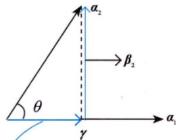  
图3-3

长度： $\left\| {a}_{2}\right\|  \cdot  \cos \theta$

解 应填 $\frac{1}{\sqrt{2}}\left[ \begin{array}{l}1\\ 0\\ 1 \end{array} \right],\frac{1}{\sqrt{6}}\left[ \begin{array}{l} - 1\\ 2\\ 1 \end{array} \right].$

加方向： $\| \alpha_{2}\| \cdot \cos \theta \cdot \frac{\alpha_{1}}{\|\alpha_{1}\|}$

由题设可得 $\alpha_{3} = \alpha_{1} + \alpha_{2}$ ，所以 $V$ 中的任意向量均可由 $\alpha_{1},\alpha_{2}$ 线性表示，又 $\alpha_{1},\alpha_{2}$ 线性无关，故 $\alpha_{1},\alpha_{2}$ 为向量空间 $V$ 的一个基，将其标准正交化，得

$$
\begin{array}{l} \boldsymbol {\beta} _ {1} = \boldsymbol {\alpha} _ {1} = \left[ \begin{array}{l} 1 \\ 0 \\ 1 \end{array} \right], \boldsymbol {\beta} _ {2} = \boldsymbol {\alpha} _ {2} - \frac {(\boldsymbol {\beta} _ {1} , \boldsymbol {\alpha} _ {2})}{(\boldsymbol {\beta} _ {1} , \boldsymbol {\beta} _ {1})} \boldsymbol {\beta} _ {1} = \left[ \begin{array}{l} - 1 \\ 2 \\ 1 \end{array} \right], \\ \gamma_ {1} = \frac {1}{\| \boldsymbol {\beta} _ {1} \|} \boldsymbol {\beta} _ {1} = \frac {1}{\sqrt {2}} \left[ \begin{array}{l} 1 \\ 0 \\ 1 \end{array} \right], \gamma_ {2} = \frac {1}{\| \boldsymbol {\beta} _ {2} \|} \boldsymbol {\beta} _ {2} = \frac {1}{\sqrt {6}} \left[ \begin{array}{l} - 1 \\ 2 \\ 1 \end{array} \right], \\ \end{array}
$$

从而 $\frac{1}{\sqrt{2}}\left\lbrack  \begin{matrix} 1 \\  0 \\  1 \end{matrix}\right\rbrack  ,\frac{1}{\sqrt{6}}\left\lbrack  \begin{matrix}  - 1 \\  2 \\  1 \end{matrix}\right\rbrack$ 为向量空间 $V$ 的一个规范正交基. 这里填两个向量而不是三个向量,这是 因为此向量空间的维数是2.

# 基础习题精练

# 习题

3.1 设 $A$ 是4阶矩阵，且 $\left|A\right| = 0$ ，则 $A$ 中（ ）.

(A) 必有一列元素全为 0  
(B) 必有两列元素对应成比例   
(C) 必有一列向量是其余列向量的线性组合  
(D) 任一列向量是其余列向量的线性组合

3.2 设 $\alpha_{1} = \begin{bmatrix} 0 \\ 0 \\ c_{1} \end{bmatrix}, \alpha_{2} = \begin{bmatrix} 0 \\ 1 \\ c_{2} \end{bmatrix}, \alpha_{3} = \begin{bmatrix} 1 \\ -1 \\ c_{3} \end{bmatrix}, \alpha_{4} = \begin{bmatrix} -1 \\ 1 \\ c_{4} \end{bmatrix}$ , 其中 $c_{1}, c_{2}, c_{3}, c_{4}$ 为任意常数, 则下列向量组线性相关的为（ ）.

(A) $\alpha_{1},\alpha_{2},\alpha_{3}$

(B) $\alpha_{1},\alpha_{2},\alpha_{4}$

(C) $\alpha_{1},\alpha_{3},\alpha_{4}$

(D) $\alpha_{2},\alpha_{3},\alpha_{4}$

3.3 设 $\alpha_{1} = \begin{bmatrix} \lambda \\ 1 \\ 1 \end{bmatrix}, \alpha_{2} = \begin{bmatrix} 1 \\ \lambda \\ 1 \end{bmatrix}, \alpha_{3} = \begin{bmatrix} 1 \\ 1 \\ \lambda \end{bmatrix}, \alpha_{4} = \begin{bmatrix} 1 \\ \lambda \\ \lambda^{2} \end{bmatrix}$ . 若向量组 $\alpha_{1}, \alpha_{2}, \alpha_{3}$ 可由 $\alpha_{1}, \alpha_{2}, \alpha_{4}$ 线性表示，则 $\lambda$ 的取值范围是（ ）.

(A) $\{1, - 1\}$

(B) $\{\lambda |\lambda \in \mathbf{R},\lambda \neq 1\}$

(C) $\{\lambda |\lambda \in \mathbf{R},\lambda \neq -1\}$

(D) $\{\lambda \mid \lambda \in \mathbf{R},\lambda \neq 1,\lambda \neq -1\}$

3.4 设 $n(n \geqslant 3)$ 维向量组 $\alpha_{1}, \alpha_{2}, \alpha_{3}$ 线性无关，若向量组 $l\alpha_{2} - \alpha_{1}, m\alpha_{3} - 2\alpha_{2}, \alpha_{1} - 3\alpha_{3}$ 线性相关，则 $m, l$ 应满足条件（ ）.

(A) $lm = 6$

(B) $lm = -6$

(C) $l + m = 6$

(D) $l + m = -6$

3.5 设向量组 $(\mathrm{I})\alpha_{1},\alpha_{2},\dots ,\alpha_{s}$ 的秩为 $r_1$ ，向量组 $(\mathrm{II})\beta_{1},\beta_{2},\dots ,\beta_{t}$ 的秩为 $r_2$ ，向量组（Ⅲ） $\alpha_{1},\alpha_{2},\dots ,\alpha_{s},\beta_{1},\beta_{2},\dots ,\beta_{t}$ 的秩为 $r_3$ ，则下列结论不正确的是（ ）.

(A)若（I）可由（Ⅱ）线性表示，则 $r_2 = r_3$   
(B) 若 (II) 可由 (I) 线性表示，则 $r_1 = r_3$   
(C) 若 $r_1 = r_3$ ，则 $r_2 > r_1$   
(D) 若 $r_2 = r_3$ ，则 $r_1 \leqslant r_2$

3.6 设 $n$ 维向量组 $(\mathrm{I})\alpha_{1},\alpha_{2},\dots ,\alpha_{s}$ ，（Ⅱ） $\beta_{1},\beta_{2},\dots ,\beta_{t}$ ，记

$$
\boldsymbol {A} = \left[ \alpha_ {1}, \alpha_ {2}, \dots , \alpha_ {s} \right], \boldsymbol {B} = \left[ \beta_ {1}, \beta_ {2}, \dots , \beta_ {t} \right].
$$

则下列结论正确的是（ ）.

(A)若 $r(\mathrm{I}) = r(\mathrm{II})$ ，则 $A\cong B$   
(B)若(I)可由(II)线性表示，则 $(\mathrm{I})\cong (\mathrm{II})$   
(C)若 $r(A) = r(B)$ ，且（Ⅱ）可由（I）线性表示，则 $(\mathrm{I})\cong (\mathrm{II})$   
(D) 若 $r(A) = r(B)$ ，则 (I) $\cong$ (II)

3.7 设向量组 $\pmb{\alpha}_{1} = [1,0, - 1,2]^{\mathrm{T}},\pmb{\alpha}_{2} = [2, - 1, - 2,6]^{\mathrm{T}},\pmb{\alpha}_{3} = [3,1,t,4]^{\mathrm{T}}$ 线性无关，则参数 $t$ 满足

3.8 已知 $\pmb{\alpha}_{1} = [1,0,2,3]^{\mathrm{T}},\pmb{\alpha}_{2} = [1,1,3,5]^{\mathrm{T}},\pmb{\alpha}_{3} = [1, - 1,a + 2,1]^{\mathrm{T}},\pmb{\alpha}_{4} = [1,2,4,a + 8]^{\mathrm{T}}$ 及 $\pmb {\beta}_1 = [1,$ $1,b + 3,5]^{\mathrm{T}}$

(1) $a, b$ 为何值时， $\pmb{\beta}$ 不能表示成 $\alpha_{1}, \alpha_{2}, \alpha_{3}, \alpha_{4}$ 的线性组合？  
(2) $a, b$ 为何值时， $\pmb{\beta}$ 有 $\alpha_{1}, \alpha_{2}, \alpha_{3}, \alpha_{4}$ 唯一的线性表示式？并写出该表示式.

3.9 求向量组

$$
\boldsymbol {\alpha} _ {1} = [ 1, 2, - 5 ] ^ {\mathrm {T}}, \boldsymbol {\alpha} _ {2} = [ 2, - 1, 2 ] ^ {\mathrm {T}}, \boldsymbol {\alpha} _ {3} = [ 4, 3, - 8 ] ^ {\mathrm {T}}, \boldsymbol {\alpha} _ {4} = [ 7, - 1, 1 ] ^ {\mathrm {T}}
$$

的秩、极大线性无关组，并将其余向量由极大线性无关组线性表示.

3.10 已知向量组 $\pmb{\beta}_{1} = \begin{bmatrix} 0 \\ 1 \\ -1 \end{bmatrix}, \pmb{\beta}_{2} = \begin{bmatrix} a \\ 2 \\ 1 \end{bmatrix}, \pmb{\beta}_{3} = \begin{bmatrix} b \\ 1 \\ 0 \end{bmatrix}$ 与向量组 $\alpha_{1} = \begin{bmatrix} 1 \\ 2 \\ -3 \end{bmatrix}, \alpha_{2} = \begin{bmatrix} 3 \\ 0 \\ 1 \end{bmatrix}, \alpha_{3} = \begin{bmatrix} 9 \\ 6 \\ -7 \end{bmatrix}$ 具有相同的秩，且 $\pmb{\beta}_{3}$ 可由 $\alpha_{1}, \alpha_{2}, \alpha_{3}$ 线性表示，求 $a, b$ 的值。

3.11 设 $\alpha_{1},\alpha_{2},\alpha_{3}$ 为两两正交的非零向量，证明： $\alpha_{1},\alpha_{2},\alpha_{3}$ 线性无关.

3.12（仅数学一）已知 $\mathbf{R}^3$ 的两个基 $\alpha_{1} = [1,0, - 1]^{\mathrm{T}},\alpha_{2} = [2,1,1]^{\mathrm{T}},\alpha_{3} = [1,1,1]^{\mathrm{T}}$ 与 $\pmb {\beta}_1 = [0,1,1]^{\mathrm{T}}$ $\pmb {\beta}_2 = [-1,1,0]^{\mathrm{T}},\pmb {\beta}_3 = [1,2,1]^{\mathrm{T}}$ ：

(1)求由基 $\alpha_{1},\alpha_{2},\alpha_{3}$ 到基 $\beta_{1},\beta_{2},\beta_{3}$ 的过渡矩阵；  
(2) 求 $y = [9, 6, 5]^{\mathrm{T}}$ 在这两个基下的坐标；  
(3)求向量 $\delta$ ，使它在这两个基下有相同的坐标，

# 解答

3.1 (C) 解 对于方阵 $A$ ，由于 $|A| = 0 \Leftrightarrow A$ 的列（行）向量组线性相关，由向量组线性相关的充要条件即知 (C) 正确。

# 考研数学基础30讲·线性代数分册

3.2 (C) 解首先，当 $c_{1} = 1$ 时，行列式 $\left|\alpha_{1},\alpha_{2},\alpha_{3}\right| = -1,\left|\alpha_{1},\alpha_{2},\alpha_{4}\right| = 1$ ，所以此时向量组 $\alpha_{1},\alpha_{2},\alpha_{3}$ 与 $\alpha_{1},\alpha_{2},\alpha_{4}$ 都线性无关，即选项(A)与(B)排除.

其次，当 $c_{2} = 0$ ， $c_{3} = c_{4} = 1$ 时，行列式 $\left|\alpha_{2},\alpha_{3},\alpha_{4}\right| = -2$ ，即此时向量组 $\alpha_{2},\alpha_{3},\alpha_{4}$ 也是线性无关的，选项(D)排除，故选(C).

事实上，当 $c_{1} = 0$ 时，知 $\alpha_{1}$ 为零向量，故 $\alpha_{1},\alpha_{3},\alpha_{4}$ 线性相关；当 $c_{1}\neq 0$ 时，有

$$
\left(c _ {3} + c _ {4}\right) \alpha_ {1} - c _ {1} \left(\alpha_ {3} + \alpha_ {4}\right) = 0,
$$

所以，对任意的常数 $c_{1}, c_{3}, c_{4}$ 而言， $\pmb{\alpha}_{1}, \pmb{\alpha}_{3}, \pmb{\alpha}_{4}$ 都是线性相关的. 选(C).

3.3 (C) 解 若向量组 $\alpha_{1}, \alpha_{2}, \alpha_{3}$ 可由 $\alpha_{1}, \alpha_{2}, \alpha_{4}$ 线性表示，可知 $\alpha_{3}$ 可由 $\alpha_{1}, \alpha_{2}, \alpha_{4}$ 线性表示，所以方程组 $x_{1} \alpha_{1} + x_{2} \alpha_{2} + x_{3} \alpha_{4} = \alpha_{3}$ 有解，其系数行列式

$$
\left| \alpha_ {1}, \alpha_ {2}, \alpha_ {4} \right| = \left| \begin{array}{l l l} \lambda & 1 & 1 \\ 1 & \lambda & \lambda \\ 1 & 1 & \lambda^ {2} \end{array} \right| = (\lambda^ {2} - 1) ^ {2},
$$

当 $\left|\alpha_{1},\alpha_{2},\alpha_{4}\right| = (\lambda^{2} - 1)^{2}\neq 0$ ，即 $\lambda \neq 1,\lambda \neq -1$ 时， $\pmb{\alpha}_{3}$ 可由 $\alpha_{1},\alpha_{2},\alpha_{4}$ 线性表示.

当 $\lambda = 1$ 时，有 $\pmb{\alpha}_{1} = \pmb{\alpha}_{2} = \pmb{\alpha}_{3} = \pmb{\alpha}_{4} = \begin{bmatrix} 1 \\ 1 \\ 1 \end{bmatrix}$ ，可知 $\pmb{\alpha}_{3}$ 仍可由 $\pmb{\alpha}_{1}, \pmb{\alpha}_{2}, \pmb{\alpha}_{4}$ 线性表示；

当 $\lambda = -1$ 时，对增广矩阵 $\overline{A}$ 作初等行变换：

$$
\begin{array}{l} \overrightarrow {A} = \left[ \alpha_ {1}, \alpha_ {2}, \alpha_ {4}: \alpha_ {3} \right] = \left[\begin{array}{c c c c}- 1&1&1&1\\\hline 1&- 1&- 1&1\\\hline 1&1&1&- 1\end{array}\right] \stackrel {\text {互 换}} {\rightarrow} \left[\begin{array}{c c c c}1&- 1&- 1&1\\- 1&1&1&1\\1&1&1&- 1\end{array}\right] \stackrel {(- 1) \text {倍 加 至}} {\rightarrow} \left[\begin{array}{c c c c}1&- 1&- 1&1\\0&0&0&2\\\hline 0&2&2&- 2\end{array}\right] \stackrel {\text {互 换}} {\leftarrow} \times \frac {1}{2} \\ \rightarrow \left[\begin{array}{c c c c}1&- 1&- 1&1\\0&1&1&- 1\\0&0&0&1\end{array}\right] \xrightarrow [ ]{1 \text {倍 加 至}} \left[\begin{array}{c c c c}1&0&0&0\\0&1&1&0\\0&0&0&1\end{array}\right], \\ \end{array}
$$

可知 $r(\overline{A}) = 3, r(A) = 2$ ，此时 $\alpha_{3}$ 不能由 $\alpha_{1},\alpha_{2},\alpha_{4}$ 线性表示.

3.4 (A) 解 $[l\pmb{\alpha}_2 - \pmb{\alpha}_1, m\pmb{\alpha}_3 - 2\pmb{\alpha}_2, \pmb{\alpha}_1 - 3\pmb{\alpha}_3] = [\pmb{\alpha}_1, \pmb{\alpha}_2, \pmb{\alpha}_3]\left[ \begin{array}{ccc} -1 & 0 & 1 \\ l & -2 & 0 \\ 0 & m & -3 \end{array} \right].$

因为 $\alpha_{1},\alpha_{2},\alpha_{3}$ 线性无关，所以 $r([a_1,a_2,a_3]) = 3$ ，则

$$
r ([ l \pmb {\alpha} _ {2} - \pmb {\alpha} _ {1}, m \pmb {\alpha} _ {3} - 2 \pmb {\alpha} _ {2}, \pmb {\alpha} _ {1} - 3 \pmb {\alpha} _ {3} ]) = r \left(\left[ \begin{array}{c c c} {- 1} & {0} & {1} \\ {l} & {- 2} & {0} \\ {0} & {m} & {- 3} \end{array} \right]\right) <   3 (\text {相 关}),
$$

所以 $\left| \begin{array}{ccc} - 1 & 0 & 1\\ l & -2 & 0\\ 0 & m & -3 \end{array} \right| = 0$ ，则 $lm = 6$ ：

注本题与例3.4的方法二很相似，但这里 $a_1, a_2, a_3$ 是 $n(n \geqslant 3)$ 维列向量，故使用 $|\pmb{a}_1, \pmb{a}_2, \pmb{a}_3|$ 是不妥的，这里用到一个更一般的秩的结论：

若 $r(A_{m \times n}) = n$ （列满秩），则 $r(A_{m \times n}B_{n \times s}) = r(B_{n \times s})$

3.5 (C) 解这里(I)显然可由(III)线性表示，若再有 $r_1 = r_3$ ，则(I)和(III)等价，此时(III)便可由(I)线性表示，即此时(II)便可由(I)线性表示，则 $r_2 \leqslant r_1$ ，故(C)错误，同理可知(D)正确，而(A)和(B)显然是正确的.

3.6 (C) 解 $A \cong B$ 有一个大前提，要求同型。尽管 $r(A) = r(\mathrm{I})$ ， $r(B) = r(\mathrm{II})$ ，由 $r(\mathrm{I}) = r(\mathrm{II})$ 可知 $r(A) = r(B)$ ，但 $A, B$ 未必同型，所以 $A, B$ 无等价可言，故 (A) 不成立。

$(\mathrm{I}) \cong (\mathrm{II}) \Leftrightarrow (\mathrm{I}), (\mathrm{II})$ 可以相互线性表示. 仅由 (I) 可由 (II) 线性表示不能说明 $(\mathrm{I}) \cong (\mathrm{II})$ , 故 (B) 不成立.

取 $A = \begin{bmatrix} 1 & 0\\ 0 & 1\\ 0 & 0 \end{bmatrix} = [\pmb {\alpha}_1,\pmb {\alpha}_2],$ $\pmb {B} = \begin{bmatrix} 0 & 1 & -1\\ 0 & 0 & 0\\ 1 & 1 & 1 \end{bmatrix} = [\pmb {\beta}_1,\pmb {\beta}_2,\pmb {\beta}_3],r(\pmb {A}) = r(\pmb {B}) = 2$ ，但 $\alpha_{1},\alpha_{2}$ 和 $\beta_{1},\beta_{2},\beta_{3}$ 之间不能相互表示，故(D)不成立.

由排除法可知，应选(C).

对于(C)，由 $r(A) = r(B)$ ，知 $r(\mathrm{I}) = r(\mathrm{II})$ ，并设其秩为 $r$ ，且设（I），（Ⅱ）的极大线性无关组分别为 $\alpha_{1},\alpha_{2},\dots ,\alpha_{r};\beta_{1},\beta_{2},\dots ,\beta_{r}$ ：

记向量组（Ⅲ）为 $\alpha_{1},\alpha_{2},\dots ,\alpha_{s},\beta_{1},\beta_{2},\dots ,\beta_{t}$ .由于（Ⅱ）可由（I）线性表示，故（I）的极大线性无关组也是（Ⅲ）的极大线性无关组， $r(\mathrm{III}) = r$ ，又任意 $r$ 个线性无关的向量为向量组（Ⅲ）的一个极大线性无关组，则（Ⅱ）的极大线性无关组也是（Ⅲ）的极大线性无关组，故（I）中任一向量均可由（Ⅱ）的极大线性无关组线性表示，故（I），（Ⅱ）可相互表示， $(\mathrm{I})\cong (\mathrm{II})$ 得证.

3.7 $t\neq -3$ 解 $[\pmb {\alpha}_1,\pmb {\alpha}_2,\pmb {\alpha}_3] = \left[ \begin{array}{rrr}1 & 2 & 3\\ 0 & -1 & 1\\ -1 & -2 & t\\ 2 & 6 & 4 \end{array} \right]\stackrel {1\text{倍加至}}{\longrightarrow}\left[ \begin{array}{rrr}1 & 2 & 3\\ 0 & 1 & -1\\ 0 & 0 & t + 3\\ 0 & 2 & -2 \end{array} \right]\stackrel {(-2)\text{倍}}{\longrightarrow}\left[ \begin{array}{rrr}1 & 2 & 3\\ 0 & 1 & -1\\ 0 & 0 & t + 3\\ 0 & 0 & 0 \end{array} \right],$

线性无关 $\Leftrightarrow t\neq -3$ ：

3.8 解设 $\pmb {\beta} = x_{1}\pmb{\alpha}_{1} + x_{2}\pmb{\alpha}_{2} + x_{3}\pmb{\alpha}_{3} + x_{4}\pmb{\alpha}_{4}$ ，即

$$
\left\{ \begin{array}{l} x _ {1} + x _ {2} + x _ {3} + x _ {4} = 1, \\ x _ {2} - x _ {3} + 2 x _ {4} = 1, \\ 2 x _ {1} + 3 x _ {2} + (a + 2) x _ {3} + 4 x _ {4} = b + 3, \\ 3 x _ {1} + 5 x _ {2} + x _ {3} + (a + 8) x _ {4} = 5, \end{array} \right. \tag {*}
$$

对方程组的增广矩阵作初等行变换

$$
(- 3) \text {倍} \left[ \begin{array}{l l l l l} 1 & 1 & 1 & 1 & 1 \\ 0 & 1 & - 1 & 2 & 1 \\ 2 & 3 & a + 2 & 4 & b + 3 \\ 3 & 5 & 1 & a + 8 & 5 \end{array} \right] \xrightarrow [ ]{(- 2) \text {倍}} \left[ \begin{array}{l l l l l} 1 & 1 & 1 & 1 & 1 \\ 0 & 1 & - 1 & 2 & 1 \\ 0 & 1 & a & 2 & b + 1 \\ 0 & 2 & - 2 & a + 5 & 2 \end{array} \right] \xrightarrow [ ]{(- 2) \text {倍}} \left[ \begin{array}{l l l l l} 1 & 1 & 1 & 1 & 1 \\ 0 & 1 & - 1 & 2 & 1 \\ 0 & 0 & a + 1 & 0 & b \\ 0 & 0 & 0 & a + 1 & 0 \end{array} \right].
$$

(1)当 $a = -1$ 且 $b\neq 0$ 时，方程组 $(*)$ 无解，此时 $\pmb{\beta}$ 不能表示成 $\alpha_{1},\alpha_{2},\alpha_{3},\alpha_{4}$ 的线性组合.  
(2) 当 $a \neq -1$ 时，因为方程组 (*) 的系数行列式不等于零，所以该方程组有唯一解，即 $\beta$ 可由 $\alpha_{1}, \alpha_{2}, \alpha_{3}, \alpha_{4}$ 线性表示，且表示式唯一。易求得

$$
\boldsymbol {\beta} = - \frac {2 b}{a + 1} \boldsymbol {\alpha} _ {1} + \frac {a + b + 1}{a + 1} \boldsymbol {\alpha} _ {2} + \frac {b}{a + 1} \boldsymbol {\alpha} _ {3} + 0 \cdot \boldsymbol {\alpha} _ {4}.
$$

3.9 解

$$
\begin{array}{l} \left[ \alpha_ {1}, \alpha_ {2}, \alpha_ {3}, \alpha_ {4} \right] = \left[ \begin{array}{r r r r} 1 & 2 & 4 & 7 \\ 2 & - 1 & 3 & - 1 \\ - 5 & 2 & - 8 & 1 \end{array} \right] \xrightarrow [ \text {加 至} ]{(- 2) \text {倍}} \left[ \begin{array}{r r r r} 1 & 2 & 4 & 7 \\ 0 & - 5 & - 5 & - 1 5 \\ 0 & 1 2 & 1 2 & 3 6 \end{array} \right] \xleftarrow {\times \left(- \frac {1}{5}\right)} \\ \begin{array}{r}{\rightarrow \left[\begin{array}{l l l l}{1}&{2}&{4}&{7}\\{0}&{1}&{1}&{3}\\{0}&{1}&{1}&{3}\end{array}\right]\rightarrow \left[\begin{array}{l l l l}{1}&{2}&{4}&{7}\\{0}&{1}&{1}&{3}\\{0}&{0}&{0}&{0}\end{array}\right] = \left[\begin{array}{l}{\pmb {\alpha}} _ {1} ^ {\prime}, \pmb {\alpha} _ {2} ^ {\prime}, \pmb {\alpha} _ {3} ^ {\prime}, \pmb {\alpha} _ {4} ^ {\prime}\end{array}\right].}\\{\text {加 士}}\end{array} \\ \end{array}
$$

由 $\alpha_{1}^{\prime},\alpha_{2}^{\prime},\alpha_{3}^{\prime},\alpha_{4}^{\prime}$ 知 $r(\pmb {\alpha}_1,\pmb {\alpha}_2,\pmb {\alpha}_3,\pmb {\alpha}_4) = 2$ ，极大线性无关组为 $\alpha_{1},\alpha_{2}$ （不唯一），且 $\alpha_{3} = 2\alpha_{1} + \alpha_{2},\alpha_{4} =$ $\alpha_{1} + 3\alpha_{2}$ ：

3.10 解 因为 $a_1$ 和 $a_2$ 线性无关， $a_3 = 3a_1 + 2a_2$ ，所以向量组 $a_1, a_2, a_3$ 线性相关，且秩为 2， $a_1, a_2$ 是它的一个极大线性无关组。

由于向量组 $\beta_{1},\beta_{2},\beta_{3}$ 与 $\alpha_{1},\alpha_{2},\alpha_{3}$ 具有相同的秩，故 $\beta_{1},\beta_{2},\beta_{3}$ 线性相关，从而

$$
\left| \begin{array}{c c c} 0 & a & b \\ 1 & 2 & 1 \\ - 1 & 1 & 0 \end{array} \right| = 0,
$$

由此解得 $a = 3b$

又 $\pmb{\beta}_{3}$ 可由 $\alpha_{1},\alpha_{2},\alpha_{3}$ 线性表示，从而可由 $\alpha_{1},\alpha_{2}$ 线性表示，所以 $\alpha_{1},\alpha_{2},\beta_{3}$ 线性相关.于是

$$
\left| \begin{array}{c c c} 1 & 3 & b \\ 2 & 0 & 1 \\ - 3 & 1 & 0 \end{array} \right| = 0,
$$

解得 $2b - 10 = 0$ ，于是得 $a = 15, b = 5$

3.11 证明 设有一组常数 $k_{1}, k_{2}, k_{3}$ ，使

$$
k _ {1} \alpha_ {1} + k _ {2} \alpha_ {2} + k _ {3} \alpha_ {3} = 0,
$$

两边与 $\pmb{\alpha}_{1}$ 作内积，由 $(\pmb{\alpha}_1,\pmb{\alpha}_2) = 0$ ， $(\pmb{\alpha}_1,\pmb{\alpha}_3) = 0$ 得

$$
k _ {1} \left(\boldsymbol {\alpha} _ {1}, \boldsymbol {\alpha} _ {1}\right) + k _ {2} \left(\boldsymbol {\alpha} _ {1}, \boldsymbol {\alpha} _ {2}\right) + k _ {3} \left(\boldsymbol {\alpha} _ {1}, \boldsymbol {\alpha} _ {3}\right) = k _ {1} \left(\boldsymbol {\alpha} _ {1}, \boldsymbol {\alpha} _ {1}\right) = 0,
$$

又因为 $\pmb{\alpha}_{1} \neq \mathbf{0}$ , $(\pmb{\alpha}_{1}, \pmb{\alpha}_{1}) > 0$ , 故 $k_{1} = 0$

同理可得 $k_{2} = 0$ ， $k_{3} = 0$ ，故 $\alpha_{1},\alpha_{2},\alpha_{3}$ 线性无关.

3.12 解 (1) 设从基 $\alpha_{1}, \alpha_{2}, \alpha_{3}$ 到基 $\beta_{1}, \beta_{2}, \beta_{3}$ 的过渡矩阵是 $C$ ，则

$$
\left[ \boldsymbol {\beta} _ {1}, \boldsymbol {\beta} _ {2}, \boldsymbol {\beta} _ {3} \right] = \left[ \boldsymbol {\alpha} _ {1}, \boldsymbol {\alpha} _ {2}, \boldsymbol {\alpha} _ {3} \right] \boldsymbol {C},
$$

故

$$
\begin{array}{l} \boldsymbol {C} = \left[ \boldsymbol {\alpha} _ {1}, \boldsymbol {\alpha} _ {2}, \boldsymbol {\alpha} _ {3} \right] ^ {- 1} \left[ \boldsymbol {\beta} _ {1}, \boldsymbol {\beta} _ {2}, \boldsymbol {\beta} _ {3} \right] \\ = \left[ \begin{array}{l l l} 1 & 2 & 1 \\ 0 & 1 & 1 \\ - 1 & 1 & 1 \end{array} \right] ^ {- 1} \left[ \begin{array}{l l l} 0 & - 1 & 1 \\ 1 & 1 & 2 \\ 1 & 0 & 1 \end{array} \right] = \left[ \begin{array}{l l l} 0 & 1 & 1 \\ - 1 & - 3 & - 2 \\ 2 & 4 & 4 \end{array} \right]. \\ \end{array}
$$

(2)设 $\pmb{\gamma}$ 在基 $\beta_{1},\beta_{2},\beta_{3}$ 下的坐标是 $[y_1,y_2,y_3]^{\mathrm{T}}$ ，即 $y_{1}\pmb{\beta}_{1} + y_{2}\pmb{\beta}_{2} + y_{3}\pmb{\beta}_{3} = \pmb{\gamma}$ ，亦即

$$
\left\{ \begin{array}{l l} - y _ {2} + y _ {3} = 9, \\ y _ {1} + y _ {2} + 2 y _ {3} = 6, \text {解 得} y _ {1} = 0, y _ {2} = - 4, y _ {3} = 5. \\ y _ {1} + y _ {3} = 5, \end{array} \right.
$$

设 $\gamma$ 在基 $\alpha_{1},\alpha_{2},\alpha_{3}$ 下的坐标是 $[x_1,x_2,x_3]^{\mathrm{T}}$ ，按坐标变换公式 $x = Cy$ ，有

$$
\left[ \begin{array}{l} x _ {1} \\ x _ {2} \\ x _ {3} \end{array} \right] = \left[ \begin{array}{c c c} 0 & 1 & 1 \\ - 1 & - 3 & - 2 \\ 2 & 4 & 4 \end{array} \right] \left[ \begin{array}{l} 0 \\ - 4 \\ 5 \end{array} \right] = \left[ \begin{array}{l} 1 \\ 2 \\ 4 \end{array} \right],
$$

可见 $\pmb{\gamma}$ 在这两个基下的坐标分别是 $[1,2,4]^{\mathrm{T}}$ 和 $[0, - 4,5]^{\mathrm{T}}$

(3) 设 $\pmb{\delta} = x_{1}\pmb{a}_{1} + x_{2}\pmb{a}_{2} + x_{3}\pmb{a}_{3} = x_{1}\pmb{\beta}_{1} + x_{2}\pmb{\beta}_{2} + x_{3}\pmb{\beta}_{3}$ ，即

$$
x _ {1} \left(\boldsymbol {\alpha} _ {1} - \boldsymbol {\beta} _ {1}\right) + x _ {2} \left(\boldsymbol {\alpha} _ {2} - \boldsymbol {\beta} _ {2}\right) + x _ {3} \left(\boldsymbol {\alpha} _ {3} - \boldsymbol {\beta} _ {3}\right) = \mathbf {0},
$$

亦即

$$
\left\{ \begin{array}{l l} x _ {1} + 3 x _ {2} = 0, \\ - x _ {1} - x _ {3} = 0, & \text {解 得} x _ {1} = x _ {2} = x _ {3} = 0 \\ - 2 x _ {1} + x _ {2} = 0, \end{array} \right.
$$

所以，仅零向量在这两个基下有相同的坐标。
