# 第4讲

# 线性方程组

# 基础知识结构

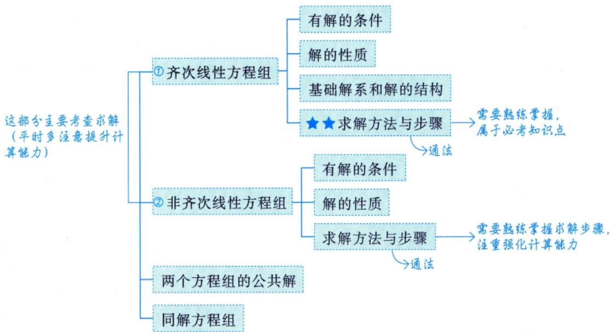

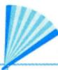

# 基础内容精讲

# 线性方程组与向量组其实是一回事

我们来看一般的非齐次线性方程组

$$
\left\{ \begin{array}{l} a _ {1 1} x _ {1} + a _ {1 2} x _ {2} + \dots + a _ {1 n} x _ {n} = b _ {1}, \\ a _ {2 1} x _ {1} + a _ {2 2} x _ {2} + \dots + a _ {2 n} x _ {n} = b _ {2}, \\ \dots \dots \\ a _ {m 1} x _ {1} + a _ {m 2} x _ {2} + \dots + a _ {m n} x _ {n} = b _ {m}, \end{array} \right.
$$

该方程组的系数矩阵

由未知数 $x_{i}$ 前的系数 $a_{ij}$ 组成的矩阵

$$
\boldsymbol {A} = \left[ \begin{array}{c c c c} a _ {1 1} & a _ {1 2} & \dots & a _ {1 n} \\ a _ {2 1} & a _ {2 2} & \dots & a _ {2 n} \\ \vdots & \vdots & & \vdots \\ a _ {m 1} & a _ {m 2} & \dots & a _ {m n} \end{array} \right]
$$

就是若干个列向量拼成的，且其增广矩阵

系数矩阵

自由项：由方程组等号右边的 $b$ 组成的列向量

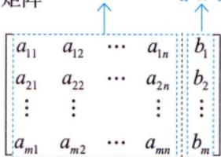

就是系数矩阵再添加一个列向量拼成的.

增广矩阵 $= [A:b] = [$ 系数矩阵：自由项]

仔细观察，把上述方程组写成向量的形式便不难看出，该方程组的未知数就是向量组中各成员的系数：

${x}_{1}{\mathbf{\alpha }}_{1} + {x}_{2}{\mathbf{\alpha }}_{2} + \cdots  + {x}_{n}{\mathbf{\alpha }}_{n} = \mathbf{\beta }$ , $\rightarrow$ 向量的线性组合

理解： $(x_{1}, x_{2}, \dots, x_{n})^{\mathrm{T}}$ 为非齐次方程组的解向量，

则解向量的各分量 $x_{1}, x_{2}, \dots, x_{n}$ 为向量组 $\alpha_{1}, \alpha_{2}, \dots, \alpha_{n}$ 表示向量 $\beta$ 的组合系数

其中

$$
\boldsymbol {\alpha} _ {j} = \left[ \begin{array}{c} a _ {1 j} \\ a _ {2 j} \\ \vdots \\ a _ {m j} \end{array} \right], j = 1, 2, \dots , n, \boldsymbol {\beta} = \left[ \begin{array}{c} b _ {1} \\ b _ {2} \\ \vdots \\ b _ {m} \end{array} \right].
$$

上一讲向量组已经解决了形式上的问题，这一讲主要落实到求解具体数字.

所以从本质上说，方程组问题就是向量组问题，方程组和向量组是同一个问题的两种表现形式其本质一样，所以解决方法也一样. 实际问题

考 查 求解线性方程组,就是对增广矩阵作初等行变换,化成行阶梯形矩阵,然后求解. 这个基本方法贯穿这门课程始终 . 方法 目的

初等行变换,不改变未知数的值,属于同解变换

方便得出真实约束的个数并求未知数

（仅数学一）用解空间表示

用线性无关的向量（在方程组中，称为“基础解系”）表示

(仅数学一)即向量空间中的基

也为解向量的极大线性无关组

接下来，该方程组有无穷多解时，如何表示出所有的解？这又是某个（无穷）向量组用什么“代表”来表示的问题，这个“代表”就是基础解系。于是，解线性方程组便成了这一部分的关键。希望考生能发现：解方程组所得到的解 $x_{1}, x_{2}, \cdots, x_{n}$ 就是描述向量与向量之间关系的表示系数。

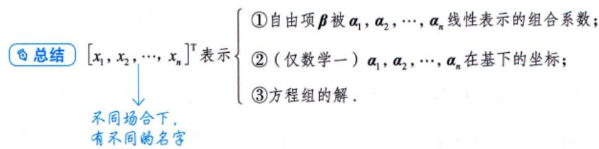

# 齐次线性方程组

方程组

$$
\left\{ \begin{array}{l} a _ {1 1} x _ {1} + a _ {1 2} x _ {2} + \dots + a _ {1 n} x _ {n} = 0, \\ a _ {2 1} x _ {1} + a _ {2 2} x _ {2} + \dots + a _ {2 n} x _ {n} = 0, \\ \dots \dots \\ a _ {m 1} x _ {1} + a _ {m 2} x _ {2} + \dots + a _ {m n} x _ {n} = 0 \end{array} \right. \tag {I}
$$

称为 $m$ 个方程， $n$ 个未知量的齐次线性方程组。

其向量形式为

其中

$$
x _ {1} \boldsymbol {\alpha} _ {1} + x _ {2} \boldsymbol {\alpha} _ {2} + \dots + x _ {n} \boldsymbol {\alpha} _ {n} = \mathbf {0}, \quad \rightarrow \text {向 量 组 的 线 性 组 合 为 零 向 量}.
$$

$$
\boldsymbol {\alpha} _ {j} = \left[ \begin{array}{c} a _ {1 j} \\ a _ {2 j} \\ \vdots \\ a _ {m j} \end{array} \right], j = 1, 2, \dots , n.
$$

若只有 $x_{1}, x_{2}, \cdots, x_{n}$ 全为0时才为零向量，则称向量组 $\alpha_{1}, \alpha_{2}, \cdots, \alpha_{n}$ 线性无关。反之，如果 $x_{1}, x_{2}, \cdots, x_{n}$ 存在一组不全为0的数，使等式成立，则称 $\alpha_{1}, \alpha_{2}, \cdots, \alpha_{n}$ 线性相关

其矩阵形式为

$$
\boldsymbol {A} _ {m \times n} \boldsymbol {x} = \boldsymbol {0},
$$

其中

$$
\boldsymbol {A} _ {m \times n} = \left[ \begin{array}{c c c c} a _ {1 1} & a _ {1 2} & \dots & a _ {1 n} \\ a _ {2 1} & a _ {2 2} & \dots & a _ {2 n} \\ \vdots & \vdots & & \vdots \\ a _ {m 1} & a _ {m 2} & \dots & a _ {m n} \end{array} \right], \boldsymbol {x} = \left[ \begin{array}{c} x _ {1} \\ x _ {2} \\ \vdots \\ x _ {n} \end{array} \right].
$$

系数矩阵

解向量

# 有解的条件

① 当 $r(A) = n$ ( $\alpha_{1}, \alpha_{2}, \dots, \alpha_{n}$ 线性无关) 时，方程组 (I) 有唯一零解；

理解： $A_{m\times n}$ （ $m$ 行 $n$ 列），当 $r(A) = n$ 时， $A$ 的列向量组满秩，所以 $Ax = 0$ 只有唯一解，又因为齐次方程组必有零解，故方程组 $Ax = 0$ 只有零解。此外，从向量组的线性表示的角度看， $\alpha_{1}, \alpha_{2}, \dots, \alpha_{n}$ 是线性无关的，故只有组合系数 $x_{1}, x_{2}, \dots, x_{n}$ 全为0时，才能表示零向量。

★★★★★②当 $r(A) = r <   n$ （ $\alpha_{1},\alpha_{2},\dots ,\alpha_{n}$ 线性相关）时，方程组（I）有非零解（无穷多解），且有 $n - r$ 个线性无关解.主要考查有非零解的情形

理解：当 $r(A) < n$ 时，列向量组 $\alpha_{1},\alpha_{2},\dots ,\alpha_{n}$ 是线性相关的， $\alpha_{1},\alpha_{2},\dots ,\alpha_{n}$ 在线性表示为零向量时， $x_{1},x_{2},\dots ,x_{n}$ 可以不全为零，即 $Ax = 0$ 存在非零解，而非零解一定有无穷多个，因为真实约束小于未知数的个数，所以有 $n - r(A)$ 个自由变量取值是不受限制的.

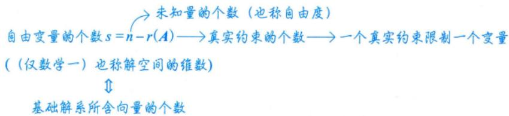

# 解的性质

① 若 $A\xi_{1} = 0, A\xi_{2} = 0$ ，则 $A(k_{1}\xi_{1} + k_{2}\xi_{2}) = 0$ ，其中 $k_{1}, k_{2}$ 是任意常数。

理解：齐次线性方程组的解向量线性组合后形成的新向量仍是该方程组的解

②类消去律：若 $A_{m \times n}$ ， $r(A) = n$ ， $AB = AC$ ，则 $B = C$ .

注证因 $r(A) = n$ ， $\pmb{A}$ 列满秩，于是 $n - r(A) = 0$ ， $Ax = 0$ 只有零解，故由 $AB = AC$ ，有 $A(B - C) = 0$ 于是 $B = C.$ 形式上好像在等号两边消去 $\pmb{A}$ ，故称类消去律.

# 基础解系和解的结构

(1) 基础解系：设 $\xi_1, \xi_2, \dots, \xi_{n-r}$ 满足

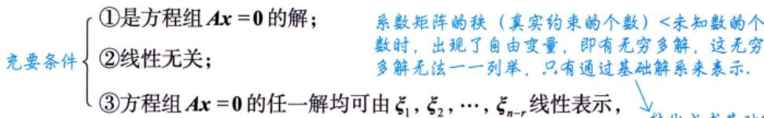

则称 $\xi_1,\xi_2,\dots ,\xi_{n - r}$ 为 $Ax = 0$ 的基础解系.个数为 $s = n - r(A)$

(2) 通解：设 $\xi_1, \xi_2, \dots, \xi_{n-r}$ 是 $Ax = 0$ 的基础解系，则 $k_1\xi_1 + k_2\xi_2 + \dots + k_{n-r}\xi_{n-r}$ 是方程组 $Ax = 0$ 的通解，其中 $k_1, k_2, \dots, k_{n-r}$ 是任意常数。

(仅数学一) $\xi_{1}, \xi_{2}, \cdots, \xi_{n-r}$ 为解空间的基，解空间内的任意一个向量都可以通过基来线性表示所以可用基础解系来表示方程组 $Ax = 0$ 的所有解向量，即

$$
x = k _ {1} \xi_ {1} + k _ {2} \xi_ {2} + \dots + k _ {n - r} \xi_ {n - r}
$$

# 4 求解方法与步骤

必须是行变换,因为行变换不改变各向量间的系数,属于同解变换

① 将系数矩阵 $\mathbf{A}$ 作初等行变换化成行阶梯形矩阵 $\mathbf{B}$ (或行最简阶梯形矩阵 $\mathbf{B}$ ), (初等行变换将方程组化为同解方程组,故 ${Ax} = 0$ 和 ${Bx} = 0$ 同解,只需解 ${Bx} = 0$ 即可). 阶梯数为 $r$ ,并记 $r\left( A\right)  = r$ ,

阶梯数为真实约束个数，即为行向量组的秩

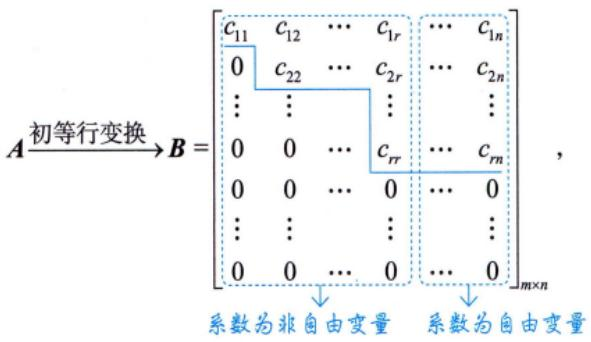

理解：矩阵的行向量组的秩与列向量组的秩是相等的，也等于矩阵的秩

其中， $m$ 是原方程组中方程个数， $n$ 是未知量个数.

②按列找出一个秩为 $r$ 的子矩阵,剩余列位置的未知数设为自由变量. $n - r\left( A\right)$ 个自由变量  
③ 按基础解系定义求出 $\xi_1, \xi_2, \dots, \xi_{n-r}$ ，并写出通解

即 $x^{\prime} = k_{1}\xi_{1} + k_{2}\xi_{2} + \dots +k_{n - r}\xi_{n - r}$ （ $k_{1},k_{2},\dots ,k_{n - r}$ 为任意常数）

# 例4.1 求齐次线性方程组

$$
\left\{ \begin{array}{l} x _ {1} + x _ {2} - 3 x _ {4} - x _ {5} = 0, \\ x _ {1} - x _ {2} + 2 x _ {3} - x _ {4} = 0, \\ 4 x _ {1} - 2 x _ {2} + 6 x _ {3} + 3 x _ {4} - 4 x _ {5} = 0, \\ 2 x _ {1} + 4 x _ {2} - 2 x _ {3} + 4 x _ {4} - 7 x _ {5} = 0 \end{array} \right.
$$

注重掌握思路和方法，切忌用中学的消元代入法来做.

的通解.

解 将系数矩阵作初等行变换，化成行阶梯形矩阵.

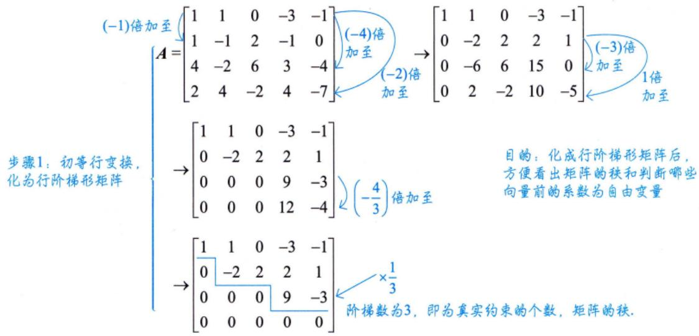

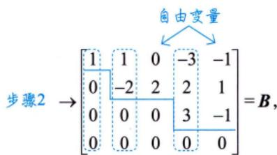

确定秩为3后，按列找出一个秩为3的子矩阵，而其余列位置的未知数为自由变量此阶梯数为3，为行向量的秩，也等于矩阵的秩故自由变量的个数为 $5 - r(A) = 5 - 3 = 2$

则 $Ax = 0$ 和 $Bx = 0$ 是同解方程组，且 $r(A) = r(B) = 3$

按列找出一个秩为3的子矩阵，可取第一、二、四列，则剩余第三、五列位置的元素 $x_{3}, x_{5}$ 即设为自由未知量.

取自由未知量 $x_{3} = k_{1}$ ， $x_{5} = 3k_{2}$ ，代入方程组得

步骤3： $① s = n - r(A)$ $\longrightarrow$ 确定基础解系中有几个向量求基础解系 $②$ 线性无关 $\longrightarrow$ 取的 $\left|A_s\right|$ （ $s$ 阶子式） $\neq 0$ ，即可确定线性无关的向量组 $(\xi_1,\xi_2)$ $③$ 是 $Ax = 0$ 的解 $\longrightarrow \xi_{1},\xi_{2}$ 是与行向量垂直的向量

$$
x _ {4} = k _ {2},
$$

$$
x _ {2} = x _ {3} + x _ {4} + \frac {1}{2} x _ {5} = k _ {1} + \frac {5}{2} k _ {2},
$$

$$
x _ {1} = - x _ {2} + 3 x _ {4} + x _ {5} = - k _ {1} + \frac {7}{2} k _ {2}.
$$

由此得通解

$\left[ \begin{array}{l}x_{1}\\ x_{2}\\ x_{3}\\ x_{4}\\ x_{5} \end{array} \right] = \left[ \begin{array}{l} - k_{1} + \frac{7}{2} k_{2}\\ k_{1} + \frac{5}{2} k_{2}\\ k_{1} + 0\\ 0 + k_{2}\\ 0 + 3k_{2} \end{array} \right] = k_{1}\left[ \begin{array}{l} - 1\\ 1\\ 1\\ 0\\ 0 \end{array} \right] + k_{2}\left[ \begin{array}{l}\frac{7}{2}\\ \frac{5}{2}\\ 0\\ 1\\ 3 \end{array} \right],$ 其中是任意常数.

自由变量的取值是随意的，但为保证基础解系是线性无关的，故 $x_{3},x_{5}$ 的两次取值须不成比例，且为方便求解其他未知量，一般先定一个为1其余为0，如

$x_{1}$ $x_{2}$ $x_{3}$ $x_{4}$ $x_{5}$ $\xi_{1} - 1$ 1 1 0 0 $\xi_{2}$ $\frac{7}{6}$ $\frac{5}{6}$ 0 $\frac{1}{3}$ 1

注 (1) 由阶梯形矩阵 $\pmb{B}$ 知，未知量 $x_{2}, x_{3}$ 地位等同，同样 $x_{4}, x_{5}$ 的地位也等同，自由未知量也可以取为 $x_{2}, x_{4}$ 或 $x_{2}, x_{5}$ 或 $x_{3}, x_{4}$ .

(2)方程组求解的回代过程也可以用初等行变换来实现，即对阶梯形矩阵 $\pmb{B}$ 继续作初等行变换，化成行最简阶梯形矩阵.

$$
\boldsymbol {B} = \left[ \begin{array}{c c c c c} 1 & 1 & 0 & - 3 & - 1 \\ 0 & - 2 & 2 & 2 & 1 \\ 0 & 0 & 0 & 3 & - 1 \\ 0 & 0 & 0 & 0 & 0 \end{array} \right] \xrightarrow {\times \left(- \frac {1}{2}\right)} \left[ \begin{array}{c c c c c} 1 & 1 & 0 & - 3 & - 1 \\ 0 & 1 & - 1 & - 1 & - \frac {1}{2} \\ 0 & 0 & 0 & 1 & - \frac {1}{3} \\ 0 & 0 & 0 & 0 & 0 \end{array} \right] ^ {- (- 1) \text {倍 加 至}}
$$

$$
\rightarrow \left[\begin{array}{c c c c c}1&0&1&- 2&- \frac {1}{2}\\0&1&- 1&- 1&- \frac {1}{2}\\0&0&0&1&- \frac {1}{3}\\0&0&0&0&0\end{array}\right] \xrightarrow [ \text {加 基} ]{2 \text {倍}} \left[\begin{array}{c c c c c}1&0&1&0&- \frac {7}{6}\\0&1&- 1&0&- \frac {5}{6}\\0&0&0&1&- \frac {1}{3}\\0&0&0&0&0\end{array}\right] = C.
$$

取自由未知量 $x_{3} = k_{1}$ ， $x_{5} = 3k_{2}$ ，则

$$
x _ {4} = k _ {2}, x _ {2} = \frac {5}{2} k _ {2} + k _ {1}, x _ {1} = \frac {7}{2} k _ {2} - k _ {1},
$$

故通解为

$\left[ \begin{array}{l}x_{1}\\ x_{2}\\ x_{3}\\ x_{4}\\ x_{5} \end{array} \right] = \left[ \begin{array}{c}\frac{7}{2} k_{2} - k_{1}\\ \frac{5}{2} k_{2} + k_{1}\\ k_{1}\\ k_{2}\\ 3k_{2} \end{array} \right] = k_{2}\left[ \begin{array}{c}\frac{7}{2}\\ \frac{5}{2}\\ 0\\ 1\\ 3 \end{array} \right] + k_{1}\left[ \begin{array}{c} - 1\\ 1\\ 1\\ 0\\ 0 \end{array} \right],$ 其中 $k_{1},k_{2}$ 是任意常数.

或者取自由未知量 $x_{3} = 1, x_{5} = 0$ 及 $x_{3} = 0, x_{5} = 3$ 分别代入，求得基础解系

$$
\boldsymbol {\xi} _ {1} = [ - 1, 1, 1, 0, 0 ] ^ {\mathrm {T}}, \boldsymbol {\xi} _ {2} = \left[ \frac {7}{2}, \frac {5}{2}, 0, 1, 3 \right] ^ {\mathrm {T}},
$$

故通解为 $k_{1}\xi_{1} + k_{2}\xi_{2}$ ，其中 $k_{1},k_{2}$ 是任意常数.

例4.2 与向量 $\alpha_{1} = [2, -1, -3], \alpha_{2} = [-3, 1, 5]$ 都正交的单位向量 $\beta^{\circ} =$

$\boxed{\mathcal{P}\text{分析}}$ 要使 $\pmb{\beta}^{\circ}$ 与 $\pmb{a}_{1},\pmb{a}_{2}$ 都正交，需满足 $\left\{ \begin{array}{l} (\pmb{a}_1,\pmb {\beta}^\circ) = 0, \\ (\pmb {a}_2,\pmb {\beta}^\circ) = 0. \end{array} \right.$

解 应填 $\pm \frac{1}{\sqrt{6}} [2,1,1]$

设向量 $\pmb {\beta} = [x_1,x_2,x_3]$ 与 $\alpha_{1},\alpha_{2}$ 都正交，则有

$$
\left\{ \begin{array}{l} (\boldsymbol {\alpha} _ {1}, \boldsymbol {\beta}) = 2 x _ {1} - x _ {2} - 3 x _ {3} = 0, \\ (\boldsymbol {\alpha} _ {2}, \boldsymbol {\beta}) = - 3 x _ {1} + x _ {2} + 5 x _ {3} = 0. \end{array} \right. \tag {*}
$$

解方程组 $(*)$ ，由

$①$ 1倍加至 $\left[ \begin{array}{rrr}2 & -1 & -3\\ -3 & 1 & 5 \end{array} \right]\rightarrow \left[ \begin{array}{rrr} - 1 & 0 & 2\\ -3 & 1 & 5 \end{array} \right]\xrightarrow {(-3)\text{倍}}\left[ \begin{array}{rrr} - 1 & 0 & 2\\ 0 & 1 & -1 \end{array} \right],$ 初等行变换后，确定矩阵的秩和自由变量

$s = 3 - 2 = 1$ 只有一个向量  
② 求出基础解系线性无关非零向量是方程组的解 $\xi_{1} = [2,1,1]$

解得 $\pmb {\beta} = k[2,1,1],k$ 是任意常数.

取 $\beta^{\circ} = \frac{\pm\beta}{\|\beta\|} = \pm \frac{1}{\sqrt{6}} [2,1,1]$ ，则 $\pmb{\beta}^{\circ}$ 为所求的与 $\alpha_{1},\alpha_{2}$ 都正交的单位向量.

这是我们的目标

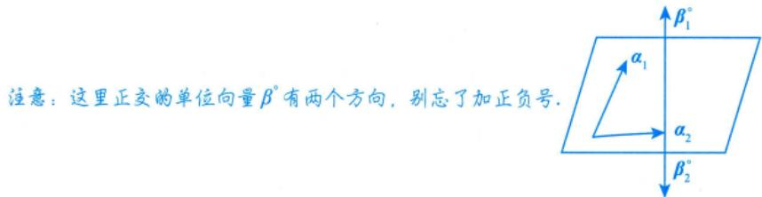

注 与 $\alpha_{1}, \alpha_{2}$ 都正交的单位向量有两个，即 $\beta^{\circ} = \pm \frac{\beta}{\|\beta\|}$ .

例4.3 设 $A = \begin{bmatrix} a_{11} & a_{12} & a_{13}\\ a_{21} & a_{22} & a_{23} \end{bmatrix}, B = \begin{bmatrix} b_{11} & b_{12}\\ b_{21} & b_{22}\\ b_{31} & b_{32} \end{bmatrix}$ ，若 $AB = \begin{bmatrix} 1 & 0\\ 2 & 1 \end{bmatrix}$ 则齐次线性方程组 $Ax = 0$ $By = 0$ 线性无关解的个数分别是（ ）：

(A)0，1

(B)1, 0

(C)2, 1

(D)2, 0

分析 应熟知的重要结论：

齐次线性方程组线性无关解的个数 $s =$ 未知量个数-真实约束的个数 $= n - r$ （系数矩阵的秩）.

解 应选(B).

齐次线性方程组线性无关解的个数取决于其系数矩阵的秩.

由 $AB = \begin{bmatrix} 1 & 0\\ 2 & 1 \end{bmatrix}$ ，知 $r(\mathbf{A}\mathbf{B}) = 2$ ，即有

$$
2 = r (\boldsymbol {A} \boldsymbol {B}) \leqslant \min  \{r (\boldsymbol {A}), r (\boldsymbol {B}) \} \leqslant \min  \{2, 3 \}.
$$

因此 $r(A) = r(B) = 2$ ，所以齐次线性方程组 $Ax = 0$ ， $\mathbf{B}\mathbf{y} = \mathbf{0}$ 线性无关解的个数分别为 $3 - r(A) = 1,2-$ $r(B) = 0$ ，故本题应选(B).

例4.4 设 $A = [\pmb{a}_1, \pmb{a}_2, \pmb{a}_3, \pmb{a}_4]$ 是4阶矩阵， $\pmb{A}^*$ 为 $\pmb{A}$ 的伴随矩阵，若 $[1,0,1,0]^{\mathrm{T}}$ 是方程组 $\pmb{Ax} = \pmb{0}$ 的一个基础解系，则 $\pmb{A}^* \pmb{x} = \pmb{0}$ 的基础解系可以为（ ）.

(A) $a_1, a_3$

(B) $a_1, a_2$

(C) $\alpha_{1},\alpha_{2},\alpha_{3}$

(D) $\alpha_{2},\alpha_{3},\alpha_{4}$

分析 由题设，应想到一个重要结论： $AA^{*} = A^{*}A = |A|E$

解 应选(D).

依题设，知 $r(A) = 4 - 1 = 3, |A| = 0$ ，且 $r(A^{*}) = 1$

又由 $A^{*}A = |A|E = 0$ ，知 $\pmb{A}$ 的列向量都为方程组 $A^{*}x = 0$ 的解，由 $r(A^{*}) = 1$ ，知 $A^{*}x = 0$ 的基础解

系由三个线性无关解构成. 又因 $[1, 0, 1, 0]^{\mathrm{T}}$ 是方程组 $Ax = 0$ 的一个解，有 $1\alpha_{1} + 0\alpha_{2} + 1\alpha_{3} + 0\alpha_{4} = 0$ ，知 $\alpha_{1}, \alpha_{3}$ 线性相关，从而知 $\alpha_{2}, \alpha_{3}, \alpha_{4}$ 或 $\alpha_{1}, \alpha_{2}, \alpha_{4}$ 是 $A^{*}x = 0$ 的一个基础解系，故选择(D).

例4.5 设 $\xi_1, \xi_2, \xi_3$ 是方程组 $Ax = 0$ 的基础解系，则下列向量组中也是方程组 $Ax = 0$ 的基础解系的是（ ）.

(A) $\xi_1 - \xi_2, \xi_2 - \xi_3, \xi_3 - \xi_1$   
(B) $\xi_{1} + \xi_{2},\xi_{2} - \xi_{3},\xi_{3} + \xi_{1}$   
(C) $\xi_{1} + \xi_{2} - \xi_{3},\xi_{1} + 2\xi_{2} + \xi_{3},2\xi_{1} + 3\xi_{2}$   
(D) $\xi_1 + \xi_2, \xi_2 + \xi_3, \xi_3 + \xi_1$

向量个数 $s = n - r(A)$ ；分析 向量组作为基础解系要满足的3个条件：★★★★线性无关；向量是方程组的解.

本题基础解系应由三个线性无关的解向量组成，题设的四个选项，均是三个向量，且由解的性质知，三个向量均是解向量，故关键是看哪个选项是线性无关向量组.

解 应选(D).

$$
\begin{array}{l} \left(\xi_ {1} - \xi_ {2}\right) + \left(\xi_ {2} - \xi_ {3}\right) + \left(\xi_ {3} - \xi_ {1}\right) = 0; \\ - \left(\xi_ {1} + \xi_ {2}\right) + \left(\xi_ {2} - \xi_ {3}\right) + \left(\xi_ {3} + \xi_ {1}\right) = 0; \\ \left(\xi_ {1} + \xi_ {2} - \xi_ {3}\right) + \left(\xi_ {1} + 2 \xi_ {2} + \xi_ {3}\right) - \left(2 \xi_ {1} + 3 \xi_ {2}\right) = 0. \\ \end{array}
$$

故(A)，(B)，(C)中向量组都是线性相关的，由排除法，应选(D).

对于(D)， $\left[\xi_{1} + \xi_{2},\xi_{2} + \xi_{3},\xi_{3} + \xi_{1}\right] = \left[\xi_{1},\xi_{2},\xi_{3}\right]\left[ \begin{array}{lll}1 & 0 & 1\\ 1 & 1 & 0\\ 0 & 1 & 1 \end{array} \right],$

其中 $\xi_1, \xi_2, \xi_3$ 线性无关，又

$$
\left| \begin{array}{c c c} 1 & 0 & 1 \\ 1 & 1 & 0 \\ 0 & 1 & 1 \end{array} \right| = 2 \neq 0,
$$

因此 $\xi_1 + \xi_2, \xi_2 + \xi_3, \xi_3 + \xi_1$ 是线性无关的，故应选(D).

# 三 非齐次线性方程组

方程组

非齐次线性方程组的自由项不全为0

$$
\left\{ \begin{array}{l} a _ {1 1} x _ {1} + a _ {1 2} x _ {2} + \dots + a _ {1 n} x _ {n} = b _ {1}, \\ a _ {2 1} x _ {1} + a _ {2 2} x _ {2} + \dots + a _ {2 n} x _ {n} = b _ {2}, \\ \dots \dots \\ a _ {m 1} x _ {1} + a _ {m 2} x _ {2} + \dots + a _ {m n} x _ {n} = b _ {m} \end{array} \right. \tag {Ⅱ}
$$

称为 $m$ 个方程， $n$ 个未知量的非齐次线性方程组.

其向量形式为 $x_{1}\pmb{a}_{1} + x_{2}\pmb{a}_{2} + \dots +x_{n}\pmb{a}_{n} = \pmb{b}$ ，其中

$$
\boldsymbol {a} _ {j} = \left[ \begin{array}{c} a _ {1 j} \\ a _ {2 j} \\ \vdots \\ a _ {m j} \end{array} \right], j = 1, 2, \dots , n; \boldsymbol {b} = \left[ \begin{array}{c} b _ {1} \\ b _ {2} \\ \vdots \\ b _ {m} \end{array} \right].
$$

其矩阵形式为 $Ax = b$ ，其中

系数矩阵

$$
\boldsymbol {A} = \left[ \begin{array}{c c c c} a _ {1 1} & a _ {1 2} & \dots & a _ {1 n} \\ a _ {2 1} & a _ {2 2} & \dots & a _ {2 n} \\ \vdots & \vdots & & \vdots \\ a _ {m 1} & a _ {m 2} & \dots & a _ {m n} \end{array} \right], \boldsymbol {x} = \left[ \begin{array}{c} x _ {1} \\ x _ {2} \\ \vdots \\ x _ {n} \end{array} \right].
$$

矩阵 $\begin{bmatrix} a_{11} & a_{12} & \dots & a_{1n} \\ a_{21} & a_{22} & \dots & a_{2n} \\ \vdots & \vdots & & \vdots \\ a_{m1} & a_{m2} & \dots & a_{mn} \end{bmatrix}$ 称为矩阵 $A$ 的增广矩阵，简记成 $[A:b]$ . 将系数矩阵和自由项拼起来即为增广矩阵

# 有解的条件

若 $r(A)\neq r([A,b])$ ( $b$ 不能由 $\alpha_{1},\alpha_{2},\dots ,\alpha_{n}$ 线性表示），则方程组（Ⅱ）无解；

若 $r(A) = r([A, b]) = n$ （即 $\alpha_{1}, \alpha_{2}, \dots, \alpha_{n}$ 线性无关， $\alpha_{1}, \alpha_{2}, \dots, \alpha_{n}, b$ 线性相关），则方程组（Ⅱ）有唯一解；

若 $r(A) = r([A, b]) = r < n$ ，则方程组（Ⅱ）有无穷多解.

# 解的性质

设 $\eta_1, \eta_2, \eta$ 是非齐次线性方程组 $Ax = b$ 的解， $\xi$ 是对应齐次线性方程组 $Ax = 0$ 的解，则：(1) $\eta_1 - \eta_2$ 是 $Ax = 0$ 的解；(2) $k\xi + \eta$ 是 $Ax = b$ 的解.

非齐次方程组的通解形式

# 求解方法与步骤

>又称非齐次方程组的导出组

① 写出 $Ax = b$ 的导出方程组 $\boldsymbol{A}\boldsymbol{x} = \mathbf{0}$ ，并求 $Ax = 0$ 的通解 $k_{1}\xi_{1} + k_{2}\xi_{2} + \dots + k_{n - r}\xi_{n - r}$ 。

齐次通解 ① $A\to$ 行阶梯形矩阵 非齐次通解等于齐次通解加非齐次的一个特解 ②确定矩阵的秩、自由变量和非自由变量 ③求出基础解系 $2$ 求出 $Ax = b$ 的一个特解 $\pmb{\eta}$ ： $\star \star \star 3Ax = b$ 的通解为 $k_{1}\xi_{1} + k_{2}\xi_{2} + \dots +k_{n - r}\xi_{n - r} + \eta ,$ 其中 $k_{1},k_{2},\dots ,k_{n - r}$ 为任意常数.

求解的主要工作

# 示例

① $[A:b] = \begin{bmatrix} 1 & 2 & 0 & 3 \\ 0 & -1 & 1 & -2 \\ 0 & 0 & 0 & 0 \\ 0 & 0 & 0 & 0 \end{bmatrix}$ , $Ax = 0$ 的通解为 $k\xi_{1} = k[-2,1,1]^{\mathrm{T}}$ , 其中 $k$ 为任意常数.  
②求特解 $\eta  = {\left\lbrack  3,0, - 2\right\rbrack  }^{\mathrm{T}}$ . 特解中令自由变量金为0  
③非齐次线性方程组通解 $x = k\xi_{1} + \eta$ ，其中 $k$ 为任意常数.

$$
\left[ \begin{array}{c} {x _ {1}} \\ {x _ {2}} \\ {x _ {3}} \end{array} \right] = k \left[ \begin{array}{c} {- 2} \\ {1} \\ {1} \end{array} \right] + \left[ \begin{array}{c} {3} \\ {0} \\ {- 2} \end{array} \right] = \left[ \begin{array}{c} {- 2 k + 3} \\ {k} \\ {k - 2} \end{array} \right] (k \text {为 任 意 常 数}) .
$$

故 $\pmb {b} = (-2k + 3)\pmb{\alpha}_{1} + k\pmb{\alpha}_{2} + (k - 2)\pmb{\alpha}_{3}$

例4.6 设非齐次线性方程组为 $A_{m\times n}x = b$ ，则（ ）.

(A)当 $r(A) = m$ 时，方程组有解  
(B)当 $r(A) = n$ 时，方程组有唯一解  
(C)当 $m = n$ 时，方程组有唯一解  
(D)当 $r(A) <   n$ 时，方程组有无穷多解

$\rho$ 分析 考查非齐次线性方程组有解的条件： $\left\{ \begin{array}{l}r(A) = r([A,b]) = n,\\ r(A) = r([A,b]) <   n,\\ r(A)\neq r([A,b]), \end{array} \right.$ 无穷多解；无解.

$Ax = b$ 有解（无解） $\Leftrightarrow r(A) = r([A,b])(r(A)\neq r([A,b]))$

题设条件未提及 $r([A, b])$ ，这正是要求考生考虑的问题。

# 解 应选(A).

因 $r(A) = m$ 时， $\pmb{A}$ 的行向量组线性无关，增广矩阵在 $\pmb{A}$ 的基础上增加一列，即行向量增加一个分量，仍线性无关，故有 $r(A) = m = r([A,b])$ ，方程组有解，应选(A).

选项(B)， $r(A) = n$ 时也可能无解；选项(C)，也可能无解或有无穷多解；选项(D)，也可能无解，均排除.

$\star \star \star$ 例4.7 设 $A$ 是 $m\times n$ 实矩阵，则对任意 $m$ 维列向量 $\pmb{b}$ ，线性方程组 $A^{\mathrm{T}}Ax = A^{\mathrm{T}}b$ （ ）

(A) 无解

(B)有解

(C)必有唯一解

(D) 必有无穷多解

# 解 应选(B).

对任意 $m$ 维列向量 $\pmb{b}$ ，由于 $[A^{\mathrm{T}}A:A^{\mathrm{T}}b] = A^{\mathrm{T}}[A:b]$ ，故

$$
r \left(\left[ \boldsymbol {A} ^ {\mathrm {T}} \boldsymbol {A}, \boldsymbol {A} ^ {\mathrm {T}} \boldsymbol {b} \right]\right) \leqslant r \left(\boldsymbol {A} ^ {\mathrm {T}}\right) = r (\boldsymbol {A}),
$$

又 $r(\mathbf{A}) = r(\mathbf{A}^{\mathrm{T}}\mathbf{A})\leqslant r([A^{\mathrm{T}}A,A^{\mathrm{T}}b])$ ，故 $r(A^{\mathrm{T}}A) = r([A^{\mathrm{T}}A,A^{\mathrm{T}}b])$ ，因此 $A^{\mathrm{T}}Ax = A^{\mathrm{T}}b$ 有解.由于不知 $\pmb{A}^{\mathrm{T}}\pmb{A}$ 是否满秩，故(C)，(D)不正确，选(B).

例4.8 设 $A = \begin{bmatrix} \lambda & 1 & 1\\ 0 & \lambda -1 & 0\\ 1 & 1 & \lambda \end{bmatrix},\pmb {b} = \begin{bmatrix} a\\ 1\\ 1 \end{bmatrix} .$ 已知线性方程组 $Ax = b$ 存在两个不同的解

(1)求 $\lambda ,a$ 的值；

$$
\text {说 明} A x = b \text {有 无 穷 多 解}
$$

$$
\Rightarrow r (A) = r ([ A, b ]) <   3
$$

(2) 求方程组 $Ax = b$ 的通解.

解 (1)因为非齐次线性方程组 $Ax = b$ 有两个不同的解，所以系数行列式

$$
\left| \boldsymbol {A} \right| = \left| \begin{array}{c c c} \lambda & 1 & 1 \\ 0 & \lambda - 1 & 0 \\ 1 & 1 & \lambda \end{array} \right| = (\lambda - 1) ^ {2} (\lambda + 1) = 0,
$$

解得 $\lambda = -1$ 或1.

当 $\lambda = 1$ 时，对方程组 $Ax = b$ 的增广矩阵作初等行变换，有

$$
[ A: b ] = \left[\begin{array}{l l l l}1&1&1&a\\\hline 0&0&0&1\\1&1&1&1\end{array}\right] \stackrel {\text {互 换}} {\rightarrow} \left[\begin{array}{l l l l}1&1&1&1\\0&0&0&1\\1&1&1&a\end{array}\right] \stackrel {(- 1) \text {倍 加 至}} {\rightarrow} \left[\begin{array}{l l l l}1&1&1&1\\0&0&0&1\\0&0&0&a - 1\end{array}\right],
$$

则其增广矩阵的秩为2，系数矩阵 $\mathbf{A}$ 的秩为1，方程组 $Ax = b$ 无解，故 $\lambda = 1$ 应舍去.

当 $\lambda = -1$ 时，对方程组 $Ax = b$ 的增广矩阵作初等行变换，有

$$
\begin{array}{l} [ A; b ] = \left[ \begin{array}{c c c c} - 1 & 1 & 1 & a \\ 0 & - 2 & 0 & 1 \\ 1 & 1 & - 1 & 1 \end{array} \right] \xrightarrow {\text {互 换}} \left[ \begin{array}{c c c c} 1 & 1 & - 1 & 1 \\ 0 & - 2 & 0 & 1 \\ - 1 & 1 & 1 & a \end{array} \right] \\ \rightarrow \left[\begin{array}{c c c c}1&1&- 1&1\\0&- 2&0&1\\0&0&0&a + 2\end{array}\right] \leftarrow \times (- 1) \rightarrow \left[\begin{array}{c c c c}1&1&- 1&1\\0&2&0&- 1\\0&0&0&a + 2\end{array}\right] = B. \\ \end{array}
$$

因为方程组 $Ax = b$ 有解，所以 $a + 2 = 0$ ，即 $a = -2$

综上， $\lambda = -1,a = -2$ ：

(2)当 $\lambda = -1$ ， $a = -2$ 时，继续对(1)中的矩阵 $\pmb{B}$ 作初等行变换，得

$$
\boldsymbol {B} \rightarrow \left[\begin{array}{c c c c}1&0&- 1&\frac {3}{2}\\0&1&0&- \frac {1}{2}\\0&0&0&0\end{array}\right],
$$

于是方程组 $Ax = b$ 的通解为

$$
\boldsymbol {x} = \frac {1}{2} \left[ \begin{array}{l} 3 \\ - 1 \\ 0 \end{array} \right] + k \left[ \begin{array}{l} 1 \\ 0 \\ 1 \end{array} \right],
$$

其中 $k$ 为任意常数.

例4.9 设 $r(A_{4\times 4}) = 2$ ， $\eta_1,\eta_2,\eta_3$ 是 $Ax = b$ 的3个解向量，其中

$$
\left\{ \begin{array}{l l} {\pmb {\eta} _ {1} - \pmb {\eta} _ {2} = [ - 1,   0,   3,   - 4 ] ^ {\mathrm {T}}, \longrightarrow \text {为 齐 次 方 程 组} A x = 0 \text {的 解}} \\ {\pmb {\eta} _ {1} + \pmb {\eta} _ {2} = [ 3,   2,   1,   - 2 ] ^ {\mathrm {T}},} \\ {\pmb {\eta} _ {3} + 2 \pmb {\eta} _ {2} = [ 5,   1,   0,   3 ] ^ {\mathrm {T}},} \end{array} \right.
$$

则 $Ax = b$ 的通解是

解 应填 $k_{1}[-1,0,3,-4]^{\mathrm{T}}+k_{2}[-1,4,3,-12]^{\mathrm{T}}+\left[\frac{3}{2},1,\frac{1}{2},-1\right]^{\mathrm{T}}$ ，其中 $k_{1},k_{2}$ 是任意常数.

由题设 $Ax = b, r(A) = 2, n = 4$ ，知 $Ax = b$ 的通解结构为

$$
k _ {1} \xi_ {1} + k _ {2} \xi_ {2} + \eta ,
$$

其中 $\xi_1, \xi_2$ 是 $Ax = 0$ 的基础解系， $\eta$ 是 $Ax = b$ 的一个特解。

因 $A(\eta_1 - \eta_2) = b - b = 0, A[3(\eta_1 + \eta_2) - 2(\eta_3 + 2\eta_2)] = 6b - 6b = 0$ ，故 $\eta_1 - \eta_2, 3(\eta_1 + \eta_2) - 2(\eta_3 + 2\eta_2)$ 为 $Ax = 0$ 的解向量，因此可取

$$
\boldsymbol {\xi} _ {1} = \boldsymbol {\eta} _ {1} - \boldsymbol {\eta} _ {2} = [ - 1, 0, 3, - 4 ] ^ {\mathrm {T}},
$$

$$
\xi_ {2} = 3 \left(\eta_ {1} + \eta_ {2}\right) - 2 \left(\eta_ {3} + 2 \eta_ {2}\right) = [ 9, 6, 3, - 6 ] ^ {\mathrm {T}} - [ 1 0, 2, 0, 6 ] ^ {\mathrm {T}} = [ - 1, 4, 3, - 1 2 ] ^ {\mathrm {T}},
$$

显然 $\xi_1, \xi_2$ 线性无关.

又因 $A\left[\frac{1}{2} (\pmb{\eta}_1 + \pmb{\eta}_2)\right] = \frac{1}{2} (\pmb{b} + \pmb{b}) = \pmb{b}$ ，故 $\frac{1}{2} (\pmb{\eta}_1 + \pmb{\eta}_2)$ 为 $Ax = b$ 的一个特解，因此可取

$$
\boldsymbol {\eta} = \frac {1}{2} \left(\boldsymbol {\eta} _ {1} + \boldsymbol {\eta} _ {2}\right) = \left[ \frac {3}{2}, 1, \frac {1}{2}, - 1 \right] ^ {\mathrm {T}},
$$

故 $Ax = b$ 的通解为

$$
k _ {1} \xi_ {1} + k _ {2} \xi_ {2} + \eta = k _ {1} [ - 1, 0, 3, - 4 ] ^ {\mathrm {T}} + k _ {2} [ - 1, 4, 3, - 1 2 ] ^ {\mathrm {T}} + \left[ \frac {3}{2}, 1, \frac {1}{2}, - 1 \right] ^ {\mathrm {T}},
$$

其中 $k_{1}, k_{2}$ 是任意常数.

注 还可以尝试使用如下方法解答：

因 $[\pmb{\eta}_1 - \pmb{\eta}_2, \pmb{\eta}_1 + \pmb{\eta}_2, \pmb{\eta}_3 + 2\pmb{\eta}_2] = [\pmb{\eta}_1, \pmb{\eta}_2, \pmb{\eta}_3]\left[ \begin{array}{ccc}1 & 1 & 0\\ -1 & 1 & 2\\ 0 & 0 & 1 \end{array} \right],$ 故

$$
\left[ \boldsymbol {\eta} _ {1}, \boldsymbol {\eta} _ {2}, \boldsymbol {\eta} _ {3} \right] = \left[ \boldsymbol {\eta} _ {1} - \boldsymbol {\eta} _ {2}, \boldsymbol {\eta} _ {1} + \boldsymbol {\eta} _ {2}, \boldsymbol {\eta} _ {3} + 2 \boldsymbol {\eta} _ {2} \right] \left[ \begin{array}{r r r} 1 & 1 & 0 \\ - 1 & 1 & 2 \\ 0 & 0 & 1 \end{array} \right] ^ {- 1},
$$

由此可以直接求出 $\pmb{\eta}_1, \pmb{\eta}_2, \pmb{\eta}_3$ ，从而得到通解为 $k_1(\pmb{\eta}_1 - \pmb{\eta}_2) + k_2(\pmb{\eta}_2 - \pmb{\eta}_3) + \pmb{\eta}_3$ ，其中 $k_1, k_2$ 是任意常数。

例4.10 已知 $A = [\alpha_{1}, \alpha_{2}, \alpha_{3}, \alpha_{4}]$ , 其中 $\alpha_{1}, \alpha_{2}, \alpha_{3}, \alpha_{4}$ 是4维列向量, 且 $\alpha_{1} = 2\alpha_{2} + \alpha_{3}, r(A) = 3$ . 若 $\beta = \alpha_{1} + 2\alpha_{2} + 3\alpha_{3} + 4\alpha_{4}$ , 则线性方程组 $Ax = \beta$ 的通解是

分析 属于抽象型方程组求解，考查向量间的表示关系和非齐次方程组解的结构.

解 应填 $k[1, -2, -1, 0]^{\mathrm{T}} + [1, 2, 3, 4]^{\mathrm{T}}$ ，其中 $k$ 是任意常数.

因 $a_1 - 2a_2 - a_3 = a_1 - 2a_2 - a_3 + 0a_4 = 0$ ，故 $\xi = [1, -2, -1, 0]^{\mathrm{T}}$ 是对应齐次线性方程组的非零解，又 $\eta = [1, 2, 3, 4]^{\mathrm{T}}$ 是 $Ax = \beta$ 的特解， $r(A) = 3$ ，故线性方程组 $Ax = \beta$ 的通解为 $k\xi + \eta$ ，其中 $k$ 是任意常数.

注 线性方程组系数矩阵列向量和解的关系.

(1)齐次线性方程组

$$
\boldsymbol {a} _ {1} x _ {1} + \boldsymbol {a} _ {2} x _ {2} + \dots + \boldsymbol {a} _ {n} x _ {n} = \mathbf {0}
$$

的解是使 $\alpha_{1},\alpha_{2},\dots ,\alpha_{n}$ 的线性组合为零向量时的线性组合的系数.

(2)非齐次线性方程组

$$
\boldsymbol {\alpha} _ {1} x _ {1} + \boldsymbol {\alpha} _ {2} x _ {2} + \dots + \boldsymbol {\alpha} _ {n} x _ {n} = \boldsymbol {\beta}
$$

的解是 $\pmb{\beta}$ 由 $\alpha_{1},\alpha_{2},\dots ,\alpha_{n}$ 线性表示时的表示系数.

★★★★★简而言之，“方程组的解就是描述列向量组中各向量之间数量关系的系数。”这个观点对于解题很有用处.

例4.11 已知线性方程组

$$
\boldsymbol {\alpha} _ {1} x _ {1} + \boldsymbol {\alpha} _ {2} x _ {2} + \boldsymbol {\alpha} _ {3} x _ {3} + \boldsymbol {\alpha} _ {4} x _ {4} = \boldsymbol {\alpha} _ {5}
$$

有通解 $[2,0,0,1]^{\mathrm{T}} + k[1, - 1,2,0]^{\mathrm{T}}$ ，则下列说法正确的是（

$$
1 = s = 4 - r \left(\left[ \alpha_ {1}, \alpha_ {2}, \alpha_ {3}, \alpha_ {4} \right]\right) \Rightarrow r \left(\left[ \alpha_ {1}, \alpha_ {2}, \alpha_ {3}, \alpha_ {4} \right]\right) = 3
$$

(A) $\alpha_{5}$ 可由 $\alpha_{1},\alpha_{2},\alpha_{3}$ 线性表示

(B) $\alpha_{4}$ 不能由 $\alpha_{1},\alpha_{2},\alpha_{3}$ 线性表示

(C) $\alpha_{5}$ 不能由 $\alpha_{2},\alpha_{3},\alpha_{4}$ 线性表示

(D) $\alpha_{4}$ 不能由 $\alpha_{1},\alpha_{2},\alpha_{5}$ 线性表示

解 应选(B).

由题设条件知

$$
\boldsymbol {a} _ {5} = (k + 2) \boldsymbol {a} _ {1} - k \boldsymbol {a} _ {2} + 2 k \boldsymbol {a} _ {3} + \boldsymbol {a} _ {4}.
$$

$\pmb{\alpha}_{5}$ 的表示式中必定有 $\pmb{\alpha}_{4}$ ，故 $\pmb{\alpha}_{5}$ 不可由 $\pmb{\alpha}_{1}, \pmb{\alpha}_{2}, \pmb{\alpha}_{3}$ 线性表示，排除(A)；

$\pmb{\alpha}_{5}$ 可由 $\alpha_{2},\alpha_{3},\alpha_{4}$ 线性表示，取 $k = -2$ ，即有 $\alpha_{5} = 2\alpha_{2} - 4\alpha_{3} + \alpha_{4}$ ，排除(C)；

$\pmb{a}_{4}$ 可由 $\alpha_{1},\alpha_{2},\alpha_{5}$ 线性表示，取 $k = 0$ ，即有 $\pmb {a}_4 = \pmb {a}_5 - 2\pmb {a}_1 + 0\pmb {a}_2$ ，排除(D).

由排除法，应选(B).

对于(B)，由题设条件知 $r([a_1,a_2,a_3,a_4]) = 3$ .若 $\pmb{\alpha}_{4}$ 可由 $\alpha_{1},\alpha_{2},\alpha_{3}$ 线性表示，因 $a_1 - a_2 + 2a_3 = 0$

则 $r([\pmb{\alpha}_1, \pmb{\alpha}_2, \pmb{\alpha}_3, \pmb{\alpha}_4]) \leqslant 2$ ，这和 $r([\pmb{\alpha}_1, \pmb{\alpha}_2, \pmb{\alpha}_3, \pmb{\alpha}_4]) = 3$ 矛盾，故(B)成立.

# 四 两个方程组的公共解

将 $Ax = 0$ ， $Bx = 0$ 联立求解即可.

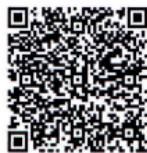

齐次线性方程组 $A_{m\times n}x = 0$ 和 $B_{m\times n}x = 0$ 的公共解是满足方程组 $\left[ \begin{array}{l}A\\ B \end{array} \right]x = 0$ 的解，即联立求解.同理，可求 $Ax = \alpha$ 与 $Bx = \beta$ 的公共解.当给出 $A,B,\alpha ,\beta$ 的具体表达式时，对考生的计算能力要求较高，理论上没有什么难点. 即求方程组 $\left\{ \begin{array}{ll}Ax = a,\\ Bx = \beta \end{array} \right.$ （20 $\left[ \begin{array}{l}A\\ B \end{array} \right]x = \left[ \begin{array}{l}\alpha \\ \beta \end{array} \right]$ 的解

★★★方程组求解的思路比较简单，但对计算能力要求高，平时要勤做练习，加强计算能力.

注 还有两种考查 $Ax = 0$ 与 $Bx = 0$ 公共解的角度：

① 若给出 $A_{m \times n}x = 0$ 的基础解系 $\xi_1, \xi_2, \dots, \xi_s$ 和 $B$ 的具体表达式，则先写出 $Ax = 0$ 的通解 $k_1\xi_1 + k_2\xi_2 + \dots + k_s\xi_s$ ，代入 $B_{m \times n}x = 0$ ，求出 $k_i (i = 1, 2, \dots, s)$ 之间的关系，代回 $A_{m \times n}x = 0$ 的通解，即可得 $Ax = 0$ 与 $Bx = 0$ 的公共解。  
② 若给出 $A_{m \times n} x = 0$ 的基础解系 $\xi_1, \xi_2, \dots, \xi_s$ 与 $B_{m \times n} x = 0$ 的基础解系 $\eta_1, \eta_2, \dots, \eta_t$ ，则 $Ax = 0$ 与 $Bx = 0$ 的公共解 $\gamma = k_1 \xi_1 + k_2 \xi_2 + \dots + k_s \xi_s = l_1 \eta_1 + l_2 \eta_2 + \dots + l_t \eta_t$ ，即

$$
k _ {1} \xi_ {1} + k _ {2} \xi_ {2} + \dots + k _ {s} \xi_ {s} - l _ {1} \eta_ {1} - l _ {2} \eta_ {2} - \dots - l _ {t} \eta_ {t} = 0,
$$

解此式，求出 $k_{i}$ 或 $l_{j}, i = 1,2,\dots ,s;j = 1,2,\dots ,t$ ，即可求出 $\gamma$ ：

# 例4.12 已知线性方程组

(I) $\left\{ \begin{array}{l}x_{1} + x_{2} = 0,\\ x_{2} - x_{4} = 0, \end{array} \right.$ (II) $\left\{ \begin{array}{l}x_{1} - x_{2} + x_{3} = 0,\\ x_{2} - x_{3} + x_{4} = 0. \end{array} \right.$

(1)分别求方程组（I），（Ⅱ）的基础解系；  
(2)求方程组（I），（Ⅱ）的公共解.

解 (1) 由方程组 (I) 得其系数矩阵为

$$
\boldsymbol {A} = \left[ \begin{array}{l l l l} 1 & 1 & 0 & 0 \\ 0 & 1 & 0 & - 1 \end{array} \right],
$$

解得其基础解系为

$$
\boldsymbol {\xi} _ {1} = [ 0, 0, 1, 0 ] ^ {\mathrm {T}}, \boldsymbol {\xi} _ {2} = [ - 1, 1, 0, 1 ] ^ {\mathrm {T}}.
$$

同理，方程组（Ⅱ）的系数矩阵为

$$
\boldsymbol {B} = \left[ \begin{array}{c c c c} 1 & - 1 & 1 & 0 \\ 0 & 1 & - 1 & 1 \end{array} \right],
$$

其基础解系为 $\pmb{\eta}_{1} = [0,1,1,0]^{\mathrm{T}},\pmb{\eta}_{2} = [-1, - 1,0,1]^{\mathrm{T}}.$

(2) 方法一 直接解(I)，(II)的联立方程组，即求解 $\left[ \begin{array}{l}A\\ B \end{array} \right]x = 0$ .因

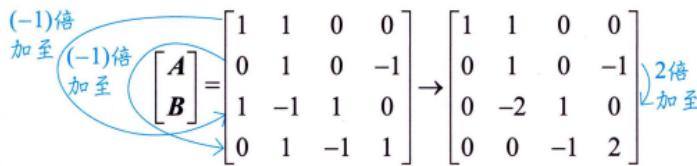

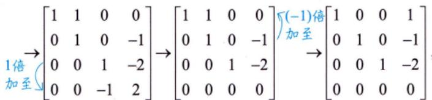

故得方程组（I），（Ⅱ）的公共解为 $k[-1,1,2,1]^{\mathrm{T}}$ ，其中 $k$ 是任意常数.

方法二 在方程组(I)的通解中找出满足方程组(II)的解（或在(II)的通解中找出满足(I)的解），即是(I)，(II)的公共解.

方程组（I）的通解为 $k_{1}\xi_{1} + k_{2}\xi_{2} = [-k_{2},k_{2},k_{1},k_{2}]^{\mathrm{T}}$ ，代入方程组（Ⅱ），得

$$
\left\{ \begin{array}{l} - k _ {2} - k _ {2} + k _ {1} = 0, \\ k _ {2} - k _ {1} + k _ {2} = 0. \end{array} \right.
$$

解得 $k_{1} = 2k_{2}$ ，代入方程组（I）的通解，得方程组（I），（Ⅱ）的公共解是

$$
\left[ - k _ {2}, k _ {2}, 2 k _ {2}, k _ {2} \right] ^ {\mathrm {T}} = k _ {2} \left[ - 1, 1, 2, 1 \right] ^ {\mathrm {T}},
$$

其中 $k_{2}$ 是任意常数.

方法三 从方程组（I），（Ⅱ）的通解中找出公共解.

（I）的通解为 $k_{1}\xi_{1} + k_{2}\xi_{2}$ ，（Ⅱ）的通解为 $l_{1}\eta_{1} + l_{2}\eta_{2}$ ，则公共解应满足 $k_{1}\xi_{1} + k_{2}\xi_{2} = l_{1}\eta_{1} + l_{2}\eta_{2}$ ，即

$$
k _ {1} \left[ \begin{array}{l} 0 \\ 0 \\ 1 \\ 0 \end{array} \right] + k _ {2} \left[ \begin{array}{l} - 1 \\ 1 \\ 0 \\ 1 \end{array} \right] = l _ {1} \left[ \begin{array}{l} 0 \\ 1 \\ 1 \\ 0 \end{array} \right] + l _ {2} \left[ \begin{array}{l} - 1 \\ - 1 \\ 0 \\ 1 \end{array} \right].
$$

由上式可得 $k_{2} = l_{2}, k_{2} = l_{1} - l_{2}, k_{1} = l_{1}$ 。故

$$
k _ {2} = l _ {1} - l _ {2} = k _ {1} - k _ {2}  ,   \text {得}   k _ {1} = 2 k _ {2}  ,
$$

或 $k_{2} = l_{2} = l_{1} - l_{2}$ ，得 $l_{1} = 2l_{2}$ ：

因此，公共解为

$$
2 k _ {2} \xi_ {1} + k _ {2} \xi_ {2} = k _ {2} (2 \xi_ {1} + \xi_ {2}) = k _ {2} [ - 1, 1, 2, 1 ] ^ {\mathrm {T}},
$$

其中 $k_{2}$ 是任意常数；

或

$$
2 l _ {2} \boldsymbol {\eta} _ {1} + l _ {2} \boldsymbol {\eta} _ {2} = l _ {2} (2 \boldsymbol {\eta} _ {1} + \boldsymbol {\eta} _ {2}) = l _ {2} [ - 1, 1, 2, 1 ] ^ {\mathrm {T}},
$$

其中 $l_{2}$ 是任意常数.

# 五

# 同解方程组

重要！！！经常用来证明秩相等的问题

证 $r(A)\leqslant r(B)$ ，常用向量组来证明

证 $r(A) = r(B)\Rightarrow$ 证 $a\leqslant \dots \leqslant r(A)\leqslant r(B)\leqslant \dots \leqslant a$ 或 $Ax = 0$ 与 $Bx = 0$ 同解

若两个方程组 $A_{m\times n}\mathbf{x} = \mathbf{0}$ 和 $B_{s\times n}\mathbf{x} = \mathbf{0}$ 有完全相同的解，则称它们为同解方程组.

于是， $Ax = 0,Bx = 0$ 是同解方程组

$\rightarrow$ （仅数学一）解空间完全一样

$\Leftrightarrow Ax = 0$ 的解满足 $Bx = 0$ ，且 $Bx = 0$ 的解满足 $Ax = 0$ （互相把解代入求出结果即可）

$\Leftrightarrow r(A) = r(B)$ ，且 $Ax = 0$ 的解满足 $Bx = 0$ （或 $Bx = 0$ 的解满足 $Ax = 0$ ）

$\Leftrightarrow r(A) = r(B) = r\left(\begin{bmatrix} A \\ B \end{bmatrix}\right)$ （三秩相同）. ★★★★主要用该结论来证明方程组是否同解此方法较方便

注 (1) 以上三条是理论分析, 着眼于客观试题.

(2) 对于齐次线性方程组 $Ax = 0$ 和 $Bx = 0$ ，因其必有零公共解，故要求公共解，主要着眼于求非零公共解，联立方程组求解是基本办法.

# 例4.13 设线性方程组

(I) $\left\{ \begin{array}{l}x_{1} + 3x_{3} + 5x_{4} = 0,\\ x_{1} - x_{2} - 2x_{3} + 2x_{4} = 0,\\ 2x_{1} - x_{2} + x_{3} + 3x_{4} = 0. \end{array} \right.$

在(I)的基础上，添加一个方程 $4x_{1} + ax_{2} + bx_{3} + 13x_{4} = 0$ ，得

（Ⅱ） $\begin{cases} x_1 + 3x_3 + 5x_4 = 0,\\ x_1 - x_2 - 2x_3 + 2x_4 = 0,\\ 2x_1 - x_2 + x_3 + 3x_4 = 0,\\ 4x_1 + ax_2 + bx_3 + 13x_4 = 0. \end{cases}$

(1)求方程组（I）的通解；  
(2) $a, b$ 满足什么条件时，方程组（I），（Ⅱ）是同解方程组？

解 (1)对方程组（I）的系数矩阵作初等行变换，即

(-2)倍加至

(-1)倍 $\left[ \begin{array}{rrrr}1 & 0 & 3 & 5\\ 1 & -1 & -2 & 2\\ 2 & -1 & 1 & 3 \end{array} \right]\rightarrow \left[ \begin{array}{rrrr}1 & 0 & 3 & 5\\ 0 & -1 & -5 & -3\\ 0 & -1 & -5 & -7 \end{array} \right]\xrightarrow[-\text{加至}]{(-1)\text{倍}}\left[ \begin{array}{rrrr}1 & 0 & 3 & 5\\ 0 & -1 & -5 & -3\\ 0 & 0 & 0 & -4 \end{array} \right].$

将自由未知量 $x_{3}$ 赋值为1，代回方程组，得基础解系 $\xi = [-3, -5, 1, 0]^{\mathrm{T}}$ ，故方程组（I）的通解为 $k[-3, -5, 1, 0]^{\mathrm{T}}$ ， $k$ 是任意常数.

(2)由方程组(I)，（Ⅱ）同解，知(I)的解应满足(Ⅱ).因(I)，（Ⅱ）前3个方程相同，故只需满足第4个方程即可，将(I)的通解代入(Ⅱ)的第4个方程，得

$$
4 (- 3 k) + a (- 5 k) + b k + 1 3 (0 k) = 0,
$$

即 $(-12 - 5a + b)k = 0, k$ 是任意常数. 故 $a, b$ 满足

$$
b - 5 a = 1 2.
$$

当 $b - 5a = 12$ 时，（I）的解满足（Ⅱ），又（Ⅱ）的前3个方程即是（I)，所以（Ⅱ）的解也满足（I），方程组（I)，（Ⅱ）是同解方程组.

例4.14 设方程组 $Ax = b$ 有解，证明： $A^{\mathrm{T}}x = 0$ 和 $\begin{bmatrix} A^{\mathrm{T}}\\ b^{\mathrm{T}} \end{bmatrix} x = 0$ 是同解方程组.

证 ① 显然 $\left[ \begin{array}{l}A^{\mathrm{T}}\\ b^{\mathrm{T}} \end{array} \right]x = 0$ 的解必满足 $A^{\mathrm{T}}x = 0$ ：

② 因 $A\mathbf{x} = \mathbf{b}$ 有解，故 $r(\mathbf{A}) = r([A, b])$ ，得 $r\left(\begin{bmatrix} A^{\mathrm{T}} \\ b^{\mathrm{T}} \end{bmatrix}\right) = r(A^{\mathrm{T}})$ . 故 $A^{\mathrm{T}}\mathbf{x} = \mathbf{0}$ 和 $\begin{bmatrix} A^{\mathrm{T}} \\ b^{\mathrm{T}} \end{bmatrix}\mathbf{x} = \mathbf{0}$ 的基础解系中所含解向量个数相等.

由①，②知，方程组 $A^{\mathrm{T}}x = 0$ 和 $\begin{bmatrix} A^{\mathrm{T}}\\ b^{\mathrm{T}} \end{bmatrix} x = 0$ 是同解方程组.

注 由 $r(A) = r([A, b])$ ，得 $r(\mathbf{A}^{\mathrm{T}}) = r\left(\begin{bmatrix}\mathbf{A}^{\mathrm{T}}\\ \mathbf{b}^{\mathrm{T}}\end{bmatrix}\right)$ ，此时 $\pmb{b}$ 是一个列向量，但即便是 $r(A) = r([A, B])$ 注意： $[A, B]^{\mathrm{T}} = \begin{bmatrix} A^{\mathrm{T}} \\ B^{\mathrm{T}} \end{bmatrix}$ 而不是 $[A^{\mathrm{T}}, B^{\mathrm{T}}]$ 易错点其中 $A_{m \times n}, B_{m \times s}$ ，也有 $r(\mathbf{A}^{\mathrm{T}}) = r\left(\begin{bmatrix} \mathbf{A}^{\mathrm{T}} \\ \mathbf{B}^{\mathrm{T}} \end{bmatrix}\right)$ . 由 $r(A) = r(A, B)$ ，知 $\pmb{B}$ 的每一列均可由 $\pmb{A}$ 的列向量线性表示，于是 $\begin{bmatrix} \mathbf{A}^{\mathrm{T}} \\ \mathbf{B}^{\mathrm{T}} \end{bmatrix}$ 表明 $\pmb{B}^{\mathrm{T}}$ 的每一行均可由 $\pmb{A}^{\mathrm{T}}$ 的行向量线性表示，故有 $r(\mathbf{A}^{\mathrm{T}}) = r\left(\begin{bmatrix} \mathbf{A}^{\mathrm{T}} \\ \mathbf{B}^{\mathrm{T}} \end{bmatrix}\right)$ ，由此， $r([A, B]) = r\left(\begin{bmatrix} A^{\mathrm{T}} \\ B^{\mathrm{T}} \end{bmatrix}\right)$ ，但要注意， $r([A, B])$ 与 $r([A^{\mathrm{T}}, B^{\mathrm{T}}])$ 却不一定相等. 如 $A = \begin{bmatrix} 1 & 0 \\ 0 & 0 \end{bmatrix}$ ， $B = \begin{bmatrix} 0 & 1 \\ 0 & 0 \end{bmatrix}$ ，则 $r([A, B]) = r\left(\begin{bmatrix} 1 & 0 & 0 & 1 \\ 0 & 0 & 0 & 0 \end{bmatrix}\right) = 1$ ，而 $r([A^{\mathrm{T}}, B^{\mathrm{T}}]) = r\left(\begin{bmatrix} 1 & 0 & 0 & 0 \\ 0 & 0 & 1 & 0 \end{bmatrix}\right) = 2$ 。究其原因， $[A^{\mathrm{T}}, B^{\mathrm{T}}]$ 并不是 $[A, B]^{\mathrm{T}}$ ，这一点可能会迷惑考生。

例4.15 设 $A$ 是 $n$ 阶实矩阵， $A^{\mathrm{T}}$ 是 $A$ 的转置矩阵。证明：方程组（I） $Ax = 0$ 和（Ⅱ） $A^{\mathrm{T}}Ax = 0$ 是同解方程组。

证 ① 若存在 $x$ ，使 $Ax = 0$ ，则在两端左边乘 $A^{\mathrm{T}}$ ，得 $A^{\mathrm{T}}Ax = 0$ ，故方程组（I）的解必是方程组

（Ⅱ）的解.

② 若存在 $x$ ，使 $A^{\mathrm{T}}Ax = 0$ ，则在两端左边乘 $x^{\mathrm{T}}$ ，得 $x^{\mathrm{T}}A^{\mathrm{T}}Ax = (Ax)^{\mathrm{T}}Ax = 0$ 。

因 $\pmb{A}$ 是实矩阵，故 $Ax$ 是实向量.设 $Ax = [a_{1}, a_{2}, \dots, a_{n}]^{\mathrm{T}}$ ，则 $(Ax)^{\mathrm{T}}Ax = \sum_{i=1}^{n}a_{i}^{2} = 0$ ，得 $a_{i} = 0 (i = 1, 2, \dots, n)$ ，故 $Ax = 0$ ，从而知方程组（Ⅱ）的解必是方程组（I）的解.

由 $①$ ， $②$ 知，方程组（I)，（Ⅱ）是同解方程组.

注 (1) 若 $A$ 是 $m \times  n$ 实矩阵,则 ${Ax} = 0$ 和 ${A}^{\mathrm{T}}{Ax} = 0$ 也是同解方程组.

(2)方程组 $Ax = 0$ 和 $A^{\mathrm{T}}Ax = 0$ 是同解方程组，从而有 $r(A) = r(A^{\mathrm{T}}A)$

★★★(3)因 $r(A) = r(A^{\mathrm{T}})$ ，故 $r(A) = r(A^{\mathrm{T}}) = r(A^{\mathrm{T}}A) = r(AA^{\mathrm{T}})$ （四秩相同）.

经常用到，要牢记

# 基础习题精练

# 习题

4.1 设线性方程组 $\left\{ \begin{array}{l} x_{1} + 2x_{2} + \lambda x_{3} = \mu + 1, \\ x_{1} - 4x_{3} = \mu - 1, \\ x_{1} + 2x_{2} - 2x_{3} = 0 \end{array} \right.$ 无解，则 $\lambda, \mu$ 应满足条件（ ）.

(A) $\lambda = -2$ ， $\mu \neq -1$

(B) $\mu = 0$ ， $\lambda \neq 0$

(C) $\lambda = 0$ ， $\mu \neq 1$

(D) $\lambda = 0$ ， $\mu \neq -1$

4.2 设 $A$ 是 $m \times n$ 矩阵， $Ax = 0$ 是非齐次线性方程组 $Ax = b$ 所对应的齐次线性方程组，则下列结论正确的是（ ）.

(A) 若 $A\mathbf{x} = \mathbf{0}$ 仅有零解，则 $A\mathbf{x} = \mathbf{b}$ 有唯一解  
(B) 若 $Ax = 0$ 有非零解，则 $Ax = b$ 有无穷多解  
(C) 若 $Ax = b$ 有无穷多解，则 $Ax = 0$ 仅有零解  
(D) 若 $Ax = b$ 有无穷多解，则 $Ax = 0$ 有非零解

4.3 已知线性方程组 $A_{4 \times 4} x = 0$ 有基础解系

$$
\boldsymbol {\xi} _ {1} = [ 1, 2, - 3, 0 ] ^ {\mathrm {T}}, \boldsymbol {\xi} _ {2} = [ 2, - 1, 0, 1 ] ^ {\mathrm {T}}, \boldsymbol {\xi} _ {3} = [ 1, 0, - 2, 1 ] ^ {\mathrm {T}},
$$

则下列向量是该方程组的解的是（ ）.

(A) $[-1, 5, 3, 7]^{\mathrm{T}}$

(B) $[0, 4, -9, 1]^{\mathrm{T}}$

(C) $[1, 2, -3, 1]^{\mathrm{T}}$

(D) $[2, -1, -2, 0]^{\mathrm{T}}$

4.4设 $\xi_{1},\xi_{2},\xi_{3}$ 是 $Ax = 0$ 的基础解系，则该方程组的基础解系还可以表示成（ ）.

(A) $\xi_{1},\xi_{2},\xi_{3}$ 的一个等价向量组

(B) $\xi_{1},\xi_{2},\xi_{3}$ 的一个等秩向量组

(C) $\xi_1 + \xi_2, \xi_2 + \xi_3, \xi_3 + \xi_1$

(D) $\xi_1 - \xi_2, \xi_2 - \xi_3, \xi_3 - \xi_1$

4.5 设 $\alpha_{1}, \alpha_{2}, \alpha_{3}$ 是四元非齐次线性方程组 $Ax = b$ 的三个解向量，且 $r(A) = 3$ ， $\alpha_{1} = [1, 2, 3, 4]^{\mathrm{T}}$ ， $\alpha_{2} + \alpha_{3} = [0, 1, 2, 3]^{\mathrm{T}}$ ， $C$ 表示任意常数，则线性方程组 $Ax = b$ 的通解 $x = (\quad)$ ：

$$
\left[ \begin{array}{l} 1 \\ 2 \\ 3 \\ 4 \end{array} \right] + C \left[ \begin{array}{l} 1 \\ 1 \\ 1 \\ 1 \end{array} \right] \tag {A}
$$

$$
\left[ \begin{array}{l} 1 \\ 2 \\ 3 \\ 4 \end{array} \right] + C \left[ \begin{array}{l} 0 \\ 1 \\ 2 \\ 3 \end{array} \right] \tag {B}
$$

$$
\left( \begin{array}{l} C \end{array} \right) \left[ \begin{array}{l} 1 \\ 2 \\ 3 \\ 4 \end{array} \right] + C \left[ \begin{array}{l} 2 \\ 3 \\ 4 \\ 5 \end{array} \right]
$$

$$
\left( \begin{array}{l} \text {D} \end{array} \right) \left[ \begin{array}{l} 1 \\ 2 \\ 3 \\ 4 \end{array} \right] + C \left[ \begin{array}{l} 3 \\ 4 \\ 5 \\ 6 \end{array} \right]
$$

4.6 已知 $\xi_{1} = [-9, 1, 2, 11]^{\mathrm{T}}$ ， $\xi_{2} = [1, -5, 13, 0]^{\mathrm{T}}$ ， $\xi_{3} = [-7, -9, 24, 11]^{\mathrm{T}}$ 是方程组

$$
\left\{ \begin{array}{l} 2 x _ {1} + a _ {2} x _ {2} + 3 x _ {3} + a _ {4} x _ {4} = d _ {1}, \\ 3 x _ {1} + b _ {2} x _ {2} + 2 x _ {3} + b _ {4} x _ {4} = 4, \\ 9 x _ {1} + 4 x _ {2} + x _ {3} + c _ {4} x _ {4} = d _ {3} \end{array} \right.
$$

的三个解，则此方程组的通解为

4.7 设 $\xi_1 = [1, 3, -2]^{\mathrm{T}}, \xi_2 = [2, -1, 3]^{\mathrm{T}}$ 是 $Ax = 0$ 的基础解系，已知 $\eta = [2, a, b]^{\mathrm{T}}$ 是方程组 $\left\{ \begin{array}{l} Ax = 0, \\ x_1 + 2x_2 + x_3 = -2 \end{array} \right.$ 的解，则 $\eta = \_$

4.8 求解非齐次线性方程组

$$
\left\{ \begin{array}{l} x _ {1} + 5 x _ {2} - x _ {3} - x _ {4} = - 1, \\ x _ {1} - 2 x _ {2} + x _ {3} + 3 x _ {4} = 3, \\ 3 x _ {1} + 8 x _ {2} - x _ {3} + x _ {4} = 1, \\ x _ {1} - 9 x _ {2} + 3 x _ {3} + 7 x _ {4} = 7, \end{array} \right.
$$

并用对应的齐次线性方程组的基础解系表示通解.

4.9 设

$$
\boldsymbol {A} = \left[ \begin{array}{c c c} 1 & - 1 & - 1 \\ - 1 & 1 & 1 \\ 0 & - 4 & - 2 \end{array} \right], \boldsymbol {\xi} _ {1} = \left[ \begin{array}{c} - 1 \\ 1 \\ - 2 \end{array} \right].
$$

(1) 求满足 $A\xi_{2} = \xi_{1}$ , $A^{2}\xi_{3} = \xi_{1}$ 的所有向量 $\xi_{2},\xi_{3}$ ;  
(2)对(1)中的任意向量 $\xi_{2},\xi_{3}$ ，证明 $\xi_1,\xi_2,\xi_3$ 线性无关.

4.10 已知方程组（I） $\left\{ \begin{array}{l}x_{1} + x_{2} - 2x_{4} = -6,\\ 4x_{1} - x_{2} - x_{3} - x_{4} = 1,\\ 3x_{1} - x_{2} - x_{3} = 3 \end{array} \right.$ 和方程组（Ⅱ） $\left\{ \begin{array}{l}x_{1} + mx_{2} - x_{3} - x_{4} = -5,\\ nx_{2} - x_{3} - 2x_{4} = -11,\\ x_{3} - 2x_{4} = 1 - t. \end{array} \right.$

(1)求解方程组（I）；  
(2)求 $m,n,t$ 为何值时，方程组（I）与方程组（Ⅱ）同解.

# 解答

4.1 (A) 分析 对方程组的增广矩阵施以初等行变换，在此基础上依据 $r([A, b]) \neq r(A)$ 确定 $\lambda, \mu$ 应满足的条件。

解对方程组的增广矩阵施以初等行变换，有

$$
\begin{array}{r}{\underbrace {(- 1) \text {倍 加 至}} _ {[ A: b ] =} \left[\begin{array}{l l l l}{1}&{2}&{\lambda}&{\mu + 1}\\{1}&{0}&{- 4}&{\mu - 1}\\{1}&{2}&{- 2}&{0}\end{array}\right]\rightarrow \left[\begin{array}{l l l l}{1}&{2}&{\lambda}&{\mu + 1}\\{0}&{- 2}&{- 4 - \lambda}&{- 2}\\{0}&{0}&{- 2 - \lambda}&{- \mu - 1}\end{array}\right] \xleftarrow {} \times \left(- \frac {1}{2}\right)\rightarrow \left[\begin{array}{l l l l}{1}&{2}&{\lambda}&{\mu + 1}\\{0}&{1}&{\frac {\lambda}{2} + 2}&{1}\\{0}&{0}&{2 + \lambda}&{\mu + 1}\end{array}\right].}\end{array}
$$

若方程组无解，则 $r([A, b]) \neq r(A)$ ，故有 $\lambda = -2$ ，且 $\mu \neq -1$ ，故本题应选(A).

4.2 (D) 解 若 $Ax = 0$ 仅有零解，则 $r(A) = n$ ，此时 $r([A, b])$ 可能是 $n$ ，也可能是 $n + 1$ ，故 (A) 不成立；若 $Ax = 0$ 有非零解，则 $r(A) < n$ ，此时 $r([A, b])$ 可能等于 $r(A)$ ，也可能不等于 $r(A)$ ，故 (B) 不成立；若 $Ax = b$ 有无穷多解，则 $r(A) = r([A, b]) < n$ ，故此时 $Ax = 0$ 有无穷多解，即有非零解，故 (C) 不成立。应选 (D)。

注 (1) 若 $Ax = 0$ 只有零解，则 $r(A) = n$ （列满秩）不能推出 $r([A, b]) = n$ ，故 $Ax = b$ 可能有解，可能无解。

(2) 若 $Ax = 0$ 有无穷多解（有非零解），则 $r(A) < n$ （列不满秩）不能推出 $r(A) = r([A, b])$ ，故 $Ax = b$ 可能有解，可能无解。  
(3) 若 $A$ 行满秩，则 $r(A) = r([A, b])$ ，故 $Ax = b$ 必有解。  
(4) 若 $Ax = b$ 有唯一解，则 $r(A) = r([A, b]) = A$ 的列数，故 $Ax = 0$ 只有零解.  
(5) 若 $Ax = b$ 有无穷多解，则 $r(A) = r([A, b]) < A$ 的列数，故 $Ax = 0$ 有非零解.

由(1)，(2)可知，(4)，(5)不能倒推.

4.3 (B) 解 $Ax = 0$ 的解向量可由基础解系线性表示，选项中的向量分别记为 $\beta_{1}, \beta_{2}, \beta_{3}, \beta_{4}$ . 对于 $\beta_{i} (i = 1, 2, 3, 4)$ ，若存在 $x_{1}, x_{2}, x_{3}$ ，使得

$$
x _ {1} \xi_ {1} + x _ {2} \xi_ {2} + x _ {3} \xi_ {3} = \boldsymbol {\beta} _ {i},
$$

则 $\beta_{i}$ 可由 $\xi_1,\xi_2,\xi_3$ 线性表示，即是解向量.因

$$
[ \xi_ {1}, \xi_ {2}, \xi_ {3}: \beta_ {1}, \beta_ {2}, \beta_ {3}, \beta_ {4} ] = \left[ \begin{array}{c c c c c c c} 1 & 2 & 1 & - 1 & 0 & 1 & 2 \\ 2 & - 1 & 0 & 5 & 4 & 2 & - 1 \\ - 3 & 0 & - 2 & 3 & - 9 & - 3 & - 2 \\ 0 & 1 & 1 & 7 & 1 & 1 & 0 \end{array} \right] \xrightarrow [ \text {加 坐} ]{(- 2) \text {倍}}
$$

$$
\begin{array}{l} \begin{array}{r}{\rightarrow \left[\begin{array}{c c c c c c c}{1}&{2}&{1}&{- 1}&{0}&{1}&{2}\\{0}&{- 5}&{- 2}&{7}&{4}&{0}&{- 5}\\{0}&{6}&{1}&{0}&{- 9}&{0}&{4}\\{0}&{1}&{1}&{7}&{1}&{1}&{0}\end{array}\right]\rightarrow \left[\begin{array}{c c c c c c c}{1}&{2}&{1}&{- 1}&{0}&{1}&{2}\\{0}&{- 5}&{- 2}&{7}&{4}&{0}&{- 5}\\{0}&{6}&{1}&{0}&{- 9}&{O}&{4}\\{0}&{- 5}&{0}&{7}&{1 0}&{1}&{- 4}\end{array}\right] \stackrel {{1 \text {倍}}} {{\rightarrow}} \text {加 至}}\end{array} \\ \rightarrow \left[\begin{array}{r r r r r r}1&2&1&- 1&0&1&2\\0&- 5&- 2&7&4&0&- 5\\\hline 0&1&- 1&7&- 5&0&- 1\\\hline 0&0&2&0&6&1&1\end{array}\right] \stackrel {\text {5 倍}} {\underset {\text {互 换} \rightarrow} {\text {加 至}}} \left[\begin{array}{r r r r r r}1&2&1&- 1&0&1&2\\0&1&- 1&7&- 5&0&- 1\\0&- 5&- 2&7&4&0&- 5\\0&0&2&0&6&1&1\end{array}\right] \stackrel {\text {3 倍}} {\underset {\text {加 至}} {\text {加 至}}} \\ \rightarrow \left[\begin{array}{l l l l l l}1&2&1&- 1&0&1&2\\0&1&- 1&7&- 5&0&- 1\\0&0&- 1&4 2&- 3&3&- 7\\0&0&2&0&6&1&1\end{array}\right] \xrightarrow [ \text {加 至} ]{\rightarrow} \left[\begin{array}{l l l l l l}1&2&1&- 1&0&1&2\\0&1&- 1&7&- 5&0&- 1\\0&0&- 1&4 2&- 3&3&- 7\\0&0&0&8 4&0&7&- 1 3\end{array}\right], \\ \end{array}
$$

故 $[\xi_1, \xi_2, \xi_3]\pmb{x} = \pmb{\beta}_2$ 有解，其他无解，应选(B).

4.4 (C) 解和 $\xi_1, \xi_2, \xi_3$ 等价的向量组不一定线性无关（此时向量个数大于秩），和 $\xi_1, \xi_2, \xi_3$ 等秩的向量组中的向量不一定是解向量，由 $(\xi_1 - \xi_2) + (\xi_2 - \xi_3) + (\xi_3 - \xi_1) = 0$ ，知 $\xi_1 - \xi_2, \xi_2 - \xi_3, \xi_3 - \xi_1$ 线性相关，故(A)，(B)，(D)均应排除。而

$$
[ \pmb {\xi} _ {1} + \pmb {\xi} _ {2}, \pmb {\xi} _ {2} + \pmb {\xi} _ {3}, \pmb {\xi} _ {3} + \pmb {\xi} _ {1} ] = [ \pmb {\xi} _ {1}, \pmb {\xi} _ {2}, \pmb {\xi} _ {3} ] \left[ \begin{array}{l l l} 1 & 0 & 1 \\ 1 & 1 & 0 \\ 0 & 1 & 1 \end{array} \right],   \text {其 中} \left| \begin{array}{l l l} 1 & 0 & 1 \\ 1 & 1 & 0 \\ 0 & 1 & 1 \end{array} \right| = 2 \neq 0,
$$

又 $\xi_1, \xi_2, \xi_3$ 线性无关，则 $\xi_1 + \xi_2, \xi_2 + \xi_3, \xi_3 + \xi_1$ 线性无关，且均是解向量，故选(C).

4.5 (C) 解 由于 $r(A) = 3$ ，故线性方程组 $Ax = 0$ 的基础解系的个数为 $4 - r(A) = 1$

由于 $A\alpha_{1} = b, A\alpha_{2} = b, A\alpha_{3} = b$ ，故

$$
A \left(\alpha_ {1} - \frac {\alpha_ {2} + \alpha_ {3}}{2}\right) = 0,
$$

所以 $2\left(\alpha_{1} - \frac{\alpha_{2} + \alpha_{3}}{2}\right) = [2, 3, 4, 5]^{\mathrm{T}}$ 是 $Ax = 0$ 的解.

根据 $Ax = b$ 的解的结构理论，选项(C)为 $Ax = b$ 的通解.

4.6 $[-9,1,2,11]^{\mathrm{T}} + k_{1}[-10,6, - 11,11]^{\mathrm{T}} + k_{2}[8,4, - 11, - 11]^{\mathrm{T}}$ ，其中 $k_{1},k_{2}$ 为任意常数

分析 求 $Ax = b$ 的通解关键是求 $Ax = 0$ 的基础解系， $\xi_1 - \xi_2, \xi_2 - \xi_3$ 都是 $Ax = 0$ 的解，关键是要求出 $r(A)$ ，以确定基础解系中解向量的个数.

解系数矩阵 $A$ 是 $3\times 4$ 矩阵， $r(A)\leqslant 3$ ，由于 $A$ 中第2，3行不成比例，故 $r(A)\geqslant 2$ ，又因

$$
\eta_ {1} = \xi_ {1} - \xi_ {2} = [ - 1 0, 6, - 1 1, 1 1 ] ^ {\mathrm {T}}, \eta_ {2} = \xi_ {2} - \xi_ {3} = [ 8, 4, - 1 1, - 1 1 ] ^ {\mathrm {T}}
$$

是 $Ax = 0$ 的两个线性无关的解，于是 $4 - r(A) \geqslant 2$ ，因此 $r(A) = 2$ ，所以 $\xi_{1} + k_{1}\eta_{1} + k_{2}\eta_{2}$ 是此方程组的通解，

其中 $k_{1}, k_{2}$ 为任意常数.

4.7 $[2, -6, 8]^{\mathrm{T}}$ 解 将 $\pmb{\eta} = [2, a, b]^{\mathrm{T}}$ 代入 $x_{1} + 2x_{2} + x_{3} = -2$ ，得 $2 + 2a + b = -2$ .

又 $\pmb{\eta} = [2, a, b]^{\mathrm{T}}$ 也是 $Ax = 0$ 的解，于是 $\pmb{\eta} = [2, a, b]^{\mathrm{T}}$ 能由 $\xi_1, \xi_2$ 表示，于是 $\xi_1, \xi_2, \eta$ 线性相关，进而 $|\xi_1, \xi_2, \eta| = \begin{vmatrix} 1 & 2 & 2 \\ 3 & -1 & a \\ -2 & 3 & b \end{vmatrix} = 0.$ 于是 $a + b - 2 = 0$ ，解得 $a = -6, b = 8$ ，从而 $\pmb{\eta} = [2, -6, 8]^{\mathrm{T}}$ .

4.8 解 对增广矩阵作初等行变换化成阶梯形矩阵，

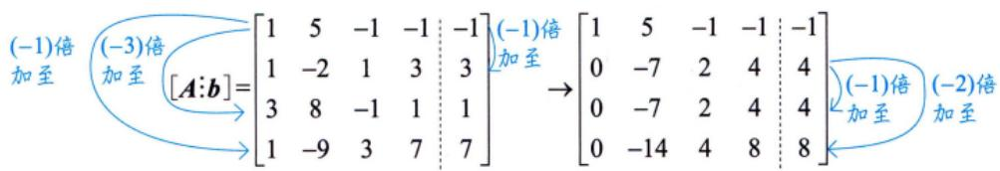

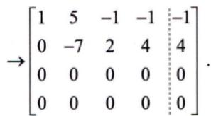

取自由未知量 $x_{3} = k_{1}$ ， $x_{4} = k_{2}$ ，代入得

$$
x _ {2} = - \frac {1}{7} (4 - 2 k _ {1} - 4 k _ {2}) = - \frac {4}{7} + \frac {2}{7} k _ {1} + \frac {4}{7} k _ {2},
$$

$$
x _ {1} = - 1 + k _ {1} + k _ {2} - 5 \left(- \frac {4}{7} + \frac {2}{7} k _ {1} + \frac {4}{7} k _ {2}\right) = \frac {1 3}{7} - \frac {3}{7} k _ {1} - \frac {1 3}{7} k _ {2},
$$

得通解为

$$
\left[ \begin{array}{c} x _ {1} \\ x _ {2} \\ x _ {3} \\ x _ {4} \end{array} \right] = \left[ \begin{array}{c} \frac {1 3}{7} - \frac {3}{7} k _ {1} - \frac {1 3}{7} k _ {2} \\ - \frac {4}{7} + \frac {2}{7} k _ {1} + \frac {4}{7} k _ {2} \\ k _ {1} \\ k _ {2} \end{array} \right] = \left[ \begin{array}{c} \frac {1 3}{7} \\ - \frac {4}{7} \end{array} \right] + k _ {1} \left[ \begin{array}{c} - \frac {3}{7} \\ \frac {2}{7} \\ 0 \\ 0 \end{array} \right] + k _ {2} \left[ \begin{array}{c} - \frac {1 3}{7} \\ \frac {4}{7} \\ 0 \\ 1 \end{array} \right],
$$

其中 $k_{1}, k_{2}$ 是任意常数， $\left[-\frac{3}{7}, \frac{2}{7}, 1, 0\right]^{\mathrm{T}}, \left[-\frac{13}{7}, \frac{4}{7}, 0, 1\right]^{\mathrm{T}}$ 为对应的齐次线性方程组的基础解系.

4.9 (1)解 首先，对增广矩阵 $\left[A:\xi_1\right]$ 作初等行变换：

$$
\left[ \boldsymbol {A}: \boldsymbol {\xi} _ {1} \right] = \left[\begin{array}{c c c c}1&- 1&- 1&- 1\\- 1&1&1&1\\0&- 4&- 2&- 2\end{array}\right]\rightarrow \left[\begin{array}{c c c c}1&- 1&- 1&- 1\\0&2&1&1\\0&0&0&0\end{array}\right],
$$

故得其基础解系为 $[1, -1, 2]^{\mathrm{T}}$ ，一个特解为 $\left[-\frac{1}{2}, \frac{1}{2}, 0\right]^{\mathrm{T}}$ ，从而

$$
\pmb {\xi} _ {2} = \left[ - \frac {1}{2}, \frac {1}{2}, 0 \right] ^ {\mathrm {T}} + C _ {1} \left[ 1, - 1, 2 \right] ^ {\mathrm {T}} \text {或} \pmb {\xi} _ {2} = \left[ \begin{array}{c} {- \frac {1}{2} + C _ {1}} \\ {\frac {1}{2} - C _ {1}} \\ {2 C _ {1}} \end{array} \right],
$$

其中 $C_1$ 为任意常数.

其次， $A^2 = \left[ \begin{array}{rrr}2 & 2 & 0\\ -2 & -2 & 0\\ 4 & 4 & 0 \end{array} \right]$ ，对增广矩阵 $\left[A^2:\xi_1\right]$ 作初等行变换：

$$
\left[ A ^ {2}: \xi_ {1} \right] = \left[\begin{array}{c c c c}2&2&0&- 1\\- 2&- 2&0&1\\4&4&0&- 2\end{array}\right]\rightarrow \left[\begin{array}{c c c c}1&1&0&- \frac {1}{2}\\0&0&0&0\\0&0&0&0\end{array}\right],
$$

故得基础解系为 $[-1, 1, 0]^{\mathrm{T}}, [0, 0, 1]^{\mathrm{T}}$ ，一个特解为 $\left[-\frac{1}{2}, 0, 0\right]^{\mathrm{T}}$ ，从而

$$
\xi_ {3} = C _ {2} \left[ - 1, 1, 0 \right] ^ {\mathrm {T}} + C _ {3} \left[ 0, 0, 1 \right] ^ {\mathrm {T}} + \left[ - \frac {1}{2}, 0, 0 \right] ^ {\mathrm {T}} \text {或} \xi_ {3} = \left[ \begin{array}{c} {- \frac {1}{2} - C _ {2}} \\ {C _ {2}} \\ {C _ {3}} \end{array} \right],
$$

其中 $C_2, C_3$ 为任意常数.

(2) 证明 只需证明行列式 $|\xi_1, \xi_2, \xi_3| \neq 0$ 即可. 事实上，

$$
\left| \xi_ {1}, \xi_ {2}, \xi_ {3} \right| = \left| \begin{array}{c c c} - 1 & - \frac {1}{2} + C _ {1} & - \frac {1}{2} - C _ {2} \\ 1 & \frac {1}{2} - C _ {1} & C _ {2} \\ - 2 & 2 C _ {1} & C _ {3} \end{array} \right| = \left| \begin{array}{c c c} - 1 & - \frac {1}{2} & - \frac {1}{2} - C _ {2} \\ 1 & \frac {1}{2} & C _ {2} \\ - 2 & 0 & C _ {3} \end{array} \right| = \left| \begin{array}{c c c} 0 & 0 & - \frac {1}{2} \\ 1 & \frac {1}{2} & C _ {2} \\ - 2 & 0 & C _ {3} \end{array} \right| = - \frac {1}{2} \neq 0,
$$

故 $\xi_1, \xi_2, \xi_3$ 线性无关.

4.10 分析 (1) 对 (I) 的增广矩阵作初等行变换，计算它的通解.

(2) 将 (I) 的通解代入 (II) 的各个方程，即可得出参数 $m, n, t$ 的值.

解 (1) 对 (I) 的增广矩阵 $\overline{A}$ 作初等行变换，有

$$
\overline {{A}} = \left[\begin{array}{c c c c c}1&1&0&- 2&- 6\\4&- 1&- 1&- 1&1\\3&- 1&- 1&0&3\end{array}\right]\rightarrow \left[\begin{array}{c c c c c}1&0&0&- 1&- 2\\0&1&0&- 1&- 4\\0&0&1&- 2&- 5\end{array}\right],
$$

所以（I）的通解为

$$
\left[ x _ {1}, x _ {2}, x _ {3}, x _ {4} \right] ^ {\mathrm {T}} = C \left[ 1, 1, 2, 1 \right] ^ {\mathrm {T}} + \left[ - 2, - 4, - 5, 0 \right] ^ {\mathrm {T}},
$$

其中 $C$ 为任意常数.

(2) 由 (1) 知 $x_{1} = C - 2, x_{2} = C - 4, x_{3} = 2C - 5, x_{4} = C$ ，将其代入（Ⅱ）的各个方程，整理得

$$
\left\{ \begin{array}{l} (m - 2) C + (8 - 4 m) = 0, \\ (n - 4) C + (1 6 - 4 n) = 0, \\ t - 6 = 0, \end{array} \right.
$$

令 $C = 0$ ，解得 $m = 2$ ， $n = 4$ ， $t = 6$

当 $m = 2$ ， $n = 4$ ， $t = 6$ 时，代入方程组（Ⅱ），有

$$
\left\{ \begin{array}{l} x _ {1} + 2 x _ {2} - x _ {3} - x _ {4} = - 5, \\ 4 x _ {2} - x _ {3} - 2 x _ {4} = - 1 1, \\ x _ {3} - 2 x _ {4} = - 5. \end{array} \right.
$$

对其增广矩阵作初等行变换，有

$$
\left[\begin{array}{c c c c c}1&2&- 1&- 1&- 5\\0&4&- 1&- 2&- 1 1\\0&0&1&- 2&- 5\end{array}\right]\rightarrow \left[\begin{array}{c c c c c}1&0&0&- 1&- 2\\0&1&0&- 1&- 4\\0&0&1&- 2&- 5\end{array}\right],
$$

由此可知，当 $m = 2$ ， $n = 4$ ， $t = 6$ 时，方程组（I）与（Ⅱ）同解.
