# 第5讲

# 特征值与特征向量

# 基础知识结构

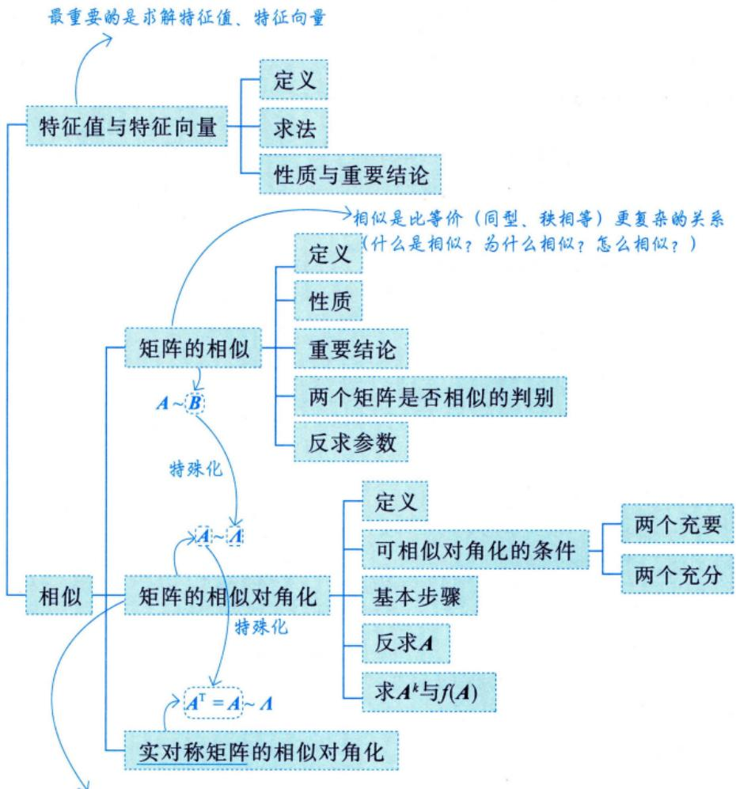  
① 初等变换化标准形

$$
A \rightarrow B _ {1} \rightarrow B _ {2} \rightarrow \dots \rightarrow \left[\begin{array}{c c}E _ {r}&O\\O&O\end{array}\right]
$$

② 相似对角化

$$
A \sim B _ {1} \sim B _ {2} \sim \left[ \begin{array}{l l} \lambda_ {1} & \\ & \cdot \end{array} \right]
$$

# 特征值与特征向量的定义

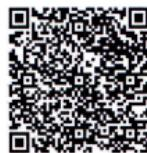

要求是方阵，若非方阵，也可研究 $A^{\mathrm{T}}A$

设 $A$ 是 $n$ 阶矩阵， $\lambda$ 是一个数，若存在 $n$ 维非零列向量 $\xi$ ，使得

特征值反映矩阵特性,而这个特性能反映空 $A : \xi  = \lambda \xi$ ,间上数据的亲近程度或者数据的最值性质 ① 值, $\lambda$ 的特征向量 $\left( {A\xi \text{等于}{\lambda \xi }\text{，相当于对}\xi \text{进行放缩}}\right)$

则称 $\lambda$ 是 $A$ 的特征值， $\xi$ 是 $A$ 的对应于特征值 $\lambda$ 的特征向量。

$n$ 阶矩阵有 $n$ 个特征值

# 矩阵的特征值与特征向量的求法

由①式，得 $(\lambda E - A)\xi = 0$ 若 $\xi = 0$ 则体现不出入的作用了因 $\xi \neq 0$ 故齐次方程组 $(\lambda E - A)x = 0$ 有非零解，于是

由此可知，上、下三角矩阵与对角矩阵的特征值就是其主对角线元素，

$\lambda A = \left[ \begin{array}{lll}a_{11} & 0 & 0\\ 0 & a_{22} & 0\\ 0 & 0 & a_{33} \end{array} \right],$ 则 $|\lambda E - A| = \left| \begin{array}{ccc}\lambda -a_{11} & 0 & 0\\ 0 & \lambda -a_{22} & 0\\ 0 & 0 & \lambda -a_{33} \end{array} \right| = 0,$

于是 $\lambda_1 = a_{11}$ ， $\lambda_{2} = a_{22}$ ， $\lambda_{3} = a_{33}$

$$
\left| \lambda E - A \right| = \left| \begin{array}{c c c c} \lambda - a _ {1 1} & - a _ {1 2} & \dots & - a _ {1 n} \\ - a _ {2 1} & \lambda - a _ {2 2} & \dots & - a _ {2 n} \\ \vdots & \vdots & & \vdots \\ - a _ {n 1} & - a _ {n 2} & \dots & \lambda - a _ {n n} \end{array} \right| = 0. \tag {②}
$$

②式称为 $A$ 的特征方程，是未知量 $\lambda$ 的 $n$ 次方程，有 $n$ 个根（重根按照重数计）， $\lambda E - A$ 称为特征矩阵， $|\lambda E - A|$ 称为特征多项式.

于是，求解具体型矩阵的特征值与特征向量，一般先用特征方程 $|\lambda E - A| = 0$ 求出 $\lambda$ ，再解齐次线性方程组 $(\lambda E - A)x = 0$ ，求出特征向量.

要的是非零解，因为特征向量不能是零向量例5.1 求矩阵 $A = \begin{bmatrix} 2 & 2 & -2\\ 2 & 5 & -4\\ -2 & -4 & 5 \end{bmatrix}$ 的特征值与特征向量．

分析 考研中求特征值.若矩阵无规律，基本上考2阶；若矩阵有规律，可考 $n$ 阶（递推，数学归纳）.

设 $\alpha, \beta$ 为列向量，若 $A = \alpha \beta^{\mathrm{T}}$ ，则 $A$ 的特征值为 $\operatorname{tr}(A), 0, 0$ .

对于本题注意到 $A - E = \begin{bmatrix} 1 & 2 & -2\\ 2 & 4 & -4\\ -2 & -4 & 4 \end{bmatrix} = \begin{bmatrix} 1\\ 2\\ -2 \end{bmatrix} [1,2, - 2]$

则 $A - E$ 的特征值为9.0，0.A的特征值为10，1，1.

解 由特征方程

$$
\left| \lambda E - A \right| = \left| \begin{array}{c c c} \lambda - 2 & - 2 & 2 \\ - 2 & \lambda - 5 & 4 \\ 2 & 4 & \lambda - 5 \end{array} \right| = \left| \begin{array}{c c c} \lambda - 2 & - 2 & 0 \\ - 2 & \lambda - 5 & \lambda - 1 \\ 2 & 4 & \lambda - 1 \end{array} \right| _ {(- 1) \text {倍 加 至}}
$$

求特征值时，

一般用 $|\lambda E - A| = 0$

也可以用 $|A - \lambda E| = 0$

$$
\begin{array}{l} = \left| \begin{array}{c c c} \lambda - 2 & - 2 & 0 \\ - 4 & \lambda - 9 & 0 \\ 2 & 4 & \lambda - 1 \end{array} \right| \longrightarrow \text {按 此 列 展 开} \\ = (\lambda - 1) \left(\lambda^ {2} - 1 1 \lambda + 1 0\right) = (\lambda - 1) ^ {2} (\lambda - 1 0) = 0, \\ \end{array}
$$

知 $\pmb{A}$ 有特征值 $\lambda_1 = \lambda_2 = 1, \lambda_3 = 10$

当 $\lambda_1 = \lambda_2 = 1$ 时，有

$$
\begin{array}{r l}&{\quad \rightarrow \text {因} 3 \text {行 成 比 例 ， 所 以 阶 梯 形 为} \left[\begin{array}{l l l}{1}&{2}&{- 2}\\{0}&{0}&{0}\\{0}&{0}&{0}\end{array}\right]}\\&{\quad (E - A) x = \left[\begin{array}{l l l}{- 1}&{- 2}&{2}\\{- 2}&{- 4}&{4}\\{2}&{4}&{- 4}\end{array}\right] \left[\begin{array}{l}{x _ {1}}\\{x _ {2}}\\{x _ {3}}\end{array}\right] = \mathbf {0},}\end{array}
$$

解得基础解系为 $\xi_{1} = [-2, 1, 0]^{\mathrm{T}}, \xi_{2} = [2, 0, 1]^{\mathrm{T}}$ ，则 $k_{1}\xi_{1} + k_{2}\xi_{2}$ 即为 $\lambda_{1} = \lambda_{2} = 1$ 的全部特征向量， $k_{1}, k_{2}$ 不全为0.

当 $\lambda_{3} = 10$ 时，有

化阶梯形的分析：

① 因 $|10E - A| = 0$ ，所 $r(10E - A) < 3$   
② 划横线这两行不成比例,所以秩为2

$$
(1 0 \boldsymbol {E} - \boldsymbol {A}) \boldsymbol {x} = \left[ \begin{array}{l l l} 8 & - 2 & 2 \\ - 2 & 5 & 4 \\ \hline 2 & 4 & 5 \end{array} \right] \left[ \begin{array}{l} x _ {1} \\ x _ {2} \\ x _ {3} \end{array} \right] = \mathbf {0}, \quad (*)
$$

解得基础解系为 ${\xi }_{3} = \left\lbrack  {1,2, - 2}\right\rbrack  {}^{\mathrm{T}}$ ,则 ${k}_{3}{\xi }_{3}$ 即为 ${\lambda }_{3} = {10}$ 的全部特征向量, ${k}_{3} \neq  0$ . 0. 但因为特征向量不

可以为0,所以 ${k}_{3} \neq  0$

注1 解方程组 $(\ast)$ 的技巧：

$\lambda_{3} = 10$ 是单根， $\pmb{A}$ 是实对称矩阵，必可相似对角化，故 $r(10E - A) = 2$ ，必有一个方程是多余方程.因 $10E - A$ 中3行均不成比例，任一方程均是另外两个方程的线性组合，故可去除任一方程，例如去掉第一个方程，剩下的仍是同解方程组，

$$
\left[\begin{array}{l l l}- 2&5&4\\2&4&5\\0&0&0\end{array}\right] \overset {1 \text {倍}} {\underset {\text {加 至}} {\rightleftharpoons}} \left[\begin{array}{l l l}- 2&5&4\\0&9&9\\0&0&0\end{array}\right] \overset {1 \times \frac {1}{9}} {\underset {\text {加 至}} {\rightleftharpoons}} \left[\begin{array}{l l l}- 2&5&4\\0&1&1\\0&0&0\end{array}\right] \overset {(- 5) \text {倍}} {\underset {\text {加 至}} {\rightleftharpoons}} \left[\begin{array}{l l l}- 2&0&- 1\\0&1&1\\0&0&0\end{array}\right],
$$

解得 $\xi_{3} = [1,2, - 2]^{\mathrm{T}}$

例1.9讲过这样的行列式

这种方法不容易想，耗费时间

注2 用 $|\lambda E - A| = 0$ 求出全部的 $\lambda$ 是起步，也是关键。上面的例子都是用行列式的性质写成了 $|\lambda E - A| = (\lambda - \lambda_1)(\lambda - \lambda_2) \cdots (\lambda - \lambda_n)$ 的形式，但如果有些技巧想不到，而直接展开成 $\lambda$ 的 $n$ 次多项式 $f(\lambda)$ ，那又该如何求特征根呢？

例如，设 $A = \begin{bmatrix} 2 & -2 & 0\\ -2 & 1 & -2\\ 0 & -2 & 0 \end{bmatrix}$ ，求矩阵 $A$ 的特征多项式 $|\lambda E - A|$ 及 $A$ 的全部特征值.

解 $\left| {\lambda E - A}\right|  = \left| \begin{matrix} \lambda  - 2 & 2 & 0 \\  2 & \lambda  - 1 & 2 \\  0 & 2 & \lambda \end{matrix}\right|  = \left| \begin{matrix} \lambda  + 2 & 2 & 0 \\  2\left( {\lambda  + 2}\right) & \lambda  - 1 & 2 \\  2\left( {\lambda  + 2}\right) & 2 & \lambda \end{matrix}\right|$ 提出 $\lambda  + 2$

$$
\begin{array}{l} = (\lambda + 2) \left| \begin{array}{l l l} 1 & 2 & 0 \\ 2 & \lambda - 1 & 2 \\ 2 & 2 & \lambda \end{array} \right| = (\lambda + 2) \left| \begin{array}{l l l} 1 & 0 & 0 \\ 2 & \lambda - 5 & 2 \\ 2 & - 2 & \lambda \end{array} \right| \\ = (\lambda + 2) \left| \begin{array}{l l} \lambda - 5 & 2 \\ - 2 & \lambda \end{array} \right| = (\lambda + 2) (\lambda^ {2} - 5 \lambda + 4) \\ = (\lambda + 2) (\lambda - 1) (\lambda - 4), \\ \end{array}
$$

所以 $A$ 的特征值为-2,1,4.

但以上过程可能有的考生一时想不到，而直接展开：

$$
\begin{array}{l} \left| \begin{array}{c c c} \lambda - 2 & 2 & 0 \\ 2 & \lambda - 1 & 2 \\ 0 & 2 & \lambda \end{array} \right| = \lambda (\lambda - 1) (\lambda - 2) - 4 (\lambda - 2) - 4 \lambda \\ = \lambda^ {3} - 3 \lambda^ {2} - 6 \lambda + 8. \\ \end{array}
$$

矩阵 $\pmb{A}$ 的特征多项式 $f(\lambda) = |\lambda E - A|$ 求出来了，但 $f(\lambda)$ 是 $\lambda$ 的三次多项式，求特征根有些困难。为此介绍三个简单而有效的 $k$ 次多项式方程

$f\left( \lambda \right)  = {a}_{k}{\lambda }^{k} + \cdots  + {a}_{1}\lambda  + {a}_{0} = 0$ 考研一般考三次的

的求根方法：

① 若 $a_0 = 0$ ，则 $f(0) = 0$ ，所以此时0是 $f(\lambda) = 0$ 的根.

② 若 $a_{k} + a_{k - 1} + \dots +a_{1} + a_{0} = 0$ ，则 $f(1) = 0$ ，所以此时1是 $f(\lambda) = 0$ 的根.

③若 $f(\lambda)$ 的偶次项（包括 $a_0$ ）系数之和等于奇次项系数之和，则 $f(-1) = 0$ ，所以此时-1是 $f(\lambda) = 0$ 的根.

据此，在本例中 $f(\lambda) = \lambda^3 - 3\lambda^2 - 6\lambda + 8$ ，因 $1 + (-3) + (-6) + 8 = 0$ ，所以1是 $f(\lambda) = 0$ 的根。从而 $\lambda - 1$ 是 $f(\lambda)$ 的一个因式，进一步分解 $f(\lambda)$ ，可用多项式的带余除法

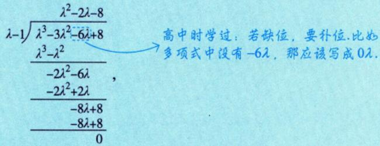

则 $f(\lambda) = (\lambda -1)(\lambda^2 -2\lambda -8)$ .而 $\lambda^2 -2\lambda -8$ 作为二次三项式的因式分解考生是熟悉的，故有

$$
f (\lambda) = (\lambda - 1) (\lambda + 2) (\lambda - 4),
$$

所以 $A$ 的3个特征值为-2,1,4.

这里所说的三个求根方法常称为试根法。多项式的带余除法和常数的带余除法形式上基本相同。上述这些原理浅显易懂，很容易掌握，且很实用，再看一题。

设

$$
\boldsymbol {A} = \left[ \begin{array}{c c c} 5 & 6 & - 1 0 \\ - 6 & 1 & 6 \\ - 2 & 3 & 0 \end{array} \right],
$$

求矩阵 $\mathbf{A}$ 的特征多项式和全部特征值. 1位数

解

$$
\begin{array}{l} \left| \lambda E - A \right| = \left| \begin{array}{c c c} \lambda - 5 & - 6 & 1 0 \\ 6 & \lambda - 1 & - 6 \\ 2 & - 3 & \lambda \end{array} \right| = \left| \begin{array}{c c c} \lambda - 5 & - 6 & \lambda + 5 \\ 6 & \lambda - 1 & 0 \\ 2 & - 3 & \lambda + 2 \end{array} \right| (- 2) \text {倍 加 至} \\ \left(- \frac {1}{3}\right) \text {倍 加 至} = \left| \begin{array}{c c c} \lambda - 9 & 0 & - \lambda + 1 \\ 6 & \lambda - 1 & 0 \\ 2 & - 3 & \lambda + 2 \end{array} \right| = \left| \begin{array}{c c c} \lambda - 9 & 0 & - \lambda + 1 \\ 6 & \lambda - 1 & 0 \\ 0 & - \frac {\lambda}{3} - \frac {8}{3} & \lambda + 2 \end{array} \right| \\ = (\lambda - 9) (\lambda - 1) (\lambda + 2) + 6 (- \lambda + 1) \left(- \frac {\lambda}{3} - \frac {8}{3}\right) \\ \stackrel {(*)} {=} (\lambda - 1) \left[ (\lambda - 9) (\lambda + 2) + (2 \lambda + 1 6) \right] \\ = (\lambda - 1) \left(\lambda^ {2} - 5 \lambda - 2\right) \text {利 用 求 根 公 式} \\ = (\lambda - 1) \left(\lambda - \frac {5 + \sqrt {3 3}}{2}\right) \left(\lambda - \frac {5 - \sqrt {3 3}}{2}\right). \\ \end{array}
$$

所以 $A$ 的3个特征值为1， $\frac{5 + \sqrt{33}}{2},\frac{5 - \sqrt{33}}{2}$

(*)处提出公因子 $\lambda - 1$ 是重要的，有了这一步下面就能将特征多项式完全分解，从而求出 $A$ 的全部特征值。如有考生忽略了提出公因子，或在计算 $|\lambda E - A|$ 时用其他方法得出

$$
f (\lambda) = \left| \lambda E - A \right| = \lambda^ {3} - 6 \lambda^ {2} + 3 \lambda + 2,
$$

可利用上面介绍的试根法求根. 因

$$
1 + (- 6) + 3 + 2 = 0,
$$

故1是 $f(\lambda) = 0$ 的一个根，从而 $\lambda -1$ 是 $f(\lambda)$ 的一个因式.再用多项式的带余除法

试出了一个根后，也可以尝试这样的思路：在行列式 $|\lambda E - A| = 0$ 中凑出 $\lambda -1$

$$
\begin{array}{c} \lambda^ {2} - 5 \lambda - 2 \\ \lambda - 1 \sqrt {\lambda^ {3} - 6 \lambda^ {2} + 3 \lambda + 2} \\ \frac {\lambda^ {3} - \lambda^ {2}}{- 5 \lambda^ {2} + 3 \lambda} \\ - 5 \lambda^ {2} + 5 \lambda \\ \frac {- 2 \lambda + 2}{0} \\ - 2 \lambda + 2 \\ \end{array} ,
$$

可得

$$
f (\lambda) = (\lambda - 1) \left(\lambda^ {2} - 5 \lambda - 2\right),
$$

同样可求得 $\pmb{A}$ 的3个特征值为 $1,\frac{5 + \sqrt{33}}{2},\frac{5 - \sqrt{33}}{2}.$

其实，还有一个定理可供考生试根：

定理 设

$$
f (x) = 1 \cdot x ^ {k} + a _ {k - 1} x ^ {k - 1} + \dots + a _ {1} x + a _ {0}
$$

是系数 $a_{i}(i = 0,1,2,\dots ,k - 1)$ 都是整数的多项式，则 $f(x) = 0$ 的有理根都是整数，且均是 $a_0$ 的因子.例如，设3阶方阵 $\pmb{A}$ 的特征多项式为

$$
f (\lambda) = | \lambda E - A | = \lambda^ {3} - 4 \lambda^ {2} + 3 \lambda + 2,
$$

求矩阵 $\pmb{A}$ 的特征值.

解根据上述定理， $f(\lambda) = 0$ 的有理根只可能是 $\pm 1,\pm 2$ .计算得

$$
f (1) = 2 \neq 0, f (- 1) = - 6 \neq 0,
$$

$$
f (2) = 0, f (- 2) = - 2 8 \neq 0,
$$

故 $f(\lambda) = 0$ 的有理根只有一个，即 $\lambda_1 = 2$ .从而 $\lambda -2$ 是 $f(\lambda)$ 的一个因式.用多项式的带余除法可得

$$
f (\lambda) = (\lambda - 2) (\lambda^ {2} - 2 \lambda - 1).
$$

对二次多项式方程 $\lambda^2 - 2\lambda - 1 = 0$ 用求根公式得出两个根为

$$
\lambda_ {2} = 1 + \sqrt {2}, \lambda_ {3} = 1 - \sqrt {2}.
$$

综上可知， $A$ 的3个特征值为2， $1 + \sqrt{2},1 - \sqrt{2}$

# 三 特征值、特征向量的性质与重要结论

# 特征值的性质与重要结论

# 已知特征值，求参数

(1) $\lambda_0$ 是 $A$ 的特征值 $\Leftrightarrow |\lambda_0E - A| = 0$ （建立方程求参数或证明行列式 $|\lambda_0E - A| = 0$ ）；

$\lambda_0$ 不是 $A$ 的特征值 $\Leftrightarrow \left|\lambda_0 E - A\right| \neq 0$ （矩阵可逆，满秩）. $\rightarrow (\lambda_0 E - A)^{-1}$ 存在

注这里常见的命题方法：若 $|aA + bE| = 0$ （或 $aA + bE$ 不可逆）， $a \neq 0$ ，则 $-\frac{b}{a}$ 是 $\pmb{A}$ 的特征值.

(2) 若 $\lambda_1, \lambda_2, \dots, \lambda_n$ 是 $A$ 的 $n$ 个特征值，则

$$
\left| b \boldsymbol {E} - (- a \boldsymbol {A}) \right| = (- a) ^ {n} \left| \frac {\bar {b}}{a} \boldsymbol {E} - \boldsymbol {A} \right| = 0, \text {则} \lambda_ {0} = - \frac {b}{a}
$$

$$
\left\{ \begin{array}{l l} {\left| A \right| = \lambda_ {1} \lambda_ {2} \dots \lambda_ {n},} \\ {\operatorname {t r} (A) = \lambda_ {1} + \lambda_ {2} + \dots + \lambda_ {n}.} \end{array} \quad \text {如 果 有 一 个 特 征 值 为 零} \right.
$$

注 以3阶矩阵为例，证明并作推广.

主子式：主对角线下标相同的行列式。  
子式：下标任意的行列式。

设 $A = \left[ \begin{array}{lll}a_{11} & a_{12} & a_{13}\\ a_{21} & a_{22} & a_{23}\\ a_{31} & a_{32} & a_{33} \end{array} \right]$ ，并定义3阶矩阵的k阶主子式为 $\left| \begin{array}{ccc}a_{i_1i_1} & \dots & a_{i_1i_k}\\ \vdots & & \vdots \\ a_{i_ki_1} & \dots & a_{i_ki_k} \end{array} \right|$ 则 $|\lambda E - A| =$

保证第1个元素两个下标相同,最后1个元素两个下标相同

$\left| \begin{array}{ccc} \lambda - a_{11} & -a_{12} & -a_{13} \\ -a_{21} & \lambda - a_{22} & -a_{23} \\ -a_{31} & -a_{32} & \lambda - a_{33} \end{array} \right|$ 是 $\lambda$ 的一元三次多项式，且1阶主子式为 $a_{11}, a_{22}, a_{33}$ ；2阶主子式为 $\left| \begin{array}{cc} a_{22} & a_{23} \\ a_{32} & a_{33} \end{array} \right| = 0$

$A_{11}$ ， $\left| \begin{array}{ll}a_{11} & a_{13}\\ a_{31} & a_{33} \end{array} \right| = A_{22},\left| \begin{array}{ll}a_{11} & a_{12}\\ a_{21} & a_{22} \end{array} \right| = A_{33};3$ 阶主子式为 $|\pmb {A}|$ ，则

$$
\left| \lambda E - A \right| = \left| \begin{array}{c c c} \lambda - a _ {1 1} & - a _ {1 2} & - a _ {1 3} \\ - a _ {2 1} & \lambda - a _ {2 2} & - a _ {2 3} \\ - a _ {3 1} & - a _ {3 2} & \lambda - a _ {3 3} \end{array} \right| = \left| \begin{array}{c c c} \lambda - a _ {1 1} & 0 - a _ {1 2} & 0 - a _ {1 3} \\ 0 - a _ {2 1} & \lambda - a _ {2 2} & 0 - a _ {2 3} \\ 0 - a _ {3 1} & 0 - a _ {3 2} & \lambda - a _ {3 3} \end{array} \right|,
$$

将上述行列式全部拆开，得

按零元素最多的列进行代数余子式展开.

$$
\left| \lambda E - A \right| = \left| \begin{array}{l l l} \lambda & 0 & 0 \\ 0 & \lambda & 0 \\ 0 & 0 & \lambda \end{array} \right| + \left| \begin{array}{l l l} \lambda & 0 & - a _ {1 3} \\ 0 & \lambda & - a _ {2 3} \\ 0 & 0 & - a _ {3 3} \end{array} \right| + \left| \begin{array}{l l l} \lambda & - a _ {1 2} & 0 \\ 0 & - a _ {2 2} & 0 \\ 0 & - a _ {3 2} & \lambda \end{array} \right| + \left| \begin{array}{l l l} \lambda & - a _ {1 2} & - a _ {1 3} \\ 0 & - a _ {2 2} & - a _ {2 3} \\ 0 & - a _ {3 2} & - a _ {3 3} \end{array} \right| +
$$

$$
\left| \begin{array}{l l l} - a _ {1 1} & 0 & 0 \\ - a _ {2 1} & \lambda & 0 \\ - a _ {3 1} & 0 & \lambda \end{array} \right| + \left| \begin{array}{l l l} - a _ {1 1} & 0 & - a _ {1 3} \\ - a _ {2 1} & \lambda & - a _ {2 3} \\ - a _ {3 1} & 0 & - a _ {3 3} \end{array} \right| + \left| \begin{array}{l l l} - a _ {1 1} & - a _ {1 2} & 0 \\ - a _ {2 1} & - a _ {2 2} & 0 \\ - a _ {3 1} & - a _ {3 2} & \lambda \end{array} \right| + \left| \begin{array}{l l l} - a _ {1 1} & - a _ {1 2} & - a _ {1 3} \\ - a _ {2 1} & - a _ {2 2} & - a _ {2 3} \\ - a _ {3 1} & - a _ {3 2} & - a _ {3 3} \end{array} \right|
$$

$$
= \lambda^ {3} - (\underbrace {a _ {1 1} + a _ {2 2} + a _ {3 3}} _ {\downarrow}) \lambda^ {2} + (\underbrace {A _ {1 1} + A _ {2 2} + A _ {3 3}} _ {\downarrow}) \lambda - | A |. \tag {①}
$$

1阶主子式之和 2阶主子式之和 3阶主子式之和

设

$$
\begin{array}{l} \left| \lambda E - A \right| = \left(\lambda - \lambda_ {1}\right) \left(\lambda - \lambda_ {2}\right) \left(\lambda - \lambda_ {3}\right) \\ = \lambda^ {3} - (\lambda_ {1} + \lambda_ {2} + \lambda_ {3}) \lambda^ {2} + (\lambda_ {1} \lambda_ {2} + \lambda_ {1} \lambda_ {3} + \lambda_ {2} \lambda_ {3}) \lambda - \lambda_ {1} \lambda_ {2} \lambda_ {3}. \tag {②} \\ \end{array}
$$

比较①，②两式，得

$$
\left\{ \begin{array}{l l} a _ {1 1} + a _ {2 2} + a _ {3 3} = \lambda_ {1} + \lambda_ {2} + \lambda_ {3}, \\ A _ {1 1} + A _ {2 2} + A _ {3 3} = \lambda_ {1} \lambda_ {2} + \lambda_ {1} \lambda_ {3} + \lambda_ {2} \lambda_ {3}, (k \text {阶 主 子 式 之 和} = \text {任 意} k \text {个 特 征 值 乘 积 之 和}) \\ | A | = \lambda_ {1} \lambda_ {2} \lambda_ {3}. \end{array} \right.
$$

以后会经常用到这里的结论.

# 特征向量的性质与重要结论

(1) $\xi (\neq 0)$ 是 $A$ 的属于 $\lambda_0$ 的特征向量 $\Leftrightarrow \xi$ 是 $(\lambda_0E - A)x = 0$ 的非零解.

(2)重要结论.

举个例子来说明.

设 $A_{3\times 3}$ ， $\left|\lambda E - A\right| = 0\Rightarrow \lambda_1 = \lambda_2 = 3,\lambda_3 = 7$

不可能为3：行列式为0，说明不满秩.

$(3E - A)x = 0.$

不可能为0：否则是3重根.

由 $s = n - r(3E - A)$ 因为 $3E - A$ 的秩有可能为2或1，所以无关特征向量可能有1个或2个

① $k$ 重特征值 $\lambda$ 至多只有 $k$ 个线性无关的特征向量（不用证明）  
② 若 $\xi_1, \xi_2$ 是 $A$ 的属于不同特征值 $\lambda_1, \lambda_2$ 的特征向量，则 $\xi_1, \xi_2$ 线性无关。

$\lambda_1 \neq \lambda_2 \Rightarrow \xi_1, \xi_2$ 线性无关矩阵 $A = \begin{bmatrix} \lambda_1 & \lambda_2 \\ \lambda_1 & \lambda_2 \end{bmatrix}$ 可能线性相关线性无关（可能2维）

注 证明： $n$ 阶方阵 $\pmb{A}$ 的任意两个不同特征值 $\lambda_1, \lambda_2$ 对应的两个特征向量线性无关.

证设 $\pmb{A}$ 的特征值 $\lambda_1,\lambda_2(\lambda_1\neq \lambda_2)$ 对应的特征向量分别是 $\xi_{1},\xi_{2}(\xi_{i}\neq 0,i = 1,2)$ ，即

$$
\boldsymbol {A} \boldsymbol {\xi} _ {1} = \lambda_ {1} \boldsymbol {\xi} _ {1}, \boldsymbol {A} \boldsymbol {\xi} _ {2} = \lambda_ {2} \boldsymbol {\xi} _ {2}.
$$

考查

$$
k _ {1} \xi_ {1} + k _ {2} \xi_ {2} = 0. \tag {①}
$$

式①两端左边乘 $A$ ，得

$$
\boldsymbol {A} \left(k _ {1} \xi_ {1} + k _ {2} \xi_ {2}\right) = k _ {1} \boldsymbol {A} \xi_ {1} + k _ {2} \boldsymbol {A} \xi_ {2} = k _ {1} \lambda_ {1} \xi_ {1} + k _ {2} \lambda_ {2} \xi_ {2} = \mathbf {0}. \tag {②}
$$

式①两边乘 $\lambda_{1}$ ，得

$$
k _ {1} \lambda_ {1} \xi_ {1} + k _ {2} \lambda_ {1} \xi_ {2} = 0. \tag {③}
$$

式③减式②，得 $k_{2}(\lambda_{1} - \lambda_{2})\xi_{2} = 0$ .因 $\lambda_1\neq \lambda_2,\xi_2\neq 0$ ，故 $k_{2} = 0$ ：

将 $k_{2} = 0$ 代入式①，因 $\xi_1\neq 0$ ，得 $k_{1} = 0$ ，故不同特征值 $\lambda_{1},\lambda_{2}$ 对应的特征向量线性无关.

# 拓展 从几何上来理解性质②.

(1) 若特征值 $\lambda$ 对应有 2 个线性无关的特征向量 $\xi_1, \xi_2$ ，则由 $\xi_1, \xi_2$ 张成的平面 $\pi$ 上的所有向量都是 $\lambda$ 对应的特征向量，即 $\pmb{\xi} = k_{1}\pmb{\xi}_{1} + k_{2}\pmb{\xi}_{2}$ 也是 $\lambda$ 对应的特征向量。

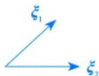

假设 $\lambda = 3$ ，即 $A\xi = 3\xi$ ，从几何上来看，就是：线性变换 $A$ 作用到平面 $\pi$ 的向量 $\xi$ 上，其作用结果为将向量 $\xi$ 变为原来的3倍.

需要注意的是：线性变换 $\mathbf{A}$ 只有作用到这样一个特定的平面 $\pi$ 上时，才会有这样的效果，并不是作用到其他平面上时，都有这样的效果。

(2)类似地，若特征值 $\lambda$ 对应1个线性无关的特征向量 $\pmb{\xi}$ ，则由 $\pmb{\xi}$ 张成一条线，此时 $A\xi = 3\xi$ 的几

何意义为：线性变换 $A$ 作用到这条线上的向量上时，其作用结果为将向量 $\xi$ 变为原来的3倍.

同样地， $\pmb{A}$ 只有作用到这样一个特定的直线上时，才会有这样的效果，并不是作用到其他直线上时，都有这样的效果。  
(3)一个特征值 $\lambda$ 只能与自己对应的特定子空间（特征向量张成的子空间）配对，也就是说 $\lambda$ 只能作用到这个特定的子空间上，作用不到别的空间上.  
(4)至此，就可以从几何意义的角度来理解性质②了.

设 $\lambda_1 = 2, \lambda_2 = 3$ ，若 $\xi_1, \xi_2$ 线性相关，则 $\lambda_1, \lambda_2$ 都能和 $\xi_1$ 配对了。这样，在线性变换 $A$ 的作用下， $\xi_1$ 既变为原来的2倍，又变为原来的3倍，这是不可能的。

③ 若 $\xi_1, \xi_2$ 是 $A$ 的属于同一特征值 $\lambda$ 的特征向量，则非零向量 $k_1\xi_1 + k_2\xi_2$ 仍是 $A$ 的属于特征值 $\lambda$ 的特征向量。（常考其中一个系数（如 $k_2$ ）等于0的情形）  
④ 若 $\xi_1, \xi_2$ 是 $A$ 的属于不同特征值 $\lambda_1, \lambda_2$ 的特征向量，则当 $k_1 \neq 0, k_2 \neq 0$ 时， $k_1\xi_1 + k_2\xi_2$ 不是 $A$ 的任何特征值的特征向量。（常考 $k_1 = k_2 = 1$ 的情形）

从几何角度去理解.

$A\xi = \lambda \xi ,\lambda_{1}$ 对应 $\xi_{1},\lambda_{2}$ 对应 $\xi_{2}.$

$k_{1}\xi_{1} + k_{2}\xi_{2}$ 既不在 $\lambda_{1}$ 作用的 $\xi_{1}$ 上，

也不在 ${A}_{2}$ 作用的 ${\xi }_{2}$ 上,所以它不是特征向量

注证 反证法. 假设 $k_{1}\xi_{1} + k_{2}\xi_{2}$ 是 $\pmb{A}$ 的特征向量，则存在数 $\lambda$ ，有

$$
\boldsymbol {A} \left(k _ {1} \xi_ {1} + k _ {2} \xi_ {2}\right) = \lambda \left(k _ {1} \xi_ {1} + k _ {2} \xi_ {2}\right),
$$

即

$$
k _ {1} \boldsymbol {A} \xi_ {1} + k _ {2} \boldsymbol {A} \xi_ {2} = k _ {1} \lambda \xi_ {1} + k _ {2} \lambda \xi_ {2},
$$

也即

$$
k _ {1} \lambda_ {1} \xi_ {1} + k _ {2} \lambda_ {2} \xi_ {2} = k _ {1} \lambda \xi_ {1} + k _ {2} \lambda \xi_ {2},
$$

移项，得

$$
k _ {1} (\lambda_ {1} - \lambda) \xi_ {1} + k _ {2} (\lambda_ {2} - \lambda) \xi_ {2} = 0.
$$

由于 $\xi_1, \xi_2$ 线性无关，则

$$
\left\{ \begin{array}{l} k _ {1} (\lambda_ {1} - \lambda) = 0, \\ k _ {2} (\lambda_ {2} - \lambda) = 0. \end{array} \right.
$$

又 $k_{1}\neq 0,k_{2}\neq 0$ ，则 $\lambda_1 = \lambda_2 = \lambda$ ，与 $\lambda_1\neq \lambda_2$ 矛盾，故 $k_{1}\xi_{1} + k_{2}\xi_{2}$ 不是 $\pmb{A}$ 的任何特征值的特征向量.

给一个 ${\lambda }_{1} \rightarrow$ 作用于 ${\xi }_{1}$ ; 另给一个不同的 ${\lambda }_{2} \rightarrow$ 作用于另一个空间向量 ${\xi }_{2}$

⑤设 $\lambda_1, \lambda_2$ 是 $A$ 的两个不同的特征值， $\xi$ 是对应于 $\lambda_1$ 的特征向量，则 $\xi$ 不是对应于 $\lambda_2$ 的特征向量（即一个特征向量不能属于两个不同的特征值）.

不同特征值对应的特征向量是线性无关的.

注证用反证法.由题设知 $A\xi = \lambda_1\xi$ .若 $\xi$ 也是 $\pmb{A}$ 的对应于 $\lambda_{2}$ 的特征向量，则有 $A\xi = \lambda_2\xi$ ，即得 $\lambda_1\xi = \lambda_2\xi$ ，即 $(\lambda_1 - \lambda_2)\xi = 0$ .由于 $\xi \neq 0$ ，故 $\lambda_{1} = \lambda_{2}$ ，这与已知 $\lambda_{1}\neq \lambda_{2}$ 矛盾，故一个特征向量不能属于两个不同的特征值.

# 常用矩阵的特征值与特征向量

$\pmb{A}$ 以及与 $\pmb{A}$ 有关的常用矩阵的特征值和特征向量总结如下：

多项式函数 $f(a)$ ，比如 $f(a) = a^3 -2a + 5$ 则矩阵多项式 $f(A) = A^{3} - 2A + 5E$

<table><tr><td>矩阵</td><td>A</td><td>kA</td><td>A^k</td><td>f(A)</td><td>A^-1</td><td>A^*</td><td>P^-1AP</td></tr><tr><td>特征值</td><td>λ</td><td>kλ</td><td>λ^k</td><td>f(λ)</td><td>1/λ</td><td>|A|/λ</td><td>λ</td></tr><tr><td>对应的特征向量</td><td>ξ</td><td>ξ</td><td>ξ</td><td>ξ</td><td>ξ</td><td>ξ</td><td>P^-1ξ</td></tr></table>

注 (1)表中若 $\lambda$ 在分母上，设 $\lambda \neq 0$

(2) 第3，4，5列的证明. 设 $n$ 阶矩阵 $\pmb{A}$ 有特征值 $\lambda$ ，对应的特征向量为 $\xi$ . 求 $kA, A^k, f(A)$ 的特征值和特征向量，其中 $f(x) = a_0 + a_1x + \dots + a_nx^n$ ：

解利用定义，由题设条件，有 $\xi \neq 0$ ，且

$$
A \xi = \lambda \xi . \tag {①}
$$

式①两端乘 $k$ ，得

$$
k A \xi = k \lambda \xi , (k A) \xi = (k \lambda) \xi , \tag {②}
$$

故由式②知， $kA$ 有特征值 $k\lambda$ ，对应的特征向量仍是 $\xi$

式①两端左边连着乘 $k - 1$ 个 $\pmb{A}$ ，并逐个代入式①，得

$$
A ^ {k} \xi = \lambda A ^ {k - 1} \xi = \lambda^ {2} A ^ {k - 2} \xi = \dots = \lambda^ {k} \xi , \tag {③}
$$

由式③知， $A^k$ 有特征值 $\lambda^k$ ，对应的特征向量仍是 $\xi$

由式 $①$ ， $②$ ， $③$ 得

$$
\begin{array}{l} f (\boldsymbol {A}) \xi = \left(a _ {0} \boldsymbol {E} + a _ {1} \boldsymbol {A} + a _ {2} \boldsymbol {A} ^ {2} + \dots + a _ {n} \boldsymbol {A} ^ {n}\right) \xi \\ = a _ {0} \xi + a _ {1} A \xi + a _ {2} A ^ {2} \xi + \dots + a _ {n} A ^ {n} \xi \\ = a _ {0} \xi + a _ {1} \lambda \xi + a _ {2} \lambda^ {2} \xi + \dots + a _ {n} \lambda^ {n} \xi = f (\lambda) \xi , \tag {4} \\ \end{array}
$$

由式④知， $f(A)$ 有特征值 $f(\lambda)$ ，对应的特征向量仍是 $\xi$

(3)第6,7,8列的证明.设 $n$ 阶可逆矩阵 $\pmb{A}$ 有特征值 $\lambda$ ，对应的特征向量为 $\xi$ .求 $A^{-1},A^{*},P^{-1}AP(P$ 为可逆矩阵）的特征值和特征向量.

解 由题设条件知，

$$
A \xi = \lambda \xi , \xi \neq 0. \tag {*}
$$

$(*)$ 式两端左边乘 $A^{-1}$ ，且由 $\left|A\right| = \lambda_1\lambda_2\dots \lambda_n\neq 0$ ，知 $\lambda \neq 0$ ，得

$$
A ^ {- 1} A \xi = \xi = \lambda A ^ {- 1} \xi ,
$$

$$
A ^ {- 1} \xi = \frac {1}{\lambda} \xi ,
$$

故 $A^{-1}$ 有特征值 $\frac{1}{\lambda}$ ，对应的特征向量仍是 $\xi$ 。

(*)式两端左边乘 $A^{\star}$ ，得

$$
A ^ {*} A \xi = | A | E \xi = \lambda A ^ {*} \xi ,
$$

$$
A ^ {*} \xi = \frac {| A |}{\lambda} \xi ,
$$

故 $A^{\star}$ 有特征值 $\frac{|A|}{\lambda}$ ，对应的特征向量仍是 $\xi$ 。（若 $A$ 有特征值 $\lambda_1, \lambda_2, \dots, \lambda_n$ ，因 $|A| = \prod_{i=1}^{n} \lambda_i$ ，故 $A^{\star}$ 的特征值为 $\lambda_2 \lambda_3 \dots \lambda_n, \lambda_1 \lambda_3 \dots \lambda_n, \dots, \lambda_1 \lambda_2 \dots \lambda_{n-1}$ 。）

因为 $P^{-1}APP^{-1}\xi = \lambda P^{-1}\xi$ ，即 $P^{-1}AP(P^{-1}\xi) = \lambda (P^{-1}\xi)$ ，故 $\lambda$ 是 $P^{-1}AP$ 的特征值，对应的特征向量是 $P^{-1}\xi$ 这是把单位矩阵E变成了 $PP^{-1}$

(4) $f(x)$ 为多项式，若矩阵 $A$ 满足 $f(A) = 0$ ， $\lambda$ 是 $A$ 的任一特征值，则 $\lambda$ 满足 $f(\lambda) = 0$ 。  
$\left|\lambda E - A^{\mathrm{T}}\right| = \left|\left(\lambda E - A\right)^{\mathrm{T}}\right| = \left|\lambda E - A\right|$ ，故特征值相同，但 $(\lambda E - A)x = 0$ 与 $(\lambda E - A^{\mathrm{T}})x = 0$ 是不同的方程组，故特征向量要单独计算才能得出.  
(5) 虽然 $A^{\mathrm{T}}$ 的特征值与 $\pmb{A}$ 相同，但特征向量不再是 $\xi$

例5.2 证明：对于秩为1的 $n$ 阶矩阵 $\mathbf{A}$ 或 $\mathbf{A} = \alpha \mathbf{B}^{\mathrm{T}}$ （或 $\beta \alpha^{\mathrm{T}}$ ）（ $\alpha, \beta$ 都是 $n$ 维非零列向量），

其特征值为 $\lambda_{1} = \lambda_{2} = \dots = \lambda_{n - 1} = 0$ ， $\lambda_{n} = \sum_{i = 1}^{n}a_{ii} = \pmb{\beta}^{\mathrm{T}}\pmb{\alpha}$ （或 $\pmb{\alpha}^{\mathrm{T}}\pmb {\beta}$ ）.

$A_{n\times n} = \alpha \beta^{\mathrm{T}}$ 与 $r(A_{n\times n}) = 1$ 互为充要条件.

分析 因为 $r(A) = 1$ ，所以 $|\pmb {A}| = 0$ ，则 $|0E - A| = 0$ ，故0为 $\pmb{A}$ 的特征值.

$s = n - r(0E - A) = n - 1$ ，运用前面特征向量的性质，可知0至少为 $n - 1$ 重特征值.又 $\lambda_1 + \lambda_2 + \dots +\lambda_{n - 1}+$ $\lambda_{n} = \pmb{\beta}^{\mathrm{T}}\pmb{\alpha}$ ，假设前面 $n - 1$ 个特征值为0，则 $\lambda_{n}$ 是否为0取决于 $\pmb{\beta}^{\mathrm{T}}\pmb{\alpha}$ ：

证 由于 $r(A) = 1$ ，则 $Ax = 0$ 有 $n - 1$ 个线性无关的解 $\alpha_{1}, \alpha_{2}, \dots, \alpha_{n - 1}$ ，于是 $A\alpha_{1} = 0 = 0\alpha_{1}$ ， $A\alpha_{2} = 0 = 0\alpha_{2}$ ， $\dots$ ， $A\alpha_{n - 1} = 0 = 0\alpha_{n - 1}$ ，故 $\lambda = 0$ 至少是 $A$ 的 $n - 1$ 重特征值，又 $\sum_{i = 1}^{n}\lambda_{i} = \sum_{i = 1}^{n}a_{ii}$ ，则 $\lambda_{n} = \sum_{i = 1}^{n}a_{ii} = \boldsymbol{\beta}^{\mathrm{T}}\boldsymbol{\alpha}$ ，故 $A$ 的特征值为 $\lambda_{1} = \lambda_{2} = \dots = \lambda_{n - 1} = 0$ ， $\lambda_{n} = \sum_{i = 1}^{n}a_{ii} = \boldsymbol{\beta}^{\mathrm{T}}\boldsymbol{\alpha}$ 。

例5.3

设 $A$ 是 $n$ 阶矩阵，且满足 $A^2 = A$

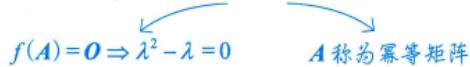

(1)求 $\pmb{A}$ 的特征值可能的取值；  
(2) 证明: $E + A$ 是可逆矩阵.

(1)解由 $A^2 = A$ 知 $A^2 -A = 0$ ，设 $\lambda$ 是 $A$ 的特征值，由“三、3”的注(4)知， $\lambda^2 -\lambda = 0$ ，解得 $\lambda = 0$ 或 $\lambda = 1$ ：因为这不是由 $\vert \lambda E - A\vert = 0$ 得到的特征方程，所以它仅是特征值约束  
(2) 证由(1)知，满足 $A^2 = A$ 的矩阵 $\pmb{A}$ 的特征值可能的取值是 $\lambda = 0$ 或 $\lambda = 1$ ，则 $\pmb{E} + \pmb{A}$ 的特征值可能的取值是1或2，均不为0，故 $|E + A| \neq 0$ （或假设 $|E + A| = 0$ ，则-1是 $\pmb{A}$ 的特征值，这与(1)中的结论矛盾），则 $E + A$ 是可逆矩阵.

注 满足条件 $A^2 = A$ 的矩阵有很多，例如， $A = \begin{bmatrix} 1 & 0 \\ 0 & 1 \end{bmatrix}$ 或 $\begin{bmatrix} 1 & 0 \\ 0 & 0 \end{bmatrix}$ 或 $\begin{bmatrix} 0 & 0 \\ 0 & 0 \end{bmatrix}$ ，均有 $A^2 = A$ ，而它们的特征值分别是1，1；1，0；0，0. 对角矩阵的特征值是主对角线元素

例5.4 已知 $A$ 是3阶方阵，特征值为1，2，3，则 $|\pmb{A}|$ 的元素 $a_{11}, a_{22}, a_{33}$ 的代数余子式 $A_{11}, A_{22}, A_{33}$ 的和 $\sum_{i=1}^{3} A_{ii} = \_$ 。

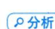

$\operatorname{tr}(A^{\bullet}) = \lambda_{1}^{\bullet} + \lambda_{2}^{\bullet} + \lambda_{3}^{\bullet}$ ，其中， $\lambda_1^* = \frac{|A|}{\lambda_1} = \lambda_2\lambda_3$ ， $\lambda_2^* = \frac{|A|}{\lambda_2} = \lambda_1\lambda_3$ ， $\lambda_3^* = \frac{|A|}{\lambda_3} = \lambda_1\lambda_2$

应填11.

3阶矩阵 $\pmb{A}$ 的特征值 $\lambda = 1,2,3$ ，由2阶主子式之和等于任意两个特征值乘积之和，得

$$
\sum_ {i = 1} ^ {3} A _ {i i} = 2 \times 3 + 1 \times 3 + 1 \times 2 = 1 1.
$$

例5.5

设 $A = (a_{ij})$ 为3阶矩阵， $A_{ij}$ 为元素 $a_{ij}$ 的代数余子式.若 $\pmb{A}$ 的每行元素之和均为2，且

$\left|A\right| = 3$ ，则 $A_{11} + A_{21} + A_{31} = \underline{\quad}$

$$
\boldsymbol {A} \left[ \begin{array}{l} 1 \\ 1 \\ 1 \end{array} \right] = \left[ \begin{array}{l} 2 \\ 2 \\ 2 \end{array} \right] = 2 \left[ \begin{array}{l} 1 \\ 1 \\ 1 \end{array} \right]
$$

解 应填 $\frac{3}{2}$

由 $A\left[ \begin{array}{l}1\\ 1\\ 1 \end{array} \right] = 2\left[ \begin{array}{l}1\\ 1\\ 1 \end{array} \right]$ ，得 $\pmb{A}$ 的一个特征值 $\lambda = 2$ ，其对应的特征向量为 $\alpha = \begin{bmatrix} 1\\ 1\\ 1 \end{bmatrix}$ 则 $A^{\star}$ 的一个特征值为 $\frac{|A|}{\lambda}$ 其对应的特征向量也为 $\pmb {\alpha} = \begin{bmatrix} 1\\ 1\\ 1 \end{bmatrix}$ .由 $A^{*}\alpha = \frac{|A|}{\lambda}\alpha$ ， $A^{*} = \begin{bmatrix} A_{11} & A_{21} & A_{31}\\ A_{12} & A_{22} & A_{32}\\ A_{13} & A_{23} & A_{33} \end{bmatrix}$ ，得 $A^{*}\left[ \begin{array}{l}1\\ 1\\ 1 \end{array} \right] = \left[ \begin{array}{l}A_{11} + A_{21} + A_{31}\\ A_{12} + A_{22} + A_{32}\\ A_{13} + A_{23} + A_{33} \end{array} \right] = \frac{|A|}{\lambda}\left[ \begin{array}{l}1\\ 1\\ 1 \end{array} \right]$ 即

$$
A _ {1 1} + A _ {2 1} + A _ {3 1} = \frac {3}{2}.
$$

# 四 矩阵的相似

# 定义

等价的前提下 $P$ 与 $Q$ 没关系，相似的前提下 $P$ 与 $Q$ 互为逆矩阵

$\pmb{A}$ 与 $\pmb{B}$ 等价：

要求 $A$ 与 $B$ 同型， $QAP = B$ 且 $\pmb{Q}$ 与 $\pmb{P}$ 是可逆矩阵.现在我们将条件严格限制一下 $\pmb{A}$ 与 $\pmb{B}$ 不仅同型且是方阵，可看出相似是特殊化的等价.

设 $A, B$ 是两个 $n$ 阶方阵，若存在 $n$ 阶可逆矩阵 $\pmb{P}$ ，使得 $P^{-1}AP = B$ ，则称 $\pmb{A}$ 相似于 $\pmb{B}$ ，记成 $A \sim B$ 。

注 (1) $A \sim A$ ; (反身性)

(2) 若 $A \sim B$ ，则 $B \sim A$ ；（对称性）性质(3)最重要  
如何证明矩阵相似？  
(3) 若 $A \sim B, B \sim C$ ，则 $A \sim C$ 。（传递性）这个性质以后常用。  
$①$ 定义法； $②$ 传递法.

# 相似矩阵的性质

考研中用传递性证明相似时一般证 $\pmb{A}$ 相似于对角矩阵 $\pmb{A}_{1}$ ， $\pmb{B}$ 相似于对角矩阵 $\pmb{A}_{2}$ ，相似的对角矩阵 $\pmb{A}_{1}$ 与 $\pmb{A}_{2}$ 一样，则 $\pmb{A}$ 与 $\pmb{B}$ 相似.

若 $A\sim B$ ，则

$\rightarrow$ 因为 ${P}^{-1}{AP} = B$ ,有 $\left| {{P}^{-1}{AP}}\right|  = \left| B\right|$ ,从而 $\left| A\right|  = \left| B\right|$ . ① $\left| A\right|  = \left| B\right|$ .  
② $r(A) = r(B)$ ① 相似是特殊化等价，所以 $r(A) = r(B)$ ② $P^{-1}AP = B$ ， $A$ 右乘矩阵 $P$ ，左乘矩阵 $P^{-1}$ ，秩不变。  
③ $\operatorname{tr}\left( \mathbf{A}\right)  = \operatorname{tr}\left( \mathbf{B}\right)$ . ——因为 $\mathbf{A}$ 与 $\mathbf{B}$ 的特征值一样,特征值之和等于主对角线元素之和. 相似矩阵特征值一样,见“三”的“3”  
④ $\lambda_{A} = \lambda_{B}$ （或 $|\lambda E - A| = |\lambda E - B|)$

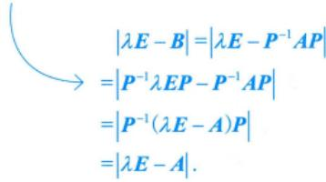

⑤ $r(\lambda E - A) = r(\lambda E - B)$ . $\longrightarrow A$ 与 $B$ 相似，则 $\lambda E - A$ 与 $\lambda E - B$ 相似.  
⑥ $A, B$ 的各阶主子式之和分别相等.

注 (1) 若①, ②, ③, ④, ⑤, ⑥中至少有一个不成立, 则 $\mathbf{A}$ 不相似于 $\mathbf{B}$ .

(2) 性质⑤的证明方法如下.

证 若 $A \sim B$ ，则 $\lambda E - A \sim \lambda E - B$ ，所以 $r(\lambda E - A) = r(\lambda E - B)$ 。事实上，由 $A \sim B$ ，知存在可逆矩阵 $P$ ，使得 $P^{-1}AP = B$ ，若 $A$ 属于 $\lambda$ 的线性无关的特征向量是 $\xi_1, \xi_2, \dots, \xi_s$ ，则 $B$ 属于 $\lambda$ 的线性无关的特征向量是 $P^{-1}\xi_1, P^{-1}\xi_2, \dots, P^{-1}\xi_s$ ，故 $A$ 和 $B$ 对应于特征值 $\lambda$ 的线性无关的特征向量的个数相同，即 $n - r(\lambda E - A) = n - r(\lambda E - B)$ ，也即 $r(\lambda E - A) = r(\lambda E - B)$ 。

(3) 性质⑥的说明：在“三、1.(2)”注中已经给出了 $A$ 的各阶主子式，由于 $A, B$ 相似，因此④成立，故⑥成立。这里也说明了一个深刻的事实：相似变换的不变量是“各阶主子式之和”。如矩阵 $A = \begin{bmatrix} 1 & 1 & 0 \\ 0 & 1 & 1 \\ 1 & 0 & 1 \end{bmatrix}$ ，其2阶主子式之和为 $A_{11} + A_{22} + A_{33} = 1 + 1 + 1 = 3$ ； $B = \begin{bmatrix} 1 & 1 & -1 \\ 0 & 1 & 0 \\ 1 & 0 & 1 \end{bmatrix}$ ，其2阶主子式之和为 $\widetilde{A}_{11} + \widetilde{A}_{22} + \widetilde{A}_{33} = 1 + 2 + 1 = 4$ ，故 $A$ 与 $B$ 不相似。

但是，即使 $① \sim ⑥$ 全成立，也不能说 $\pmb{A}$ 相似于 $\pmb{B}$ .如：

设 $A = \begin{bmatrix} 1 & 0 & 0 & 0\\ 1 & 1 & 0 & 0\\ 0 & 0 & 1 & 0\\ 0 & 0 & 1 & 1 \end{bmatrix}, B = \begin{bmatrix} 1 & 0 & 0 & 0\\ 0 & 1 & 0 & 0\\ 0 & 1 & 1 & 0\\ 0 & 0 & 1 & 1 \end{bmatrix}$ 可轻易验证①~⑥均成立.

现设 $A\sim B$ ，则 $A - E\sim B - E$

记 $A - E = A_{1}, B - E = B_{1}$ ，即 $A_{1} \sim B_{1}$ ，也即存在可逆矩阵 $P$ ，使得 $P^{-1}A_{1}P = B_{1}$ ，于是 $A_{1}P = PB_{1}$ 设 $P = (p_{ij}), 1 \leqslant i, j \leqslant 4$ ，故

$$
\left[ \begin{array}{l l l l} 0 & 0 & 0 & 0 \\ 1 & 0 & 0 & 0 \\ 0 & 0 & 0 & 0 \\ 0 & 0 & 1 & 0 \end{array} \right] \left[ \begin{array}{l l l l} p _ {1 1} & p _ {1 2} & p _ {1 3} & p _ {1 4} \\ p _ {2 1} & p _ {2 2} & p _ {2 3} & p _ {2 4} \\ p _ {3 1} & p _ {3 2} & p _ {3 3} & p _ {3 4} \\ p _ {4 1} & p _ {4 2} & p _ {4 3} & p _ {4 4} \end{array} \right] = \left[ \begin{array}{l l l l} p _ {1 1} & p _ {1 2} & p _ {1 3} & p _ {1 4} \\ p _ {2 1} & p _ {2 2} & p _ {2 3} & p _ {2 4} \\ p _ {3 1} & p _ {3 2} & p _ {3 3}, & p _ {3 4} \\ p _ {4 1} & p _ {4 2} & p _ {4 3}, & p _ {4 4} \end{array} \right] \left[ \begin{array}{l l l l} 0 & 0 & 0 & 0 \\ 0 & 0 & 0 & 0 \\ 0 & 1 & 0 & 0 \\ 0 & 0 & 1 & 0 \end{array} \right],
$$

即

$$
\left[ \begin{array}{c c c c} 0 & 0 & 0 & 0 \\ p _ {1 1} & p _ {1 2} & p _ {1 3} & p _ {1 4} \\ 0 & 0 & 0 & 0 \\ p _ {3 1} & p _ {3 2} & p _ {3 3} & p _ {3 4} \end{array} \right] = \left[ \begin{array}{c c c c} 0 & p _ {1 3} & p _ {1 4} & 0 \\ 0 & p _ {2 3} & p _ {2 4} & 0 \\ 0 & p _ {3 3} & p _ {3 4} & 0 \\ 0 & p _ {4 3} & p _ {4 4} & 0 \end{array} \right],
$$

得

$$
\left\{ \begin{array}{l} p _ {1 3} = p _ {1 4} = 0, \\ p _ {1 3} = p _ {2 4}, \\ p _ {3 3} = p _ {3 4} = 0, \\ p _ {3 3} = p _ {4 4}, \end{array} \right.
$$

解得 $p_{14} = 0, p_{24} = 0, p_{34} = 0, p_{44} = 0$ ，即 $\pmb{P}$ 的第4列元素全为0，故 $|\pmb{P}| = 0$ ， $\pmb{P}$ 不可逆，矛盾。于是 $\pmb{A}_{1}$ 与 $\pmb{B}_{1}$ 不相似，即 $\pmb{A}$ 与 $\pmb{B}$ 不相似。

# 重要结论

若 $A\sim B$ ，则 $A^2 -2A + 3E\sim B^2 -2B + 3E$

(1) 若 $A \sim B$ ，则 $A^k \sim B^k$ ， $f(A) \sim f(B)$ （其中 $f(x)$ 是多项式）.

证 ① 因 $A, B$ 相似，故有可逆矩阵 $\pmb{P}$ ，使得 $P^{-1}AP = B$ 。

由

$$
\pmb {B} ^ {k} = \overbrace {\pmb {B B} \cdots \pmb {B B}} ^ {k \text {个}} = \overbrace {(\pmb {P} ^ {- 1} \pmb {A P}) (\pmb {P} ^ {- 1} \pmb {A P}) \cdots (\pmb {P} ^ {- 1} \pmb {A P})} ^ {k \text {个}}
$$

$$
P ^ {- 1} \text {A} P = \widehat {B}
$$

$$
= P ^ {- 1} A (P P ^ {- 1}) A (P P ^ {- 1}) \dots A P = P ^ {- 1} A ^ {k} P,
$$

$$
\begin{array}{c c} \mathbf {A} ^ {\bullet} & \mathbf {B} ^ {\bullet} \end{array}
$$

考虑相似手段 A $\mathbf{B}^{-1}$ 是否相同 4） $f(B)$

知 $A^k\sim B^k$

$$
\begin{array}{c c} A ^ {T} & B ^ {T} \end{array}
$$

② 设 $f(x) = a_{k}x^{k} + a_{k - 1}x^{k - 1} + \dots +a_{1}x + a_{0}$ ，由于

$$
\boldsymbol {P} ^ {- 1} \left(a _ {0} \boldsymbol {E}\right) \boldsymbol {P} = a _ {0} \boldsymbol {E},
$$

并且由①可知

$$
\boldsymbol {P} ^ {- 1} \left(a _ {1} \boldsymbol {A}\right) \boldsymbol {P} = a _ {1} \boldsymbol {B}, \dots , \boldsymbol {P} ^ {- 1} \left(a _ {k} \boldsymbol {A} ^ {k}\right) \boldsymbol {P} = a _ {k} \boldsymbol {B} ^ {k}.
$$

等式两边全部相加，得

$$
\boldsymbol {P} ^ {- 1} \left(a _ {k} \boldsymbol {A} ^ {k} + \dots + a _ {1} \boldsymbol {A} + a _ {0} \boldsymbol {E}\right) \boldsymbol {P} = a _ {k} \boldsymbol {B} ^ {k} + \dots + a _ {1} \boldsymbol {B} + a _ {0} \boldsymbol {E},
$$

即 $P^{-1}f(A)P = f(B)$ ，故 $f(A)\sim f(B)$

(2)若 $A\sim B$ ，且 $\pmb{A}$ 可逆，则 $A^{-1}\sim B^{-1}$ ， $f(A^{-1})\sim f(B^{-1})$ （其中 $f(x)$ 是多项式）

注证若 $A\sim B$ ，则存在可逆矩阵 $\pmb{P}$ ，使得 $P^{-1}AP = B$ ，两边取逆，有 $P^{-1}A^{-1}P = B^{-1}$ ，故 $A^{-1}\sim B^{-1}$ ，由(1)知 $f(A^{-1})\sim f(B^{-1})$ ：

(3) 若 $A \sim B$ ，则 $A^{*} \sim B^{*}$ .

这里用的是穿脱原则： $(AB)^{*} = B^{*}A^{*}$

注 ①证 若 $A \sim B$ ，则存在可逆矩阵 $P$ ，使得 $P^{-1}AP = B$ ，两边取伴随，有 $P^{\star}A^{\star}(P^{-1})^{\star} = B^{\star}$ ，即 $P^{\star}A^{\star}(P^{\star})^{-1} = B^{\star}$ ，故 $A^{\star} \sim B^{\star}$ 。事实上，由于 $P^{\star} = |P|P^{-1}$ ，即 $|P|P^{-1}A^{\star}\frac{1}{|P|} P = B^{\star}$ ，也即 $P^{-1}A^{\star}P = B^{\star}$ 。看到伴随矩阵，大家得能想到逆矩阵，因为它们仅相差个行列式

②由(1)~(3)可知,若 ${P}^{-1}{AP} = B$ ,则 ${P}^{-1}f\left( A\right) P = f\left( B\right) ,{P}^{-1}{A}^{-1}P = {B}^{-1},{P}^{-1}{A}^{ * }P = {B}^{ * }$ ,即 $f\left( A\right)$ 与 $f\left( B\right) ,{A}^{-1}$ 与 ${B}^{-1},{A}^{ * }$ 与 ${B}^{ * }$ 相似的手段相同,也即 ${P}^{-1}\left\lbrack  {{af}\left( A\right)  + b{A}^{-1} + c{A}^{ * }}\right\rbrack  P = {af}\left( B\right)  + b{B}^{-1} + c{B}^{ * }$ . ${A}^{\mathrm{T}} \sim  {B}^{\mathrm{T}}$ 相似手段与上面不同

(4) 若 $A \sim B$ ，则 $A^{\mathrm{T}} \sim B^{\mathrm{T}}$

注证若 $A\sim B$ ，则存在可逆矩阵 $\pmb{P}$ ，使得 $P^{-1}AP = B$ ，两边取转置，有 $P^{\mathrm{T}}A^{\mathrm{T}}(P^{-1})^{\mathrm{T}} = B^{\mathrm{T}}$ 即 $P^{\mathrm{T}}A^{\mathrm{T}}(P^{\mathrm{T}})^{-1} = B^{\mathrm{T}}$ ，故 $A^{\mathrm{T}}\sim B^{\mathrm{T}}$ .由此可知， $A^{\mathrm{T}}$ 与 $B^{\mathrm{T}}$ 相似的手段与(1）～(3)不同.

(5) 若 $A \sim C, B \sim D$ ，则 $\left[ \begin{array}{cc} A & O \\ O & B \end{array} \right] \sim \left[ \begin{array}{cc} C & O \\ O & D \end{array} \right]$ .

注证若 $A\sim C$ ，则存在可逆矩阵 $\pmb{P}_{1}$ ，使得 $P_{1}^{-1}AP_{1} = C$ ；若 $B\sim D$ ，则存在可逆矩阵 $P_{2}$ ，使得 $P_{2}^{-1}BP_{2} = D$ ：

故 $\left[ \begin{array}{ll}P_1^{-1} & O\\ O & P_2^{-1} \end{array} \right]\left[ \begin{array}{ll}A & O\\ O & B \end{array} \right]\left[ \begin{array}{ll}P_1 & O\\ O & P_2 \end{array} \right] = \left[ \begin{array}{ll}C & O\\ O & D \end{array} \right],$ 则 $\left[ \begin{array}{ll}A & O\\ O & B \end{array} \right] \sim \left[ \begin{array}{ll}C & O\\ O & D \end{array} \right].$

# 4 两个矩阵是否相似的判别与证明

(1) 定义法. 若存在可逆矩阵 $P$ ，使得 $P^{-1}AP = B$ ，则 $A \sim B$ ：

(2)传递性.若 $A\sim A,A\sim B$ ，则 $A\sim B$ .（重点）

(3)性质.若 $A \sim  B$ ,则 $r\left( A\right)  = r\left( B\right) ,\left| A\right|  = \left| B\right| ,\operatorname{tr}\left( A\right)  = \operatorname{tr}\left( B\right) ,{\lambda }_{A} = {\lambda }_{B},r\left( {{\lambda E} - A}\right)  = r\left( {{\lambda E} - B}\right)$ , $A$ 与 $B$ 的各阶主子式之和分别相等.

满足性质不一定相似，但不满足性质一定不相似

注 可在 $A \sim B$ 的条件下，用性质反求参数，但如前所述，所有的性质都只是 $A \sim B$ 的必要条件。

例5.6 设 $\pmb{W} = \begin{bmatrix} 1 & 1 & 1\\ 2 & 2 & 2\\ 3 & 3 & 3 \end{bmatrix}$ 则与 $\pmb{W}$ 相似的矩阵是（ ）：

$\operatorname {tr}(A) = 3$

(A) $\mathbf{A} = \left\lbrack  \begin{matrix} 1 & 0 & 1 \\  0 & 2 & 0 \\  0 & 0 & 0 \end{matrix}\right\rbrack$

(B) $\mathbf{B} = \left\lbrack  \begin{matrix} 1 & 0 & 0 \\  0 & 0 & 2 \\  0 & 3 & 0 \end{matrix}\right\rbrack$

(C) $C = \begin{bmatrix} 1 & 1 & 1\\ 2 & 2 & 2\\ -3 & -3 & -3 \end{bmatrix}$

$= \mathbf{0}$ $\mathbf{D}\mathbf{P} = \left\lbrack  \begin{matrix} 1 & 2 & 1 \\  2 & 4 & 2 \\  1 & 2 & 1 \end{matrix}\right\rbrack$

分析 判断两个矩阵是否相似：①用相似的性质进行排除；②用相似传递性验证两个矩阵是否相似.

解 应选(D).

因为 $W$ 的秩为1，所以它有两个0特征值，另一个是 $\operatorname{tr}(W)$

$r(\pmb {W}) = 1\neq r(\pmb {A}) = 2,\pmb{W}$ 与 $\pmb{A}$ 不相似，排除(A)； $|\pmb {W}| = 0\neq |\pmb {B}| = -6,\pmb{W}$ 与 $\pmb{B}$ 不相似，排除(B)； $\operatorname {tr}(\boldsymbol {W}) =$ $6\neq \operatorname {tr}(C) = 0,W$ 与 $c$ 不相似，排除(C).由排除法知，应选(D).

对于(D)， $r(W) = r(D) = 1,\lambda = 0$ 均为二重特征值， $r(0E - W) = r(0E - D) = 1$ ，即它们均有2个线性无关的特征向量，又 $\lambda_3 = \sum_{i = 1}^{3}w_{ii} = \sum_{i = 1}^{3}d_{ii} = 6$ ，故 $W\sim D$ ，即 重特征值0的重数等于对应线性无关特征向量个数时，

$$
\left[ \begin{array}{l l l} 1 & 1 & 1 \\ 2 & 2 & 2 \\ 3 & 3 & 3 \end{array} \right] \sim \left[ \begin{array}{l l l} 1 & 2 & 1 \\ 2 & 4 & 2 \\ 1 & 2 & 1 \end{array} \right],
$$

应选(D).

注 选项(A)，(B)，(C)均不满足与 $\pmb{W}$ 相似的必要条件，应排除，利用必要条件来排除不成立的结论是选择题常用的方法，此题在考场上不必验证(D).

例5.7 已知

$$
\boldsymbol {A} = \left[ \begin{array}{l l l} 2 & 0 & 0 \\ 0 & 0 & 1 \\ 0 & 1 & a \end{array} \right], \boldsymbol {B} = \left[ \begin{array}{c c c} 2 & & \\ & b & \\ & & - 1 \end{array} \right],
$$

且 $A\sim B$ ，则 $(a,b) =$

分析 由 $A\sim B$ ，利用 $\operatorname {tr}(A) = \operatorname {tr}(B),|A| = |B|$ 来解决问题.

解 应填 $(0,1)$ ：

因为 $A \sim B$ ，所以 $|\mathbf{A}| = |\mathbf{B}|$ ， $\operatorname{tr}(A) = \operatorname{tr}(B)$ ，得 $|\mathbf{A}| = -2 = |\mathbf{B}| = -2b$ ，则 $b = 1$ ； $\operatorname{tr}(A) = 2 + a = \operatorname{tr}(B) = 1 + b$ ，则 $a = 0$ 。

例5.8 已知可逆矩阵 $\mathbf{A}$ 相似于 $\pmb{B}$ ，则下列选项不正确的是（ ）.

(A) $A^{*} + A^{-1}$ 与 $\pmb{B}^{*} + \pmb{B}^{-1}$ 相似

(B) $A^2 + A^{-1}$ 与 $B^2 + B^{-1}$ 相似

(C) $A^2 + A^*$ 与 $\pmb{B}^{2} + \pmb{B}^{*}$ 相似

(D) $A^2 + A^{\mathrm{T}}$ 与 $\pmb{B}^{2} + \pmb{B}^{\mathrm{T}}$ 相似

解 应选(D).

由“四、3.重要结论”的 $(1)\sim (4)$ 可知，选项(A)，(B)，(C)正确，(D)不正确.故选(D).

# 五 矩阵的相似对角化

这里不要与我们前面学的等价标准形混了，

等价标准形 $PAQ = \begin{bmatrix} E_r & O \\ O & O \end{bmatrix}$ ，其中 $P, Q$ 为可逆矩阵.

①等价标准形 $A$ 可以不是方阵；

②手段不限制，只要左边乘 $P$ ，右边乘 $Q$ 就行

# 1定义

最“好看”的矩阵.

设 $A$ 为 $n$ 阶矩阵，若存在 $n$ 阶可逆矩阵 $\pmb{P}$ ，使得 $P^{-1}AP = A$ ，其中 $\pmb{A}$ 是对角矩阵，则称 $\pmb{A}$ 可相似对角化，记 $A\sim A$ ，称 $\pmb{A}$ 是 $\pmb{A}$ 的相似标准形.

# 2 矩阵可相似对角化的条件

由定义可知，若 $A$ 可相似对角化，即 $P^{-1}AP = A$ ，其中 $P$ 可逆，等式两边同时左边乘 $P$ ，有 $AP = PA$ ，记

$$
\boldsymbol {P} = \left[ \xi_ {1}, \xi_ {2}, \dots , \xi_ {n} \right], \boldsymbol {A} = \left[ \begin{array}{c c c c} \lambda_ {1} & & & \\ & \lambda_ {2} & & \\ & & \ddots & \\ & & & \lambda_ {n} \end{array} \right],
$$

则

$$
A [ \xi_ {1}, \xi_ {2}, \dots , \xi_ {n} ] = [ \xi_ {1}, \xi_ {2}, \dots , \xi_ {n} ] \left[ \begin{array}{l l l l} \lambda_ {1} & & & \\ & \lambda_ {2} & & \\ & & \ddots & \\ & & & \lambda_ {n} \end{array} \right], \quad \left[ \begin{array}{l l l l} \lambda_ {1} & & & \\ & \lambda_ {2} & & \\ & & \ddots & \\ & & & \lambda_ {n} \end{array} \right].
$$

$\lambda$ 的位置与特征向量位置是对应的.

即 $\begin{array}{rl} & {\left[A\xi_{1},A\xi_{2},\dots ,A\xi_{n}\right] = \left[\lambda_{1}\xi_{1},\lambda_{2}\xi_{2},\dots ,\lambda_{n}\xi_{n}\right],}\\ & {A\xi_{i} = \lambda_{i}\xi_{i},i = 1,2,\dots ,n.} \end{array}$ $A\xi_{3}:A_{3\times 3}:\lambda_{1} = \lambda_{2} = 3,\lambda_{3} = 7$ 也即 $\begin{array}{rcl}\xi_1 & \xi_2 & \xi_3\\ \Rightarrow [\xi_1,\xi_2,\xi_3]^{-1}A[\xi_1,\xi_2,\xi_3] = \left[ \begin{array}{ll}3 & \\ 3 & \\ 7 \end{array} \right], \end{array}$ 由P可逆，则ξ，，，线性无关.上述过程可逆，于是

由 $\pmb{P}$ 可逆，则 $\xi_1,\xi_2,\dots ,\xi_n$ 线性无关.上述过程可逆，于是

① $n$ 阶矩阵 $A$ 可相似对角化 $\Leftrightarrow  A$ 有 $n$ 个线性无关的特征向量. ${\left\lbrack  {\xi }_{3},{\xi }_{2},{\xi }_{1}\right\rbrack  }^{-1}A{\left\lbrack  {\xi }_{3},{\xi }_{2},{\xi }_{1}\right\rbrack   = \left\lbrack  \begin{matrix} 7 \\  3 \end{matrix}\right\rbrack$ . 由“三、2.(2) ①”, $k$ 重特征值 $\lambda$ 至多只有 $k$ 个线性无关的特征向量,得  
② $n$ 阶矩阵 $\mathbf{A}$ 可相似对角化 $\Leftrightarrow \mathbf{A}$ 对应于每个 $k_{i}$ 重特征值都有 $k_{i}$ 个线性无关的特征向量.

$$
\begin{array}{l} {\mathrm {单 根 特 征 值 一 定 会 有 一 个 线 性 无 关 的 特 征 向 量 ,}} \\ {\mathrm {重 根 特 征 值 线 性 无 关 的 特 征 向 量 有 可 能 小 于 重 数}} \\ {2. (2) \mathrm {② ” , 对 应 于 不 同 特 征 值 的 特 征 向 量 线 性 无 关 , 得}} \end{array} \quad \begin{array}{l} {\mathrm {如} A _ {5 \times 5}, \quad \lambda_ {1} = \lambda_ {2} = 7} \\ {\downarrow \quad \downarrow} \\ {\xi_ {1} \quad \xi_ {2}} \end{array} \quad \begin{array}{l} {\mathrm {单 根 特 征 值 一 定 会 有 一 个 线 性 无 关 的 特 征 向 量 ,}} \\ {\mathrm {重 根 特 征 值 线 性 无 关 的 特 征 向 量 有 可 能 小 于 重 数}} \\ {2 = 5 - r (7 E - A)} \end{array} \quad \begin{array}{l} {\mathrm {如} A _ {5 \times 5}, \quad \lambda_ {3} = \lambda_ {4} = \lambda_ {5} = 2} \\ {\downarrow \quad \downarrow} \\ {\xi_ {3} \quad \xi_ {4} \quad \xi_ {5}} \end{array}
$$

③ $n$ 阶矩阵 $\mathbf{A}$ 有 $n$ 个不同特征值 $\Rightarrow \mathbf{A}$ 可相似对角化.

由下面的“六”可知：  
④ $n$ 阶矩阵 $\mathbf{A}$ 为实对称矩阵 $\Rightarrow \mathbf{A}$ 可相似对角化.  
以上 $①$ ， $②$ 为 $\pmb{A}$ 可相似对角化的充要条件； $③$ ， $④$ 为 $\pmb{A}$ 可相似对角化的充分条件.

# 求可逆矩阵 $P$ ，使得 $P^{-1}AP = \Lambda$

在已知 $n$ 阶矩阵 $\mathbf{A}$ 可相似对角化的条件下，其基本步骤如下.

① 求 $A$ 的特征值 $\lambda_1, \lambda_2, \dots, \lambda_n$ .  
② 求 $A$ 的对应于特征值 $\lambda_1, \lambda_2, \dots, \lambda_n$ 的线性无关的特征向量 $\xi_1, \xi_2, \dots, \xi_n$ .

$③$ 令 $\pmb {P} = [\pmb {\xi}_1,\pmb {\xi}_2,\dots ,\pmb {\xi}_n]$ ，则 $P^{-1}AP = A = \left[ \begin{array}{cccc}\lambda_{1} & & & \\ & \lambda_{2} & & \\ & & \ddots & \\ & & & \lambda_{n} \end{array} \right].$

需要注意的是， $P$ 中特征向量 $\xi_{i}$ 与 $\pmb{A}$ 中特征值 $\lambda_{i}$ 对应，且 $P$ 没有唯一性.

# 由特征值、特征向量反求 $A$

若有可逆矩阵 $P$ ，使得 $P^{-1}AP = A$ ，则 $A = PAP^{-1}$ ，这是反求 $A$ 的一个基本思路.

$$
\left[ \xi_ {1}, \xi_ {2} \right] ^ {- 1} A \left[ \xi_ {1}, \xi_ {2} \right] = \left[ \begin{array}{l} \lambda_ {1} \\ \lambda_ {2} \end{array} \right] \Rightarrow A = \left[ \xi_ {1}, \xi_ {2} \right] \left[ \begin{array}{l} \lambda_ {1} \\ \lambda_ {2} \end{array} \right] \left[ \xi_ {1}, \xi_ {2} \right] ^ {- 1}
$$

# 5 求 $A^k$ 及 $f(A)$

按照4，进一步地，当 $A\sim A = \left[ \begin{array}{cccc}\lambda_1 & & & \\ & \lambda_2 & & \\ & & \ddots & \\ & & & \lambda_n \end{array} \right]$ 时，有

$$
\boldsymbol {P} ^ {- 1} \boldsymbol {A} ^ {k} \boldsymbol {P} = \boldsymbol {A} ^ {k}, \boldsymbol {A} ^ {k} = \boldsymbol {P} \boldsymbol {A} ^ {k} \boldsymbol {P} ^ {- 1} = \boldsymbol {P} \left[ \begin{array}{c c c c} \lambda_ {1} ^ {k} & & & \\ & \lambda_ {2} ^ {k} & & \\ & & \ddots & \\ & & & \lambda_ {n} ^ {k} \end{array} \right] \boldsymbol {P} ^ {- 1},
$$

$$
\boldsymbol {P} ^ {- 1} f (\boldsymbol {A}) \boldsymbol {P} = f (\boldsymbol {A}), f (\boldsymbol {A}) = \boldsymbol {P} f (\boldsymbol {A}) \boldsymbol {P} ^ {- 1} = \boldsymbol {P} \left[ \begin{array}{c c c c} f (\lambda_ {1}) & & & \\ & f (\lambda_ {2}) & & \\ & & \ddots & \\ & & & f (\lambda_ {n}) \end{array} \right] \boldsymbol {P} ^ {- 1}.
$$

例5.9 下列矩阵中，不能相似于对角矩阵的是（ ）

(A) $A = \begin{bmatrix} 0 & 0 & 1\\ 0 & 1 & 0\\ 1 & 0 & 0 \end{bmatrix}$

(B) $\pmb{B} = \begin{bmatrix} 1 & 1 & 1\\ 0 & 2 & 2\\ 0 & 0 & 3 \end{bmatrix}$

(C) $C = \begin{bmatrix} 1 & -2 & 1\\ 2 & -4 & 2\\ 1 & -2 & 1 \end{bmatrix}$

(D) $\pmb{D} = \begin{bmatrix} 2 & -1 & 2 \\ 5 & -3 & 3 \\ -1 & 0 & -2 \end{bmatrix}$

解 应选(D).

$\pmb{A}$ 是实对称矩阵，必相似于对角矩阵. $\pmb{B}$ 有3个不同的特征值 $\lambda_{1} = 1, \lambda_{2} = 2, \lambda_{3} = 3$ ，能相似于对角矩阵.

$r(\pmb {C}) = 1,\lambda = 0$ 是二重特征值，有2个线性无关的特征向量，另一个特征值 $\lambda_3 = -2$ ，故 $c$ 能相似于对角矩阵.由排除法，应选(D).

对(D)，由

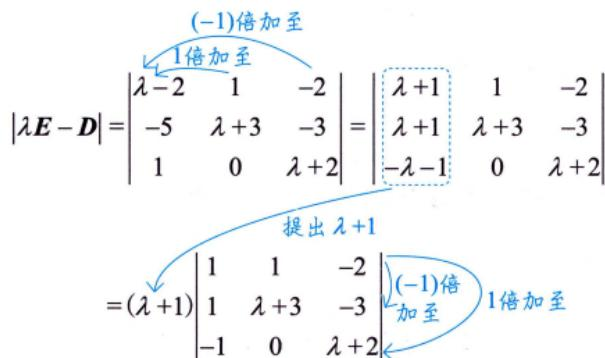

$$
= (\lambda + 1) \left| \begin{array}{c c c} 1 & 1 & - 2 \\ 0 & \lambda + 2 & - 1 \\ 0 & 1 & \lambda \end{array} \right| = (\lambda + 1) ^ {3} = 0,
$$

知 $\lambda = -1$ 是三重特征值，但 $-E - D \neq 0$ ，线性无关的特征向量最多有2个（实际上只有1个），故 $D$ 不能相似于对角矩阵.

注 判别一个矩阵是否相似于对角矩阵的步骤如下：

(1) 是否是实对称矩阵，实对称矩阵必相似于对角矩阵（如(A)).  
(2) 特征值是否都是实单根，若是，则相似于对角矩阵（如(B)).  
(3) 特征值是 $r$ 重根，若对应有 $r$ 个线性无关的特征向量，则相似于对角矩阵（如(C)）；若对应的线性无关的特征向量少于 $r$ 个（不可能多于 $r$ 个），则不能相似于对角矩阵（如(D)).

行列式为0的两个不同说法

例5.10 设 $A$ 是3阶矩阵，已知 $\left|E + A\right| = 0, (3E - A)x = 0$ 有非零解， $E - 3A$ 不可逆，问 $A$ 是否相似于对角矩阵，并说明理由。

解 $A$ 相似于对角矩阵.

由题意，知 $E + A,3E - A,E - 3A$ 均不可逆，即 $\begin{array}{r}\left|aA + bE\right| = 0\Rightarrow \lambda = -\frac{b}{a}\\ \left|E + A\right| = 0,\left|3E - A\right| = 0,\left|E - 3A\right| = 0, \end{array}$ 特征值各不相同，可相似对角化

因此可知， $A$ 有3个不同的特征值： $-1,3,\frac{1}{3}$ .从而 $A$ 有3个线性无关的特征向量，故 $A$ 相似于对角矩阵，即

$$
\boldsymbol {A} \sim \left[ \begin{array}{c c c} - 1 & & \\ & 3 & \\ & & \frac {1}{3} \end{array} \right].
$$

注 回顾结论：若 $A, B$ 可逆，则 $\left|A^{*}\right| = \left|A\right|^{n - 1}, (AB)^{*} = B^{*}A^{*}$

之前只针对 $A, B$ 可逆时作了说明，其实，当 $A, B$ 不可逆时，这两个结论依然成立，如何证明呢？这里给出一个能体现知识综合性的证明思路。

若 $|\pmb {A}| = 0$ ， $\left|0\bullet E + A\right| = 0\Rightarrow A$ 至少有一个特征值为0.不妨设 $\pmb{A}$ 的特征值为0，0，1.

若 $t > 0$ ，则 $tE + A$ 的特征值为 $t$ ， $t$ ， $t + 1$ . $\left|tE + A\right| = t^2 (t + 1) \neq 0$ ，从而 $tE + A$ 可逆. 当 $t$ 充分小时，总有 $\left|tE + A\right| \neq 0$ ，从而 $\left|(tE + A)^{*}\right| = \left|tE + A\right|^{n - 1}$ . 令 $t \to 0^{+}$ ，得 $\left|A^{*}\right| = \left|A\right|^{n - 1} \rightarrow$ 扰动法

关于 $l$ 的连续函数

类似地，有 $\left[(t\pmb {E} + \pmb {A})(t\pmb {E} + \pmb {B})\right]^* = (t\pmb {E} + \pmb {B})^* (t\pmb {E} + \pmb {A})^*$ ，令 $t\to 0^{+}$ ，得 $(AB)^{*} = B^{*}A^{*}$

例5.11 设 $A$ 为3阶矩阵， $\alpha_{1},\alpha_{2}$ 为 $A$ 的属于特征值1的线性无关的特征向量， $\pmb{\alpha}_{3}$ 为 $A$ 的属

于特征值-1的特征向量，则满足 $P^{-1}AP = \begin{bmatrix} 1 & 0 & 0\\ 0 & -1 & 0\\ 0 & 0 & 1 \end{bmatrix}$ 的可逆矩阵 $P$ 可为（ ）.

(A) $\left[\pmb{a}_{1} + \pmb{a}_{3},\pmb{a}_{2}, - \pmb{a}_{3}\right]$

(B) $[a_1 + a_2, a_2, -a_3]$

(C) $[\pmb{\alpha}_{1} + \pmb{\alpha}_{3}, -\pmb{\alpha}_{3}, \pmb{\alpha}_{2}]$

(D) $[a_1 + a_2, -a_3, a_2]$

解 应选(D).

因为 $\alpha_{1},\alpha_{3}$ 是属于矩阵 $A$ 的不同特征值的特征向量，故 $\pmb{\alpha}_{1} + \pmb{\alpha}_{3}$ 不是 $A$ 的特征向量，所以可排除选项(A)，(C).

若取 $P = [\pmb{\alpha}_1 + \pmb{\alpha}_2, \pmb{\alpha}_2, -\pmb{\alpha}_3]$ ，则由 $\pmb{\alpha}_1 + \pmb{\alpha}_2, \pmb{\alpha}_2, -\pmb{\alpha}_3$ 分别是 $\pmb{A}$ 的对应于特征值 1, 1, -1 的特征向量，故 $\pmb{P}^{-1}\pmb{A}\pmb{P} = \begin{bmatrix} 1 & 0 & 0 \\ 0 & 1 & 0 \\ 0 & 0 & -1 \end{bmatrix}$ ，排除 (B)；

若取 $P = [\pmb{\alpha}_1 + \pmb{\alpha}_2, -\pmb{\alpha}_3, \pmb{\alpha}_2]$ ，则由 $\pmb{\alpha}_1 + \pmb{\alpha}_2, -\pmb{\alpha}_3, \pmb{\alpha}_2$ 分别是 $\pmb{A}$ 的对应于特征值 1，-1，1 的特征向量，故 $\pmb{P}^{-1}\pmb{A}\pmb{P} = \begin{bmatrix} 1 & 0 & 0 \\ 0 & -1 & 0 \\ 0 & 0 & 1 \end{bmatrix}$ . 故选 (D).

例5.12 设 $A$ 为2阶矩阵且 $A^2 - A = 2E, P = [\alpha, A\alpha]$ , 其中 $\alpha$ 是非零向量且不是 $A$ 的特征向量.

$A\alpha \neq k\alpha ,\forall k\in \mathbf{R},\alpha \neq 0$

(1) 证明 $|P| \neq 0$

(2) 求 $P^{-1}AP$ ，并判断 $A$ 是否相似于对角矩阵.

(1) 证 若 $|P|=0$ ，即 $\pmb{P}$ 为不可逆矩阵，则 $\alpha, A\alpha$ 线性相关，因为 $\alpha \neq 0$ ，所以存在数 $\lambda_0$ ，使得 $A\alpha=\lambda_0\alpha$ 。这与 $\alpha$ 不是 $\pmb{A}$ 的特征向量矛盾，所以 $\pmb{P}$ 为可逆矩阵，即 $|P| \neq 0$ 。

(2)解因为 $A^2 - A - 2E = O$ ，即 $A^2\alpha - A\alpha - 2\alpha = 0, A^2\alpha = 2\alpha + A\alpha$ ，所以

$$
A P = [ A \alpha , A ^ {2} \alpha ] = [ A \alpha , 2 \alpha + A \alpha ] = [ \alpha , A \alpha ] \left[ \begin{array}{l l} 0 & 2 \\ 1 & 1 \end{array} \right] = P \left[ \begin{array}{l l} 0 & 2 \\ 1 & 1 \end{array} \right],
$$

故 $P^{-1}AP = \begin{bmatrix} 0 & 2\\ 1 & 1 \end{bmatrix},$

可知 $\pmb{A}$ 相似于 $\left[ \begin{array}{ll}0 & 2\\ 1 & 1 \end{array} \right]$ ，故 $|\lambda E - A| = \left| \begin{array}{cc}\lambda & -2\\ -1 & \lambda -1 \end{array} \right| = (\lambda -2)(\lambda +1)$ ，得 $\pmb{A}$ 的特征值为2，-1，所以 $\pmb{A}$ 相似于对角矩阵 $\left[ \begin{array}{ll}2 & 0\\ 0 & -1 \end{array} \right]$ .

考查概念与性质设 $\pmb{A}$ 为3阶矩阵， $\pmb{P}$ 为3阶可逆矩阵，且 $P^{-1}AP = \begin{bmatrix} 1 & 0 & 0\\ 0 & 1 & 0\\ 0 & 0 & 2 \end{bmatrix} .$ 若 $P = [\pmb {\alpha}_1,\pmb {\alpha}_2,\pmb {\alpha}_3]$ ， $\pmb {Q} = [\pmb {\alpha}_1 + \pmb {\alpha}_2,\pmb {\alpha}_2,\pmb {\alpha}_3]$ ，则 $Q^{-1}AQ = ()$ ：

(A) $\left[ \begin{array}{lll}1 & 0 & 0\\ 0 & 2 & 0\\ 0 & 0 & 1 \end{array} \right]$

(B) $\left[ \begin{array}{lll}1 & 0 & 0\\ 0 & 1 & 0\\ 0 & 0 & 2 \end{array} \right]$

(C) $\begin{bmatrix} 2 & 0 & 0\\ 0 & 1 & 0\\ 0 & 0 & 2 \end{bmatrix}$

(D) $\begin{bmatrix} 2 & 0 & 0\\ 0 & 2 & 0\\ 0 & 0 & 1 \end{bmatrix}$

解 应选(B).

由 $P^{-1}AP = \begin{bmatrix} 1 & 0 & 0\\ 0 & 1 & 0\\ 0 & 0 & 2 \end{bmatrix}$ ，知矩阵 $\pmb{A}$ 可相似对角化，因而其相似变换矩阵 $\pmb{P}$ 的列向量 $\alpha_{1},\alpha_{2},\alpha_{3}$ 是 $\pmb{A}$ 的分别属于特征值 $\lambda_1 = 1,\lambda_2 = 1,\lambda_3 = 2$ 的特征向量.由于 $\lambda_1 = \lambda_2 = 1$ 是 $\pmb{A}$ 的二重特征值，因此 $\pmb{\alpha}_{1} + \pmb{\alpha}_{2}$ 仍是 $\pmb{A}$ 的属于特征值1的特征向量，即 $A(\pmb {\alpha}_1 + \pmb {\alpha}_2) = 1(\pmb {\alpha}_1 + \pmb {\alpha}_2)$ ，从而有

$$
Q ^ {- 1} A Q = \left[ \begin{array}{l l l} \alpha_ {1} + \alpha_ {2}, & \alpha_ {2}, & \alpha_ {3} \end{array} \right] ^ {- 1} A \left[ \begin{array}{l l l} \alpha_ {1} + \alpha_ {2}, & \alpha_ {2}, & \alpha_ {3} \end{array} \right] = \left[ \begin{array}{l l l} 1 & 0 & 0 \\ 0 & 1 & 0 \\ 0 & 0 & 2 \end{array} \right].
$$

例5.14 设 $A$ 为3阶矩阵，已知 $\alpha_{1},\alpha_{2},\alpha_{3}$ 是线性无关的3维列向量，且满足

$$
A \alpha_ {1} = \alpha_ {1} + \alpha_ {2} + \alpha_ {3}, A \alpha_ {2} = 2 \alpha_ {2} + \alpha_ {3}, A \alpha_ {3} = 2 \alpha_ {2} + 3 \alpha_ {3}.
$$

(1) 求矩阵 $\pmb{B}$ ，使得 $A[\alpha_{1}, \alpha_{2}, \alpha_{3}] = [\alpha_{1}, \alpha_{2}, \alpha_{3}]\pmb{B}$ ；  
(2)求矩阵 $A$ 的特征值；  
(3)求可逆矩阵 $P$ ，使得 $P^{-1}AP$ 为对角矩阵.

解 (1) 将题设条件合并成矩阵形式有

$$
\begin{array}{l} A [ \alpha_ {1}, \alpha_ {2}, \alpha_ {3} ] = [ A \alpha_ {1}, A \alpha_ {2}, A \alpha_ {3} ] = [ \alpha_ {1} + \alpha_ {2} + \alpha_ {3}, 2 \alpha_ {2} + \alpha_ {3}, 2 \alpha_ {2} + 3 \alpha_ {3} ] \\ = \left[ \begin{array}{l l l} \boldsymbol {\alpha} _ {1}, & \boldsymbol {\alpha} _ {2}, & \boldsymbol {\alpha} _ {3} \end{array} \right] \left[ \begin{array}{l l l} 1 & 0 & 0 \\ 1 & 2 & 2 \\ 1 & 1 & 3 \end{array} \right], \\ \end{array}
$$

故 $\pmb{B} = \begin{bmatrix} 1 & 0 & 0\\ 1 & 2 & 2\\ 1 & 1 & 3 \end{bmatrix} .$

(2)因 $\alpha_{1},\alpha_{2},\alpha_{3}$ 线性无关，故 $C = [\pmb {\alpha}_1,\pmb {\alpha}_2,\pmb {\alpha}_3]$ 是可逆矩阵，且有 $C^{-1}AC = B$ ，即 $\mathbf{A}$ 和 $\pmb{B}$ 相似，相似矩阵有相同的特征值.因

$$
\left| \lambda E - B \right| = \left| \begin{array}{c c c} \lambda - 1 & 0 & 0 \\ - 1 & \lambda - 2 & - 2 \\ - 1 & - 1 & \lambda - 3 \end{array} \right| = (\lambda - 1) (\lambda^ {2} - 5 \lambda + 4) = (\lambda - 1) ^ {2} (\lambda - 4) = 0,
$$

故 $\pmb{B}$ 的特征值为1，1，4，所以 $A$ 的特征值也为1，1，4

(3) 对于矩阵 $\pmb{B}$ ，当 $\lambda_1 = \lambda_2 = 1$ 时，由 $(\pmb{E} - \pmb{B})\pmb{x} = \mathbf{0}$ ，即

$$
\left[ \begin{array}{c c c} 0 & 0 & 0 \\ - 1 & - 1 & - 2 \\ - 1 & - 1 & - 2 \end{array} \right] \left[ \begin{array}{l} x _ {1} \\ x _ {2} \\ x _ {3} \end{array} \right] = \left[ \begin{array}{l} 0 \\ 0 \\ 0 \end{array} \right],
$$

得基础解系 $\xi_{1} = [1, - 1,0]^{\mathrm{T}},\xi_{2} = [-2,0,1]^{\mathrm{T}}$

当 $\lambda_3 = 4$ 时，由 $(4E - B)x = 0$ ，即

$$
\left[ \begin{array}{c c c} 3 & 0 & 0 \\ - 1 & 2 & - 2 \\ - 1 & - 1 & 1 \end{array} \right] \left[ \begin{array}{l} x _ {1} \\ x _ {2} \\ x _ {3} \end{array} \right] = \left[ \begin{array}{l} 0 \\ 0 \\ 0 \end{array} \right],
$$

得基础解系 $\xi_{3} = [0,1,1]^{\mathrm{T}}$

令 $Q = [\xi_1, \xi_2, \xi_3] = \begin{bmatrix} 1 & -2 & 0 \\ -1 & 0 & 1 \\ 0 & 1 & 1 \end{bmatrix}$ ，有 $Q^{-1} B Q = A = \begin{bmatrix} 1 & 0 & 0 \\ 0 & 1 & 0 \\ 0 & 0 & 4 \end{bmatrix}$ ，故有

$$
\boldsymbol {Q} ^ {- 1} \boldsymbol {B} \boldsymbol {Q} = \boldsymbol {Q} ^ {- 1} \boldsymbol {C} ^ {- 1} \boldsymbol {A} \boldsymbol {C} \boldsymbol {Q} = \boldsymbol {\Lambda} = \left[ \begin{array}{l l l} 1 & 0 & 0 \\ 0 & 1 & 0 \\ 0 & 0 & 4 \end{array} \right].
$$

取 $P = CQ = [\pmb{\alpha}_1, \pmb{\alpha}_2, \pmb{\alpha}_3]\left[ \begin{array}{ccc} 1 & -2 & 0 \\ -1 & 0 & 1 \\ 0 & 1 & 1 \end{array} \right] = [\pmb{\alpha}_1 - \pmb{\alpha}_2, -2\pmb{\alpha}_1 + \pmb{\alpha}_3, \pmb{\alpha}_2 + \pmb{\alpha}_3]$ ，则有

$$
\boldsymbol {P} ^ {- 1} \boldsymbol {A} \boldsymbol {P} = \left[ \begin{array}{c c c} 1 & 0 & 0 \\ 0 & 1 & 0 \\ 0 & 0 & 4 \end{array} \right].
$$

例5.15 设 $\pmb{A}$ 是3阶矩阵，已知 $A\xi_{i} = i\xi_{i}(i = 1,2,3)$ ，其中 $\xi_1 = [1,0,0]^{\mathrm{T}}$ ， $\xi_{2} = [1,1,0]^{\mathrm{T}}$ ， $\xi_{3} = [1,1,1]^{\mathrm{T}}$ ，则矩阵 $\pmb{A} = \_$

解 应填 $\begin{bmatrix} 1 & 1 & 1\\ 0 & 2 & 1\\ 0 & 0 & 3 \end{bmatrix} .$

方法一 由题设 $A\xi_{i} = i\xi_{i}(i = 1,2,3)$ 知，3阶矩阵 $\pmb{A}$ 有3个互不相同的特征值，所以 $\pmb{A}$ 可以相似于对角矩阵，且 $\xi_1,\xi_2,\xi_3$ 是3个线性无关的特征向量，故存在可逆矩阵 $P = [\xi_1,\xi_2,\xi_3]$ ，使得

$$
\boldsymbol {P} ^ {- 1} \boldsymbol {A} \boldsymbol {P} = \left[ \begin{array}{c c c} 1 & & \\ & 2 & \\ & & 3 \end{array} \right],
$$

故 $A = P\left[ \begin{array}{lll}1 & & \\ & 2 & \\ & & 3 \end{array} \right]P^{-1} = \left[ \begin{array}{lll}1 & 1 & 1\\ 0 & 1 & 1\\ 0 & 0 & 1 \end{array} \right]\left[ \begin{array}{lll}1 & & \\ & 2 & \\ & & 3 \end{array} \right]\left[ \begin{array}{lll}1 & -1 & 0\\ 0 & 1 & -1\\ 0 & 0 & 1 \end{array} \right] = \left[ \begin{array}{lll}1 & 1 & 1\\ 0 & 2 & 1\\ 0 & 0 & 3 \end{array} \right].$

方法二 由题设条件 $A\xi_{i} = i\xi_{i}(i = 1,2,3)$ ，合并成矩阵形式，得

$$
[ A \xi_ {1}, A \xi_ {2}, A \xi_ {3} ] = A [ \xi_ {1}, \xi_ {2}, \xi_ {3} ] = [ \xi_ {1}, 2 \xi_ {2}, 3 \xi_ {3} ],
$$

两端右边乘 $[\pmb{\xi}_1, \pmb{\xi}_2, \pmb{\xi}_3]^{-1}$ ，得

$$
\begin{array}{l} A = \left[ \xi_ {1}, 2 \xi_ {2}, 3 \xi_ {3} \right] \left[ \xi_ {1}, \xi_ {2}, \xi_ {3} \right] ^ {- 1} \\ = \left[ \begin{array}{l l l} 1 & 2 & 3 \\ 0 & 2 & 3 \\ 0 & 0 & 3 \end{array} \right] \left[ \begin{array}{l l l} 1 & 1 & 1 \\ 0 & 1 & 1 \\ 0 & 0 & 1 \end{array} \right] ^ {- 1} = \left[ \begin{array}{l l l} 1 & 2 & 3 \\ 0 & 2 & 3 \\ 0 & 0 & 3 \end{array} \right] \left[ \begin{array}{l l l} 1 & - 1 & 0 \\ 0 & 1 & - 1 \\ 0 & 0 & 1 \end{array} \right] = \left[ \begin{array}{l l l} 1 & 1 & 1 \\ 0 & 2 & 1 \\ 0 & 0 & 3 \end{array} \right]. \\ \end{array}
$$

例5.16 已知 $\mathbf{A}$ 是3阶矩阵，且

$$
\boldsymbol {A} \sim \boldsymbol {A} = \left[ \begin{array}{c c c} 1 & & \\ & 2 & \\ & & 3 \end{array} \right].
$$

设 $\pmb {B} = \pmb{A}^{3} - 6\pmb{A}^{2} + 11\pmb {A} - 8\pmb{E}$ ，则 $\pmb {B} =$

分析 $P^{-1}AP = A = \left[ \begin{array}{lll}1 & & \\ & 2 & \\ & & 3 \end{array} \right],B = f(A),f(A)\sim f(A).$

解 应填 $-2E$ ：

由 $A\sim A = \left[ \begin{array}{lll}1 & & \\ & 2 & \\ & & 3 \end{array} \right]$ 知，存在可逆矩阵 $\pmb{P}$ ，使 $P^{-1}AP = A$ ， $A = PAP^{-1}$ ，则

$$
\begin{array}{l} \boldsymbol {B} = \boldsymbol {A} ^ {3} - 6 \boldsymbol {A} ^ {2} + 1 1 \boldsymbol {A} - 8 \boldsymbol {E} = (\boldsymbol {P A P} ^ {- 1}) ^ {3} - 6 (\boldsymbol {P A P} ^ {- 1}) ^ {2} + 1 1 \boldsymbol {P A P} ^ {- 1} - 8 \boldsymbol {E} \\ = P \left(A ^ {3} - 6 A ^ {2} + 1 1 A - 8 E\right) P ^ {- 1} \\ = P \left(\left[ \begin{array}{l l l} 1 & & \\ & 2 & \\ & & 3 \end{array} \right] ^ {3} - 6 \left[ \begin{array}{l l l} 1 & & \\ & 2 & \\ & & 3 \end{array} \right] ^ {2} + 1 1 \left[ \begin{array}{l l l} 1 & & \\ & 2 & \\ & & 3 \end{array} \right] - 8 \left[ \begin{array}{l l l} 1 & & \\ & 1 & \\ & & 1 \end{array} \right]\right) P ^ {- 1} \\ = \boldsymbol {P} \left[ \begin{array}{l l l} 1 - 6 + 1 1 - 8 & & \\ & 8 - 2 4 + 2 2 - 8 & \\ & & 2 7 - 5 4 + 3 3 - 8 \end{array} \right] \boldsymbol {P} ^ {- 1} \\ \end{array}
$$

$$
= \boldsymbol {P} \left[ \begin{array}{c c c} - 2 & & \\ & - 2 & \\ & & - 2 \end{array} \right] \boldsymbol {P} ^ {- 1} = - 2 \boldsymbol {E}.
$$

例5.17

已知 $A = \begin{bmatrix} 2 & a & 1\\ 0 & 3 & 0\\ 3 & -6 & 0 \end{bmatrix}$ 能相似于对角矩阵.

(1)求 $a$ 的值；  
(2) 求 $A^{100}$ .

解

(1)因 $A = \left| \begin{array}{lll}0 & 3 & 0 \end{array} \right|$ 的特征方程为

$$
\left| \lambda E - A \right| = \left| \begin{array}{c c c} \lambda - 2 & - a & - 1 \\ 0 & \lambda - 3 & 0 \\ - 3 & 6 & \lambda \end{array} \right| = (\lambda - 3) (\lambda^ {2} - 2 \lambda - 3) = (\lambda - 3) ^ {2} (\lambda + 1) = 0,
$$

故有特征值 $\lambda_1 = \lambda_2 = 3, \lambda_3 = -1$

已知 $A$ 能相似于对角矩阵，故当 $\lambda = 3$ （二重根）时，应有 $r(3E - A) = 1$ .又

$$
3 E - A = \left[ \begin{array}{c c c} {1} & {- a} & {- 1} \\ {0} & {0} & {0} \\ {- 3} & {6} & {3} \end{array} \right] \xrightarrow [ \text {加 至} ]{3 \text {倍}} \left[ \begin{array}{c c c} {1} & {- a} & {- 1} \\ {0} & {0} & {0} \\ {0} & {6 - 3 a} & {0} \end{array} \right],
$$

所以 $6 - 3a = 0$ ，即 $a = 2$

(2)当 $\lambda_1 = \lambda_2 = 3$ 时， $(3E - A)x = 0$ 的同解方程为 $x_{1} - 2x_{2} - x_{3} = 0$ ，解得线性无关的特征向量

$$
\boldsymbol {\xi} _ {1} = [ 1, 0, 1 ] ^ {\mathrm {T}}, \boldsymbol {\xi} _ {2} = [ 2, 1, 0 ] ^ {\mathrm {T}};
$$

当 $\lambda_{3} = -1$ 时，

$$
(- \boldsymbol {E} - \boldsymbol {A}) \boldsymbol {x} = \left[ \begin{array}{c c c} - 3 & - 2 & - 1 \\ 0 & - 4 & 0 \\ - 3 & 6 & - 1 \end{array} \right] \left[ \begin{array}{l} x _ {1} \\ x _ {2} \\ x _ {3} \end{array} \right] = \mathbf {0},
$$

解得线性无关的特征向量 $\xi_{3} = [1,0, - 3]^{\mathrm{T}}$

于是有可逆矩阵 $P = [\xi_1, \xi_2, \xi_3]$ ，使得 $P^{-1}AP = A = \begin{bmatrix} 3 & \\ & 3 & \\ & & -1 \end{bmatrix}$ ，则 $A = PAP^{-1}$ ，故

$$
\boldsymbol {A} ^ {1 0 0} = \boldsymbol {P} \boldsymbol {A} ^ {1 0 0} \boldsymbol {P} ^ {- 1} = \left[ \begin{array}{l l l} 1 & 2 & 1 \\ 0 & 1 & 0 \\ 1 & 0 & - 3 \end{array} \right] \left[ \begin{array}{l l l} 3 ^ {1 0 0} & & \\ & 3 ^ {1 0 0} & \\ & & (- 1) ^ {1 0 0} \end{array} \right] \frac {1}{4} \left[ \begin{array}{l l l} 3 & - 6 & 1 \\ 0 & 4 & 0 \\ 1 & - 2 & - 1 \end{array} \right]
$$

$$
= \frac {1}{4} \left[ \begin{array}{c c c} 3 ^ {1 0 1} + 1 & 2 \times 3 ^ {1 0 0} - 2 & 3 ^ {1 0 0} - 1 \\ 0 & 4 \times 3 ^ {1 0 0} & 0 \\ 3 ^ {1 0 1} - 3 & - 2 \times 3 ^ {1 0 1} + 6 & 3 ^ {1 0 0} + 3 \end{array} \right].
$$

注至此，你能求出在例3.8注中所提及的 $(CB)^{8}$ 了吗？

解已知 $CB = \begin{bmatrix} -1 & 0\\ -1 & -2 \end{bmatrix}$ 则 $\left|\lambda E - CB\right| = \left| \begin{array}{cc}\lambda +1 & 0\\ 1 & \lambda +2 \end{array} \right| = (\lambda +1)(\lambda +2) = 0$ ，故有特征值 $\lambda_{1} = -1$ （2号 $\lambda_{2} = -2$ ：

当 $\lambda_{1} = -1$ 时，解得特征向量 $\xi_{1} = [1, -1]^{\mathrm{T}}$

$$
A ^ {9} = B C \dots B C
$$

$$
= B (C B) ^ {8} C
$$

当 $\lambda_{2} = -2$ 时，解得特征向量 $\pmb{\xi}_{2} = [0,1]^{\mathrm{T}}$

于是有可逆矩阵 $P = [\xi_1, \xi_2]$ ，使得 $P^{-1}(CB)P = A = \begin{bmatrix} -1 & 0 \\ 0 & -2 \end{bmatrix}$ ，则 $CB = PAP^{-1}$ ，故

$$
(\boldsymbol {C B}) ^ {8} = \boldsymbol {P A} ^ {8} \boldsymbol {P} ^ {- 1} = \left[ \begin{array}{l l} 1 & 0 \\ - 1 & 1 \end{array} \right] \left[ \begin{array}{l l} - 1 & 0 \\ 0 & - 2 \end{array} \right] ^ {8} \left[ \begin{array}{l l} 1 & 0 \\ 1 & 1 \end{array} \right] = \left[ \begin{array}{l l} 1 & 0 \\ 2 5 5 & 2 5 6 \end{array} \right].
$$

# 六 实对称矩阵的相似对角化

可相似对角化的充分条件

# 1 实对称矩阵的性质

在第2讲中已经学过，若 $A^{\mathrm{T}} = A$ ，则 $\pmb{A}$ 为对称矩阵，进一步，若组成 $\pmb{A}$ 的元素都是实数，则 $\pmb{A}$ 为实对称矩阵.

(1) $A$ 是实对称矩阵，则 $A$ 的特征值是实数，特征向量是实向量（不用证明）.  
(2)实对称矩阵 $\pmb{A}$ 的属于不同特征值的特征向量相互正交.

正交是比无关更强 $\lambda_1 \neq \lambda_2 \Rightarrow \xi_1 \perp \xi_2$ $\lambda_1 \neq \lambda_2 \Rightarrow \xi_1 \text{与} \xi_2$ 线性无关，  
的条件.正交能推 实对称矩阵 $A = \begin{bmatrix} \lambda_1 & \lambda_2 \\ \lambda_1 & \lambda_2 \end{bmatrix} \xrightarrow{\text{可}\lambda_1} \begin{bmatrix} \xi_1 & \xi_2 \\ \xi_1 & \xi_2 \end{bmatrix} \xrightarrow{\text{普通矩阵} A} \begin{bmatrix} \lambda_1 & \lambda_2 \\ \lambda_1 & \lambda_2 \end{bmatrix} \Rightarrow \begin{bmatrix} \xi_1 & \xi_2 \\ \xi_1 & \xi_2 \end{bmatrix} \text{线性无关}$ 出线性无关，线性  
无关不一定正交

注证设 $A\xi_{i} = \lambda_{i}\xi_{i}(\xi_{i}\neq 0,i = 1,2),\lambda_{1}\neq \lambda_{2},A^{\mathrm{T}} = A$ ，则

$$
\begin{array}{l} \lambda_ {1} \boldsymbol {\xi} _ {2} ^ {\mathrm {T}} \boldsymbol {\xi} _ {1} = \boldsymbol {\xi} _ {2} ^ {\mathrm {T}} \boldsymbol {A} \boldsymbol {\xi} _ {1} = \boldsymbol {\xi} _ {2} ^ {\mathrm {T}} \boldsymbol {A} ^ {\mathrm {T}} \boldsymbol {\xi} _ {1} = (\boldsymbol {A} \boldsymbol {\xi} _ {2}) ^ {\mathrm {T}} \boldsymbol {\xi} _ {1} \\ = \left(\lambda_ {2} \xi_ {2}\right) ^ {\mathrm {T}} \xi_ {1} = \lambda_ {2} \xi_ {2} ^ {\mathrm {T}} \xi_ {1}. \\ \end{array}
$$

由于 $\lambda_1 \neq \lambda_2$ ，因此 $\xi_2^{\mathrm{T}}\xi_1 = 0$ ，即 $(\xi_1, \xi_2) = 0$ ，故当 $\xi_1, \xi_2$ 为实对称矩阵 $A$ 对应于不同特征值的特征向量时， $\xi_1$ 与 $\xi_2$ 正交。

★普通矩阵不存在正交矩阵 $Q$ ，使其相似对角化

[反证法]已知 $A^{\mathrm{T}}\neq A$

设存在正交矩阵 $Q(Q^{\mathrm{T}} = Q^{-1})$

使 $Q^{\mathrm{T}}AQ = A$ ，则 $A = (Q^{\mathrm{T}})^{-1}AQ^{-1} = QAQ^{\mathrm{T}}$

于是 $A^{\mathrm{T}} = (QAQ^{\mathrm{T}})^{\mathrm{T}} = QAQ^{\mathrm{T}} = A$

矛盾，则不存在正交矩阵 $Q$

使 $Q^{\mathrm{T}}AQ = \Lambda$

(3)对任意的 $n$ 阶实对称矩阵 $\mathbf{A}$ ，存在 $n$ 阶正交矩阵 $\pmb{Q}$ ，使得

① $QQ^{\mathrm{T}} = E, Q^{-1} = Q^{\mathrm{T}}$   
② 正交矩阵 $Q$ 是由规范正交基组成的.

$$
\boldsymbol {Q} ^ {\mathrm {T}} \boldsymbol {A} \boldsymbol {Q} = \boldsymbol {Q} ^ {- 1} \boldsymbol {A} \boldsymbol {Q} = \left[ \begin{array}{c c c c} \lambda_ {1} & & & \\ & \lambda_ {2} & & \\ & & \ddots & \\ & & & \lambda_ {n} \end{array} \right],
$$

这里 $\lambda_{i}(1\leqslant i\leqslant n)$ 是 $A$ 的全部特征值（不用说明）.

$$
A \xrightarrow {n \text {个 线 性 无 关 的} \xi} A \sim A \Rightarrow \left[ \xi_ {1}, \xi_ {2}, \xi_ {3} \right] ^ {- 1} A \left[ \xi_ {1}, \xi_ {2}, \xi_ {3} \right] = \left[ \begin{array}{c} \lambda_ {1} \\ \lambda_ {2} \\ \lambda_ {3} \end{array} \right].
$$

$$
A ^ {\mathrm {T}} = A \xrightarrow {\text {无 条 件}} A \sim A \Rightarrow \left[ \xi_ {1}, \xi_ {2}, \xi_ {3} \right] ^ {- 1} A \left[ \xi_ {1}, \xi_ {2}, \xi_ {3} \right] = \left[ \begin{array}{c} \lambda_ {1} \\ \lambda_ {2} \\ \lambda_ {3} \end{array} \right].
$$

$$
\xrightarrow {\xi_ {3}} \quad \xrightarrow {\text {正 变 化}} \quad \xrightarrow {\eta_ {3}} \quad \xrightarrow {\text {单 位 化}} \quad \xrightarrow {\eta_ {2}} \quad \xrightarrow {\text {正 变 化}} \quad \text {单 位 化} \quad \left[ \eta_ {1}, \eta_ {2}, \eta_ {3} \right] ^ {- 1} A \left[ \eta_ {1}, \eta_ {2}, \eta_ {3} \right] = \left[ \begin{array}{l} \lambda_ {1} \\ \lambda_ {2} \\ \lambda_ {3} \end{array} \right].
$$

$$
\left[ \eta_ {1}, \eta_ {2}, \eta_ {3} \right] ^ {- 1} A \left[ \eta_ {1}, \eta_ {2}, \eta_ {3} \right] = \left[ \begin{array}{c} \lambda_ {1} \\ \lambda_ {2} \\ \lambda_ {3} \end{array} \right].
$$

$$
\left[ \eta_ {1}, \eta_ {2}, \eta_ {3} \right] ^ {\mathrm {T}} A \left[ \eta_ {1}, \eta_ {2}, \eta_ {3} \right] = \left[ \begin{array}{c} \lambda_ {1} \\ \lambda_ {2} \\ \lambda_ {3} \end{array} \right].
$$

# 2 实对称矩阵相似对角化的基本步骤

若 $\pmb{A}$ 为 $n$ 阶实对称矩阵，则其用正交矩阵 $\pmb{Q}$ 相似对角化的基本步骤如下.

(1) 求 $\pmb{A}$ 的特征值 $\lambda_1, \lambda_2, \dots, \lambda_n$   
(2)求 $\pmb{A}$ 的对应于特征值 $\lambda_1,\lambda_2,\dots ,\lambda_n$ 的特征向量 $\xi_{1},\xi_{2},\dots ,\xi_{n}$

# 见下面的注

(3) 将 $\xi_1, \xi_2, \dots, \xi_n$ 正交化（若需要的话）、单位化为 $\eta_1, \eta_2, \dots, \eta_n$ 。

3. 相同特征值对应的线性无关的特征向量才需要正交化。

(4) 令 $Q = [\eta_1, \eta_2, \dots, \eta_n]$ ，则 $Q$ 为正交矩阵，且 $Q^{-1}AQ = Q^{\mathrm{T}}AQ = A$ .

注 ①施密特正交化公式：

设 $\alpha_{1},\alpha_{2},\alpha_{3}$ 线性无关但不正交，令

$$
\boldsymbol {\beta} _ {1} = \boldsymbol {\alpha} _ {1}, \boldsymbol {\beta} _ {2} = \boldsymbol {\alpha} _ {2} - \frac {(\boldsymbol {\beta} _ {1} , \boldsymbol {\alpha} _ {2})}{(\boldsymbol {\beta} _ {1} , \boldsymbol {\beta} _ {1})} \boldsymbol {\beta} _ {1}, \boldsymbol {\beta} _ {3} = \boldsymbol {\alpha} _ {3} - \frac {(\boldsymbol {\beta} _ {1} , \boldsymbol {\alpha} _ {3})}{(\boldsymbol {\beta} _ {1} , \boldsymbol {\beta} _ {1})} \boldsymbol {\beta} _ {1} - \frac {(\boldsymbol {\beta} _ {2} , \boldsymbol {\alpha} _ {3})}{(\boldsymbol {\beta} _ {2} , \boldsymbol {\beta} _ {2})} \boldsymbol {\beta} _ {2},
$$

则 $\beta_{1},\beta_{2},\beta_{3}$ 相互正交.

如 $\pmb{\alpha}_{1} = \begin{bmatrix} 1\\ 0\\ 1 \end{bmatrix}$ ， $\pmb{\alpha}_{2} = \begin{bmatrix} 1\\ 2\\ 1 \end{bmatrix}$ ， $\pmb{\alpha}_{3} = \begin{bmatrix} 3\\ 1\\ 2 \end{bmatrix}$ ，则施密特正交化过程如下：

令 $\pmb{\beta}_{1} = \pmb{\alpha}_{1} = [1,0,1]^{\mathrm{T}}$

$$
\boldsymbol {\beta} _ {2} = \boldsymbol {\alpha} _ {2} - \frac {(\boldsymbol {\beta} _ {1} , \boldsymbol {\alpha} _ {2})}{(\boldsymbol {\beta} _ {1} , \boldsymbol {\beta} _ {1})} \boldsymbol {\beta} _ {1} = [ 1, 2, 1 ] ^ {\mathrm {T}} - \frac {2}{2} [ 1, 0, 1 ] ^ {\mathrm {T}} = [ 0, 2, 0 ] ^ {\mathrm {T}},
$$

$$
\begin{array}{l} \boldsymbol {\beta} _ {3} = \alpha_ {3} - \frac {(\boldsymbol {\beta} _ {1} , \boldsymbol {\alpha} _ {3})}{(\boldsymbol {\beta} _ {1} , \boldsymbol {\beta} _ {1})} \boldsymbol {\beta} _ {1} - \frac {(\boldsymbol {\beta} _ {2} , \boldsymbol {\alpha} _ {3})}{(\boldsymbol {\beta} _ {2} , \boldsymbol {\beta} _ {2})} \boldsymbol {\beta} _ {2} \\ = [ 3, 1, 2 ] ^ {T} - \frac {5}{2} [ 1, 0, 1 ] ^ {T} - \frac {2}{4} [ 0, 2, 0 ] ^ {T} \\ = \left[ \frac {1}{2}, 0, - \frac {1}{2} \right] ^ {\mathrm {T}}, \\ \end{array}
$$

此时 $\beta_{1},\beta_{2},\beta_{3}$ 相互正交.

需要注意的是，相同特征值对应的线性无关的特征向量才可以正交化，不同特征值对应的线性无关的特征向量无法正交化。

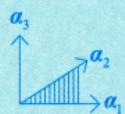

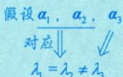

进行施密特正交化，令

$$
\beta_ {1} = \alpha_ {1}, \longrightarrow \text {对 应} \lambda_ {1} = \lambda_ {2}
$$

$$
\beta_ {2} = \alpha_ {2} - \frac {\left(\beta_ {1} , \alpha_ {2}\right)}{\left(\beta_ {1} , \beta_ {1}\right)} \beta_ {1}. \longrightarrow \text {对 应} \lambda_ {1} = \lambda_ {2}
$$

$$
\text {对 应} \lambda_ {3} \quad \beta_ {3} = \overrightarrow {\alpha_ {3}} - \frac {(\beta_ {1} , \alpha_ {3})}{(\beta_ {1} , \beta_ {1})} \beta_ {1} - \frac {(\beta_ {2} , \alpha_ {3})}{(\beta_ {2} , \beta_ {2})} \beta_ {2}. \quad \text {对 应} \lambda_ {1} = \lambda_ {2}
$$

$$
\text {故} \boldsymbol {\beta} _ {3} \text {不 对 应 任 何 特 征 值 ， 即} \Rightarrow [ \boldsymbol {\beta} _ {1}, \boldsymbol {\beta} _ {2}, \boldsymbol {\beta} _ {3} ] ^ {- 1} A [ \boldsymbol {\beta} _ {1}, \boldsymbol {\beta} _ {2}, \boldsymbol {\beta} _ {3} ] = \left[ \begin{array}{l l} \lambda_ {1} & \\ & \lambda_ {2} \\ & \lambda_ {3} \end{array} \right]
$$

② $Q$ 中特征向量 $\eta_{i}$ 与 $\pmb{A}$ 中特征值 $\lambda_{i}$ 对应，且 $Q$ 不唯一.

例5.18

设 $A = \left[ \begin{array}{rrr}0 & -1 & 4\\ -1 & 3 & a\\ 4 & a & 0 \end{array} \right],$ 正交矩阵 $\pmb{Q}$ 使 $\pmb{Q}^{\mathrm{T}}\pmb {A}\pmb{Q}$ 为对角矩阵，若 $\pmb{Q}$ 的第1列为 $\frac{1}{\sqrt{6}} [1,2,1]^{\mathrm{T}}$

求 $a, Q$ ：

分析 显然 $\mathbf{A}^{\mathrm{T}} = \mathbf{A}$ .将对称矩阵 $\mathbf{A}$ 进行 $Q^{\mathrm{T}}AQ$ 这样的处理，在几何意义上实现了正交旋转.

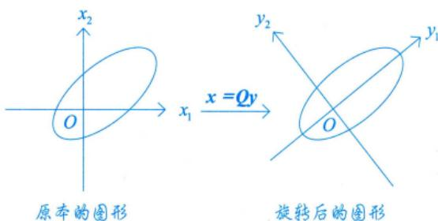

解 由于 $\frac{1}{\sqrt{6}} [1,2,1]^{\mathrm{T}}$ 是正交矩阵 $Q$ 的第1列，因此 $[1,2,1]^{\mathrm{T}}$ 是矩阵 $\pmb{A}$ 的一个特征向量.设其对应的特征值为 $\lambda_{1}$ ，于是有 向量单位化后的形式

$$
\boldsymbol {A} \left[ \begin{array}{l} 1 \\ 2 \\ 1 \end{array} \right] = \left[ \begin{array}{c c c} 0 & - 1 & 4 \\ - 1 & 3 & a \\ 4 & a & 0 \end{array} \right] \left[ \begin{array}{l} 1 \\ 2 \\ 1 \end{array} \right] = \lambda_ {1} \left[ \begin{array}{l} 1 \\ 2 \\ 1 \end{array} \right],
$$

即 $\left\{ \begin{array}{l} - 2 + 4 = \lambda_1,\\ 5 + a = 2\lambda_1,\\ 4 + 2a = \lambda_1, \end{array} \right.$

解得 $a = -1, \lambda_1 = 2$ .由此可知 $A = \begin{bmatrix} 0 & -1 & 4\\ -1 & 3 & -1\\ 4 & -1 & 0 \end{bmatrix},$

其特征多项式为 $\left|\lambda E - A\right| = \begin{vmatrix} \lambda & 1 & -4 \\ 1 & \lambda -3 & 1 \\ -4 & 1 & \lambda \end{vmatrix} = \begin{vmatrix} \lambda +4 & 1 & -4 \\ 0 & \lambda -3 & 1 \\ -\lambda -4 & 1 & \lambda \end{vmatrix}$ 1倍加至=0 1-3 10 2 4

$$
= (\lambda + 4) (\lambda^ {2} - 7 \lambda + 1 0) = (\lambda - 2) (\lambda - 5) (\lambda + 4),
$$

则 $\pmb{A}$ 的特征值为 $\lambda_1 = 2, \lambda_2 = 5, \lambda_3 = -4$

当 $\lambda_{2} = 5$ 时，解齐次方程组

$$
\begin{array}{r l} & {\quad \quad \quad \quad \quad \quad \quad \quad \quad \quad \quad \quad \quad \quad \quad \quad \quad \quad \quad \quad \quad \quad \quad \quad \quad \quad \quad \quad \quad \quad \quad \quad \quad \quad \quad \quad \quad \quad \quad \quad \quad \quad \quad \quad \quad \quad \quad \quad \quad \quad \quad} \\ & {\left[ \begin{array}{l l l} 5 & 1 & - 4 \\ 1 & 2 & 1 \\ - 4 & 1 & 5 \end{array} \right] \left[ \begin{array}{l} x _ {1} \\ x _ {2} \\ x _ {3} \end{array} \right] = 0,} \end{array}
$$

得到属于 $\lambda_{2}$ 的一个特征向量 $\pmb{\xi}_{2} = [1, - 1,1]^{\mathrm{T}}$

当 $\lambda_{3} = -4$ 时，解齐次方程组

$$
\left[\begin{array}{r r r}- 4&1&- 4\\1&- 7&1\\- 4&1&- 4\end{array}\right]\left[\begin{array}{l}x _ {1}\\x _ {2}\\x _ {3}\end{array}\right] = \mathbf {0}, \quad \left[\begin{array}{r r r}- 4&1&- 4\\1&- 7&1\\- 4&1&- 4\end{array}\right]\rightarrow \left[\begin{array}{r r r}1&- 7&1\\0&- 2 7&0\\0&0&0\end{array}\right]\rightarrow \left[\begin{array}{r r r}1&0&1\\0&1&0\\0&0&0\end{array}\right]
$$

得到属于 $\lambda_3$ 的一个特征向量 $\xi_{3} = [-1,0,1]^{\mathrm{T}}$

将 $\xi_{2},\xi_{3}$ 单位化后分别作为 $Q$ 的第2，3列，可得

$$
\boldsymbol {Q} = \left[ \begin{array}{c c c} \frac {1}{\sqrt {6}} & \frac {1}{\sqrt {3}} & - \frac {1}{\sqrt {2}} \\ \frac {2}{\sqrt {6}} & - \frac {1}{\sqrt {3}} & 0 \\ \frac {1}{\sqrt {6}} & \frac {1}{\sqrt {3}} & \frac {1}{\sqrt {2}} \end{array} \right],
$$

且 $\pmb{Q}^{\mathrm{T}}\pmb {A}\pmb {Q} = \begin{bmatrix} 2 & 0 & 0\\ 0 & 5 & 0\\ 0 & 0 & -4 \end{bmatrix} .$

例5.19 设 $A = \begin{bmatrix} 0 & -1 & 4\\ -1 & 3 & -1\\ 4 & -1 & 0 \end{bmatrix}, B = \begin{bmatrix} 5 & 0 & 0\\ -5 & -1 & 3\\ 4 & 3 & -1 \end{bmatrix}, A, B$ 是否相似，说明理由.

分析 ① 凑相似定义： $P^{-1}AP = B$ ，但 $P$ 较难求.

②根据相似的传递性，若 $A\sim A$ ， $B\sim A$ ，则 $A\sim B$ ，故优先判断矩阵 $A,B$ 是否可相似对角化.

解因 $A = \left[ \begin{array}{rrr}0 & -1 & 4\\ -1 & 3 & -1\\ 4 & -1 & 0 \end{array} \right],$

由例5.18知， $A$ 有3个不同的特征值 $\lambda_1 = 2, \lambda_2 = 5, \lambda_3 = -4$ ，故 $A \sim A = \begin{bmatrix} 2 & 0 & 0 \\ 0 & 5 & 0 \\ 0 & 0 & -4 \end{bmatrix}$ .

又 $\pmb {B} = \left[ \begin{array}{rrr}5 & 0 & 0\\ -5 & -1 & 3\\ 4 & 3 & -1 \end{array} \right],$

有 $\left|\lambda E - B\right| = \begin{vmatrix} \lambda - 5 & 0 & 0 \\ 5 & \lambda + 1 & -3 \\ -4 & -3 & \lambda + 1 \end{vmatrix} = (\lambda - 5)(\lambda^2 + 2\lambda - 8) = (\lambda - 5)(\lambda + 4)(\lambda - 2) = 0,$

所以 $\pmb{B}$ 有3个不同的特征值 $\lambda_1 = 2, \lambda_2 = 5, \lambda_3 = -4$ ，故

$$
\boldsymbol {B} \sim \boldsymbol {\Lambda} = \left[ \begin{array}{c c c} 2 & 0 & 0 \\ 0 & 5 & 0 \\ 0 & 0 & - 4 \end{array} \right].
$$

由相似的传递性知， $A\sim B$ ：

考研一般还会让求 $A$ 是如何变成 $\pmb{B}$ 的，即求使 $\pmb{A}$ 变成 $\pmb{B}$ 的可逆矩阵.

若 $P^{-1}AP = A = Q^{-1}BQ$ ，则 $QP^{-1}APQ^{-1} = B$ ，即 $(PQ^{-1})^{-1}A(PQ^{-1}) = B$ ，故令 $C = PQ^{-1}$ 即可.

注 特征值相同是两个矩阵相似的必要条件，如 $\left[ \begin{array}{ll}1 & 0\\ 0 & 1 \end{array} \right]$ 与 $\left[ \begin{array}{ll}1 & 0\\ 0 & 2 \end{array} \right]$ 的特征值不同，肯定不相似，但特征值相同的矩阵也不一定相似，如 $\left[ \begin{array}{ll}1 & 1\\ 0 & 1 \end{array} \right]$ 与 $\left[ \begin{array}{ll}1 & 0\\ 0 & 1 \end{array} \right]$ 的特征值相同，但并不相似。不过，当 $A, B$ 均是实对称矩阵时， $A, B$ 相似的充分必要条件是 $A, B$ 有相同的特征值。

# 基础习题精练

# 习题

5.1 设 $\lambda = 2$ 是可逆矩阵 $A$ 的一个特征值，则矩阵 $\left(\frac{1}{3} A^2\right)^{-1}$ 有一个特征值为（ ）.

(A) $\frac{4}{3}$

(B) $\frac{3}{4}$

(C) $\frac{1}{2}$

(D) $\frac{1}{4}$

5.2 设 $A$ 是 $n$ 阶实对称矩阵， $P$ 是 $n$ 阶可逆矩阵。已知 $n$ 维列向量 $\alpha$ 是 $A$ 的属于特征值 $\lambda$ 的特征向量，则矩阵 $(P^{-1}AP)^{\mathrm{T}}$ 属于特征值 $\lambda$ 的特征向量是（ ）.

(A) $P^{-1}\alpha$

(B) $P^{\mathrm{T}}\alpha$

(C) $P a$

(D) $(\pmb{P}^{-1})^{\mathrm{T}}\pmb{\alpha}$

5.3 已知矩阵 $A = \begin{bmatrix} 2 & 0 & 0\\ 0 & 2 & 1\\ 0 & 0 & 1 \end{bmatrix}$ ， $B = \begin{bmatrix} 2 & 1 & 0\\ 0 & 2 & 0\\ 0 & 0 & 1 \end{bmatrix}$ ， $C = \begin{bmatrix} 1 & 0 & 0\\ 0 & 2 & 0\\ 0 & 0 & 2 \end{bmatrix}$ ，则（

(A) $A$ 与 $C$ 相似， $\pmb{B}$ 与 $C$ 相似

(B) $A$ 与 $C$ 相似， $B$ 与 $C$ 不相似

(C) $A$ 与 $C$ 不相似, $B$ 与 $C$ 相似

(D) $A$ 与 $C$ 不相似， $B$ 与 $C$ 不相似

5.4 设 $A = \begin{bmatrix} a_{11} & a_{12} & a_{13}\\ a_{21} & a_{22} & a_{23}\\ a_{31} & a_{32} & a_{33} \end{bmatrix}$ 是可逆矩阵， $BA = \begin{bmatrix} 2a_{11} & -a_{12} & 3a_{13}\\ 2a_{21} & -a_{22} & 3a_{23}\\ 2a_{31} & -a_{32} & 3a_{33} \end{bmatrix}$ ，则 $\pmb{B}$ 相似于（ ）.

(A) $\left[ \begin{array}{rrr} - 1 & & \\ & 2 & \\ & & -3 \end{array} \right]$

(B) $\left[ \begin{array}{rrr}2 & & \\ & -1 & \\ & & 3 \end{array} \right]$

(C) $\left[ \begin{array}{rrr}3 & & \\ & -2 & \\ & & -1 \end{array} \right]$

(D) $\left[ \begin{array}{lll}1 & & \\ & 3 & \\ & & 2 \end{array} \right]$

5.5 设 $A$ 是3阶矩阵，已知 $-3E + A$ 不可逆， $|2E + A| = 0, (E - A)x = 0$ 有非零解，则 $\left|A^{*} - E\right| =$   
5.6 设 $A$ 是4阶实矩阵， $A^{*}$ 是 $A$ 的伴随矩阵，已知 $A^{*}$ 有特征值1，-1，2，-4，则 $\left|A^3 + 2A^2 - A - 3E\right| =$   
5.7 设 $A = \begin{bmatrix} 0 & 0 & 1\\ x & 1 & y\\ 1 & 0 & 0 \end{bmatrix}$ ，若 $A$ 可相似于对角矩阵，则 $x,y$ 应满足  
5.8 设 $A \sim \left[ \begin{array}{ccc} 1 & & \\ & -1 & \\ & & 2 \end{array} \right]$ , 则 $r(A - E) + r(A + E) =$   
5.9 已知 $\pmb{\alpha} = [1, k, 1]^{\mathrm{T}}$ 是 $A^{-1}$ 的特征向量，其中 $A = \begin{bmatrix} 2 & 1 & 1 \\ 1 & 2 & 1 \\ 1 & 1 & 2 \end{bmatrix}$ ，求 $k$ 及 $\pmb{\alpha}$ 所对应的 $A^{-1}$ 的特征值。  
5.10 设 $A = \begin{bmatrix} a & -1 & c \\ 5 & b & 3 \\ 1 - c & 0 & -a \end{bmatrix}$ ，且 $|A| = -1$ ， $A^*$ 是 $A$ 的伴随矩阵， $A^*$ 有特征值 $\lambda_0$ ，对应于 $\lambda_0$ 的特征向量为 $\xi = [-1, -1, 1]^{\mathrm{T}}$ ，求 $a, b, c$ 及 $\lambda_0$ 。  
5.11 设矩阵 $\mathbf{A}$ 满足对任意 $x_{1}, x_{2}, x_{3}$ 均有 $\mathbf{A} \begin{bmatrix} x_{1} \\ x_{2} \\ x_{3} \end{bmatrix} = \begin{bmatrix} x_{1} + x_{2} + x_{3} \\ 2x_{1} - x_{2} + x_{3} \\ x_{2} - x_{3} \end{bmatrix}$ .

(1) 求 $A$ ；  
(2) 求可逆矩阵 $P$ 与对角矩阵 $\Lambda$ ，使得 $P^{-1}AP = \Lambda$ 。

5.12 设矩阵 $A = \begin{bmatrix} 0 & 2 & -3\\ -1 & 3 & -3\\ 1 & -2 & a \end{bmatrix}$ 相似于矩阵 $B = \begin{bmatrix} 1 & -2 & 0\\ 0 & b & 0\\ 0 & 3 & 1 \end{bmatrix}$ .

(1)求 $a,b$ 的值；  
(2)求可逆矩阵 $P$ ，使 $P^{-1}AP$ 为对角矩阵.

5.13 设

$$
\boldsymbol {A} = \left[ \begin{array}{c c c} 1 & - 2 & 2 \\ - 2 & - 2 & 4 \\ 2 & 4 & - 2 \end{array} \right],
$$

求正交矩阵 $Q$ ，使得 $Q^{-1}AQ$ 为对角矩阵.

5.14 已知 $1, 1, -1$ 是 3 阶实对称矩阵 $A$ 的特征值，向量 $\xi_1 = [1, 1, 1]^{\mathrm{T}}$ ， $\xi_2 = [2, 2, 1]^{\mathrm{T}}$ 是 $A$ 的对应于

特征值 $\lambda_1 = \lambda_2 = 1$ 的特征向量，求矩阵 $A$

5.15 设 $A = \begin{bmatrix} 1 & -2 & 0 & 0\\ -1 & 0 & 0 & 0\\ 0 & 0 & 2 & 1\\ 0 & 0 & 0 & 2 \end{bmatrix}$ ，求 $A^n (n\geqslant 2)$

# 解答

5.1 (B) 解 $\frac{1}{3} A^2$ 有一个特征值为 $\frac{4}{3}$ （因为 $\frac{1}{3}\lambda^2 = \frac{4}{3}$ ），则 $\left(\frac{1}{3} A^2\right)^{-1}$ 有一个特征值为 $\frac{3}{4}$ .

5.2 (B) 解 因为 $\alpha$ 是 $A$ 的属于特征值 $\lambda$ 的特征向量，故 $A\alpha = \lambda \alpha$ ，矩阵 $(P^{-1}AP)^{\mathrm{T}}$ 属于特征值 $\lambda$ 的特征向量 $\beta$ 必须满足 $(P^{-1}AP)^{\mathrm{T}}\beta = \lambda \beta$ ：

将(A)，(B)，(C)，(D)中的四个向量分别代入 $(P^{-1}AP)^{\mathrm{T}}\pmb {\beta}$ ，只有 $\pmb {\beta} = \pmb{P}^{\mathrm{T}}\pmb{\alpha}$ 满足上式，即

$$
\left(\boldsymbol {P} ^ {- 1} \boldsymbol {A} \boldsymbol {P}\right) ^ {\mathrm {T}} \left(\boldsymbol {P} ^ {\mathrm {T}} \boldsymbol {\alpha}\right) = \boldsymbol {P} ^ {\mathrm {T}} \boldsymbol {A} ^ {\mathrm {T}} \left(\boldsymbol {P} ^ {- 1}\right) ^ {\mathrm {T}} \boldsymbol {P} ^ {\mathrm {T}} \boldsymbol {\alpha} = \boldsymbol {P} ^ {\mathrm {T}} \boldsymbol {A} ^ {\mathrm {T}} \left(\boldsymbol {P} ^ {\mathrm {T}}\right) ^ {- 1} \boldsymbol {P} ^ {\mathrm {T}} \boldsymbol {\alpha} = \boldsymbol {P} ^ {\mathrm {T}} \boldsymbol {A} \boldsymbol {\alpha} = \lambda \left(\boldsymbol {P} ^ {\mathrm {T}} \boldsymbol {\alpha}\right).
$$

故选 (B).

5.3 (B) 解 $A$ 和 $B$ 都是上三角矩阵，特征值是对角线上的元素，都是1，2，2. 判断它们是否与 $C$ 相似，只看其是否可相似对角化即可.

对二重特征值2， $n - r(2E - A) = 3 - 1 = 2$ （等于重数），于是 $\pmb{A}$ 可相似对角化， $\pmb{A}$ 相似于 $C$

对二重特征值2， $n - r(2E - B) = 3 - 2 = 1$ （小于重数），于是 $\pmb{B}$ 不可相似对角化， $\pmb{B}$ 不相似于 $C$ 故选(B).

5.4 (B) 解因

$$
\boldsymbol {B} \boldsymbol {A} = \left[ \begin{array}{l l l} 2 a _ {1 1} & - a _ {1 2} & 3 a _ {1 3} \\ 2 a _ {2 1} & - a _ {2 2} & 3 a _ {2 3} \\ 2 a _ {3 1} & - a _ {3 2} & 3 a _ {3 3} \end{array} \right] = \left[ \begin{array}{l l l} a _ {1 1} & a _ {1 2} & a _ {1 3} \\ a _ {2 1} & a _ {2 2} & a _ {2 3} \\ a _ {3 1} & a _ {3 2} & a _ {3 3} \end{array} \right] \left[ \begin{array}{c c c} 2 & & \\ & - 1 & \\ & & 3 \end{array} \right] = \boldsymbol {A} \left[ \begin{array}{c c c} 2 & & \\ & - 1 & \\ & & 3 \end{array} \right],
$$

又 $\pmb{A}$ 可逆，故 $\pmb {B} = \pmb {A}\left[ \begin{array}{rrr}2 & & \\ & -1 & \\ & & 3 \end{array} \right]\pmb{A}^{-1} = (\pmb{A}^{-1})^{-1}\left[ \begin{array}{rrr}2 & & \\ & -1 & \\ & & 3 \end{array} \right]\pmb{A}^{-1}$ ，故 $\pmb {B}\sim \left[ \begin{array}{rrr}2 & & \\ & -1 & \\ & & 3 \end{array} \right].$

5.5 42 解由题知， $-3E + A$ 不可逆，故 $|3E - A| = 0$ ，则 $A$ 有特征值 $\lambda_1 = 3$

$\left|2E + A\right| = 0$ ，则 $A$ 有特征值 $\lambda_{2} = -2$

$(E - A)x = 0$ 有非零解，故 $|\pmb {E} - \pmb {A}| = 0$ ，则 $\pmb{A}$ 有特征值 $\lambda_3 = 1$ ：

综上，3阶矩阵 $\pmb{A}$ 有特征值 $\lambda_{1} = 3, \lambda_{2} = -2, \lambda_{3} = 1$ ，得 $|\mathbf{A}| = \prod_{i=1}^{3} \lambda_{i} = -6$ 。则 $\pmb{A}^{\star}$ 的特征值为

$$
\mu_ {1} = \frac {- 6}{3} = - 2, \mu_ {2} = \frac {- 6}{- 2} = 3, \mu_ {3} = - 6.
$$

则 $A^{*} - E$ 的特征值为 $m_{1} = -2 - 1 = -3, m_{2} = 3 - 1 = 2, m_{3} = -6 - 1 = -7$ ，故

$$
\left| \boldsymbol {A} ^ {*} - \boldsymbol {E} \right| = (- 3) \times 2 \times (- 7) = 4 2.
$$

5.6 $-\frac{187}{8}$ 解 $A^{*}$ 有特征值 $1, -1, 2, -4$ ，则 $\left|A^{*}\right| = \prod_{i=1}^{4} \lambda_{i} = 8 \neq 0$ ，故 $A^{*}$ 可逆， $A$ 可逆。又 $\left|A^{*}\right| = \left|A\right|^{n-1} = \left|A\right|^{3} = 8$ ，得 $\left|A\right| = 2$ 。故 $A$ 的特征值 $\lambda_{A} = \frac{\left|A\right|}{\lambda_{A}}$ ，即为 $2, -2, 1, -\frac{1}{2}$ 。

设 $f(A) = A^3 + 2A^2 - A - 3E$ ，则 $f(A)$ 的特征值为

$$
f (2) = 2 ^ {3} + 2 \times 2 ^ {2} - 2 - 3 = 1 1,
$$

$$
f (- 2) = (- 2) ^ {3} + 2 \times (- 2) ^ {2} + 2 - 3 = - 1,
$$

$$
f (1) = 1 + 2 - 1 - 3 = - 1,
$$

$$
f \left(- \frac {1}{2}\right) = \left(- \frac {1}{2}\right) ^ {3} + 2 \times \left(- \frac {1}{2}\right) ^ {2} + \frac {1}{2} - 3 = - \frac {1 7}{8},
$$

故 $\left|A^3 + 2A^2 - A - 3E\right| = f(2) \cdot f(-2) \cdot f(1) \cdot f\left(-\frac{1}{2}\right) = -\frac{187}{8}.$

5.7 $x + y = 0$ 解 $\pmb{A}$ 相似于对角矩阵，对角矩阵的对角元素是 $\pmb{A}$ 的特征值，且应存在3个线性无关的特征向量.因为

$$
\left| \lambda E - A \right| = \left| \begin{array}{c c c} \lambda & 0 & - 1 \\ - x & \lambda - 1 & - y \\ - 1 & 0 & \lambda \end{array} \right| = (\lambda - 1) (\lambda^ {2} - 1) = (\lambda - 1) ^ {2} (\lambda + 1) = 0,
$$

故无论 $x, y$ 为何值，均有 $\lambda_1 = \lambda_2 = 1, \lambda_3 = -1$ .

对于二重特征值 $\lambda_1 = \lambda_2 = 1$ ，应有2个线性无关的特征向量，即方程组

$$
(E - A) x = 0
$$

应有2个线性无关的解向量.因

$$
\begin{array}{r}{\pmb {E} - \pmb {A} = \left[\begin{array}{l l l}{1}&{0}&{- 1}\\{- x}&{0}&{- y}\\{- 1}&{0}&{1}\end{array}\right] ^ {\text {加 士}} \rightarrow \left[\begin{array}{l l l}{1}&{0}&{- 1}\\{0}&{0}&{- x - y}\\{0}&{0}&{0}\end{array}\right],}\end{array}
$$

故当 $x + y = 0$ 时，有 $r(E - A) = 1$ ，从而 $(E - A)x = 0$ 有2个线性无关的解向量，此时 $A$ 相似于对角矩阵.

5.8 4 解 因 $A \sim A = \left[ \begin{array}{rrr}1 & & \\ & -1 & \\ & & 2\end{array} \right]$ ，即存在可逆矩阵 $P$ ，使 $P^{-1}AP = A$ ，即 $A = PAP^{-1}$ ，故

$$
\begin{array}{l} r (\boldsymbol {A} - \boldsymbol {E}) + r (\boldsymbol {A} + \boldsymbol {E}) = r (\boldsymbol {P A P} ^ {- 1} - \boldsymbol {E}) + r (\boldsymbol {P A P} ^ {- 1} + \boldsymbol {E}) \\ = r \left(P (\boldsymbol {\Lambda} - \boldsymbol {E}) \boldsymbol {P} ^ {- 1}\right) + r \left(\boldsymbol {P} (\boldsymbol {\Lambda} + \boldsymbol {E}) \boldsymbol {P} ^ {- 1}\right) = r (\boldsymbol {\Lambda} - \boldsymbol {E}) + r (\boldsymbol {\Lambda} + \boldsymbol {E}) \\ \end{array}
$$

$$
\begin{array}{l} = r \left(\left[ \begin{array}{c c c} 0 & & \\ & - 2 & \\ & & 1 \end{array} \right]\right) + r \left(\left[ \begin{array}{c c c} 2 & & \\ & 0 & \\ & & 3 \end{array} \right]\right) \\ = 2 + 2 = 4. \\ \end{array}
$$

5.9解由题设知， $A^{-1}\alpha = \lambda \alpha$ ， $\lambda$ 是 $A^{-1}$ 的对应于 $\pmb{\alpha}$ 的特征值，两端左边乘 $A$ ，得 $\alpha = \lambda A\alpha$ ：

因 $\alpha \neq 0$ ，故 $\lambda \neq 0, A\alpha = \frac{1}{\lambda}\alpha \stackrel{\text{记}}{=} \mu \alpha$ ，即

$$
\left[ \begin{array}{c c c} 2 & 1 & 1 \\ 1 & 2 & 1 \\ 1 & 1 & 2 \end{array} \right] \left[ \begin{array}{c} 1 \\ k \\ 1 \end{array} \right] = \mu \left[ \begin{array}{c} 1 \\ k \\ 1 \end{array} \right].
$$

由对应分量相等，得 $\left\{ \begin{array}{l}3 + k = \mu ,\\ 2 + 2k = k\mu ,\\ 3 + k = \mu , \end{array} \right.$

得 $2 + 2k = k(3 + k)$ ，即 $k^2 + k - 2 = 0$ ，故 $k = 1$ 或 $k = -2$ ：

当 $k = 1$ 时， $\alpha = [1,1,1]^{\mathrm{T}}$ ， $\mu = 4$ ， $\lambda = \frac{1}{\mu} = \frac{1}{4}$ ；当 $k = -2$ 时， $\alpha = [1, - 2,1]^{\mathrm{T}}$ ， $\mu = 1$ ， $\lambda = \frac{1}{\mu} = 1$

注 已知 $A^{-1}$ 的特征向量，因 $A, A^{-1}$ 有相同的特征向量，故不必求出 $A^{-1}$ .

5.10 解 由题知 $A^* \xi = \lambda_0 \xi$ ，在等式两端左边乘 $A, A A^* \xi = \lambda_0 A \xi = |A| \xi = -\xi$ ，即

$$
\begin{array}{l} \lambda_ {0} \left[ \begin{array}{c c c} a & - 1 & c \\ 5 & b & 3 \\ 1 - c & 0 & - a \end{array} \right] \left[ \begin{array}{c} - 1 \\ - 1 \\ 1 \end{array} \right] = \left[ \begin{array}{c} 1 \\ 1 \\ - 1 \end{array} \right], \\ \left\{ \begin{array}{l} \lambda_ {0} (- a + 1 + c) = 1, \\ \lambda_ {0} (- 5 - b + 3) = 1, \\ \lambda_ {0} (- 1 + c - a) = - 1, \end{array} \right. \\ \end{array}
$$

得 $\lambda_0 = 1, a = c, b = -3$ ，又 $|A| = \begin{vmatrix} a & -1 & a \\ 5 & -3 & 3 \\ 1 - a & 0 & -a \end{vmatrix} = a - 3 = -1$ ，得 $a = c = 2$ 。

5.11 解 (1) 由题可知， $A\left[ \begin{array}{l}x_{1}\\ x_{2}\\ x_{3} \end{array} \right] = \left[ \begin{array}{lll}1 & 1 & 1\\ 2 & -1 & 1\\ 0 & 1 & -1 \end{array} \right]\left[ \begin{array}{l}x_{1}\\ x_{2}\\ x_{3} \end{array} \right]$ ，故 $A = \left[ \begin{array}{rrr}1 & 1 & 1\\ 2 & -1 & 1\\ 0 & 1 & -1 \end{array} \right]$ .

(2) 由 $|\lambda E - A| = (\lambda + 2)(\lambda - 2)(\lambda + 1) = 0$ ，得 $\pmb{A}$ 的特征值为 $\lambda_1 = 2, \lambda_2 = -1, \lambda_3 = -2$

由 $(2E - A)x = 0$ 得 $\lambda_{1} = 2$ 对应的特征向量 $\alpha_{1} = [4,3,1]^{\mathrm{T}}$

由 $(-E - A)x = 0$ 得 $\lambda_{2} = -1$ 对应的特征向量 $\alpha_{2} = \left[-\frac{1}{2},0,1\right]^{\mathrm{T}}$

由 $(-2E - A)x = 0$ 得 $\lambda_{3} = -2$ 对应的特征向量 $\alpha_{3} = [0, -1, 1]^{\mathrm{T}}$ .

令 $\pmb{P} = [\pmb{\alpha}_1, \pmb{\alpha}_2, \pmb{\alpha}_3] = \begin{bmatrix} 4 & -\frac{1}{2} & 0 \\ 3 & 0 & -1 \\ 1 & 1 & 1 \end{bmatrix}, \pmb{A} = \begin{bmatrix} 2 & 0 & 0 \\ 0 & -1 & 0 \\ 0 & 0 & -2 \end{bmatrix}$ ，则有

$$
\boldsymbol {P} ^ {- 1} \boldsymbol {A} \boldsymbol {P} = \left[ \begin{array}{c c c} 2 & 0 & 0 \\ 0 & - 1 & 0 \\ 0 & 0 & - 2 \end{array} \right].
$$

5.12 解 (1) 由于矩阵 $\mathbf{A}$ 与矩阵 $\mathbf{B}$ 相似，因此

$$
\operatorname {t r} (\boldsymbol {A}) = \operatorname {t r} (\boldsymbol {B}), | \boldsymbol {A} | = | \boldsymbol {B} |,
$$

于是 $3 + a = 2 + b, 2a - 3 = b,$

解得 $a = 4, b = 5$

(2) 由 (1) 知 $\mathbf{A} = \begin{bmatrix} 0 & 2 & -3 \\ -1 & 3 & -3 \\ 1 & -2 & 4 \end{bmatrix}$ , $\mathbf{B} = \begin{bmatrix} 1 & -2 & 0 \\ 0 & 5 & 0 \\ 0 & 3 & 1 \end{bmatrix}$ .

由于矩阵 $\mathbf{A}$ 与矩阵 $\pmb{B}$ 相似，因此

$$
\left| \lambda E - A \right| = \left| \lambda E - B \right| = (\lambda - 1) ^ {2} (\lambda - 5),
$$

故 $\pmb{A}$ 的特征值为 $\lambda_1 = \lambda_2 = 1, \lambda_3 = 5$

当 $\lambda_1 = \lambda_2 = 1$ 时，解方程组 $(E - A)x = 0$ ，得线性无关的特征向量 $\xi_{1} = \begin{bmatrix} 2\\ 1\\ 0 \end{bmatrix}$ ， $\xi_{2} = \begin{bmatrix} -3\\ 0\\ 1 \end{bmatrix}$

当 $\lambda_3 = 5$ 时，解方程组 $(5E - A)x = 0$ ，得特征向量 $\xi_{3} = \begin{bmatrix} -1\\ -1\\ 1 \end{bmatrix} .$

令 $\pmb{P} = [\pmb{\xi}_1, \pmb{\xi}_2, \pmb{\xi}_3] = \begin{bmatrix} 2 & -3 & -1 \\ 1 & 0 & -1 \\ 0 & 1 & 1 \end{bmatrix}$ ，则 $\pmb{P}^{-1}\pmb{A}\pmb{P} = \begin{bmatrix} 1 & 0 & 0 \\ 0 & 1 & 0 \\ 0 & 0 & 5 \end{bmatrix}$ ，故 $\pmb{P}$ 为所求可逆矩阵。

5.13 解 由

$$
\begin{array}{r} {\left| \lambda E - A \right| = \left| \begin{array}{c c c} {\lambda - 1} & {2} & {- 2} \\ {2} & {\lambda + 2} & {- 4} \\ {- 2} & {- 4} & {\lambda + 2} \end{array} \right| = \left| \begin{array}{c c c} {\lambda - 1} & {2} & {- 2} \\ {0} & {\lambda - 2} & {\lambda - 2} \\ {- 2} & {- 4} & {\lambda + 2} \end{array} \right|} \end{array}
$$

按此行展开 $\begin{array}{r}\lambda -1\quad 2\quad -4\\ \left| \begin{array}{ccc}0 & \lambda -2 & 0\\ -2 & -4 & \lambda +6 \end{array} \right| = (\lambda -2)\left| \begin{array}{cc}\lambda -1 & -4\\ -2 & \lambda +6 \end{array} \right| \end{array}$

$$
\begin{array}{l} = (\lambda - 2) \left(\lambda^ {2} + 5 \lambda - 1 4\right) \\ = (\lambda - 2) ^ {2} (\lambda + 7), \\ \end{array}
$$

令 $|\lambda E - A| = 0$ ，得 $\lambda_1 = \lambda_2 = 2, \lambda_3 = -7$

对于 $\lambda_1 = \lambda_2 = 2$ ，由 $(\lambda_{1}\pmb {E} - \pmb {A})\pmb {x} = \pmb{0}$ ，即

$$
\left[ \begin{array}{r r r} 1 & 2 & - 2 \\ 2 & 4 & - 4 \\ - 2 & - 4 & 4 \end{array} \right] \left[ \begin{array}{l} x _ {1} \\ x _ {2} \\ x _ {3} \end{array} \right] = \left[ \begin{array}{l} 0 \\ 0 \\ 0 \end{array} \right],
$$

得 $\lambda_{1} = \lambda_{2} = 2$ 对应的线性无关的特征向量 $\xi_{1} = [2, -1, 0]^{\mathrm{T}}, \xi_{2} = [2, 0, 1]^{\mathrm{T}}$ .

对于 $\lambda_3 = -7$ ，由 $(\lambda_{3}\pmb {E} - \pmb {A})\pmb {x} = \pmb{0}$ ，即

$$
\left[ \begin{array}{r r r} - 8 & 2 & - 2 \\ 2 & - 5 & - 4 \\ - 2 & - 4 & - 5 \end{array} \right] \left[ \begin{array}{l} x _ {1} \\ x _ {2} \\ x _ {3} \end{array} \right] = \left[ \begin{array}{l} 0 \\ 0 \\ 0 \end{array} \right],
$$

得 $\lambda_{3} = -7$ 对应的特征向量 $\xi_{3} = [1,2, - 2]^{\mathrm{T}}$

对于 $\lambda_{1} = \lambda_{2} = 2$ 对应的线性无关的特征向量 $\xi_{1} = [2, -1, 0]^{\mathrm{T}}$ , $\xi_{2} = [2, 0, 1]^{\mathrm{T}}$ . 用施密特正交化公式，先正交化，得

$$
\begin{array}{l} \beta_ {1} = \xi_ {1}, \\ \boldsymbol {\beta} _ {2} = \xi_ {2} - \frac {\left(\boldsymbol {\beta} _ {1} , \xi_ {2}\right)}{\left(\boldsymbol {\beta} _ {1} , \boldsymbol {\beta} _ {1}\right)} \boldsymbol {\beta} _ {1} \\ = \left[ \begin{array}{l} 2 \\ 0 \\ 1 \end{array} \right] - \frac {4}{5} \left[ \begin{array}{l} 2 \\ - 1 \\ 0 \end{array} \right] = \frac {1}{5} \left[ \begin{array}{l} 2 \\ 4 \\ 5 \end{array} \right], \\ \end{array}
$$

再将 $\beta_{1},\beta_{2}$ 单位化，得

$$
\begin{array}{l} \boldsymbol {\eta} _ {1} = \left[ \frac {2 \sqrt {5}}{5}, - \frac {\sqrt {5}}{5}, 0 \right] ^ {\mathrm {T}}, \\ \boldsymbol {\eta} _ {2} = \left[ \frac {2 \sqrt {5}}{1 5}, \frac {4 \sqrt {5}}{1 5}, \frac {\sqrt {5}}{3} \right] ^ {\mathrm {T}}. \\ \end{array}
$$

对于 $\lambda_{3} = -7$ 对应的特征向量 $\xi_3 = [1,2, - 2]^{\mathrm{T}}$ ，单位化得 $\eta_{3} = \left[\frac{1}{3},\frac{2}{3}, - \frac{2}{3}\right]^{\mathrm{T}}$ ，取正交矩阵

$$
\boldsymbol {Q} = \left[ \begin{array}{l l l} \eta_ {1}, & \eta_ {2}, & \eta_ {3} \end{array} \right] = \left[ \begin{array}{c c c} \frac {2 \sqrt {5}}{5} & \frac {2 \sqrt {5}}{1 5} & \frac {1}{3} \\ - \frac {\sqrt {5}}{5} & \frac {4 \sqrt {5}}{1 5} & \frac {2}{3} \\ 0 & \frac {\sqrt {5}}{3} & - \frac {2}{3} \end{array} \right],
$$

则 $Q^{-1}AQ = \left[ \begin{array}{rrr}2 & & \\ & 2 & \\ & & -7 \end{array} \right].$

5.14 分析 因 $A$ 是实对称矩阵，故 $A$ 一定相似于对角矩阵，且不同的特征值对应的特征向量相互正交，故由此可求出 $\lambda_{3} = -1$ 对应的特征向量（和例5.15不同，在例5.15中， $A$ 不是实对称矩阵，求 $A$ 时， $A$ 的3个特征向量必须全部给出）.

解设 $\lambda_3 = -1$ 对应的特征向量为 $\xi_{3} = [x_{1},x_{2},x_{3}]^{\mathrm{T}}$ ，则由 $\pmb{A}$ 是实对称矩阵，有

$$
\left\{ \begin{array}{l} (\xi_ {1}, \xi_ {3}) = x _ {1} + x _ {2} + x _ {3} = 0, \\ (\xi_ {2}, \xi_ {3}) = 2 x _ {1} + 2 x _ {2} + x _ {3} = 0, \end{array} \right.
$$

取 $\xi_{3} = [-1, 1, 0]^{\mathrm{T}}$ ，从而得可逆矩阵 $P = [\xi_{1}, \xi_{2}, \xi_{3}]$ ，使得

$$
\boldsymbol {P} ^ {- 1} \boldsymbol {A} \boldsymbol {P} = \boldsymbol {\Lambda},
$$

则有 $A = P A P^{-1} = \begin{bmatrix} 1 & 2 & -1\\ 1 & 2 & 1\\ 1 & 1 & 0 \end{bmatrix} \begin{bmatrix} 1 & & \\ & 1 & \\ & & -1 \end{bmatrix} \begin{bmatrix} 1 & 2 & -1\\ 1 & 2 & 1\\ 1 & 1 & 0 \end{bmatrix} ^{-1}$

$$
= \frac {1}{2} \left[ \begin{array}{l l l} 1 & 2 & - 1 \\ 1 & 2 & 1 \\ 1 & 1 & 0 \end{array} \right] \left[ \begin{array}{l l l} 1 & & \\ & 1 & \\ & & - 1 \end{array} \right] \left[ \begin{array}{l l l} - 1 & - 1 & 4 \\ 1 & 1 & - 2 \\ - 1 & 1 & 0 \end{array} \right] = \left[ \begin{array}{l l l} 0 & 1 & 0 \\ 1 & 0 & 0 \\ 0 & 0 & 1 \end{array} \right].
$$

注 若将 $\xi_1, \xi_2, \xi_3$ 标准正交化，还可求得正交矩阵 $Q$ ，使得 $A = Q\Lambda Q^{-1} = Q\Lambda Q^{\mathrm{T}}$ ，用转置来替代求逆运算，结果当然是一样的。

5.15 解 $A$ 是分块对角矩阵，记 $A = \begin{bmatrix} B & O \\ O & C \end{bmatrix}$ ，其中 $B = \begin{bmatrix} 1 & -2 \\ -1 & 0 \end{bmatrix}$ ， $C = \begin{bmatrix} 2 & 1 \\ 0 & 2 \end{bmatrix}$ ，则

$$
\boldsymbol {A} ^ {n} = \left[ \begin{array}{c c} \boldsymbol {B} & \boldsymbol {O} \\ \boldsymbol {O} & \boldsymbol {C} \end{array} \right] ^ {n} = \left[ \begin{array}{c c} \boldsymbol {B} ^ {n} & \boldsymbol {O} \\ \boldsymbol {O} & \boldsymbol {C} ^ {n} \end{array} \right].
$$

对于 $\pmb{B} = \begin{bmatrix} 1 & -2 \\ -1 & 0 \end{bmatrix}$ ，由 $|\lambda E - B| = \begin{vmatrix} \lambda - 1 & 2 \\ 1 & \lambda \end{vmatrix} = (\lambda + 1)(\lambda - 2) = 0$ ，得对应的特征值为 $\lambda_1 = -1, \lambda_2 = 2$ 。

当 $\lambda_{1} = -1$ 时，由 $(\lambda_{1}\pmb {E} - \pmb {B})\pmb {x} = \pmb{0}$ ，得 $\xi_1 = [1,1]^{\mathrm{T}}$ ；当 $\lambda_{2} = 2$ 时，由 $(\lambda_{2}\pmb {E} - \pmb {B})\pmb {x} = \pmb{0}$ ，得 $\xi_{2} = [-2,1]^{\mathrm{T}}$

于是有 $P^{-1}BP = \begin{bmatrix} -1 & 0\\ 0 & 2 \end{bmatrix}$ ，其中 $P = \begin{bmatrix} 1 & -2\\ 1 & 1 \end{bmatrix}, P^{-1} = \frac{1}{3}\begin{bmatrix} 1 & 2\\ -1 & 1 \end{bmatrix}$ 故

$$
\begin{array}{l} \boldsymbol {B} ^ {n} = \left(\boldsymbol {P} \left[ \begin{array}{l l} - 1 & 0 \\ 0 & 2 \end{array} \right] \boldsymbol {P} ^ {- 1}\right) ^ {n} = \boldsymbol {P} \left[ \begin{array}{l l} - 1 & 0 \\ 0 & 2 \end{array} \right] ^ {n} \boldsymbol {P} ^ {- 1} \\ = \frac {1}{3} \left[ \begin{array}{l l} 1 & - 2 \\ 1 & 1 \end{array} \right] \left[ \begin{array}{c c} (- 1) ^ {n} & 0 \\ 0 & 2 ^ {n} \end{array} \right] \left[ \begin{array}{l l} 1 & 2 \\ - 1 & 1 \end{array} \right] \\ = \frac {1}{3} \left[ \begin{array}{l l} (- 1) ^ {n} + 2 ^ {n + 1} & (- 1) ^ {n} \cdot 2 - 2 ^ {n + 1} \\ (- 1) ^ {n} - 2 ^ {n} & (- 1) ^ {n} \cdot 2 + 2 ^ {n} \end{array} \right]. \\ \end{array}
$$

对于 $C = \begin{bmatrix} 2 & 1\\ 0 & 2 \end{bmatrix}$ ，因当 $n\geqslant 2$ 时， $\left[ \begin{array}{ll}0 & 1\\ 0 & 0 \end{array} \right]^n = 0$ ，故

$$
\boldsymbol {C} ^ {n} = \left(2 \boldsymbol {E} + \left[ \begin{array}{l l} 0 & 1 \\ 0 & 0 \end{array} \right]\right) ^ {n} = 2 ^ {n} \boldsymbol {E} ^ {n} + n \cdot 2 ^ {n - 1} \boldsymbol {E} ^ {n - 1} \left[ \begin{array}{l l} 0 & 1 \\ 0 & 0 \end{array} \right] = \left[ \begin{array}{l l} 2 ^ {n} & n \cdot 2 ^ {n - 1} \\ 0 & 2 ^ {n} \end{array} \right].
$$

因此，

$$
\boldsymbol {A} ^ {n} = \left[ \begin{array}{c c} \boldsymbol {B} ^ {n} & \boldsymbol {O} \\ \boldsymbol {O} & \boldsymbol {C} ^ {n} \end{array} \right] = \left[ \begin{array}{c c c c} \frac {1}{3} (- 1) ^ {n} + \frac {1}{3} \cdot 2 ^ {n + 1} & \frac {2}{3} (- 1) ^ {n} - \frac {1}{3} \cdot 2 ^ {n + 1} & 0 & 0 \\ \frac {1}{3} (- 1) ^ {n} - \frac {1}{3} \cdot 2 ^ {n} & \frac {2}{3} (- 1) ^ {n} + \frac {1}{3} \cdot 2 ^ {n} & 0 & 0 \\ 0 & 0 & 2 ^ {n} & n \cdot 2 ^ {n - 1} \\ 0 & 0 & 0 & 2 ^ {n} \end{array} \right].
$$
