# 第6讲

# 二次型

# 基础知识结构

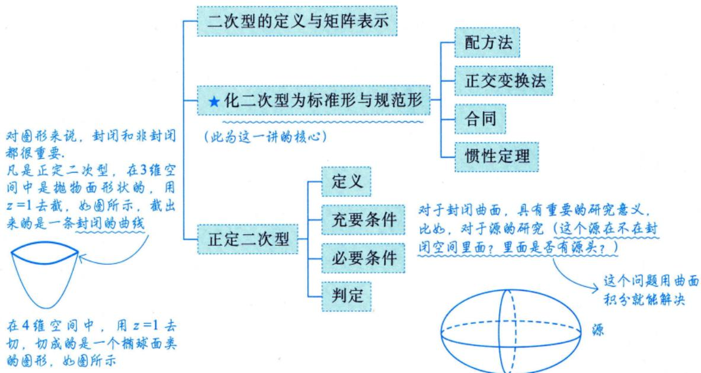

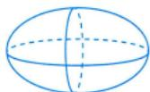

（也是封闭的）

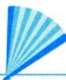

# 基础内容精讲

二次型是将相似理论应用在一个重要的研究对象（二次齐次式）上

# 二次型的定义及其矩阵表达式

$n$ 元变量 $x_{1}, x_{2}, \dots, x_{n}$ 的二次齐次多项式

令 $a_{12} = a_{21}$ ，故 $a_{12}x_1x_2 + a_{21}x_1x_2 = 2a_{12}x_1x_2$

$$
f \left(x _ {1}, x _ {2}, \dots , x _ {n}\right) = a _ {1 1} x _ {1} ^ {2} + 2 a _ {1 2} x _ {1} x _ {2} + \dots + 2 a _ {1 n} x _ {1} x _ {n}
$$

$x_{i}x_{j}$ （当 $i = j = 1$ 时， $x_{i}x_{j} = x_{1}^{2})$

$$
\rightarrow x _ {i} x _ {j} (\text {当} i = j = 2 \text {时}, x _ {i} x _ {j} = x _ {2} ^ {2})
$$

$$
+ a _ {2 2} x _ {2} ^ {2} + \dots + 2 a _ {2 n} x _ {2} x _ {n}
$$

$$
+ \dots
$$

$$
+ a _ {n n} \overbrace {x _ {n} ^ {2}} ^ {\rightarrow x _ {i} x _ {j} (\text {当} i = j = n \text {时 ，} x _ {i} x _ {j} = x _ {n} ^ {2})}
$$

称为 $n$ 元二次型，简称二次型.

考研只研究系数 $a_{ij} \in \mathbf{R}(i \leqslant j; i, j = 1, 2, \dots, n)$ 的情况，故称此二次型 $f$ 为实二次型。

因为 $x_{i}x_{j} = x_{j}x_{i}$ ，若令 $a_{ij} = a_{ji}(i,j = 1,2,\dots ,n)$ ，则 $2a_{ij}x_i x_j = a_{ij}x_ix_j + a_{ji}x_jx_i$ ，于是

$$
f \left(x _ {1}, x _ {2}, \dots , x _ {n}\right) = a _ {1 1} x _ {1} ^ {2} + a _ {1 2} x _ {1} x _ {2} + \dots + a _ {1 n} x _ {1} x _ {n} + a _ {2 1} x _ {2} x _ {1} + a _ {2 2} x _ {2} ^ {2} + \dots + a _ {2 n} x _ {2} x _ {n} + \dots +
$$

$$
a _ {n 1} x _ {n} x _ {1} + a _ {n 2} x _ {n} x _ {2} + \dots + a _ {n n} x _ {n} ^ {2} \tag {*}
$$

$= \sum_{i = 1}^{n}\sum_{j = 1}^{n}a_{ij}x_{i}x_{j},$ 典型的二次齐次式

其中 $(\ast)$ 式称为完全展开式， $(\ast \ast)$ 式称为和式.令

$$
\boldsymbol {A} ^ {\mathrm {T}} = \boldsymbol {A} = \left[ \begin{array}{c c c c} a _ {1 1} & a _ {1 2} & \dots & a _ {1 n} \\ a _ {2 1} & a _ {2 2} & \dots & a _ {2 n} \\ \vdots & \vdots & \ddots & \vdots \\ a _ {n 1} & a _ {n 2} & \dots & a _ {n n} \end{array} \right], \boldsymbol {x} = \left[ \begin{array}{c} x _ {1} \\ x _ {2} \\ \vdots \\ x _ {n} \end{array} \right]
$$

两个变量 平今成两项，分别写在 $a_{ij}$ 和 $a_{ji}$ 的位置例如： $f(x_{1},x_{2}) = a_{11}x_{1}^{2} + 2a_{12}x_{1}x_{2} + a_{22}x_{2}^{2}$ 下标 $i\neq j$ （交叉项） $= [x_1,x_2][a_{11}\dots a_{12}] [x_1] \rightarrow$ 主对角线写平方项前面的系数将 $f$ 写成矩阵形式（此为对称矩阵，记为 $\pmb{A}$ 产

则二次型可表示为

$$
f (\boldsymbol {x}) = \boldsymbol {x} ^ {\mathrm {T}} \boldsymbol {A} \boldsymbol {x}. \left(\begin{array}{c c c c}\square&\square&\square&\text {形 式 要 记 住}\\\downarrow&\downarrow&\downarrow&\end{array}\right)\rightarrow (* * *)
$$

(***)式称为二次型 $f(x_{1},x_{2},\dots ,x_{n})$ 的矩阵表达式，实对称矩阵 $A$ 称为二次型 $f(x)$ 的矩阵.这里需要着重多说几句.

二次型的矩阵 $\mathbf{A}$ 是一个对称矩阵，其中 $A = (a_{ij})_{n\times n}$ ， $a_{ij} = a_{ji}$ ，即满足 $A^{\mathrm{T}} = A$ .为什么要强调这一点？事实上，一个二次型可以有不同的写法，例如三元二次型

可以写成

$$
\begin{array}{r l} & {f (x _ {1}, x _ {2}, x _ {3}) = x _ {1} ^ {2} + x _ {2} ^ {2} + x _ {3} ^ {2} + 4 x _ {1} x _ {2},} \\ & {\qquad \qquad \qquad \qquad \qquad \qquad \qquad \qquad \qquad \qquad \qquad \qquad \qquad \qquad \qquad \qquad \qquad \qquad \qquad \qquad \qquad \qquad \qquad \qquad \qquad \qquad \qquad \qquad \qquad \qquad \qquad \qquad \qquad \qquad \text {将} “ 4 ” \text {拆 成} “ 1 ” \text {和} “ 3 ”} \\ & {f (x _ {1}, x _ {2}, x _ {3}) = x _ {1} ^ {2} + x _ {2} ^ {2} + x _ {3} ^ {2} + x _ {1} x _ {2} + 3 x _ {2} x _ {1},} \end{array}
$$

也可以写成

$$
f (x _ {1}, x _ {2}, x _ {3}) = x _ {1} ^ {2} + x _ {2} ^ {2} + x _ {3} ^ {2} + 2 x _ {1} x _ {2} + 2 x _ {2} x _ {1} \text {将 “ 4 ” 拆 成 “ 2 ” 和 “ 2 ”}
$$

等.对应的用矩阵表示也有多种形式：

$\mathrm{f}$ 一定要写成对称矩阵,保证唯一性.

实对称矩阵一定可以相似对角化，即实对称矩阵一定可以用正交矩阵相似对角化.

$$
\begin{array}{l}{f (x _ {1}, x _ {2}, x _ {3}) = [ x _ {1}, x _ {2}, x _ {3} ] \left[\begin{array}{c c c}1&4&0\\0&1&0\\0&0&1\end{array}\right] \left[\begin{array}{c}x _ {1}\\x _ {2}\\x _ {3}\end{array}\right] = [ x _ {1}, 4 x _ {1} + x _ {2}, x _ {3} ] \left[\begin{array}{c}x _ {1}\\x _ {2}\\x _ {3}\end{array}\right]}\\{\quad = [ x _ {1}, x _ {2}, x _ {3} ] \left[\begin{array}{c c c}1&1&0\\3&1&0\\0&0&1\end{array}\right] \left[\begin{array}{c}x _ {1}\\x _ {2}\\x _ {3}\end{array}\right] \xrightarrow {\frac {3 + 1}{2}} = 2 \longrightarrow \text {关 于 主 对 角 线 对 称}}\\{\quad = [ x _ {1}, x _ {2}, x _ {3} ] \left[\begin{array}{c c c}1&2&0\\2&1&0\\0&0&1\end{array}\right] \left[\begin{array}{c}x _ {1}\\x _ {2}\\x _ {3}\end{array}\right] \quad .}\\{\quad = [ x _ {1}, x _ {2}, x _ {3} ] \left[\begin{array}{c c c}1&2&0\\2&1&0\\0&0&1\end{array}\right]\left[ \right.\begin{array}{c}x _ {1}\\x _ {2}\\x _ {3}\end{array}] \quad .}\\{\quad \text {对 角 化 ， 即}}\\{\quad \text {在 矩 阵 相 似}}\\{\quad \text {对 称 矩 阵}}\end{array}
$$

这样，代表二次型的矩阵就不唯一了，不利于研究二次型问题。现在我们立了“规矩”，规定二次型的矩阵必须是对称矩阵，代表二次型的矩阵就是唯一的。所以只有对称矩阵才是二次型的矩阵，也只有用对称矩阵表达的式子才是二次型的矩阵表达式，上面第③种形式是按“规矩”写的。

例6.1 写出三元二次型 $f(x_{1},x_{2},x_{3}) = 2x_{1}^{2} + 2x_{2}^{2} + 2x_{3}^{2} - 2x_{1}x_{2} - 2x_{2}x_{3} + 2x_{1}x_{3}$ 的二次型矩阵 $A$ ：

解 将二次型表示成矩阵形式是基本要求，方法： $A$ 的主对角线元素 $a_{ii}$ 是平方项 $x_{i}^{2}$ 的系数， $a_{ij}$ 是混合项 $x_{i}x_{j}$ 的系数的 $\frac{1}{2}$ ，即

$$
f (x _ {1}, x _ {2}, x _ {3}) = [ x _ {1}, x _ {2}, x _ {3} ] \left[ \begin{array}{r r r} 2 & - 1 & 1 \\ - 1 & 2 & - 1 \\ 1 & - 1 & 2 \end{array} \right] \left[ \begin{array}{l} x _ {1} \\ x _ {2} \\ x _ {3} \end{array} \right],
$$

得 $A = \begin{bmatrix} 2 & -1 & 1\\ -1 & 2 & -1\\ 1 & -1 & 2 \end{bmatrix} \xrightarrow{} A$ 的秩即为 $f$ 的秩 $f\Longleftrightarrow \frac{\longrightarrow}{\text{一一对应}}\frac{\longrightarrow}{\downarrow}$ 对称矩阵

注 系数矩阵 $\pmb{A}$ 的秩即为二次型 $f(x)$ 的秩. 比如本题中, $\pmb{A} = \begin{bmatrix} 2 & -1 & 1 \\ -1 & 2 & -1 \\ 1 & -1 & 2 \end{bmatrix}$ , 其秩 $r(A) = 3$ , 故其对应的二次型的秩也是 3.

# 合同变换，二次型的合同标准形、规范形

# 线性变换的定义

即 $n$ 元函数

对于 $n$ 元二次型 $f(x_{1},x_{2},\dots ,x_{n})$ ，若令

特殊的 $n$ 元函数，每一项都是二次的

把所有 $x$ 换成 $y$ ， $x$ 可以用 $y_{1},y_{2},\dots ,y_{n}$ 的线性组合表示

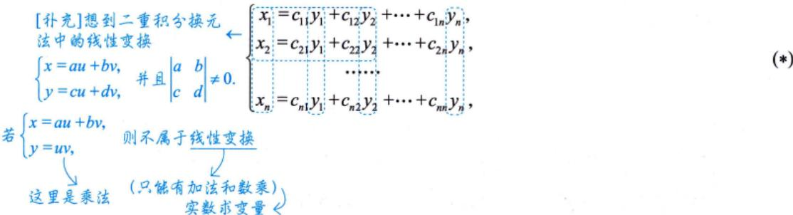

记 $x = \begin{bmatrix} x_1\\ x_2\\ \vdots \\ x_n \end{bmatrix}$ ， $C = \left[ \begin{array}{cccc}c_{11} & c_{12} & \dots & c_{1n}\\ c_{21} & c_{22} & \dots & c_{2n}\\ \vdots & \vdots & & \vdots \\ c_{n1} & c_{n2} & \dots & c_{nn} \end{array} \right],y = \left[ \begin{array}{l}y_1\\ y_2\\ \vdots \\ y_n \end{array} \right]$ 则 $(\ast)$ 式可写为

$$
x = C y,
$$

其中 $(\ast)$ 式称为线性变换. 若线性变换的系数矩阵 $C$ 可逆，即 $|C| \neq 0$ ，则称为可逆线性变换. 现给出

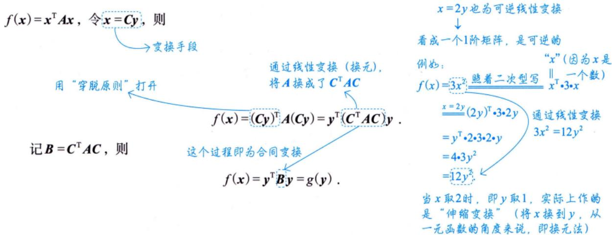

此时，二次型 $f(\pmb {x}) = \pmb{x}^{\mathrm{T}}\pmb {A}\pmb{x}$ 通过线性变换 $\pmb {x} = \pmb {C}\pmb{y}$ 得到一个新二次型 $g(y) = y^{\mathrm{T}}By$ ：

唯一对应二次型的矩阵 $\mathbf{A}$ .

唯一对应二次型的矩阵 $\pmb{B}$

# 2 矩阵合同的定义与性质

考生不难发现，上述二次型 $f(x)$ 与 $g(y)$ 的系数矩阵 $\mathbf{A}$ 与 $\mathbf{B}$ 有下述关系

$$
\boldsymbol {B} = \boldsymbol {C} ^ {\mathrm {T}} \boldsymbol {A} \boldsymbol {C},
$$

这种关系叫什么呢？下面就给出数学上的描述。

定义 设 $A, B$ 为 $n$ 阶矩阵，若存在可逆矩阵 $C$ ，使得

$$
\boldsymbol {C} ^ {\mathrm {T}} \boldsymbol {A} \boldsymbol {C} = \boldsymbol {B},
$$

则称 $A$ 与 $\pmb{B}$ 合同，记作 $A\boxplus B$ .此时称其对应的二次型 $f(x)$ 与 $g(y)$ 为合同二次型.

合同  
等价  
相似

二次型合同，也称矩阵合同。例如，空间向量的伸缩：从原来一个空间变成另一个空间，所有的向量都进行了伸缩。再如：一个二次型从原来空间到另外一个新的空间作了旋转的变换，这两个二次型实际上是同一个二次型，这两个二次型为合同关系。

可以看出，在二次型背景下， $A$ 表征的是 $f(x) = x^{\mathrm{T}}Ax$ 的“形态”， $B$ 表征的是 $g(y) = y^{\mathrm{T}}By$ 的“形态”，但是毕竟 $f(x) = g(y)$ 是同一个东西，之所以 $A,B$ 分别表征了不同的“形态”，无非是因为在 $x = [x_{1},x_{2},\dots ,x_{n}]^{\mathrm{T}}$ 的参照系下与在 $y = [y_{1},y_{2},\dots ,y_{n}]^{\mathrm{T}}$ 的参照系下看到的是同一个事物的不同“形

态”罢了.

后面会知道，如果 $C^{-1} = C^{\mathrm{T}}$ ，称 $\pmb{c}$ 为正交矩阵，这是一种特殊的可逆线性变换.在变换 $x = Cy$ 下，如果 $C^{-1}\neq C^{\mathrm{T}}$ ，这种可逆线性变换一般会改变图形的形状，使其“扭曲”，但图形的类型不会变，比如 $f = 1$ ，原来是封闭曲面，可逆线性变换后仍是封闭曲面.若在 $x = [x_{1},x_{2},x_{3}]^{\mathrm{T}}$ 的参照系下，“ $f(x) =$ 某常数 $a$ ”的图形是“正”着放的，如图6-1所示，则在 $y = [y_{1},y_{2},y_{3}]^{\mathrm{T}}$ 的参照系下，“ $g(y) =$ 某常数 $a$ ”的图形是“歪”着放的，如图6-2所示（考生只需将头稍稍歪一下，使 $y_{3}$ 轴平行于你的鼻梁，即可看到图形在 $y = [y_1,y_2,y_3]^{\mathrm{T}}$ 的参照系下的“歪”的形态）.

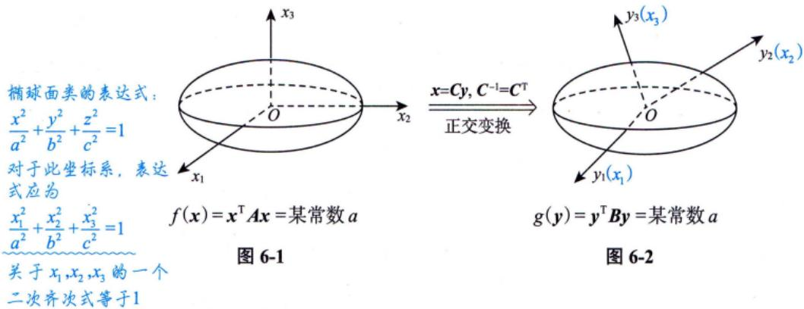

上面这段分析让我们理解到：在二次型中， $A$ 与 $\pmb{B}$ 的合同，就是指同一个二次型在可逆线性变换下的两个不同状态的联系.

合同有以下三个性质：

(1) $A = A$ （反身性）；  
(2) 若 $A = B$ ，则 $B = A$ （对称性）；  
(3)若 $A\simeq B$ ，且 $B\simeq C$ ，则 $A\simeq C$ （传递性）.可逆矩阵

可逆矩阵的转置也是可逆矩阵 $\leftarrow  \overset{⏜}{C} = B$ (可逆矩阵乘上 $A$ 不改变 $A$ 的秩,故 $r\left( A\right)  = r\left( B\right)$ )

特别需要指出的是，由矩阵合同的定义知，若 $A = B$ ，则有 $r(A) = r(B)$ ，因此有重要结论：可逆线性变换不会改变二次型的秩.顺便再说一句，由于在二次型中，二次型的矩阵都是对称矩阵，因此和对称矩阵合同的矩阵也必是对称矩阵.这是因为若 $A = B$ ，即存在可逆矩阵 $\pmb{C}$ ，使得 $C^{\mathrm{T}}AC = B$ ，其中 $A^{\mathrm{T}} = A$ ，则

$$
\boldsymbol {B} ^ {\mathrm {T}} = (\boldsymbol {C} ^ {\mathrm {T}} \boldsymbol {A} \boldsymbol {C}) ^ {\mathrm {T}} = \boldsymbol {C} ^ {\mathrm {T}} \boldsymbol {A} ^ {\mathrm {T}} \boldsymbol {C} = \boldsymbol {C} ^ {\mathrm {T}} \boldsymbol {A} \boldsymbol {C} = \boldsymbol {B}.
$$

① 矩阵合同一定等价.

② 矩阵相似一定等价.

等价的结论是最弱的

穿脱原则 $\rightarrow$ 必须有的限制

考研中，在 $A, B$ 均为对称矩阵的条件下，研究合同.合同是对二次型的关系来说的，且二次型矩阵一定是对称矩阵

二次型什么时候的形态是“最佳”的呢？对于二次型来说，化成标准形是够了，但化成规范形更完美。

若二次型中只含有平方项，没有交叉项（即所有交叉项的系数全为零），即形如

$$
d _ {1} x _ {1} ^ {2} + d _ {2} x _ {2} ^ {2} + \dots + d _ {n} x _ {n} ^ {2}
$$

的二次型称为标准形. $\rightarrow$ 一般不唯一.

若标准形中，系数 $d_{i}(i = 1,2,\dots ,n)$ 的取值范围为 $\{1, - 1,0\}$ ，即形如 $x_{1}^{2} + \dots +x_{p}^{2} - x_{p + 1}^{2} - \dots -x_{p + q}^{2}$ 的

如果 $d_{i}\neq 0,1, - 1$ ，则可以通过伸缩变换将系数变为0， $\pm 1.$ 例如 $f$ 中出现了 $\sqrt{d_1} x_1$ ，则 $\sqrt{d_1} x_1 = y_1\Rightarrow (\sqrt{d_1} x_1)^2 = 1\cdot y_1^2$ 二次型称为规范形.在不考虑 $d_{i}$ 顺序时，唯一.

给出一个二次型,如 $f\left( {{x}_{1},{x}_{2}}\right)  = \underset{\text{交叉项 }}{\underbrace{{x}_{1}^{2} + 2{x}_{1}{x}_{2} + 3{x}_{2}^{2}}}$ 既含平方项又含交叉项或不含平方项只含交叉项,叫作一般形,只含平方项,不含交叉项,叫作标准形.

对于一个二次型来说，不论怎么作可逆线性变换，只要是合

同的状态，其规范形是一样的

$C$ 只保证可逆，达不到正交矩阵的标准

也叫拉格朗日配方法

$\star$ 定理1 任何二次型 $f(x) = x^{\mathrm{T}}Ax$ 均可通过配方法（作可逆线性变换 $x = \overline{C}\mathbf{y}$ )化成标准形及规范形，

用矩阵语言表述：任何实对称矩阵 $\mathbf{A}$ ,必存在可逆矩阵 $\mathbf{C}$ ,使得 ${\mathbf{C}}^{\mathrm{T}}\overline{\mathbf{A}}\overline{\mathbf{C}} = \overline{\mathbf{A}}$ ,其中

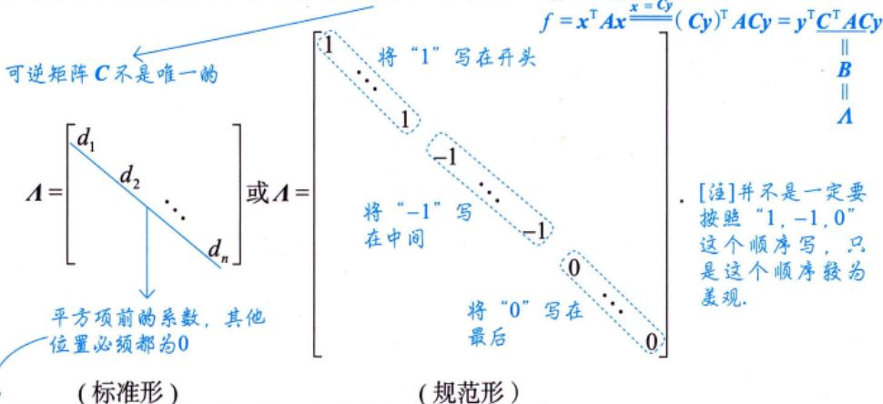

因为只要其他位置有不为0的数，就意味着一定含有交叉项

注此处 $\pmb{C}$ 的列向量一般不是 $\pmb{A}$ 的特征向量， $d_{i}(i = 1,2,\dots ,n)$ 一般也不是 $\pmb{A}$ 的特征值.

$①$ 任何实对称矩阵 $\pmb{A}$ ，必存在可逆矩阵 $C$ ，使得 $C^{\mathrm{T}}AC = \varLambda$ （即 $\mathbf{A}$ 和 $\varLambda$ 合同）

存在可逆矩阵 $C$ ，使得 $C^{-1}AC = A$ ，即 $\pmb{A}$ 和 $\pmb{\Lambda}$ 相似，记 $A\sim A$

其中 $C$ 是由 $A$ 的特征向量拼成的,(或 $A$ 可以相似对角化)

$\pmb{A}$ 是由 $\pmb{A}$ 的特征值拼成的

其中 $C^{\mathrm{T}}$ 不一定是 $C^{-1}$ .若 $C^{\mathrm{T}}$ 和 $C^{-1}$ 不相同，则 $C^{\mathrm{T}}$ 中的 $\pmb{c}$ 不是由 $\pmb{A}$ 的特征向量拼成的.

$\boldsymbol{C}^{\mathrm{T}} \boldsymbol{A} \boldsymbol{C} = \boldsymbol{A}^{*}$ 中的“ $\boldsymbol{A}^{*}$ ”也不是由 $\boldsymbol{A}$ 的特征值拼成的；当 $\boldsymbol{C}$ 为正交矩阵时， $\boldsymbol{C}^{\mathrm{T}} = \boldsymbol{C}^{-1}$ ，即 $\boldsymbol{C}^{\mathrm{T}}$

中的 $C$ 也是由 $\pmb{A}$ 的特征向量拼成的.（对于正交矩阵来说，合同跟相似是一回事）

$\star$ 定理2任何二次型 $f(x) = x^{\mathrm{T}}Ax$ 也可以通过正交变换 $\pmb {x} = \pmb{Q}\pmb{y}$ 化成标准形，用矩阵语言表述：任

何实对称矩阵 $A$ ，一定存在正交矩阵 $\mathcal{Q}$ ，使得

正交矩阵 $Q$ 不是唯一的

$$
\bar {Q} ^ {- 1} A Q = \bar {Q} ^ {\mathrm {T}} A Q = \Lambda ,
$$

当 $Q$ 为正交矩阵时， $\mathbf{A}$ 和 $\mathbf{A}^{\prime}$ 的合同

与 $\pmb{A}$ 和 $\pmb{\Lambda}$ 的相似是一回事.

$Q$ 一定是由 $A$ 的特征向量拼成的，

$A$ 一定是由 $A$ 的特征值拼成的

其中

$$
f (x) = \underbrace {x ^ {\mathrm {T}} A x} _ {\text {一 般 形}} \frac {x = Q y}{Q ^ {\mathrm {T}}} (Q y) ^ {\mathrm {T}} A Q y = y ^ {\mathrm {T}} \underbrace {Q ^ {\mathrm {T}} A Q} _ {\text {一 次 型 的 标 准 形}} y = y ^ {\mathrm {T}} A y
$$

注 此处 $Q$ 的列向量均是 $\mathbf{A}$ 的特征向量， $\lambda_{i}(i = 1,2,\dots ,n)$ 均是 $\mathbf{A}$ 的特征值.

# 三 惯性定理

合同变换下的不变量是正、负惯性指数

配方法、正交变换法、成对初等变换法等

无论选取什么样的可逆线性变换,将二次型化成标准形或规范形,其正项个数 $p$ 、负项个数 $q$ 都是不变的, $p$ 称为正惯性指数, $q$ 称为负惯性指数. 正的系数的项 负的系数的项的倒数项

相似变换下的不变量是 $k$ 阶主子式之和

等于任意 $k$ 个特征值乘积之和

注 若二次型的秩为 $r$ ，则 $r = p + q$ ，可逆线性变换不改变正、负惯性指数。

两个二次型(或实对称矩阵)合同的充要条件是有相同的正、负惯性指数，或有相同的秩及正（或负）惯性指数，或有相同的正、负特征值个数.

在 $A^{\mathrm{T}} = A$ 的条件下，相似 合同特征值相同， $p_A = p_B,q_A = q_B$ 仅能得出 $p_A = p_B,q_A = q_B$

# 注

两种方法

一定要搞

清楚,不 $f\left( x\right)  = {x}^{2} \cdot  \underline{A}x =$

要只会套 ${A}^{\mathrm{T}} = A$ 条件下

公式

$①$ 配方法（可逆线性变换）： $x = Cy$ ， $C$ 可逆.

使得 $f\frac{x = Cy}{y^{\mathrm{T}}}\Lambda y$ ，其中 $C^{\mathrm{T}}AC = \Lambda$ （使 $\pmb{A}$ 合同于对角矩阵）

$C$ 不一定由 $A$ 的特征向量拼成.

$A$ 也不一定是由 $A$ 的特征值拼成的.

正交变换法（可逆线性变换）： $x = Qy$ （这里的 $Q$ 不仅可逆，还满足 $Q^{-1} = Q^{\mathrm{T}})$ ，使得 $f\frac{x = Qy}{y^{\mathrm{T}}A}$ yT A y，其中 $Q^{\mathrm{T}}AQ = Q^{-1}AQ = A$ ：

★二者区别：在配方法中， $C$ 只满足可逆，所以 $C^{-1}$ 不一定等于 $C^{\mathrm{T}}$ ，但是在正交变换法中，变换手段 $\pmb{Q}$ 满足 $Q^{-1} = Q^{\mathrm{T}}$ ：

二者相同点：它们的正、负惯性指数是相同的.

例6.2 化二次型

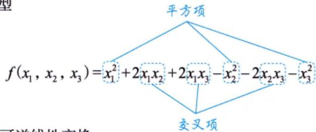

既含有平方项，又含有交叉项，故此二次型为一般形，即

$$
\boldsymbol {A} = \left[ \begin{array}{l l l} 1 & 1 & 1 \\ 1 & - 1 & - 1 \\ 1 & - 1 & - 1 \end{array} \right]
$$

为标准形，并写出所作的可逆线性变换.

分析 $f = \left\{  {{x}_{1}^{2} + 2{x}_{1}{x}_{2} + 2{x}_{1}{x}_{3}}\right.  - {x}_{2}^{2} - 2{x}_{2}{x}_{3} - {x}_{3}^{2}$

这三项均有 $x_{1}$ , 配成此式

$$
= \left(x _ {1} + x _ {2} + x _ {3}\right) ^ {2} - 2 x _ {2} ^ {2} - 4 x _ {2} x _ {3} - 2 x _ {3} ^ {2}
$$

拿此项跟原式作比 这两项均有 $x_{2}$

继续配成完全平方

$$
= (x _ {1} + x _ {2} + x _ {3}) ^ {2} - 2 (x _ {2} + x _ {3}) ^ {2};
$$

解 先对 $x_{1}^{2}$ 及所有含 $x_{1}$ 的混合项 $2x_{1}x_{2}, 2x_{1}x_{3}$ 配完全平方，有

$$
\begin{array}{l} f \left(x _ {1}, x _ {2}, x _ {3}\right) = \left(x _ {1} + x _ {2} + x _ {3}\right) ^ {2} - x _ {2} ^ {2} - x _ {3} ^ {2} - 2 x _ {2} x _ {3} - x _ {2} ^ {2} - 2 x _ {2} x _ {3} - x _ {3} ^ {2} \\ = \left(x _ {1} + x _ {2} + x _ {3}\right) ^ {2} - 2 x _ {2} ^ {2} - 4 x _ {2} x _ {3} - 2 x _ {3} ^ {2}. \\ \end{array}
$$

再对 $2x_{2}^{2}$ 及所有含 $x_{2}$ 的混合项 $-4x_{2}x_{3}$ 配完全平方，有

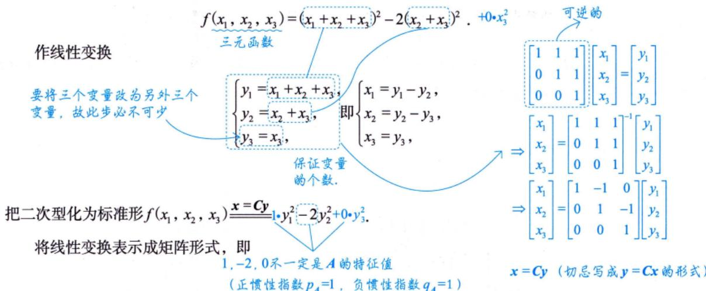

不一定是 $A$ 的特征向量 $\pmb{x} = \pmb{C}\pmb{y}$ 其中 $\pmb {C} = \begin{bmatrix} 1 & -1 & 0\\ 0 & 1 & -1\\ 0 & 0 & 1 \end{bmatrix} .$ 由于 $\left|\boldsymbol {C}\right| = \left| \begin{array}{lll}1 & -1 & 0\\ 0 & 1 & -1\\ 0 & 0 & 1 \end{array} \right| = 1\neq 0$ ，故所作变换是可逆线性变换.

注 (1) 用配方法化二次型为标准形时，要遵循“将某个变量的平方项及与其有关的混合项一次配完，配成一个完全平方，减少一个未配完全平方的变量，使得总的平方项的项数小于等于变量个数”。目的是保证所用变换是可逆的。

(2)当总的完全平方项的项数小于变量个数时，例如本题是三元二次型，完全平方项个数是2，应视作

$$
f \left(x _ {1}, x _ {2}, x _ {3}\right) = \left(x _ {1} + x _ {2} + x _ {3}\right) ^ {2} - 2 \left(x _ {2} + x _ {3}\right) ^ {2} + 0 x _ {3} ^ {2},
$$

变换为

$$
\left\{ \begin{array}{l} y _ {1} = x _ {1} + x _ {2} + x _ {3}, \\ y _ {2} = x _ {2} + x _ {3}, \\ y _ {3} = x _ {3}. \end{array} \right.
$$

如变换为

$$
\left\{ \begin{array}{l} y _ {1} = x _ {1} + x _ {2} + x _ {3}, \\ y _ {2} = x _ {2} + x _ {3}, \end{array} \right.
$$

显然是不可逆的.

(3) 配方法中配方次序可以不同，故所作可逆线性变换不唯一，标准形不唯一，但标准形中不为零的项数 $(r(f))$ 、正项个数（正惯性指数）、负项个数（负惯性指数）是不变的。  
(4)本题用矩阵语言表述：设 $A = \begin{bmatrix} 1 & 1 & 1\\ 1 & -1 & -1\\ 1 & -1 & -1 \end{bmatrix}$ ，求可逆矩阵 $C$ ，使得 $C^{\mathrm{T}}AC = A$ ，并写出对角矩阵 $\pmb{A}$ ：

#

例6.3

将二次型 $f(x_{1},x_{2},x_{3}) = x_{1}x_{2} + x_{1}x_{3} - x_{2}x_{3}$ 化为规范形，并求所用的可逆线性变换.

解

令

变量有几个就作几次变换

$$
\left\{ \begin{array}{l} x _ {1} = y _ {1} + y _ {2}, \\ x _ {2} = y _ {1} - y _ {2}, \\ x _ {3} = y _ {3}, \end{array} \right.
$$

则

$$
f \left(x _ {1}, x _ {2}, x _ {3}\right) = \boxed {y _ {1} ^ {2} - y _ {2} ^ {2}} + \boxed {y _ {1} y _ {3} + y _ {2} y _ {3} - y _ {1} y _ {3} + y _ {2} y _ {3}} = y _ {1} ^ {2} - y _ {2} ^ {2} + 2 y _ {2} y _ {3}
$$

配 ${y}_{2}$ ,写成 $- {\left( {y}_{2} - {y}_{3}\right) }^{2}$ 与原 式差了一个 ${y}_{3}^{2}$ ,故补一个 ${y}_{3}^{2}$

令

$$
\begin{array}{r l} & = \overline {{y _ {1} ^ {2}}} - (\overline {{y _ {2} - y _ {3}}}) ^ {2} + \overline {{y _ {3} ^ {2}}}, \\ & \left\{ \begin{array}{l l} z _ {1} = \overline {{y _ {1}}}, \\ z _ {2} = \overline {{y _ {2} - y _ {3}}}, \\ z _ {3} = \overline {{y _ {3}}}, \end{array} \right. \text {即} \left\{ \begin{array}{l l} y _ {1} = z _ {1}, \\ y _ {2} = z _ {2} + z _ {3}, \\ y _ {3} = z _ {3}, \end{array} \right. \end{array}
$$

得二次型的规范形为

$$
f \left(x _ {1}, x _ {2}, x _ {3}\right) \xlongequal {\boldsymbol {x} = \boldsymbol {C} z} z _ {1} ^ {2} - z _ {2} ^ {2} + z _ {3} ^ {2}.
$$

所用线性变换为

既是标准形也是规范形，

1(二重)，-1不一定为二次型f对应矩阵的特征值对应的变换手段也不一定是它的特征向量.

$\left\{ \begin{array}{l}x_{1} = y_{1} + y_{2},\\ x_{2} = y_{1} - y_{2},\\ x_{3} = y_{3} \end{array} \right.$ 与 $\left\{ \begin{array}{l}y_{1} = z_{1},\\ y_{2} = z_{2} + z_{3},\\ y_{3} = z_{3}, \end{array} \right.$ $\left[ \begin{array}{c}x_{1}\\ x_{2}\\ x_{3} \end{array} \right] = \left[ \begin{array}{rrr}1 & 1 & 0\\ 1 & -1 & 0\\ 0 & 0 & 1 \end{array} \right]\left[ \begin{array}{c}y_{1}\\ y_{2}\\ y_{3} \end{array} \right]$ 得 $\left\{ \begin{array}{l}x_{1} = z_{1} + z_{2} + z_{3},\\ x_{2} = z_{1} - z_{2} - z_{3},\\ x_{3} = z_{3}. \end{array} \right.$ $= \left[ \begin{array}{rrrrrrrrrrrrrrrrrrrrrrrrrrrrrrrrrrrrrrrrrrrrrrrrrrrrrrrrrrrrrrrrrrrrrrrrrrrrrrrrrrrrrrrrrrrrrrrrrrrrrrrrrrrrrrrrrrrrrrrrrrrrrrrrrrrrrrrrrrrrrrrrrrrrrrrrrrrrrrrrrrrrrrrrrrrrrrrrrrrrrrrrrrrrrrrrrrrrrrrrr$ 用矩阵表示为

其中 $|C| = \begin{vmatrix} 1 & 1 & 1\\ 1 & -1 & -1\\ 0 & 0 & 1 \end{vmatrix} = -2\neq 0$ ，故 $x = Cz$ 是可逆线性变换.

注 (1) 用配方法化二次型为标准形、规范形, 若有平方项, 应将平方项及其有关混合项配成完全平方 (如例 6.2). 没有平方项时, 作可逆线性变换 $\left\{ \begin{array}{l} x_{1} = y_{1} + y_{2}, \\ x_{2} = y_{1} - y_{2}, \\ x_{3} = y_{3}, \end{array} \right.$ , 使其出现平方项, 然后再配完全平方 (如本题). 这样, 任何二次型总可以用配方法化成标准形、规范形, 且所作变换均是可逆线性变换. 用矩阵的语言表述: 任何实对称矩阵 $A$ , 必存在可逆矩阵 $C$ , 使得 $C^{\mathrm{T}} A C = A$ , 其中 $A$ 是对角矩阵, 或是对角元素取值范围为 $\{1, -1, 0\}$ 的对角矩阵.

(2)配方是中学已经掌握的内容，并不难，但为我们提供了 $①$ 所作的可逆线性变换； $②$ 与 $\pmb{A}$ 合同的对角矩阵； $③$ 二次型（或 $\pmb{A}$ ）的秩； $④$ 正、负惯性指数； $⑤$ 是否正定等二次型的重要信息，故在解决上述问题时，别忘了有一招是配方法.

# 例6.4 用正交变换化二次型

a12 a21 a32 分成“2”和“2”分成“-4”和“-4” $f\left( {{x}_{1},{x}_{2},{x}_{3}}\right)  = {2{x}_{1}^{2} + 5{x}_{2}^{2} + 5{x}_{3}^{2} + 4{x}_{1}{x}_{2} - 4{x}_{1}{x}_{3} - 8{x}_{2}{x}_{3}}$ 对应主对角线元素分成“-2”和“-2” ${a}_{13}\;{a}_{31}$ ① 加头：由 $f$ 写出 $A = \left\lbrack  \begin{array}{rrr} 2 & 2 &  - 2 \\  2 & 5 &  - 4 \\   - 2 &  - 4 & 5 \end{array}\right\rbrack$ , 为标准形,并求所作的正交变换.

# 解 二次型的对应矩阵为

2 -2 2 5 -4 2 -4

$②$ 求 $A$ 的 $\lambda$ 与 $\xi$

③ $\xi_{1},\xi_{2},\dots ,\xi_{n}\xrightarrow[\text{单位化}]{\text{正麦化}}\eta_{1},\eta_{2},\dots ,\eta_{n}$

令 $Q = [\eta_1, \eta_2, \dots, \eta_n]$

④加尾：令 $x = Qy \Rightarrow$

$$
\begin{array}{l} f = x ^ {T} A x = (\underline {{Q}} y) ^ {T} A Q y = y ^ {T} Q ^ {T} A Q y \\ = y ^ {T} Q ^ {- 1} A Q y = y ^ {T} A y \\ = \lambda_ {1} y _ {1} ^ {2} + \dots + \lambda_ {n} y _ {n} ^ {2}. \\ \end{array}
$$

②求特征值、特征向量

由例5.1知 $\pmb{A}$ 有特征值 $\lambda_1 = \lambda_2 = 1, \lambda_3 = 10$

当 $\lambda_{1} = \lambda_{2} = 1$ 时，基础解系为 $\xi_1 = [-2,1,0]^{\mathrm{T}},\xi_2 = [2,0,1]^{\mathrm{T}}$ 与 $\xi_{2}$ 不正交，故作施密特正交化使二者正交

当 $\lambda_3 = 10$ 时，基础解系为 $\xi_{3} = [1,2, - 2]^{\mathrm{T}}$

将 $\lambda_1 = \lambda_2 = 1$ 对应的特征向量 $\xi_1, \xi_2$ 标准正交化.

取

$$
\boldsymbol {\eta} _ {1} = \boldsymbol {\xi} _ {1} = [ - 2, 1, 0 ] ^ {\mathrm {T}},
$$

③ 正变化、单位化

$$
\eta_ {2} = \xi_ {2} - \frac {\left(\eta_ {1} , \xi_ {2}\right)}{\left(\eta_ {1} , \eta_ {1}\right)} \eta_ {1} = [ 2, 0, 1 ] ^ {\mathrm {T}} - \frac {- 4}{5} [ - 2, 1, 0 ] ^ {\mathrm {T}} = \left[ \frac {2}{5}, \frac {4}{5}, 1 \right] ^ {\mathrm {T}},
$$

不妨取 $\pmb{\eta}_{2} = [2,4,5]^{\mathrm{T}}$

再将 $\pmb{\eta}_1, \pmb{\eta}_2, \pmb{\xi}_3$ 单位化，

$$
\eta_ {1} ^ {\circ} = \left[ \begin{array}{c} - 2 \\ \frac {1}{\sqrt {5}} \\ 0 \end{array} \right], \eta_ {2} ^ {\circ} = \left[ \begin{array}{c} \frac {2}{3 \sqrt {5}} \\ \frac {4}{3 \sqrt {5}} \\ \frac {5}{3 \sqrt {5}} \end{array} \right], \eta_ {3} ^ {\circ} = \left[ \begin{array}{c} \frac {1}{3} \\ \frac {2}{3} \\ \frac {- 2}{3} \end{array} \right],
$$

④ 加尾

得正交矩阵 $Q = [\eta_1^{\circ},\eta_2^{\circ},\eta_3^{\circ}]$ ，令 $\pmb {x} = \pmb {Q}\pmb{y}$ ，则原二次型化为标准形

$$
f \left(x _ {1}, x _ {2}, x _ {3}\right) = \boldsymbol {x} ^ {\mathrm {T}} \boldsymbol {A} \boldsymbol {x} \xlongequal {\boldsymbol {x} = \boldsymbol {Q} \boldsymbol {y}} \boldsymbol {y} ^ {\mathrm {T}} \boldsymbol {Q} ^ {\mathrm {T}} \boldsymbol {A} \boldsymbol {Q} \boldsymbol {y} = y _ {1} ^ {2} + y _ {2} ^ {2} + 1 0 y _ {3} ^ {2},
$$

其中正交变换为

$$
\boldsymbol {x} = \boldsymbol {Q} \boldsymbol {y} = \left[ \begin{array}{c c c} \frac {- 2}{\sqrt {5}} & \frac {2}{3 \sqrt {5}} & \frac {1}{3} \\ \frac {1}{\sqrt {5}} & \frac {4}{3 \sqrt {5}} & \frac {2}{3} \\ 0 & \frac {5}{3 \sqrt {5}} & \frac {- 2}{3} \end{array} \right] \left[ \begin{array}{l} y _ {1} \\ y _ {2} \\ y _ {3} \end{array} \right].
$$

注 (1)正交变换只能化二次型为标准形，不能化为规范形（除非特征值都属于 $\{1, -1, 0\}$ ）.

(2) 正交变换不唯一，但经正交变换所得标准形是唯一的（不考虑 $\lambda_{i}$ 的顺序），求得特征值后即可得标准形为

$$
\lambda_ {1} y _ {1} ^ {2} + \lambda_ {2} y _ {2} ^ {2} + \dots + \lambda_ {n} y _ {n} ^ {2}.
$$

(3) $\lambda_{1} = \lambda_{2} = 1$ 是二重根，方程组 $(\pmb {E} - \pmb {A})\pmb {x} = \left[ \begin{array}{rrr} - 1 & -2 & 2\\ -2 & -4 & 4\\ 2 & 4 & -4 \end{array} \right]\left[ \begin{array}{l}x_{1}\\ x_{2}\\ x_{3} \end{array} \right] = \mathbf{0}$ 有两个线性无关解，为避免后面的正交化计算，可在解此方程组时，同时考虑正交化. $\lambda_1 = \lambda_2 = 1$ ，对应特征向量应满足

$$
- x _ {1} - 2 x _ {2} + 2 x _ {3} = 0.
$$

取 $\xi_{1} = [-2, 1, 0]^{\mathrm{T}}$ ，再求 $\xi_{2}$ 时，可先令 $\xi_{2}$ 和 $\xi_{1}$ 正交，取 $\xi_{2} = [1, 2, a]^{\mathrm{T}}((\xi_{1}, \xi_{2}) = 0, a$ 待定），再代入方程以确定 $a$ ，即 $-1 - 4 + 2a = 0$ ，得 $a = \frac{5}{2}$ ，则 $\xi_{2} = \left[1, 2, \frac{5}{2}\right]^{\mathrm{T}}$ ，取整数得 $\xi_{2}' = [2, 4, 5]^{\mathrm{T}}$ 。

(4) 计算过程还可作如下验算: ① $\sum_{i=1}^{3} \lambda_{i} = \sum_{i=1}^{3} a_{ii}, |A| = \prod_{i=1}^{3} \lambda_{i}$ ; ② 当 $\lambda_{1} \neq \lambda_{3}$ 时, $(\xi_{1}, \xi_{3}) = 0$ .

(5)本题用矩阵语言表述：设 $A = \begin{bmatrix} 2 & 2 & -2\\ 2 & 5 & -4\\ -2 & -4 & 5 \end{bmatrix}$ ，求正交矩阵 $\pmb{Q}$ ，使得 $Q^{-1}AQ = Q^{\mathrm{T}}AQ = A$ ，并写出对角矩阵 $\pmb{A}$ ：

看到正交变换一定要想到2，1，-1为二次型f对应矩阵的特征值

例6.5 设二次型 $f(x_{1},x_{2},x_{3})$ 在正交变换 $x = P y$ 下的标准形为 $2y_{1}^{2} + y_{2}^{2} - y_{3}^{2}$ ，其中 $P = P$ 为对应于特征值2，1，-1的特征向量。 $[e_1,e_2,e_3]$ 。若 $Q = [e_1, - e_3,e_2]$ ，则 $f(x_{1},x_{2},x_{3})$ 在正交变换 $x = Qy$ 下的标准形为（ ）.

(A) $2y_{1}^{2} - y_{2}^{2} + y_{3}^{2}$

(B) $2y_{1}^{2} + y_{2}^{2} - y_{3}^{2}$

(C) $2y_{1}^{2} - y_{2}^{2} - y_{3}^{2}$

(D) $2y_{1}^{2} + y_{2}^{2} + y_{3}^{2}$

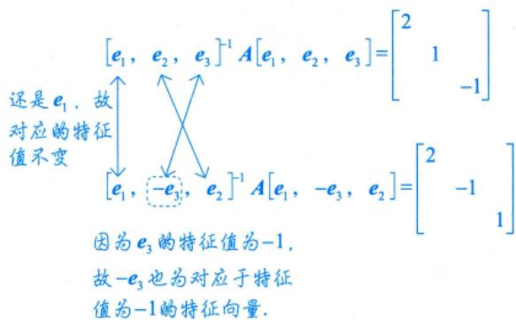

解 应选(A).

设二次型矩阵为 $A$ ，则

$$
\boldsymbol {P} ^ {- 1} \boldsymbol {A} \boldsymbol {P} = \boldsymbol {P} ^ {\mathrm {T}} \boldsymbol {A} \boldsymbol {P} = \left[ \begin{array}{l l l} 2 & 0 & 0 \\ 0 & 1 & 0 \\ 0 & 0 & - 1 \end{array} \right],
$$

则 $\pmb{e}_1, \pmb{e}_2, \pmb{e}_3$ 分别是 $\pmb{A}$ 的对应于特征值 2, 1, -1 的特征向量，于是 $-\pmb{e}_3$ 也是 $\pmb{A}$ 的对应于特征值 -1 的特征向量。因此

$$
\boldsymbol {Q} ^ {- 1} \boldsymbol {A} \boldsymbol {Q} = \boldsymbol {Q} ^ {\mathrm {T}} \boldsymbol {A} \boldsymbol {Q} = \left[ \begin{array}{l l l} 2 & 0 & 0 \\ 0 & - 1 & 0 \\ 0 & 0 & 1 \end{array} \right],
$$

从而 $f$ 在正交变换 $\pmb {x} = \pmb {Q}\pmb{y}$ 下的标准形为 $2y_{1}^{2} - y_{2}^{2} + y_{3}^{2}$

例6.6 设二次型 $f(x_{1},x_{2}) = x_{1}^{2} - 4x_{1}x_{2} + ax_{2}^{2}$ 经过正交变换 $\left[ \begin{array}{l}x_{1}\\ x_{2} \end{array} \right] = Q\left[ \begin{array}{l}y_{1}\\ y_{2} \end{array} \right]$ 化为二次型

因为是正交变换,所以

A，B既合同也相似

$$
g \left(y _ {1}, y _ {2}\right) = \frac {4 y _ {1} ^ {2} + 4 y _ {1} y _ {2} + b y _ {2} ^ {2}}{B}.
$$

(1) 求 $a, b$ 的值；  
(2) 求正交矩阵 $Q$ ：

解 (1)由题意，二次型 $f(x_{1},x_{2})$ 与 $g(y_{1},y_{2})$ 的矩阵分别为

$$
\boldsymbol {A} = \left[ \begin{array}{l l} 1 & - 2 \\ - 2 & a \end{array} \right], \boldsymbol {B} = \left[ \begin{array}{l l} 4 & 2 \\ 2 & b \end{array} \right],
$$

且 $\mathbf{Q}^{\mathrm{T}}\mathbf{A}\mathbf{Q} = \mathbf{B}$ .由于 $\pmb{Q}$ 为正交矩阵，于是 $Q^{-1}AQ = B$ ，因此 $\operatorname {tr}(A) = \operatorname {tr}(B),|A| = |B|$ ，即

$$
\left\{ \begin{array}{l} 1 + a = 4 + b, \\ a - 4 = 4 b - 4, \end{array} \right.
$$

解得 $a = 4, b = 1$

(2) 由于 $|\lambda \pmb{E} - \pmb{A}| = |\lambda \pmb{E} - \pmb{B}| = \lambda (\lambda - 5)$ ，因此矩阵 $\pmb{A}, \pmb{B}$ 的特征值均为 $\lambda_1 = 0, \lambda_2 = 5$ 。

因为 $A$ ， $\pmb{B}$ 相似，故特征值相同

$\therefore$ 矩阵 $\mathbf{A}$ 为正定矩阵, $\left( {\mathbf{A}\mathbf{B}}\right)$ 为 $\mathbf{A}$ B相似,故特征值相同

矩阵 $\pmb{A}$ 的属于特征值 $\lambda_{2} = 5$ 的单位特征向量 $\pmb{a}_{2} = \frac{1}{\sqrt{5}}\left[ \begin{array}{l}1\\ -2 \end{array} \right]$

令 $Q_{1} = [\pmb{a}_{1}, \pmb{a}_{2}] = \frac{1}{\sqrt{5}} \begin{bmatrix} 2 & 1 \\ 1 & -2 \end{bmatrix}$ ，则 $Q_{1}$ 为正交矩阵，且 $Q_{1}^{\mathrm{T}} A Q_{1} = \begin{bmatrix} 0 & 0 \\ 0 & 5 \end{bmatrix}$ .

由(1)知， $\pmb {B} = \left[ \begin{array}{ll}4 & 2\\ 2 & 1 \end{array} \right].$

考纲中要求的（A直接化成标准形）

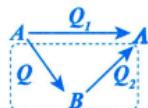  
中间经历的

矩阵 $\pmb{B}$ 的属于特征值 $\lambda_{1} = 0$ 的单位特征向量 $\pmb{\beta}_{1} = \frac{1}{\sqrt{5}}\left[ \begin{array}{l}1\\ -2 \end{array} \right]$

矩阵 $\pmb{B}$ 的属于特征值 $\lambda_{2} = 5$ 的单位特征向量 $\pmb{\beta}_{2} = \frac{1}{\sqrt{5}}\begin{bmatrix} 2 \\ 1 \end{bmatrix}$ .

令 $Q_{2} = [\pmb{\beta}_{1}, \pmb{\beta}_{2}] = \frac{1}{\sqrt{5}} \begin{bmatrix} 1 & 2 \\ -2 & 1 \end{bmatrix}$ ，则 $Q_{2}$ 为正交矩阵，且 $Q_{2}^{\mathrm{T}} B Q_{2} = \begin{bmatrix} 0 & 0 \\ 0 & 5 \end{bmatrix}$ .

由于 $Q_{1}^{\mathrm{T}}AQ_{1} = Q_{2}^{\mathrm{T}}BQ_{2} = \left[ \begin{array}{ll}0 & 0\\ 0 & 5 \end{array} \right]$ ，因此 $(Q_{1}Q_{2}^{T})^{T}A(Q_{1}Q_{2}^{T}) = B$ ，故 $Q = Q_{1}Q_{2}^{T} = \frac{1}{5}\left[ \begin{array}{rr}4 & -3\\ -3 & -4 \end{array} \right]$ 为所求矩阵.

例6.7 设二次型 $f(x_{1},x_{2},x_{3}) = x_{1}^{2} - x_{2}^{2} + 2ax_{1}x_{3} + 4x_{2}x_{3}$ 的负惯性指数为1，则 $a$ 的取值范围是_____. 对于此类型的题，有两个方法：方法一：采用配方法，配平方之后只有1个平方项前的系数是负的；方法二：写二次型矩阵 $A$ ，求其特征值，保证只有1个负的特征值。而对于本题来说，用配方法更好。

解 应填[-2,2].

因为 $f(x_{1},x_{2},x_{3}) = x_{1}^{2} - x_{2}^{2} + 2ax_{1}x_{3} + 4x_{2}x_{3}$

$$
\begin{array}{l} = x _ {1} ^ {2} + 2 a x _ {1} x _ {3} + a ^ {2} x _ {3} ^ {2} - x _ {2} ^ {2} + 4 x _ {2} x _ {3} - 4 x _ {3} ^ {2} + 4 x _ {3} ^ {2} - a ^ {2} x _ {3} ^ {2} \\ = \left(x _ {1} + a x _ {3}\right) ^ {2} - \left(x _ {2} - 2 x _ {3}\right) ^ {2} + \left(4 - a ^ {2}\right) x _ {3} ^ {2}, \\ \end{array}
$$

又因为 $f$ 的负惯性指数为1，所以 $4 - a^{2}\geqslant 0$ ，故 $-2\leqslant a\leqslant 2$ ：

例6.8

1 2 0 可以求A的特征值2 1 0 则下列矩阵中与 $\pmb{A}$ 合同的是（ ）.0 0 1 也可以配方： $f = x_1^2 +x_2^2 +x_3^2 +4x_1x_2 = (x_1 + 2x_2)$

(A) $\begin{bmatrix} 1 & 0 & 0\\ 0 & 1 & 0\\ 0 & 0 & 1 \end{bmatrix}$

(B) $\begin{bmatrix} 1 & 0 & 0\\ 0 & 1 & 0\\ 0 & 0 & -1 \end{bmatrix}$

(C) $\begin{bmatrix} 1 & 0 & 0 \\ 0 & -1 & 0 \\ 0 & 0 & -1 \end{bmatrix}$

(D) $\left[ \begin{array}{rrr} - 1 & 0 & 0\\ 0 & -1 & 0\\ 0 & 0 & -1 \end{array} \right]$

分析 在“对称条件”下谈合同，知

$$
A \simeq B \Leftrightarrow p _ {A} = p _ {B} = 2, \quad q _ {A} = q _ {B} = 1.
$$

解 应选(B).

方法一 $A$ 对应的二次型为

$$
f \left(x _ {1}, x _ {2}, x _ {3}\right) = x _ {1} ^ {2} + x _ {2} ^ {2} + x _ {3} ^ {2} + 4 x _ {1} x _ {2},
$$

经配方法化为

$$
f \left(x _ {1}, x _ {2}, x _ {3}\right) = x _ {1} ^ {2} + x _ {2} ^ {2} + x _ {3} ^ {2} + 4 x _ {1} x _ {2} = \left(x _ {1} + 2 x _ {2}\right) ^ {2} - 3 x _ {2} ^ {2} + x _ {3} ^ {2},
$$

知 $r(f) = 3$ ，正惯性指数 $p = 2$ ，与选项(B)相同，故应选(B).

方法二 求 $A$ 的特征值. 由

$$
\left| \lambda E - A \right| = \left| \begin{array}{c c c} \lambda - 1 & - 2 & 0 \\ - 2 & \lambda - 1 & 0 \\ 0 & 0 & \lambda - 1 \end{array} \right| = (\lambda - 1) (\lambda^ {2} - 2 \lambda - 3) = (\lambda - 1) (\lambda - 3) (\lambda + 1) = 0,
$$

知 $\pmb{A}$ 的特征值为 $\lambda_1 = 1, \lambda_2 = 3, \lambda_3 = -1$ ，且 $\pmb{A}$ 对应的二次型在正交变换下化为标准形 $y_1^2 + 3y_2^2 - y_3^2$ ，与选项(B)的正、负惯性指数相同，即

$$
\boldsymbol {A} \simeq \left[ \begin{array}{c c c} 1 & 0 & 0 \\ 0 & 1 & 0 \\ 0 & 0 & - 1 \end{array} \right],
$$

故应选(B).

例6.9 设 $\pmb{A}$ 为3阶实对称矩阵，互换 $\pmb{A}$ 的1，2行得到矩阵 $\pmb{B}$ ，再互换 $\pmb{B}$ 的1，2列得到矩阵 $\pmb{C}$ ，则矩阵 $\pmb{A}$ 与矩阵 $\pmb{C}$ （ ）.

(A)合同但不相似

(B) 相似但不合同

(C) 合同且相似

(D) 不合同也不相似

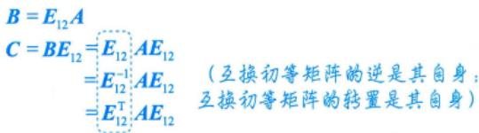

解 应选(C).

由题设互换 $A$ 的1，2行得到矩阵 $\pmb{B}$ ，则有 $PA = B$ ，其中 $P = \begin{bmatrix} 0 & 1 & 0\\ 1 & 0 & 0\\ 0 & 0 & 1 \end{bmatrix}$ .再互换 $\pmb{B}$ 的1，2列得到矩阵 $C$ ，则有 $BP = C$ ，从而 $PAP = C$ .由于初等矩阵 $P = \begin{bmatrix} 0 & 1 & 0\\ 1 & 0 & 0\\ 0 & 0 & 1 \end{bmatrix}$ 满足 $P^{\mathrm{T}} = P,P^{-1} = P$ ，因此 $P^{-1}AP = C,P^{\mathrm{T}}AP = C$ ，即矩阵 $A$ 与矩阵 $C$ 合同且相似，故正确选项为(C).

# 四 正定二次型及其判别

# 定义

$n$ 元二次型 $f(x_{1},x_{2},\dots ,x_{n}) = x^{\mathrm{T}}Ax$ .若对任意的 $\pmb {x} = [x_1,x_2,\dots ,x_n]^{\mathrm{T}}\neq \mathbf{0}$ ，均有 $x^{\mathrm{T}}Ax > 0$ ，则称 $f$ 为正定二次型，称二次型的对应矩阵 $\pmb{A}$ 为正定矩阵.

在二元情况下, $z = f\left( {{x}_{1},{x}_{2}}\right)$ ,形成了一个空间坐标系,若 $f$ 为正定二次型, 并且 $f = 1$ (不一定非得是 1 , 可以是任何大于 0 的常数), 则图形是封闭的

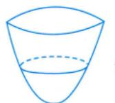

椭圆类（封闭曲线）

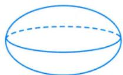

$f(x_{1},x_{2},x_{3}) = 1$ ，椭球面类（封闭曲线）

注 正定的 $f$ 有一个特性：令 $f$ 是一正的常数，其反映出来的几何图形是封闭的。

# 二次型正定的充要条件

$n$ 元二次型 $f = \pmb{x}^{\mathrm{T}}\pmb{A}\pmb{x}$ 正定 $\Leftrightarrow$ 对任意 $\pmb {x}\neq \pmb{0}$ ，有 $\pmb{x}^{\mathrm{T}}\pmb {A}\pmb {x} > 0$ （定义）

$$
\begin{array}{l} \boldsymbol {x} ^ {\mathrm {T}} \boldsymbol {A} \boldsymbol {x} = \boldsymbol {y} ^ {\mathrm {T}} \boldsymbol {A} \boldsymbol {y} \\ = a _ {1} y _ {1} ^ {2} + \dots + a _ {n} y _ {n} ^ {2}, \\ \end{array}
$$

要保证其始终大于0，要求 $a_1,a_2,\dots ,a_n$ 金是正的即可.

通过伸缩变换成 $z_1^2 +\dots +z_n^2$ （规范形，系数全为“1”），故存在可逆矩阵 $\pmb{C}$ ，使得 $C^{\mathrm{T}}AC = E$ ，即 $"A\simeq E"$ ，则

$$
\begin{array}{l} \boldsymbol {A} = \left(\boldsymbol {C} ^ {\mathrm {T}}\right) ^ {- 1} \boldsymbol {C} ^ {- 1} \\ = (\boldsymbol {C} ^ {- 1}) ^ {\mathrm {T}} \boldsymbol {C} ^ {- 1} \\ = D ^ {\mathrm {T}} D \\ \end{array}
$$

注 设 $A = (a_{ij})_{n\times n}$ ，则

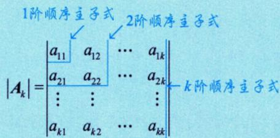

称为 $n$ 阶矩阵 $\mathbf{A}$ 的 $k$ 阶顺序（或左上角）主子式.当 $k$ 取1，2，…， $n$ 时，就得到 $\mathbf{A}$ 的 $n$ 个顺序主子式.

# 3二次型正定的必要条件

(1) $a_{ii} > 0 (i = 1, 2, \dots, n)$ .   
(2) $|A| > 0$

# 例6.10 判别二次型

$$
f \left(x _ {1}, x _ {2}, x _ {3}\right) = 2 x _ {1} ^ {2} + 2 x _ {2} ^ {2} + 2 x _ {3} ^ {2} + 2 x _ {1} x _ {2} + 2 x _ {1} x _ {3} + 2 x _ {2} x _ {3}
$$

的正定性.

解

$$
f \left(x _ {1}, x _ {2}, x _ {3}\right) = \left[ x _ {1}, x _ {2}, x _ {3} \right] \left[ \begin{array}{l l l} 2 & 1 & 1 \\ 1 & 2 & 1 \\ 1 & 1 & 2 \end{array} \right] \left[ \begin{array}{l} x _ {1} \\ x _ {2} \\ x _ {3} \end{array} \right],
$$

故 $f(x_{1},x_{2},x_{3})$ 的对应矩阵是

$$
\boldsymbol {A} = \left[ \begin{array}{l l l} 2 & 1 & 1 \\ 1 & 2 & 1 \\ 1 & 1 & 2 \end{array} \right].
$$

方法一 判别对应矩阵 $\pmb{A}$ 的各阶顺序主子式是否大于零.

（最常用）

由

1阶顺序主子式 2 阶顺序主子式

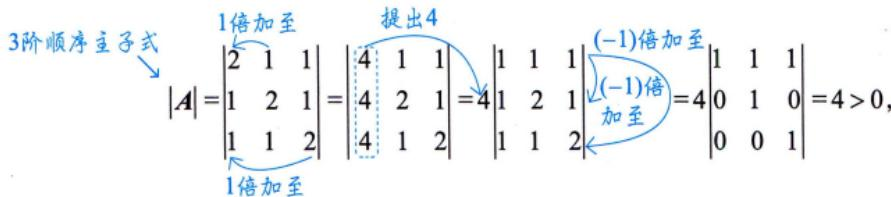

故 $A$ 正定， $f$ 是正定二次型.

方法二 判别对应矩阵 $A$ 的特征值是否全部大于零.

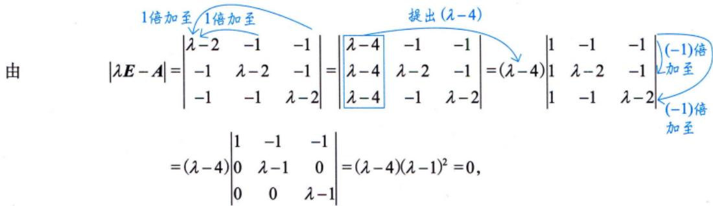

知 $\pmb{A}$ 的特征值 $\lambda_1 = 4, \lambda_2 = \lambda_3 = 1$ 全部大于零，故 $\pmb{A}$ 正定， $f$ 是正定二次型.

方法三 利用配方法化为标准形，判别 $f$ 的正惯性指数 $p$ 是否等于 $n$ （未知量个数）

$$
\begin{array}{l} f = 2 x _ {1} ^ {2} + 2 x _ {2} ^ {2} + 2 x _ {3} ^ {2} + 2 x _ {1} x _ {2} + 2 x _ {1} x _ {3} + 2 x _ {2} x _ {3} \\ = 2 \left(x _ {1} + \frac {x _ {2}}{2} + \frac {x _ {3}}{2}\right) ^ {2} + \frac {3}{2} x _ {2} ^ {2} + \frac {3}{2} x _ {3} ^ {2} + x _ {2} x _ {3} \\ = 2 \left(x _ {1} + \frac {x _ {2}}{2} + \frac {x _ {3}}{2}\right) ^ {2} + \frac {3}{2} \left(x _ {2} + \frac {1}{3} x _ {3}\right) ^ {2} + \frac {4}{3} x _ {3} ^ {2}, \\ \end{array}
$$

由二次型的标准形知， $f$ 的正惯性指数 $p = 3 = n$ ，故 $f$ 是正定二次型.

方法四 用定义，验证是否对任意的 $x = [x_1, x_2, x_3]^{\mathrm{T}} \neq \mathbf{0}$ ，有 $x^{\mathrm{T}}Ax > 0$ 。将二次型配成完全平方和（注意：这里配完全平方和的做法与方法三中的配方法不同，这里没有要求将某平方项及与其有关的混合项一次配完），即

$$
\begin{array}{l} f \left(x _ {1}, x _ {2}, x _ {3}\right) = 2 x _ {1} ^ {2} + 2 x _ {2} ^ {2} + 2 x _ {3} ^ {2} + 2 x _ {1} x _ {2} + 2 x _ {1} x _ {3} + 2 x _ {2} x _ {3} \\ = \left(x _ {1} + x _ {2}\right) ^ {2} + \left(x _ {2} + x _ {3}\right) ^ {2} + \left(x _ {3} + x _ {1}\right) ^ {2}, \\ \end{array}
$$

注：这里不是配方法

故有 $f\geqslant 0$ ，且

$$
f = 0 \Leftrightarrow \left\{ \begin{array}{l} x _ {1} + x _ {2} = 0, \\ x _ {2} + x _ {3} = 0, \\ x _ {3} + x _ {1} = 0. \end{array} \right. \tag {*}
$$

因方程组 $(\ast)$ 的系数行列式

$$
\left| \begin{array}{c c c} 1 & 1 & 0 \\ 0 & 1 & 1 \\ 1 & 0 & 1 \end{array} \right| = 2 \neq 0,
$$

故方程组 $(\ast)$ 只有零解，故 $f = 0\Leftrightarrow x_{1} = x_{2} = x_{3} = 0$

因此，当 $\pmb{x} = [x_1, x_2, x_3]^{\mathrm{T}} \neq \mathbf{0}$ 时，恒有 $f(x_1, x_2, x_3) > 0$ ，从而知 $f$ 是正定二次型.

方法五 由方法四知， $f(x_{1},x_{2},x_{3})$ 可配完全平方和

$$
f \left(x _ {1}, x _ {2}, x _ {3}\right) = \left(x _ {1} + x _ {2}\right) ^ {2} + \left(x _ {2} + x _ {3}\right) ^ {2} + \left(x _ {3} + x _ {1}\right) ^ {2},
$$

且利用内积可表示成如下矩阵形式

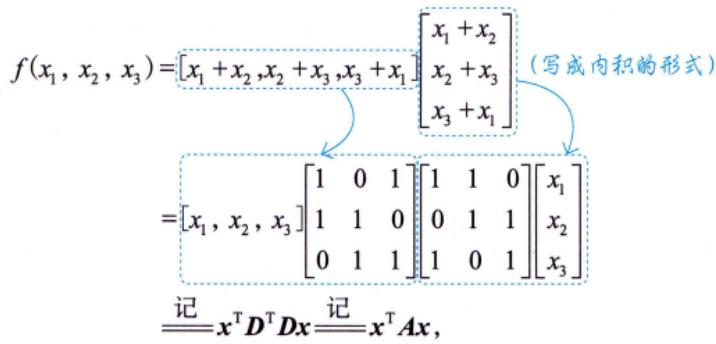

其中 $A = D^{\mathrm{T}}D,|\pmb {D}| = \left| \begin{array}{lll}1 & 1 & 0\\ 0 & 1 & 1\\ 1 & 0 & 1 \end{array} \right| = 2\neq 0,$ $\pmb{D}$ 可逆，故 $\pmb{A}$ 合同于单位矩阵，是正定矩阵，即 $f(x_{1},x_{2},x_{3})$ 是正定二次型.

注 以上五种方法利用定义及4个充要条件判别二次型是否正定。对具体的数值二次型（或实对称矩阵）主要用方法一，即判别顺序主子式是否全部大于零，其他问题要具体分析并根据对这些充要条件的熟练程度作出选择。

有些学生看到这个式子觉得 $f$ 一定正定,这个是错误的,必须用拉格朗日配方法配方成标准形式,才能说 $f$ 正定,该式显然不是由拉格朗日配方法得到的,所以不能说它一定正定.

例6.11 设二次型 $f(x_{1},x_{2},x_{3}) = (x_{1} + x_{2})^{2} + (x_{2} + x_{3})^{2} + (ax_{3} + x_{1})^{2}$ 正定，则 $a$ 的取值范围是

解 应填 $a \neq -1$ ：

如例6.10的方法四，由于 $f(x_{1},x_{2},x_{3})\geqslant 0$ ，且

$$
f \left(x _ {1}, x _ {2}, x _ {3}\right) = 0 \Leftrightarrow \left\{ \begin{array}{l} x _ {1} + x _ {2} = 0, \\ x _ {2} + x _ {3} = 0, \\ a x _ {3} + x _ {1} = 0, \end{array} \right.
$$

因方程组的系数行列式为

(-1)倍加至 $\left| \begin{array}{lll}1 & 1 & 0\\ 0 & 1 & 1\\ 1 & 0 & a \end{array} \right| = \left| \begin{array}{lll}1 & 1 & 0\\ 0 & 1 & 1\\ 0 & -1 & a \end{array} \right| = a + 1,$

当 $a = -1$ 时，

$$
f = \left(\frac {x _ {1} + x _ {2}}{y _ {1}}\right) ^ {2} + \left(\frac {x _ {2} + x _ {3}}{y _ {2}}\right) ^ {2} + \left(\frac {x _ {1} - x _ {3}}{y _ {3}}\right) ^ {2},
$$

令 $\left\{ \begin{array}{l}x_{1} + x_{2} = y_{1}\\ x_{2} + x_{3} = y_{2}\\ x_{1} - x_{3} = y_{3} \end{array} \right.$ 即

$$
\left[ \begin{array}{c c c} 1 & 1 & 0 \\ 0 & 1 & 1 \\ 1 & 0 & - 1 \end{array} \right] \left[ \begin{array}{l} x _ {1} \\ x _ {2} \\ x _ {3} \end{array} \right] = \left[ \begin{array}{l} y _ {1} \\ y _ {2} \\ y _ {3} \end{array} \right],
$$

因为其行列式为0，所以此矩阵不可逆，故此变换为不可逆线性变换，会改变原图形的性质，也即原图形为非封闭的图形，但是通过这种不可逆的线性变换使图形变成封闭的了，也就是把整个问题的性质改变了.

① 当 $a + 1 \neq 0$ 时， $f(x_{1}, x_{2}, x_{3}) = 0 \Leftrightarrow x_{1} = x_{2} = x_{3} = 0$ ，故当 $a \neq -1$ 时， $f(x_{1}, x_{2}, x_{3})$ 正定.

$$
(f > 0 \Leftrightarrow \left[ \begin{array}{l} x _ {1} \\ x _ {2} \\ x _ {3} \end{array} \right] \neq 0)
$$

② 当 $a = -1$ 时，存在 $\left[ \begin{array}{l} x_{1} \\ x_{2} \\ x_{3} \end{array} \right] \neq 0$ ，使得 $f$ 等于0（与 $f$ 正定的定义相悖）

注 对于 $f(x_{1}, x_{2}, x_{3}) = (a_{1}x_{1} + a_{2}x_{2} + a_{3}x_{3})^{2} + (b_{1}x_{1} + b_{2}x_{2} + b_{3}x_{3})^{2} + (c_{1}x_{1} + c_{2}x_{2} + c_{3}x_{3})^{2}$ 的情形，可总结如下做题方法：

令 $f = 0$ ，即 $\left\{ \begin{array}{l} a_{1}x_{1} + a_{2}x_{2} + a_{3}x_{3} = 0, \\ b_{1}x_{1} + b_{2}x_{2} + b_{3}x_{3} = 0, \\ c_{1}x_{1} + c_{2}x_{2} + c_{3}x_{3} = 0, \end{array} \right.$ 计算 $|A| = \left| \begin{array}{lll}a_1 & a_2 & a_3\\ b_1 & b_2 & b_3\\ c_1 & c_2 & c_3 \end{array} \right|$ ，若 $|\pmb {A}|\neq 0$ ，则 $f$ 正定；若 $|A| = 0$ ，则 $f$ 不正定.

例6.12 设实二次型 $f(x_{1},x_{2},\dots ,x_{n}) = \mathbf{x}^{\mathrm{T}}\mathbf{A}\mathbf{x}$ ，其中 $A = (a_{ij})_{n\times n}$ 是实对称矩阵，则 $f(x_{1},x_{2},\dots ,x_{n})$ 为正定二次型的充要条件是（ ）. 证明二次型正定充要条件的步骤：

(A) $A^{\star}$ 是正定矩阵

(B) $A^{-1}$ 是正定矩阵

(C) $f(x_{1},x_{2},\dots ,x_{n})$ 的负惯性指数为零

(D)存在 $n$ 阶实矩阵 $\pmb{C}$ ，使得 $A = C^{\mathrm{T}}C$

(第1步先判断对称矩阵,一个矩阵是正定矩阵的前提是它为对称矩阵)

分析 对于(A)：① $(A^{\bullet})^{\mathrm{T}} = \left(|A|A^{-1}\right)^{\mathrm{T}} = |A|\left(A^{\mathrm{T}}\right)^{-1} = |A|A^{-1} = A^{\bullet}$

② $A$ 正定 $\Rightarrow \lambda > 0 \Rightarrow \frac{|A|}{\lambda} > 0 \Rightarrow A^{\star}$ 正定.

（第2步用前面说的五种方法判断）

解 应选(B).

因 $\pmb{A}$ 正定，且 $\pmb{A}$ 为实对称矩阵，有 $A^{\mathrm{T}} = A$ ，且 $\pmb{A}$ 的特征值 $\lambda >0$ .两边求逆，得 $(A^{\mathrm{T}})^{-1} = A^{-1} = (A^{-1})^{\mathrm{T}}$ ，所以 $A^{-1}$ 是实对称矩阵，且其特征值 $\frac{1}{\lambda} >0$ ，故 $A^{-1}$ 是正定矩阵.

反之，因 $A^{-1}$ 正定，故 $(A^{-1})^{\mathrm{T}} = A^{-1}$ ，且 $A^{-1}$ 的特征值 $\frac{1}{\lambda} > 0$ 。两边求逆，得 $A^{\mathrm{T}} = A$ ，所以 $A$ 为实对称矩阵，且 $A$ 的特征值 $\lambda > 0$ ，故 $A$ 是正定矩阵。

综上， $A$ 正定 $\Leftrightarrow A^{-1}$ 正定，应选(B).

选项(A)， $A^{\star}$ 正定是 $\pmb{A}$ 正定的必要条件，但不充分，如

$$
\boldsymbol {A} = \left[ \begin{array}{c c c} - 1 & 0 & 0 \\ 0 & - 1 & 0 \\ 0 & 0 & - 1 \end{array} \right] = - \boldsymbol {E}, \boldsymbol {A} ^ {*} = | \boldsymbol {A} | \boldsymbol {A} ^ {- 1} = - 1 (- \boldsymbol {E}) ^ {- 1} = \boldsymbol {E} ^ {- 1} = \boldsymbol {E},
$$

$A^{*}$ 是正定矩阵，但 $A$ 不是正定矩阵，故(A)不成立；

选项(C)， $f$ 的负惯性指数为零，但正惯性指数 $p$ 不一定为 $n$ ，即可能 $p = r(f) < n$ ，故(C)不成立；

选项(D)， $A$ 正定 $\Leftrightarrow$ 存在 $n$ 阶实可逆矩阵 $C$ ，使 $A = C^{\mathrm{T}}C$ ，但(D)中没有要求 $C$ 可逆，故(D)不成立.例如取

$$
\boldsymbol {C} = \left[ \begin{array}{l l} 1 & 1 \\ 0 & 0 \end{array} \right],
$$

此时， $\pmb{A} = \pmb{C}^{\mathrm{T}}\pmb{C} = \begin{bmatrix} 1 & 0\\ 1 & 0 \end{bmatrix} \begin{bmatrix} 1 & 1\\ 0 & 0 \end{bmatrix} = \begin{bmatrix} 1 & 1\\ 1 & 1 \end{bmatrix},$

$|A| = 0$ ， $A$ 不正定.

# 基础习题精练

# 习题

6.1二次型 $f(x_{1},x_{2},x_{3}) = 2x_{2}^{2} + 2x_{3}^{2} + 4x_{1}x_{2} - 4x_{1}x_{3} + 8x_{2}x_{3}$ 的规范形为（ ）.

(A) $y_1^2 + y_2^2 + y_3^2$

(B) $y_1^2 + y_2^2 - y_3^2$

(C) $y_1^2 - y_2^2 - y_3^2$

(D) $y_{1}^{2} - y_{2}^{2}$

6.2 设 $f(x_{1},x_{2}) = x_{1}^{2} + 3x_{2}^{2} + 4x_{1}x_{2}$ ，则 $f(x_{1},x_{2})$ 对应的矩阵与下列矩阵不同的是（ ）.

(A) $\left[ \begin{array}{ll} - 1 & 1\\ 1 & 2 \end{array} \right]$

(B) $\left[ \begin{array}{ll}1 & 2\\ 2 & 1 \end{array} \right]$

(C) $\left[ \begin{array}{cc}0 & -1\\ -1 & 1 \end{array} \right]$

(D) $\left[ \begin{array}{ll}1 & 1\\ 1 & 2 \end{array} \right]$

6.3 下列矩阵中，为正定矩阵的是（ ）

(A) $\begin{bmatrix} 4 & 2 & 3\\ 2 & 2 & 1\\ 3 & 1 & -1 \end{bmatrix}$

(B) $\begin{bmatrix} 1 & 2 & 2 \\ 2 & 1 & 2 \\ 2 & 2 & 4 \end{bmatrix}$

(C) $\begin{bmatrix} 1 & 2 & 2 \\ 2 & 1 & 0 \\ 2 & 0 & 2 \end{bmatrix}$

(D) $\begin{bmatrix} 3 & 0 & 1 \\ 0 & 2 & 1 \\ 1 & 1 & 2 \end{bmatrix}$

6.4 设二次型 $f(x_{1}, x_{2}, x_{3}) = 2x_{1}^{2} + 4x_{2}^{2} + ax_{3}^{2} + 4x_{1}x_{2} + 4x_{1}x_{3} + 4x_{2}x_{3}$ 的秩为 2，则参数 $a =$

6.5 二次型 $f(x_{1},x_{2},x_{3}) = (x_{1} + x_{2})^{2} + (x_{2} - x_{3})^{2} + (x_{3} + x_{1})^{2}$ 的秩为

6.6 设二次型 $f(x_{1}, x_{2}, x_{3}) = x_{1}^{2} + 3x_{2}^{2} + x_{3}^{2} + 2x_{1}x_{2} + 2x_{1}x_{3} + 2x_{2}x_{3}$ ，则 $f$ 的正惯性指数为

6.7 $f(x_{1},x_{2},x_{3}) = x_{1}^{2} + 2tx_{1}x_{2} - 2x_{1}x_{3} + x_{2}^{2} + 4x_{2}x_{3} + 5x_{3}^{2}$ 正定，则 $t$ 的取值范围是

6.8 设矩阵

$$
\boldsymbol {B} = \left[ \begin{array}{c c c} 1 & 2 & 3 \\ - 2 & 0 & 1 \\ 0 & 4 & 5 \end{array} \right], \boldsymbol {x} = \left[ \begin{array}{c} x _ {1} \\ x _ {2} \\ x _ {3} \end{array} \right].
$$

问 $f(x_{1},x_{2},x_{3}) = \pmb{x}^{\mathrm{T}}\pmb{B}\pmb{x}$ 是否为关于 $x_{1},x_{2},x_{3}$ 的二次型？ $\pmb{B}$ 是否为 $f$ 的矩阵？写出 $f$ 的矩阵表达式.

6.9 设二次型

$$
f \left(x _ {1}, x _ {2}, x _ {3}\right) = k x _ {1} ^ {2} + 2 x _ {2} ^ {2} - 2 x _ {3} ^ {2} + 2 m x _ {1} x _ {3} (m > 0),
$$

其中二次型的矩阵的特征值之和为1，特征值之积为-12.

(1) 求 $k, m$ 的值；  
(2)用正交变换化二次型为标准形，并求所作的正交变换及对应的正交矩阵.

6.10 已知二次型 $f(x_{1},x_{2},x_{3}) = 5x_{1}^{2} + 5x_{2}^{2} + cx_{3}^{2} - 2x_{1}x_{2} + 6x_{1}x_{3} - 6x_{2}x_{3}$ 的秩为2.

(1) 求参数 $c$ 及此二次型对应矩阵的特征值；  
(2）（仅数学一）指出方程 $f(x_{1},x_{2},x_{3}) = 1$ 表示何种二次曲面？

6.11 已知二次型 $f(x_{1}, x_{2}, x_{3}) = 2x_{1}^{2} + 3x_{2}^{2} + 3x_{3}^{2} + 2ax_{2}x_{3}(a > 0)$ ，通过正交变换化为标准形 $f = y_{1}^{2} + 2y_{2}^{2} + 5y_{3}^{2}$ ，求参数 $a$ 及所用的正交变换矩阵.

6.12 已知二次型 $f(x_{1},x_{2},x_{3}) = x^{\mathrm{T}}Ax$ 在正交变换 $x = Qy$ 下的标准形为 $y_{1}^{2} + y_{2}^{2}$ ，且 $Q$ 的第 3 列为 $\left[\frac{\sqrt{2}}{2},0,\frac{\sqrt{2}}{2}\right]^{\mathrm{T}}$ .

(1) 求矩阵 $A$ ；  
(2) 证明 $A + E$ 为正定矩阵，其中 $E$ 为3阶单位矩阵.

6.13 已知 $A$ 是 $n$ 阶实对称方阵，有特征值 $\lambda_1 < \lambda_2 < \dots < \lambda_n$ ，问：

(1) $a$ 满足什么条件时， $aE + A$ 正定？  
(2) 正数 $\varepsilon$ 满足什么条件时， $E + \varepsilon A$ 正定？

# 解答

6.1 (B) 解 方法一

$$
\begin{array}{l} f \left(x _ {1}, x _ {2}, x _ {3}\right) = 2 x _ {2} ^ {2} + 2 x _ {3} ^ {2} + 4 x _ {1} x _ {2} - 4 x _ {1} x _ {3} + 8 x _ {2} x _ {3} = 2 \left(x _ {1} + x _ {2} + 2 x _ {3}\right) ^ {2} - 2 x _ {1} ^ {2} - 6 x _ {3} ^ {2} - 1 2 x _ {1} x _ {3} \\ = 2 \left(x _ {1} + x _ {2} + 2 x _ {3}\right) ^ {2} - 2 \left(x _ {1} + 3 x _ {3}\right) ^ {2} + 1 2 x _ {3} ^ {2}, \\ \end{array}
$$

故 $f$ 的规范形为 $y_{1}^{2} + y_{2}^{2} - y_{3}^{2}$

方法二 二次型 $f$ 对应的矩阵为

$$
\boldsymbol {A} = \left[ \begin{array}{c c c} 0 & 2 & - 2 \\ 2 & 2 & 4 \\ - 2 & 4 & 2 \end{array} \right].
$$

故 $|\lambda E - A| = \left| \begin{array}{ccc}\lambda & -2 & 2\\ -2 & \lambda -2 & -4\\ 2 & -4 & \lambda -2 \end{array} \right| = (\lambda -6)(\lambda +4)(\lambda -2) = 0,$

得 $\pmb{A}$ 的特征值为 $\lambda_1 = 6, \lambda_2 = 2, \lambda_3 = -4$ ，故 $f$ 的规范形为 $y_1^2 + y_2^2 - y_3^2$ 。故应选(B)。

6.2 (D) 解 由题设，二次型为 $f(x_{1}, x_{2}) = x^{\mathrm{T}}Ax = x_{1}^{2} + 3x_{2}^{2} + 4x_{1}x_{2} = (x_{1} + 2x_{2})^{2} - x_{2}^{2}$ .

可知二次型的正惯性指数 $p = 1$ ，负惯性指数 $q = 1$

选项(A)对应的二次型为 $f = x^{\mathrm{T}}\left[ \begin{array}{ll} - 1 & 1\\ 1 & 2 \end{array} \right]x = -x_1^2 +2x_2^2 +2x_1x_2 = -(x_1 - x_2)^2 +3x_2^2;$

选项 (B) 对应的二次型为 $f = x^{\mathrm{T}} \begin{bmatrix} 1 & 2 \\ 2 & 1 \end{bmatrix} x = x_1^2 + x_2^2 + 4x_1x_2 = (x_1 + 2x_2)^2 - 3x_2^2$ ;

选项(C)对应的二次型为 $f = x^{\mathrm{T}}\left[ \begin{array}{cc}0 & -1\\ -1 & 1 \end{array} \right]x = x_2^2 -2x_1x_2 = (x_2 - x_1)^2 -x_1^2;$

选项(D)对应的二次型为 $f = \pmb{x}^{\mathrm{T}}\left[ \begin{array}{ll}1 & 1\\ 1 & 2 \end{array} \right]\pmb {x} = x_1^2 +2x_2^2 +2x_1x_2 = (x_1 + x_2)^2 +x_2^2.$

显然只有选项(D)对应的二次型与题干中二次型的正、负惯性指数不同，故应选(D).

6.3 (D) 解 利用正定矩阵的必要条件及顺序主子式判别.

选项(A)中矩阵元素 $a_{33} = -1 < 0$ ，不正定.

选项(B)、选项(C)中矩阵2阶顺序主子式 $\left| \begin{array}{ll}1 & 2\\ 2 & 1 \end{array} \right| = -3 <   0$ ，不正定.

由排除法，应选(D).

对选项(D)，各阶顺序主子式为

$$
\Delta_ {1} = 3 > 0, \Delta_ {2} = 6 > 0, \Delta_ {3} = \left| \begin{array}{c c c} 3 & 0 & 1 \\ 0 & 2 & 1 \\ 1 & 1 & 2 \end{array} \right| = \left| \begin{array}{c c c} 3 & - 2 & 1 \\ 0 & 0 & 1 \\ 1 & - 3 & 2 \end{array} \right| = - \left| \begin{array}{c c} 3 & - 2 \\ 1 & - 3 \end{array} \right| = 7 > 0,
$$

故其是正定矩阵，应选(D).

6.4 2 解 $f$ 对应的矩阵 $A = \begin{bmatrix} 2 & 2 & 2\\ 2 & 4 & 2\\ 2 & 2 & a \end{bmatrix}$ ，对 $A$ 作初等行变换，

$$
A = \left[ \begin{array}{l l l} 2 & 2 & 2 \\ 2 & 4 & 2 \\ 2 & 2 & a \end{array} \right] \xrightarrow {\text {加 士}} \left[ \begin{array}{l l l} 2 & 2 & 2 \\ 0 & 2 & 0 \\ 0 & 0 & a - 2 \end{array} \right],
$$

于是 $r(A) = r(f) = 2\Leftrightarrow a = 2$

6.5 2 解二次型 $f$ 的矩阵为 $A = \begin{bmatrix} 2 & 1 & 1 \\ 1 & 2 & -1 \\ 1 & -1 & 2 \end{bmatrix}$ . 对 $A$ 作初等变换得 $A \rightarrow \begin{bmatrix} 1 & 0 & 0 \\ 0 & 1 & 0 \\ 0 & 0 & 0 \end{bmatrix}$ ，从而 $r(A) = 2$ ，即二次型的秩为2.

注 有些考生认为二次型的标准形是 $f = y_{1}^{2} + y_{2}^{2} + y_{3}^{2}$ ，从而得到秩是3，这是错误的，因为 $\left\{ \begin{array}{l} y_{1} = x_{1} + x_{2}, \\ y_{2} = x_{2} - x_{3}, \\ y_{3} = x_{1} + x_{3} \end{array} \right.$ 这个变换并不是正交变换，因为 $C = \left[ \begin{array}{rrr}1 & 1 & 0\\ 0 & 1 & -1\\ 1 & 0 & 1 \end{array} \right]$ 不可逆.

6.6 2 解 方法一 求二次型矩阵 $A$ 的特征值.

因为 $A = \begin{bmatrix} 1 & 1 & 1\\ 1 & 3 & 1\\ 1 & 1 & 1 \end{bmatrix} ,$

所以 $\left|\lambda E - A\right| = \begin{cases} \lambda -1 & -1\\ -1 & \lambda -3\\ -1 & -1 \end{cases} \quad \begin{array}{c} - 1\\ -1\\ -1 \end{array}$

$$
= \lambda (\lambda - 1) (\lambda - 4),
$$

即 $A$ 的特征值为 $\lambda_1 = 0, \lambda_2 = 1, \lambda_3 = 4$ ，原二次型的标准形为 $f = y_{2}^{2} + 4y_{3}^{2}$ ，其正惯性指数 $p = 2$ ：

方法二 配方法.

$$
\begin{array}{l} f = x _ {1} ^ {2} + 2 x _ {1} \left(x _ {2} + x _ {3}\right) + \left(x _ {2} + x _ {3}\right) ^ {2} + 2 x _ {2} ^ {2} \\ = \left(x _ {1} + x _ {2} + x _ {3}\right) ^ {2} + 2 x _ {2} ^ {2}, \\ \end{array}
$$

因此原二次型的正惯性指数 $p = 2$

6.7 $-\frac{4}{5} < t < 0$ 解 二次型的对应矩阵为

$$
\boldsymbol {A} = \left[ \begin{array}{c c c} 1 & t & - 1 \\ t & 1 & 2 \\ - 1 & 2 & 5 \end{array} \right].
$$

$\pmb{A}$ 的各阶顺序主子式为

$$
\begin{array}{l} \Delta = 1, \\ \Delta_ {2} = \left| \begin{array}{l l} 1 & t \\ t & 1 \end{array} \right| = 1 - t ^ {2}, \\ \end{array}
$$

按此行展开 $A_{3} = \left| \begin{array}{rrr}1 & t & -1\\ t & 1 & 2\\ -1 & 2 & 5 \end{array} \right| = \left| \begin{array}{rrr}1 & 0 & 0\\ t & 1 - t^{2} & 2 + t\\ -1 & 2 + t & 4 \end{array} \right| = 4(1 - t^{2}) - (2 + t)^{2} = -5t^{2} - 4t.$

1倍加至

于是， $f$ 正定 $\Leftrightarrow A$ 正定 $\Leftrightarrow \left\{ \begin{array}{l} 1 - t^2 > 0, \\ -t(5t + 4) > 0 \end{array} \right. \Leftrightarrow \left\{ \begin{array}{l} -1 < t < 1, \\ -\frac{4}{5} < t < 0 \end{array} \right. \Leftrightarrow -\frac{4}{5} < t < 0.$

6.8 解 $f$ 是关于 $x_{1}, x_{2}, x_{3}$ 的二次型，但 $\pmb{B}$ 不是 $f$ 的矩阵（因为 $\pmb{B}$ 不是对称矩阵）。求 $f$ 的矩阵有以下两种方法。

方法一 由于

$$
\begin{array}{l} f \left(x _ {1}, x _ {2}, x _ {3}\right) = \left[ x _ {1}, x _ {2}, x _ {3} \right] \left[ \begin{array}{r r r} 1 & 2 & 3 \\ - 2 & 0 & 1 \\ 0 & 4 & 5 \end{array} \right] \left[ \begin{array}{l} x _ {1} \\ x _ {2} \\ x _ {3} \end{array} \right] \\ = \left[ x _ {1}, x _ {2}, x _ {3} \right] \left[ \begin{array}{r} x _ {1} + 2 x _ {2} + 3 x _ {3} \\ - 2 x _ {1} + x _ {3} \\ 4 x _ {2} + 5 x _ {3} \end{array} \right] \\ = x _ {1} ^ {2} + 2 x _ {1} x _ {2} + 3 x _ {1} x _ {3} - 2 x _ {1} x _ {2} + x _ {2} x _ {3} + 4 x _ {2} x _ {3} + 5 x _ {3} ^ {2} \\ = x _ {1} ^ {2} + 5 x _ {3} ^ {2} + 3 x _ {1} x _ {3} + 5 x _ {2} x _ {3}, \\ \end{array}
$$

因此 $f$ 的矩阵为

$$
\boldsymbol {A} = \left[ \begin{array}{l l l} 1 & 0 & \frac {3}{2} \\ 0 & 0 & \frac {5}{2} \\ \frac {3}{2} & \frac {5}{2} & 5 \end{array} \right],
$$

即 $f$ 的矩阵表达式为 $f(\pmb {x}) = \pmb{x}^{\mathrm{T}}\pmb {A}\pmb{x}$

方法二 注意 $x^{\mathrm{T}}Bx$ 是 $1\times 1$ 矩阵，故其转置不变，因而有

$$
\begin{array}{l} f (\boldsymbol {x}) = \boldsymbol {x} ^ {\mathrm {T}} \boldsymbol {B} \boldsymbol {x} = (\boldsymbol {x} ^ {\mathrm {T}} \boldsymbol {B} \boldsymbol {x}) ^ {\mathrm {T}} = \frac {1}{2} \left[ \boldsymbol {x} ^ {\mathrm {T}} \boldsymbol {B} \boldsymbol {x} + (\boldsymbol {x} ^ {\mathrm {T}} \boldsymbol {B} \boldsymbol {x}) ^ {\mathrm {T}} \right] \\ = \frac {1}{2} \left(\boldsymbol {x} ^ {\mathrm {T}} \boldsymbol {B} \boldsymbol {x} + \boldsymbol {x} ^ {\mathrm {T}} \boldsymbol {B} ^ {\mathrm {T}} \boldsymbol {x}\right) = \frac {1}{2} \boldsymbol {x} ^ {\mathrm {T}} \left(\boldsymbol {B} + \boldsymbol {B} ^ {\mathrm {T}}\right) \boldsymbol {x} = \boldsymbol {x} ^ {\mathrm {T}} \frac {\boldsymbol {B} + \boldsymbol {B} ^ {\mathrm {T}}}{2} \boldsymbol {x}, \\ \end{array}
$$

由于 $\frac{1}{2} (\pmb {B} + \pmb{B}^{\mathrm{T}})$ 是对称矩阵，故 $f$ 的矩阵为

$$
\begin{array}{l} \boldsymbol {A} = \frac {1}{2} (\boldsymbol {B} + \boldsymbol {B} ^ {\mathrm {T}}) = \frac {1}{2} \left(\left[ \begin{array}{r r r} 1 & 2 & 3 \\ - 2 & 0 & 1 \\ 0 & 4 & 5 \end{array} \right] + \left[ \begin{array}{r r r} 1 & - 2 & 0 \\ 2 & 0 & 4 \\ 3 & 1 & 5 \end{array} \right]\right) \\ = \left[ \begin{array}{c c c} 1 & 0 & \frac {3}{2} \\ 0 & 0 & \frac {5}{2} \\ \frac {3}{2} & \frac {5}{2} & 5 \end{array} \right], \\ \end{array}
$$

$f$ 的矩阵表达式同方法一.

6.9 解 (1)二次型 $f$ 的对应矩阵为

$$
\boldsymbol {A} = \left[ \begin{array}{c c c} k & 0 & m \\ 0 & 2 & 0 \\ m & 0 & - 2 \end{array} \right].
$$

设 $A$ 的特征值为 $\lambda_1, \lambda_2, \lambda_3$ ，由题设条件，得

$$
\lambda_ {1} + \lambda_ {2} + \lambda_ {3} = k + 2 - 2 = 1,
$$

$$
\lambda_ {1} \lambda_ {2} \lambda_ {3} = | A | = - 4 k - 2 m ^ {2} = - 1 2,
$$

解得 $k = 1, m = \pm 2$ ，已知 $m > 0$ ，故 $m = 2$ ，即 $k = 1, m = 2$ ：

(2)由矩阵 $\pmb{A}$ 的特征方程

$$
\left| \lambda E - A \right| = \left| \begin{array}{c c c} \lambda - 1 & 0 & - 2 \\ 0 & \lambda - 2 & 0 \\ - 2 & 0 & \lambda + 2 \end{array} \right| = (\lambda - 2) (\lambda^ {2} + \lambda - 6) = (\lambda - 2) ^ {2} (\lambda + 3) = 0,
$$

知 $\pmb{A}$ 的特征值为 $\lambda_1 = \lambda_2 = 2, \lambda_3 = -3$ ，故二次型的标准形为 $2y_{1}^{2} + 2y_{2}^{2} - 3y_{3}^{2}$ .

对 $\lambda_1 = \lambda_2 = 2$ ，由

$$
(2 \boldsymbol {E} - \boldsymbol {A}) \boldsymbol {x} = \left[ \begin{array}{c c c} 1 & 0 & - 2 \\ 0 & 0 & 0 \\ - 2 & 0 & 4 \end{array} \right] \left[ \begin{array}{l} x _ {1} \\ x _ {2} \\ x _ {3} \end{array} \right] = \mathbf {0},
$$

解得基础解系为 $\pmb{\xi}_{1} = [0,1,0]^{\mathrm{T}},\pmb{\xi}_{2} = [2,0,1]^{\mathrm{T}}$

对 $\lambda_3 = -3$ ，由

$$
(- 3 \boldsymbol {E} - \boldsymbol {A}) \boldsymbol {x} = \left[ \begin{array}{c c c} - 4 & 0 & - 2 \\ 0 & - 5 & 0 \\ - 2 & 0 & - 1 \end{array} \right] \left[ \begin{array}{l} x _ {1} \\ x _ {2} \\ x _ {3} \end{array} \right] = \mathbf {0},
$$

解得基础解系为 $\xi_3 = [1,0, - 2]^{\mathrm{T}}$

因 $\xi_1, \xi_2, \xi_3$ 已两两正交，故只需单位化，得

$$
\boldsymbol {\xi} _ {1} ^ {\circ} = [ 0, 1, 0 ] ^ {\mathrm {T}}, \boldsymbol {\xi} _ {2} ^ {\circ} = \left[ \frac {2}{\sqrt {5}}, 0, \frac {1}{\sqrt {5}} \right] ^ {\mathrm {T}}, \boldsymbol {\xi} _ {3} ^ {\circ} = \left[ \frac {1}{\sqrt {5}}, 0, \frac {- 2}{\sqrt {5}} \right] ^ {\mathrm {T}},
$$

则所求正交矩阵

$$
\boldsymbol {Q} = \left[ \begin{array}{l l l} \xi_ {1} ^ {\circ}, & \xi_ {2} ^ {\circ}, & \xi_ {3} ^ {\circ} \end{array} \right] = \left[ \begin{array}{c c c} 0 & \frac {2}{\sqrt {5}} & \frac {1}{\sqrt {5}} \\ 1 & 0 & 0 \\ 0 & \frac {1}{\sqrt {5}} & \frac {- 2}{\sqrt {5}} \end{array} \right],
$$

故 $x = Qy$ 即为所求正交变换，且有

$$
f = \boldsymbol {x} ^ {\mathrm {T}} \boldsymbol {A} \boldsymbol {x} \xlongequal {\boldsymbol {x} = \boldsymbol {Q} \boldsymbol {y}} \boldsymbol {y} ^ {\mathrm {T}} \boldsymbol {Q} ^ {\mathrm {T}} \boldsymbol {A} \boldsymbol {Q} \boldsymbol {y} = \boldsymbol {y} ^ {\mathrm {T}} \left[ \begin{array}{l l l} 2 & & \\ & 2 & \\ & & - 3 \end{array} \right] \boldsymbol {y} = 2 y _ {1} ^ {2} + 2 y _ {2} ^ {2} - 3 y _ {3} ^ {2}.
$$

6.10 解 (1) 二次型对应的矩阵为 $\mathbf{A} = \begin{bmatrix} 5 & -1 & 3 \\ -1 & 5 & -3 \\ 3 & -3 & c \end{bmatrix}$ . 因 $r(\mathbf{A}) = 2$ ，故

$$
| \boldsymbol {A} | = \left| \begin{array}{c c c} 5 & - 1 & 3 \\ - 1 & 5 & - 3 \\ 3 & - 3 & c \end{array} \right| = 0,
$$

解得 $c = 3$ ，容易验证，此时 $\mathbf{A}$ 的秩是2. $\mathbf{A}$ 的特征多项式为

$$
\left| \lambda E - A \right| = \left| \begin{array}{c c c} \lambda - 5 & 1 & - 3 \\ 1 & \lambda - 5 & 3 \\ - 3 & 3 & \lambda - 3 \end{array} \right| = \lambda (\lambda - 4) (\lambda - 9),
$$

故所求特征值为 $\lambda_1 = 0, \lambda_2 = 4, \lambda_3 = 9$

(2)二次型 $f$ 的标准形为 $f = 4y_{2}^{2} + 9y_{3}^{2}$

由此可知 $f(x_{1},x_{2},x_{3}) = 1$ 所表示的曲面是椭圆柱面.

6.11 解 二次型 $f$ 的矩阵 $A = \begin{bmatrix} 2 & 0 & 0 \\ 0 & 3 & a \\ 0 & a & 3 \end{bmatrix}$ ，特征方程为

$$
\left| \lambda E - A \right| = \left| \begin{array}{c c c} \lambda - 2 & 0 & 0 \\ 0 & \lambda - 3 & - a \\ 0 & - a & \lambda - 3 \end{array} \right| = (\lambda - 2) (\lambda^ {2} - 6 \lambda + 9 - a ^ {2}) = 0.
$$

由二次型的标准形可知， $A$ 的特征值为 $\lambda_1 = 1, \lambda_2 = 2, \lambda_3 = 5$ 。将 $\lambda_1 = 1$ （或 $\lambda_3 = 5$ ）代入特征方程，得 $a^2 - 4 = 0, a = \pm 2$ 。由于 $a > 0$ ，故 $a = 2$ 。

此处也可根据 $|A| = \lambda_1\lambda_2\lambda_3$ ，得 $\left| \begin{array}{lll}2 & 0 & 0\\ 0 & 3 & a\\ 0 & a & 3 \end{array} \right| = 1\times 2\times 5$ ，即 $9 - a^{2} = 5$ ，所以 $a = \pm 2$ ，由于 $a > 0$ ，故 $a = 2$ ：此时，

$$
\boldsymbol {A} = \left[ \begin{array}{l l l} 2 & 0 & 0 \\ 0 & 3 & 2 \\ 0 & 2 & 3 \end{array} \right].
$$

以下逐一求出对应于每一特征值的特征向量，并将其单位化：

当 $\lambda_1 = 1$ 时，由 $(E - A)x = 0$ ，即

$$
\left[ \begin{array}{r r r} - 1 & 0 & 0 \\ 0 & - 2 & - 2 \\ 0 & - 2 & - 2 \end{array} \right] \left[ \begin{array}{l} x _ {1} \\ x _ {2} \\ x _ {3} \end{array} \right] = \left[ \begin{array}{l} 0 \\ 0 \\ 0 \end{array} \right],
$$

解得对应的特征向量 $\xi_{1} = \begin{bmatrix} 0\\ 1\\ -1 \end{bmatrix}$

当 $\lambda_{2} = 2$ 时，由 $(2E - A)x = 0$ ，即

$$
\left[ \begin{array}{c c c} 0 & 0 & 0 \\ 0 & - 1 & - 2 \\ 0 & - 2 & - 1 \end{array} \right] \left[ \begin{array}{l} x _ {1} \\ x _ {2} \\ x _ {3} \end{array} \right] = \left[ \begin{array}{l} 0 \\ 0 \\ 0 \end{array} \right],
$$

解得对应的特征向量 $\xi_{2} = \begin{bmatrix} 1\\ 0\\ 0 \end{bmatrix}$

当 $\lambda_3 = 5$ 时，由 $(5E - A)x = 0$ ，即

$$
\left[ \begin{array}{c c c} 3 & 0 & 0 \\ 0 & 2 & - 2 \\ 0 & - 2 & 2 \end{array} \right] \left[ \begin{array}{l} x _ {1} \\ x _ {2} \\ x _ {3} \end{array} \right] = \left[ \begin{array}{l} 0 \\ 0 \\ 0 \end{array} \right],
$$

解得对应的特征向量 $\xi_{3} = \begin{bmatrix} 0\\ 1\\ 1 \end{bmatrix}$

将 $\xi_1, \xi_2, \xi_3$ 单位化，得

$$
\boldsymbol {p} _ {1} = \frac {\xi_ {1}}{\| \xi_ {1} \|} = \left[ \begin{array}{l} 0 \\ \frac {1}{\sqrt {2}} \\ \frac {- 1}{\sqrt {2}} \end{array} \right], \boldsymbol {p} _ {2} = \xi_ {2} = \left[ \begin{array}{l} 1 \\ 0 \\ 0 \end{array} \right], \boldsymbol {p} _ {3} = \frac {\xi_ {3}}{\| \xi_ {3} \|} = \left[ \begin{array}{l} 0 \\ \frac {1}{\sqrt {2}} \\ \frac {1}{\sqrt {2}} \end{array} \right],
$$

故所用的正交变换矩阵为

$$
\boldsymbol {P} = \left[ \begin{array}{l l l} \boldsymbol {p} _ {1}, & \boldsymbol {p} _ {2}, & \boldsymbol {p} _ {3} \end{array} \right] = \left[ \begin{array}{l l l} 0 & 1 & 0 \\ \frac {1}{\sqrt {2}} & 0 & \frac {1}{\sqrt {2}} \\ \frac {- 1}{\sqrt {2}} & 0 & \frac {1}{\sqrt {2}} \end{array} \right].
$$

6.12 (1)解因为二次型 $x^{\mathrm{T}}Ax$ 在正交变换 $\pmb {x} = \pmb {Q}\pmb{y}$ 下的标准形为 $y_{1}^{2} + y_{2}^{2}$ ，所以其系数1，1，0就是矩阵 $\pmb{A}$ 的特征值，即

$$
\boldsymbol {Q} ^ {- 1} \boldsymbol {A} \boldsymbol {Q} = \boldsymbol {Q} ^ {\mathrm {T}} \boldsymbol {A} \boldsymbol {Q} = \left[ \begin{array}{l l l} 1 & & \\ & 1 & \\ & & 0 \end{array} \right],
$$

且矩阵 $\pmb{Q}$ 的第3列就是属于特征值0的特征向量.

设 $[x_1, x_2, x_3]^{\mathrm{T}}$ 为 $A$ 的属于特征值1的特征向量. 由于实对称矩阵属于不同特征值的特征向量是正交的，故有

$$
\left[ \frac {\sqrt {2}}{2}, 0, \frac {\sqrt {2}}{2} \right] \left[ \begin{array}{l} x _ {1} \\ x _ {2} \\ x _ {3} \end{array} \right] = 0,
$$

即 $x_{1} + x_{3} = 0$ ，解得 $\xi_{2} = \left[\frac{\sqrt{2}}{2},0, - \frac{\sqrt{2}}{2}\right]^{\mathrm{T}},\xi_{3} = [0,1,0]^{\mathrm{T}}$ ，即为属于特征值1的两个正交单位特征向量.以 $\xi_2,\xi_3$ 分别为 $\pmb{Q}$ 的第1，2列（或第2，1列）得到

$$
\boldsymbol {Q} = \left[ \begin{array}{c c c} \frac {\sqrt {2}}{2} & 0 & \frac {\sqrt {2}}{2} \\ 0 & 1 & 0 \\ - \frac {\sqrt {2}}{2} & 0 & \frac {\sqrt {2}}{2} \end{array} \right]
$$

或

$$
\boldsymbol {Q} = \left[ \begin{array}{c c c} 0 & \frac {\sqrt {2}}{2} & \frac {\sqrt {2}}{2} \\ 1 & 0 & 0 \\ 0 & - \frac {\sqrt {2}}{2} & \frac {\sqrt {2}}{2} \end{array} \right],
$$

并有

$$
\boldsymbol {Q} ^ {\mathrm {T}} \boldsymbol {A} \boldsymbol {Q} = \left[ \begin{array}{c c c} 1 & & \\ & 1 & \\ & & 0 \end{array} \right],
$$

从而得

$$
\boldsymbol {A} = \boldsymbol {Q} \left[ \begin{array}{l l l} 1 & & \\ & 1 & \\ & & 0 \end{array} \right] \boldsymbol {Q} ^ {\mathrm {T}} = \frac {1}{2} \left[ \begin{array}{l l l} 1 & 0 & - 1 \\ 0 & 2 & 0 \\ - 1 & 0 & 1 \end{array} \right].
$$

(2)证明因 $\pmb{A}$ 的特征值为1，1，0，所以矩阵 $A + E$ 的特征值为2，2，1.又 $A^{\mathrm{T}} = A$ ，则 $A + E$ 为实对称矩阵，故 $A + E$ 是正定矩阵（实对称矩阵正定的一个充要条件是其所有特征值均为正数）.

注 第(2)问也可计算 $A + E$ 的顺序主子式 $\Delta_{1} = \frac{3}{2} > 0, \Delta_{2} = 3 > 0, \Delta_{3} = 4 > 0$ ，故 $A + E$ 正定.

6.13 解 (1) $A$ 有特征值 $\lambda_{i}(i = 1,2,\dots ,n)$ ，则 $aE + A$ 有特征值 $a + \lambda_{i}(i = 1,2,\dots ,n)$ ，由题设条件，知

$$
a + \lambda_ {1} <   a + \lambda_ {2} <   \dots <   a + \lambda_ {n}.
$$

当 $a + \lambda_1 > 0$ ，即 $a > -\lambda_{1}$ 时，有 $a + \lambda_i > 0(i = 1,2,\dots ,n),aE + A$ 是正定矩阵.

(2) $A$ 有特征值 $\lambda_{i}(i = 1,2,\dots ,n)$ ，则 $E + \varepsilon A$ 有特征值 $1 + \varepsilon \lambda_{i}(i = 1,2,\dots ,n)$ .因 $\varepsilon >0$ ，由题设条件，知

$$
1 + \varepsilon \lambda_ {1} <   1 + \varepsilon \lambda_ {2} <   \dots <   1 + \varepsilon \lambda_ {n}.
$$

当 $\lambda_{1} \geqslant 0$ 时，对任意的 $\varepsilon > 0$ ，有 $1 + \varepsilon \lambda_{i} > 0 (i = 1,2,\dots,n)$ ， $E + \varepsilon A$ 正定；

当 $\lambda_1 < 0$ 时，只需 $1 + \varepsilon \lambda_1 > 0$ ，即 $\varepsilon \lambda_1 > -1, 0 < \varepsilon < \frac{-1}{\lambda_1}$ ，就有 $1 + \varepsilon \lambda_i > 0 (i = 1, 2, \dots, n)$ ，从而 $E + \varepsilon A$ 正定.
