# 第2讲

# 数列极限

<table><tr><td>考题</td><td>证明数列极限的存在性</td></tr><tr><td>题型</td><td>选择题、填空题、解答题</td></tr><tr><td>目标</td><td>①理解数列极限的概念; ②掌握数列极限的性质及四则运算规则; ③掌握数列极限存在的两个准则,并会利用它们求极限</td></tr><tr><td>重难点</td><td>①海涅定理的应用; ②通过放缩利用夹逼准则求极限; ③单调有界准则证明极限存在</td></tr></table>

# 基础知识结构

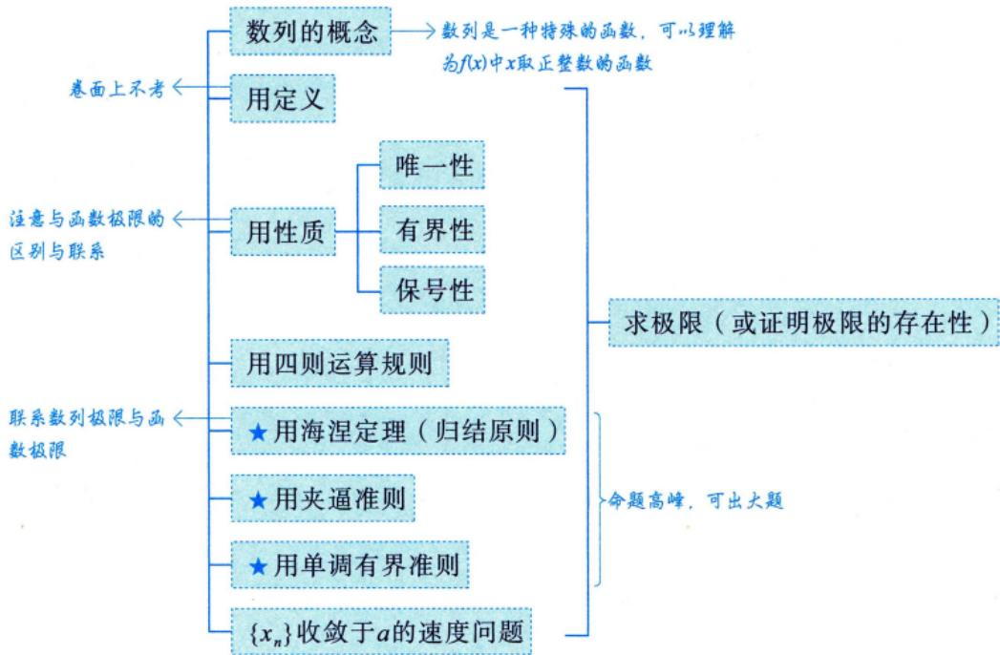

# 数列的概念

对每个 $n \in \mathbf{N}_{+}$ ，如果按照某一法则，对应着一个确定的实数 $x_{n}$ ，这些实数 $x_{n}$ 按照下标 $n$ 从小到大排列得到的一个序列

$$
x _ {1}, x _ {2}, x _ {3}, \dots , x _ {n}, \dots
$$

就叫作数列，简记为数列 $\{x_{n}\}$ ：

数列中的每一个数叫作数列的项，第 $n$ 项 $x_{n}$ 叫作数列的一般项（或通项）.

在几何上，数列 $\{x_{n}\}$ 可看作数轴上的一个动点，它依次取数轴上的点 $x_{1}, x_{2}, x_{3}, \dots, x_{n}, \dots$ （见图2-1).

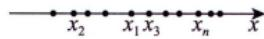  
图2-1

注

数列一定有无穷多项.

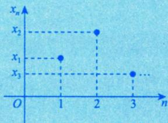

数列的本质是“整标函数”

数列 $\{x_{n}\}$ 可看作自变量为正整数 $n$ 的函数

$$
x _ {n} = f (n), n \in \mathbf {N} _ {+}.
$$

当自变量 $n$ 依次取1,2,3，…一切正整数时，对应的函数值就排列成数列 $\{x_{n}\}$ ：

注

(1) 子列.

从数列 $\{a_{n}\} : a_{1}, a_{2}, \dots, a_{n}, \dots$ 中选取无穷多项，并按原来的先后顺序组成新的数列，称新数列为原数列的子列，记为

$$
\{a _ {n _ {k}} \}: a _ {n _ {1}}, a _ {n _ {2}}, \dots , a _ {n _ {k}}, \dots ,
$$

其中下标 $n_1, n_2, \dots, n_k, \dots$ 为正整数.

例如，若 $n_k(k = 1,2,\dots)$ 分别取 $2k$ 和 $2k - 1$ ，则得到数列 $\{a_n\}$ 的两个子列

$$
\{a _ {2 k} \}: a _ {2}, a _ {4}, \dots , a _ {2 k}, \dots ; \{a _ {2 k - 1} \}: a _ {1}, a _ {3}, \dots , a _ {2 k - 1}, \dots ,
$$

这两个子列的项在原数列中交错出现.

(2)等差数列.

首项为 $a_1$ ，公差为 $d(d\neq 0)$ 的数列 $a_1,a_1 + d,a_1 + 2d,\dots ,a_1 + (n - 1)d,\dots .$

① 通项公式 $a_{n} = a_{1} + (n - 1)d$   
② 前 $n$ 项的和 $S_{n} = \frac{n}{2}\left[2a_{1} + (n - 1)d\right] = \frac{n}{2}\left(a_{1} + a_{n}\right)$

(3)等比数列.

首项为 $a_1$ ，公比为 $r(r \neq 0)$ 的数列 $a_1, a_1r, a_1r^2, \dots, a_1r^{n-1}, \dots$

$①$ 通项公式 $a_{n} = a_{1}r^{n - 1}$   
$②$ 前 $n$ 项的和 $S_{n} = \left\{ \begin{array}{ll}na_{1}, & r = 1,\\ \frac{a_{1}(1 - r^{n})}{1 - r}, & r\neq 1. \end{array} \right.$   
③常用 $1 + r + {r}^{2} + \cdots  + {r}^{n - 1} = \frac{1 - {r}^{n}}{1 - r}\left( {r \neq  1}\right)  \rightarrow$ 有限项和不会发散,收敛和发散的概念,只在无穷项时会涉及

这两个求和公式针对的前 $n$ 项和,即有限项和。当讨论无限项和时,需要使用无穷级数理论.

(4) 单调数列.

若对所有正整数 $n$ ，有 $a_{n+1} \geqslant a_n (a_{n+1} \leqslant a_n)$ ，则称数列 $\{a_n\}$ 为单调不减（不增）数列。将 $\geqslant (\leqslant)$ 换成 $> (<)$ ，则称为单调递增（递减）数列。单调递增数列与单调递减数列统称为单调数列。

(5) 有界数列.

若对所有正整数 $n$ ，存在正实数 $M$ ，有 $\left|a_{n}\right|\leqslant M$ ，则称数列 $\{a_n\}$ 为有界数列.

$①$ 找 $M$ ，使得 $\left|a_{n}\right|\leqslant M$ $②$ 放缩法； $③$ 找最值； $④$ 基本不等式法.

(6) 一些常见数列前 $n$ 项的和.

① $\sum_{k=1}^{n} k = 1 + 2 + 3 + \cdots + n = \frac{n(n+1)}{2}$ .   
怎么算出来的？裂项相消 $2\mathop{\sum }\limits_{{k = 1}}^{n}{k}^{2} = {1}^{2} + {2}^{2} + {3}^{2} + \cdots  + {n}^{2} = \frac{n\left( {n + 1}\right) \left( {{2n} + 1}\right) }{6}.$   
1 1 1 1 1 1 1 1 1 n   
怎么算出来的？裂项相消

$$
\lim  _ {n \rightarrow \infty} \sum_ {k = 1} ^ {n} \frac {1}{k (k + 1)} = \lim  _ {n \rightarrow \infty} \frac {n}{n + 1} = 1
$$

$$
\begin{array}{l} = 1 - \frac {1}{2} + \frac {1}{2} - \frac {1}{3} + \frac {1}{3} - \frac {1}{4} + \dots + \frac {1}{n} - \frac {1}{n + 1} \\ = 1 - \frac {1}{n + 1} \\ \end{array}
$$

(7) 一个重要数列 $\left\{\left(1 + \frac{1}{n}\right)^n\right\}$ 的结论：

$①$ 单调递增有上界.  
② $\lim_{n\to \infty}\left(1 + \frac{1}{n}\right)^n = e.$

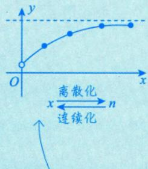

当 $n$ 无限增大时（即 $n \to \infty$ 时），对应的 $x_{n} = f(n)$ 是否能无限接近于某个确定的数值，这就是我们接下来要研究的数列极限。

例2.1 设 $0 < x_{1} < 3, x_{n + 1} = \sqrt{x_{n}(3 - x_{n})} (n = 1,2,\dots)$ ，证明数列 $\{x_{n}\}$ 有界。

分析 针对 $\sqrt{A(B - A)}$ 形的式子，可以使用基本不等式.

证 因为 $0 < x_{1} < 3$ ，所以 $x_{1}, 3 - x_{1}$ 均为正数，从而

$$
\sqrt {a b} \leqslant \frac {a + b}{2} (a \geqslant 0, b \geqslant 0) <   \quad 0 <   x _ {2} = \sqrt {x _ {1} (3 - x _ {1})} \leqslant \frac {x _ {1} + 3 - x _ {1}}{2} = \frac {3}{2}.
$$

设 $0 < x_{k} \leqslant \frac{3}{2}(k > 1)$ ，则 $0 < x_{k + 1} = \sqrt{x_{k}(3 - x_{k})} \leqslant \frac{1}{2}(x_{k} + 3 - x_{k}) = \frac{3}{2}$ ，由数学归纳法知，对任意正整数 $n > 1$ ，都有 $0 < x_{n} \leqslant \frac{3}{2}$ ，即数列 $\{x_{n}\}$ 有界。

# 数列极限的定义

设 $\{x_{n}\}$ 为一数列，若存在常数 $a$ ，对于任意的 $\varepsilon >0$ （不论它多么小），总存在正整数 $N$ ，使得当 $n > N$ 时， $\left|x_n - a\right| <   \varepsilon$ 恒成立，则称常数 $a$ 是数列 $\{x_{n}\}$ 的极限，或者称数列 $\{x_{n}\}$ 收敛于 $a$ ，记为

$$
\lim  _ {n \rightarrow \infty} x _ {n} = a \text {或} x _ {n} \rightarrow a (n \rightarrow \infty). \xrightarrow [ \text {趋 于 正 无 穷 的} ]{\text {指} n \rightarrow + \infty , \text {且 是 “ 离 散 ” 着}}
$$

如果不存在这样的常数 $a$ ，就说数列 $\{x_{n}\}$ 是发散的.

注 (1) 数列极限的定义是比较难的一个考点, 但是卷面上不会考证明的解答题, 基本只在选择题和填空题里面考对它的理解.

(2) 数列极限与函数极限是极限的两个基本类型，二者虽然有联系，但是也有着很大的区别。比如对于唯一性而言，数列极限与函数极限是相同的，二者的极限都具有唯一性。对于有界性而言，二者是有区别的，函数极限的有界性强调的是局部有界性，也就是在某个邻域上有界，而数列极限的有界性指的是全局有界性，即对数列中的任意一项都有 $|a_{n}| \leqslant M$ 。对于保号性而言，函数极限强调的也是局部保号性，即在某个邻域上是保号的，而数列极限虽然没有强调局部保号性，但是也要强调存在正整数 $N$ ，当 $n > N$ 时才有 $a_{n} > 0$ （或 $< 0$ ）。

(3) 常用的语言: ① $\lim_{n \to \infty} x_n = a \Leftrightarrow$ 任意 $\varepsilon > 0$ , 存在 $N \in \mathbf{N}_+$ , 当 $n > N$ 时, 恒有 $\left|x_n - a\right| < \varepsilon$ , 且当 $a = 0$ 时, 称 $x_n$ 为 $n \to \infty$ 时的无穷小量.

a.与函数极限的定义作对比.

$\lim_{x \to +\infty} f(x) = a \Leftrightarrow$ 任意 $\varepsilon > 0$ ，存在 $X > 0$ ，当 $x > X$ 时，恒有 $|f(x) - a| < \varepsilon$ 。

b. 定义中的 $n > N$ ， $N$ 未必只能取整数，因为 $n > 10000$ 和 $n > 10000.1$ 表达的意思是一样的。

② $\lim_{n\to \infty}x_n = \infty \Leftrightarrow$ 任意 $x > 0$ ，存在 $N\in \mathbf{N}_{+}$ ，当 $n > N$ 时，恒有 $\left|x_n\right| > x$ .此时称 $x_{n}$ 为 $n\to \infty$ 时的无穷大量.

(4) 数列收敛与其子列收敛的关系.

定理1 若数列 $\{a_{n}\}$ 收敛，则其任何子列 $\left\{a_{n_k}\right\}$ 也收敛，且 $\lim_{k\to \infty}a_{n_k} = \lim_{n\to \infty}a_n$

$$
\text {推 论 :} \lim  _ {n \to \infty} a _ {n} = a \Leftrightarrow \lim  _ {k \to \infty} a _ {2 k} = a, \text {且} \lim  _ {k \to \infty} a _ {2 k - 1} = a.
$$

$$
\lim  _ {k \rightarrow + \infty} a _ {3 k} = \lim  _ {k \rightarrow + \infty} a _ {3 k + 1} = a, \text {推 不 出} \lim  _ {n \rightarrow \infty} a _ {n} = a.
$$

$$
A \Rightarrow B \cap C, \text {则} \overline {{B}} \cup \overline {{C}} \Rightarrow \overline {{A}}
$$

$$
\text {因 为} a _ {3 k + 2} \text {缺 失}.
$$

此定理为我们提供了一个判断数列发散的方法：对于一个数列 $\{a_{n}\}$ ，如果能找到一个发散的子列，则原数列一定发散；如果能找到至少两个收敛的子列 $\{a_{n_k}\}$ 和 $\{a_{n_k'}\}$ ，但它们收敛到不同极限，则原数列也一定发散。

如 $\left\{n^{(-1)^n}\right\}$ ，详见例2.3

再例如，对于数列 $\left\{(-1)^n\right\} : -1, 1, -1, 1, \dots, (-1)^n, \dots$ ，我们找到其收敛的子列

$$
\left\{(- 1) ^ {2 k} \right\}: 1, 1, \dots , 1, \dots ; \left\{(- 1) ^ {2 k - 1} \right\}: - 1, - 1, \dots , - 1, \dots ,
$$

它们的极限分别为1和-1，所以原数列发散.

例2.2

证明：若 $\lim_{n\to \infty}a_n = A$ ，则 $\lim_{n\to \infty}\left|a_n\right| = \left|A\right|$

证明 $\lim_{n\to \infty}|a_n| = |A|$ ，关键是要找到 $\| a_n\| -|A|$ 与 $|a_{n} - A|$ 的关系，这时就要联想到三角不等式.

因为 $\lim_{n\to \infty}a_n = A$ ，所以对任意正数 $\varepsilon$ ，存在正整数 $N$ ，当 $n > N$ 时，有

$$
\left| a _ {n} - A \right| <   \varepsilon .
$$

又由不等式 $|a| - |b| \leqslant |a - b|$ ，有

$$
\left| \left| a _ {n} \right| - \left| A \right| \right| \leqslant \left| a _ {n} - A \right| <   \varepsilon .
$$

故 $\lim_{n\to \infty}\left|a_n\right| = \left|A\right|$

注 (1) 此命题反过来不对，如取 $a_{n} = (-1)^{n}$ ，则 $\lim_{n\to \infty}\left|(-1)^n\right| = 1$ 。但 $\lim_{n\to \infty}(-1)^n$ 不存在。

(2) 在本题中若 $A = 0$ ，则 $\left|\left|a_{n}\right| - \left|A\right|\right| = \left|\left|a_{n}\right| - 0\right| = \left|a_{n} - 0\right|$ ，即有 $\lim_{n\to \infty}a_n = 0 \Leftrightarrow \lim_{n\to \infty}\left|a_n\right| = 0$ ，这个结论常用。

$$
\begin{array}{r l} & {\text {例}: \lim  _ {n \to \infty} \frac {\sin n}{n ^ {2}}.} \\ & {\text {由} 0 \leqslant \left| \frac {\sin n}{n ^ {2}} \right| \leqslant \frac {1}{n ^ {2}} \text {, 得} \lim  _ {n \to \infty} \left| \frac {\sin n}{n ^ {2}} \right| = 0 \text {, 故} \lim  _ {n \to \infty} \frac {\sin n}{n ^ {2}} = 0} \end{array}
$$

一般地，若要证 $\lim_{n\to \infty}a_n = 0$ ，可转化为证 $\lim_{n\to \infty}|a_n| = 0$ ，由于 $|a_{n}|\geqslant 0$ ，若使用夹逼准则，便省了一半的力气，只需找到一个数列 $\{b_n\}$ 满足 $|a_{n}|\leqslant b_{n}$ ，且 $\lim_{n\to \infty}b_n = 0$ 即可.

(3) 此结论对函数亦成立，即若 $\lim_{x \to x_0} f(x) = A$ ，则 $\lim_{x \to x_0} |f(x)| = |A|$ ，而反之不成立。但 $\lim_{x \to x_0} f(x) = 0 \Leftrightarrow \lim_{x \to x_0} |f(x)| = 0$ 。

例2.3 证明数列 $\{n^{(-1)^n}\}$ 极限不存在.

证 从数列

$$
\left\{n ^ {(- 1) ^ {n}} \right\}: \frac {1}{1}, 2, \frac {1}{3}, 4, \frac {1}{5}, 6, \dots , \frac {1}{2 n - 1}, 2 n, \dots
$$

中选取一个子列 $\{2n\} : 2, 4, \dots, 2n, \dots$ ，该数列不是有界数列，由下文收敛数列的性质定理3的逆否命题知该子列发散，因此，由“收敛数列的任何子列也收敛”的逆否命题知，原数列极限不存在。

注该数列存在收敛的子列 $\left\{\frac{1}{2n - 1}\right\} :1,\frac{1}{3},\frac{1}{5},\dots ,\frac{1}{2n - 1},\dots$ ，但原数列发散.这说明一个数列的某个子列收敛并不能保证原数列收敛.

例2.4 设 $x_{n} = \left\{ \begin{array}{ll} \frac{n^{2} + \sqrt{n}}{n}, & n \text{为正奇数,} \\ \frac{1}{n}, & n \text{为正偶数,} \end{array} \right.$ 则当 $n \to \infty$ 时，变量 $x_{n}$ 为（ ）.

$\rightarrow$ 对于某个 $M > 0$ ,存在 $N > 0$ ,当 ${2n} > N$ 时,无论 ${2n}$ 取何值,都有 ${x}_{2n} \rightarrow  0 < M$ ,所以 $\{ {x}_{n}\}$ 不是无穷大量

(A)无穷大量

(B) 无穷小量

(C)有界变量但不是无穷小量

(D) 无界变量但不是无穷大量

解 应选(D).

$$
\lim  _ {n \rightarrow \infty} x _ {2 n} = \lim  _ {n \rightarrow \infty} \frac {1}{2 n} = 0,
$$

$$
\lim  _ {n \rightarrow \infty} x _ {2 n - 1} = \lim  _ {n \rightarrow \infty} \frac {(2 n - 1) ^ {2} + \sqrt {2 n - 1}}{2 n - 1} = + \infty ,
$$

可知 $\lim_{n\to \infty}x_{2n}\neq \lim_{n\to \infty}x_{2n - 1}$ ，因此 $\lim_{n\to \infty}x_n$ 不存在，且当 $n\to \infty$ 时， $\{x_{n}\}$ 既不是无穷大量，也不是无穷小量它是无界变量，故选(D).

# 收敛数列的性质

定理2（唯一性）给出数列 $\{x_{n}\}$ ，若 $\lim_{n\to \infty}x_n = a$ （存在），则 $a$ 是唯一的.

定理3（有界性）若数列 $\{x_{n}\}$ 极限存在，则数列 $\{x_{n}\}$ 有界.

定理4（保号性）设 $\lim_{n\to \infty}x_n = a > b$ ，则存在 $N > 0$ ，当 $n > N$ 时，有 $x_{n} > b$ .若数列 $\{x_{n}\}$ 从某区别于函数的局部有项起有 $x_{n}\geqslant b$ ，且 $\lim_{n\to \infty}x_n = a$ ，则 $a\geqslant b$ ，其中 $b$ 为任意实数.常考 $b = 0$ 的情形.界性和局部保号性

脱帽解法： $\lim_{n\to \infty}x_n > a\Rightarrow x_n > a$ （严格不等）.

戴帽解法： $x_{n}\geqslant a\Rightarrow \lim_{n\to \infty}x_{n}\geqslant a$ （非严格不等）.（≤) (≤)

# 例2.5

已知 $a_{n} = 1 - \frac{(-1)^{n}}{n} (n = 1,2,\dots)$ ，则 $\{a_n\}$ （ ）.

(A)有最大值，有最小值

(B) 有最大值，没有最小值

(C)没有最大值，有最小值

(D)没有最大值，没有最小值

分析

写出开头几项： $1 + \frac{1}{1}, 1 - \frac{1}{2}, 1 + \frac{1}{3}, \dots$ ，观察规律，发现在“1”的附近摆动.

# 应选(A).

$\lim_{n \to \infty} a_n = 1, a_1 = 2 > 1, a_2 = 1 - \frac{1}{2} < 1.$ 由于 $\lim_{n \to \infty} (a_n - a_1) < 0$ ，则存在 $N_1 > 0$ ，当 $n > N_1$ 时， $a_n < a_1$ 又由于 $\lim_{n \to \infty} (a_n - a_2) > 0$ ，则存在 $N_2 > 0$ ，当 $n > N_2$ 时， $a_n > a_2$ . 取 $N = \max \{N_1, N_2\}$ ，当 $n > N$ 时， $a_n$ 不可能是最大、最小值，故前有限项必存在最大、最小值. 目的是保证 $N \geqslant N_1$ 且 $N \geqslant N_2$ ，于是

目的是保证 $N \geqslant N_{1}$ 且 $N \geqslant N_{2}$ ，于是 $n > N$ 时，有 $n > N_{1}$ 且 $n > N_{2}$

(1) 最值是比较出来的.

(2)此题用保号性说明了 $n > N$ 后的项没有资格参与比较，故前有限项必有最大、最小值.

# 极限四则运算规则

$①$ 对于数列极限，有

设 $\lim_{n\to \infty}x_n = a,\lim_{n\to \infty}y_n = b$ ，则

$$
\lim  _ {n \rightarrow \text {多}} (x _ {n} + y _ {n}) = \lim  _ {n \rightarrow \text {多}} x _ {n} + \lim  _ {n \rightarrow \text {多}} y _ {n}: \quad \lim  _ {n \rightarrow \text {多}} (x _ {n} - y _ {n}) = \lim  _ {n \rightarrow \text {多}} x _ {n} - \lim  _ {n \rightarrow \text {多}} y _ {n};
$$

$$
\lim  _ {n \rightarrow \infty} x _ {n} y _ {n} = \lim  _ {n \rightarrow \infty} x _ {n} \cdot \lim  _ {n \rightarrow \infty} y _ {n}: \quad \lim  _ {n \rightarrow \infty} \frac {x _ {n}}{y _ {n}} = \frac {\lim  _ {n \rightarrow \infty} x _ {n}}{\lim  _ {n \rightarrow \infty} y _ {n}} \left(\lim  _ {n \rightarrow \infty} y _ {n} \neq 0\right).
$$

(1) $\lim_{n\to \infty}(x_n\pm y_n) = a\pm b$

②对于函数极限，有

$$
\lim  _ {x \rightarrow x _ {0}} [ f (x) + g (x) ] = \lim  _ {x \rightarrow x _ {0}} f (x) + \lim  _ {x \rightarrow x _ {0}} g (x): \lim  _ {x \rightarrow x _ {0}} [ f (x) - g (x) ] = \lim  _ {x \rightarrow x _ {0}} f (x) - \lim  _ {x \rightarrow x _ {0}} g (x)
$$

(2) $\lim_{n\to \infty}x_ny_n = ab$

$$
\lim  _ {x \rightarrow x _ {0}} f (x) g (x) = \lim  _ {x \rightarrow x _ {0}} f (x) \cdot \lim  _ {x \rightarrow x _ {0}} g (x); \quad \lim  _ {x \rightarrow x _ {0}} \frac {f (x)}{g (x)} = \frac {\lim  _ {x \rightarrow x _ {0}} f (x)}{\lim  _ {x \rightarrow x _ {0}} g (x)} \left(\lim  _ {x \rightarrow x _ {0}} g (x) \neq 0\right).
$$

(3) 若 $b \neq 0$ ，则 $\lim_{n \to \infty} \frac{x_n}{y_n} = \frac{a}{b}$ .

四则运算规则可以推广至有限个数列情形.

# 例2.6

设 $\lim_{n\to \infty}(a_n + b_n) = 1,\lim_{n\to \infty}(a_n - b_n) = 3$ ，则（

(A) $\{a_{n}\}$ 极限存在， $\{b_n\}$ 极限不存在  
(B) $\{a_{n}\}$ 极限存在， $\{b_n\}$ 极限存在  
(C) $\{a_{n}\}$ 极限不存在， $\{b_n\}$ 极限不存在  
(D) $\{a_{n}\}$ 极限不存在， $\{b_n\}$ 极限存在

# 分析

对于数列极限的计算，可简记如下：

存在 $\pm$ 存在 $=$ 存在；

存在 $\pm$ 不存在 $=$ 不存在；

不存在 $\pm$ 不存在 $=$ 不确定.

# 解

# 应选(B).

令 $u_{n} = a_{n} + b_{n}$ ， $\nu_{n} = a_{n} - b_{n}$ ，则 $\lim_{n\to \infty}u_n = 1,\lim_{n\to \infty}\nu_n = 3$ .由极限四则运算规则(1)知， $\{u_n + v_n\}$ 和 $\{u_{n} - v_{n}\}$ 均存在极限，且有

$$
\begin{array}{l} \lim  _ {n \rightarrow \infty} (u _ {n} + v _ {n}) = \lim  _ {n \rightarrow \infty} u _ {n} + \lim  _ {n \rightarrow \infty} v _ {n} = 1 + 3 = 4, \\ \lim  _ {n \rightarrow \infty} (u _ {n} - v _ {n}) = \lim  _ {n \rightarrow \infty} u _ {n} - \lim  _ {n \rightarrow \infty} v _ {n} = 1 - 3 = - 2. \\ \end{array}
$$

又 $a_{n} = \frac{1}{2} (u_{n} + v_{n}), b_{n} = \frac{1}{2} (u_{n} - v_{n})$ ，所以 $\left\{a_{n}\right\}$ 和 $\left\{b_{n}\right\}$ 的极限均存在，且有

$$
\lim  _ {n \rightarrow \infty} a _ {n} = \frac {1}{2} \times 4 = 2, \lim  _ {n \rightarrow \infty} b _ {n} = \frac {1}{2} \times (- 2) = - 1.
$$

注 $\lim_{n\to \infty}(a_n + b_n)$ 存在，并不意味着 $\lim_{n\to \infty}a_n$ 和 $\lim_{n\to \infty}b_n$ 均存在.例如 $\lim_{n\to \infty}[\sin n + (-\sin n)] = \lim_{n\to \infty}0 = 0$ ，但 $\lim_{n\to \infty}\sin n$ 与 $\lim_{n\to \infty}(-\sin n)$ 均不存在.

# 5

# 海涅定理（归结原则

在有的题目中,计算数列极限是极其困难的,这个时候我们就可以使用海涅定理,将原来的数列极限转化成函数极限,转换成函数极限后,有很多工具可以使用,比如洛必达法则、泰勒公式、等价无穷小代换等,计算出函数极限后,根据海涅定理,就可以得出数列极限的值,这是极限计算中一个非常重要的考点.比如

$$
\lim  _ {n \rightarrow \infty} \frac {\ln n}{n} = \lim  _ {x \rightarrow + \infty} \frac {\ln x}{x} = \lim  _ {x \rightarrow + \infty} \frac {\frac {1}{x}}{1} = 0.
$$

这道题是一个非常典型的利用海涅定理将数列极限转化为函数极限的例子,之所以要这样操作,是因为题目中用到了洛必达法则,但是数列极限是不能用洛必达法则的,因为我们把数列理解成一个下标为整数的函数,所以它是一个一个离散的点,不能求导,但是通过海涅定理将它转化成函数极限之后,便可以求导,于是可以使用洛必达法则,进而由函数极限的值得到数列极限的值.

设 $f(x)$ 在 $U(x_0, \delta)$ 内有定义，则 $\lim_{x \to x_0} f(x) = A$ 存在 $\Leftrightarrow$ 对任何 $U(x_0, \delta)$ 内以 $x_0$ 为极限的数列 $\{x_n\} (x_n \neq x_0)$ ，极限 $\lim_{n \to \infty} f(x_n) = A$ 存在.

注 众所周知，虽然数列极限与函数极限是分别独立定义的，但是海涅定理是联系数列极限与函数极限的桥梁。它指出：在极限存在的条件下，函数极限和数列极限可以相互转化。有些考生可能没有听说过这个定理，但是在不知不觉中我们已经使用它了。

常考 $①$ 当 $x\to 0$ 时，取 $x_{n} = \frac{1}{n}$ ，即若 $\lim_{x\to 0}f(x) = A$ ，则 $\lim_{n\to \infty}f\left(\frac{1}{n}\right) = A$ ：例： $\lim_{n\to \infty}\left(1 - \frac{1}{n + 1}\right)^n = e^{-1}$ $②$ 当 $x\to +\infty$ 时，取 $x_{n} = n$ ，即若 $\lim_{x\to +\infty}f(x) = A$ ，则 $\lim_{n\to \infty}f(n) = A$ ： $③$ 当 $x_{n}\rightarrow a$ ，且 $x_{n}\neq a$ 时，若 $\lim_{x\to a}f(x) = A$ ，则 $\lim_{n\to \infty}f(x_n) = A$ ：

例2.7 当 $x\to 0$ 时， $\frac{1}{x}\sin {\frac{1}{x}}$ 是（

(A)无穷大量

(B) 无界量，但不是无穷大量

(C)有界量，但不是无穷小量

(D) 无穷小量

分析 $\infty \cdot \sin \infty$ 型，使用归结原则.

解 应选(B).

设 $f(x) = \frac{1}{x}\sin \frac{1}{x}$ ，若取 $x_{n} = \frac{1}{n\pi} \to 0, n \to \infty$ ，则 $f(x_{n}) = n\pi \cdot \sin (n\pi) = 0$ ，于是 $\lim_{n \to \infty} f(x_{n}) = 0$ ；若取 $x_{n}^{\prime} = \frac{1}{\left(2n + \frac{1}{2}\right)\pi} \to 0, n \to \infty$ ，则 $f(x_{n}^{\prime}) = \left(2n + \frac{1}{2}\right)\pi \to +\infty, n \to \infty$ 。根据归结原则，极限 $\lim_{x \to 0} \frac{1}{x}\sin \frac{1}{x}$ 不存在，且当 $x \to 0$ 时， $\frac{1}{x}\sin \frac{1}{x}$ 是无界量，但不是无穷大量。

注 令 $f(x) = \begin{cases} x^2, & x \text{ 是有理数，} \\ 0, & x \text{ 是无理数，} \end{cases}$ 事实上， $f(x) = x^2 D(x)$ ，其中 $D(x) = \begin{cases} 1, & x \text{ 是有理数，} \\ 0, & x \text{ 是无理数，} \end{cases}$ 为狄利克雷函数。有如下结论：

(1) $f(x)$ 在 $x = 0$ 处连续.

无穷小量 $x$ 有界量 $=$ 无穷小量

证方法一 $|D(x)|\leqslant 1$ ，即 $D(x)$ 为有界量，故 $\lim_{x\to 0}f(x) = \lim_{x\to 0}x^{2}D(x) = 0$

因为 $f(0) = 0$ ，所以 $f(x)$ 在 $x = 0$ 处连续.

方法二 $0 \leqslant |f(x)| \leqslant |x^2| + |0| = x^2$

由夹逼准则得 $\lim_{x\to 0}f(x) = 0$ ，且 $f(0) = 0$ ，故 $f(x)$ 在 $x = 0$ 处连续.

(2) 当 $x_0 \neq 0$ 时， $f(x)$ 一定不连续.

证使用归结原则：对于 $\lim_{x\to x_0}f(x)$ ，当 $x$ 分别取有理数列和无理数列时，极限不同，故极限不存在.

以上例子说明 $f(x)$ 在一点处连续，并不意味着 $f(x)$ 在这点的附近连续.

#

例2.8

$$
\text {求} \lim  _ {n \rightarrow \infty} \sqrt [ n ]{\left(\cos \frac {1}{\sqrt {n}}\right) ^ {n ^ {2}}}
$$

分析 “1”型极限，使用等价代换 $u^{\nu}\sim \mathrm{e}^{\nu (u - 1)}$

$$
\text {解} \lim  _ {n \rightarrow \infty} \sqrt [ n ]{\left(\cos \frac {1}{\sqrt {n}}\right) ^ {n ^ {2}}} = \lim  _ {n \rightarrow \infty} \left(\cos \frac {1}{\sqrt {n}}\right) ^ {n} = e ^ {\lim  _ {n \rightarrow \infty} n \ln \left(\cos \frac {1}{\sqrt {n}}\right)}.
$$

因 $\lim_{x\to +\infty}x\ln \left(\cos {\frac{1}{\sqrt{x}}}\right) = \lim_{x\to +\infty}x\ln \left(1 + \cos {\frac{1}{\sqrt{x}}} - 1\right)$

$$
\begin{array}{l} = \lim  _ {x \rightarrow + \infty} x \left(\cos \frac {1}{\sqrt {x}} - 1\right) \\ = \lim  _ {x \rightarrow + \infty} x \cdot \left[ - \frac {1}{2} \left(\frac {1}{\sqrt {x}}\right) ^ {2} \right] = - \frac {1}{2}, \\ \end{array}
$$

故由归结原则知， $\lim_{n\to \infty}n\ln \left(\cos {\frac{1}{\sqrt{n}}}\right) = -\frac{1}{2}$ 即原式 $= \mathrm{e}^{-\frac{1}{2}}$

注 当 $n \to \infty$ 时，若 $\left(1 + \frac{1}{n}\right)^n - e$ 与 $\frac{a}{n}$ 是等价无穷小，则 $a = -\frac{e}{2}$ .

解 由例1.24知， $(1 + x)^{\frac{1}{x}} - \mathrm{e} \sim -\frac{\mathrm{e}}{2} x (x \to 0^{+})$

$$
0 ^ {+} \leftarrow x = \frac {1}{n} \cdot \longrightarrow \text {这 里} x \text {相 当 于} \frac {1}{n}, \text {当} n \rightarrow \infty \text {时 ,} x \rightarrow 0 ^ {+}
$$

# 夹逼准则

如果数列 $\{x_{n}\} ,\{y_{n}\}$ 及 $\{z_{n}\}$ 满足下列条件：

① 从某项起，即存在 $n_0 \in \mathbf{N}_+$ ，当 $n > n_0$ 时， $y_n \leqslant x_n \leqslant z_n$ ；  
② $\lim_{n\to \infty}y_n = a,\lim_{n\to \infty}z_n = a.$

则数列 $\{x_{n}\}$ 的极限存在，且 $\lim_{n\to \infty}x_n = a$

不需要验证等号

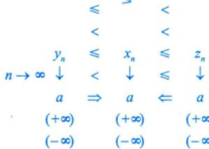

注 放缩的常用方法如下. 已知方法: 未知方法 (题设给出)

(1) 利用简单的放大与缩小.

针对无穷项相加 $\left\{ \begin{array}{l}n\bullet u_{\min}\leqslant u_1 + u_2 + \dots +u_n\leqslant n\bullet u_{\max},\\ \text{当} u_i\geqslant 0\text{时，} 1\bullet u_{\max}\leqslant u_1 + u_2 + \dots +u_n\leqslant n\bullet u_{\max}. \end{array} \right.$ 针对有限项相加

(2)利用重要不等式.

① 设 $a, b$ 为实数，则 $a \cdot |a \pm b| \leqslant |a| + |b|$ ; $b \cdot \| a \| - |b \| \leqslant |a - b|$ .

可以将上述不等式a.推广为 $n$ 个实数的情形，即

$$
\left| a _ {1} \pm a _ {2} \pm \dots \pm a _ {n} \right| \leqslant \left| a _ {1} \right| + \left| a _ {2} \right| + \dots + \left| a _ {n} \right|.
$$

② a. $\sqrt{ab} \leqslant \frac{a + b}{2} \leqslant \sqrt{\frac{a^2 + b^2}{2}} (a, b \geqslant 0)$ .

还有 $|ab| \leqslant \frac{a^2 + b^2}{2}$ ，例如，若 $u_n > 0$ ，则 $\frac{u_n}{n} = u_n \cdot \frac{1}{n} \leqslant \frac{u_n^2 + \frac{1}{n^2}}{2}$ 。

b. $\sqrt[3]{abc} \leqslant \frac{a + b + c}{3} \leqslant \sqrt{\frac{a^2 + b^2 + c^2}{3}} (a, b, c \geqslant 0)$ .   
③ 设 $a \geqslant b \geqslant 0$ ，则 $\left\{ \begin{array}{l} \text{当 } m > 0 \text{ 时, } a^{m} \geqslant b^{m}, \\ \text{当 } m < 0 \text{ 时, } a^{m} \leqslant b^{m}. \end{array} \right.$   
④ 若 $0 < a < x < b, 0 < c < y < d$ ，则 $\frac{c}{b} < \frac{y}{x} < \frac{d}{a}$ 。

考研中考过：当 $n\pi < x < (n + 1)\pi$ ， $2n < S(x) < 2(n + 1)$ 时， $\frac{2n}{(n + 1)\pi} < \frac{S(x)}{x} < \frac{2(n + 1)}{n\pi}$

注例 当 $n \leqslant x < n + 1$ 时， $2n \leqslant f(x) < 2(n + 1)$ ，则 $\lim_{x \to +\infty} \frac{f(x)}{x} = \frac{1}{n + 1} < \frac{1}{x} \leqslant \frac{1}{n}$ .

解 由于 $\frac{2n}{n+1} < \frac{f(x)}{x} < \frac{2(n+1)}{n}$ ，当 $x \to +\infty$ 时， $n \to \infty$ ，根据夹逼准则，得 $\lim_{x \to +\infty} \frac{f(x)}{x} = 2$

⑤ $\sin x <   x <   \tan x\left(0 <   x <   \frac{\pi}{2}\right).$ ⑥ $\sin x <   x(x > 0)$   
考研中考过：当 $x_{n} > 0$ 时， $x_{n + 1} = \sin x_n <   x_n$ ，故 $\{x_{n}\}$ 单调减少.  
⑦ 当 $0 < x < \frac{\pi}{4}$ 时， $x < \tan x < \frac{4}{\pi} x$ 。证明见习题6.9。

⑧ 当 $0 < x < \frac{\pi}{2}$ 时， $\sin x > \frac{2}{\pi} x$ 。证明见例6.19.  
⑨ $\arctan x \leqslant x \leqslant \arcsin x (0 \leqslant x \leqslant 1)$ .

可考：当 $x_{n} > 0$ 时， $x_{n + 1} = \arctan x_n <   x_n$ ，故 $\{x_{n}\}$ 单调减少.

$\mathbf{10} \mathrm{e}^{x} \geqslant x + 1$ （任意 $x$ ）.  
可考：当 $x_{n + 1} = \mathrm{e}^{x_n} - 1$ 时，由 $\mathrm{e}^{x_n} - 1\geqslant x_n$ ，得 $x_{n + 1}\geqslant x_n$ ，即 $\{x_{n}\}$ 单调不减.  
⑪ $x - 1 \geqslant \ln x (x > 0)$

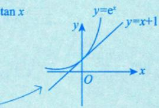

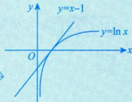

可考：当 $x_{n} > 0$ 时，若 $x_{n + 1} = \ln x_n + 1$ ，由 $\ln x_{n} + 1\leqslant x_{n}$ ，得 $x_{n + 1}\leqslant x_{n}$ ，即 $\{x_{n}\}$ 单调不增.

1 1+x <ln(1+）<x>0)或 x<x>(1+x）<x(x>0）  
(3)利用闭区间上连续函数必有最大值与最小值.  
(4)利用压缩映射原理.（简化版）

原理一 对数列 $\{x_{n}\}$ ，若存在常数 $k$ （ $0 < k < 1$ ），使得 $\left|x_{n+1} - a\right| \leqslant k\left|x_{n} - a\right|$ ， $n = 1, 2, \dots$ ，则 $\{x_{n}\}$ 收敛于 $a$ 。

证 $0 \leqslant |x_{n+1} - a| \leqslant k |x_n - a| \leqslant k^2 |x_{n-1} - a| \leqslant \cdots \leqslant k^n |x_1 - a|$ , 由于 $\lim_{n \to \infty} k^n = 0$ , 根据夹逼准则, 有 $\lim_{n \to \infty} |x_{n+1} - a| = 0$ , 即 $\{x_n\}$ 收敛于 $a$ .

原理二 对数列 $\{x_{n}\}$ ，若 $x_{n+1} = f(x_{n}), n = 1, 2, \dots, f(x)$ 可导， $a$ 是 $f(x) = x$ 的唯一解，且对任意 $x \in \mathbb{R}$ ，有 $\left|f'(x)\right| \leqslant k < 1$ ，则 $\{x_{n}\}$ 收敛于 $a$ 。

证 $\left|x_{n + 1} - a\right| = \left|f(x_n) - f(a)\right|\xlongequal{\text{拉格朗日中值定理}}\left|f'(\xi)\right|\left|x_n - a\right|\leqslant k\left|x_n - a\right|$ ，其中 $\xi$ 介于 $a$ 与 $x_{n}$ 之间，由原理一，有 $\{x_{n}\}$ 收敛于 $a$ ：

以上原理一、二是特殊的压缩映射过程，考生在使用它们时，要写出证明过程.如例2.15

(5)利用题设条件来推证（这往往是解答题的第1问）. 例2.11

例2.9 $\lim_{n\to \infty}\left(\frac{1}{n^2 + n + 1} +\frac{2}{n^2 + n + 2} +\dots +\frac{n}{n^2 + n + n}\right) = \underline{\quad}.$

分析 分母不一样不能相加减，通分又太复杂，故可以利用放缩将分母化成相同的.需要注意：分母越大，分数越小.

把分母写成一样的：小 $\leqslant \sum_{i = 1}^{n}\frac{i}{n^2 + n + i}\leqslant$ 大.

解 应填 $\frac{1}{2}$

分子不变，将分母放缩成相同的，则

$$
\frac {n (n + 1)}{2 \left(n ^ {2} + n + n\right)} \leqslant \frac {1}{n ^ {2} + n + 1} + \frac {2}{n ^ {2} + n + 2} + \dots + \frac {n}{n ^ {2} + n + n} \leqslant \frac {n (n + 1)}{2 \left(n ^ {2} + n + 1\right)},
$$

又 $\lim_{n\to \infty}\frac{n(n + 1)}{2(n^2 + n + 1)} = \lim_{n\to \infty}\frac{n(n + 1)}{2(n^2 + n + n)} = \frac{1}{2}$ 所以根据夹逼准则，原式 $= \frac{1}{2}$

找带头大哥

例2.10 求极限 $\lim_{n\to \infty}\sqrt[n]{a_1^n + a_2^n + \cdots + a_m^n}$ ，其中 $a_i (i = 1, 2, \dots, m)$ 都是非负数.

解设 $a = \max \{a_1,a_2,\dots ,a_m\}$ ，则

$$
a ^ {n} \leqslant a _ {1} ^ {n} + a _ {2} ^ {n} + \dots + a _ {m} ^ {n} \leqslant m \cdot a ^ {n},
$$

即 $a \leqslant \sqrt[n]{a_1^n + a_2^n + \cdots + a_m^n} \leqslant a \cdot m^{\frac{1}{n}}$ ，且 $\lim_{n \to \infty} m^{\frac{1}{n}} = 1$ 。故

$$
\lim  _ {n \rightarrow \infty} \sqrt [ n ]{a _ {1} ^ {n} + a _ {2} ^ {n} + \dots + a _ {m} ^ {n}} = \max  \left\{a _ {1}, a _ {2}, \dots , a _ {m} \right\}.
$$

注 这是一个结论，应当记住.

如当 $0 < a < b$ 时， $\lim_{n\to \infty}(a^{-n} + b^{-n})^{\frac{1}{n}} = \lim_{n\to \infty}\sqrt[n]{\left(\frac{1}{a}\right)^n + \left(\frac{1}{b}\right)^n} = \frac{1}{a}$ 又如当 $0\leqslant x\leqslant \frac{\pi}{2}$ 时， $\frac{1}{a} >\frac{1}{b} >0$

$\mathop{\lim }\limits_{{n \rightarrow  \infty }}\sqrt[n]{{\sin }^{n}x + {\cos }^{n}x} = \left\{  \begin{array}{l} \cos x,\;0 \leq  x \leq  \frac{\pi }{4}, \\  \sin x,\;\frac{\pi }{4} < x \leq  \frac{\pi }{2}. \end{array}\right.$ $y = \cos x$ $\left( {0,\frac{\pi }{4},\frac{\pi }{2}}\right) x$ (定义函数的方法之一)

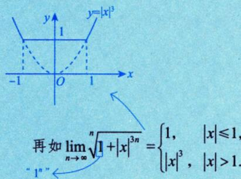

约束式

关系式

定义式

例2.11 设 $0 < a_{n} < \frac{\pi}{2}, 0 < b_{n} < \frac{\pi}{2}, \cos a_{n} - a_{n} = \cos b_{n}$ ，且 $\lim_{n\to \infty}b_n = 0$ ，求 $\lim_{n\to \infty}a_n, \lim_{n\to \infty}\frac{a_n}{b_n^2}$ 。

分析 (1)分清约束式、关系式和定义式；(2)做一至两步的逆运算；(3)联想一些经典形式.

解 由 $\cos a_{n} - \cos b_{n} = a_{n} > 0$ ，知 $0 < a_{n} < b_{n}$ ，则由夹逼准则，得根据 $\cos x$ 的单调性， $\cos x$ 在 $\lim_{n\to \infty}a_n = 0$ ，

联想到 $1 - \cos x\sim \frac{1}{2} x^{2}(x\to 0)$

$$
\lim  _ {n \rightarrow \infty} \frac {a _ {n}}{b _ {n} ^ {2}} = \lim  _ {n \rightarrow \infty} \frac {\sqrt {1 - \cos b _ {n}}}{b _ {n} ^ {2}} \cdot \frac {a _ {n}}{1 - \cos b _ {n}} = \frac {1}{2} \lim  _ {n \rightarrow \infty} \frac {a _ {n}}{1 - \cos a _ {n} + a _ {n}} = \frac {1}{2} \lim  _ {n \rightarrow \infty} \frac {1}{\underbrace {1 - \cos a _ {n}} _ {a _ {n}} + 1} = \frac {1}{2}.
$$

# 单调有界准则

单调有界准则是讨论数列极限存在的两个最重要的准则之一，另外一个是夹逼准则

单调有界数列必有极限, 即若数列 $\left\{  {x}_{n}\right\}$ 单调增加(减少)且有上界(下界),则 $\mathop{\lim }\limits_{{n \rightarrow  \infty }}{x}_{n}$ 存在.

不等关系

单调有界准则其实包含两种情况（涉及不等关系，是数学中的难点），第1种情况数列单调增加并且有上界；第2种情况，数列单调减少并且有下界。在这两种情况下数列极限都是存在的，使用的时候需要注意，当证明出来数列单调增加时，只需要再去证明数列有上界即可，无须再去证明有下界，同样如果证明出来数列有上界，则只需要再去证明数列单调增加即可，第二种情况同理。

记： $x_{n}\leqslant x_{n + 1}\leqslant a$ ，则 $\lim_{n\to \infty}x_n$ 存在.

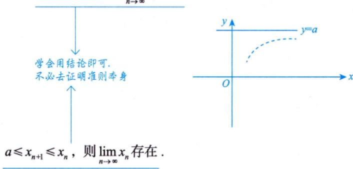

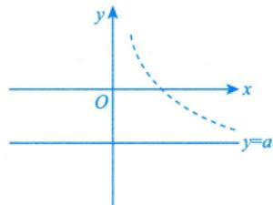

证明数列 $\{x_{n}\}$ 单调性的常用方法：

$\star$ a. $\frac{x_{n + 1} - x_n}{x_n} >0$ 或 $\frac{x_{n + 1}}{x_n} >1$ （同号）.

作差法用得较多.

① 验 $n = 1$ 成立；

② 设 $n = k$ 成立；

③证 $n = k + 1$ 成立.

1. 利用数学归纳法

题一练 设 $c = 2\ln (1 + b),b > a > 0$ ，且 $a$ 是方程 $x - 2\ln (1 + x) = 0$ 的唯一非零解，证明 $c > a$ ：

分析 由题知， $c = 2\ln (1 + b),a = 2\ln (1 + a)$

令 $f(x) = 2\ln (1 + x)$ ， $f^{\prime}(x) = \frac{2}{1 + x}$ ，则当 $x > 0$ 时， $f(x)$ 单调递增.

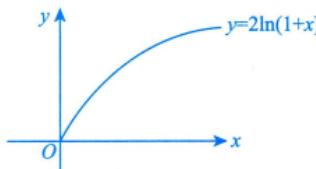

由 $b > a > 0$ ，得 $2\ln (1 + b) > 2\ln (1 + a)$ ，故 $c > a$ ：

设单调递减数列 $\{x_{n}\}$ 满足 $x_{n + 1} = 2\ln (1 + x_n), n = 1, 2, \dots, x_1 > a > 0$ ，且 $a$ 是 $x - 2\ln (1 + x) = 0$ 的唯一

非零解. 证明: $\{x_{n}\}$ 收敛.

分析 ①验： $x_{1} > a > 0$ ：

② 设： $x_{k} > a > 0$ ：  
③证： $x_{k + 1} > a > 0$

$$
x _ {k + 1} = 2 \ln (1 + x _ {k}), \quad 2 \ln (1 + a) = a.
$$

由于 $f(x) = 2\ln (1 + x)$ 在 $x > 0$ 时单调递增，因此 $2\ln (1 + x_k) > 2\ln (1 + a)$ ，故 $x_{k+1} > a$ ，于是 $\{x_n\}$ 有下界.

再由 $\{x_{n}\}$ 单调递减，知 $\{x_{n}\}$ 收敛.

$\star$ c.利用重要不等式（见夹逼准则的注(2)）.

$\rightarrow$ 用得不多

d. $x_{n} - x_{n - 1}$ 与 $x_{n - 1} - x_{n - 2}$ 同号，则 $\{x_{n}\}$ 单调.

★e.利用结论： $x_{n + 1} = f(x_n)(n = 1,2,\dots),x_n\in$ 区间 $I$ ：

无法确定是单调递增还是单调递减若 $f^{\prime}(x) > 0$ ， $x\in$ 区间 $I$ ，则数列 $\{x_{n}\}$ 单调，且当 $x_{2} > x_{1}$ 时，数列 $\{x_{n}\}$ 单调增加，可通过例题 $f(x)$ 单调增加证明见例2.13当 $x_{2} <   x_{1}$ 时，数列 $\{x_{n}\}$ 单调减少.帮助理解结论若 $f^{\prime}(x) <   0$ ， $x\in$ 区间 $I$ ，则数列 $\{x_{n}\}$ 不单调. $f(x)$ 单调减少

例2.12 设 $0 < x_{1} < 3, x_{n+1} = \sqrt{x_{n}(3 - x_{n})} (n = 1, 2, \cdots)$ ，证明数列 $\{x_{n}\}$ 的极限存在，并求此极限。

分析 证明这种由递推形式给出的数列的收敛性，一般都是根据“单调有界数列必收敛”这一准则进行证明；在证明了极限存在的前提下再求极限.

证 由例2.1知数列 $\{x_{n}\}$ 是有界的，对任意正整数 $n > 1$ ，都有 $0 < x_{n} \leqslant \frac{3}{2}$ $\rightarrow \frac{\sqrt{ab} \leqslant \frac{a + b}{2}(a, b > 0)}{重要不等式}$ 再证明 $\{x_{n}\}$ 单调：当 $n > 1$ 时，

$$
\begin{array}{l} x _ {n + 1} - x _ {n} = \sqrt {x _ {n} \left(3 - x _ {n}\right)} - x _ {n} = \sqrt {x _ {n}} \left(\sqrt {3 - x _ {n}} - \sqrt {x _ {n}}\right) \\ = \frac {2 \sqrt {x _ {n}} \left(\frac {3}{2} - x _ {n}\right)}{\sqrt {3 - x _ {n}} + \sqrt {x _ {n}}} = \sqrt {x _ {n}} \cdot \frac {3 - 2 x _ {n}}{\sqrt {3 - x _ {n}} + \sqrt {x _ {n}}} \geqslant 0, \\ \end{array}
$$

由 $x_{n}\leqslant \frac{3}{2}$ 得 $3 - 2x_{n}\geqslant 0$

再由 $\sqrt{x_n} \geqslant 0, \sqrt{3 - x_n} \geqslant 0.$

得 $x_{n + 1} - x_n\geqslant 0$

即 $x_{n + 1}\geqslant x_n(n > 1)$ ，所以数列 $\{x_{n}\} (n > 1)$ 是单调增加的.

可写成 $\lim_{n\to \infty}x_n = \frac{\text{存在}}{\text{记为}} a$

根据单调有界数列必有极限的准则知 $\lim_{n\to \infty}x_n$ 存在，设其为 $a$ ，则

$$
a = \lim  _ {n \rightarrow \infty} x _ {n} = \lim  _ {n \rightarrow \infty} \sqrt {x _ {n - 1} (3 - x _ {n - 1})} = \sqrt {a (3 - a)},
$$

解得 $a = \frac{3}{2}$ 或 $a = 0$ (舍去). 故

对题干等式两边取极限

由于 $\{x_{n}\}$ 单调增加，且 $x_{n} > 0$ ，故 $a > 0$

$$
\lim  _ {n \rightarrow \infty} x _ {n} = \frac {3}{2}.
$$

例2.13 设 $x_{n + 1} = f(x_n)$ ，则以下命题正确的是（

① 若 $f\left( x\right)$ 单调增加,且 ${x}_{1} < {x}_{2}$ ,则数列 $\left\{  {x}_{n}\right\}$ 单调增加  
② 若 $f(x)$ 单调增加，且 $x_{1} > x_{2}$ ，则数列 $\{x_{n}\}$ 单调减少  
③若 $f(x)$ 单调减少，且 $x_{1} < x_{2}$ ，则数列 $\{x_{n}\}$ 单调增加

理解见例2.15的注.

④若 $f(x)$ 单调减少，且 $x_{1} > x_{2}$ ，则数列 $\{x_{n}\}$ 单调减少

(A) ①②

(B) ①③

(C) ②③

(D) ②④

解 应选(A).

对于①，若 $f(x)$ 单调增加，且 $x_{1} < x_{2}$ ， $x_{2} = f(x_{1})$ ， $x_{3} = f(x_{2})$ ，则 $f(x_{1}) < f(x_{2})$ ，即 $x_{2} < x_{3}$ ，又 $x_{3} = f(x_{2})$ ， $x_{4} = f(x_{3})$ ，此时 $f(x_{2}) < f(x_{3})$ ，即 $x_{3} < x_{4}, \cdots$ ，依次类推，便知数列 $\{x_{n}\}$ 越来越大，即单调增加。  
对于 ②，若 $f(x)$ 单调增加，且 $x_{1} > x_{2}$ ， $x_{2} = f(x_{1})$ ， $x_{3} = f(x_{2})$ ，则 $f(x_{1}) > f(x_{2})$ ，即 $x_{2} > x_{3}$ ，又 $x_{3} = f(x_{2})$ ， $x_{4} = f(x_{3})$ ，此时 $f(x_{2}) > f(x_{3})$ ，即 $x_{3} > x_{4}, \cdots$ ，依次类推，便知数列 $\{x_{n}\}$ 越来越小，即单调减少.

# 参考例2.15

对于③，若 $f(x)$ 单调减少，且 $x_{1} < x_{2}$ ， $x_{2} = f(x_{1})$ ， $x_{3} = f(x_{2})$ ，则 $f(x_{1}) > f(x_{2})$ ，即 $x_{2} > x_{3}$ ，又 $x_{3} = f(x_{2})$ ， $x_{4} = f(x_{3})$ ，此时 $f(x_{2}) < f(x_{3})$ ，即 $x_{3} < x_{4}, \cdots$ ，依次类推，便知数列 $\{x_{n}\}$ 是摆动的，不单调。  
对于④，若 $f(x)$ 单调减少，且 $x_{1} > x_{2}$ ， $x_{2} = f(x_{1})$ ， $x_{3} = f(x_{2})$ ，则 $f(x_{1}) < f(x_{2})$ ，即 $x_{2} < x_{3}$ ，又 $x_{3} = f(x_{2})$ ， $x_{4} = f(x_{3})$ ，此时 $f(x_{2}) > f(x_{3})$ ，即 $x_{3} > x_{4}, \cdots$ ，依次类推，便知数列 $\{x_{n}\}$ 是摆动的，不单调。

例2.14 (1) 证明方程 $x = 2\ln(1 + x)$ 在 $(0, +\infty)$ 内有唯一实根 $\xi$ ；

(2) 对于 (1) 中的 $\xi$ ，任取 $x_{1} > \xi$ ，定义 $x_{n+1} = 2\ln(1 + x_{n})$ ， $n = 1, 2, \dots$ ，证明 $\lim_{n \to \infty} x_{n}$ 存在，并求其值.

证 (1) 令 $F(x) = x - 2\ln(1 + x), x > 0$ ，则

$$
F ^ {\prime} (x) = 1 - \frac {2}{1 + x} = \frac {x - 1}{1 + x} \xlongequal {\text {令}} 0,
$$

得 $x = 1$ 是 $(0, +\infty)$ 内的唯一驻点，且当 $0 < x < 1$ 时， $F'(x) < 0, F(x)$ 单调递减；当 $x > 1$ 时， $F'(x) > 0, F(x)$ 单调递增.

又 $F(0) = 0$ ， $F(1) = 1 - 2\ln 2 < 0$ ， $F(+\infty) = \lim_{x\to +\infty}[x - 2\ln (1 + x)] = +\infty >0$ 如图2-2所示，故 $F(x)$ 在(0,1)内无零点，在 $(1, + \infty)$ 上有唯一零点，因此原方程在 $(0, + \infty)$ 内有唯一实根 $\xi$ ：

(2) 由 (1) 得 $\xi = 2\ln (1 + \xi)$ , $\xi > 0$ . 令 $x_{n+1} = f(x_n)$ , $f(x) = 2\ln (1 + x)$ .

① 验： $x_{1} > x_{2} > \xi$ ：

$$
x _ {2} = 2 \ln \left(1 + x _ {1}\right), \quad 2 \ln (1 + \xi) = \xi ,
$$

因为 $x_{1} - 2\ln (1 + x_{1}) > 0$ ，故 $x_{1} > 2\ln (1 + x_{1}) = x_{2} > 2\ln (1 + \xi) = \xi$

② 设： $x_{k - 1} > x_k > \xi$ ：

③证： $x_{k} > x_{k + 1} > \xi$

由 $②$ 知，

$$
x _ {k + 1} = 2 \ln (1 + x _ {k}) > 2 \ln (1 + \xi) = \xi ,
$$

$$
x _ {k} = \underbrace {2 \ln (1 + x _ {k - 1}) > 2 \ln (1 + x _ {k})} _ {\substack {\downarrow \\ \ln (1 + x) \text{为增函数}}} = x _ {k + 1},
$$

故得证 $x_{k} > x_{k + 1} > \xi$

综上， $\{x_{n}\}$ 单调递减有下界，于是

$$
\lim  _ {n \to \infty} x _ {n} {\frac {\text {存 在}}{\text {记 为}}} a .
$$

在 $x_{n + 1} = 2\ln (1 + x_n)$ 两边取极限，有 $a = 2\ln (1 + a)$

又由(1)知， $\xi$ 是 $x = 2\ln (1 + x)$ 在 $(0, + \infty)$ 内的唯一实根，故 $a = \xi$ ：

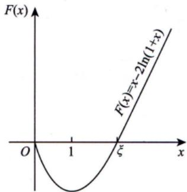  
图2-2

注题目解答过程需要背诵.考生可画出如图2-3所示的情形，加深理解.

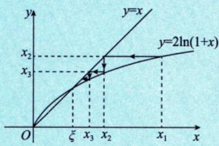  
图2-3

引申：若题目改为 $x_{1} < \xi$ ，则如图2-4所示.

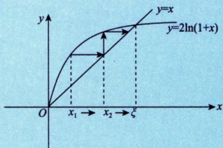  
图2-4

例2.15 (1) 证明方程 $x = \cos x$ 在 $\left(0, \frac{\pi}{3}\right)$ 内有唯一实根 $a$ ;

(2) 设 $-1 \leqslant x_{1} \leqslant 1$ ，定义 $x_{n+1} = \cos x_{n}, n = 1, 2, \cdots$ ，证明 $\lim_{n \to \infty} x_{n}$ 存在，且极限值就是 (1) 中的 $a$ 。

证 (1) 令 $F(x) = \cos x - x$ , $x \in \left(0, \frac{\pi}{3}\right)$ , 则

$$
F (0) = 1 > 0, F \left(\frac {\pi}{3}\right) = \frac {1}{2} - \frac {\pi}{3} <   0,
$$

且 $F^{\prime}(x) = -\sin x - 1 < 0$ ，故 $F(x)$ 单调递减，于是存在唯一的 $a \in \left(0, \frac{\pi}{3}\right)$ ，使得 $F(a) = 0$ ，即 $a = \cos a$ ，方程在 $\left(0, \frac{\pi}{3}\right)$ 内有唯一实根 $a$

(2) 由题知， $x_{n+1} = \cos x_n$ ，由于 $-1 \leqslant x_1 \leqslant 1$ ，则 $x_{n+1} = \cos x_n \leqslant 1$ ，且 $x_{n+1} = \cos x_n > 0$ ，故 $0 < x_n \leqslant 1 < \frac{\pi}{3}$ ， $n > 1$ 。

令 $f(x) = \cos x$ ，显然 $f(x)$ 在 $\left(0, \frac{\pi}{3}\right)$ 内单调减少，于是 $\{x_{n}\}$ 不单调，下面直接考虑 $\left|x_{n+1} - a\right|$ .

压缩映射

$$
\begin{array}{l} \left| x _ {n + 1} - a \right| = \left| \cos x _ {n} - \cos a \right| \\ = \left| - \sin \xi \right| \cdot \left| x _ {n} - a \right| \quad \text {拉 格 朗 日 中 值 定 理} \\ \leqslant \frac {\sqrt {3}}{2} \cdot | x _ {n} - a | \quad \sin \frac {\pi}{3} \\ \leqslant \left(\frac {\sqrt {3}}{2}\right) ^ {2} | x _ {n - 1} - a | \\ \leqslant \left(\frac {\sqrt {3}}{2}\right) ^ {n} | x _ {1} - a |, \\ \end{array}
$$

其中 $\xi$ 介于 $a$ 与 $x_{n}$ 之间，当 $n\to \infty$ 时， $\left(\frac{\sqrt{3}}{2}\right)^n |x_1 - a|\to 0$ ，故由夹逼准则，有 $x_{n + 1}\rightarrow a$ ，即 $\lim_{n\to \infty}x_n = a$ ：

注考生可画出如图2-5所示的情形，加深理解.

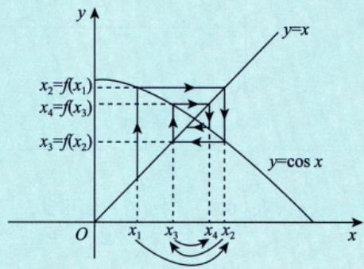  
图2-5

# 8 $\{x_{n}\}$ 收敛于 $a$ 的速度问题

设数列 $\{x_{n}\}$ ， $\{y_{n}\}$ 在 $n\to \infty$ 的过程中同时趋于 $a$ ，记 $u_{n} = |x_{n} - a|$ ， $\nu_{n} = |y_{n} - a|$ ， $I = \lim_{n\to \infty}\frac{u_n}{\nu_n}$ 且当 $n\to \infty$ 时， $u_{n}$ 和 $\nu_{n}$ 都是无穷小量，则有

若 $I = 0$ ，则说明 $x_{n}$ 的收敛速度比 $y_{n}$ 的收敛速度快；（高阶）

若 $I = b$ （ $b$ 为大于零的常数），则说明 $x_{n}$ 的收敛速度是 $y_{n}$ 的 $\frac{1}{b}$ 倍；（同阶）

若 $I = \infty$ ，则说明 $x_{n}$ 的收敛速度比 $y_{n}$ 的收敛速度慢.（低阶）

如： $x_{n} = \frac{1}{n},y_{n} = \frac{1}{\sqrt{n}},\lim_{n\to \infty}x_{n} = \lim_{n\to \infty}y_{n} = 0$ ，故 $I = \lim_{n\to \infty}\frac{\left|\frac{1}{n} - 0\right|}{\left|\frac{1}{\sqrt{n}} - 0\right|} = 0$ ，于是 $x_{n}$ 比 $y_{n}$ 收敛于0的速度快.

而数列极限定义为 $\lim_{n\to \infty}x_n = a\Leftrightarrow$ 任意 $\varepsilon >0$ ，存在 $N > 0$ ，当 $n > N$ 时，恒有 $\left|x_{n} - a\right| <   \varepsilon$ .此定义中不体现收敛速度，这是命制选择题的理论依据.

例2.16 “对任意给定的 $k \in \mathbf{N}_{+}$ , 总存在正整数 $N$ , 当 $n > N$ 时, 恒有 $|x_{n} - a| \leqslant \frac{1}{2^{k}}$ ” 是数列 $\{x_{n}\}$ 收敛于 $a$ 的（ ）.

(A) 充分不必要条件

(B) 必要不充分条件

(C) 充分必要条件

(D) 既不充分也不必要条件

解 应选(C).

对于任意给定的 $k \in \mathbf{N}_{+}$ , $\frac{1}{2^k}$ 可为任意小的正数, 记 $\frac{1}{2^k} = \varepsilon > 0$ , 则该题干说法是 $\{x_n\}$ 收敛于 $a$ 的充分必要条件.

例2.17 “存在正整数 $N$ ，当 $n\geqslant N$ 时，恒有 $\left|x_{n} - a\right|\leqslant \frac{1}{n}$ ”是数列 $\{x_{n}\}$ 收敛于 $a$ 的（ ）.

(A) 充分不必要条件

(B) 必要不充分条件

(C) 充分必要条件

(D) 既不充分也不必要条件

解 应选(A).

如果存在正整数 $N$ ，当 $n\geqslant N$ 时，恒有 $\left|x_{n} - a\right|\leqslant \frac{1}{n}$ ，那么任意的 $\varepsilon >0$ ，取 $n = \max \left\{N,\left[\frac{1}{\varepsilon}\right] + 1\right\}$ ，则 $\left|x_{n} - a\right|\leqslant \frac{1}{n} <  \varepsilon$ ，所以数列 $\{x_n\}$ 收敛于 $a$ ：

反之，取 $x_{n} = a + \frac{1}{\sqrt{n}}$ ，则数列 $\{x_{n}\}$ 收敛于 $a$ ，但“存在正整数 $N$ ，当 $n\geqslant N$ 时，恒有 $\left|x_n - a\right|\leqslant \frac{1}{n}$ 并不成立.

综上，“存在正整数 $N$ ，当 $n\geqslant N$ 时，恒有 $\left|x_{n} - a\right|\leqslant \frac{1}{n}$ ”是数列 $\{x_{n}\}$ 收敛于 $a$ 的充分不必要条件.

注对比本题与上一题，数列极限定义中的 $\varepsilon$ 可以被替换为不依赖于 $n$ 的任意小的正数，即不能与 $n$ 有关，否则相当于对收敛速度提出了要求。比如此题中，若 $x_{n} = a + \frac{1}{\sqrt{n}}$ ，其收敛于 $a$ 的速度是慢于 $y_{n} = a + \frac{1}{n}$ 的，于是存在正整数 $N$ ，当 $n \geqslant N$ 时， $|x_{n} - a| > \frac{1}{n}$ ，但不影响 $\lim_{n \to \infty} x_{n} = a$ 。总之，可作为 $\lim_{n \to \infty} x_{n} = a$ 的充分必要条件的命题中，不能对收敛速度提要求，因为数列极限定义中只体现收敛目标，不体现收敛速度。

例2.18 设 $\lim_{n\to \infty}a_n = a$ ，且 $a\neq 0$ ，则当 $n$ 充分大时，有（ ）.

(A) $\left|a_{n}\right| > \frac{\left|a\right|}{2}$

(B) $\left| a_{n} \right| < \frac{|a|}{2}$

(C) $a_{n} > a - \frac{1}{n}$

(D) $a_{n} <   a + \frac{1}{n}$

解 应选(A).

对于选项(A)，(B)，由极限保号性，当 $n\to \infty$ 时，显然有 $\left|a_{n}\right|$ 与 $\left|a\right|$ 无限靠近，故 $\left|a_n\right| > \frac{\left|a\right|}{2}$ ，因此选项(A)正确，(B)不正确.

对于选项(C)，(D)，无论是 $b_{n} = a - \frac{1}{n}$ ，还是 $c_{n} = a + \frac{1}{n}$ ，当 $n\to \infty$ 时， $b_{n}$ ， $c_{n}$ 均收敛于 $a$ ，但它们都提出了收敛的速度，而 $\lim_{n\to \infty}a_n = a$ 并不知其收敛速度，所以 $a_{n}$ 与 $b_{n}$ ， $c_{n}$ 的大小关系显然都不能确定，

故选项(C)，(D)都不正确.

注此题亦可举反例，但回顾过往，若一道选择题是通过别人给的反例，用排除法获得答案的，那么你要问问自己，为什么是这样的反例？我举得出这样的反例吗？若这两个问题均无法回答，此题要考什么就根本无从说起，做与不做，几乎无异.

# 基础习题精练

# 习题

2.1 设 $\lim_{n\to \infty}a_n = 0, \lim_{n\to \infty}b_n = 1$ ，则（ ）.

(A)对任意 $n$ ， $a_{n} < b_{n}$ 成立  
(B)存在正整数 $N$ ，当 $n > N$ 时，总有 $a_{n} < b_{n}$   
(C) $\lim_{n\to \infty}\frac{b_n}{a_n}$ 必定存在  
(D) $\lim_{n\to \infty}a_nb_n$ 可能不存在

2.2 设数列 $\{x_{n}\}$ 满足 $x_{n} > 0$ ，且 $\lim_{n\to \infty}\frac{x_{n + 1}}{x_n} = \frac{1}{2}$ 则（ ）.

(A) $\lim_{n\to \infty}x_n = 0$

(B) $\lim_{n\to \infty}x_n$ 存在，但不为零

(C) $\lim_{n\to \infty}x_n$ 不存在

(D) $\lim_{n\to \infty}x_n$ 可能存在，也可能不存在

2.3 $\lim_{n\to \infty}(\sqrt{n + \sqrt{n}} -\sqrt{n - \sqrt{n}}) = \underline{\quad}$   
2.4 设 $\lim_{n\to \infty}\frac{n^{99}}{n^k - (n - 1)^k}$ 存在且不为零，则常数 $k =$   
2.5 $\lim_{n\to \infty}\left(\frac{1}{\sqrt{n^2 + 1}} +\frac{1}{\sqrt{n^2 + 2}} +\dots +\frac{1}{\sqrt{n^2 + n}}\right) = \underline{\quad}.$   
2.6 $\lim_{n\to \infty}\sqrt[n]{1 + \frac{1}{2} + \frac{1}{3} + \dots + \frac{1}{n}} = \underline{\quad}$   
2.7 设函数 $f(x)$ 在 $[a, b]$ 上连续， $x_1, x_2, \dots, x_n$ 是 $[a, b]$ 上的一个点列，求 $\lim_{n \to \infty} \sqrt[n]{\frac{1}{n} \sum_{k=1}^{n} e^{f(x_k)}}$ 。

2.8 设 $x_{1} = 2, x_{n} + (x_{n} - 4)x_{n-1} = 3 (n = 2, 3, \cdots)$ ，证明 $\lim_{n \to \infty} x_{n}$ 存在，并求其值。

# 解答

2.1 (B) 解数列极限的概念是描述变量在给定过程中的变化趋势，数列极限存在与否与前有限项的值无关，因此可以排除(A).

由于 $\lim_{n\to \infty}a_n = 0,\lim_{n\to \infty}b_n = 1$ ，由极限四则运算规则可知 $\lim_{n\to \infty}a_nb_n$ 必定存在， $\lim_{n\to \infty}\frac{b_n}{a_n}$ 不符合极限四则运算规则，由无穷小量的性质可知其肯定不存在.因此可以排除(C)，(D).故由排除法，应选(B).

2.2 (A) 解 $\lim_{n\to \infty}\frac{x_{n + 1}}{x_n} = \frac{1}{2} < 1$ ，由数列极限的保号性可知，存在正整数 $N$ ，当 $n > N$ 时， $\frac{x_{n + 1}}{x_n} < 1$ 又 $x_{n} > 0$ ，于是 $x_{n + 1} < x_{n}$ .所以 $\{x_{n}\}$ 单调递减且有下界，于是 $\lim_{n\to \infty}x_n$ 存在.

设 $\lim_{n\to \infty}x_n = A\geqslant 0$ .若 $A > 0$ ，此时 $\lim_{n\to \infty}\frac{x_{n + 1}}{x_n} = \frac{\lim_{n\to\infty}x_{n + 1}}{\lim_{n\to\infty}x_n} = \frac{A}{A} = 1$ ，矛盾.于是 $A = 0$ ，即 $\lim_{n\to \infty}x_n = 0.$

2.31 解 所给极限为“ $\infty - \infty$ ”型未定式，表达式中含有根式，可先将其变形，即

$$
\begin{array}{l} \lim  _ {n \rightarrow \infty} (\sqrt {n + \sqrt {n}} - \sqrt {n - \sqrt {n}}) \\ = \lim  _ {n \rightarrow \infty} \frac {\left(\sqrt {n + \sqrt {n}} - \sqrt {n - \sqrt {n}}\right) \cdot \left(\sqrt {n + \sqrt {n}} + \sqrt {n - \sqrt {n}}\right)}{\sqrt {n + \sqrt {n}} + \sqrt {n - \sqrt {n}}} \\ = \lim  _ {n \rightarrow \infty} \frac {2 \sqrt {n}}{\sqrt {n + \sqrt {n}} + \sqrt {n - \sqrt {n}}} = \lim  _ {n \rightarrow \infty} \frac {2}{\sqrt {1 + \frac {1}{\sqrt {n}}} + \sqrt {1 - \frac {1}{\sqrt {n}}}} = 1. \\ \end{array}
$$

2.4 100 解 $\lim_{n\to \infty}\frac{n^{99}}{n^k - (n - 1)^k} = \lim_{n\to \infty}\frac{n^{99}}{n^k\left[1 - \left(1 - \frac{1}{n}\right)^k\right]}$

$$
= - \lim  _ {n \rightarrow \infty} \frac {n ^ {9 9 - k}}{\left(1 - \frac {1}{n}\right) ^ {k} - 1} = - \lim  _ {n \rightarrow \infty} \frac {n ^ {9 9 - k}}{k \left(- \frac {1}{n}\right)} = \frac {1}{k} \lim  _ {n \rightarrow \infty} n ^ {9 9 - k + 1}.
$$

由此可知，极限存在且不为零的充要条件是 $99 - k + 1 = 0$ ，即 $k = 100$ ：

2.5 1 解 因为

$$
\frac {n}{\sqrt {n ^ {2} + n}} \leqslant \sum_ {i = 1} ^ {n} \frac {1}{\sqrt {n ^ {2} + i}} \leqslant \frac {n}{\sqrt {n ^ {2} + 1}},
$$

又 $\lim_{n\to \infty}\frac{n}{\sqrt{n^2 + n}} = \lim_{n\to \infty}\frac{n}{\sqrt{n^2 + 1}} = 1$ ，根据夹逼准则，所以原式 $= 1$

2.6 1 解 因为

$$
1 \leqslant \sqrt [ n ]{1 + \frac {1}{2} + \frac {1}{3} + \dots + \frac {1}{n}} \leqslant \sqrt [ n ]{n},
$$

而 $\lim_{n\to \infty}\sqrt[n]{n} = 1$ ，所以

$$
\lim  _ {n \rightarrow \infty} \sqrt [ n ]{1 + \frac {1}{2} + \frac {1}{3} + \dots + \frac {1}{n}} = 1.
$$

2.7解本题考虑夹逼准则.由 $f(x)$ 在 $[a,b]$ 上连续，知 $\mathrm{e}^{f(x)}$ 在 $[a,b]$ 上非负连续，且 $0 < m\leqslant$ $\mathrm{e}^{f(x)}\leqslant M$ ，其中 $M,m$ 分别为 $\mathrm{e}^{f(x)}$ 在 $[a,b]$ 上的最大值和最小值，于是 $0 < m\leqslant \frac{1}{n}\sum_{k = 1}^{n}\mathrm{e}^{f(x_k)}\leqslant M$ ，故

$$
\sqrt [ n ]{m} \leqslant \sqrt [ n ]{\frac {1}{n} \sum_ {k = 1} ^ {n} \mathrm {e} ^ {f (x _ {k})}} \leqslant \sqrt [ n ]{M}.
$$

又 $\lim_{n\to \infty}\sqrt[n]{m} = \lim_{n\to \infty}\sqrt[n]{M} = 1$ ，根据夹逼准则，得 $\lim_{n\to \infty}\sqrt[n]{\frac{1}{n}\sum_{k = 1}^{n}\mathrm{e}^{f(x_k)}} = 1$

2.8 证明 先证单调性. 由 $x_{n} + (x_{n} - 4)x_{n - 1} = 3$ ，得 $x_{n} = \frac{3 + 4x_{n - 1}}{1 + x_{n - 1}}$ 又 $x_{1} = 2$ ，所以 $x_{2} = \frac{3 + 4\times 2}{1 + 2} = \frac{11}{3}>$ $x_{1} > 0$ ，假设 $x_{k} > x_{k - 1} > 0$ 成立，则

$$
x _ {k + 1} - x _ {k} = \frac {3 + 4 x _ {k}}{1 + x _ {k}} - \frac {3 + 4 x _ {k - 1}}{1 + x _ {k - 1}} = \frac {x _ {k} - x _ {k - 1}}{(1 + x _ {k}) (1 + x _ {k - 1})} > 0,
$$

故 $x_{k + 1} > x_k$ ，即数列 $\{x_n\}$ 单调增加.

再证明其有界.因 $x_{n} = \frac{3 + 4x_{n - 1}}{1 + x_{n - 1}} = 3 + \frac{x_{n - 1}}{1 + x_{n - 1}} < 3 + 1 = 4$ ，所以数列 $\{x_{n}\}$ 有上界.

由单调有界准则知 $\lim_{n\to \infty}x_n$ 存在.设 $\lim_{n\to \infty}x_n = A$ ，当 $n\to \infty$ 时，由 $x_{n} = \frac{3 + 4x_{n - 1}}{1 + x_{n - 1}}$ ，得 $A = \frac{3 + 4A}{1 + A}$ ，解得 $A = \frac{3\pm\sqrt{21}}{2}$ ，由题设， $x_{n} > x_{1} > 0$ ，根据极限保号性可知 $A > 0$ ，故 $\lim_{n\to \infty}x_n = \frac{3 + \sqrt{21}}{2}$
