# 第10讲

# 一元函数积分学的应用（一）几何应用

总目标：套公式, $\overrightarrow{\text{做计算}} \rightarrow$ 第9讲的内容. 核心

<table><tr><td>考题</td><td>①平面图形的面积,旋转体的体积,函数的平均值; ②形心坐标公式,平面曲线的弧长,旋转曲面的面积(侧面积)(仅数学一、数学二)</td></tr><tr><td>题型</td><td>选择题、填空题、解答题</td></tr><tr><td>目标</td><td>①掌握用定积分表达和计算一些几何量(平面图形的面积、平面曲线的弧长、旋转体的体积及 侧面积、平行截面面积为已知的立体体积、质心、形心等)及函数的平均值(仅数学一、数学二); ②会利用定积分计算平面图形的面积、旋转体的体积和函数的平均值(仅数学三)</td></tr><tr><td>重难点</td><td>平面图形的面积、旋转体的体积</td></tr></table>

# 基础知识结构

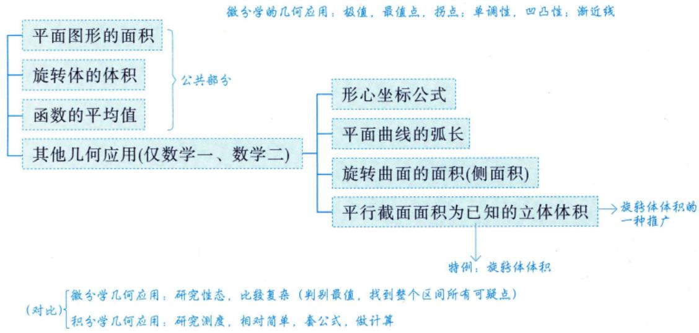

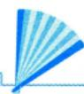

# 基础内容精讲

假设以下曲线都是光滑的. 三大体系下的图形：①直角坐标系下（直接算）②参数方程下 直接算（少）换元法③极坐标系下（直接算）1用定积分表达和计算平面图形的面积可以推广为用收敛的反常积分进行表示推广：可能用到在收敛情况下的反常积分及时回看，补上，以免遗忘

(1)曲线 $y = y_{1}(x)$ 与 $y = y_{2}(x)$ 及 $x = a$ ， $x = b(a < b)$ 所围成的平面图形的面积

$$
S = \int_ {a} ^ {b} | y _ {1} (x) - y _ {2} (x) | d x.
$$

计算一个带绝对值的函数的定积分

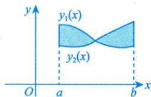

小提示：随着学习的进行,知识会遗忘,所以要及时进行复习,因此在学面积之前,可以先回看前面学到的平面图形.

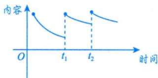

及时复习晦 话，遗忘曲线就会出现许多巍跃间断点

记忆小曲线 $\Rightarrow$ 复习2~3次，遗忘内容大幅度减少

微元法.

用大的面积减去小的面积，即 $S = \int_{a}^{b}y_{1}\mathrm{d}x - \int_{a}^{b}y_{2}\mathrm{d}x$

① 取微元： $\Delta S = |y_1(x) - y_2(x)|\mathrm{d}x$   
② 积分： $S = \int_{a}^{b}\left|y_{1} - y_{2}\right|\mathrm{d}x$

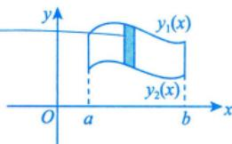

(2)曲线 $r = r_1(\theta)$ 与 $r = r_{2}(\theta)$ 与两射线 $\theta = \alpha$ 与 $\theta = \beta (0 <   \beta -\alpha \leqslant 2\pi)$ 所围成的曲边扇形的面积

$$
S = \frac {1}{2} \int_ {\alpha} ^ {\beta} \left| r _ {1} ^ {2} (\theta) - r _ {2} ^ {2} (\theta) \right| d \theta .
$$

绝对值：保证差值非负

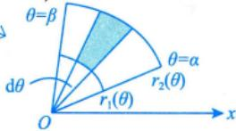

当 $\mathrm{d}\theta \to 0$ 时，可将扇形区域近似看作三角形，计算三角形面积： $\frac{1}{2} r_2(\theta)\cdot r_2(\theta)\mathrm{d}\theta -\frac{1}{2} r_1(\theta)\cdot r_1(\theta)\mathrm{d}\theta$ 微元法.

$①$ 用经过 $o$ 的射线去切分扇形区域，  
②取微元：用大“三角形”面积-小“三角形”面积.

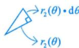

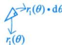

$$
\Delta S = \frac {1}{2} r _ {2} (\theta) \cdot r _ {2} (\theta) \mathrm {d} \theta - \frac {1}{2} r _ {1} (\theta) \cdot r _ {1} (\theta) \mathrm {d} \theta = \frac {1}{2} \left| r _ {2} ^ {2} (\theta) - r _ {1} ^ {2} (\theta) \right| \mathrm {d} \theta .
$$

③ 积分： $S = \int_{\alpha}^{\beta}\frac{1}{2}\left|r_2^2 (\theta) - r_1^2 (\theta)\right|\mathrm{d}\theta .$

例10.1 设 $A_{n}$ 是曲线 $y = x^{n}$ 与 $y = x^{n + 1}(n = 1,2,\dots)$ 所围区域的面积，则 $\lim_{n\to \infty}\left(2\sum_{k = 1}^{n}A_k\right)^n =$

分析 ① 求交点. $\left\{ \begin{array}{l} y = x^n, \\ y = x^{n+1} \end{array} \Rightarrow x^n = x^{n+1} \Rightarrow x = 0 \text{ 或 } x = 1 \right.$ .

$②$ 画图（见图10-1）.

图10-1

③ 套公式，做计算，得到 $A_{n}$ 的具体表达式.  
④代入 $A_{n}$ ，求极限.

解 应填 $\mathbf{e}^{-2}$

由

$$
\left\{ \begin{array}{l} y = x ^ {n}, \\ y = x ^ {n + 1} \end{array} \Rightarrow x ^ {n + 1} - x ^ {n} = 0 \Rightarrow x ^ {n} (x - 1) = 0 \Rightarrow x = 0, x = 1 \right.,
$$

得 $y = x^{n}$ 与 $y = x^{n + 1}$ 的交点为 $(0,0),(1,1)$ ，故

$$
A _ {n} = \int_ {0} ^ {1} \left(x ^ {n} - x ^ {n + 1}\right) d x = \left(\frac {1}{n + 1} x ^ {n + 1} - \frac {1}{n + 2} x ^ {n + 2}\right) \Bigg | _ {0} ^ {1} = \frac {1}{n + 1} - \frac {1}{n + 2},
$$

则 $\lim_{n\to \infty}\left(2\sum_{k = 1}^{n}A_k\right)^n = \lim_{n\to \infty}\left[\sum_{k = 1}^{n}\left(\frac{2}{k + 1} -\frac{2}{k + 2}\right)\right]^n$

$$
= \lim  _ {n \rightarrow \infty} \left(\frac {2}{2} - \frac {2}{3} + \frac {2}{3} - \frac {2}{4} + \dots + \frac {2}{n + 1} - \frac {2}{n + 2}\right) ^ {n} = \underbrace {\lim  _ {n \rightarrow \infty} \left(1 - \frac {2}{n + 2}\right) ^ {n}} _ {\downarrow} = e ^ {- 2}.
$$

可以把 $n$ 当作 $x$ ,无须用归结原则化为函数极限

例10.2 求由摆线 $\left\{ \begin{array}{l}x = a(t - \sin t),\\ y = a(1 - \cos t) \end{array} \right.$ （ $a > 0$ )的一拱（见图10-2)与 $x$ 轴所围平面图形的面积.

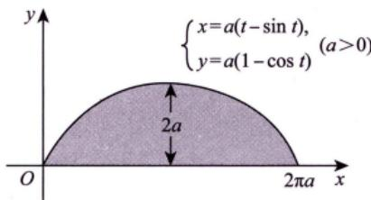  
图10-2

参数方程下的问题是重点. ① $\left\{ \begin{array}{l} x = x(t), \\ y = y(t) \end{array} \Rightarrow y = f(x) \right.$ 它们所有对应点的函数值均相同  
给定参数方程，其实是对定积分计算的换元法的变相  
考查.当 $f$ 复杂时，引进一个新的自变量 $t$ 进行处理. $S = \int_{0}^{2\pi} f(x) \mathrm{d}x$ （直角坐标系） $x = x(t) \int_{\alpha}^{\beta} y(t) x'(t) \mathrm{d}t = \int_{0}^{2\pi} y(t) \mathrm{d}[x(t)]$

分析 ①画出摆线（考试不会给出图！！！）.

$②$ 按照直角坐标系去理解参数方程，套直角坐标系下的面积公式进行计算.

$$
\left\{ \begin{array}{l} x = x (t), \\ y = y (t) \end{array} \Rightarrow y = f (x) = f [ x (t) ] = y (t) \right..
$$

比如： $\left\{ \begin{array}{l}x = 2t,\\ y = t^2 \end{array} \right.\Rightarrow y = \frac{1}{4} x^2 = f(x) = f[x(t)] = \frac{1}{4} (2t)^2 = t^2 = y(t).$

$$
S = \int_ {a} ^ {b} f (x) \mathrm {d} x \xlongequal {x = x (t)} \int_ {x ^ {- 1} (a)} ^ {x ^ {- 1} (b)} f [ x (t) ] \mathrm {d} [ x (t) ] = \int_ {\alpha} ^ {\beta} y (t) x ^ {\prime} (t) \mathrm {d} t.
$$

解当 $t = 0$ 或 $t = 2\pi$ 时， $y = 0$ .故当 $\pmb{t}$ 由0变到 $2\pi$ 时，曲线正好成一拱，所以

$$
\begin{array}{l} S = \int_ {0} ^ {2 \pi a} y (x) \mathrm {d} x \frac {x = a (t - \sin t)}{y (x) = y [ a (t - \sin t) ]} \int_ {0} ^ {2 \pi} a (1 - \cos t) [ a (t - \sin t) ] ^ {\prime} \mathrm {d} t \\ = \int_ {0} ^ {2 \pi} a ^ {2} (1 - \cos t) ^ {2} d t = a ^ {2} \int_ {0} ^ {2 \pi} (1 - 2 \cos t + \cos^ {2} t) d t \\ = a ^ {2} \int_ {0} ^ {2 \pi} d t - 2 a ^ {2} \int_ {0} ^ {2 \pi} \cos t d t + a ^ {2} \int_ {0} ^ {2 \pi} \cos^ {2} t d t \\ = 2 a ^ {2} \pi + 4 a ^ {2} \boxed {\int_ {0} ^ {\frac {\pi}{2}} \cos^ {2} t d t} = 3 a ^ {2} \pi . \\ \end{array}
$$

方法总结 参数方程下面积公式的本质：直角坐标系下的面积公式的换元法形式. $x = x(t)$

例10.3 伯努利双纽线 $r^2 = a^2\cos 2\theta$ 围成的图形的面积为

分析 ①画图. ②套公式，做计算（借助对称性简化计算）.

解 应填 $a^2$

如图10-3所示，利用对称性，所求图形面积是阴影部分面积的4倍.

阴影部分的图形由射线 $\theta = 0, \theta = \frac{\pi}{4}$ 与伯努利双纽线 $r^2 = a^2\cos 2\theta$ 围成，于是所求的平面图形面积为

$$
S = 4 \int_ {0} ^ {\frac {\pi}{4}} \frac {1}{2} a ^ {2} \cos 2 \theta d \theta = a ^ {2} \sin 2 \theta \left| _ {0} ^ {\frac {\pi}{4}} = a ^ {2} \right..
$$

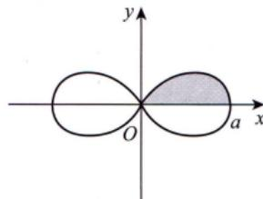  
图10-3

例10.4 求曲线 $y = \mathrm{e}^{-x}\sin x (x\geqslant 0)$ 与 $x$ 轴所围平面图形的面积

分析 ①画图：如图10-4所示.

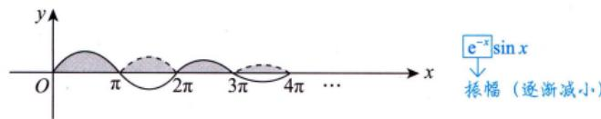  
图10-4

② 套公式： $S = \int_{0}^{+\infty} \mathrm{e}^{-x} |\sin x| \, \mathrm{d}x$ 保持非负（对应图形在 $x$ 轴下方的部分向上翻折）

③做计算（难度在于处理绝对值）：

$$
S = \int_ {0} ^ {\pi} \mathrm {e} ^ {- x} \sin x \mathrm {d} x + \int_ {\pi} ^ {2 \pi} (- \mathrm {e} ^ {- x} \sin x) \mathrm {d} x + \int_ {2 \pi} ^ {3 \pi} \mathrm {e} ^ {- x} \sin x \mathrm {d} x + \dots = \lim  _ {n \rightarrow \infty} \sum_ {k = 0} ^ {n} \left| \int_ {k \pi} ^ {(k + 1) \pi} \mathrm {e} ^ {- x} \sin x \mathrm {d} x \right|.
$$

解 $S = \int_{0}^{+\infty}\mathrm{e}^{-x}\left|\sin x\right|\mathrm{d}x = \lim_{n\to \infty}\sum_{k = 0}^{n}\left|\int_{k\pi}^{(k + 1)\pi}\mathrm{e}^{-x}\sin x\mathrm{d}x\right|$ ，其中 “前世今生”见例8.5③

$$
\begin{array}{l} \int_ {k \pi} ^ {(k + 1) \pi} e ^ {- x} \sin x d x = \frac {1}{2} \left| \begin{array}{l l} (e ^ {- x}) ^ {\prime} & (\sin x) ^ {\prime} \\ e ^ {- x} & \sin x \end{array} \right| _ {k \pi} ^ {(k + 1) \pi} \\ = - \frac {1}{2} \mathrm {e} ^ {- x} (\cos x + \sin x) \Bigg | _ {k \pi} ^ {(k + 1) \pi} \\ = - \frac {1}{2} e ^ {- (k + 1) \pi} \cdot (- 1) ^ {k + 1} + \frac {1}{2} e ^ {- k \pi} \cdot (- 1) ^ {k} \\ = \frac {(- 1) ^ {k}}{2} e ^ {- k \pi} (e ^ {- \pi} + 1), \\ \end{array}
$$

套公式，计算量大，重视计算

故 $S = \frac{\mathrm{e}^{-\pi} + 1}{2}\lim_{n\to \infty}\sum_{k = 0}^{n}(\mathrm{e}^{-\pi})^{k} = \frac{\mathrm{e}^{-\pi} + 1}{2}\cdot \frac{1}{1 - \mathrm{e}^{-\pi}} = \frac{\mathrm{e}^{-\pi} + 1}{2(1 - \mathrm{e}^{-\pi})}.$

# 用定积分表达和计算旋转体的体积

(1)曲线 $y = y(x)$ 与 $x = a$ ， $x = b(a < b)$ 及 $x$ 轴围成的曲边梯形绕 $x$ 轴旋转一周所得到的旋转体的体积为

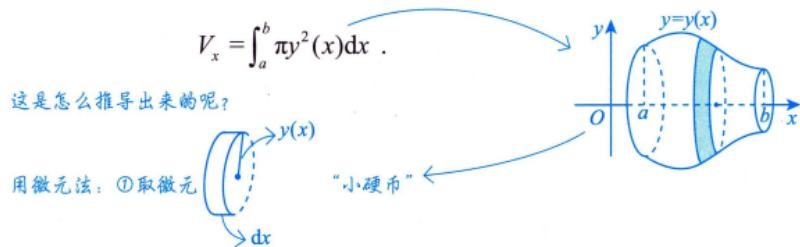

$$
\begin{array}{l} \text {②} \Delta V = \pi y ^ {2} (x) d x. \\ ③ \text {积 分}: V _ {x} = \int_ {a} ^ {b} \pi y ^ {2} (x) d x. \\ \end{array}
$$

例10.5 求曲线 $y = \mathrm{e}^{-\frac{x}{2}}\sqrt{\sin x}$ 在 $[0, 2\pi]$ 部分与 $x$ 轴围成的平面图形绕 $x$ 轴旋转一周所成的旋转体的体积.

分析 ① 确定 $x$ 的取值范围： $\sqrt{\sin x} \Rightarrow \sin x \geqslant 0 \Rightarrow x \in [0, \pi]$

② 套公式： $V_{x} = \int_{0}^{\pi}\pi (\mathrm{e}^{-\frac{x}{2}}\sqrt{\sin x})^{2}\mathrm{d}x.$

解 $y = \mathrm{e}^{-\frac{x}{2}}\sqrt{\sin x}$ 在 $[0,\pi ]$ 上存在，在 $(\pi ,2\pi)$ 内不存在，故

$$
V = \int_ {0} ^ {\pi} \pi y ^ {2} (x) \mathrm {d} x = \int_ {0} ^ {\pi} \pi \mathrm {e} ^ {- x} \sin x \mathrm {d} x \stackrel {\text {见 注}} {=} \frac {1}{2} \pi (1 + \mathrm {e} ^ {- \pi}) .
$$

注 $\int_0^\pi \pi \mathrm{e}^{-x}\sin x\mathrm{d}x = \frac{\pi}{2}\left|\begin{array}{cc}(\mathrm{e}^{-x})' & (\sin x)'\\ \mathrm{e}^{-x} & \sin x \end{array}\right|_0^\pi = -\frac{\pi}{2} (\cos x + \sin x)\mathrm{e}^{-x}\Bigg|_0^\pi = \frac{\pi}{2} (\mathrm{e}^{-\pi} + 1).$

(2) 曲线 $y = y(x)$ 与 $x = a$ ， $x = b (0 \leqslant a < b)$ 及 $x$ 轴围成的曲边梯形绕 $y$ 轴旋转一周所得到的旋转体的体积为

$$
V _ {y} = 2 \pi \int_ {a} ^ {b} x | y (x) | d x. \tag {*}
$$

注 公式 $(\ast)$ 有时用起来很方便，现简单推导如下（微元法）：

取 $[x, x + \Delta x](\Delta x > 0)$ ，得到一个小竖条，如图10-5的阴影区域所示，此小竖条绕着 $y$ 轴旋转一周，成为一个“圆柱壳”，将其沿任何一条竖线“切开”，可展开为一个“长方体”，其体积为

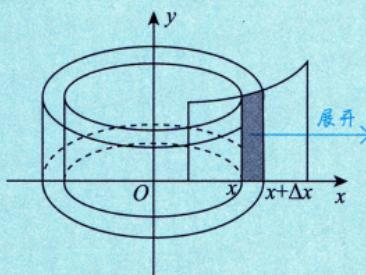

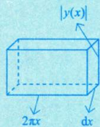  
图10-5

$\mathrm{d}V_{y} = 2\pi x|y(x)|\mathrm{d}x,$ 故 $V_{y} = 2\pi \int_{a}^{b}x\bigl {|}y(x)\bigr {|}\mathrm{d}x.$

总结 $V_{x} = \pi \int_{a}^{b}$ 2dx， 往“口”里代 $V_{y} = 2\pi \int_{a}^{b}x|\square |\mathrm{d}x.$

例10.6 设函数 $f(x)$ 的定义域为 $(0, +\infty)$ ，且满足 $2f(x) + x^{2}f\left(\frac{1}{x}\right) = \frac{x^{2} + 2x}{\sqrt{1 + x^{2}}}$ . 求 $f(x)$ ，并求曲线 $y = f(x)$ ，直线 $y = \frac{1}{2}, y = \frac{\sqrt{3}}{2}$ 及 $y$ 轴所围图形绕 $x$ 轴旋转一周所成旋转体的体积.

分析 ① $x$ 与 $y$ 地位交换，求出 $y = f(x) \Rightarrow x = \varphi(y)$

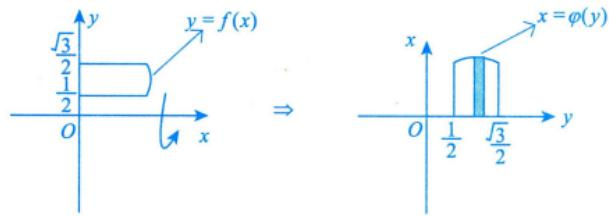

② 套 $V_{y}$ 体积公式， $y$ 作自变量， $x$ 作因变量，有 $V_{y} = \int_{\frac{1}{2}}^{\frac{\sqrt{3}}{2}} 2\pi y \cdot \varphi(y) \, \mathrm{d}y$ 。

解 由例1.2知

$$
\begin{array}{l} \left(1 + x ^ {2}\right) y ^ {2} = x ^ {2} \\ f (x) = \frac {x}{\sqrt {1 + x ^ {2}}} (x > 0). \\ \Rightarrow y ^ {2} + x ^ {2} y ^ {2} - x ^ {2} = 0 \\ \Rightarrow x ^ {2} (y ^ {2} - 1) = - y ^ {2} \\ \Rightarrow x = \frac {y}{\sqrt {1 - y ^ {2}}} \\ \end{array}
$$

由 $y = \frac{x}{\sqrt{1 + x^2}}$ 得 $x = \frac{y}{\sqrt{1 - y^2}} (0 < y < 1)$ ，从而 $y = f(x), y = \frac{1}{2}, y = \frac{\sqrt{3}}{2}$ 及 $y$ 轴所围图形绕 $x$ 轴旋转一周所成旋转体的体积为

$$
\begin{array}{l} V = 2 \pi \int_ {\frac {1}{2}} ^ {\frac {\sqrt {3}}{2}} x y d y = 2 \pi \int_ {\frac {1}{2}} ^ {\frac {\sqrt {3}}{2}} \frac {y ^ {2}}{\sqrt {1 - y ^ {2}}} d y \\ \xlongequal {\text {令} y = \sin t} 2 \pi \int_ {\frac {\pi}{6}} ^ {\frac {\pi}{3}} \sin^ {2} t \mathrm {d} t = 2 \pi \int_ {\frac {\pi}{6}} ^ {\frac {\pi}{3}} \frac {1 - \cos 2 t}{2} \mathrm {d} t \\ = \frac {\pi^ {2}}{6}. \\ \end{array}
$$

方法总结 学会利用反函数，将绕 $x$ 轴旋转用 $V_{y}$ 的体积公式表示出来.

此题增加了2个综合性考查：

①要把 $f(x)$ 求出来.   
② $x$ ， $y$ 地位交换，先反解，再套公式计算.

(3) 平面曲线绕定直线旋转.

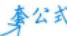

若出现2个及以上的交点,则不适用,如

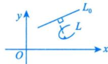

平面曲线 $L$ ： $y = f(x)$ ， $a\leqslant x\leqslant b$ ，且 $f(x)$ 可导.

定直线 $L_{0}$ ： $Ax + By + C = 0$ ，且过 $L_{0}$ 的任一条垂线与 $L$ 至多有一个交点，如图10-6所示，则 $L$ 绕 $L_{0}$ 旋转一周所得旋转体的体积为

$$
\star V = \frac {\pi}{(A ^ {2} + B ^ {2}) ^ {\frac {3}{2}}} \int_ {a} ^ {b} [ A x + B f (x) + C ] ^ {2} | A f ^ {\prime} (x) - B | d x. \tag {10-1}
$$

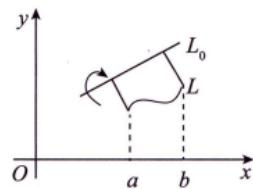  
图10-6

特别地，若 $A = C = 0, B \neq 0$ ，则 $L_{0}$ 为 $y = 0$ （ $x$ 轴），如图10-7所示， $L$ 绕 $L_{0}$ 旋转一周所得旋转体的体积为

$$
\begin{array}{l} V = \pi \int_ {a} ^ {b} f ^ {2} (x) d x. \quad \rightarrow V = \frac {\pi}{(B ^ {2}) ^ {\frac {3}{2}}} \int_ {a} ^ {b} [ B f (x) ] ^ {2} | - B | d x \\ = \frac {\pi}{| B | ^ {3}} \int_ {a} ^ {b} B ^ {2} | B | f ^ {2} (x) d x = \pi \int_ {a} ^ {b} f ^ {2} (x) d x \\ \end{array}
$$

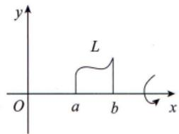  
图10-7

注 掌握住此结论，会套公式即可.

公式 $|B^3|\Rightarrow |B|B^2 = B^2\mid B|.$

例10.7 过坐标原点作曲线 $y = \mathrm{e}^{x}$ 的切线，该切线与曲线 $y = \mathrm{e}^{x}$ 以及 $x$ 轴围成的向 $x$ 轴负向无限伸展的平面图形记为 $D$ . 求：

(1) $D$ 的面积 $A$   
(2) $D$ 绕直线 $x = 1$ 旋转一周所成的旋转体的体积 $V$

分析 先求切点与切线方程，进而套面积公式和旋转体体积公式.

解设切点坐标为 $P(x_0,y_0)$ ，于是曲线 $y = \mathrm{e}^{x}$ 在点 $P$ 的切线斜率为

$$
y ^ {\prime} \left(x _ {0}\right) = e ^ {x _ {0}},
$$

切线方程为

$$
\rightarrow y (0) = 0 \quad y - y _ {0} = e ^ {x _ {0}} \left(x - x _ {0}\right).
$$

因为该切线经过点 $(0,0)$ ，所以 $-y_{0} = -x_{0}\mathrm{e}^{x_{0}}$ 。又因为 $y_{0} = \mathrm{e}^{x_{0}}$ ，代入求得 $x_{0} = 1$ ，从而 $y_{0} = \mathrm{e}^{x_{0}} = \mathrm{e}$ ，切线方程为 $y = \mathrm{ex}$ ，如图10-8所示。

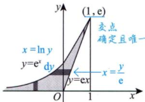  
图10-8

(1)取水平条面积微元，则 $D$ 的面积

若取竖直条面积微元：

$$
\Delta S _ {1} = e ^ {x} d x, \Delta S _ {2} = (e ^ {x} - e x) d x
$$

再积分： $S = \int_{-\infty}^{0}\mathrm{e}^{x}\mathrm{d}x + \int_{0}^{1}(\mathrm{e}^{x} - \mathrm{e}x)\mathrm{d}x,$

则较为麻烦，故不建议

$$
\begin{array}{l} A = \int_ {0} ^ {\mathrm {e}} \left(\frac {y}{\mathrm {e}} - \ln y\right) \mathrm {d} y \xrightarrow {\int \ln y \mathrm {d} y = y \ln y - \int y \cdot \frac {1}{y} \mathrm {d} y = y \ln y - y + C} \\ \begin{array}{r l} & = \frac {1}{e} \cdot \frac {y ^ {2}}{2} \Bigg | _ {0} ^ {e} - (y \ln y - y) \Bigg | _ {0} ^ {e} \\ & = \frac {e}{2} + \lim  _ {y \to 0 ^ {+}} y \ln y = \frac {e}{2}. \end{array} \\ \end{array}
$$

(2) $D$ 绕直线 $x = 1$ 旋转一周所成的旋转体的体积微元为

先取微元：用“大体积”-“小体积” dV=[π(1-lny)²-π（1-）²]dy,

从而

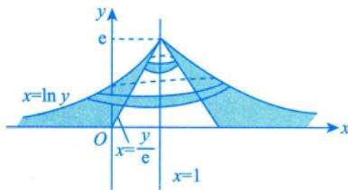

再积分 $\leftarrow V = \pi \int_{0}^{\mathrm{e}}\left(\ln^{2}y - 2\ln y + \frac{2y}{\mathrm{e}} -\frac{y^{2}}{\mathrm{e}^{2}}\right)\mathrm{d}y$

$$
= \pi \left(y \ln^ {2} y - 4 y \ln y + 4 y + \frac {y ^ {2}}{e} - \frac {y ^ {3}}{3 e ^ {2}}\right) \Bigg | _ {0} ^ {e} = \frac {5}{3} \pi e.
$$

注第(2)问也可以直接套公式（10-1），可得方法二.

$L_{0}:x = 1\Rightarrow Ax + By + C = 0$ 中， $A = 1$ ， $B = 0$ ， $C = -1$ ：

$$
L: y _ {\text {大}} = \mathrm {e} ^ {x}, y _ {\text {小}} = \mathrm {e} x.
$$

由 $V = \frac{\pi}{(A^2 + B^2)^{\frac{3}{2}}}\int_a^b [Ax + Bf(x) + C]^2\left|Af'(x) - B\right|\mathrm{d}x,$

得 $V_{\text{大}} = \pi \int_{-\infty}^{1}(x - 1)^{2}\mathrm{e}^{x}\mathrm{d}x, V_{\text{小}} = \pi \int_{0}^{1}(x - 1)^{2}\mathrm{e}\mathrm{d}x,$

则 $V = V_{\text{大}} - V_{\text{小}}$

$$
\begin{array}{l} = \pi \int_ {- \infty} ^ {1} (x - 1) ^ {2} e ^ {x} d x - \pi \int_ {0} ^ {1} (x - 1) ^ {2} e d x \\ = \pi \int_ {- \infty} ^ {1} (x - 1) ^ {2} d \left(e ^ {x}\right) - e \pi \int_ {0} ^ {1} \left(x ^ {2} - 2 x + 1\right) d x \\ = \pi \mathrm {e} ^ {x} (x - 1) ^ {2} \Big | _ {- \infty} ^ {1} - 2 \pi \int_ {- \infty} ^ {1} (x - 1) \cdot \mathrm {e} ^ {x} \mathrm {d} x - \frac {\pi \mathrm {e}}{3} \\ = - 2 \pi \int_ {- \infty} ^ {1} (x - 1) d \left(e ^ {x}\right) - \frac {\pi e}{3} \\ = - 2 \pi \mathrm {e} ^ {x} \cdot (x - 1) \Big | _ {- \infty} ^ {1} + 2 \pi \int_ {- \infty} ^ {1} \mathrm {e} ^ {x} \mathrm {d} x - \frac {\pi \mathrm {e}}{3} \\ = 2 \pi e ^ {x} \Big | _ {- \infty} ^ {1} - \frac {\pi e}{3} \\ = \frac {5 \pi e}{3}. \\ \end{array}
$$

# 3 用定积分表达和计算函数的平均值

设 $x\in [a,b]$ ，函数 $\underline{y(x)}$ 在 $[a,b]$ 上的平均值为 $\bar{y} = \frac{1}{b - a}\int_{a}^{b}y(x)\mathrm{d}x\Rightarrow \bar{y} = y(\xi),\xi \in [a,b]$ （由积分中值定理可得）.一般认为 $y(x)$ 是连续函数

例10.8 设 $f(x)$ 连续，且 $f(x + 2) - f(x) = x, \int_0^2 f(x)\mathrm{d}x = 0$ ，则 $f(x)$ 在[1,3]上的平均值为

关系式

分析

$①$ 套公式： $\overline{f} = \frac{1}{3 - 1}\int_{1}^{3}f(x)\mathrm{d}x = \frac{1}{2}\int_{1}^{3}f(x)\mathrm{d}x\leqslant$

观察可知区间长度均为2

② a. $f(x + 2) - f(x) \Rightarrow$ 联想周期性（本题中的 $f(x)$ 未必具有周期性）.

若 $f(x)$ 是周期为 $T$ 的周期函数，则 $\int_{a}^{a + T} f(x) \mathrm{d}x = \int_{0}^{T} f(x) \mathrm{d}x (f(x + T) = f(x))$

设 $F(x) = \int_{x}^{x + 2}f(t)\mathrm{d}t$ ，则 $\overline{f} = \frac{F(1)}{2}$

b. 反写一至两步，联想经典形式 $\left[\int_{\varphi_1(x)}^{\varphi_2(x)}f(t)\mathrm{d}t\right]'$ ，则

$$
\left[ \int_ {x} ^ {x + 2} f (t) d t \right] = f (x + 2) - f (x).
$$

由a.或者b.都可以想到，令 $F(x) = \int_{x}^{x + 2}f(t)\mathrm{d}t$

解 应填 $\frac{1}{4}$

记 $F(x) = \int_{x}^{x + 2}f(t)\mathrm{d}t$ ，则

变限积分函数

$$
F ^ {\prime} (x) = f (x + 2) - f (x) = x,
$$

故 $F(x) = \int x\mathrm{d}x = \frac{1}{2} x^2 +C.$

由 $F(0) = \int_0^2 f(x)\mathrm{d}x = 0 = C$ ，得 $F(x) = \frac{1}{2} x^{2}$ ，则 $\int_1^3 f(x)\mathrm{d}x = F(1) = \frac{1}{2}$ ，故

$$
\bar {f} = \frac {1}{3 - 1} \int_ {1} ^ {3} f (x) d x = \frac {1}{2} F (1) = \frac {1}{4}.
$$

方法总结 学会观察条件，得到有效信息，产生联想，进而快速解题.

# 4其他几何应用（仅数学一、数学二）

是几何量，还有质心、重心

(1) “平面上的曲边梯形”的形心坐标公式.

设平面区域 $D = \{(x,y)|0\leqslant y\leqslant f(x),a\leqslant x\leqslant b\}$ ， $y = f(x)$ 在 $[a,b]$ 上连续，如图10-9所示.现推导 $D$ 的形心坐标 $\overline{x}$ ， $\overline{y}$ 的计算公式．

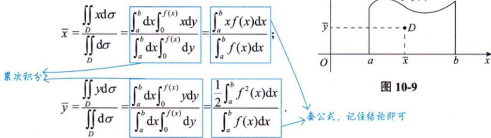

例10.9 设曲线 $L$ 的方程为 $y = \frac{1}{4} x^2 -\frac{1}{2}\ln x, 1\leqslant x\leqslant e, D$ 是由曲线 $L$ 和直线 $x = 1, x = e$ 及 $x$ 轴围成的平面图形，则 $D$ 的形心的横坐标为

$\int_{1}^{\mathrm{e}}x\left(\frac{1}{4} x^{2} - \frac{1}{2}\ln x\right)\mathrm{d}x$ 直接套公式得 $\overline{x} = \frac{\int_1^{\mathrm{e}}x\left(\frac{1}{4}x^2 - \frac{1}{2}\ln x\right)\mathrm{d}x}{\int_1^{\mathrm{e}}\left(\frac{1}{4}x^2 - \frac{1}{2}\ln x\right)\mathrm{d}x}.$

解 应填 $\frac{3(\mathrm{e}^2 + 1)(\mathrm{e}^2 - 3)}{4(\mathrm{e}^3 - 7)}$

平面图形 $D$ 的形心的横坐标的计算公式为 $\overline{x} = \frac{\int_{1}^{e}xy\mathrm{d}x}{\int_{1}^{e}y\mathrm{d}x}$ ，其中

$$
\int_ {1} ^ {\mathrm {e}} x y \mathrm {d} x = \int_ {1} ^ {\mathrm {e}} x \left(\frac {1}{4} x ^ {2} - \frac {1}{2} \ln x\right) \mathrm {d} x = \left(\frac {1}{1 6} x ^ {4} - \frac {1}{4} x ^ {2} \ln x + \frac {1}{8} x ^ {2}\right) \Bigg | _ {1} ^ {\mathrm {e}} = \frac {1}{1 6} (\mathrm {e} ^ {2} + 1) (\mathrm {e} ^ {2} - 3),
$$

$$
\int_ {1} ^ {\mathrm {e}} y \mathrm {d} x = \int_ {1} ^ {\mathrm {e}} \left(\frac {1}{4} x ^ {2} - \frac {1}{2} \ln x\right) \mathrm {d} x = \left(\frac {1}{1 2} x ^ {3} - \frac {1}{2} x \ln x + \frac {1}{2} x\right) \Bigg | _ {1} ^ {\mathrm {e}} = \frac {1}{1 2} \mathrm {e} ^ {3} - \frac {7}{1 2},
$$

所以 $D$ 的形心的横坐标为

$$
\overline {{x}} = \frac {\frac {1}{1 6} (\mathrm {e} ^ {2} + 1) (\mathrm {e} ^ {2} - 3)}{\frac {1}{1 2} \mathrm {e} ^ {3} - \frac {7}{1 2}} = \boxed {\frac {3 (\mathrm {e} ^ {2} + 1) (\mathrm {e} ^ {2} - 3)}{4 (\mathrm {e} ^ {3} - 7)}}. \longrightarrow \text {考 研 题 答 案 必 必 简 洁 ， 要 多 做 计 算}
$$

(2)平面曲线的弧长.

① 若平面光滑曲线由直角坐标方程 $y = y(x) (a \leqslant x \leqslant b)$ 给出，则 $s = \int_{a}^{b} \sqrt{1 + [y'(x)]^2} \, \mathrm{d}x$ .  
② 若平面光滑曲线由参数方程 $\left\{ \begin{array}{l} x = x(t), \\ y = y(t) \end{array} \right.$ ( $\alpha \leqslant t \leqslant \beta$ ) 给出，则 $s = \int_{\alpha}^{\beta} \sqrt{\left[x'(t)\right]^2 + \left[y'(t)\right]^2} \, \mathrm{d}t$ 。  
③若平面光滑曲线由极坐标方程 $r = r(\theta)(\alpha \leqslant \theta \leqslant \beta)$ 给出，则 $s = \int_{\alpha}^{\beta}\sqrt{[r(\theta)]^2 + [r'(\theta)]^2}\mathrm{d}\theta$

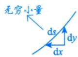

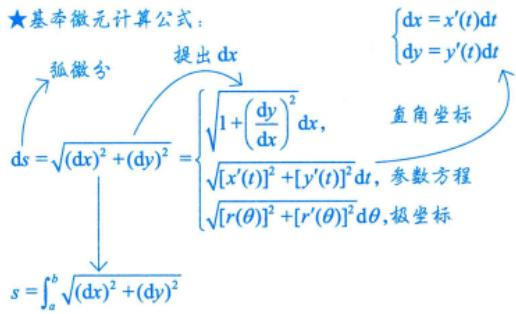

例10.10 曲线 $y = \ln (1 - x^2)$ 上相应于 $0 \leqslant x \leqslant \frac{1}{2}$ 的一段弧的长度为

分析 只需套公式，做计算即可，不用画图。

解 应填 $\ln 3 - \frac{1}{2}$

套公式 $s = \int_0^{\frac{1}{2}}\sqrt{1 + (y')^2}\mathrm{d}x = \int_0^{\frac{1}{2}}\sqrt{1 + \left(\frac{-2x}{1 - x^2}\right)^2}\mathrm{d}x = \int_0^{\frac{1}{2}}\frac{1 + x^2}{1 - x^2}\mathrm{d}x$ 做计算  
\[
\begin{aligned}
& = \int_0^{\frac{1}{2}}\frac{x^2 - 1 + 2}{1 - x^2}\mathrm{d}x = \int_0^{\frac{1}{2}}\left(\frac{2}{1 - x^2} -1\right)\mathrm{d}x\\
& = \int_0^{\frac{1}{2}}\left(\frac{1}{1 + x} +\frac{1}{1 - x} -1\right)\mathrm{d}x = \ln 3 - \frac{1}{2}.
\end{aligned}
\]

例10.11 阿基米德螺线 $r = \theta$ 上相应于 $\theta$ 从0到 $2\pi$ 一段的弧长为

分析 套极坐标求弧长的公式.

解 应填 $\pi \sqrt{1 + 4\pi^2} + \frac{1}{2}\ln \left(2\pi + \sqrt{1 + 4\pi^2}\right)$ .

阿基米德螺线的图形如图10-10所示，

由题意，所求弧长为

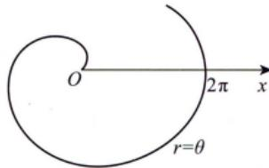  
图10-10

[ s = \int_{0}^{2\pi} \sqrt{[r(\theta)]^2 + [r'(\theta)]^2} \, \mathrm{d}\theta ]  
[ = \int_{0}^{2\pi} \sqrt{\theta^2 + 1^2} \, \mathrm{d}\theta ]  
[ = \int_{0}^{2\pi} \sqrt{1 + \theta^2} \, \mathrm{d}\theta ]  
[ = \int_{0}^{2\pi} \sqrt{1 + \theta^2} \, \mathrm{d}\theta ]  
[ = \int_{0}^{2\pi} \sqrt{1 + \theta^2} \, \mathrm{d}\theta ]  
[ = \left[\frac{\theta}{2} \sqrt{1 + \theta^2} + \frac{1}{2} \ln \left(\theta + \sqrt{1 + \theta^2}\right)\right]_0^{2\pi} = \frac{1}{2} \cdot \sqrt{1 + \theta^2} \cdot \theta + \frac{1}{2} \ln \left(\sqrt{\theta^2 + 1} + \theta\right) + C ]  
[ = \pi \sqrt{1 + 4\pi^2} + \frac{1}{2} \ln \left(2\pi + \sqrt{1 + 4\pi^2}\right). ]

(3) 旋转曲面的面积（侧面积）. $\longrightarrow$ 在弧长公式基础上多乘了 $2\pi |y(x)|$

$①$ 曲线 $L:y = f(x)(a\leqslant x\leqslant b)$ 绕 $x$ 轴旋转一周所得旋转曲面的面积

$$
S = 2 \pi \int_ {a} ^ {b} | y | \sqrt {1 + \left(y _ {x} ^ {\prime}\right) ^ {2}} d x.
$$

$②$ 曲线 $L$ ： $\left\{ \begin{array}{l}x = x(t),\\ y = y(t) \end{array} \right.$ $(\alpha \leqslant t\leqslant \beta ,x^{\prime}(t)\neq 0)$ 绕 $x$ 轴旋转一周所得旋转曲面的面积

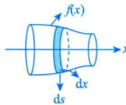  
算体积用 $\mathrm{dx}$ ，算侧面积用ds

S=2π|f(x)|ds 弧微

$$
S = 2 \pi \int_ {\alpha} ^ {\beta} | y (t) | \sqrt {\left(x _ {t} ^ {\prime}\right) ^ {2} + \left(y _ {t} ^ {\prime}\right) ^ {2}} d t.
$$

③曲线 $L$ ： $r = r(\theta)(\alpha \leqslant \theta \leqslant \beta)$ 绕 $x$ 轴旋转一周所得旋转曲面的面积

$$
S = 2 \pi \int_ {\alpha} ^ {\beta} | r (\theta) \sin \theta | \sqrt {[ r (\theta) ] ^ {2} + [ r ^ {\prime} (\theta) ] ^ {2}} d \theta .
$$

例10.12 曲线 $y = \sqrt{x - 1} (1\leqslant x\leqslant 2)$ 绕 $x$ 轴旋转一周所得到的旋转体的表面积为

解 应填 $\frac{\pi}{6} (5\sqrt{5} -1)$

曲线 $y = \sqrt{x - 1} (1\leqslant x\leqslant 2)$ 绕 $x$ 轴旋转一周所得到的旋转体的表面积为

$$
S = \int_ {1} ^ {2} 2 \pi y \sqrt {1 + \left(y ^ {\prime}\right) ^ {2}} d x = \pi \int_ {1} ^ {2} \sqrt {4 x - 3} d x = \frac {\pi}{6} (5 \sqrt {5} - 1).
$$

算出来多少就是多少，不用担心结果古怪。

例10.13 已知星形线的方程为 $\left\{ \begin{array}{l} x = 2\cos^3 t, \\ y = 2\sin^3 t, \end{array} \right.$ 则它绕 $x$ 轴旋转一周而成的旋转体的表面积为

分析 利用对称性算出 $y$ 轴右侧的表面积，再乘以2即可.

套公式： $S = \int_{\alpha}^{\beta}2\pi |y(t)|\sqrt{(x_t')^2 + (y_t')^2}\mathrm{d}t$ ，再做计算.

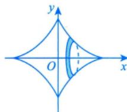

解 应填 $\frac{48}{5}\pi$

旋转体的表面积为

$$
\begin{array}{l} S = 2 \int_ {0} ^ {\frac {\pi}{2}} 2 \pi y \sqrt {\left(x _ {t} ^ {\prime}\right) ^ {2} + \left(y _ {t} ^ {\prime}\right) ^ {2}} d t \quad \rightarrow = \sqrt {\left[ 6 \cos^ {2} t (- \sin t) \right] ^ {2} + \left(6 \sin^ {2} t \cos t\right) ^ {2}} \\ = 4 \pi \int_ {0} ^ {\frac {\pi}{2}} 2 \sin^ {3} t \cdot 6 \sin t \cos t d t = 6 \sin t \cos t \\ = 4 8 \pi \int_ {0} ^ {\frac {\pi}{2}} \sin^ {4} t d (\sin t) \\ = 4 8 \pi \cdot \frac {\sin^ {5} t}{5} \Big | _ {0} ^ {\frac {\pi}{2}} = \frac {4 8}{5} \pi . \\ \end{array}
$$

(4)平行截面面积为已知的立体体积. (考研未考过)

考研历史上尚未出现过，考题不太好出

如图10-11所示，在区间 $[a,b]$ 上，垂直于 $x$ 轴的平面截立体 $\Omega$ 所得到的截面面积为 $x$ 的连续函数 $A(x)$ 取体积微元： $\mathrm{d}V = A(x)\mathrm{d}x$ ，则 $\Omega$ 的体积为

$$
V = \int_ {a} ^ {b} A (x) d x.
$$

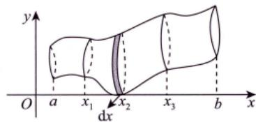  
图10-11

旋转体体积是其特例.

例10.14 曲线 $y = \sqrt{x}$ 与 $y = x$ 所围平面有界区域绕直线 $y = x$ 旋转一周所得旋转体的体积

为

分析 $r = \frac{\sqrt{x} - x}{\sqrt{2}}.$

取微元： $\mathrm{d}V = \pi \cdot \left(\frac{\sqrt{x} - x}{\sqrt{2}}\right)^{2} \cdot \sqrt{2}\mathrm{d}x.$

解 应填 $\frac{\sqrt{2}}{60}\pi$

$y = \sqrt{x}$ 与 $y = x$ 交于点 $(0,0),(1,1)$ ，如图10-12所示，曲线 $y = \sqrt{x}$ 上的点到 $y = x$ 的距离为 $r = \frac{\sqrt{x} - x}{\sqrt{2}}$ ，故垂直于 $x$ 轴的平面截“该旋转体”所得的截面面积为 $A(x) = \sqrt{2}\pi \left(\frac{\sqrt{x} - x}{\sqrt{2}}\right)^{2}$ .因此，旋转体的体积为

$$
V = \int_ {0} ^ {1} \sqrt {2} \pi \left(\frac {\sqrt {x} - x}{\sqrt {2}}\right) ^ {2} d x = \int_ {0} ^ {1} \frac {\pi}{\sqrt {2}} \left(x - 2 x ^ {\frac {3}{2}} + x ^ {2}\right) d x = \frac {\sqrt {2}}{6 0} \pi .
$$

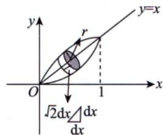  
图10-12

注 ①事实上， $V = \int_{a}^{b} A(x) \, \mathrm{d}x$ 就是 $V = \int_{a}^{b} \pi f^{2}(x) \, \mathrm{d}x$ 的一般化.

② 为什么 $A(x) = \sqrt{2} \cdot \pi \left(\frac{\sqrt{x} - x}{\sqrt{2}}\right)^2$ ？

设 $\alpha$ 为曲线 $y = \sqrt{x}$ 任一点的切线与 $x$ 轴正方向的夹角， $\beta$ 为直线 $y = x$ 与 $x$ 轴正方向的夹角.

由于此题的对称性，视任一点处 $\alpha = \beta$ ，误差抵消，为0.（\*）

如图10-13所示，在曲线 $y = \sqrt{x}$ 上的任一点 $(x_i, \sqrt{x_i})$ 处均作平行于 $y = x$ 的直线，则

$$
\Delta u = \sqrt {2} \Delta x, r (x _ {i}) = [ f (x _ {i}) - x _ {i} ] \cdot \frac {1}{\sqrt {2}} = \frac {\sqrt {x _ {i}} - x _ {i}}{\sqrt {2}},
$$

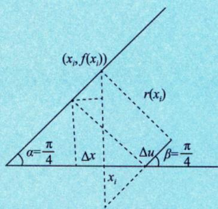  
图10-13

故 $V = \lim_{n\to \infty}\sum_{i = 1}^{n}\pi \bullet r^2 (x_i)\bullet \Delta u = \lim_{n\to \infty}\sum_{i = 1}^{n}\pi \bullet \left(\frac{\sqrt{x_i} - x_i}{\sqrt{2}}\right)^2\bullet \sqrt{2}\Delta x = \int_0^1\pi \left(\frac{\sqrt{x} - x}{\sqrt{2}}\right)^2\bullet \sqrt{2}\mathrm{d}x = \frac{\sqrt{2}}{60}\pi .$

事实上，这种处理作了等价变换。

$(*)$ 处的解释如图10-14所示：

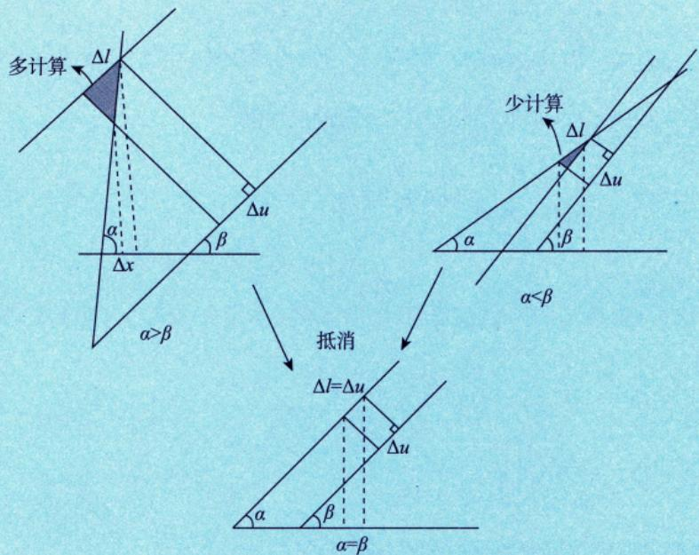  
图10-14

本题所用方法要有足够的经验，才能作上述等价变换，这是一种数学“直觉”，此方法要视具体情况而定，不能一味套公式，要求较高，供参考。

# 基础习题精练

# 习题

10.1 位于曲线 $y = \frac{1}{\sqrt{1 + x^2}} (0 \leqslant x < +\infty)$ 下方， $x$ 轴上方的无界区域绕 $x$ 轴旋转一周所得旋转体的体积为

10.2 圆域 $x^{2} + (y - b)^{2}\leqslant k^{2}(0 <   k <   b)$ 绕 $\mathcal{X}$ 轴旋转一周所得旋转体的体积 $V =$

10.3（仅数学一、数学二）曲线 $x = \frac{1}{4} y^2 -\frac{1}{2}\ln y$ 相应于 $1\leqslant y\leqslant e$ 的一段弧的长度为

10.4（仅数学一、数学二）星形线 $x = \cos^3 t$ ， $y = \sin^3 t(0\leqslant t\leqslant 2\pi)$ 的弧长为

10.5 函数 $y = \frac{x^2}{\sqrt{1 - x^2}}$ 在区间 $\left[\frac{1}{2}, \frac{\sqrt{3}}{2}\right]$ 上的平均值为

10.6 求曲线 $y = \sqrt{x}$ 的一条切线 $l$ ，使该曲线与切线 $l$ 及直线 $x = 0, x = 2$ 所围成图形的面积最小.

10.7 设 $D_{1}$ 是由抛物线 $y = 2x^{2}$ 和直线 $x = a, x = 2$ 及 $y = 0$ 所围成的平面区域， $D_{2}$ 是由抛物线

$y = 2x^{2}$ 和直线 $y = 0$ ， $x = a$ 所围成的平面区域，其中 $0 < a < 2$ ：

(1)求 $D_{1}$ 绕 $x$ 轴旋转一周而成的旋转体体积 $V_{1}$ ， $D_{2}$ 绕 $y$ 轴旋转一周而成的旋转体体积 $V_{2}$   
(2) 问当 $a$ 为何值时， $V_{1} + V_{2}$ 取得最大值？并求此最大值.

10.8 计算由摆线 $\left\{ \begin{array}{l} x = a(t - \sin t), \\ y = a(1 - \cos t) \end{array} \right.$ ( $a > 0, 0 \leqslant t \leqslant 2\pi$ ) 与 $x$ 轴所围平面图形绕 $y$ 轴旋转一周所得旋转体的体积.

10.9 求曲线 $y = 3 - \left|x^{2} - 1\right|$ 与 $x$ 轴围成的封闭图形绕直线 $y = 3$ 旋转一周所得旋转体的体积.

# 解答

10.1 $\frac{\pi^2}{2}$ 解 所求体积为

$$
\int_ {0} ^ {+ \infty} \pi \left(\frac {1}{\sqrt {1 + x ^ {2}}}\right) ^ {2} d x = \lim  _ {b \rightarrow + \infty} \pi \int_ {0} ^ {b} \frac {1}{1 + x ^ {2}} d x = \pi \lim  _ {b \rightarrow + \infty} \arctan x \Big | _ {0} ^ {b} = \frac {\pi^ {2}}{2}.
$$

10.2 $2\pi^2 k^2 b$ 解如图10-15所示，上半圆周为 $y_{2} = b + \sqrt{k^{2} - x^{2}}$ ，下半圆周为 $y_{1} = b - \sqrt{k^{2} - x^{2}}$ 其体积微元为

$$
\begin{array}{l} \mathrm {d} V = \left(\pi y _ {2} ^ {2} - \pi y _ {1} ^ {2}\right) \mathrm {d} x \\ = \pi \left[ \left(b + \sqrt {k ^ {2} - x ^ {2}}\right) ^ {2} - \left(b - \sqrt {k ^ {2} - x ^ {2}}\right) ^ {2} \right] d x \\ = 4 \pi b \sqrt {k ^ {2} - x ^ {2}} d x. \\ \end{array}
$$

则所求旋转体的体积为

$$
\begin{array}{l} V = 4 \pi b \int_ {- k} ^ {k} \sqrt {k ^ {2} - x ^ {2}} d x = 8 \pi b \int_ {0} ^ {k} \sqrt {k ^ {2} - x ^ {2}} d x \\ = 8 \pi b \cdot \frac {\pi k ^ {2}}{4} = 2 \pi^ {2} k ^ {2} b. \\ \end{array}
$$

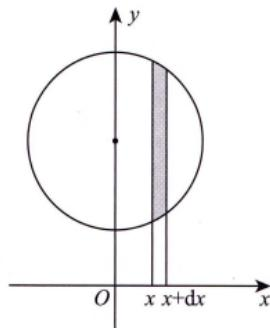  
图10-15

注 采用对 $y$ 积分，即取微元 $[y, y + \mathrm{dy}]$ 亦可算出 $V$ .

10.3 $\frac{1}{4} (e^2 + 1)$ 解 以 $y$ 作为参数，则

$$
\mathrm {d} s = \sqrt {\left(\frac {\mathrm {d} x}{\mathrm {d} y}\right) ^ {2} + 1} \mathrm {d} y = \sqrt {\left(\frac {y}{2} - \frac {1}{2 y}\right) ^ {2} + 1} \mathrm {d} y = \frac {1}{2} \left(y + \frac {1}{y}\right) \mathrm {d} y,
$$

故弧长为 $s = \int_{1}^{\mathrm{e}}\frac{1}{2}\left(y + \frac{1}{y}\right)\mathrm{d}y = \frac{1}{4} (\mathrm{e}^{2} + 1).$

10.46解如图10-16所示，曲线具有对称性，我们只需计算在第一象限的弧段，即 $t\in \left[0,\frac{\pi}{2}\right]$ 对应部分的弧长.故

$$
\begin{array}{l} s = 4 \int_ {0} ^ {\frac {\pi}{2}} \sqrt {\left[ x ^ {\prime} (t) \right] ^ {2} + \left[ y ^ {\prime} (t) \right] ^ {2}} d t \\ = 4 \int_ {0} ^ {\frac {\pi}{2}} \sqrt {\left(- 3 \cos^ {2} t \sin t\right) ^ {2} + \left(3 \sin^ {2} t \cos t\right) ^ {2}} d t \\ = 4 \int_ {0} ^ {\frac {\pi}{2}} 3 | \sin t \cos t | d t = 1 2 \int_ {0} ^ {\frac {\pi}{2}} \sin t \cos t d t = 6. \\ \end{array}
$$

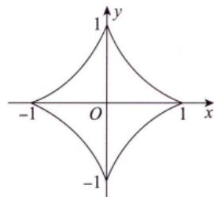  
图10-16

10.5 $\frac{\sqrt{3} + 1}{12}\pi$ 解 函数 $y = f(x)$ 在区间 $[a,b]$ 上的平均值是指 $\frac{1}{b - a}\int_{a}^{b}f(x)\mathrm{d}x$ ，故所求的平均值为

$$
\frac {2}{\sqrt {3} - 1} \int_ {\frac {1}{2}} ^ {\frac {\sqrt {3}}{2}} \frac {x ^ {2}}{\sqrt {1 - x ^ {2}}} d x.
$$

令 $x = \sin \theta$ ，则

$$
\text {上 式} = \frac {2}{\sqrt {3} - 1} \int_ {\frac {\pi}{6}} ^ {\frac {\pi}{3}} \sin^ {2} \theta \mathrm {d} \theta = \frac {2}{\sqrt {3} - 1} \left(\frac {1}{2} \theta - \frac {1}{4} \sin 2 \theta\right) \Bigg | _ {\frac {\pi}{6}} ^ {\frac {\pi}{3}} = \frac {\sqrt {3} + 1}{1 2} \pi .
$$

10.6 解 因为 $y' = \frac{1}{2\sqrt{x}}$ ，所以 $y = \sqrt{x}$ 在点 $(t, \sqrt{t})$ 处的切线 $l$ 的方程为

$$
y - \sqrt {t} = \frac {1}{2 \sqrt {t}} (x - t)  ,     \text {即}   y = \frac {1}{2 \sqrt {t}} x + \frac {\sqrt {t}}{2} .
$$

所围面积为

$$
S (t) = \int_ {0} ^ {2} \left[ \left(\frac {1}{2 \sqrt {t}} x + \frac {\sqrt {t}}{2}\right) - \sqrt {x} \right] d x = \frac {1}{\sqrt {t}} + \sqrt {t} - \frac {4 \sqrt {2}}{3}.
$$

令 $S^{\prime}(t) = -\frac{1}{2} t^{-\frac{3}{2}} + \frac{1}{2} t^{-\frac{1}{2}} = 0$ ，得 $t = 1$ ：

又 $S''(1) > 0$ ，故当 $t = 1$ 时， $S$ 取最小值，此时 $l$ 的方程为 $y = \frac{x}{2} + \frac{1}{2}$ .

10.7 解 (1) 由题意得

$$
V _ {1} = \pi \int_ {a} ^ {2} (2 x ^ {2}) ^ {2} d x = \frac {4}{5} \pi (3 2 - a ^ {5}),
$$

$$
V _ {2} = \pi a ^ {2} \cdot 2 a ^ {2} - \pi \int_ {0} ^ {2 a ^ {2}} \frac {y}{2} d y = \pi a ^ {4}.
$$

(2) 由 (1) 得

$$
V = V _ {1} + V _ {2} = \frac {4}{5} \pi (3 2 - a ^ {5}) + \pi a ^ {4}.
$$

令

$$
V ^ {\prime} = 4 \pi a ^ {3} (1 - a) = 0,
$$

得区间(0,2)内唯一的驻点 $a = 1$ ，且 $V''(1) = -4\pi < 0$ ，因此 $a = 1$ 是极大值点，即最大值点，此时

$$
V _ {\max } = \frac {1 2 9}{5} \pi .
$$

10.8 解 作平面图形，如图10-17所示。

方法一 平面图形绕 $y$ 轴旋转一周所得旋转体体积为

$$
\begin{array}{l} V _ {y} = \pi \left[ \int_ {0} ^ {2 a} x _ {2} ^ {2} (y) d y - \int_ {0} ^ {2 a} x _ {1} ^ {2} (y) d y \right] \\ = \pi \left[ \int_ {2 \pi} ^ {\pi} a ^ {2} (t - \sin t) ^ {2} a \sin t d t - \int_ {0} ^ {\pi} a ^ {2} (t - \sin t) ^ {2} a \sin t d t \right] \\ = \pi a ^ {3} \left[ - \int_ {\pi} ^ {2 \pi} (t - \sin t) ^ {2} \sin t d t - \int_ {0} ^ {\pi} (t - \sin t) ^ {2} \sin t d t \right] \\ = - \pi a ^ {3} \int_ {0} ^ {2 \pi} (t - \sin t) ^ {2} \sin t d t, \\ \end{array}
$$

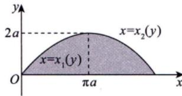  
图10-17

其中 $\int_0^{2\pi}(t - \sin t)^2\sin t\mathrm{d}t = \int_0^{2\pi}(t^2\sin t + \sin^3 t - 2t\sin^2 t)\mathrm{d}t = \int_0^{2\pi}t^2\sin t\mathrm{d}t - \int_0^{2\pi}2t\sin^2 t\mathrm{d}t.$

因为 $\int_0^{2\pi}t^2\sin t\mathrm{d}t = -t^2\cos t\bigg|_0^{2\pi} + \int_0^{2\pi}2t\cos t\mathrm{d}t$

$$
= - 4 \pi^ {2} + 2 t \sin t \Big | _ {0} ^ {2 \pi} - \int_ {0} ^ {2 \pi} 2 \sin t d t = - 4 \pi^ {2},
$$

$$
\begin{array}{l} \int_ {0} ^ {2 \pi} 2 t \sin^ {2} t d t = \int_ {0} ^ {2 \pi} 2 t \frac {1 - \cos 2 t}{2} d t = \int_ {0} ^ {2 \pi} (t - t \cos 2 t) d t \\ = \left. \left(\frac {1}{2} t ^ {2} - \frac {t \sin 2 t}{2}\right) \right| _ {0} ^ {2 \pi} + \int_ {0} ^ {2 \pi} \frac {\sin 2 t}{2} d t \\ = 2 \pi^ {2} - \frac {\cos 2 t}{4} \Bigg | _ {0} ^ {2 \pi} = 2 \pi^ {2}, \\ \end{array}
$$

所以 $\int_0^{2\pi}(t - \sin t)^2\sin t\mathrm{d}t = -4\pi^2 -2\pi^2 = -6\pi^2,$

则 $V_{y} = -\pi a^{3}\cdot (-6\pi^{2}) = 6\pi^{3}a^{3}.$

方法二 平面图形绕 $y$ 轴旋转一周所得旋转体的体积为

$$
\begin{array}{l} V _ {y} = 2 \pi \int_ {0} ^ {2 \pi a} x y (x) d x \\ = 2 \pi \int_ {0} ^ {2 \pi} a (t - \sin t) a (1 - \cos t) a (1 - \cos t) d t \\ = 2 \pi a ^ {3} \int_ {0} ^ {2 \pi} (t - 2 t \cos t + t \cos^ {2} t - \sin t + 2 \sin t \cos t - \sin t \cos^ {2} t) d t \\ = 6 \pi^ {3} a ^ {3}. \\ \end{array}
$$

10.9 解 作出图形，如图10-18所示。

$\widehat{AB}$ 的方程为 $y = x^{2} + 2(0 \leqslant x \leqslant 1)$ , $\widehat{BC}$ 的方程为 $y = 4 - x^{2}(1 \leqslant x \leqslant 2)$ .

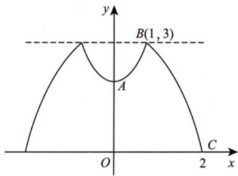  
图10-18

设旋转体在区间[0,1]上的体积为 $V_{1}$ ，在区间[1,2]上的体积为 $V_{2}$ ，则它们的体积微元分别为

$$
\begin{array}{l} \mathrm {d} V _ {1} = \pi \left\{3 ^ {2} - \left[ 3 - \left(x ^ {2} + 2\right) \right] ^ {2} \right\} \mathrm {d} x = \pi \left(8 + 2 x ^ {2} - x ^ {4}\right) \mathrm {d} x, \\ \mathrm {d} V _ {2} = \pi \left\{3 ^ {2} - [ 3 - (4 - x ^ {2}) ] ^ {2} \right\} \mathrm {d} x = \pi (8 + 2 x ^ {2} - x ^ {4}) \mathrm {d} x. \\ \end{array}
$$

由对称性得

$$
\begin{array}{l} V = 2 \left(V _ {1} + V _ {2}\right) = 2 \pi \int_ {0} ^ {1} \left(8 + 2 x ^ {2} - x ^ {4}\right) d x + 2 \pi \int_ {1} ^ {2} \left(8 + 2 x ^ {2} - x ^ {4}\right) d x \\ = 2 \pi \int_ {0} ^ {2} \left(8 + 2 x ^ {2} - x ^ {4}\right) d x = \frac {4 4 8}{1 5} \pi . \\ \end{array}
$$
