# 第14讲

# 二重积分

<table><tr><td>考题</td><td>二重积分</td></tr><tr><td>题型</td><td>解答题</td></tr><tr><td>目标</td><td>①理解二重积分的概念，了解二重积分的基本性质，了解二重积分的中值定理；
②掌握二重积分的计算方法（直角坐标、极坐标）</td></tr><tr><td>重难点</td><td>计算二重积分</td></tr></table>

# 基础知识结构

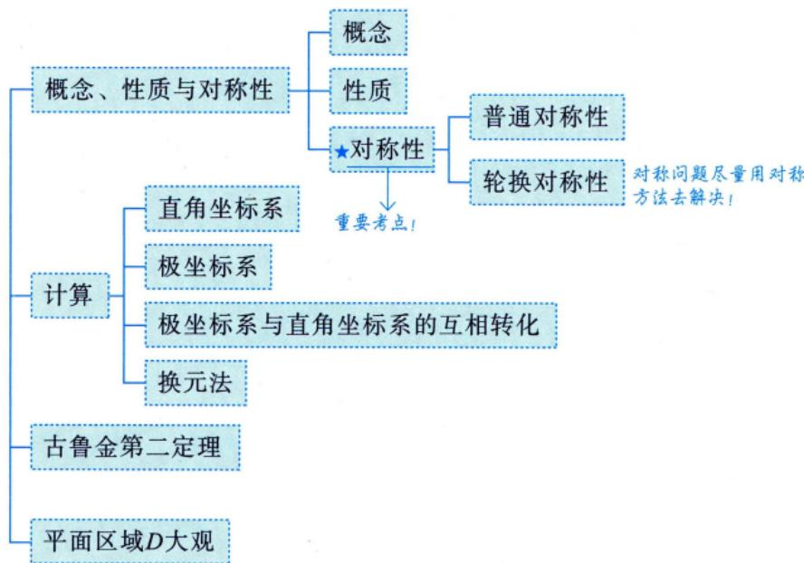

# 思考问题：

1. 直角坐标系中先积 $x$ ，还是先积 $y$ ？  
2. 极坐标系 $r, \theta$ 谁先积？  
3. 极坐标系和直角坐标系如何互相转化？

# 基础内容精讲

$\rightarrow$ 概念可以联系前面所学的定积分！

概念、性质与对称性

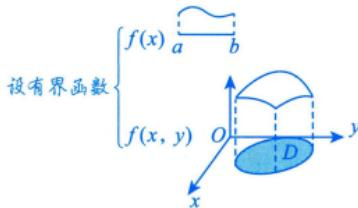

1 概念

按照第8讲中给出定积分定义的方法，可以得到二重积分的定义.

定积分中是对线段的分割，这

这里是平面区域的分割！

设 $f(x,y)$ 是有界闭区域 $D$ 上的有界函数，将闭区域 $D$ 任意分成 $n$ 个小闭区域

小柱体体积的近似，定积分 $f(\xi_i)\Delta x_i$ 是面积的近似

$\Delta \sigma_{1}, \Delta \sigma_{2}, \dots, \Delta \sigma_{n}$

其中 $\Delta \sigma_{i}$ 表示第 $i$ 个小闭区域，也表示它的面积.在每个 $\Delta \sigma_{i}$ 上任取一点 $(\xi_i,\eta_i)$ ，作乘积 $f(\xi_i,\eta_i)\Delta \sigma_i(i = 1,2,\dots ,n)$ ，并作和 $\sum_{i = 1}^{n}f(\xi_i,\eta_i)\Delta \sigma_i$ ，如果当各小闭区域的直径中的最大值 $\lambda$ 趋于零时，取极限和的极限总存在（与 $\Delta \sigma_{i}$ 的分法及点 $(\xi_i,\eta_i)$ 的取法均无关），则称此极限值为函数 $f(x,y)$ 在闭区域D上的二重积分，记作 $\iint \limits_{D}f(x,y)\mathrm{d}\sigma$ ，即 定积分是 $\sum_{i = 1}^{n}f(\xi_i)\Delta x_i$ ，注意 $\Delta x_{i}$ 的取

$$
\iint_ {D} f (x, y) \mathrm {d} \sigma = \lim  _ {\lambda \rightarrow 0} \sum_ {i = 1} ^ {n} f (\xi_ {i}, \eta_ {i}) \Delta \sigma_ {i},
$$

$$
\max  \left\{\Delta \sigma_ {i} \right\} = \lambda \rightarrow 0
$$

$\lambda  \rightarrow  0$ ,这不是一个方向的积分,区域为二维,则有2个积分符号,即 $\int$

其中 $f(x,y)$ 称为被积函数， $f(x,y)\mathrm{d}\sigma$ 称为被积表达式， $\mathrm{d}\sigma$ 称为面积元素， $x$ 与 $y$ 称为积分变量， $D$

称为积分区域， $\sum_{i = 1}^{n}f(\xi_i,\eta_i)\Delta \sigma_i$ 称为积分和.

$$
\mathrm {d} \sigma > 0
$$

若 $f(x,y)$ 在有界闭区域 $D$ 上连续，则二重积分 $\iint_{D} f(x,y) \, \mathrm{d}\sigma$ 一定存在.

实际问题：

细质杆（可看成一条线） $\rightarrow$ 定积分

一维： $\int_{a}^{b}f(x)\mathrm{d}x$

二维： $\iint_{D}f(x,y)\mathrm{d}\sigma$

三维： $\iiint_{D} f(x, y, z) \mathrm{d}v$

平面薄板.→二重积分

通常它们的每一点处的密度不同，如何求它们的总质量？

数学思想：先把它们分得足够细，也就是测度足够小，在这个测度上近似认为函数值是常数，则一小块的质量为 $f(\xi_i, \eta_i) \Delta \sigma_i$ （定积分是 $f(\xi_i) \Delta x_i$ ），再求和；最后求极限！

后面所讲的三重积分也是这个思想！（ $\lim_{\lambda \to 0}\sum_{i = 1}^{n}f(\xi_i,\eta_i,\zeta_i)\bullet \Delta v_i = \iiint_{\Omega}f(x,y,z)\mathrm{d}\nu$

注 (1) 设 $f\left( {x,y}\right)  \geq  0$ ,如图 14-1 所示,被积函数 $f\left( {x,y}\right)$ 可作为曲顶柱体在点(x,y)处的柱体微元

的竖坐标（高），用底面积 $\mathrm{d}\sigma$ 乘以高 $f(x,y)$ ，得到一个“小竖条”的体积，再在区域 $D$ 上把所有的“小竖条”累加起来，就得到了整个曲顶柱体的体积.

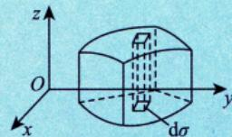  
图14-1

(2)如果 $f(x,y)$ 是负的，柱体就在 $xOy$ 面的下方，二重积分的绝对值仍等于柱体的体积，但二重积分的值是负的.（类似于定积分）

(3) 如果 $f(x, y)$ 在 $D$ 的若干部分区域上是正的，而在其他部分区域上是负的，那么， $f(x, y)$ 在 $D$ 上的二重积分就等于 $xOy$ 面上方的柱体体积减去 $xOy$ 面下方的柱体体积所得之差。（类似于定积分）

# 性质（与一元函数类似

性质1（求区域面积） $\iint_{D} 1 \cdot \mathrm{d}\sigma = \iint_{D} \mathrm{d}\sigma = A$ ，其中 $A$ 为 $D$ 的面积.

性质2（可积函数必有界）当 $f(x,y)$ 在有界闭区域 $D$ 上可积时， $f(x,y)$ 在 $D$ 上必有界.

性质3（积分的线性性质）设 $k_{1}, k_{2}$ 为常数，则

“瓦解敌人，各个击破”

$$
\iint_ {D} [ k _ {1} f (x, y) \pm k _ {2} g (x, y) ] \mathrm {d} \sigma = k _ {1} \iint_ {D} f (x, y) \mathrm {d} \sigma \pm k _ {2} \iint_ {D} g (x, y) \mathrm {d} \sigma . \text {和 的 积 分} = \text {积 分 的 和}
$$

性质4（积分的可加性）设 $f(x,y)$ 在有界闭区域 $D$ 上可积，且 $D_{1}\cup D_{2} = D,D_{1}\cap D_{2} = \emptyset$ ，则

$$
\iint_ {D} f (x, y) \mathrm {d} \sigma = \iint_ {D _ {1}} f (x, y) \mathrm {d} \sigma + \iint_ {D _ {2}} f (x, y) \mathrm {d} \sigma .
$$

性质5（积分的保号性）当 $f(x,y),g(x,y)$ 在有界闭区域 $D$ 上可积时，若在 $D$ 上有

$$
f (x, y) \leqslant g (x, y),
$$

则有 $\iint_{D} f(x, y) \mathrm{d}\sigma \leqslant \iint_{D} g(x, y) \mathrm{d}\sigma.$ 保持原有的不等关系

特殊地，有 $\left|\iint_{D}f(x,y)\mathrm{d}\sigma \right|\leqslant \iint_{D}|f(x,y)|\mathrm{d}\sigma .$

性质6（二重积分的估值定理）设 $M, m$ 分别是 $f(x, y)$ 在有界闭区域 $D$ 上的最大值和最小值， $A$ 为 $D$ 的面积，则有

$$
m A \leqslant \iint_ {D} f (x, y) \mathrm {d} \sigma \leqslant M A. \longrightarrow m \leqslant f (x, y) \leqslant M
$$

性质7（二重积分的中值定理）设函数 $f(x,y)$ 在有界闭区域 $D$ 上连续， $A$ 为 $D$ 的面积，则在 $D$ 上至少存在一点 $(\xi ,\eta)$ ，使得

$$
\iint_ {D} f (x, y) \mathrm {d} \sigma = f (\xi , \eta) A. \quad \rightarrow \int_ {a} ^ {b} f (x) \mathrm {d} x = f (\xi) (b - a), \xi \in (a, b)
$$

例14.1 设平面闭区域 $D_{i}(i = 1,2,3,4)$ 分别是由

$$
\begin{array}{l} L _ {1}: x ^ {2} + y ^ {2} = 1, L _ {2}: x ^ {2} + y ^ {2} = 2, \\ L _ {3}: x ^ {2} + 2 y ^ {2} = 2, L _ {4}: 2 x ^ {2} + y ^ {2} = 2 \\ \end{array}
$$

围成的平面区域，记

$I_{i} = \iiint_{D_{i}}\left(1 - x^{2} - \frac{1}{2} y^{2}\right)\mathrm{d}x\mathrm{d}y,$ →在不同的区域上对同一个被积函数做二重积分

则 $\max \{I_1, I_2, I_3, I_4\} = (\quad)$

(A) $I_{1}$

(B) $I_{2}$

(C) $I_{3}$

(D) $I_{4}$

$\rho$ 分析 此题是同一个函数在不同区域的积分比大小的问题，不需要计算二重积分，应研究在不同积分区域下，被积函数的正负情形。被积函数 $1 - x^{2} - \frac{1}{2} y^{2} \geqslant 0$ 正好对应的区域为 $D_{4}$ ，而 $D_{1} < D_{4}$ ，故 $I_{1} < I_{4}$ ， $D_{4} < D_{2}$ ，在 $D_{2} - D_{4}$ 区域，被积函数值为负，所以 $I_{2} < I_{4}$ ，同理 $I_{3} < I_{4}$ 。

解 应选(D).

曲线 $L_{i}(i = 1,2,3,4)$ 如图14-2所示.记被积函数为 $f(x,y) =$ $1 - \left(x^{2} + \frac{1}{2} y^{2}\right)$ ，由于 $L_{4}$ ： $2x^{2} + y^{2} = 2$ ，则 $D_{4}$ 内部为 $x^{2} + \frac{y^{2}}{2} <  1$ ，于是在 $D_{4}$ 内部有 $f(x,y) > 0$ ，而在 $D_{4}$ 外部有 $f(x,y) <   0$ ：

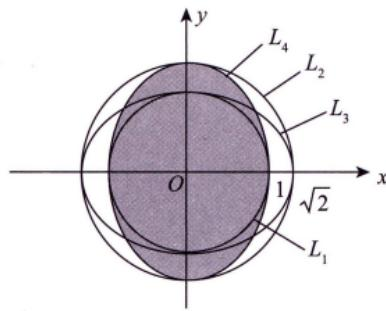  
图14-2

① 比较 $I_{1}$ 与 $I_{4}$ ：

$$
\begin{array}{l} I _ {4} = \iint_ {D _ {4}} f (x, y) d x d y = \iint_ {D _ {1}} f (x, y) d x d y + \iint_ {D _ {4} - D _ {1}} f (x, y) d x d y \\ = I _ {1} + \iint f (x, y) d x d y > I _ {1}. \\ \end{array}
$$

② 比较 $I_{2}$ 与 $I_{4}$ ：

$\rightarrow  f\left( {x,y}\right)  > 0$

$$
\begin{array}{l} I _ {2} = \iint_ {D _ {2}} f (x, y) d x d y = \iint_ {D _ {4}} f (x, y) d x d y + \iint_ {D _ {2} - D _ {4}} f (x, y) d x d y \\ = I _ {4} + \iint_ {\substack {D _ {2} - D _ {4}\\\rightarrow f (x, y) <   0}} f (x, y) \mathrm {d} x \mathrm {d} y <   I _ {4}. \\ \end{array}
$$

③ 比较 $I_{3}$ 与 $I_{4}$ . 如图14-3所示，将 $D_{3}$ ， $D_{4}$ 中互不重合的部分分别记为 $D_{31}, D_{32}, D_{41}, D_{42}$ ，则

$$
I _ {3} = \iint_ {\substack {D _ {3 1}\\\rightarrow f (x, y) <   0}} f (x, y) \mathrm {d} x \mathrm {d} y + \iint_ {\substack {D _ {3 2}\\\rightarrow f (x, y) <   0}} f (x, y) \mathrm {d} x \mathrm {d} y + \iint_ {D _ {3} \cap D _ {4}} f (x, y) \mathrm {d} x \mathrm {d} y
$$

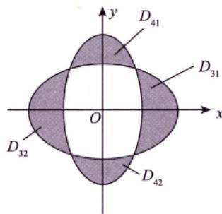  
图14-3

$$
\begin{array}{l} <   \iint_ {D _ {4 1}} f (x, y) d x d y + \iint_ {D _ {4 2}} f (x, y) d x d y + \iint_ {D _ {3} \cap D _ {4}} f (x, y) d x d y \\ = I _ {4}. \\ \end{array}
$$

所以 $\max \{I_1,I_2,I_3,I_4\} = I_4$ ，即应选(D).

事实上， $D_{4}$ 是使得 $\iint \limits_{D}\left(1 - x^{2} - \frac{1}{2} y^{2}\right)\mathrm{d}x\mathrm{d}y$ 取得最大值的区域，因为 $D_{4}$ 包含了所有使 $1 - x^{2} - \frac{1}{2} y^{2}$ 大于零的区域，而不包含任何使 $1 - x^{2} - \frac{1}{2} y^{2}$ 小于零的区域，由二重积分的性质知 $I_{4}$ 最大.

方法总结 寻找二重积分的最大值的区域，即是寻找被积函数大于等于零的区域.

例14.2 设

$$
D (t) = \{(x, y) | 2 x ^ {2} + 3 y ^ {2} \leqslant 6 t \} (t \geqslant 0),
$$

$$
f (x, y) = \left\{ \begin{array}{l l} \frac {\sqrt [ 3 ]{1 - \left(x ^ {2} + y ^ {2}\right)} - 1}{\mathrm {e} ^ {x ^ {2} + y ^ {2}} - 1}, & (x, y) \neq (0, 0), \\ a, & (x, y) = (0, 0) \end{array} \right.
$$

为连续函数，令 $F(t) = \iint_{D(t)} f(x, y) \, \mathrm{d}x \, \mathrm{d}y$ ，则 $F_{+}^{\prime}(0) = \_$

分析 本题积分区域为动态区域 $D(t)$ ，当 $t\to 0$ 时， $D(t)\rightarrow 0$ ：

本题研究的是在一点处的导数，所以用导数的定义，当 $\iint_{D} f(x, y) \, \mathrm{d}\sigma$ 难计算时，可以利用二重积分的中值定理来处理.

解 应填 $-\frac{\sqrt{6}\pi}{3}$

由例13.2可知 $a = -\frac{1}{3}$

由二重积分的中值定理知，存在 $(\xi, \eta) \in D(t)$ ，使得

$$
F (t) = \iint_ {D (t)} f (x, y) d x d y = \sqrt {6} \pi t f (\xi , \eta).
$$

于是，

$$
\begin{array}{l} F _ {+} ^ {\prime} (0) = \lim  _ {t \rightarrow 0 ^ {+}} \frac {F (t) - F (0)}{t - 0} = \lim  _ {t \rightarrow 0 ^ {+}} \frac {\sqrt {6} \pi t f (\xi , \eta)}{t} = \lim  _ {t \rightarrow 0 ^ {+}} \sqrt {6} \pi f (\xi , \eta) \\ = \sqrt {6} \pi f (0, 0) = - \frac {\sqrt {6} \pi}{3}. \\ \end{array}
$$

注此题的被积函数被命制成具体函数，但 $\iint_{D(t)}f(x,y)\mathrm{d}\sigma$ 难以计算，故考虑利用二重积分的中值定理来处理.同理，若被积函数被命制成抽象函数，也可以考虑利用二重积分中值定理来处理，如：设 $f(x,y)$ 具有二阶连续偏导数，

$$
D (t) = \{(x, y) | 0 \leqslant x \leqslant t, 0 \leqslant y \leqslant t \},
$$

令 $F(t) = \iint_{D(t)} f_{xy}''(x, y) \, \mathrm{d}x \, \mathrm{d}y$ ，求 $F_{+}'(0)$ 。

解

$$
\begin{array}{l} F _ {+} ^ {\prime} (0) = \lim  _ {t \rightarrow 0 ^ {+}} \frac {F (t) - F (0)}{t - 0} = \lim  _ {t \rightarrow 0 ^ {+}} \frac {\iint_ {D (t)} f _ {x y} ^ {\prime \prime} (x , y) d x d y}{t - 0} \\ \xlongequal {\text {二 重 积 分 的 中 值 定 理}} \lim  _ {t \rightarrow 0 ^ {+}} \frac {f _ {x y} ^ {\prime \prime} (\xi , \eta) \cdot t ^ {2}}{t} = \lim  _ {t \rightarrow 0 ^ {+}} t \cdot f _ {x y} ^ {\prime \prime} (\xi , \eta) = 0. \\ \end{array}
$$

方法总结 当 $\iint_{D} f(x, y) \mathrm{d}\sigma$ 难计算或者 $f(x, y)$ 为抽象型时，可考虑利用二重积分的中值定理来处理.  
公式 $\iint_{D} f(x, y) \mathrm{d}\sigma = f(\xi, \eta) \cdot S_D, (\xi, \eta) \in D$ ，其中 $S_D$ 为 $D$ 的面积.  
3 普通对称性与轮换对称性 必考题

(1) 普通对称性.

设区域 $D$ 关于 $y$ 轴对称，如图14-4所示，取对称的两块小面积 $\mathrm{d}\sigma$ ，对称点分别为 $(x,y)$ 与 $(-x,y)$ ，则对称点处的高分别为 $f(x,y)$ 与 $f(-x,y)$ .依据定义，对称位置的两个“小竖条”的体积分别为 $f(x,y)\mathrm{d}\sigma$ 与 $f(-x,y)\mathrm{d}\sigma$ 因为 $\mathrm{d}\sigma$ 一样，所以，当 $f(x,y) = f(-x,y)$ 时， $f(x,y)\mathrm{d}\sigma = f(-x,y)\mathrm{d}\sigma$ 体积相同，此时只需计算对称区域的一半，然后乘以2即可得到整个积分值；而当 $f(x,y) = -f(-x,y)$ 时， $f(x,y)\mathrm{d}\sigma = -f(-x,y)\mathrm{d}\sigma$ ，对称区域的体积正好相反，这样累加起来的总体积自然就是0.于是，我们有

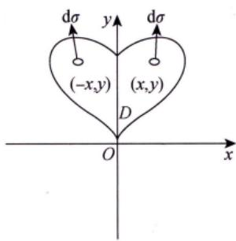  
图14-4

$$
\iint_ {D} f (x, y) \mathrm {d} x \mathrm {d} y = \left\{ \begin{array}{l l} 2 \iint_ {D _ {1}} f (x, y) \mathrm {d} x \mathrm {d} y, & f (x, y) = f (- x, y), \\ 0, & f (x, y) = - f (- x, y), \end{array} \right. \quad \text {相 同 ， 即 2 倍 ： 函 数 值 相 反 ， 即 为 0 (偶 倍 奇 零)}
$$

其中 $D_{1}$ 是 $D$ 在 $y$ 轴右侧的部分.

你看，用这种基于概念的分析方法，不用死记硬背，而且真正理解了性质的本质。现将二重积分有关的对称性全面总结如下。

① 若 $D$ 关于 $y$ 轴对称，则 $\frac{y}{x} = 0$

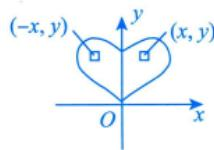

$$
\iint_ {D} f (x, y) \mathrm {d} \sigma = \left\{ \begin{array}{l l} 2 \iint_ {D _ {1}} f (x, y) \mathrm {d} \sigma , & f (x, y) = f (- x, y), \\ 0, & f (x, y) = - f (- x, y), \end{array} \right.
$$

其中 $D_{1}$ 是 $D$ 在 $y$ 轴右侧的部分.

$$
\text {如} \iint_ {D} (x - a) \mathrm {d} \sigma , \text {因} f (x, y) = x - a, \text {而} f (2 a - x, y) = a - x, \text {故} \iint_ {D \text {下}} (x - a) \mathrm {d} \sigma = 0.
$$

注 若 $D$ 关于 $x = a(a \neq 0)$ 对称， $(x, y)$ 关于 $x = a$ 的对称点为 $(2a - x, y)$ ，则

$$
\text {相 当 于 将} \stackrel {\vee} {x} = 0 \text {平}   \text {移 了} a \text {个 单 位 长 度} \iint_ {D} f (x, y) \mathrm {d} \sigma = \left\{ \begin{array}{l l} 2 \iint_ {D _ {1}} f (x, y) \mathrm {d} \sigma , & f (x, y) = f (2 a - x, y), \\ 0, & f (x, y) = - f (2 a - x, y), \end{array} \right.
$$

其中 $D_{1}$ 是 $D$ 在 $x = a$ 右侧的部分.

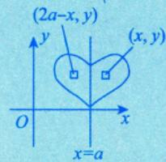

② 若 $D$ 关于 $x$ 轴对称，则

$$
\iint_ {D} f (x, y) \mathrm {d} \sigma = \left\{ \begin{array}{l l} 2 \iint_ {D _ {i}} f (x, y) \mathrm {d} \sigma , & f (x, y) = f (x, - y), \\ 0, & f (x, y) = - f (x, - y), \end{array} \right.
$$

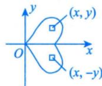

其中 $D_{1}$ 是 $D$ 在 $x$ 轴上侧的部分.

注 若 $D$ 关于 $y = a(a \neq 0)$ 对称， $(x, y)$ 关于 $y = a$ 的对称点为 $(x, 2a - y)$ ，则

$$
\iint_ {D} f (x, y) \mathrm {d} \sigma = \left\{ \begin{array}{l l} 2 \iint_ {D _ {1}} f (x, y) \mathrm {d} \sigma , & f (x, y) = f (x, 2 a - y), \\ 0, & f (x, y) = - f (x, 2 a - y), \end{array} \right.
$$

其中 $D_{1}$ 是 $D$ 在 $y = a$ 上侧的部分.

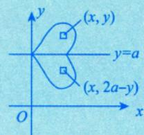

关键两点：  
① 看 $D$ 关于谁对称；  
② 将点代入 $f(x, y)$ ，相等则2倍，相反则为0.  
$③$ 若 $D$ 关于原点对称，则

$(x,y)$ 关于原点的对称点为 $(-x, - y)$

$$
\iint_ {D} f (x, y) \mathrm {d} \sigma = \left\{ \begin{array}{l l} 2 \iint_ {D _ {1}} f (x, y) \mathrm {d} \sigma , & f (x, y) = f (- x, - y), \\ 0, & f (x, y) = - f (- x, - y), \end{array} \right.
$$

其中 $D_{1}$ 是 $D$ 关于原点对称的半个部分.

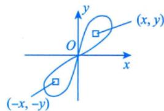

④若 $D$ 关于 $y = x$ 对称，则

$(x,y)$ 关于 $y = x$ 的对称点为 $(y,x)$

$$
\begin{array}{r l} & x, y \text {对 调 .} f (x, y) = f (y, x) \\ & \iint_ {D} f (x, y) \mathrm {d} \sigma = \left\{ \begin{array}{l l} 2 \iint_ {D _ {1}} f (x, y) \mathrm {d} \sigma , & f (x, y) = f (y, x), \\ 0, & f (x, y) = - f (y, x), \end{array} \right. \end{array}
$$

其中 $D_{1}$ 是 $D$ 关于 $y = x$ 对称的半个部分.

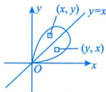

例14.3 设 $J_{i} = \iint_{D_{i}}\sqrt[3]{x - y}\mathrm{d}x\mathrm{d}y (i = 1,2,3)$ ，其中 $D_{1} = \{(x,y)|0\leqslant x\leqslant 1,0\leqslant y\leqslant 1\}$ ， $D_{2} = \{(x,y)|0\leqslant$ $x\leqslant 1,0\leqslant y\leqslant \sqrt{x}\}$ ， $D_{3} = \{(x,y)|0\leqslant x\leqslant 1,x^{2}\leqslant y\leqslant 1\}$ ，则（ ）.

(A) $J_{1} <   J_{2} <   J_{3}$

(B) $J_{3} < J_{1} < J_{2}$

(C) $J_{2} <   J_{3} <   J_{1}$

(D) $J_{2} < J_{1} < J_{3}$

分析 本题先画出每部分的积分区域图，然后研究同一函数在不同区域的积分值的大小.

本题是结合对称性和被积函数正负的问题.

因 $D_{1}$ 关于 $y = x$ 对称， $f(y,x) = -f(x,y)$ ，故 $J_{1} = 0$ ：

$D_{2}$ 不对称，但可以作辅助曲线，创造对称性，对称部分积分为0，另一部分 $f(x,y)\geqslant 0$ ，故 $J_{2} > 0$ ：

同理， $D_{3}$ 也可作辅助曲线，对称部分积分为0，另一部分 $f(x,y)\leqslant 0$ ，故 $J_{3} <   0$ ：

解 应选(B).

如图14-5(a)所示， $D_{1}$ 被直线 $y = x$ 分成 $D_{11}$ 和 $D_{12}$ 两部分，故 $\iint_{D_1} \sqrt[3]{x - y} \, \mathrm{d}x \, \mathrm{d}y = \iint_{D_{11} + D_{12}} \sqrt[3]{x - y} \, \mathrm{d}x \, \mathrm{d}y$ ，由于 $\sqrt[3]{x - y} = -\sqrt[3]{y - x}$ ，故由普通对称性，有 $J_1 = \iint_{D_1} \sqrt[3]{x - y} \, \mathrm{d}x \, \mathrm{d}y = 0$ ：

如图14-5(b)所示，作辅助线 $y = x^2$ ，将 $D_{2}$ 分为 $D_{21}$ 和 $D_{22}$ 两部分，由普通对称性知， $\iint_{D_{21}} \sqrt[3]{x - y} \, \mathrm{d}x \, \mathrm{d}y = 0$ 。而在 $D_{22}$ 上， $\sqrt[3]{x - y} \geqslant 0$ ，由保号性知，

$$
J _ {2} = \iint_ {D _ {2}} ^ {3} \sqrt {x - y} d x d y = \iint_ {D _ {2 2}} ^ {3} \sqrt {x - y} d x d y > 0.
$$

如图14-5(c)所示，作辅助线 $y = \sqrt{x}$ ，将 $D_{3}$ 分为 $D_{31}$ 和 $D_{32}$ 两部分，由普通对称性知， $\iint_{D_{32}} \sqrt[3]{x - y} \, \mathrm{d}x \, \mathrm{d}y = 0$ 。而在 $D_{31}$ 上， $\sqrt[3]{x - y} \leqslant 0$ ，由保号性知，

$$
J _ {3} = \iint_ {D _ {3}} ^ {3} \sqrt {x - y} d x d y = \iint_ {D _ {3 1}} ^ {3} \sqrt {x - y} d x d y <   0.
$$

综上， $J_{3} <   J_{1} <   J_{2}$

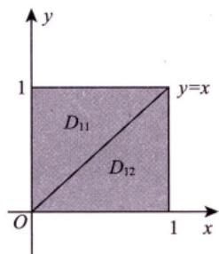  
(a)

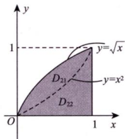  
(b)

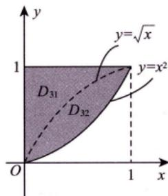  
(c)   
图14-5

方法总结 遇到二重积分的题目，首先应考虑对称性，看能否化简.

公式 当 $D$ 关于 $y = x$ 对称， $f(x, y) = -f(y, x)$ 时， $\iint_{D} f(x, y) = 0$

(2)轮换对称性（一定是直角坐标系下）.

引例1

$$
\iint_ {D _ {1}: \frac {x ^ {2}}{4} + \frac {y ^ {2}}{3} \leqslant 1} (2 x ^ {2} + 3 y ^ {2}) \mathrm {d} x \mathrm {d} y \stackrel {?} {=} \iint_ {D _ {2}: \frac {y ^ {2}}{4} + \frac {x ^ {2}}{3} \leqslant 1} (2 y ^ {2} + 3 x ^ {2}) \mathrm {d} y \mathrm {d} x.
$$

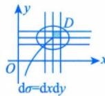

解因为上述两个积分只是将 $x$ 与 $y$ 这两个字母对调了，而积分值与用什么字母表示是无关的，故它们是相等的.

引例2

$$
\iint_ {D: \frac {x ^ {2}}{4} + \frac {y ^ {2}}{4} \leqslant 1} (2 x ^ {2} + 3 y ^ {2}) d x d y = \iint_ {D: \frac {x ^ {2}}{4} + \frac {y ^ {2}}{4} \leqslant 1} (2 y ^ {2} + 3 x ^ {2}) d y d x.
$$

解理由如上，它们也是相等的.

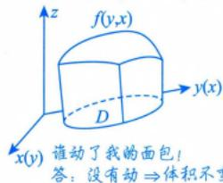

引例2中的区域 $D$ 有个特点，就是当你把 $x$ 与 $y$ 对调后，区域 $D$ 不变（事实上，区域 $D$ 关于 $y = x$ 对称）.于是抽象化写出的式子为

$$
\iint_ {D} f (x, y) \mathrm {d} x \mathrm {d} y = \iint_ {D} f (y, x) \mathrm {d} y \mathrm {d} x.
$$

整理一下，我们可以这样来描述：

在直角坐标系下，若把 $x$ 与 $y$ 对调后，区域 $D$ 不变（或区域 $D$ 关于 $y = x$ 对称），则

$$
\iint_ {D} f (x, y) \mathrm {d} \sigma = \iint_ {D} f (y, x) \mathrm {d} \sigma , \longrightarrow \mathrm {d} \sigma = \mathrm {d} x \mathrm {d} y = \mathrm {d} y \mathrm {d} x
$$

这就是轮换对称性.

轮换对称性的应用： $\iint_{D}f(x,y)\mathrm{d}\sigma \left(\iint_{D}f(y,x)\mathrm{d}\sigma\right)$ 难计算，但 $f(x,y) + f(y,x)$ 之和式子简单，如注(1).

例如：当 $D = \{(x,y)|x^2 +y^2\leqslant 1,x > 0,y > 0\}$ 时，

$$
\begin{array}{l} \iint_ {D} \frac {a \sqrt {f (x)} + b \sqrt {f (y)}}{\sqrt {f (x)} + \sqrt {f (y)}} d \sigma \\ = \iint_ {D} \frac {a \sqrt {f (y)} + b \sqrt {f (x)}}{\sqrt {f (y)} + \sqrt {f (x)}} d \sigma \\ = \frac {1}{2} \iint_ {D} (a + b) d \sigma \\ = \frac {a + b}{2} \cdot \frac {1}{4} \cdot \pi \cdot 1 ^ {2}. \quad \frac {1}{4} \text {个 圆 的 面 积} \\ \end{array}
$$

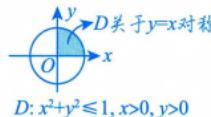

普通对称性 $\left\{ \begin{array}{l}1D\text{关于} y = x\text{对称};\\ 2f(x,y) = f(y,x)\text{或} f(x,y) = -f(y,x). \end{array} \right.$ 轮换对称性 $\left\{ \begin{array}{l}1D\text{关于} y = x\text{对称};\\ 2\text{利用} f(x,y) + f(y,x)\text{简化计算}. \end{array} \right.$

注 (1) 在直角坐标系中, 若 $f\left( {x,y}\right)  + f\left( {y,x}\right)  = a$ ,则

$$
I = \frac {1}{2} \iint_ {D} [ f (x, y) + f (y, x) ] d x d y = \frac {1}{2} \iint_ {D} a d x d y = \frac {a}{2} S _ {D}.
$$

(2) 要注意区分普通对称性中的 ④ 与这里轮换对称性的区别与联系。虽然它们都是 $D$ 关于 $y = x$ 对称，但普通对称性考查的是 $f(x, y)$ 与 $f(y, x)$ 是相等还是相反，轮换对称性考查的是 $f(x, y) + f(y, x)$ 是否简单。事实上，当 $f(x, y) = -f(y, x)$ 时，它们是一回事。

例14.4 设 $f(x) = \iint_{D(x)} \frac{v \ln \sqrt{u^2 + v^2}}{u + v} \, \mathrm{d}u \, \mathrm{d}v, D(x) = \left\{(u, v) \mid \frac{1}{4} \leqslant u^2 + v^2 \leqslant x^2, u > 0, v > 0 \right\} \left( x > \frac{1}{2} \right)$ ，则

$$
f (x) = (\quad).
$$

(A) $\frac{1}{4}\iint_{D(x)}\ln (u^2 +v^2)\mathrm{d}u\mathrm{d}v$

(B) $\frac{1}{2}\iint_{D(x)}\ln (u^2 +v^2)\mathrm{d}u\mathrm{d}v$

(C) $\iint_{D(x)}\ln (u^2 +v^2)\mathrm{d}u\mathrm{d}v$

(D) $2\iint_{D(x)}\ln (u^2 +v^2)\mathrm{d}u\mathrm{d}v$

$\mathcal{P}$ 分析 $D$ 中 $u, v$ 互换位置， $D$ 不变，接着看 $g(u, v)$ 与 $g(v, u)$ 的关系既不相等，也不相反，考虑将其加起来， $g(u, v) + g(v, u)$ 计算简单，所以考虑轮换对称性.

解 应选(A).

由轮换对称性，有

$$
\begin{array}{l} f (x) = \iint_ {D (x)} \frac {\nu \ln \sqrt {u ^ {2} + v ^ {2}}}{u + v} d u d v = \iint_ {D (x)} \frac {u \ln \sqrt {u ^ {2} + v ^ {2}}}{u + v} d u d v \\ = \frac {1}{2} \iint_ {D (x)} \ln \sqrt {u ^ {2} + v ^ {2}} d u d v = \frac {1}{4} \iint_ {D (x)} \ln (u ^ {2} + v ^ {2}) d u d v. \\ \end{array}
$$

方法总结 当 $D$ 关于 $y = x$ 对称， $f(x, y) = -f(y, x)$ 或 $f(x, y) = f(y, x)$ 时，考虑普通对称性，若不满足，可看 $f(x, y) + f(y, x)$ 是否简单，考虑轮换对称性。

# 二 计算

# 直角坐标系下的计算方法

直角坐标系用平行于坐标系的线切割.

问题：先对 $x$ 积分，还是对 $y$ 积分？

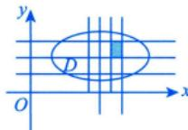

$\frac{d\sigma = dxdy}{\text{直角坐标系下的标志}}$

在直角坐标系下，按照积分次序的不同，一般将二重积分的计算分为两种情况，如图14-6所示.

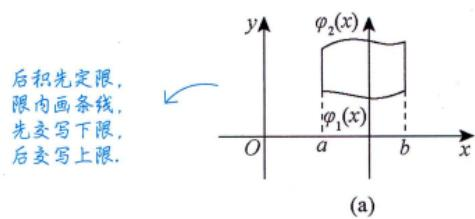

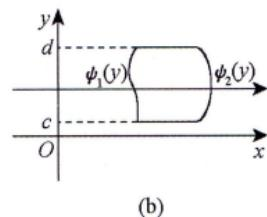  
图14-6

先定x的 上下限 $\mathbf{\Phi}_D$ 后积 $x$ 再定y的上下限 注意，这里上限 $\geqslant$ 下限 X型区域的特点是：穿过D内部且平行于y 轴的直线与D的边界相交不多于两点 (1) $\iint_{D}f(x,y)\mathrm{d}\sigma = \int_{a}^{b}\mathrm{d}x\int_{\varphi_1(x)}^{\varphi_2(x)}f(x,y)\mathrm{d}y$ ，其中 $D$ 为 $X$ 型区域： $\varphi_1(x)\leqslant y\leqslant \varphi_2(x),a\leqslant x\leqslant b$ ，如图14-6（a）所示.积分区域是 $X$ 型区域的后积 $x$ ，类似还有其他几种（见批注图）.

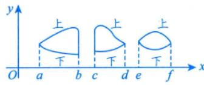

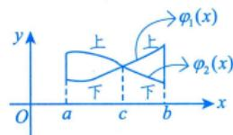

$$
\iint_ {D} f (x, y) \mathrm {d} \sigma = \int_ {a} ^ {c} \mathrm {d} x \int_ {\varphi_ {1} (x)} ^ {\varphi_ {2} (x)} f (x, y) \mathrm {d} y + \int_ {c} ^ {b} \mathrm {d} x \int_ {\varphi_ {2} (x)} ^ {\varphi_ {1} (x)} f (x, y) \mathrm {d} y
$$

先定 $y$ 的 再定 $x$ 的上下限

$y$ 型区域的特点是：穿过 $D$ 内部且平行于 $x$ 轴的直线与 $D$ 的边界相交不多于两点

(2) $\iint_{D} f(x, y) \, \mathrm{d}\sigma = \int_{c}^{d} \mathrm{d}y \int_{\psi_1(y)}^{\psi_2(y)} f(x, y) \, \mathrm{d}x$ ，其中 $D$ 为 $Y$ 型区域： $\psi_1(y) \leqslant x \leqslant \psi_2(y)$ ， $c \leqslant y \leqslant d$ ，如图 14-6(b) 所示。积分区域是 $Y$ 型区域的后积 $y$ 。

域的后积 $y$ . 二重积分变换上下限添负号例如： ${\int }_{a}^{b}\mathrm{d}x{\int }_{\phi \left( x\right) }^{{\varphi }_{1}\left( x\right) }f\left( {x,y}\right) \mathrm{d}y = \sqrt{-{\int }_{a}^{b}\mathrm{d}x{\int }_{{\phi }_{2}\left( x\right) }^{{\varphi }_{1}\left( x\right) }f\left( {x,y}\right) \mathrm{d}y}\;\left( {a < b,{\varphi }_{1}\left( x\right)  > {\varphi }_{2}\left( x\right) }\right)$

注 (1)有一点需要指出,这里的下限都必须小于等于上限. ${dx} > 0,{dy} > 0,{d\sigma } > 0$

(2) 若被积函数 $f(x, y)$ 易于对 $y$ 积分或积分区域 $D$ 是 $X$ 型区域，则选择先 $y$ 后 $x$ 的积分次序；若被积函数 $f(x, y)$ 易于对 $x$ 积分或积分区域 $D$ 是 $Y$ 型区域，则选择先 $x$ 后 $y$ 的积分次序.  
(3)计算二重积分的关键是确定积分限,为此,要画好积分区域 $D$ 的边界图形,当 $D$ 的边界图形不易画出时,要写出 $D$ 的不等式表达式,从而确定上下限.

例14.5 设函数 $f(x, y)$ 连续，则二次积分 $\int_{\frac{\pi}{2}}^{\pi} \mathrm{d}x \int_{\sin x}^{1} f(x, y) \mathrm{d}y = (\quad)$ .

(A) $\int_0^1\mathrm{d}y\int_{\pi +\arcsin y}^\pi f(x,y)\mathrm{d}x$

(B) $\int_0^1\mathrm{d}y\int_{\pi -\arcsin y}^\pi f(x,y)\mathrm{d}x$

(C) $\int_0^1\mathrm{d}y\int_{\frac{\pi}{2}}^{\pi +\arcsin y}f(x,y)\mathrm{d}x$

(D) $\int_0^1\mathrm{d}y\int_{\frac{\pi}{2}}^{\pi -\arcsin y}f(x,y)\mathrm{d}x$

分析 题于是后积 $x$ ，选项是后积 $y$ ，可知本题考虑的是交换积分顺序，应先确定积分区域，然后先积 $x$ 后积 $y$ ，写成累次积分的形式.后积 $y$ ，先定限，下限为0，上限为1，再定 $x$ 的限，限内画平行于 $x$ 轴的直线，当 $\frac{\pi}{2} < x \leqslant \pi$ 时， $x = \pi - \arcsin y$ ，所以下限为 $x = \pi - \arcsin y$ ，上限为 $x = \pi$ ：

解 应选(B).

根据所给二次积分得到积分区域为 $D$ ： $\left\{ \begin{array}{ll} \sin x < y < 1, \\ \frac{\pi}{2} < x < \pi, \end{array} \right.$ 如图14-7所示，则

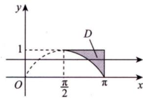  
图14-7

$$
\int_ {\frac {\pi}{2}} ^ {\pi} \mathrm {d} x \int_ {\sin x} ^ {1} f (x, y) \mathrm {d} y = \int_ {0} ^ {1} \mathrm {d} y \int_ {\pi - \arcsin y} ^ {\pi} f (x, y) \mathrm {d} x.
$$

由例1.12得，当 $\frac{\pi}{2} < x \leqslant \frac{3}{2}\pi$ 时， $x = \pi - \arcsin y$

方法总结 交换积分顺序的题目，应先确定积分区域，然后交换积分顺序写成相应的累次积分.

$\int_{\frac{\pi}{2}}^{\pi} \mathrm{d}x \int_{1}^{\sin x} f(x, y) \mathrm{d}y$ $\sin x < 1$ （不是二重积分，仅是累次积分形式）

$=  - {\int }_{\frac{\pi }{2}}^{\pi }\mathrm{d}x{\int }_{\sin x}^{1}f\left( {x,y}\right) \mathrm{d}y$ . 二重积分

例14.6 当 $x \to 0^{+}$ 时， $f(x) = \int_{0}^{x^2} \mathrm{d}y \int_{x}^{\sqrt{y}} \sin \frac{y}{t} \, \mathrm{d}t$ 与 $g(x) = ax^b$ 是等价无穷小量，则 $ab =$

$\rho$ 分析 $\sin \frac{y}{x}$ 若对 $x$ 积分，则没有初等函数形式的原函数表达，若对 $y$ 积分，可用初等函数形式表示，所以先积 $y$ 后积 $x$ ，本题属于交换积分顺序的题目.

又因为 $0 \leqslant y \leqslant x^{2}$ ，所以 $\sqrt{y} \leqslant x$ ，故 $\int_{0}^{x^{2}} \mathrm{d}y \int_{x}^{\sqrt{y}} \sin \frac{y}{t} \mathrm{d}t$ 先添一个负号变为 $-\int_{0}^{x^{2}} \mathrm{d}y \int_{\sqrt{y}}^{x} \sin \frac{y}{t} \mathrm{d}t$ ，变为二重积分后，画出积分区域图，再交换积分顺序。

解 应填 $-\frac{1}{2}$

交换上下限，保证上限大于等于下限

[ = {\int }_{0}^{x}t \cdot  \left( {\cos \frac{y}{t}}\right) \overset{\left| y = {t}^{2}\right| }{\underset{y = 0}{\underbrace{\mathrm{d}t}}} + \text{注意给哪个变量代上下限.}]

$$
\begin{array}{l} f (x) = \int_ {0} ^ {x ^ {2}} d y \int_ {x} ^ {\sqrt {y}} \sin \frac {y}{t} d t = - \int_ {0} ^ {x ^ {2}} d y \int_ {\sqrt {y}} ^ {x} \sin \frac {y}{t} d t \\ = - \iint_ {D} \sin \frac {y}{t} d \sigma = - \int_ {0} ^ {x} d t \int_ {0} ^ {t ^ {2}} \sin \frac {y}{t} d y \\ = \int_ {0} ^ {x} t (\cos t - 1) d t, \\ \end{array}
$$

$\lim_{x \to 0^{+}} \frac{f(x)}{g(x)} = \lim_{x \to 0^{+}} \frac{x(\cos x - 1)}{abx^{b-1}} = \lim_{x \to 0^{+}} \frac{-\frac{1}{2}x^{3}}{abx^{b-1}} = 1$ ，故 $ab = -\frac{1}{2}$ 。

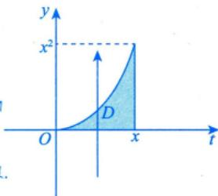

注 (1) $\frac{\sin x}{x}, \frac{\cos x}{x}, \frac{\ln(1 + x)}{x}, \frac{1}{\ln x}, \sin x^2, \cos x^2, \sin \frac{1}{x}, \cos \frac{1}{x}, \frac{\tan x}{x}, \frac{e^x}{x}, \tan x^2, e^{ax^2 + bx + c} (a \neq 0)$

均没有初等函数形式的原函数，见到它们，一般都要交换积分次序，避免先对 $x$ 求积分.

(2) 事实上， $a = -\frac{1}{8}, b = 4.$

方法总结 当累次积分无法积分，即没有初等函数形式的原函数表达式时，可考虑交换积分顺序.  
公式 $\int \sin \frac{y}{t} \mathrm{d}y = -t \cos \frac{y}{t} + C.$

当 $x\to 0^{+}$ 时， $f(x)\sim g(x)$ ，则 $\int_0^x f(t)\mathrm{d}t\sim \int_0^x g(t)\mathrm{d}t$ .（可用洛必达法则证明）

例14.7 计算 $\int_0^1\mathrm{d}y\int_y^1\arcsin \sqrt{4x - 4x^2}\mathrm{d}x$

分析 被积函数只含有 $x$ ，而且先对 $x$ 积分较困难，所以考虑交换积分顺序.

解 先对 $x$ 积分较困难，交换积分次序.

原式 $= \int_{0}^{1}\mathrm{d}x\int_{0}^{x}\arcsin \sqrt{4x - 4x^{2}}\mathrm{d}y$

$$
= \int_ {0} ^ {1} x \arcsin \sqrt {4 x - 4 x ^ {2}} d x = \frac {1}{2}.
$$

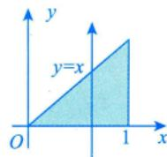

方法总结 $\int_{c}^{d}\mathrm{d}y\int_{x_1(y)}^{x_2(y)}f(x)\mathrm{d}x$ 对 $x$ 积分比较困难时，可转化为先积 $y$ ，即 $\int_{a}^{b}\mathrm{d}x\int_{y_1(x)}^{y_2(x)}f(x)\mathrm{d}y.$

公式 $\int_0^1\arcsin \sqrt{1 - x^2}\mathrm{d}x = 1,\int_0^1 x\arcsin \sqrt{4x - 4x^2}\mathrm{d}x = \frac{1}{2}.$   
极坐标系下的计算方法 因为是中心对称图像,一般先积 $r$ ,后积 $\theta$

极坐标系：与中心对称图像有关！

直角坐标与极坐标关系 $\left\{ \begin{array}{l}x = r\cos \theta ,\\ y = r\sin \theta . \end{array} \right.\rightarrow$ 转换桥梁

用 $r = r_0$ ， $\theta = \theta_0$ 来切分区域 $D$

则有 $\mathrm{d}\sigma = \mathrm{d}r\cdot r\mathrm{d}\theta = r\mathrm{d}r\mathrm{d}\theta$ 近似看成矩形.

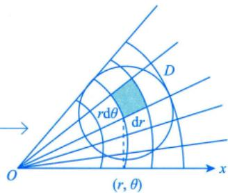

在极坐标系下，按照积分区域与极点位置关系的不同，一般将二重积分的计算分为三种情况，如图14-8所示.

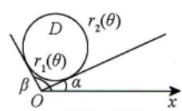  
(a)

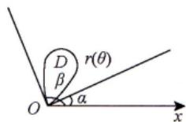  
(b)

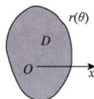  
(c)   
图14-8

从 ${Ox}$ 轴逆时针出发,先碰到积分区域时,记 $\theta  = \alpha$ ,后离开区域时,记 $\theta  = \beta$ ,所以 $\theta$ 的下限为 $\alpha$ ,上限为 $\beta$ ,然后限内画条线,先交内曲线记 $r = {r}_{1}\left( \theta \right)$ ,然后交外曲线 $r = {r}_{2}\left( \theta \right)$

(1) $\iint_{D} f(x, y) \, \mathrm{d}\sigma = \int_{\alpha}^{\beta} \, \mathrm{d}\theta \int_{r_1(\theta)}^{r_2(\theta)} f(r \cos \theta, r \sin \theta) r \, \mathrm{d}r$ （极点 $O$ 在区域 $D$ 外部）；  
(2) $\iint_{D} f(x, y) \, \mathrm{d}\sigma = \int_{\alpha}^{\beta} \, \mathrm{d}\theta \int_{0}^{r(\theta)} f(r \cos \theta, r \sin \theta) r \, \mathrm{d}r$ （极点 $O$ 在区域 $D$ 边界上）；

(3) $\iint_{D} f(x, y) \, \mathrm{d}\sigma = \int_{0}^{2\pi} \, \mathrm{d}\theta \int_{0}^{r(\theta)} f(r \cos \theta, r \sin \theta) r \, \mathrm{d}r$ （极点 $O$ 在区域 $D$ 内部）.

注极坐标系与直角坐标系选择的一般原则.

一般来说，给出一个二重积分：

是否用极坐标系计算主要看①.

① 看被积函数是否为 $f(x^{2} + y^{2})$ ， $f\left(\frac{y}{x}\right)$ ， $f\left(\frac{x}{y}\right)$ 等形式；  
② 看积分区域是否为圆或者圆的一部分.

如果①，②至少满足其中之一，那么优先选用极坐标系，否则，就优先考虑直角坐标系.

例14.8 设区域 $D = \{(x, y) | x^2 + y^2 \leqslant \sqrt{2}\}$ ，则 $\iint_{D} \left(x^2 + \frac{y^2}{2}\right) \mathrm{d}x \mathrm{d}y = \_$ .

分析 积分区域是圆，但被积函数不是平方和，这里注意到 $x$ 与 $y$ 互换时，积分区域 $D$ 不变，说明 $D$ 关于 $y = x$ 对称，此时考虑轮换对称性，最后在极坐标系下计算此二重积分.

解 应填 $\frac{3\pi}{4}$

$$
\begin{array}{l} \iint_ {D} \left(x ^ {2} + \frac {y ^ {2}}{2}\right) \mathrm {d} x \mathrm {d} y = \iint_ {D} \left(y ^ {2} + \frac {x ^ {2}}{2}\right) \mathrm {d} x \mathrm {d} y = \frac {1}{2} \left(1 + \frac {1}{2}\right) \iint_ {D} \left(x ^ {2} + y ^ {2}\right) \mathrm {d} x \mathrm {d} y \\ = \frac {1}{2} \left(1 + \frac {1}{2}\right) \int_ {0} ^ {2 \pi} d \theta \int_ {0} ^ {2 \frac {1}{4}} \left(r ^ {2} \cos^ {2} \theta + r ^ {2} \sin^ {2} \theta\right) r d r = \frac {3 \pi}{4}. \\ \end{array}
$$

方法总结 积分区域 $D$ 关于 $y = x$ 对称，考虑轮换对称性，即利用 $\iint_{D} f(x, y) \, \mathrm{d}\sigma = \frac{1}{2} \iint_{D} [f(x, y) + f(y, x)] \, \mathrm{d}\sigma.$

★★★二重积分复习标杆个

例14.9 设平面有界区域 $D$ 位于第一象限，由曲线 $x^{2} + y^{2} - xy = 1, x^{2} + y^{2} - xy = 2$ 与直线 $y = \sqrt{3} x, y = 0$ 围成，计算 $\iint_{D} \frac{1}{3x^2 + y^2} \mathrm{d}x \mathrm{d}y$ .

分析 对于 $x^{2} + y^{2} - xy = 1$ ， $x^{2} + y^{2} - xy = 2$ ，将 $x,y$ 互换，式子不变，所以图像关于 $y = x$ 对称，根据一些特殊的点及 $y^\prime (0) = \frac{1}{2} >0$ ， $y^\prime (1) = -1 <   0$ 确定单调性，最后将积分区域草图确定下来，根据积分区域来确定 $\theta$ ，而且曲线含有 $x^{2} + y^{2}$ ，被积函数分母有平方，则考虑极坐标系下计算.

在考试时，有些 $D$ 的边界图形不易画出，考生可根据 $D$ 的表达式来确定上下限.

解 由 $x^{2} + y^{2} - xy = 1$ ，得 $r^2 - r^2 \sin \theta \cos \theta = 1$ ，故 $r = \sqrt{\frac{1}{1 - \cos \theta \sin \theta}}$ ；由 $x^{2} + y^{2} - xy = 2$ 得 $r^2 - r^2 \sin \theta \cos \theta = 2$ ，故 $r = \sqrt{\frac{2}{1 - \cos \theta \sin \theta}}$ 。又 $y = \sqrt{3} x$ ，得 $r \sin \theta = \sqrt{3} r \cos \theta$ ，有 $\tan \theta = \sqrt{3}$ ，则 $\theta = \frac{\pi}{3}$ 。

$$
\iint_ {D} \frac {1}{3 x ^ {2} + y ^ {2}} d x d y = \int_ {0} ^ {\frac {\pi}{3}} d \theta \int_ {\sqrt {\frac {1}{1 - \cos \theta \sin \theta}}} ^ {\sqrt {\frac {2}{1 - \cos \theta \sin \theta}}} \cdot \frac {1}{r ^ {2} (3 \cos^ {2} \theta + \sin^ {2} \theta)} r d r
$$

$$
= \int_ {0} ^ {\frac {\pi}{3}} d \theta \int_ {\sqrt {\frac {1}{1 - \cos \theta \sin \theta}}} ^ {\sqrt {\frac {2}{1 - \cos \theta \sin \theta}}} \cdot \frac {1}{3 \cos^ {2} \theta + \sin^ {2} \theta} \cdot \frac {1}{r} d r \rightarrow \ln r \left| \frac {\sqrt {\frac {2}{1 - \cos \theta \sin \theta}}}{\sqrt {\frac {1}{1 - \cos \theta \sin \theta}}} = \frac {\ln 2}{2} \right.
$$

$$
= \frac {\ln 2}{2} \int_ {0} ^ {\frac {\pi}{3}} \frac {1}{3 \cos^ {2} \theta + \sin^ {2} \theta} d \theta
$$

$$
\begin{array}{l} \int \frac {\mathrm {d} x}{a ^ {2} + x ^ {2}} = \frac {1}{a} \arctan \frac {x}{a} + C (a > 0) \\ = \frac {\ln 2}{2} \int_ {0} ^ {\frac {\pi}{3}} \frac {1}{3 + \tan^ {2} \theta} d (\tan \theta) \\ = \frac {\ln 2}{2} \left(\frac {1}{\sqrt {3}} \arctan \frac {\tan \theta}{\sqrt {3}}\right) \Bigg | _ {0} ^ {\frac {\pi}{3}} \\ = \frac {\sqrt {3} \ln 2}{2 4} \pi . \\ \end{array}
$$

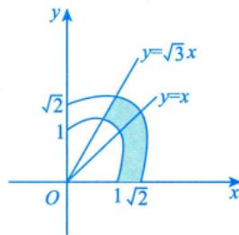

注 本题有两个办法画出 $D$ 的边界图形.

第一，描点法. 显然， $x^{2} + y^{2} - xy = 1$ 与 $x^{2} + y^{2} - xy = 2$ 分别与 $x$ 轴、 $y$ 轴和 $y = x$ 交于 $(1,0)$ 与 $(\sqrt{2},0)$ ， $(0,1)$ 与 $(0,\sqrt{2})$ ， $(1,1)$ 与 $(\sqrt{2},\sqrt{2})$ ，将这些点连起来即可得到其大致图形.

第二，事实上， $x^{2} + y^{2} - xy = [x,y]\left[ \begin{array}{cc}1 & -\frac{1}{2}\\ -\frac{1}{2} & 1 \end{array} \right]\left[ \begin{array}{c}x\\ y \end{array} \right],$ 其二次型矩阵为 $A = \left[ \begin{array}{rr}1 & -\frac{1}{2}\\ -\frac{1}{2} & 1 \end{array} \right],|\lambda E - A| =$ 学完线性代数分册再看此处

$\left| \begin{array}{cc}\lambda -1 & \frac{1}{2}\\ \frac{1}{2} & \lambda -1 \end{array} \right| = 0$ ，得 $\lambda_1 = \frac{1}{2},\lambda_2 = \frac{3}{2}$ （或用配方法 $x^{2} + y^{2} - xy = \left(x - \frac{1}{2} y\right)^{2} + \frac{3}{4} y^{2})$ 故 $x^{2} + y^{2} - xy$ 可经正交变换化为 $\frac{1}{2} y_1^2 +\frac{3}{2} y_2^2$ ，于是 $\frac{1}{2} y_1^2 +\frac{3}{2} y_2^2 = 1$ 与 $\frac{1}{2} y_1^2 +\frac{3}{2} y_2^2 = 2$ 均为椭圆，即可画出图形.

方法总结 当积分区域给出的不是常见曲线时，可考虑描点法画积分区域图。

公式 $\int \frac{1}{3\cos^2\theta + \sin^2\theta}\mathrm{d}\theta = \int \frac{\mathrm{d}(\tan\theta)}{3 + \tan^2\theta} = \frac{1}{\sqrt{3}}\arctan \frac{\tan\theta}{\sqrt{3}} +C.$

例14.10 设 $f(x) = \iint_{D(x)} \frac{\nu \ln \sqrt{u^2 + v^2}}{u + v} \, \mathrm{d}u \, \mathrm{d}v, D(x) = \left\{(u, v) \mid \frac{1}{4} \leqslant u^2 + v^2 \leqslant x^2, u > 0, v > 0 \right\}$ ，求曲线 $y(x) = \int_{1}^{x} f(t) \, \mathrm{d}t \left( x > \frac{1}{2} \right)$ 的拐点。

分析 积分区域关于 $y = x$ 对称，同时观察被积函数的特点，所以考虑轮换对称性。又因为积分区域是 $\frac{1}{4}$ 个圆环，且被积函数含有平方和，所以考虑极坐标计算。

因为本题最终求的是 $y(x)$ 的二阶导数，即 $f(x)$ 的一阶导数，所以不必要真正计算出二重积分，只转化为变限积分即可.

解 由轮换对称性，根据例14.4知，有

$$
\begin{array}{l} f (x) = \frac {1}{4} \iint_ {D (x)} \ln \left(u ^ {2} + v ^ {2}\right) d u d v \\ = \frac {1}{4} \int_ {0} ^ {\frac {\pi}{2}} d \theta \int_ {\frac {1}{2}} ^ {x} \ln r ^ {2} \cdot r d r \\ = \frac {\pi}{4} \int_ {\frac {1}{2}} ^ {x} r \ln r d r, \\ \end{array}
$$

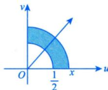

故 $y'(x) = f(x), y''(x) = f'(x) = \frac{\pi}{4} x \ln x \stackrel{\text{令}}{=} 0$ ，得 $x = 1$ . 当 $\frac{1}{2} < x < 1$ 时， $y''(x) < 0$ ，当 $x > 1$ 时， $y''(x) > 0$ ，于是 (1,0) 为 $y(x)$ 的拐点.

方法总结 积分区域 $D$ 关于 $y = x$ 对称，考虑轮换对称性，即利用 $\iint_{D} f(x, y) \, \mathrm{d}\sigma = \frac{1}{2} \iint_{D} [f(x, y) + f(y, x)] \, \mathrm{d}\sigma.$

例14.11 计算 $\int_0^{+\infty}\mathrm{e}^{-x^2}\mathrm{d}x$

$\mathcal{P}$ 分析 因为 $\mathrm{e}^{ax^2 +bx + c}(a\neq 0)$ 没有初等函数形式下的原函数，积分与字母无关，所以 $I = \int_0^{+\infty}\mathrm{e}^{-x^2}\mathrm{d}x = \int_0^{+\infty}\mathrm{e}^{-y^2}\mathrm{d}y$ 又因为 $\iint_{D}\mathrm{e}^{-(x^2 +y^2)}\mathrm{d}\sigma$ 易计算，所以计算 $I^2$ .根据被积函数为 $x^{2} + y^{2}$ 的表达式，选择极坐标计算，将第一象限看成广义的 $\frac{1}{4}$ 个圆，其半径 $r\to +\infty$ ：

解设 $I = \int_0^{+\infty}\mathrm{e}^{-x^2}\mathrm{d}x$ ，则简化版解法

$$
\begin{array}{l} I ^ {2} = \int_ {0} ^ {+ \infty} \mathrm {e} ^ {- x ^ {2}} \mathrm {d} x \cdot \int_ {0} ^ {+ \infty} \mathrm {e} ^ {- x ^ {2}} \mathrm {d} x = \int_ {0} ^ {+ \infty} \mathrm {e} ^ {- x ^ {2}} \mathrm {d} x \cdot \int_ {0} ^ {+ \infty} \mathrm {e} ^ {- y ^ {2}} \mathrm {d} y \\ = \int_ {0} ^ {+ \infty} d x \int_ {0} ^ {+ \infty} e ^ {- (x ^ {2} + y ^ {2})} d y = \iint_ {\substack {0 \leq x <   + \infty \\ 0 \leq y <   + \infty}} e ^ {- (x ^ {2} + y ^ {2})} d x d y \\ = \int_ {0} ^ {\frac {\pi}{2}} d \theta \cdot \int_ {0} ^ {+ \infty} e ^ {- r ^ {2}} \cdot r d r = \frac {\pi}{2} \cdot \left(- \frac {1}{2}\right) \int_ {0} ^ {+ \infty} e ^ {- r ^ {2}} d (- r ^ {2}) \\ = - \frac {\pi}{4} e ^ {- r ^ {2}} \Bigg | _ {0} ^ {+ \infty} = \frac {\pi}{4}, \\ \end{array}
$$

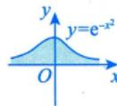

$\int_{-\infty}^{+\infty}\mathrm{e}^{-x^2}\mathrm{d}x = \sqrt{\pi}$ 这叫高斯积分，  
如同欧拉公式 $\mathbf{e}^{\pi i} + 1 = 0$ 一样美  
妙.它们都同时包含e,π

由积分的保号性知 $I > 0$ ，故 $I = \int_{0}^{+\infty}\mathrm{e}^{-x^2}\mathrm{d}x = \frac{\sqrt{\pi}}{2}$

注 应记住这一结果，它经常被用到，如例14.12.

方法总结 积分与字母用谁无关！

$$
\iint_ {D _ {x y}} f (x, y) \mathrm {d} x \mathrm {d} y = \iint_ {D _ {y x}} f (y, x) \mathrm {d} y \mathrm {d} x, \int_ {a} ^ {b} f (x) \mathrm {d} x = \int_ {a} ^ {b} f (t) \mathrm {d} t.
$$

公式 $\int \mathrm{e}^{-x}\mathrm{d}x = -\mathrm{e}^{-x} + C.$

例14.12 计算 $\int_{-\infty}^{+\infty}x^{2}\mathrm{e}^{-x^{2}}\mathrm{d}x$

被积函数为偶函数，因为 $\int_{-\infty}^{+\infty}x^{2}\mathrm{e}^{-x^{2}}\mathrm{d}x$ 收敛，所以可以用对称性处理，然后借助 $\Gamma$ 函数计算结果.

解 $\int_{-\infty}^{+\infty}x^{2}\mathrm{e}^{-x^{2}}\mathrm{d}x = 2\int_{0}^{+\infty}x^{2}\mathrm{e}^{-x^{2}}\mathrm{d}x$ ，又由例9.28知， $2\int_0^{+\infty}x^2\mathrm{e}^{-x^2}\mathrm{d}x = 2\int_0^{+\infty}x^{2 + \frac{3}{2} -1}\mathrm{e}^{-x^2}\mathrm{d}x = \Gamma \left(\frac{3}{2}\right) = \frac{1}{2}\cdot \Gamma \left(\frac{1}{2}\right) =$ $\frac{\sqrt{\pi}}{2}$ 故 $\int_{-\infty}^{+\infty}x^{2}\mathrm{e}^{-x^{2}}\mathrm{d}x = \frac{\sqrt{\pi}}{2}$

注 本题若不用 $\Gamma$ 函数，对于 $\int_0^{+\infty}x^2\mathrm{e}^{-x^2}\mathrm{d}x$ ，要这样算：

$$
\begin{array}{l} \int_ {0} ^ {+ \infty} x ^ {2} e ^ {- x ^ {2}} d x = \int_ {0} ^ {+ \infty} \left(- \frac {1}{2}\right) x e ^ {- x ^ {2}} d (- x ^ {2}) = \int_ {0} ^ {+ \infty} \left(- \frac {1}{2}\right) x d (e ^ {- x ^ {2}}) \\ = - \frac {1}{2} x \mathrm {e} ^ {- x ^ {2}} \Bigg | _ {0} ^ {+ \infty} - \int_ {0} ^ {+ \infty} \left(- \frac {1}{2}\right) \mathrm {e} ^ {- x ^ {2}} \mathrm {d} x \\ = 0 + \frac {1}{2} \int_ {0} ^ {+ \infty} e ^ {- x ^ {2}} d x = \frac {\sqrt {\pi}}{4}, \\ \end{array}
$$

故 $\int_{-\infty}^{+\infty}x^{2}\mathrm{e}^{-x^{2}}\mathrm{d}x = \frac{\sqrt{\pi}}{2}$ 显然，这是相对麻烦的.

方法总结 $\Gamma$ 函数的相关结论要牢记： $\Gamma (\alpha) = \int_0^{+\infty}x^{\alpha -1}\mathrm{e}^{-x}\mathrm{d}x$ ， $\Gamma (\alpha +1) = \alpha \Gamma (\alpha)$

例14.13 已知 $\lim_{x\to +\infty}\frac{\int_0^x t^2\mathrm{e}^{x^2 - t^2}\mathrm{d}t + ae^{x^2}}{x^b} = -\frac{1}{2}$ 求 $a,b$ 的值.

分析 一开始，可能看不出是什么类型的未定式，作恒等变形（分子分母同时除以 $\mathbf{e}^{x^2}$ ）再看.

解 原式 $= \lim_{x\to +\infty}\frac{\int_0^x t^2\mathrm{e}^{-t^2}\mathrm{d}t + a}{x^b\mathrm{e}^{-x^2}} = -\frac{1}{2},$

此时不论 $b$ 取何值， $\lim_{x\to +\infty}x^{b}\mathrm{e}^{-x^{2}} = 0$ ，即判定为“ $\frac{0}{0}$ ”型（事实上，变形前为“ $\frac{\infty}{\infty}$ ”型）.

故 $\lim_{x\to +\infty}\left(\int_0^x t^2\mathrm{e}^{-t^2}\mathrm{d}t + a\right) = 0,$

于是

$$
a = - \int_ {0} ^ {+ \infty} t ^ {2} \mathrm {e} ^ {- t ^ {2}} \mathrm {d} t = - \frac {\sqrt {\pi}}{4}. \quad \rightarrow \text {由 例 1 4 . 1 2 知}
$$

则

$$
\begin{array}{l} \text {原 式} = \lim  _ {x \rightarrow + \infty} \frac {\int_ {0} ^ {x} t ^ {2} \mathrm {e} ^ {- t ^ {2}} \mathrm {d} t - \frac {\sqrt {\pi}}{4}}{x ^ {b} \mathrm {e} ^ {- x ^ {2}}} \xlongequal {\text {洛 必 达 法 则}} \lim  _ {x \rightarrow + \infty} \frac {x ^ {2} \mathrm {e} ^ {- x ^ {2}}}{b x ^ {b - 1} \mathrm {e} ^ {- x ^ {2}} + x ^ {b} \mathrm {e} ^ {- x ^ {2}} (- 2 x)} \\ = \lim  _ {x \rightarrow + \infty} \frac {x ^ {2}}{b x ^ {b - 1} - 2 x ^ {b + 1}} = - \frac {1}{2}, \\ \end{array}
$$

故 $b = 1$ ：

方法总结 当分母 $\rightarrow 0$ 时，若分式的极限不为0，则可知分子 $\rightarrow 0$

$$
\begin{array}{l} \lim  _ {x \rightarrow + \infty} \mathrm {e} ^ {x ^ {2}} \left(\overbrace {\int_ {0} ^ {x} t ^ {2} \mathrm {e} ^ {- t ^ {2}} \mathrm {d} t} ^ {\int_ {0} ^ {x} t ^ {2} \mathrm {e} ^ {- t ^ {2}} \mathrm {d} t} + a\right) = \infty . \\ \theta \text {公 式} \int_ {0} ^ {+ \infty} t ^ {2} \mathrm {e} ^ {- t ^ {2}} \mathrm {d} t = \frac {\sqrt {\pi}}{4}. \\ \end{array}
$$

# 极坐标系与直角坐标系的互相转化

$x = r\cos \theta ,$ 一是用好这个公式；二是画出区域 $D$ 的边界图形，做好上限、下限的转化.

例14.14 $\int_0^1\mathrm{d}x\int_{1 - x}^{\sqrt{1 - x^2}}\frac{x + y}{x^2 + y^2}\mathrm{d}y = \underline{\quad}.$

分析 本题乍一看，也许我们会先考虑题目是否在积分次序上设置了障碍，是否需要交换积分次序再做积分，但是，细致做来，我们会发现不管是先对 $x$ 积分，还是先对 $y$ 积分，都不容易计算。看来这不是积分次序上的问题，这时想想看是不是选择何种坐标系的问题呢？被积函数中含有 $x^{2} + y^{2}$ 的形式，且积分区域是圆的一部分，如图14-9所示，显然应该优先考虑极坐标系，题目给出的却是直角坐标系，我们需要改变一下。

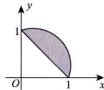  
图14-9

即使发现区域 $D$ 关于 $y = x$ 对称，使用轮换对称性 $f(x,y) + f(y,x)$ 的等式仍复杂，所以不用轮换对称性，只需要放在极坐标下计算即可.

解 应填 $2 - \frac{\pi}{2}$

$$
\begin{array}{l} \text {原 式} = \int_ {0} ^ {\frac {\pi}{2}} \mathrm {d} \theta \int_ {\frac {1}{\cos \theta + \sin \theta}} ^ {1} \frac {r (\cos \theta + \sin \theta)}{r ^ {2}} r \mathrm {d} r \quad r = \frac {1}{\cos \theta + \sin \theta}. \\ = \int_ {0} ^ {\frac {\pi}{2}} (\cos \theta + \sin \theta) \frac {\cos \theta + \sin \theta - 1}{\cos \theta + \sin \theta} d \theta \\ = \int_ {0} ^ {\frac {\pi}{2}} \cos \theta d \theta + \int_ {0} ^ {\frac {\pi}{2}} \sin \theta d \theta - \int_ {0} ^ {\frac {\pi}{2}} d \theta \\ = 1 + 1 - \frac {\pi}{2} = 2 - \frac {\pi}{2}. \\ \end{array}
$$

方法总结 当题目是累次积分时，通常考虑换积分顺序或者换坐标系.

公式 $\int \cos \theta \mathrm{d}\theta = \sin \theta +C,\int \sin \theta \mathrm{d}\theta = -\cos \theta +C.$

# 4换元法

二重积分亦有和定积分一脉相承的换元法，有时很有用，现介绍于此，供参考，若能够用上，可直接使用，不必证明.

先回顾一元函数积分换元法，见“①”，再看二重积分换元法，见“②”

① $\int_{\alpha}^{b}f(x)\mathrm{d}x\xlongequal{x = \varphi(t)}\int_{\alpha}^{\beta}f[\varphi (t)]\varphi '(t)\mathrm{d}t.$

a. $f(x)\rightarrow f[\varphi (t)]$   
b. $\int_{a}^{b}\rightarrow \int_{\alpha}^{\beta}$   
c. $\mathrm{d}x\to \varphi '(t)\mathrm{d}t$

换元的三换

注意： $x = \varphi (t)$ 单调，存在一阶连续导数.

② $\iint_{D_{xy}} f(x, y) \, \mathrm{d}x \, \mathrm{d}y \frac{x = x(u, v)}{y = y(u, v)} \iint_{D_{uv}} f[x(u, v), y(u, v)] \left| \frac{\partial(x, y)}{\partial(u, v)} \right| \, \mathrm{d}u \, \mathrm{d}v.$

a. $f(x,y)\to f[x(u,v),y(u,v)]$   
b. $\iint_{D_{xy}}\rightarrow \iint_{D_{uv}}$   
c. $\mathrm{d}x\mathrm{\;d}y \rightarrow  \frac{\left| \partial \left( {x,y}\right) \right| }{\left| \partial \left( u,v\right) \right| }\mathrm{d}u\mathrm{\;d}v$ . 已可微分的唯一

注意：其中 $\left\{ \begin{array}{l}x = x(u,v),\\ y = y(u,v) \end{array} \right.$ 是 $(x,y)$ 面到 $(u,\nu)$ 面的一对一映射， $x = x(u,\nu)$ ， $y = y(u,\nu)$ 存在一阶连

$\frac{\partial(x,y)}{\partial(u,v)} = \begin{cases} \frac{\partial x}{\partial u} & \frac{\partial x}{\partial v}\\ \frac{\partial y}{\partial u} & \frac{\partial y}{\partial v} \end{cases} \neq 0.$ 续偏导数，称为J行列式

另外，令 $\left\{ \begin{array}{l}x = r\cos \theta ,\\ y = r\sin \theta , \end{array} \right.$ 则

$$
\begin{array}{l} \iint_ {D _ {x y}} f (x, y) \mathrm {d} x \mathrm {d} y = \iint_ {D _ {r \theta}} f (r \cos \theta , r \sin \theta) \left\| \begin{array}{l l} \frac {\partial x}{\partial r} & \frac {\partial x}{\partial \theta} \\ \frac {\partial y}{\partial r} & \frac {\partial y}{\partial \theta} \end{array} \right\| \mathrm {d} r \mathrm {d} \theta \quad “ 换 无 法 ” \\ = \iint_ {D _ {r \theta}} f (r \cos \theta , r \sin \theta) \left\| \begin{array}{l l} \cos \theta & - r \sin \theta \\ \sin \theta & r \cos \theta \end{array} \right\| d r d \theta = \iint_ {D _ {r \theta}} f (r \cos \theta , r \sin \theta) r d r d \theta . \\ \end{array}
$$

这就是直角坐标系到极坐标系的换元过程.

例14.15 设平面区域 $D = \{(x,y) | 0 \leqslant x \leqslant 1 - y, 0 \leqslant y \leqslant 1\}$ ，计算二重积分 $\iint_{D} \mathrm{e}^{\frac{y}{x + y}} \, \mathrm{d}\sigma$

$\mathcal{P}$ 分析 虽然积分区域简单，但是无论是先积 $x$ ，还是先积 $y$ ，都比较困难.若考虑极坐标系，由于积分区域是三角形，计算量也很大，主要是e的指数为 $\frac{y}{x + y}$ ，造成“头重脚轻”.可以考虑换元，令 $\left\{ \begin{array}{l} x + y = u, \\ y = v, \end{array} \right.$ 则 $\frac{y}{x + y}$ 就变为 $\frac{v}{u}$ 此时积分区域变为另一个三角形区域，被积函数也变得简单.

解 令 $\left\{ \begin{array}{l}x + y = u,\\ y = v, \end{array} \right.$ 则 $\left\{ \begin{array}{ll}x = u - v,\\ y = v, \end{array} \right.$

$$
J = \left| \begin{array}{l l} \frac {\partial x}{\partial u} & \frac {\partial x}{\partial v} \\ \frac {\partial y}{\partial u} & \frac {\partial y}{\partial v} \end{array} \right| = \left| \begin{array}{l l} 1 & - 1 \\ 0 & 1 \end{array} \right| = 1,
$$

且由 $\left\{ \begin{array}{l}0\leqslant x\leqslant 1 - y,\\ 0\leqslant y\leqslant 1, \end{array} \right.$ 知 $\left\{ \begin{array}{ll}\nu \leqslant u\leqslant 1,\\ 0\leqslant \nu \leqslant 1, \end{array} \right.$ 如图14-10所示.故

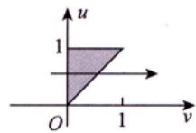  
图14-10

$$
\begin{array}{l} I = \iint_ {D} \mathrm {e} ^ {\frac {y}{x + y}} \mathrm {d} \sigma = \iint_ {D _ {u v}} \mathrm {e} ^ {\frac {v}{u}} | J | \mathrm {d} u \mathrm {d} v = \int_ {0} ^ {1} \mathrm {d} u \int_ {0} ^ {u} \mathrm {e} ^ {\frac {v}{u}} \mathrm {d} v \\ = \int_ {0} ^ {1} u \mathrm {e} ^ {\frac {v}{u}} \Bigg | _ {v = 0} ^ {v = u} \mathrm {d} u = \int_ {0} ^ {1} u (\mathrm {e} - 1) \mathrm {d} u = \frac {1}{2} (\mathrm {e} - 1). \\ \end{array}
$$

注此题亦可用常规方法（极坐标系，见图14-11）求解：

$$
\begin{array}{l} I = \int_ {0} ^ {\frac {\pi}{2}} d \theta \int_ {0} ^ {\frac {1}{\cos \theta + \sin \theta}} e ^ {\frac {\sin \theta}{\cos \theta + \sin \theta}} r d r \\ = \int_ {0} ^ {\frac {\pi}{2}} \mathrm {e} ^ {\frac {\sin \theta}{\cos \theta + \sin \theta}} \cdot \left. \frac {r ^ {2}}{2} \right| _ {0} ^ {\frac {1}{\cos \theta + \sin \theta}} \mathrm {d} \theta \\ = \frac {1}{2} \int_ {0} ^ {\frac {\pi}{2}} e ^ {\frac {\sin \theta}{\cos \theta + \sin \theta}} \frac {1}{(\cos \theta + \sin \theta) ^ {2}} d \theta \\ = \frac {1}{2} \int_ {0} ^ {\frac {\pi}{2}} \mathrm {e} ^ {\frac {\sin \theta}{\cos \theta + \sin \theta}} \mathrm {d} \left(\frac {\sin \theta}{\cos \theta + \sin \theta}\right) \\ = \frac {1}{2} \mathrm {e} ^ {\frac {\sin \theta}{\cos \theta + \sin \theta}} \Bigg | _ {0} ^ {\frac {\pi}{2}} = \frac {1}{2} (\mathrm {e} - 1). \\ \end{array}
$$

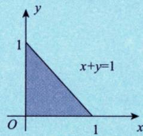  
图14-11

方法总结 二重积分的换元：注意“三换”，换积分区域，换被积函数，换积分变量.极坐标换元 $\left\{ \begin{array}{l}x = r\cos \theta ,\\ y = r\sin \theta \end{array} \right.$ 仅是一种换元法.

$$
\text {公 式} \left(\frac {\sin \theta}{\cos \theta + \sin \theta}\right) ^ {\prime} = \frac {1}{(\cos \theta + \sin \theta) ^ {2}}.
$$

# 古鲁金第二定理

如图14-12所示，将平面有界闭区域 $D$ 任意分成 $n$ 个小闭区域， $\Delta \sigma_{i}(i = 1,2,\dots ,n)$ 为面积，在 $\Delta \sigma_{i}$ 中任取一点 $(\xi_i,\eta_i)$ ，记 $\lambda = \max_{i}\{\Delta \sigma_{i}\}$ ，则

$$
\Delta V _ {i} = 2 \pi r _ {i} \Delta \sigma_ {i} = 2 \pi \frac {\left| a \xi_ {i} + b \eta_ {i} + c \right|}{\sqrt {a ^ {2} + b ^ {2}}} \Delta \sigma_ {i},
$$

故 $V = \lim_{\lambda \to 0}\sum_{i = 1}^{n}\Delta V_{i} = \lim_{\lambda \to 0}\sum_{i = 1}^{n}2\pi \frac{\left|a\xi_{i} + b\eta_{i} + c\right|}{\sqrt{a^{2} + b^{2}}}\Delta \sigma_{i}$

$$
\begin{array}{l} = \iint_ {D} 2 \pi \frac {\left| a x + b y + c \right|}{\sqrt {a ^ {2} + b ^ {2}}} d \sigma \\ = \frac {2 \pi}{\sqrt {a ^ {2} + b ^ {2}}} \iint_ {D} | a x + b y + c | d \sigma . \tag {14-1} \\ \end{array}
$$

与第12讲的公式(12-5)比较，得

$$
r (\bar {x}, \bar {y}) = \frac {M _ {L _ {0}}}{M} = \frac {2 \pi M _ {L _ {0}}}{2 \pi M} = \frac {V}{2 \pi \cdot S},
$$

即 $V = 2\pi \cdot S \cdot r(\overline{x}, \overline{y})$ 。

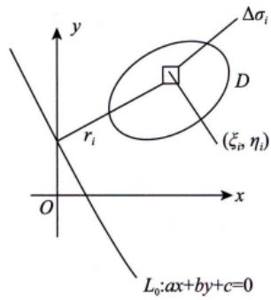  
图14-12

例14.16 曲线 $y = \sin x (0 \leqslant x \leqslant 2\pi)$ 与 $x$ 轴所围区域 $D$ 绕直线 $y = -x$ 旋转一周所成的旋转体的体积为

解 应填 $4\sqrt{2}\pi^2$

由古鲁金第二定理，有

$$
\begin{array}{l} V = 2 \pi \cdot S \cdot r (\bar {x}, \bar {y}) \\ \quad \quad \quad \quad \quad \quad \quad \quad \quad \quad \quad \quad \quad \quad \quad \quad \quad \quad \quad \quad \quad \quad = 2 \pi \cdot 4 \cdot \frac {\pi}{\sqrt {2}} = 4 \sqrt {2} \pi^ {2}. \end{array}
$$

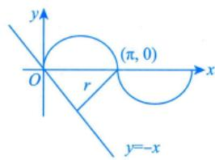

例14.17 设 $D$ 为 $(x - 1)^2 + y^2 = 1$ 与 $(x - 2)^2 + y^2 = 2^2$ 及 $x$ 轴所围区域在第一象限的部分，则 $D$ 的形心 $(\overline{x}, \overline{y}) =$ _______.

解 应填 $\left(\frac{7}{3},\frac{28}{9\pi}\right)$

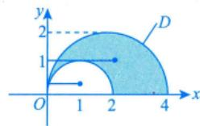

$D$ 绕 $y$ 轴旋转一周所成的旋转体的体积

$$
V = 2 \pi \cdot \frac {\pi \cdot 2 ^ {2}}{2} \cdot 2 - 2 \pi \cdot \frac {\pi \cdot 1 ^ {2}}{2} \cdot 1 = 7 \pi^ {2},
$$

故 $D$ 的形心到 $y$ 轴的距离为 $r(\overline{x},\overline{y}) = \frac{V}{2\pi S} = \frac{7\pi^2}{2\pi(\pi\bullet 2^2 - \pi\bullet 1^2)\bullet\frac{1}{2}} = \frac{7}{3}$

显然，即 $\overline{x} = \frac{7}{3}$ 。同理可求得 $\overline{y} = \frac{28}{9\pi}$ 。

注 $\bar{y}$ 的求解较 $\overline{x}$ 稍微复杂一些，要先求出半圆域 $(x - 1)^2 + y^2 \leqslant 1 (y \geqslant 0)$ 与半圆域 $(x - 2)^2 + y^2 \leqslant 2^2 (y \geqslant 0)$ 的形心竖坐标 $\overline{y}_1, \overline{y}_2$ 。

由 $\overline{y}_1 = \frac{\iint y\mathrm{d}\sigma}{\iint\mathrm{d}\sigma} = \frac{\int_0^{\frac{\pi}{2}}\mathrm{d}\theta\int_0^{2\cos\theta}r\sin\theta\cdot r\mathrm{d}r}{\pi\cdot 1^2\cdot\frac{1}{2}} = \frac{4}{3\pi}$ 得 $\bar{y}_1 = \frac{4}{3\pi}$ ，同理可得 $\overline{y}_2 = \frac{8}{3\pi}$ 则 $D$ 绕 $x$ 轴旋转一周所成的旋转体的体积

$$
V _ {x} = 2 \pi \cdot \frac {\pi \cdot 2 ^ {2}}{2} \cdot \frac {8}{3 \pi} - 2 \pi \cdot \frac {\pi \cdot 1 ^ {2}}{2} \cdot \frac {4}{3 \pi} = \frac {2 8 \pi}{3},
$$

故 $D$ 的形心到 $\mathcal{X}$ 轴的距离为

$$
r (\bar {x}, \bar {y}) = \frac {V _ {x}}{2 \pi S} = \frac {\frac {2 8 \pi}{3}}{2 \pi (\pi \cdot 2 ^ {2} - \pi \cdot 1 ^ {2}) \cdot \frac {1}{2}} = \frac {2 8}{9 \pi},
$$

即 $\overline{y} = \frac{28}{9\pi}$

# 四 平面区域 $D$ 大观

要想正确计算二重积分，准确画出平面区域 $D$ 是必不可少的基本功，本讲最后，总结了结出常见的平面区域 $D$ 的图形及表达，考生应多画、多练，这些图不是背的，而是训练画区域能力的素材.

# 1 直角坐标系下直线边界型

考生应能熟练画出平面区域 $D$

（1） $D = \{(x,y)|0\leqslant x\leqslant 1,0\leqslant y\leqslant 1\}$

(2) $D = \{(x, y) | x + y \leqslant 1, x \geqslant 0, y \geqslant 0\}$ .

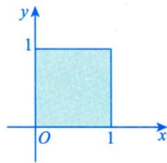

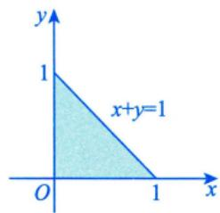

(3) $D = \{(x, y) | 0 \leqslant x \leqslant 1, 0 \leqslant y \leqslant x\}$ .

（4） $D = \left\{(x,y)\big|0\leqslant x\leqslant 2,x\leqslant y\leqslant \sqrt{3} x\right\} .$

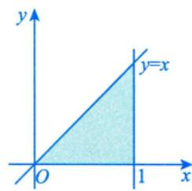

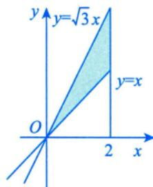

(5) $D = \{(x, y) | 0 \leqslant x \leqslant \pi, 0 \leqslant y \leqslant 1\}$ .

(6) $D = \{(x, y) | 1 \leqslant x + y \leqslant 2, x \geqslant 0, y \geqslant 0\}$ .

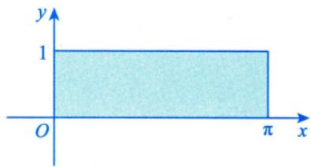

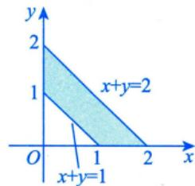

(7) $D = \left\{(x,y)\mid 0\leqslant x\leqslant 3,0\leqslant y\leqslant 3,\frac{\sqrt{3}}{3} x\leqslant y\leqslant \sqrt{3} x\right\} .$

(8) $D = \{(x, y) | 1 \leqslant x + y \leqslant 2, 0 \leqslant y \leqslant x\}$ .

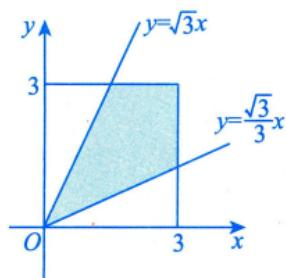

（9） $D = \{(x,y)|0\leqslant x + y\leqslant 1,0\leqslant y\leqslant 1\}$

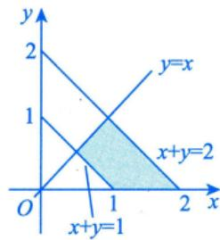

(10) $D = \{(x,y)|0\leqslant x\leqslant 1,x\leqslant y\leqslant 1\}$

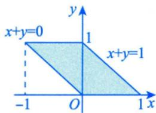

（11） $D = \{(x,y)|x\leqslant 1,y\geqslant -1,y\leqslant x\}$

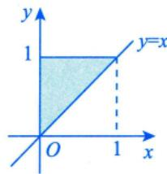

(12) $D = \left\{(x,y)\left|\frac{1}{4}\leqslant y\leqslant \frac{1}{2},y\leqslant x\leqslant \frac{1}{2}\right.\right\} .$

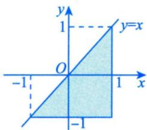

(13) $D = \{(x,y)|0\leqslant x\leqslant 1,x\leqslant y\leqslant 1 + x\}$

(14) $D = \{(x,y)|x\leqslant 3y,y\leqslant 3x,x + y\leqslant 8\}$

（15） $D = \{(x,y) || x| + |y| \leqslant 1\}$ .

(16) $D = \left\{(x,y)\bigg|0\leqslant x\leqslant 1,0\leqslant y\leqslant 1,\big|x - y\big|\leqslant \frac{1}{2}\right\} .$

（17） $D = \{(x,y) || x| \leqslant 1, |y| \leqslant 1\}$ .

# 2 直角坐标系下曲线边界型

考生应能熟练画出平面区域 $D$

（1） $D = \left\{(x,y)|0\leqslant x\leqslant 1,\sqrt[3]{x}\leqslant y\leqslant 1\right\} .$

(2) $D = \left\{(x,y)\bigg|0\leqslant x\leqslant 1,\arctan x\leqslant y\leqslant \frac{\pi}{4}\right\} .$

(3) $D = \left\{(x,y)\mid 0\leqslant x\leqslant 1,0\leqslant y\leqslant 1,(x - 1)^2 +(y - 1)^2\leqslant 1\right\} .$

（4） $D = \left\{(x,y)|0\leqslant y\leqslant x,x^2 +y^2\leqslant 1\right\} .$

(5) $D = \left\{(x,y)\big|1\leqslant x^2 +y^2\leqslant \mathrm{e}^2,x\geqslant 0,y\geqslant 0\right\}$

(6) $D = \{(x, y) | y \geqslant -x, x^2 + y^2 \leqslant 4,$

$$
\left. x ^ {2} + y ^ {2} \geqslant 2 x, y \geqslant 0 \right\}.
$$

（7） $D = \left\{(x,y)\big|(x - 1)^2 +(y - 1)^2\leqslant 2,0\leqslant x + y\leqslant 4\right\} .$

(8) $D = \left\{(x,y)\left|\frac{1}{4}\leqslant x^2 +y^2,x^2 +y^2\geqslant x^4 +y^4\right.\right.$

$$
x \geqslant 0, y \geqslant 0 \}.
$$

（9） $D = \{(x,y)|0\leqslant x\leqslant \ln 2,\mathrm{e}^x\leqslant y\leqslant 2\}$

(10) $D = \left\{(x,y)\bigg|0\leqslant y\leqslant 1,0\leqslant x\leqslant 1 - \sqrt{2y - y^2}\right\} .$

(11) $D = \left\{(x,y)\mid x^2 +y^2\leqslant \sqrt{2} x,0\leqslant y\leqslant x,\sqrt{x^2 + y^2}\leqslant 1\right\}$

(12) $D = \left\{(x,y)\mid (x^2 +y^2)^2\leqslant 2xy,x\geqslant 0,y\geqslant 0\right\} .$

(13) $D = \{(x, y) | x \geqslant 1, x^2 \leqslant y\}$ .

(14) $D = \left\{(x,y)\mid y\leqslant \sqrt{2x - x^2},x + y\geqslant 2\right\} .$

(15) $D = \left\{(x,y)\left|\frac{1 - x}{1 + x}\leqslant y\leqslant \sqrt{1 - x^2},0\leqslant x\leqslant 1\right.\right\} .$

(16) $D = \left\{(x,y)\mid x + y + xy\geqslant 1,x^2 +y^2\leqslant 1,x\geqslant 0,y\geqslant 0\right\} .$

(17) $D = \left\{(x,y)\mid y\leqslant \sqrt{1 - x^2},y\geqslant 1 - \sqrt{1 - x^2}\right\} .$

(18) $D = \left\{(x,y)\mid x^2 +y^2\leqslant 4,2x - x^2 -y^2\leqslant 0\right\} .$

(19) $D = \left\{(x,y)\mid (x^{2} + y^{2})^{2}\leqslant 2xy\right\} .$

(20) $D = \left\{(x,y)\big|0\leqslant y\leqslant 1, - \sqrt{1 - y^2}\leqslant x\leqslant 1 - y\right\} .$

(21) $D = \left\{(x,y)\big|\sqrt{1 - x^2}\leqslant y\leqslant \sqrt{4 - x^2}, - x\leqslant y,y\geqslant 0\right\} .$ (22） $D = \{(x,y)|1\leqslant x^2 +y^2\leqslant 2x,y\geqslant 0\}$

(23) $D = \left\{(x,y)\mid (x^{2} + y^{2})^{2}\leqslant x^{2} - y^{2},x\geqslant 0\right\} .$

(24) $D = \left\{(x,y) \mid 0 \leqslant x \leqslant 2, 0 \leqslant y \leqslant 4 - x^2\right\}$ .

(25) $D = \left\{(x,y)\left|\sin x\leqslant y\leqslant 1,\frac{\pi}{2}\leqslant x\leqslant \pi \right.\right\} .$

(26) $D = \left\{(x,y)\bigg|y\geqslant \sin x, - \frac{\pi}{2}\leqslant x\leqslant \frac{\pi}{2},y\leqslant 1\right\} .$

(27) $D = \left\{(x,y)\mid 2xy\leqslant 1,4xy\geqslant 1,y\geqslant x,y\leqslant \sqrt{3} x\right\} .$

(28) $D = \left\{(x,y)\mid -1\leqslant x\leqslant 0, - x\leqslant y\leqslant 2 - x^2\right\} .$

(29) $D = \{(x,y)|4x^2\leqslant y\leqslant 9x^2,x\geqslant 0\}$

(30) $D = \left\{(x,y)\bigg|0\leqslant y\leqslant 1,\sqrt{y}\leqslant x\leqslant \sqrt{2 - y^2}\right\} .$

(31) $D = \left\{(x,y)\mid x\geqslant -2,0\leqslant y\leqslant 2,x\leqslant -\sqrt{2y - y^2}\right\} .$

(32) $D = \left\{(x,y)\mid 0\leqslant y\leqslant \frac{1}{4},y\leqslant x\leqslant \sqrt{y}\right\} .$

（33） $D = \left\{(x,y)\mid x^2 +y^2\leqslant 4,(x + 1)^2 +y^2\geqslant 1\right\} .$

(34) $D_{1} = \left\{(x,y)\mid x^{2} + y^{2}\leqslant 1,x\geqslant 0,y\geqslant 0\right\} ,$

$$
D _ {2} = \left\{(x, y) \mid x ^ {2} + y ^ {2} \geqslant 1, 0 \leqslant x \leqslant 1, 0 \leqslant y \leqslant 1 \right\}.
$$

(35) $D = \{(x,y)|x\leqslant \sqrt{1 + y^2},x + \sqrt{2} y\geqslant 0,$

(36) $D = \left\{(x,y)\big|0\leqslant x\leqslant 1,0\leqslant y\leqslant \sqrt{x}\right\} .$

$$
\left. x - \sqrt {2} y \geqslant 0 \right\}.
$$

（37） $D = \{(x,y)|0\leqslant x\leqslant 1,x^2\leqslant y\leqslant 1\}$

(38) $D = \left\{(x,y)\mid 1\leqslant x\leqslant 2,\sqrt{x}\leqslant y\leqslant x\right\} .$

（39） $D = \left\{(x,y)|2\leqslant x\leqslant 4,\sqrt{x}\leqslant y\leqslant 2\right\} .$

(40) $D = \left\{(x,y)\left|\frac{1}{4}\leqslant y\leqslant \frac{1}{2},\frac{1}{2}\leqslant x\leqslant \sqrt{y}\right.\right\} .$

(41) $D = \left\{(x,y)\left|\frac{1}{2}\leqslant y\leqslant 1,y\leqslant x\leqslant \sqrt{y}\right.\right\} .$

（42） $D = \left\{(x,y)\big|2\leqslant 2x^{2} + y^{2}\leqslant 4,x\geqslant 0,y\geqslant 0\right\} .$

（43） $D = \{(x,y)|x^2 +y^2 +xy\leqslant 1\}$

(44) $D = \left\{(x,y)\bigg|0\leqslant x\leqslant 2,0\leqslant y\leqslant 2,y\leqslant \frac{1}{x}\right\} .$

# 极坐标方程型

考生应能熟练画出平面区域 $D$

(1) $D = \left\{(r, \theta) \mid 0 \leqslant r \leqslant \frac{1}{\sin \theta}, \frac{\pi}{4} \leqslant \theta \leqslant \frac{\pi}{2}\right\}$ .

(2) $D = \left\{(r, \theta) \mid 0 \leqslant r \leqslant \sec \theta, 0 \leqslant \theta \leqslant \frac{\pi}{4}\right\}$ .

(3) $D = \left\{(r, \theta) \mid 0 \leqslant \theta \leqslant 2\pi, \frac{\theta}{2} \leqslant r \leqslant \pi\right\}$ .

(4) $D = \left\{(r, \theta) \mid 0 \leqslant r \leqslant 1, 0 \leqslant \theta \leqslant \frac{\pi}{4}\right\}$ .

(5) $D = \left\{(r, \theta) \mid \frac{1}{\sqrt{\sin \theta \cos \theta}} \leqslant r \leqslant \frac{2}{\cos \theta}, \right.$

(6) $D = \left\{(r, \theta) \mid 2 \leqslant r \leqslant 2(1 + \cos \theta), -\frac{\pi}{2} \leqslant \theta \leqslant \frac{\pi}{2}\right\}$ .

$$
\left. \arctan \frac {1}{4} \leqslant \theta \leqslant \frac {\pi}{4} \right\}.
$$

(7) $D = \left\{(r, \theta) \mid 0 \leqslant r \leqslant \sqrt{\sin 2\theta}, 0 \leqslant \theta \leqslant \frac{\pi}{2}\right\}$ .

(8) $D = \left\{(r, \theta) \mid 0 \leqslant \theta \leqslant \frac{\pi}{2}, 0 \leqslant r \leqslant 2 \cos \theta, \right.$

$$
0 \leqslant r \leqslant \frac {2}{\cos \theta + \sin \theta} \Bigg \}.
$$

(9) $D = \left\{(r, \theta) \mid 0 \leqslant r \leqslant 2, -\arccos \frac{r}{2} \leqslant \theta \leqslant \arccos \frac{r}{2}\right\}$ .

(10) $D = \left\{(r, \theta) \mid 0 \leqslant r \leqslant 2 (\sin \theta + \cos \theta), \frac{\pi}{4} \leqslant \theta \leqslant \frac{3}{4} \pi \right\}$ .

(11) $D = \left\{(r, \theta) \mid 0 \leqslant r \leqslant 2 \sin \theta, 0 \leqslant \theta \leqslant \frac{\pi}{4}\right\}$ .

(12) $D = \left\{(r, \theta) \mid 0 \leqslant r \leqslant 2 \cos \theta, \frac{\pi}{4} \leqslant \theta \leqslant \frac{\pi}{2}\right\}$ .

(13) $D = \left\{(r, \theta) \mid 0 \leqslant r \leqslant 2, 0 \leqslant \theta \leqslant \frac{\pi}{2}\right\}$ .

(14) $D = \left\{(r, \theta) \mid 0 \leqslant r \leqslant \frac{2}{\sin \theta - \cos \theta}, \frac{\pi}{2} \leqslant \theta \leqslant \pi \right\}$ .

（15） $D = \{(r,\theta)|1\leqslant r\leqslant u,0\leqslant \theta \leqslant \nu \}$

注 有些 $D$ 是用直角坐标系下的表达式描述的，但实际上用极坐标方程更方便，要归到这里来。如2019年考研真题数学二（18）的平面区域为 $D = \left\{(x, y) \mid |x| \leqslant y, (x^2 + y^2)^3 \leqslant y^4\right\}$ .

$$
g: y = | x |, f: y ^ {4} = \left(x ^ {2} + y ^ {2}\right) ^ {3}
$$

# 参数方程型

考生应能熟练画出平面区域 $D$

（1） $D = \{(x,y)|0\leqslant y\leqslant t - x,0\leqslant x\leqslant t,0 <   t\leqslant 1\} .$

(3) $D = \left\{(x,y)\mid 0\leqslant x\leqslant t,0\leqslant y\leqslant x,t > 0\right\} .$

(5) $D = \left\{(x, y) \mid x^2 + (y - 1)^2 \leqslant 1, \frac{2}{3} x^2 + \frac{2}{9} y^2 \leqslant a^2, a > 0\right\}$ .

  
(a)

  
(b)

  
(c)

(6) $D = \left\{(x,y)\bigg|0 < y < \sqrt{2ax - x^2},x > y,a > 0\right\} .$

（7） $D = \{(x,y)|0\leqslant x\leqslant 2t,0\leqslant y\leqslant t,t > 0\}$

（8） $D = \left\{(x,y)\big|y\geqslant -x,y\leqslant -a + \sqrt{a^2 - x^2},a > 0\right\} .$

（9） $D = \{(x,y)|y\leqslant x\leqslant t,1\leqslant y\leqslant t,t > 1\}$

# 基础习题精练

# 习题

14.1 $\lim_{n\to \infty}\sum_{i = 1}^{n}\sum_{j = 1}^{n}\frac{n}{(n + i)(n^2 + j^2)} = (\quad)$

(A) $\int_0^1\mathrm{d}x\int_0^x\frac{1}{(1 + x)(1 + y^2)}\mathrm{d}y$

(B) $\int_0^1\mathrm{d}x\int_0^x\frac{1}{(1 + x)(1 + y)}\mathrm{d}y$

(C) $\int_0^1\mathrm{d}x\int_0^1\frac{1}{(1 + x)(1 + y)}\mathrm{d}y$

(D) $\int_0^1\mathrm{d}x\int_0^1\frac{1}{(1 + x)(1 + y^2)}\mathrm{d}y$

14.2 设函数 $f(t)$ 连续，区域 $D = \{(x, y) | x^2 + y^2 \leqslant 2y\}$ ，则 $\iint_{D} f(xy) \, \mathrm{d}x \, \mathrm{d}y = (\quad)$ .

(A) $\int_{-1}^{1}\mathrm{d}x\int_{-\sqrt{1 - x^2}}^{\sqrt{1 - x^2}}f(xy)\mathrm{d}y$

(B) $2\int_{0}^{2}\mathrm{d}y\int_{0}^{\sqrt{2y - y^2}}f(xy)\mathrm{d}x$

(C) $\int_0^\pi \mathrm{d}\theta \int_0^{2\sin \theta}f(r^2\sin \theta \cos \theta)\mathrm{d}r$

(D) $\int_0^\pi \mathrm{d}\theta \int_0^{2\sin \theta}f(r^2\sin \theta \cos \theta)r\mathrm{d}r$

14.3 累次积分 $\int_0^{\frac{\pi}{2}}\mathrm{d}\theta \int_0^{\cos \theta}f(r\cos \theta ,r\sin \theta)r\mathrm{d}r$ 可以写成（ ）.

(A) $\int_0^1\mathrm{d}y\int_0^{\sqrt{y - y^2}}f(x,y)\mathrm{d}x$

(B) $\int_0^1\mathrm{d}y\int_0^{\sqrt{1 - y^2}}f(x,y)\mathrm{d}x$

(C) $\int_0^1\mathrm{d}x\int_0^1 f(x,y)\mathrm{d}y$

(D) $\int_0^1\mathrm{d}x\int_0^{\sqrt{x - x^2}}f(x,y)\mathrm{d}y$

14.4 $\int_{-1}^{1}\mathrm{d}x\int_{|x|}^{\sqrt{2 - x^2}}\sin (x^2 +y^2)\mathrm{d}y = ()$

(A) $\frac{\pi}{4} (\cos 2 - 1)$

(B) $\frac{\pi}{4} (-\cos 2 + 1)$

(C) $\frac{\pi}{4} (\cos 2 + 1)$

(D) $\frac{\pi}{4} (-\cos 2 - 1)$

14.5 设 $a > 0, f(x) = g(x) = \begin{cases} a, & 0 \leqslant x \leqslant 1, \\ 0, & \text{其他}, \end{cases}$ 而 $D$ 表示全平面，则 $I = \iint_{D} f(x)g(y - x)\mathrm{d}x\mathrm{d}y = \_$   
14.6 设 $f(x)$ 为连续函数， $F(t) = \int_{1}^{t} \mathrm{d}y \int_{y}^{t} f(x) \, \mathrm{d}x$ ，则 $F'(t) =$ ________.  
14.7 设区域 $D$ 是由曲线 $y = \sin x$ 与直线 $x = \pm \frac{\pi}{2}$ ， $y = 1$ 围成的平面区域，则 $\iint_{D} (xy^5 - 1) \, \mathrm{d}\sigma =$ _______.  
14.8 设区域 $D = \{(x, y) | x^2 + y^2 \leqslant 1, x \geqslant 0\}$ ，计算二重积分 $I = \iint_{D} \frac{1 + xy}{1 + x^2 + y^2} \mathrm{d}x \mathrm{d}y$ 。  
14.9 计算二重积分 $\iint_{D} \mathrm{e}^{\max\{x^2, y^2\}} \, \mathrm{d}x \, \mathrm{d}y$ ，其中 $D = \{(x, y) | 0 \leqslant x \leqslant 1, 0 \leqslant y \leqslant 1\}$ .  
14.10 计算二重积分 $I = \iint_{D} r^{2} \sin \theta \sqrt{1 - r^{2} \cos 2\theta} \, \mathrm{d}r \, \mathrm{d}\theta$ ，其中

$$
D = \left\{(r, \theta) \mid 0 \leqslant r \leqslant \sec \theta , 0 \leqslant \theta \leqslant \frac {\pi}{4} \right\}.
$$

14.11 计算二重积分 $I = \iint_{D} r^{2} \mathrm{e}^{-r^{2} \sin^{2} \theta} \cos \theta \, \mathrm{d}r \, \mathrm{d}\theta$ ，其中 $D = \left\{(r, \theta) \mid r \geqslant 0, \frac{\pi}{4} \leqslant \theta \leqslant \frac{\pi}{2}\right\}$ .  
14.12 (1) 设积分区域 $D$ 能使二重积分 $\iint_{D} (1 - 2x^{2} - y^{2}) \, \mathrm{d}\sigma$ 的值达到最大，求出该积分区域 $D$ ；  
(2)对(1)中的二重积分 $\iint_{D}(1 - 2x^{2} - y^{2})\mathrm{d}\sigma$ ，求出其最大值.

# 解答

14.1 (D) 解 设 $D = \{(x, y) | 0 < x \leqslant 1, 0 < y \leqslant 1\}$ ，记 $f(x, y) = \frac{1}{(1 + x)(1 + y^2)}$ .

用直线 $x = x_{i} = \frac{i}{n} (i = 1,2,\dots ,n)$ 与 $y = y_{j} = \frac{j}{n} (j = 1,2,\dots ,n)$ 将 $D$ 分成 $n^2$ 等份，和式

$$
\sum_ {i = 1} ^ {n} \sum_ {j = 1} ^ {n} \frac {1}{(1 + x _ {i}) (1 + y _ {j} ^ {2})} \frac {1}{n ^ {2}} = \sum_ {i = 1} ^ {n} \sum_ {j = 1} ^ {n} \frac {1}{\left(1 + \frac {i}{n}\right) \left(1 + \frac {j ^ {2}}{n ^ {2}}\right)} \frac {1}{n ^ {2}} = \sum_ {i = 1} ^ {n} \sum_ {j = 1} ^ {n} \frac {n}{(n + i) (n ^ {2} + j ^ {2})}
$$

是函数 $f(x,y)$ 在 $D$ 上的一个二重积分，所以

$$
\lim  _ {n \rightarrow \infty} \sum_ {i = 1} ^ {n} \sum_ {j = 1} ^ {n} \frac {n}{(n + i) (n ^ {2} + j ^ {2})} = \iint_ {D} \frac {1}{(1 + x) (1 + y ^ {2})} d x d y = \int_ {0} ^ {1} d x \int_ {0} ^ {1} \frac {1}{(1 + x) (1 + y ^ {2})} d y.
$$

注 (1) 实际还可以用“配凑法”，直接从题干出发。

$$
\begin{array}{l} \lim  _ {n \rightarrow \infty} \sum_ {i = 1} ^ {n} \sum_ {j = 1} ^ {n} \frac {n}{(n + i) (n ^ {2} + j ^ {2})} = \lim  _ {n \rightarrow \infty} \sum_ {i = 1} ^ {n} \sum_ {j = 1} ^ {n} \frac {1}{\left(1 + \frac {i}{n}\right)\left(1 + \frac {j ^ {2}}{n ^ {2}}\right)} \cdot \frac {1}{n ^ {2}} \\ = \lim  _ {n \rightarrow \infty} \sum_ {i = 1} ^ {n} \sum_ {j = 1} ^ {n} \frac {1}{1 + \frac {i}{n}} \cdot \frac {1}{1 + \frac {j ^ {2}}{n ^ {2}}} \cdot \frac {1}{n} \cdot \frac {1}{n} \\ = \int_ {0} ^ {1} d x \int_ {0} ^ {1} \frac {1}{(1 + x) (1 + y ^ {2})} d y. \\ \end{array}
$$

(2) 此题结果为 $\frac{\pi}{4} \ln 2$ .

14.2 (D) 解 所给问题为直角坐标系下的二重积分，积分区域 $D = \{(x, y) | x^2 + y^2 \leqslant 2y\}$ 在直角坐标系下可以表示为 $x^2 + (y - 1)^2 \leqslant 1$ ，即圆心在 $(0, 1)$ ，半径为 1 的圆域。因此区域 $D$ 可表示为

$$
- 1 \leqslant x \leqslant 1, 1 - \sqrt {1 - x ^ {2}} \leqslant y \leqslant 1 + \sqrt {1 - x ^ {2}},
$$

也可以表示为

$$
0 \leqslant y \leqslant 2, - \sqrt {2 y - y ^ {2}} \leqslant x \leqslant \sqrt {2 y - y ^ {2}}.
$$

因此

$$
\iint_ {D} f (x y) \mathrm {d} x \mathrm {d} y = \int_ {- 1} ^ {1} \mathrm {d} x \int_ {1 - \sqrt {1 - x ^ {2}}} ^ {1 + \sqrt {1 - x ^ {2}}} f (x y) \mathrm {d} y,
$$

可知(A)不正确. 又

$$
\iint_ {D} f (x y) \mathrm {d} x \mathrm {d} y = \int_ {0} ^ {2} \mathrm {d} y \int_ {- \sqrt {2 y - y ^ {2}}} ^ {\sqrt {2 y - y ^ {2}}} f (x y) \mathrm {d} x,
$$

且题设中没有给出 $f$ 为偶函数的条件，可知(B)也不正确.

在极坐标系下， $x^{2} + y^{2} = 2y$ 转化为 $r = 2\sin \theta$ .因此 $D$ 可以表示为

$$
0 \leqslant \theta \leqslant \pi , 0 \leqslant r \leqslant 2 \sin \theta ,
$$

因此

$$
\iint_ {D} f (x y) \mathrm {d} x \mathrm {d} y = \int_ {0} ^ {\pi} \mathrm {d} \theta \int_ {0} ^ {2 \sin \theta} f \left(r ^ {2} \cos \theta \sin \theta\right) r \mathrm {d} r,
$$

可知(C)不正确，(D)正确.故选(D).

14.3 (D) 解 积分区域 $D = \left\{  {\left( {r,\theta }\right) \left| {0 \leq  \theta  \leq  \frac{\pi }{2},0 \leq  r \leq  \cos \theta }\right. }\right\}$ 化为直角坐标,可表示为

$$
\begin{array}{l} D = \left\{(x, y) \mid 0 \leqslant x \leqslant 1, 0 \leqslant y \leqslant \sqrt {x - x ^ {2}} \right\} \\ = \left\{(x, y) \mid 0 \leqslant y \leqslant \frac {1}{2}, \frac {1}{2} - \sqrt {\frac {1}{4} - y ^ {2}} \leqslant x \leqslant \frac {1}{2} + \sqrt {\frac {1}{4} - y ^ {2}} \right\}. \\ \end{array}
$$

14.4 (B) 解 先画出积分区域 $D$ ，如图 14-13 所示，因积分区域 $D$ 的边界曲线为 $y = |x|$ 与 $y = \sqrt{2 - x^2}$ ，其交点为 $(1,1)$ 与 $(-1,1)$ ，故 $D$ 可用极坐标表示为

  
图14-13

$$
D = \left\{(r, \theta) \mid 0 \leqslant r \leqslant \sqrt {2}, \frac {\pi}{4} \leqslant \theta \leqslant \frac {3 \pi}{4} \right\},
$$

则 $\int_{-1}^{1}\mathrm{d}x\int_{|x|}^{\sqrt{2 - x^2}}\sin (x^2 +y^2)\mathrm{d}y = \int_{\frac{\pi}{4}}^{\frac{3\pi}{4}}\mathrm{d}\theta \int_0^{\sqrt{2}}r\sin r^2\mathrm{d}r$

$$
= \left. \frac {\pi}{2} \times \frac {1}{2} (- \cos r ^ {2}) \right| _ {0} ^ {\sqrt {2}} = \frac {\pi}{4} (- \cos 2 + 1).
$$

14.5 $a^2$ 解 $g(y - x) = \begin{cases} a, & 0 \leqslant y - x \leqslant 1, \\ 0, & \text{其他} \end{cases} \Rightarrow g(y - x) = \begin{cases} a, & x \leqslant y \leqslant 1 + x, \\ 0, & \text{其他}. \end{cases}$

设 $D_{1} = \{(x,y)|0\leqslant x\leqslant 1,x\leqslant y\leqslant 1 + x\}$ ，如图14-14所示，令 $D_{2} = D - D_{1}$ ，故

$$
f (x) g (y - x) = \left\{ \begin{array}{l} a ^ {2}, (x, y) \in D _ {1}, \\ 0, (x, y) \in D _ {2}, \end{array} \right.
$$

所以

$$
\begin{array}{l} I = \iint_ {D} f (x) g (y - x) d x d y = \iint_ {D _ {1}} a ^ {2} d x d y + \iint_ {D _ {2}} 0 d x d y \\ = \int_ {0} ^ {1} d x \int_ {x} ^ {1 + x} a ^ {2} d y = a ^ {2} \int_ {0} ^ {1} y \Bigg | _ {x} ^ {1 + x} d x \\ = a ^ {2} \int_ {0} ^ {1} (1 + x - x) d x = a ^ {2}. \\ \end{array}
$$

  
图14-14

14.6 $(t - 1)f(t)$ 解所给积分为二次变限积分，它是变量 $t$ 的函数，故求 $F^{\prime}(t)$ 需先将二次变限积分化为变限的单积分.为此考虑所给二次积分的特点，由于依给定的积分次序，不能化为变限单积分，因此先交换积分次序，可得

$$
F (t) = \int_ {1} ^ {t} d y \int_ {y} ^ {t} f (x) d x = \int_ {1} ^ {t} d x \int_ {1} ^ {x} f (x) d y = \int_ {1} ^ {t} (x - 1) f (x) d x,
$$

于是 $F^{\prime}(t) = (t - 1)f(t)$

14.7 -π 解 所给积分区域如图14-15所示，

记 $A\left(-\frac{\pi}{2}, - 1\right),B\left(-\frac{\pi}{2},1\right),C\left(\frac{\pi}{2},1\right).$ 作辅助线 $y = -\sin x$ ，则曲线BO将区域 $D$ 划分为 $D_{1}$ ， $D_{2}$ 两个子区域，区域 $D_{1}$ 关于 $\mathcal{X}$ 轴对称，区域 $D_{2}$ 关于 $_y$ 轴对称.而 $xy^{5}$ 既为 $\mathfrak{X}$ 的奇函数，也为 $_y$ 的奇函数，从而 $\iint \limits_{D_1}xy^5\mathrm{d}x\mathrm{d}y = 0,\iint \limits_{D_2}xy^5\mathrm{d}x\mathrm{d}y = 0$ ，因此

  
图14-15

原式 $= -\iint \limits_{D}\mathrm{d}x\mathrm{d}y = -\int \limits_{-\frac{\pi}{2}}^{\frac{\pi}{2}}\mathrm{d}x\int \limits_{\sin x}^{1}\mathrm{d}y$

$$
= - \int_ {- \frac {\pi}{2}} ^ {\frac {\pi}{2}} (1 - \sin x) d x = - 2 \int_ {0} ^ {\frac {\pi}{2}} d x = - \pi .
$$

14.8 解 因为 $I_{1} = \iint_{D} \frac{1}{1 + x^{2} + y^{2}} \, \mathrm{d}x \, \mathrm{d}y = \int_{-\frac{\pi}{2}}^{\frac{\pi}{2}} \mathrm{d}\theta \int_{0}^{1} \frac{1}{1 + r^{2}} r \, \mathrm{d}r = \frac{\pi}{2} \ln (1 + r^{2})\Bigg|_{0}^{1} = \frac{\pi}{2} \ln 2$

$$
I _ {2} = \iint_ {D} \frac {x y}{1 + x ^ {2} + y ^ {2}} d x d y = \int_ {- \frac {\pi}{2}} ^ {\frac {\pi}{2}} d \theta \int_ {0} ^ {1} \frac {r ^ {3} \cos \theta \sin \theta}{1 + r ^ {2}} d r = \int_ {- \frac {\pi}{2}} ^ {\frac {\pi}{2}} \cos \theta \sin \theta d \theta \int_ {0} ^ {1} \frac {r ^ {3}}{1 + r ^ {2}} d r = 0,
$$

所以

$$
I = I _ {1} + I _ {2} = \frac {\pi}{2} \ln 2.
$$

14.9 解 设 $D_{1} = \{(x,y)|0\leqslant x\leqslant 1,0\leqslant y\leqslant x\}$ ， $D_{2} = \{(x,y)|0\leqslant x\leqslant 1,x\leqslant y\leqslant 1\}$ ，则

$$
\begin{array}{l} \iint_ {D} \mathrm {e} ^ {\max  \left\{x ^ {2}, y ^ {2} \right\}} \mathrm {d} x \mathrm {d} y = \iint_ {D _ {1}} \mathrm {e} ^ {\max  \left\{x ^ {2}, y ^ {2} \right\}} \mathrm {d} x \mathrm {d} y + \iint_ {D _ {2}} \mathrm {e} ^ {\max  \left\{x ^ {2}, y ^ {2} \right\}} \mathrm {d} x \mathrm {d} y = \iint_ {D _ {1}} \mathrm {e} ^ {x ^ {2}} \mathrm {d} x \mathrm {d} y + \iint_ {D _ {2}} \mathrm {e} ^ {y ^ {2}} \mathrm {d} x \mathrm {d} y \\ = \int_ {0} ^ {1} d x \int_ {0} ^ {x} e ^ {x ^ {2}} d y + \int_ {0} ^ {1} d y \int_ {0} ^ {y} e ^ {y ^ {2}} d x = \int_ {0} ^ {1} x e ^ {x ^ {2}} d x + \int_ {0} ^ {1} y e ^ {y ^ {2}} d y = e - 1. \\ \end{array}
$$

14.10 解 先画出积分区域 $D$ （见图14-16)，然后将积分化为直角坐标系下的二重积分，再去计算，即

$$
\begin{array}{l} I = \iint_ {D} r ^ {2} \sin \theta \sqrt {1 - r ^ {2} \cos^ {2} \theta + r ^ {2} \sin^ {2} \theta} d r d \theta = \iint_ {D} y \sqrt {1 - x ^ {2} + y ^ {2}} d x d y \\ = \frac {1}{2} \int_ {0} ^ {1} d x \int_ {0} ^ {x} \sqrt {1 - x ^ {2} + y ^ {2}} d (1 - x ^ {2} + y ^ {2}) = \frac {1}{3} \int_ {0} ^ {1} (1 - x ^ {2} + y ^ {2}) ^ {\frac {3}{2}} \Bigg | _ {0} ^ {x} d x \\ = \frac {1}{3} \int_ {0} ^ {1} \left[ 1 - (1 - x ^ {2}) ^ {\frac {3}{2}} \right] d x. \quad \begin{array}{l} r = \sec \theta , \text {即} r = \frac {1}{\cos \theta}, \\ \text {也 即} r \cos \theta = 1, \text {得} x = 1 \end{array} \\ \end{array}
$$

设 $x = \sin t$ ，则 $I = \frac{1}{3} -\frac{1}{3}\int_{0}^{\frac{\pi}{2}}\cos^{4}t\mathrm{d}t = \frac{1}{3} -\frac{1}{3}\times \frac{3}{4}\times \frac{1}{2}\times \frac{\pi}{2} = \frac{1}{3} -\frac{\pi}{16}.$

  
图14-16

14.11 解 积分区域 $D$ 为图14-17中阴影部分，转换成直角坐标系进行计算．

$$
I = \iint_ {D} x \mathrm {e} ^ {- y ^ {2}} \mathrm {d} x \mathrm {d} y = \int_ {0} ^ {+ \infty} \mathrm {e} ^ {- y ^ {2}} \mathrm {d} y \int_ {0} ^ {y} x \mathrm {d} x = \frac {1}{2} \int_ {0} ^ {+ \infty} y ^ {2} \mathrm {e} ^ {- y ^ {2}} \mathrm {d} y \xlongequal {\text {由 例} 1 4 . 1 2} \frac {\sqrt {\pi}}{8}.
$$

  
图14-17

14.12 解 (1) 由二重积分的性质可知，当积分区域 $D$ 包含了所有使被积函数 $1 - 2x^{2} - y^{2}$ 大于等于零的区域，而不包含使被积函数 $1 - 2x^{2} - y^{2}$ 小于零的区域，即当 $D$ 是椭圆 $2x^{2} + y^{2} = 1$ 所围的平面闭区域时，此二重积分的值达到最大。

(2) 由 (1) 知 $D = \left\{(x, y) \mid 2x^2 + y^2 \leqslant 1\right\}$ , 此时令 $\left\{ \begin{array}{l} x = \frac{1}{\sqrt{2}} r \cos \theta, \\ y = r \sin \theta, \end{array} \right.$ 则

$$
\begin{array}{l} \iint_ {D} (1 - 2 x ^ {2} - y ^ {2}) \mathrm {d} \sigma = \int_ {0} ^ {2 \pi} \mathrm {d} \theta \int_ {0} ^ {1} (1 - r ^ {2} \cos^ {2} \theta - r ^ {2} \sin^ {2} \theta) \cdot \left\| \begin{array}{l l} \frac {\partial x}{\partial r} & \frac {\partial x}{\partial \theta} \\ \frac {\partial y}{\partial r} & \frac {\partial y}{\partial \theta} \end{array} \right\| \mathrm {d} r \\ = \int_ {0} ^ {2 \pi} \mathrm {d} \theta \int_ {0} ^ {1} (1 - r ^ {2}) \frac {1}{\sqrt {2}} r \mathrm {d} r \\ = 2 \pi \cdot \frac {1}{\sqrt {2}} \int_ {0} ^ {1} (r - r ^ {3}) d r \\ = \sqrt {2} \pi \left(\frac {1}{2} r ^ {2} - \frac {1}{4} r ^ {4}\right) \Bigg | _ {0} ^ {1} = \frac {\sqrt {2} \pi}{4}. \\ \end{array}
$$
