# 第18讲

# 多元函数积分学（仅数学一）

<table><tr><td>考题</td><td>三重积分、第一型曲线积分、第一型曲面积分、第二型曲线积分、第二型曲面积分</td></tr><tr><td>题型</td><td>选择题、填空题、解答题</td></tr><tr><td>目标</td><td>①理解三重积分的概念,了解三重积分的性质;②会计算三重积分(直角坐标、柱面坐标、球面坐标);③理解两类曲线积分的概念,了解两类曲线积分的性质及两类曲线积分的关系;④掌握计算两类曲线积分的方法;⑤掌握格林公式并会运用平面曲线积分与路径无关的条件,会求二元函数全微分的原函数;⑥了解两类曲面积分的概念、性质及两类曲面积分的关系,掌握计算两类曲面积分的方法,掌握用高斯公式计算曲面积分的方法,并会用斯托克斯公式计算曲线积分;⑦会用重积分、曲线积分及曲面积分求一些几何量与物理量(平面图形的面积、体积、曲面面积、弧长、质量、质心、形心、转动惯量、引力、功及流量等)</td></tr><tr><td>重难点</td><td>①第二型曲线积分;②第二型曲面积分;③格林公式;④高斯公式;⑤斯托克斯公式</td></tr></table>

# 基础知识结构

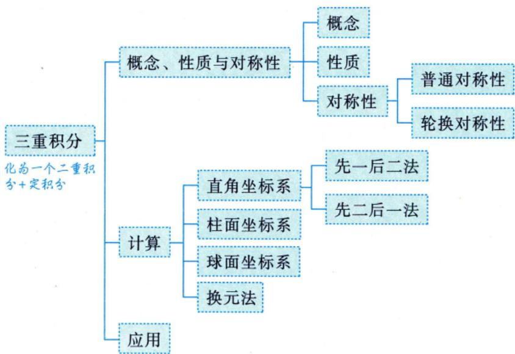

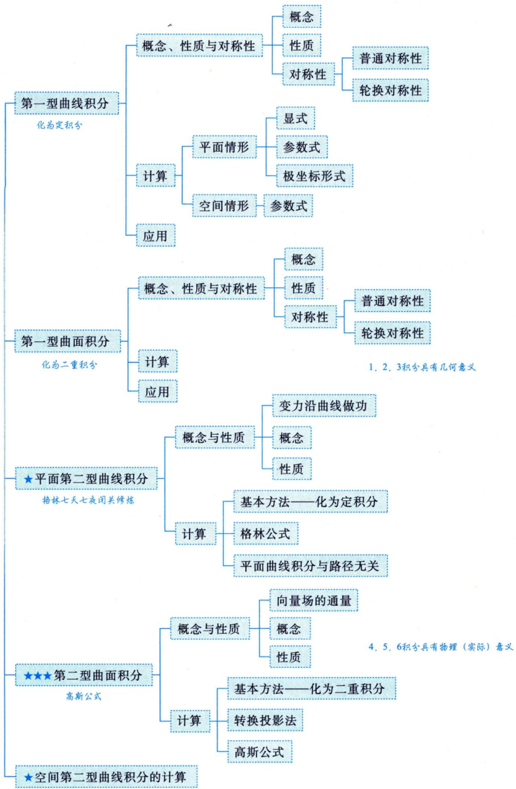  
斯托克斯公式

# 三重积分

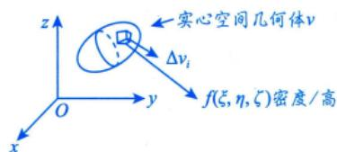  
分割

# 1 概念

设 $f(x,y,z)$ 是空间有界闭区域 $\Omega$ 上的有界函数，将 $\Omega$ 任意分成 $n$ 个小闭区域

$$
\Delta v _ {1}, \Delta v _ {2}, \dots , \Delta v _ {n},
$$

其中 $\Delta v_{i}$ 表示第 $i$ 个小闭区域，也表示它的体积.在每个 $\Delta v_{i}$ 上任取  
一点 $(\xi_i,\eta_i,\zeta_i)$ ，作乘积 $f(\xi_i,\eta_i,\zeta_i)\Delta v_i(i = 1,2,\dots ,n)$ ，并作和  
求和 $\sum_{i = 1}^{n}f(\xi_i,\eta_i,\zeta_i)\Delta v_i.$ 如果当各小闭区域直径中的最大值 $\lambda$ 趋于零时，  
取极限  
这和的极限总存在（与 $\Delta v_{i}$ 的分法及 $(\xi_i,\eta_i,\zeta_i)$ 的取法均无关），  
则称此极限值为函数 $f(x,y,z)$ 在闭区域 $\Omega$ 上的三重积分，记作 $\iiint_{\Omega}f(x,y,z)\mathrm{d}\nu$ ，即

知识回顾二重积分：分割、近似，求和，取极限

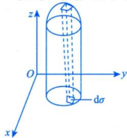

$\lim_{\lambda \to 0}\sum_{k = 1}^{n}f(\xi_k,\eta_k)\Delta \sigma_k = \iint \limits_{D}f(x,y)\mathrm{d}\sigma$

$\iint \limits_{D}\mathbf{\nabla}f(x,y)\mathrm{d}\sigma$ 平面

$\iiint_{D} f(x, y, z) \, \mathrm{d}\nu$

$$
\iiint_ {\Omega} f (x, y, z) \underline {{\mathrm {d} v}} = \lim  _ {\lambda \rightarrow 0} \sum_ {i = 1} ^ {n} f (\xi_ {i}, \eta_ {i}, \zeta_ {i}) \Delta v _ {i},
$$

其中 $f(x,y,z)$ 称为被积函数， $f(x,y,z)\mathrm{d}\nu$ 称为被积表达式， $\mathrm{d}\nu$ 称为体积元素， $x,y$ 与 $z$ 称为积分变量， $\Omega$ 称为积分区域， $\sum_{i = 1}^{n}f(\xi_i,\eta_i,\zeta_i)\Delta \nu_i$ 称为积分和.

若 $f(x,y,z)$ 在 $\Omega$ 上连续，则三重积分

$$
\iiint_ {\Omega} f (x, y, z) \mathrm {d} v
$$

一定存在.

注 三重积分的物理意义：设一物体占有 $Oxyz$ 上的闭区域 $\Omega$ ，在点 $(x, y, z)$ 处的体密度为 $\rho(x, y, z)$ ，假定 $\rho(x, y, z)$ 在 $\Omega$ 上连续，则物体的质量

$$
M = \iiint_ {\Omega} \rho (x, y, z) d v.
$$

# 2 性质

以下总假设 $\Omega$ 为空间有界闭区域.

性质1（求空间区域的体积） $\iiint_{\Omega} 1 \mathrm{~d}\nu = \iiint_{\Omega} \mathrm{d}\nu = V$ ，其中 $V$ 为 $\Omega$ 的体积.

性质2（可积函数必有界）设 $f(x,y,z)$ 在 $\Omega$ 上可积，则其在 $\Omega$ 上必有界.

性质3（积分的线性性质）设 $k_{1}, k_{2}$ 为常数，则

$$
\iiint_ {\Omega} \left[ k _ {1} f (x, y, z) \pm k _ {2} g (x, y, z) \right] d v = k _ {1} \iiint_ {\Omega} f (x, y, z) d v \pm k _ {2} \iiint_ {\Omega} g (x, y, z) d v.
$$

性质4（积分的可加性）设 $f(x,y,z)$ 在 $\Omega$ 上可积，且 $\Omega_1\cup \Omega_2 = \Omega ,\Omega_1\cap \Omega_2 = \varnothing$ ，则

$$
\iiint_ {\Omega} f (x, y, z) \mathrm {d} v = \iiint_ {\Omega_ {1}} f (x, y, z) \mathrm {d} v + \iiint_ {\Omega_ {2}} f (x, y, z) \mathrm {d} v.
$$

性质5（积分的保号性）设 $f(x,y,z),g(x,y,z)$ 在 $\varOmega$ 上可积，且在 $\varOmega$ 上 $f(x,y,z)\leqslant g(x,y,z)$ 则有

$$
\iiint_ {\Omega} f (x, y, z) \mathrm {d} v \leqslant \iiint_ {\Omega} g (x, y, z) \mathrm {d} v.
$$

特殊地, 有 $\left| {\iiint }_{\Omega }f\left( {x,y,z}\right) \mathrm{d}v\right|  \leq  \iiint \limits_{\Omega }\left| {f\left( {x,y,z}\right) }\right| \mathrm{d}v. >$ 绝对值不等式

性质6（三重积分的估值定理）设 $M, m$ 分别是 $f(x, y, z)$ 在 $\Omega$ 上的最大值和最小值， $V$ 为 $\Omega$ 的体积，则有

$$
m V \leqslant \iiint_ {\Omega} f (x, y, z) \mathrm {d} v \leqslant M V.
$$

性质7（三重积分的中值定理）设 $f(x,y,z)$ 在 $\Omega$ 上连续， $V$ 为 $\Omega$ 的体积，则在 $\Omega$ 上至少存在一点 $(\xi ,\eta ,\zeta)$ ，使得

$$
\iiint_ {\Omega} f (x, y, z) \mathrm {d} v = f (\xi , \eta , \zeta) V.
$$

# 3 普通对称性与轮换对称性

分析方法与二重积分完全一样. 关于 $yOz$ （前后）： $(x, y, z)$ 与 $(-x, y, z)$ 对应关于 $xOy$ （上下）： $(x, y, z)$ 与 $(x, y, -z)$ 对应

(1) 普通对称性：

假设 $\Omega$ 关于 $xOz$ 面对称（见图18-1），则

$x, z$ 不动，关于 $y$ 为偶函数

$$
\iiint_ {\Omega} f (x, y, z) \mathrm {d} v = \left\{ \begin{array}{l l} 2 \iiint_ {\Omega_ {1}} f (x, y, z) \mathrm {d} v, & f (x, y, z) = f (x, - y, z), \\ 0, & f (x, y, z) = - f (x, - y, z), \end{array} \right.
$$

其中 $\Omega_{1}$ 是 $\Omega$ 在 $xOz$ 面右边的部分.

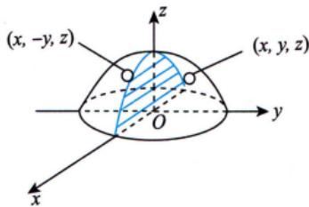  
图18-1

关于其他坐标面对称的情况与此类似.

(2)轮换对称性.

在直角坐标系下，若把 $x$ 与 $y$ 对调后， $\Omega$ 不变，则 $\iiint_{\Omega} f(x, y, z) \, \mathrm{d}x \, \mathrm{d}y \, \mathrm{d}z = \iiint_{\Omega} f(y, x, z) \, \mathrm{d}x \, \mathrm{d}y \, \mathrm{d}z$ ，这就是轮换对称性。用轮换对称性就是为了相加后，被积函数简单

关于其他情况与此类似.

如 $\Omega = \left\{(x, y, z) \mid x^2 + y^2 + z^2 \leqslant R^2\right\}$ ，则 $\iiint_{\Omega} f(x) \, \mathrm{d}x \, \mathrm{d}y \, \mathrm{d}z = \iiint_{\Omega} f(y) \, \mathrm{d}x \, \mathrm{d}y \, \mathrm{d}z = \iiint_{\Omega} f(z) \, \mathrm{d}x \, \mathrm{d}y \, \mathrm{d}z$ 可以化简计算.

具体应用见后面的例子.

注 空间区域 $\Omega$ 大观.

考生应能熟练画出以下图形，并时常翻之，看之，动手画图.

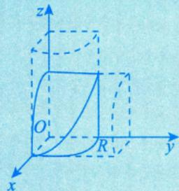

$$
\left\{ \begin{array}{l} x ^ {2} + y ^ {2} = R ^ {2}, \\ x ^ {2} + z ^ {2} = R ^ {2} \end{array} \right.
$$

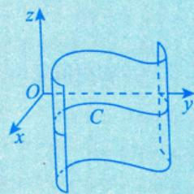

$$
F (x, y) = 0
$$

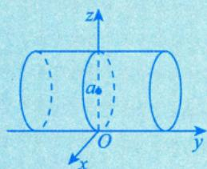

$$
x ^ {2} + z ^ {2} = 2 a z
$$

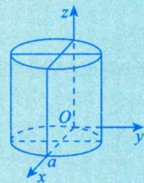

$$
\left(x - \frac {a}{2}\right) ^ {2} + y ^ {2} = \left(\frac {a}{2}\right) ^ {2}
$$

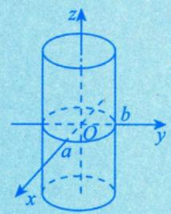

$$
\frac {x ^ {2}}{a ^ {2}} + \frac {y ^ {2}}{b ^ {2}} = 1
$$

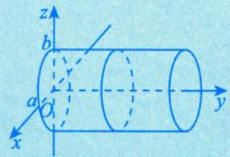

$$
\frac {x ^ {2}}{a ^ {2}} + \frac {z ^ {2}}{b ^ {2}} = 1
$$

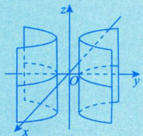

$$
- \frac {x ^ {2}}{a ^ {2}} + \frac {y ^ {2}}{b ^ {2}} = 1
$$

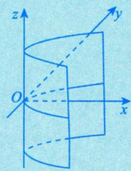

$$
y ^ {2} = x
$$

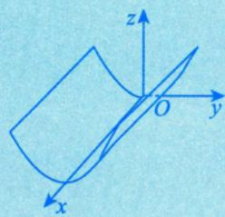

$$
z = y ^ {2}
$$

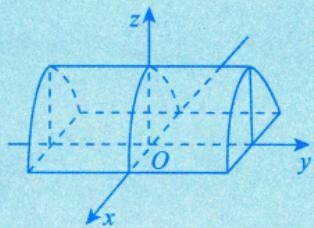

$$
z = 1 - x ^ {2}
$$

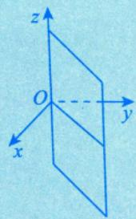

$$
x - y = 0
$$

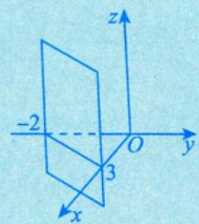

$$
2 x - 3 y - 6 = 0
$$

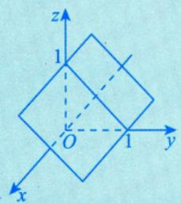

$$
y + z = 1
$$

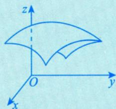

$$
F (x, y, z) = 0
$$

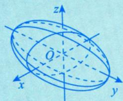

$$
\frac {x ^ {2}}{a ^ {2}} + \frac {y ^ {2}}{b ^ {2}} + \frac {z ^ {2}}{c ^ {2}} = 1
$$

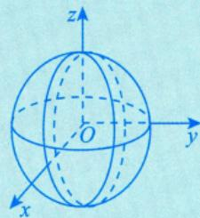

$$
x ^ {2} + y ^ {2} + z ^ {2} = R ^ {2}
$$

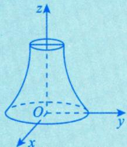

$$
f (\pm \sqrt {x ^ {2} + y ^ {2}}, z) = 0
$$

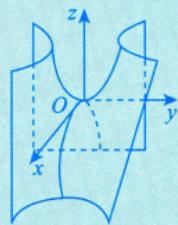

$$
- \frac {x ^ {2}}{2 p} + \frac {y ^ {2}}{2 q} = z, p, q > 0
$$

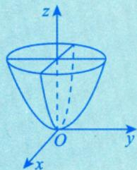

$$
\frac {x ^ {2}}{2 p} + \frac {y ^ {2}}{2 q} = z, p, q > 0
$$

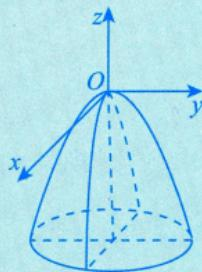

$$
\frac {x ^ {2}}{2 p} + \frac {y ^ {2}}{2 q} = z, p, q <   0
$$

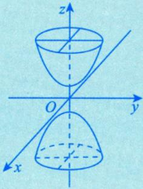

$$
\frac {x ^ {2}}{a ^ {2}} + \frac {y ^ {2}}{b ^ {2}} - \frac {z ^ {2}}{c ^ {2}} = - 1
$$

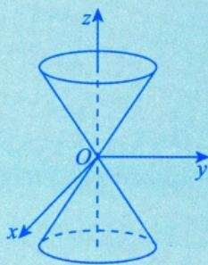

$$
\frac {x ^ {2}}{a ^ {2}} + \frac {y ^ {2}}{b ^ {2}} - \frac {z ^ {2}}{c ^ {2}} = 0
$$

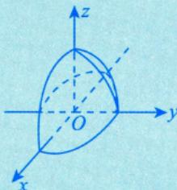

$$
z = 1 - x ^ {2} - 2 y ^ {2}, z \geqslant 0
$$

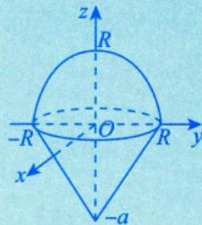

$$
\left\{ \begin{array}{l} z = \sqrt {R ^ {2} - x ^ {2} - y ^ {2}}, \\ z = \frac {a}{R} \sqrt {x ^ {2} + y ^ {2}} - a \end{array} (R > 0, a > 0) \right.
$$

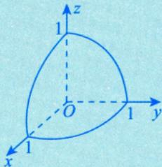

$$
z = \sqrt {1 - x ^ {2} - y ^ {2}}, x \geqslant 0, y \geqslant 0
$$

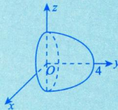

$$
4 - y = x ^ {2} + z ^ {2}, y \geqslant 0
$$

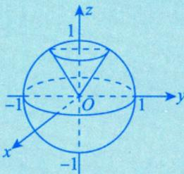

$$
\left\{ \begin{array}{l} z = \sqrt {x ^ {2} + y ^ {2}}, \\ x ^ {2} + y ^ {2} + z ^ {2} = 1 \end{array} \right.
$$

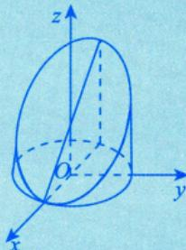

$$
\left\{ \begin{array}{l} x ^ {2} + y ^ {2} = 4, \\ x + z = 2, \\ z = 0 \end{array} \right.
$$

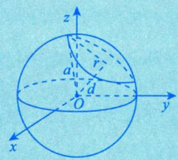

$$
\left\{ \begin{array}{l} x ^ {2} + y ^ {2} + z ^ {2} = a ^ {2}, \\ x + y + z = \frac {3}{2} a \end{array} (a > 0) \right.
$$

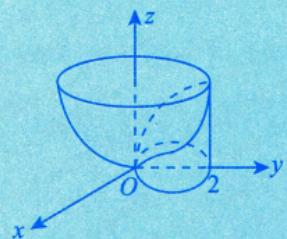

$$
\left\{ \begin{array}{l} x ^ {2} + (y - 1) ^ {2} = 1, \\ z = x ^ {2} + y ^ {2} \end{array} \right.
$$

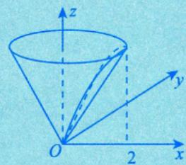

$$
\left\{ \begin{array}{l} z = \sqrt {x ^ {2} + y ^ {2}}  , \\ z ^ {2} = 2 x \end{array} \right.
$$

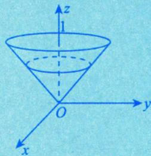

$$
\left\{ \begin{array}{l} z = \sqrt {x ^ {2} + y ^ {2}}  , \\ z = 1 \end{array} \right.
$$

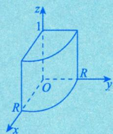

$$
x ^ {2} + y ^ {2} = R ^ {2}, x, y > 0, 0 <   z <   1
$$

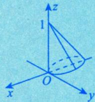

$$
x ^ {2} + 2 x (1 - z) + y ^ {2} = 0, \quad 0 \leqslant z \leqslant 1
$$

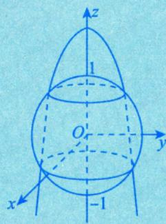

$$
\left\{ \begin{array}{l} x ^ {2} + y ^ {2} + z ^ {2} = 1, \\ 6 (x ^ {2} + y ^ {2}) = - z + 4 \end{array} \right.
$$

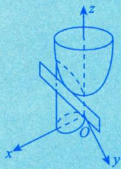

$$
\left\{ \begin{array}{l} z = x ^ {2} + y ^ {2} + 1, \\ z = 2 x, \\ (x - 1) ^ {2} + y ^ {2} = 1 \end{array} \right.
$$

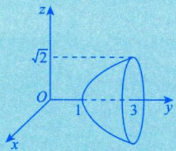

$\left\{ \begin{array}{l} z = \sqrt{y - 1}, \\ x = 0 \end{array} \right.$ （2号 $(1\leqslant y\leqslant 3)$ （绕 $y$ 轴旋转）

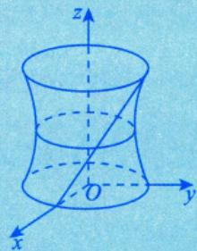

$\left\{ \begin{array}{l}x = 1 - z,\\ y = z \end{array} \right.$ （绕 $z$ 轴旋转）

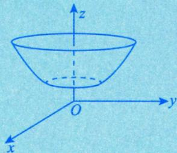

$\left\{ \begin{array}{l} z = \mathrm{e}^{y}, \\ x = 0 \end{array} \right.$ （204 $1 \leqslant y \leqslant 2$ （绕 $z$ 轴旋转）

# 4 计算

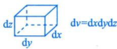

# (1) 直角坐标系.

$①$ 先一后二法（先 $z$ 后 $xy$ 法，也叫投影穿线法）

a.适用场合.

$\varOmega$ 有下曲面 $z = z_{1}(x,y)$ 、上曲面 $z = z_{2}(x,y)$ ，无侧面或侧面为柱面，如图18-2所示.

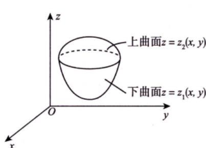  
（无侧面）  
(a)

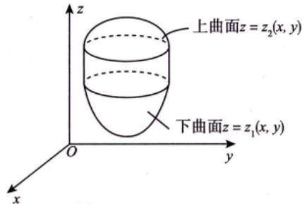  
（侧面为柱面）  
(b)   
图18-2

b.计算方法.

如图18-3所示，有 $\iiint_{\Omega} f(x, y, z) \mathrm{d}\nu = \iint_{D_{xy}} \mathrm{d}\sigma \int_{z_1(x, y)}^{z_2(x, y)} f(x, y, z) \mathrm{d}z.$

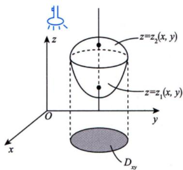  
(a)

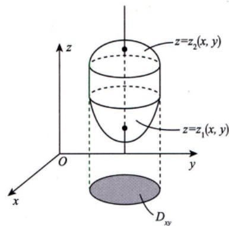  
(b)   
图18-3

后积先定限，限内画条线，先交写下限（下曲面），后交写上限。

② 先二后一法（先 $xy$ 后 $z$ 法，也叫定限截面法）

a.适用场合.

$\Omega$ 是旋转体，其旋转曲面方程为 $\Sigma : z = z(x, y)$ ，如图18-4所示.

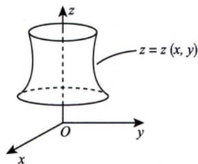  
图18-4

b.计算方法： 后积先定限 限内截个面如图18-5所示，有 $\iiint_{\Omega}f(x,y,z)\mathrm{d}\nu = \boxed{\int_a^b\mathrm{d}z}\iint_{D_z}f(x,y,z)\mathrm{d}\sigma .$

  
图18-5

例18.1 设 $\Omega$ 是由平面 $x + y + z = 1$ 与三个坐标平面所围成的空间区域，则 $\iiint_{\Omega} (x + 2y + 3z) \, \mathrm{d}x \, \mathrm{d}y \, \mathrm{d}z =$

分析 用轮换对称性.

此题投影穿线法更简单

解 应填 $\frac{1}{4}$

方法一 积分区域如图18-6(a)所示.

  
图18-6

由轮换对称性知，

$$
\iiint_ {\Omega} x \mathrm {d} v = \iiint_ {\Omega} y \mathrm {d} v = \iiint_ {\Omega} z \mathrm {d} v,
$$

则 $I = \iiint_{\Omega}(x + 2y + 3z)\mathrm{d}\nu = 6\iiint_{\Omega}z\mathrm{d}\nu .$

记 $\Omega: 0 \leqslant z \leqslant 1, (x, y) \in D(z), D(z)$ 是过 $z$ 轴上 $[0, 1]$ 中任一点 $z$ 作垂直于 $z$ 轴的平面截 $\Omega$ 所得平面区域[平移到 $xOy$ 平面上，见图18-6(b)]，其面积为 $\frac{1}{2}(1 - z)^2$ ，于是由先二后一法（定限截面法），得

$$
\begin{array}{l} \iiint_ {\Omega} z \mathrm {d} v = \int_ {0} ^ {1} z \mathrm {d} z \boxed {\iint_ {D (z)} \mathrm {d} x \mathrm {d} y} = \int_ {0} ^ {1} \frac {1}{2} (1 - z) ^ {2} z \mathrm {d} z \\ = \int_ {0} ^ {1} \frac {1}{2} (z - 2 z ^ {2} + z ^ {3}) d z \\ = \left. \frac {1}{2} z ^ {2} - \frac {2}{3} z ^ {3} + \frac {1}{4} z ^ {4} \right| _ {0} ^ {1} = \frac {1}{2 4}, \\ \end{array}
$$

因此 $I = 6 \times \frac{1}{24} = \frac{1}{4}$ .

方法二 同方法一，有 $I = 6\iiint_{\Omega}z\mathrm{d}\nu$

记 $\Omega: 0 \leqslant z \leqslant 1 - x - y, (x, y) \in D_{xy}, D_{xy} = \{(x, y) \mid 0 \leqslant x \leqslant 1, 0 \leqslant y \leqslant 1 - x\}$ ，如图18-6(c)所示.于是由先一后二法（投影穿线法），得

$$
\begin{array}{l} \iint_ {D _ {x y}} \mathrm {d} \sigma \int_ {0} ^ {1 - x - y} z \mathrm {d} z \quad \iiint_ {\Omega} z \mathrm {d} v = \iint_ {D _ {x y}} \left(\int_ {0} ^ {1 - x - y} z \mathrm {d} z\right) \mathrm {d} x \mathrm {d} y = \iint_ {D _ {x y}} \frac {1}{2} (1 - x - y) ^ {2} \mathrm {d} x \mathrm {d} y \\ = \frac {1}{2} \int_ {0} ^ {1} d x \int_ {0} ^ {1 - x} (1 - x - y) ^ {2} d y \\ = \frac {1}{2} \int_ {0} ^ {1} \left[ - \frac {1}{3} (1 - x - y) ^ {3} \right| _ {y = 0} ^ {y = 1 - x} \mathrm {d} x \\ = \frac {1}{6} \int_ {0} ^ {1} (1 - x) ^ {3} d x = \frac {1}{2 4}, \\ \end{array}
$$

因此 $I = 6 \times \frac{1}{24} = \frac{1}{4}$ .

(2) 柱面坐标系 $=$ 极坐标系下二重积分与定积分.

在直角坐标系的计算中，如若 $\iint_{D_{xy}}\mathrm{d}\sigma$ 适用于极坐标系，则令 $\left\{ \begin{array}{l}x = r\cos \theta ,\\ y = r\sin \theta , \end{array} \right.$ 便有

$$
\iiint_ {\Omega} f (x, y, z) \mathrm {d} x \mathrm {d} y \mathrm {d} z = \iiint_ {\Omega} f (r \cos \theta , r \sin \theta , z) r \mathrm {d} r \mathrm {d} \theta \mathrm {d} z,
$$

此种计算方法称为柱面坐标系下三重积分的计算.

例18.2 设 $\Omega$ 是由圆柱面 $x^{2} + (y - 1)^{2} = 1$ ，旋转抛物面 $8z = x^{2} + y^{2}$ 以及平面 $z = 0$ 所围成的区

域，则 $I = \iiint_{\Omega}\sqrt{x^2 + y^2}\mathrm{d}\nu = \underline{\quad}.$

解 应填 $\frac{64}{75}$

如图18-7所示，用先一后二法（投影穿线法），即

$$
I = \iint_ {D _ {x y}} \mathrm {d} \sigma \int_ {0} ^ {\frac {x ^ {2} + y ^ {2}}{8}} \sqrt {x ^ {2} + y ^ {2}} \mathrm {d} z
$$

  
图18-7

$$
\text {柱 面 坐 标 法} = \int_ {0} ^ {\pi} \mathrm {d} \theta \int_ {0} ^ {2 \sin \theta} r \mathrm {d} r \int_ {0} ^ {\frac {r ^ {2}}{8}} r \mathrm {d} z = \frac {1}{8} \int_ {0} ^ {\pi} \mathrm {d} \theta \int_ {0} ^ {2 \sin \theta} r ^ {4} \mathrm {d} r
$$

$$
= \frac {4}{5} \int_ {0} ^ {\pi} \sin^ {5} \theta d \theta = \frac {4}{5} \left(2 \times \frac {4}{5} \times \frac {2}{3}\right) = \frac {6 4}{7 5}.
$$

点火公式

$$
\begin{array}{l} = \frac {1}{8} \iint_ {D _ {\text {平}}} \sqrt {x ^ {2} + y ^ {2}} \cdot (x ^ {2} + y ^ {2}) d \sigma \\ = \frac {1}{8} \int_ {0} ^ {\pi} \mathrm {d} \theta \int_ {0} ^ {2 \sin \theta} r ^ {3} r \mathrm {d} r \\ = \frac {1}{4 0} \cdot 2 ^ {5} \int_ {0} ^ {\pi} \sin^ {5} \theta d \theta = \frac {6 4}{7 5}. \\ \end{array}
$$

(3)球面坐标系.

$①$ 适用场合.

a. 被积函数中含 $\left\{ \begin{array}{l} f(x^2 + y^2 + z^2), \\ f(x^2 + y^2). \end{array} \right.$

球或球的部分，b.积分区域为锥或锥的部分.

$②$ 计算方法.令

球面坐标系应该是整个高等数学或者说微积分里最复杂的一种计算方法，我们打一套拳来把这个问题解决。

第一步，转：从 $xOz$ 面出发，拉着一扇门绕 $z$ 轴（从 $z$ 轴正向向下看）逆时针旋转一周.见a.

第二步,开：从2轴出发,喇叭花开花,伸展运动,从0°开始到180°.见b.

第三步, 穿: 从原点发出一条射线, 至无穷远处. 见c.

这套拳可称为“球系太极拳”，在解决积兮问题的同时，舒展筋骨，强身健体。

则 $\mathrm{d}\nu = \sqrt{r^2\sin\varphi}\mathrm{d}r\mathrm{d}\varphi \mathrm{d}\theta$

测度的倍数

a.过z轴的半平面与xOz面正向夹角为θ（取值范围[0,2π]）{先碰到Ω，记θ1，后离开Ω，记θ2.

  
拉着一扇门往后转

b. 顶点在原点，以 $z$ 轴为中心轴的圆锥面半顶角为 $\varphi$ （取值范围 $[0, \pi]$ ） $\left\{ \begin{array}{l} \text{先碰到 } \Omega, \text{ 记 } \varphi_1(\theta), \\ \text{后离开 } \Omega, \text{ 记 } \varphi_2(\theta). \end{array} \right.$

c.从原点出发画一条长为 $r$ 的线（取值范围 $[0, + \infty)$ ） $\left\{ \begin{array}{l}\text{先碰到} \Omega ,\text{记} r_1(\varphi ,\theta),\\ \text{后离开}\Omega ,\text{记} r_2(\varphi ,\theta). \end{array} \right.$

于是

$$
\begin{array}{l} \iiint_ {\Omega} f (x, y, z) \mathrm {d} v = \iiint_ {\Omega} f (\underline {{r}} \sin \varphi \cos \theta , r \sin \varphi \sin \theta , r \cos \varphi) r ^ {2} \sin \varphi \mathrm {d} r \mathrm {d} \varphi \mathrm {d} \theta \\ = \int_ {\theta_ {1}} ^ {\theta_ {2}} d \theta \int_ {\varphi_ {1} (\theta)} ^ {\varphi_ {2} (\theta)} d \varphi \int_ {r _ {1} (\varphi , \theta)} ^ {r _ {2} (\varphi , \theta)} f (r \sin \varphi \cos \theta , r \sin \varphi \sin \theta , r \cos \varphi) r ^ {2} \sin \varphi d r. \\ \end{array}
$$

例18.3 设 $\Omega = \{(x, y, z) | x^2 + y^2 + z^2 \leqslant 1\}$ ，则 $\iiint_{\Omega} z^2 \, \mathrm{d}x \, \mathrm{d}y \, \mathrm{d}z = \_$ .

解 应填 $\frac{4\pi}{15}$

由轮换对称性可知， $\iiint_{\Omega} z^2 \, \mathrm{d}x \, \mathrm{d}y \, \mathrm{d}z = \iiint_{\Omega} x^2 \, \mathrm{d}x \, \mathrm{d}y \, \mathrm{d}z = \iiint_{\Omega} y^2 \, \mathrm{d}x \, \mathrm{d}y \, \mathrm{d}z$ ，所以

$$
\begin{array}{l} \iiint_ {\Omega} z ^ {2} \mathrm {d} x \mathrm {d} y \mathrm {d} z = \frac {1}{3} \iiint_ {\Omega} \left(x ^ {2} + y ^ {2} + z ^ {2}\right) \mathrm {d} x \mathrm {d} y \mathrm {d} z = \frac {1}{3} \cdot \int_ {0} ^ {2 \pi} \mathrm {d} \theta \int_ {0} ^ {\pi} \mathrm {d} \varphi \int_ {0} ^ {1} r ^ {2} \cdot r ^ {2} \sin \varphi \mathrm {d} r \\ = \frac {2 \pi}{3} \int_ {0} ^ {\pi} \sin \varphi d \varphi \int_ {0} ^ {1} r ^ {4} d r = \frac {4 \pi}{1 5}. \\ \end{array}
$$

例18.4 设 $\Omega = \{(x, y, z) \mid \sqrt{x^2 + y^2} \leqslant z \leqslant 1\}$ ，则 $\iiint_{\Omega} \frac{1}{\sqrt{x^2 + y^2 + z^2}} \mathrm{d}\nu = \_$ .

解 应填 $(\sqrt{2} - 1)\pi$ ：

如图18-8所示，从原点引射线穿过 $\Omega$ ，从 $z = 1$ 穿出，即 $r\cos \varphi = 1$ ，则 $r = \frac{1}{\cos\varphi}$ 为上限，于是

$$
\begin{array}{l} I = \int_ {0} ^ {2 \pi} \mathrm {d} \theta \int_ {0} ^ {\frac {\pi}{4}} \mathrm {d} \varphi \int_ {0} ^ {\frac {1}{\cos \varphi}} \frac {1}{r} \cdot r ^ {2} \sin \varphi \mathrm {d} r = 2 \pi \int_ {0} ^ {\frac {\pi}{4}} \frac {1}{2} r ^ {2} \left| _ {0} ^ {\frac {1}{\cos \varphi}} \right. \cdot \sin \varphi \mathrm {d} \varphi \\ = \pi \int_ {0} ^ {\frac {\pi}{4}} \frac {1}{\cos^ {2} \varphi} \cdot \sin \varphi d \varphi = - \pi \int_ {0} ^ {\frac {\pi}{4}} \frac {1}{\cos^ {2} \varphi} d (\cos \varphi) = \pi \cdot \left. \frac {1}{\cos \varphi} \right| _ {0} ^ {\frac {\pi}{4}} = (\sqrt {2} - 1) \pi . \\ \end{array}
$$

  
图18-8

(4) 换元法.

$\iiint_{D_{xyz}} f(x, y, z) \, \mathrm{d}x \, \mathrm{d}y \, \mathrm{d}z$ 重积分盯着区域来换元 $x = x(u, v, w)$ 古性的 $\Omega_{xyz} \to$ 常规的 $\Omega_{uvw}$ 雅可比行列式 $y = y(u, v, w)$ $y = y(u, v, w)$ $f[x(u, v, w), y(u, v, w), z(u, v, w)] \frac{\partial(x, y, z)}{\partial(u, v, w)} \, \mathrm{d}u \, \mathrm{d}v \, \mathrm{d}w.$ $z = z(u, v, w)$ $z = z(u, v, w)$

① $f(x,y,z)\rightarrow f[x(u,v,w),y(u,v,w),z(u,v,w)]$   
$② \iiint_{\Omega_{xyz}} \rightarrow \iiint_{\Omega_{uvw}}$

③ $\mathrm{d}x\mathrm{d}y\mathrm{d}z\rightarrow \left|\frac{\partial(x,y,z)}{\partial(u,v,w)}\right|\mathrm{d}u\mathrm{d}v\mathrm{d}w.$ 类比： $①$ dxdy=rdrdθ, ② dxdydz=r²sinφdrdφdθ

其中

a. $\left\{ \begin{array}{l}x = x(u,v,w),\\ y = y(u,v,w),\\ z = z(u,v,w) \end{array} \right.$ 是空间 $(x,y,z)$ 到空间 $(u,\nu ,w)$ 的一一映射；  
b. $x = x(u,v,w),y = y(u,v,w),z = z(u,v,w)$ 有一阶连续偏导数，且

$$
\frac {\partial (x , y , z)}{\partial (u , v , w)} = \left| \begin{array}{c c c} \frac {\partial x}{\partial u} & \frac {\partial x}{\partial v} & \frac {\partial x}{\partial w} \\ \frac {\partial y}{\partial u} & \frac {\partial y}{\partial v} & \frac {\partial y}{\partial w} \\ \frac {\partial z}{\partial u} & \frac {\partial z}{\partial v} & \frac {\partial z}{\partial w} \end{array} \right| \neq 0.
$$

柱面坐标系  
另外，令 $\left\{ \begin{array}{l}x = r\cos \theta ,\\ y = r\sin \theta ,\\ z = z, \end{array} \right.$ 则

$$
\begin{array}{l} \iiint_ {\Omega_ {x y z}} f (x, y, z) \mathrm {d} x \mathrm {d} y \mathrm {d} z = \iiint_ {\Omega_ {r \theta z}} f (r \cos \theta , r \sin \theta , z) \left| \frac {\partial (x , y , z)}{\partial (r , \theta , z)} \right| \mathrm {d} r \mathrm {d} \theta \mathrm {d} z \\ = \iiint_ {\Omega_ {r \theta z}} f (r \cos \theta , r \sin \theta , z) \left\| \begin{array}{l l l} \frac {\partial x}{\partial r} & \frac {\partial x}{\partial \theta} & \frac {\partial x}{\partial z} \\ \frac {\partial y}{\partial r} & \frac {\partial y}{\partial \theta} & \frac {\partial y}{\partial z} \\ \frac {\partial z}{\partial r} & \frac {\partial z}{\partial \theta} & \frac {\partial z}{\partial z} \end{array} \right\| d r d \theta d z \\ = \iiint_ {\Omega_ {r \theta z}} f (r \cos \theta , r \sin \theta , z) \left\| \begin{array}{c c c} \cos \theta & - r \sin \theta & 0 \\ \sin \theta & r \cos \theta & 0 \\ 0 & 0 & 1 \end{array} \right\| d r d \theta d z \\ = \iiint_ {\Omega_ {r \theta z}} f (r \cos \theta , r \sin \theta , z) r d r d \theta d z. \\ \end{array}
$$

这就是直角坐标系到柱面坐标系的换元过程.

令 $\left\{ \begin{array}{l}x = r\sin \varphi \cos \theta ,\\ y = r\sin \varphi \sin \theta ,\\ z = r\cos \varphi , \end{array} \right.$ 则

$$
\iiint_ {\Omega_ {x y z}} f (x, y, z) \mathrm {d} x \mathrm {d} y \mathrm {d} z = \iiint_ {\Omega_ {r \theta \varphi}} f (r \sin \varphi \cos \theta , r \sin \varphi \sin \theta , r \cos \varphi) \left| \frac {\partial (x , y , z)}{\partial (r , \theta , \varphi)} \right| \mathrm {d} r \mathrm {d} \varphi \mathrm {d} \theta
$$

$$
\begin{array}{l} = \iiint_ {\Omega_ {r \theta \varphi}} f (r \sin \varphi \cos \theta , r \sin \varphi \sin \theta , r \cos \varphi) \left\| \begin{array}{l l l} \frac {\partial x}{\partial r} & \frac {\partial x}{\partial \theta} & \frac {\partial x}{\partial \varphi} \\ \frac {\partial y}{\partial r} & \frac {\partial y}{\partial \theta} & \frac {\partial y}{\partial \varphi} \\ \frac {\partial z}{\partial r} & \frac {\partial z}{\partial \theta} & \frac {\partial z}{\partial \varphi} \end{array} \right\| d r d \varphi d \theta \\ = \iiint_ {\Omega_ {r \phi \varphi}} f (r \sin \varphi \cos \theta , r \sin \varphi \sin \theta , r \cos \varphi) \cdot \left\| \begin{array}{c c c} \sin \varphi \cos \theta & - r \sin \varphi \sin \theta & r \cos \varphi \cos \theta \\ \sin \varphi \sin \theta & r \sin \varphi \cos \theta & r \cos \varphi \sin \theta \\ \cos \varphi & 0 & - r \sin \varphi \end{array} \right\| d r d \varphi d \theta \\ = \iiint_ {\Omega_ {r \theta p}} f (r \sin \varphi \cos \theta , r \sin \varphi \sin \theta , r \cos \varphi) r ^ {2} \sin \varphi d r d \varphi d \theta . \\ \end{array}
$$

这就是直角坐标系到球面坐标系的换元过程.

例18.5 设 $\Omega = \{(x, y, z) | x^2 + 4y^2 + z^2 \leqslant 1\}$ ，则 $I = \iiint_{\Omega} (1 - x^2 - 4y^2 - z^2) \, \mathrm{d}x \, \mathrm{d}y \, \mathrm{d}z = \_$ .

$$
x ^ {2} + \frac {y ^ {2}}{\frac {1}{4}} + z ^ {2} \leqslant 1 \text {为 椭 球 体}
$$

分析 令 $\left\{ \begin{array}{l}x = x_{1},\\ 2y = y_{1},\\ z = z_{1}, \end{array} \right.$ 则 $\iiint_{x^2 +4y^2 +z^2\leqslant 1}(1 - x^2 -4y^2 -z^2)\mathrm{d}x\mathrm{d}y\mathrm{d}z = \iiint_{x_1^2 +y_1^2 +z_1^2\leqslant 1}(1 - x_1^2 -y_1^2 -z_1^2)\mathrm{d}x_1\cdot \frac{1}{2}\mathrm{d}y_1\mathrm{d}z_1.$

解 应填 $\frac{4\pi}{15}$

令

$$
\left\{ \begin{array}{l} x = r \sin \varphi \cos \theta , \\ y = \frac {1}{2} r \sin \varphi \sin \theta , \\ z = r \cos \varphi , \end{array} \right.
$$

于是 $J = \frac{\partial(x,y,z)}{\partial(r,\theta,\varphi)} = \begin{vmatrix} \frac{\partial x}{\partial r} & \frac{\partial x}{\partial\theta} & \frac{\partial x}{\partial\varphi}\\ \frac{\partial y}{\partial r} & \frac{\partial y}{\partial\theta} & \frac{\partial y}{\partial\varphi}\\ \frac{\partial z}{\partial r} & \frac{\partial z}{\partial\theta} & \frac{\partial z}{\partial\varphi} \end{vmatrix} = -\frac{1}{2} r^2\sin \varphi ,$

则

$$
\begin{array}{l} I = \iiint_ {x ^ {2} + 4 y ^ {2} + z ^ {2} \leqslant 1} (1 - x ^ {2} - 4 y ^ {2} - z ^ {2}) d x d y d z \\ = \iiint_ {x _ {1} ^ {2} + y _ {1} ^ {2} + z _ {1} ^ {2} \leqslant 1} \left(1 - x _ {1} ^ {2} - y _ {1} ^ {2} - z _ {1} ^ {2}\right) \frac {1}{2} d x _ {1} d y _ {1} d z _ {1} \quad \rightarrow x _ {1} = r \sin \varphi \cos \theta , \\ = \int_ {0} ^ {2 \pi} \mathrm {d} \theta \int_ {0} ^ {\pi} \mathrm {d} \varphi \int_ {0} ^ {1} (1 - r ^ {2}) \frac {1}{2} r ^ {2} \sin \varphi \mathrm {d} r = \frac {4 \pi}{1 5}. \quad z _ {1} = r \cos \varphi \\ \end{array}
$$

# 5 应用

(1) 若 $\Omega$ 是物体所占的空间区域，则其体积为 $V = \iiint_{\Omega} \mathrm{d}\nu$ 。

$\star$ (2)对于空间物体，若体密度为 $\rho (x,y,z)$ ， $\Omega$ 是物体所占的空间区域，则计算重心 $(\overline{x},\overline{y},\overline{z})$ 的公式为

$$
\bar {x} = \frac {\iiint_ {\Omega} x \rho (x , y , z) \mathrm {d} v}{\iiint_ {\Omega} \rho (x , y , z) \mathrm {d} v}, \bar {y} = \frac {\iiint_ {\Omega} y \rho (x , y , z) \mathrm {d} v}{\iiint_ {\Omega} \rho (x , y , z) \mathrm {d} v}, \bar {z} = \frac {\iiint_ {\Omega} z \rho (x , y , z) \mathrm {d} v}{\iiint_ {\Omega} \rho (x , y , z) \mathrm {d} v}.
$$

注 (1)在考研的范畴内，重心就是质心。

(2)当密度 $\rho (x,y)$ 或者 $\rho (x,y,z)$ 为常数时，重心就成了形心.  
(3)形心公式的逆用. 因分子、分母、被积函数都有这个常数,故可约掉

由 $\overline{x} = \frac{\iiint_{\Omega}x\mathrm{d}\nu}{\iiint_{\Omega}\mathrm{d}\nu}$ 得 $\iiint_{\Omega}x\mathrm{d}\nu = \overline{x}\cdot V$ ，其中 $V$ 为 $\Omega$ 的体积.若 $\bar{x}$ 与 $V$ 均易于求出，则可快速计算出 $\iiint_{\Omega}x\mathrm{d}\nu$ ，以下同理.

由 $\bar{y} = \frac{\iiint_{\Omega} y \mathrm{d}\nu}{\iiint_{\Omega} \mathrm{d}\nu}$ ，得 $\iiint_{\Omega} y \mathrm{d}\nu = \bar{y} \cdot V$ ，其中 $V$ 为 $\Omega$ 的体积。

由 $\overline{z} = \frac{\iiint_{\Omega} z \mathrm{d}\nu}{\iiint_{\Omega} \mathrm{d}\nu}$ ，得 $\iiint_{\Omega} z \mathrm{d}\nu = \overline{z} \cdot V$ ，其中 $V$ 为 $\Omega$ 的体积。

(3)对于空间物体，若体密度为 $\rho (x,y,z)$ ， $\Omega$ 是物体所占的空间区域，则计算该物体对 $x$ 轴、 $y$ 轴、 $z$ 轴和原点 $O$ 的转动惯量 $I_{x},I_{y},I_{z}$ 和 $I_O$ 公式分别为

$$
I _ {x} = \iiint_ {\Omega} (y ^ {2} + z ^ {2}) \rho (x, y, z) d v, I _ {y} = \iiint_ {\Omega} (z ^ {2} + x ^ {2}) \rho (x, y, z) d v,
$$

$$
I _ {z} = \iiint_ {\Omega} (x ^ {2} + y ^ {2}) \rho (x, y, z) d v, I _ {O} = \iiint_ {\Omega} (x ^ {2} + y ^ {2} + z ^ {2}) \rho (x, y, z) d v. \underset {(x, y, z)} {\mathrm {d m}} x ^ {2} + y ^ {2} \Big | _ {(0, 0, z)} ^ {z}
$$

(4)对于空间物体，若体密度为 $\rho (x,y,z),\Omega$ 是物体所占的空间区域，则 $r^2\mathrm{dm}$ 为微计算该物体对物体外一点 $M_0(x_0,y_0,z_0)$ 处的质量为 $m$ 的质点的引力 $(F_{x},F_{y},F_{z})$ 公式为

$r^2 dm$ 为微元对 $z$ 轴的转动惯量

$$
F _ {x} = G m \iiint_ {\Omega} \frac {\rho (x , y , z) \left(x - x _ {0}\right)}{\left[ \left(x - x _ {0}\right) ^ {2} + \left(y - y _ {0}\right) ^ {2} + \left(z - z _ {0}\right) ^ {2} \right] ^ {\frac {3}{2}}} d v,
$$

$$
F _ {y} = G m \iiint_ {\Omega} \frac {\rho (x , y , z) (y - y _ {0})}{\left[ (x - x _ {0}) ^ {2} + (y - y _ {0}) ^ {2} + (z - z _ {0}) ^ {2} \right] ^ {\frac {3}{2}}} d v,
$$

$$
F _ {z} = G m \iiint_ {\Omega} \frac {\rho (x , y , z) (z - z _ {0})}{\left[ (x - x _ {0}) ^ {2} + (y - y _ {0}) ^ {2} + (z - z _ {0}) ^ {2} \right] ^ {\frac {3}{2}}} d v.
$$

例18.6 设 $\Omega = \{(x, y, z) | 4x^2 + y^2 + z^2 - 2z \leqslant 3\}$ ，则 $\iiint_{\Omega} z \, \mathrm{d}\nu =$

解 应填 $\frac{16}{3}\pi$ $x^{2} + \frac{y^{2}}{4} +\frac{(z - 1)^{2}}{4}\leqslant 1$ 为椭球体

由于 $\Omega = \left\{(x,y,z)\Bigg|x^2 +\frac{y^2}{4} +\frac{(z - 1)^2}{4}\leqslant 1\right\}$ ，其形心坐标为 $(0,0,1)$ ，于是

$$
\iiint_ {\Omega} z \mathrm {d} v = \bar {z} \cdot V _ {\Omega} = 1 \cdot \frac {4}{3} \cdot \pi \cdot \frac {1}{a} \cdot \frac {2}{b} \cdot \frac {2}{c} = \frac {1 6}{3} \pi . \text {横 球 体} \frac {x ^ {2}}{a ^ {2}} + \frac {y ^ {2}}{b ^ {2}} + \frac {z ^ {2}}{c ^ {2}} \leqslant 1 \text {的 体 积 为} \frac {4}{3} \pi a b c
$$

例18.7 设 $\Omega = \{(x, y, z) | x^2 + y^2 \leqslant z \leqslant 1\}$ ，则 $\Omega$ 的形心的竖坐标 $\overline{z} = \_$

解 应填 $\frac{2}{3}$

设 $D = \{(x,y)|x^2 +y^2\leqslant 1\}$ ，则

$$
\iiint_ {\Omega} \mathrm {d} x \mathrm {d} y \mathrm {d} z = \iint_ {D} \mathrm {d} x \mathrm {d} y \int_ {x ^ {2} + y ^ {2}} ^ {1} \mathrm {d} z = \iint_ {D} (1 - x ^ {2} - y ^ {2}) \mathrm {d} x \mathrm {d} y = \int_ {0} ^ {2 \pi} \mathrm {d} \theta \int_ {0} ^ {1} (1 - r ^ {2}) r \mathrm {d} r = \frac {\pi}{2},
$$

$$
\iiint_ {Q} z \mathrm {d} x \mathrm {d} y \mathrm {d} z = \iint_ {D} \mathrm {d} x \mathrm {d} y \int_ {x ^ {2} + y ^ {2}} ^ {1} z \mathrm {d} z = \frac {1}{2} \iint_ {D} [ 1 - (x ^ {2} + y ^ {2}) ^ {2} ] \mathrm {d} x \mathrm {d} y = \frac {1}{2} \int_ {0} ^ {2 \pi} \mathrm {d} \theta \int_ {0} ^ {1} (1 - r ^ {4}) r \mathrm {d} r = \frac {\pi}{3},
$$

所以 $\overline{z} = \frac{\iiint_{\Omega} z \mathrm{d}x \mathrm{d}y \mathrm{d}z}{\iiint_{\Omega} \mathrm{d}x \mathrm{d}y \mathrm{d}z} = \frac{2}{3}$ .

  
极坐标系算出

# 第一型曲线积分 计算量不大

# 1 概念

设 $L$ 为 $xOy$ 面内的一条光滑曲线弧，函数 $f(x,y)$ 在 $L$ 上有界，在 $L$ 上任意插入一系列点 $M_1,M_2,\dots ,M_{n - 1}$ 把 $L$ 分成 $_n$ 个小段.设第 $_i$ 个小弧段的长度为 $\Delta s_i$ ，又 $(\xi_i,\eta_i)$ 为第 $_i$ 个小弧段上任意取近似 定的一点，作乘积 $f(\xi_i,\eta_i)\Delta s_i(i = 1,2,\dots ,n)$ ，并作和 $\sum_{i = 1}^{n}f(\xi_i,\eta_i)\Delta s_i$ ，如果当各小弧段长度的最大值取极限 $\lambda$ 趋于零时，这和的极限总存在（与 $\Delta s_i$ 的分法及 $(\xi_i,\eta_i)$ 的取法均无关），则称此极限为函数 $f(x,y)$ 在曲线弧 $L$ 上对弧长的曲线积分或第一型曲线积分，记作 $\int_L f(x,y)\mathrm{d}s$ ，即

$$
\int_ {L} f (x, y) \mathrm {d} s = \lim  _ {\lambda \rightarrow 0} \sum_ {i = 1} ^ {n} f (\xi_ {i}, \eta_ {i}) \Delta s _ {i},
$$

其中 $f(x,y)$ 称为被积函数， $f(x,y)\mathrm{d}s$ 称为被积表达式， $x$ 与 $y$ 称为积分变量， $L$ 称为积分弧段.

此定义可以类似地推广到积分弧段为空间曲线弧 $\Gamma$ 的情形，即函数 $f(x,y,z)$ 在曲线弧 $\varGamma$ 上对弧长的曲线积分

$$
\begin{array}{l} \mathrm {d} s = \sqrt {(\mathrm {d} x) ^ {2} + (\mathrm {d} y) ^ {2} + (\mathrm {d} z) ^ {2}} \\ = \sqrt {1 + \left(y _ {x} ^ {\prime}\right) ^ {2} + \left(z _ {x} ^ {\prime}\right) ^ {2}} d x \\ \end{array}
$$

$$
\int_ {\Gamma} f (x, y, z) \mathrm {d} s = \lim  _ {\lambda \rightarrow 0} \sum_ {i = 1} ^ {n} f (\xi_ {i}, \eta_ {i}, \zeta_ {i}) \Delta s _ {i}.
$$

区别：

①底部直线变曲线，

②第一型曲线积分弧微分，

$$
\mathrm {d} s = \sqrt {(\mathrm {d} x) ^ {2} + (\mathrm {d} y) ^ {2}}
$$

注 但事实上，如果仅理解到此，还是不够的。不妨把定积分和第一型曲线积分放在一起作个对比，加深我们对概念的理解。定积分定义在“直线段”上，而第一型曲线积分定义在“曲线段”上，如图18-9、图18-10所示，由于 $f(x, y)$ 定义在 $L: y = y(x)$ 上，故曲线方程 $L$ 可代入被积函数，从而化简计算。

  
图18-9

  
图18-10

# 性质

以下总假设 $\varGamma$ 为空间有限长分段光滑曲线.

性质1（求空间曲线的长度（弧长）） $\int_{\Gamma} 1 \mathrm{~d}s = l_{\Gamma}$ ，其中 $l_{\Gamma}$ 为 $\Gamma$ 的长度.

性质2（可积函数必有界）设 $f(x,y,z)$ 在 $\varGamma$ 上可积，则其在 $\varGamma$ 上必有界.

↓ 同定积分

性质3（积分的线性性质）设 $k_{1}, k_{2}$ 为常数，则

$$
\int_ {\Gamma} \left[ k _ {1} f (x, y, z) \pm k _ {2} g (x, y, z) \right] d s = k _ {1} \int_ {\Gamma} f (x, y, z) d s \pm k _ {2} \int_ {\Gamma} g (x, y, z) d s.
$$

性质4（积分的可加性）设 $f(x,y,z)$ 在 $\varGamma$ 上可积，且 $\Gamma_1\bigcup \Gamma_2 = \Gamma ,\Gamma_1\cap \Gamma_2 = \emptyset$ ，则

$$
\int_ {\Gamma} f (x, y, z) d s = \int_ {\Gamma_ {1}} f (x, y, z) d s + \int_ {\Gamma_ {2}} f (x, y, z) d s.
$$

性质5（积分的保号性）设 $f(x,y,z),g(x,y,z)$ 在 $\varGamma$ 上可积，且在 $\varGamma$ 上 $f(x,y,z)\leqslant g(x,y,z)$ 则有

ds>0 $\int_{\Gamma}f(x,y,z)\underline{\mathrm{d}s}\leqslant \int_{\Gamma}g(x,y,z)\mathrm{d}s.$ ①定积分 $\int_{a}^{b}f(x)\mathrm{d}x$ 若 $a <   b\Rightarrow \mathrm{d}x > 0$ 若 $a > b\Rightarrow \mathrm{d}x <   0$ 特殊地，有 $\left|\int_{\Gamma}f(x,y,z)\mathrm{d}s\right|\leqslant \int_{\Gamma}|f(x,y,z)|\mathrm{d}s$ 积分的保号性 ②二重积分 $\iint_{D}f(x,y)d\sigma .$ 注意： $\mathrm{d}\sigma >0$ ③三重积分 $\iiint_{D}f(x,y,z)\mathrm{d}\nu .$ 注意： $\mathrm{dv} > 0$

性质6（第一型曲线积分的估值定理）设 $M, m$ 分别是 $f(x, y, z)$ 在 $\Gamma$ 上的最大值和最小值， $l_{\Gamma}$ 为 $\Gamma$ 的长度，则有

与定积分、二重积分、三重积分类似 $m l_{\Gamma} \leqslant \int_{\Gamma} f(x, y, z) \mathrm{d}s \leqslant M l_{\Gamma}$ .

性质7（第一型曲线积分的中值定理）设 $f(x,y,z)$ 在 $\varGamma$ 上连续， $l_{\varGamma}$ 为 $\varGamma$ 的长度，则在 $\varGamma$ 上至少存在一点 $(\xi ,\eta ,\zeta)$ ，使得

$$
\int_ {\Gamma} f (x, y, z) \mathrm {d} s = f (\xi , \eta , \zeta) l _ {\Gamma}.
$$

# 普通对称性与轮换对称性

分析方法与二重积分、三重积分完全一样.

(1) 普通对称性.

假设 $\Gamma$ 关于 $xOz$ 面对称，则

$$
\int_ {\Gamma} f (x, y, z) \mathrm {d} s = \left\{ \begin{array}{l l} 2 \int_ {\Gamma_ {1}} f (x, y, z) \mathrm {d} s, & f (x, y, z) = f (x, - y, z), \\ 0, & f (x, y, z) = - f (x, - y, z), \end{array} \right.
$$

  
同理：上下对称，变的是 $z$ ；前后对称，变的是 $x$

其中 $\Gamma_{1}$ 是 $\Gamma$ 在 $xOz$ 面右边的部分.

关于其他坐标面对称的情况与此类似.

(2)轮换对称性.

若把 $x$ 与 $y$ 对调后, $\Gamma$ 不变,则 ${\int }_{\Gamma }f\left( {x,y,z}\right) \mathrm{d}s = {\int }_{\Gamma }f\left( {y,x,z}\right) \mathrm{d}s$ ,这就是轮换对称性. (2) 关于其他情况与此类似. 因为 $\mathrm{d}s = \sqrt{{\left( \mathrm{d}x\right) }^{2} + {\left( \mathrm{d}y\right) }^{2} + {\left( \mathrm{d}z\right) }^{2}}$ 在加法上有交换律,交换 $x$ 与 $y$ 后, $\mathrm{d}s$ 不变

# 计算

由于第一型曲线积分就是由定积分推广而来的，因此计算第一型曲线积分的基本方法就是将其化为定积分.口诀为“一投二代三计算” 从定积分来，回到定积分去

(1)平面情形.

掌握三种体系下曲线积分的计算：① 直角坐标系下；

② 参数式下：

③极坐标系下

① 若平面曲线 $L$ 由 $y = y(x)(a \leqslant x \leqslant b)$ 给出，则 $\mathrm{ds} = \sqrt{1 + [y'(x)]^2}\mathrm{dx}$ ，且

一投二代三计算,这是基本方法的口诀.

$②$ 若平面曲线 $L$ 由参数式 $\left\{ \begin{array}{l}x = x(t),\\ y = y(t) \end{array} \right.$ $(\alpha \leqslant t\leqslant \beta)$ 给出，则ds=√[x'(t)]²+[y'(t)]²dt，且

一投：把 $L$ 投到 $x$ 轴上去,写成 $\int_ {a} ^ {b}$

第二代：注意这里的 $x, y$ 不是独立的，它是受约束于方程 $y = y(x)$ 的，一定要把 $y = y(x)$ 代入 $f(x, y)$ （这是曲线（曲面）积分的特点，因为这里的变量是定义在线上（面上）的，不具有独立性，所以这里必须代入）；

三计算：之前讲过弧微分计算公式

$$
\mathrm {d} s = \sqrt {\left(\mathrm {d} x\right) ^ {2} + \left(\mathrm {d} y\right) ^ {2}} = \sqrt {1 + \left[ y ^ {\prime} (x) \right] ^ {2}} \mathrm {d} x.
$$

经过一投二代三计算,就化成了定积分.

③若平面曲线 $L$ 由极坐标形式 $r = r(\theta)(\alpha \leqslant \theta \leqslant \beta)$ 给出，则 $\mathrm{ds} = \sqrt{\left[r(\theta)\right]^2 + \left[r'(\theta)\right]^2}\mathrm{d}\theta$ ，且

(2) 空间情形.

若空间曲线 $\Gamma$ 由参数式 $\left\{ \begin{array}{l}x = x(t),\\ y = y(t),(\alpha \leqslant t\leqslant \beta)\\ z = z(t) \end{array} \right.$ 给出，则

$$
\mathrm {d} s = \sqrt {\left[ x ^ {\prime} (t) \right] ^ {2} + \left[ y ^ {\prime} (t) \right] ^ {2} + \left[ z ^ {\prime} (t) \right] ^ {2}} \mathrm {d} t,
$$

且

例18.8 已知曲线 $L:y = x^{2}(0\leqslant x\leqslant \sqrt{2})$ ，则 $\int_{L}x\mathrm{d}s = \underline{\quad}$

$\mathcal{P}$ 分析 利用“一投二代三计算”的口诀计算直角坐标系下的第一型曲线积分.

解 应填 $\frac{13}{6}$

$$
\begin{array}{r l} \int_ {L} x \mathrm {d} s & = \int_ {0} ^ {\sqrt {2}} x \sqrt {1 + (2 x) ^ {2}} \mathrm {d} x = \frac {1}{8} \int_ {0} ^ {\sqrt {2}} \sqrt {1 + 4 x ^ {2}} \mathrm {d} (1 + 4 x ^ {2}) \\ & = \frac {1}{1 2} (1 + 4 x ^ {2}) ^ {\frac {3}{2}} \Bigg | _ {0} ^ {\sqrt {2}} = \frac {1 3}{6}. \end{array}
$$

例18.9 设 $L: x^{2} + y^{2} = -2y$ ，则 $I = \oint_{L} \sqrt{x^{2} + y^{2}} \, \mathrm{d}s =$ ______.

$\oint \rightarrow$ 封闭曲线的专用符号

分析 根据曲线 $L$ 及被积函数的表达式，不难发现都含有平方和，所以本题不宜用直角坐标计算，故采用极坐标解题.

解 应填8.

$$
\begin{array}{r l} & {r \text {是} \theta \text {的 函 数},} \\ & {\text {由} x ^ {2} + y ^ {2} = - 2 y \Rightarrow r ^ {2} = - 2 r \sin \theta \Rightarrow r = - 2 \sin \theta} \end{array}
$$

将曲线方程用极坐标表示： $r = -2\sin \theta (-\pi \leqslant \theta \leqslant 0)$ ，则

故 $x = r\cos \theta ,y = r\sin \theta ,\mathrm{d}s = \sqrt{\left[r(\theta)\right]^2 + \left[r'(\theta)\right]^2}\mathrm{d}\theta = \sqrt{4\sin^2\theta + 4\cos^2\theta}\mathrm{d}\theta = 2\mathrm{d}\theta .$ →投，I=一→0r·2dθ二代 I=（-2sinθ）·2dθ=-4sinθdθ=8.一个拱的面积是2

例18.10 设 $\Gamma$ 是空间曲线 $\left\{ \begin{array}{l}x^{2} + y^{2} + z^{2} = 1,\\ x + y + z = 0, \end{array} \right.$ 则 $\oint_{\Gamma}(x^2 +y^2)\mathrm{d}s = \underline{\quad}$

分析 空间曲线是过原点的平面切球心在原点的单位球面所切出的一个大圆，且 $x, y, z$ 地位相等，故可以考虑用轮换对称性. 后续所有积分，首先考虑用性质进行化简.

解 应填 $\frac{4}{3}\pi$

由轮换对称性知 $\oint_{\Gamma}x^{2}\mathrm{d}s = \oint_{\Gamma}y^{2}\mathrm{d}s = \oint_{\Gamma}z^{2}\mathrm{d}s$ ，于是

$$
\begin{array}{l} \oint_ {\Gamma} \left(x ^ {2} + y ^ {2}\right) d s = \oint_ {\Gamma} x ^ {2} d s + \oint_ {\Gamma} y ^ {2} d s \\ = 2 \oint_ {\Gamma} x ^ {2} d s = \frac {2}{3} \left(\oint_ {\Gamma} x ^ {2} d s + \oint_ {\Gamma} y ^ {2} d s + \oint_ {\Gamma} z ^ {2} d s\right) \\ = \frac {2}{3} \oint_ {\Gamma} \left(x ^ {2} + y ^ {2} + z ^ {2}\right) d s \stackrel {(*)} {=} \frac {2}{3} \oint_ {\Gamma} 1 d s = \frac {2}{3} \times 2 \pi \times 1 = \frac {4}{3} \pi . \\ \end{array}
$$

注 (1) $\Omega: x^{2} + y^{2} + z^{2} \leqslant 1$ ，不止包括曲面 $x^{2} + y^{2} + z^{2} = 1$ ，还包括曲面内部，即三重积分的积分区域 $\Omega: x^{2} + y^{2} + z^{2} \leqslant 1$ 为实心球体。

如果在三重积分中，被积函数里出现 $x^{2} + y^{2} + z^{2}$ ，那么 $\iiint_{\Omega: x^{2} + y^{2} + z^{2} \leqslant 1} (x^{2} + y^{2} + z^{2}) \mathrm{d}v$ 是不能直接将被积函数代为1的。

(2) $\Gamma: \left\{ \begin{array}{l} x^{2} + y^{2} + z^{2} = 1, \\ x + y + z = 0, \end{array} \right.$ 曲线既在单位球面上，又在平面上，即为两个面的交线，故曲线、曲面积分的积分区域只有边界线或边界面。

在第一型曲线、曲面积分中，可以将积分曲线或曲面代入被积函数，如本题中 $(\ast)$ 处来自曲线方程 $\left\{ \begin{array}{l} x^{2} + y^{2} + z^{2} = 1, \\ x + y + z = 0, \end{array} \right.$ 可直接代入被积函数，从而化简计算.

# 5 应用

(1)对于空间光滑曲线 $\Gamma$ ，若其由参数式 $\left\{ \begin{array}{l}x = x(t),\\ y = y(t),\\ z = z(t) \end{array} \right.$ 20 $(\alpha \leqslant t\leqslant \beta)$ 给出，则计算空间曲线的长度（弧长）的公式为

$$
l = \int_ {\alpha} ^ {\beta} \sqrt {\left[ x ^ {\prime} (t) \right] ^ {2} + \left[ y ^ {\prime} (t) \right] ^ {2} + \left[ z ^ {\prime} (t) \right] ^ {2}} d t.
$$

(2) 对于空间光滑曲线 $L$ ，若线密度为 $\rho(x, y, z)$ ，则计算重心 $(\overline{x}, \overline{y}, \overline{z})$ 的公式为

$$
\bar {x} = \frac {\int_ {L} x \rho (x , y , z) d s}{\int_ {L} \rho (x , y , z) d s}, \bar {y} = \frac {\int_ {L} y \rho (x , y , z) d s}{\int_ {L} \rho (x , y , z) d s}, \bar {z} = \frac {\int_ {L} z \rho (x , y , z) d s}{\int_ {L} \rho (x , y , z) d s}.
$$

注 (1)在考研的范畴内，重心就是质心。

(2)当密度 $\rho (x,y)$ 或者 $\rho (x,y,z)$ 为常数时，重心就成了形心.  
(3) 形心公式的逆用.

由 $\overline{x} = \frac{\int_{L}x\mathrm{d}s}{\int_{L}1\mathrm{d}s}$ 得 $\int_{L}x\mathrm{d}s = \overline{x}\cdot l$ ，其中 $l = \int_{L}1\mathrm{d}s$ 为曲线 $L$ 的长度；

由 $\bar{y} = \frac{\int_{L}y\mathrm{d}s}{\int_{L}1\mathrm{d}s}$ 得 $\int_{L}y\mathrm{d}s = \overline{y}\bullet l$ ，其中 $l = \int_{L}1\mathrm{d}s$ 为曲线 $L$ 的长度；

由 $\overline{z} = \frac{\int_{L} z \mathrm{d}s}{\int_{L} 1 \mathrm{d}s}$ ，得 $\int_{L} z \mathrm{d}s = \overline{z} \cdot l$ ，其中 $l = \int_{L} 1 \mathrm{d}s$ 为曲线 $L$ 的长度。

(3) 对于光滑曲线 $L$ ，线密度为 $\rho(x, y, z)$ ，则计算该曲线对 $x$ 轴、 $y$ 轴、 $z$ 轴和原点 $O$ 的转动惯量 $I_x, I_y, I_z$ 和 $I_O$ 公式分别为

$$
I _ {x} = \int_ {L} (y ^ {2} + z ^ {2}) \rho (x, y, z) d s, I _ {y} = \int_ {L} (z ^ {2} + x ^ {2}) \rho (x, y, z) d s,
$$

$$
I _ {z} = \int_ {L} \left(x ^ {2} + y ^ {2}\right) \rho (x, y, z) d s, I _ {O} = \int_ {L} \left(x ^ {2} + y ^ {2} + z ^ {2}\right) \rho (x, y, z) d s.
$$

例18.11 设 $C$ 是曲线 $x^{2} + y^{2} = 2(x + y)$ ，则 $\oint_{C}(2x^{2} + 3y^{2})\mathrm{d}s = \_$

分析 将曲线中 $x$ 与 $y$ 对调，此时曲线不变，故可以考虑用轮换对称性解题.

解 应填 $20\sqrt{2}\pi$

$C$ 是圆 $(x - 1)^2 +(y - 1)^2 = 2$ ，关于 $y = x$ 对称，由轮换对称性知

$$
\oint_ {C} x ^ {2} d s = \oint_ {C} y ^ {2} d s,
$$

故 $\oint_{C}(2x^{2} + 3y^{2})\mathrm{d}s = \frac{5}{2}\oint_{C}(x^{2} + y^{2})\mathrm{d}s = 5\oint_{C}(x + y)\mathrm{d}s$

$$
= 5 \bar {x} \cdot l _ {C} + 5 \bar {y} \cdot l _ {C} = 1 0 l _ {C} = 2 0 \sqrt {2 \pi}.
$$

形心坐标 长度 ${10} \cdot  {2\pi } \cdot  \sqrt{2}$

# 第一型曲面积分 从二重积分来，回到二重积分去

# 概念

设曲面 $\Sigma$ 是光滑的,函数 $f\left( {x,y,z}\right)$ 在 $\sum$ 上有界,把 $\sum$ 任意分成 $n$ 个小块 $\Delta {S}_{i}$ ( $\Delta {S}_{i}$ 同时也代表第 $i$ 个小块曲面的面积),设 $\left( {{\xi }_{i},{\eta }_{i},{\zeta }_{i}}\right)$ 是 $\Delta {S}_{i}$ 上任意取定的一点,作乘积 $f\left( {{\xi }_{i},{\eta }_{i},{\zeta }_{i}}\right) \Delta {S}_{i}\left( {i = 1,2,\cdots ,n}\right)$ , 并作和 $\mathop{\sum }\limits_{{i = 1}}^{n}f\left( {{\xi }_{i},{\eta }_{i},{\zeta }_{i}}\right) {\Delta }_{S}$ . 如果当各小块曲面的直径的最大值 $\lambda$ 趋于零时,该和的极限总存在(与 $\Delta {S}_{i}$ ) 的分法及 $\left( {{\xi }_{i},{\eta }_{i},{\zeta }_{i}}\right)$ 的取法均无关),则称此极限值为函数 $f\left( {x,y,z}\right)$ 在曲面 $\sum$ 上对面积的曲面积分或第一型曲面积分,记作 $\iint \limits_{\Sigma }f\left( {x,y,z}\right) \mathrm{d}S$ ,即

$$
\iint_ {\Sigma} f (x, y, z) \mathrm {d} S = \lim  _ {\lambda \rightarrow 0} \sum_ {i = 1} ^ {n} f (\xi_ {i}, \eta_ {i}, \zeta_ {i}) \Delta S _ {i},
$$

其中 $f(x,y,z)$ 称为被积函数， $\Sigma$ 称为积分曲面.

注 (1)第一型曲面积分的物理背景是以 $f\left( {x,y,z}\right)$ 为面密度的空间物质曲面的质量.

(2)把二重积分和第一型曲面积分放在一起作个对比，如图18-11所示.

  
图18-11

(3)第一型曲面积分是由二重积分变换来的.

# 性质

以下均假设 $\Sigma$ 为空间有限分片光滑曲面.

性质1（求空间曲面的面积） $\iint_{\Sigma} 1 \mathrm{~d} S = S$ ，其中 $S$ 为 $\Sigma$ 的面积.

性质2（可积函数必有界）设 $f(x,y,z)$ 在 $\Sigma$ 上可积，则其在 $\Sigma$ 上必有界.

性质3（积分的线性性质）设 $k_{1}, k_{2}$ 为常数，则

$$
\iint_ {\Sigma} \left[ k _ {1} f (x, y, z) \pm k _ {2} g (x, y, z) \right] d S = k _ {1} \iint_ {\Sigma} f (x, y, z) d S \pm k _ {2} \iint_ {\Sigma} g (x, y, z) d S.
$$

性质4（积分的可加性）设 $f(x,y,z)$ 在 $\Sigma$ 上可积，且 $\Sigma_1\bigcup \Sigma_2 = \Sigma$ ， $\Sigma_{1}\cap \Sigma_{2} = \varnothing$ ，则

$$
\iint_ {\Sigma} f (x, y, z) \mathrm {d} S = \iint_ {\Sigma_ {1}} f (x, y, z) \mathrm {d} S + \iint_ {\Sigma_ {2}} f (x, y, z) \mathrm {d} S.
$$

性质5（积分的保号性）设 $f(x,y,z),g(x,y,z)$ 在 $\Sigma$ 上可积，且在 $\Sigma$ 上 $f(x,y,z)\leqslant g(x,y,z)$ 则有

$$
\iint_ {\Sigma} f (x, y, z) \mathrm {d} S \leqslant \iint_ {\Sigma} g (x, y, z) \mathrm {d} S.
$$

特殊地，有 $\left|\iint_{\Sigma}f(x,y,z)\mathrm{d}S\right|\leqslant \iint_{\Sigma}|f(x,y,z)|\mathrm{d}S.$

性质6（第一型曲面积分的估值定理）设 $M, m$ 分别是 $f(x, y, z)$ 在 $\Sigma$ 上的最大值和最小值， $S$ 为 $\Sigma$ 的面积，则有

$$
m S \leqslant \iint_ {\Sigma} f (x, y, z) \mathrm {d} S \leqslant M S.
$$

性质7（第一型曲面积分的中值定理）设 $f(x,y,z)$ 在 $\Sigma$ 上连续， $S$ 为 $\Sigma$ 的面积，则在 $\Sigma$ 上至少存在一点 $(\xi ,\eta ,\zeta)$ ，使得

$$
\iint_ {\Sigma} f (x, y, z) \mathrm {d} S = f (\xi , \eta , \zeta) S.
$$

# 普通对称性与轮换对称性

分析方法与二重积分、三重积分和第一型曲线积分完全一样.

(1) 普通对称性.

假设 $\Sigma$ 关于 $xOz$ 面对称，则

$$
\iint_ {\Sigma} f (x, y, z) \mathrm {d} S = \left\{ \begin{array}{l l} 2 \iint_ {\Sigma_ {1}} f (x, y, z) \mathrm {d} S, & f (x, y, z) = f (x, - y, z), \\ 0, & f (x, y, z) = - f (x, - y, z), \end{array} \right.
$$

其中 $\Sigma_{1}$ 是 $\Sigma$ 在 $xOz$ 面右边的部分.

关于其他坐标面对称的情况与此类似.

(2)轮换对称性.

当 $\Sigma: z = z(x, y)$ 为单值函数时，若把 $x$ 与 $y$ 对调后， $\Sigma$ 不变，则 $\iint_{\Sigma} f(x, y, z) \, \mathrm{d}S = \iint_{\Sigma} f(y, x, z) \, \mathrm{d}S$ 这就是轮换对称性。

关于其他情况与此类似.

# 计算

因为第一型曲面积分就是由二重积分推广而来的，所以计算第一型曲面积分的基本方法就是将其化为二重积分.口诀为“一投二代三计算”.

无论空间曲面 $\Sigma$ 是由显式 $z = z(x, y)$ 还是隐式 $F(x, y, z) = 0$ 给出的，我们都需要做三件事（无逻辑上的先后顺序，哪件事情最有利于解题就先做哪件）：

①一投：将 $\Sigma$ 投影到某一平面（比如 $xOy$ 面）上，设投影区域为 $D$ （比如 $D_{xy}$ ）；  
② 二代：将 $z = z(x, y)$ 或 $F(x, y, z) = 0$ 代入 $f(x, y, z)$ ；  
③三计算：计算 $z_{x}^{\prime}, z_{y}^{\prime}$ ，则 $\mathrm{d}S = \sqrt{1 + (z_x')^2 + (z_y')^2}\mathrm{d}x\mathrm{d}y$

这就把第一型曲面积分化成了二重积分（比如化成关于 $x, y$ 的二重积分），得到

化成关于其他变量的二重积分与此类似.

注 (1)这里有一点需要特别强调，将 $\Sigma$ 投影到哪个平面上由你自己决定，但是 $\Sigma$ 上的任何两点的投影点不能重合，换言之，假如要将 $\Sigma$ 投向 $xOy$ 面，则 $z = z(x, y)$ 必须是单值函数。忘记了这一点，就可能算错结果。

如果将 $\Sigma$ 投向某一平面，但是曲面投影后有重合点，且对称性不能使用时，则

① 要么将 $\Sigma$ 转投向另一个平面，使得曲面投影后无重合点；  
②要么将 $\Sigma$ 分成若干曲面 $\Sigma_1, \Sigma_2, \dots$ ，使得这些曲面各自投影后无重合点。

(2) 曲面拆分方法（即求拆分曲线的方法）：若将 $\Sigma$ 投向 $xOy$ 面时有重合点，取曲面拆分曲线上一点 $P(x, y, z)$ ，记该点的切平面的法向量为 $n$ ，则法向量 $n$ 与 $z$ 轴垂直，即法向量 $n$ 与 $(0,0,1)$ 垂直，即可得到拆分曲线的轨迹方程。

例18.12 求 $\iint_{\Sigma} z \, \mathrm{d}S$ ，其中 $\Sigma$ 为柱面 $x^2 + y^2 = R^2 (R > 0)$ 被 $x = 0, y = 0, z = 0$ 及 $z = 1$ 所截得的第

一卦限部分，如图18-12所示.

分析投影点不可重合，故可向 $xOz$ 面投（向左投）.

解 选择向 $xOz$ 面投影，由曲面方程得

$$
\begin{array}{r l} & y = \sqrt {R ^ {2} - x ^ {2}} \\ & \mathrm {d} S = \sqrt {1 + (y _ {x} ^ {\prime}) ^ {2} + (y _ {z} ^ {\prime}) ^ {2}} \mathrm {d} x \mathrm {d} z \end{array}
$$

$$
\begin{array}{l} \sqrt {1 + \frac {x ^ {2}}{R ^ {2} - x ^ {2}}} = \sqrt {\frac {R ^ {2}}{R ^ {2} - x ^ {2}}} = \sqrt {1 + \left(\frac {- 2 x}{2 \sqrt {R ^ {2} - x ^ {2}}}\right) ^ {2} + 0 ^ {2}} d x d z \\ = \frac {R}{\sqrt {R ^ {2} - x ^ {2}}} d x d z, \\ \end{array}
$$

  
图18-12

故 $\iint_{\Sigma} z \, \mathrm{d}S = \iint_{D_{xz}} \frac{Rz}{\sqrt{R^2 - x^2}} \, \mathrm{d}x \, \mathrm{d}z$ ，其中 $D_{xz} = \{(x, z) | 0 \leqslant x \leqslant R, 0 \leqslant z \leqslant 1\}$ ，即

$$
\iint_ {\Sigma} z \mathrm {d} S = R \int_ {0} ^ {R} \mathrm {d} x \int_ {0} ^ {1} \frac {z}{\sqrt {R ^ {2} - x ^ {2}}} \mathrm {d} z = \frac {\pi}{4} R. \quad \int_ {0} ^ {R} \frac {1}{\sqrt {R ^ {2} - x ^ {2}}} \mathrm {d} x \int_ {0} ^ {1} z \mathrm {d} z = \arcsin \left. \frac {x}{R} \right| _ {0} ^ {R} \cdot \frac {1}{2} z ^ {2} \left| _ {0} ^ {1} = \frac {\pi}{2} \cdot \frac {1}{2} = \frac {\pi}{4}\right)
$$

注 (1) 由于 $\Sigma$ 在 $xOy$ 面上的投影仅为一条曲线, 若选择向 $xOy$ 面投影, 则投影区域的面积为 0 ,于是 $\iint_{\Sigma} z \mathrm{~d} S = 0$ . 这是错误的, 因为投影点不能重合.

(2) 以下常考： 可以背一下！

① 柱面 $x^{2} + y^{2} = a^{2}$ 的 $\mathrm{d}S = \frac{a}{\sqrt{a^2 - x^2}}\mathrm{d}x\mathrm{d}z$ .比如 $x^{2} + y^{2} = 2$ ，则 $\mathrm{d}S = \frac{\sqrt{2}}{\sqrt{2 - x^2}}\mathrm{d}x\mathrm{d}z$

② 球面 $x^{2} + y^{2} + z^{2} = a^{2}$ 的 $\mathrm{d}S = \frac{a}{\sqrt{a^2 - x^2 - y^2}}\mathrm{d}x\mathrm{d}y$   
③ 锥面 $z = \sqrt{x^2 + y^2}$ 的 $\mathrm{d}S = \sqrt{2} \, \mathrm{d}x \, \mathrm{d}y$ .

例18.13 设 $\Sigma$ 为椭球面 $\frac{x^2}{2} + \frac{y^2}{2} + z^2 = 1$ 的上半部分，点 $P(x, y, z) \in \Sigma$ ， $\pi$ 为 $\Sigma$ 在点 $P$ 处的切平面， $\rho(x, y, z)$ 为点 $O(0, 0, 0)$ 到平面 $\pi$ 的距离，求 $\iint_{\Sigma} \frac{z}{\rho(x, y, z)} \mathrm{d}S$ 。

分析 ① 求 $\rho(x, y, z)$ ；② 代入 $\iint_{\Sigma} \frac{z}{\rho} \mathrm{d}S$ 。

解设 $(X,Y,Z)$ 为 $\pi$ 上任意一点，则 $\pi$ 的方程为

$$
\frac {x X}{2} + \frac {y Y}{2} + z Z = 1,
$$

由第17讲的“四、2.(1)”，令 $F(x, y, z) = \frac{x^2}{2} + \frac{y^2}{2} + z^2 - 1$ ，则 $F_x' = x$ ， $F_y' = y$ ， $F_z' = 2z$ ，故

$\pi$ 的法向量为 $(x, y, 2z)$ ， $\pi$ 的方程为 $x(X - x) + y(Y - y) + 2z(Z - z) = 0$ ，又因为 $P(x, y, z) \in \Sigma$

所 $\therefore \frac{x^2}{2} +\frac{y^2}{2} +z^2 = 1$ ，代入π的方程化简可得

$$
\frac {x X}{2} + \frac {y Y}{2} + z Z = 1.
$$

从而知 $\rho(x, y, z) = \frac{|0 + 0 + 0 - 1|}{\sqrt{\left(\frac{x}{2}\right)^{2} + \left(\frac{y}{2}\right)^{2}} + z^{2}} = \left(\frac{x^{2}}{4} + \frac{y^{2}}{4} + z^{2}\right)^{-\frac{1}{2}}.$

由

$$
z = \sqrt {1 - \left(\frac {x ^ {2}}{2} + \frac {y ^ {2}}{2}\right)},
$$

$\overset{1}{2}x =  - 4$

有 $\frac{\partial z}{\partial x} = \frac{-x}{2\sqrt{1 - \left(\frac{x^2}{2} + \frac{y^2}{2}\right)}}, \frac{\partial z}{\partial y} = \frac{-y}{2\sqrt{1 - \left(\frac{x^2}{2} + \frac{y^2}{2}\right)}},$

于是

$$
\begin{array}{l} \mathrm {d} S = \sqrt {1 + \left(\frac {\partial z}{\partial x}\right) ^ {2} + \left(\frac {\partial z}{\partial y}\right) ^ {2}} \mathrm {d} \sigma = \sqrt {1 + \frac {x ^ {2}}{4 \left(1 - \frac {x ^ {2}}{2} - \frac {y ^ {2}}{2}\right)} + \frac {y ^ {2}}{4 \left(1 - \frac {x ^ {2}}{2} - \frac {y ^ {2}}{2}\right)}} \mathrm {d} \sigma \\ = \sqrt {\frac {4 - 2 x ^ {2} - 2 y ^ {2} + x ^ {2} + y ^ {2}}{4 \left(1 - \frac {x ^ {2}}{2} - \frac {y ^ {2}}{2}\right)}} \mathrm {d} \sigma = \frac {\sqrt {4 - x ^ {2} - y ^ {2}}}{2 \sqrt {1 - \left(\frac {x ^ {2}}{2} + \frac {y ^ {2}}{2}\right)}} \mathrm {d} \sigma , \quad \rightarrow \mathrm {d} S \text {有 时 可 与 被 积 函 数 约 掉} \\ \end{array}
$$

所以

$$
\iint_ {\Sigma} \frac {z \mathrm {d} S}{\rho (x , y , z)} = \frac {1}{4} \iint_ {D _ {x y}} \left(4 - x ^ {2} - y ^ {2}\right) \mathrm {d} \sigma = \frac {1}{4} \int_ {0} ^ {2 \pi} \mathrm {d} \theta \int_ {0} ^ {\sqrt {2}} \left(4 - r ^ {2}\right) r \mathrm {d} r = \frac {3}{2} \pi ,
$$

其中 $D_{xy} = \{(x,y)\mid x^2 +y^2\leqslant 2\}$

5 应用 重积分：形心最重要，第一型曲面积分：曲面面积最重要

(1) 对于光滑曲面薄片 $\Sigma$ ，若 $\Sigma$ 由单值函数 $z = z(x, y)$ 给出， $D_{xy}$ 为曲面 $\Sigma$ 在 $xOy$ 面上的投影区域，则其面积

$$
A = \iint_ {D _ {x y}} \sqrt {1 + \left(z _ {x} ^ {\prime}\right) ^ {2} + \left(z _ {y} ^ {\prime}\right) ^ {2}} d x d y.
$$

注同理，在同样保证单值函数的情况下，可向另外两个坐标面投影，得

$$
A = \iint_ {D _ {y z}} \sqrt {1 + \left(x _ {y} ^ {\prime}\right) ^ {2} + \left(x _ {z} ^ {\prime}\right) ^ {2}} d y d z,
$$

其中 $\Sigma: x = x(y, z)$ ， $D_{yz}$ 是曲面在 $yOz$ 面上的投影区域；

$$
A = \iint_ {D _ {x x}} \sqrt {1 + \left(y _ {z} ^ {\prime}\right) ^ {2} + \left(y _ {x} ^ {\prime}\right) ^ {2}} d z d x,
$$

其中 $\Sigma: y = y(x, z)$ , $D_{zx}$ 是曲面在 $zOx$ 面上的投影区域.

事实上，曲面面积就是当第一型曲面积分的被积函数是1时，用投影法所得出的积分，请大家注意这个联系.

(2) 对于光滑曲面薄片 $\Sigma$ ，若面密度为 $\rho(x, y, z)$ ，则计算重心 $(\overline{x}, \overline{y}, \overline{z})$ 的公式为

$$
\bar {x} = \frac {\iint x \rho (x , y , z) \mathrm {d} S}{\iint_ {\Sigma} \rho (x , y , z) \mathrm {d} S}, \bar {y} = \frac {\iint y \rho (x , y , z) \mathrm {d} S}{\iint_ {\Sigma} \rho (x , y , z) \mathrm {d} S}, \bar {z} = \frac {\iint z \rho (x , y , z) \mathrm {d} S}{\iint_ {\Sigma} \rho (x , y , z) \mathrm {d} S}.
$$

注 (1)在考研的范畴内，重心就是质心.

(2)当密度 $\rho (x,y)$ 或者 $\rho (x,y,z)$ 为常数时，重心就成了形心.  
(3) 形心公式的逆用.

由 $\overline{x} = \frac{\iint_{\Sigma}x\mathrm{d}S}{\iint_{\Sigma}1\mathrm{d}S}$ 得 $\iint_{\Sigma}x\mathrm{d}S = \overline{x}\bullet A$ ，其中 $A = \iint_{\Sigma}1\mathrm{d}S$ 为曲面 $\boldsymbol{\varSigma}$ 的面积；

由 $\overline{y} = \frac{\iint y\mathrm{d}S}{\iint\limits_{\Sigma}\mathrm{d}S}$ 得 $\iint \limits_{\Sigma}y\mathrm{d}S = \overline{y}\bullet A$ ，其中 $A = \iint \limits_{\Sigma}1\mathrm{d}S$ 为曲面 $\boldsymbol{\varSigma}$ 的面积；

由 $\overline{z} = \frac{\iint z\mathrm{d}S}{\iint_{\Sigma}1\mathrm{d}S}$ 得 $\iint_{\Sigma}z\mathrm{d}S = \overline{z}\cdot A$ ，其中 $A = \iint_{\Sigma}1\mathrm{d}S$ 为曲面 $\boldsymbol{\varSigma}$ 的面积.

(3)对于光滑曲面薄片 $\Sigma$ ，若面密度为 $\rho (x,y,z)$ ，则计算该薄片对 $x$ 轴、 $y$ 轴、 $z$ 轴和原点 $O$ 的转动惯量 $I_{x},I_{y},I_{z}$ 和 $I_O$ 的公式分别为

$$
I _ {x} = \iint_ {\Sigma} (y ^ {2} + z ^ {2}) \rho (x, y, z) d S, I _ {y} = \iint_ {\Sigma} (z ^ {2} + x ^ {2}) \rho (x, y, z) d S,
$$

$$
I _ {z} = \iint_ {\Sigma} (x ^ {2} + y ^ {2}) \rho (x, y, z) d S, I _ {O} = \iint_ {\Sigma} (x ^ {2} + y ^ {2} + z ^ {2}) \rho (x, y, z) d S.
$$

例18.14 设薄片形物体 $\Sigma$ 是圆锥面 $z = \sqrt{x^2 + y^2}$ 被柱面 $z^2 = 2x$ 截下的有限部分，其上任一点的密度为 $\mu (x,y,z) = 9\sqrt{x^2 + y^2 + z^2}$ .记圆锥面与柱面的交线为 $C$ ：

(1) 求 $C$ 在 $xOy$ 平面上的投影曲线的方程；  
(2)求 $\Sigma$ 的质量 $M$ ：

(1)联立锥面与柱面，得到交线 $C$ ，将其投影到 $xOy$ 面，也就是消去交线中的 $z$ ，且让其与 $xOy$ 面（即平面 $z = 0$ ）联立.

(2) $\sum$ 的质量 $M = \iint \limits_{\Sigma} \mathrm{d}m = \iint \limits_{\Sigma} \mu \mathrm{d}S$ . 面密度

解 (1) 如图 18-13 所示, 圆锥面与柱面的交线 $C$ 的方程为 $\left\{ \begin{array}{l} z = \sqrt{x^2 + y^2}, \\ z^2 = 2x, \end{array} \right.$ 消去 $z$ , 得 $C$ 在 $xOy$ 平面上的投影柱面为 $x^2 + y^2 = 2x$ , 故所求投影曲线的方程为 $\left\{ \begin{array}{l} x^2 + y^2 = 2x, \\ z = 0. \end{array} \right.$

(2)因为 $\Sigma$ 的点密度为 $\mu (x,y,z) = 9\sqrt{x^2 + y^2 + z^2}$ ，所以 $\Sigma$ 的质量为

$$
\text {” 代 ” 曲 面 方 程} z = \sqrt {x ^ {2} + y ^ {2}} \quad M = \iint_ {\Sigma} 9 \sqrt {x ^ {2} + y ^ {2} + z ^ {2}} d S. \quad \sqrt {2} d x d y, \text {见 例 1 8 . 1 2 中 注 (2) ③}
$$

  
图18-13

又 $\Sigma$ 在 $xOy$ 面上的投影区域为 $D_{xy} = \{(x,y)|x^2 +y^2\leqslant 2x\}$ ，所以

$$
\begin{array}{l} M = 9 \iint_ {D _ {x y}} \sqrt {2 \left(x ^ {2} + y ^ {2}\right)} \sqrt {1 + \left(\frac {x}{\sqrt {x ^ {2} + y ^ {2}}}\right) ^ {2} + \left(\frac {y}{\sqrt {x ^ {2} + y ^ {2}}}\right) ^ {2}} d x d y \\ = 1 8 \iint_ {D _ {x y}} \sqrt {x ^ {2} + y ^ {2}} d x d y = 1 8 \int_ {\frac {\pi}{2}} ^ {\frac {\pi}{2}} d \theta \int_ {0} ^ {2 \cos \theta} r \cdot r d r \\ = 4 8 \int_ {- \frac {\pi}{2}} ^ {\frac {\pi}{2}} \cos^ {3} \theta d \theta = 9 6 \int_ {0} ^ {\frac {\pi}{2}} \cos^ {3} \theta d \theta = 6 4. \\ \end{array}
$$

# 四 平面第二型曲线积分 $\rightarrow$ 进入向量型被积函数求积分

# 变力沿曲线做功

在一个向量场——变力场中，设某质点在变力 $F(x, y) = P(x, y)i + Q(x, y)j$ 作用下，沿着有向曲线 $L$ 从起点 $A$ 移动到终点 $B$ ，总共做了多少功？（这个物理背景请大家熟记，考研中出现过基于这种背景的考题。）

设沿着有向曲线 $L$ 在 $M(x,y)$ 点移动了一个微位移 $\mathrm{ds} = \mathrm{dx}\mathbf{i} + \mathrm{dy}\mathbf{j}$ ，将变力 $F(x,y)$ 近似看作常力，则力在此微位移上的微功 $\mathrm{dW} = F(x,y)\cdot \mathrm{ds}$ ，于是变力 $F(x,y)$ 沿着有向曲线 $L$ 从起点 $A$ 移动到终点 $B$ 所做的总功为

$$
\begin{array}{l} W = \int_ {L} d W = \int_ {L} F (x, y) \cdot d s = \int_ {L} (P (x, y), Q (x, y)) \cdot (d x, d y) \\ = \int_ {L} \underbrace {P (x , y) \mathrm {d} x} _ {\substack {\text {水平方向} \\ \text {做功微元}}} + \underbrace {Q (x , y) \mathrm {d} y} _ {\substack {\text {铅直方向} \\ \text {做功微元}}} = \int_ {L} P \mathrm {d} x + \int_ {L} Q \mathrm {d} y, \\ \end{array}
$$

于是我们就引出了第二型曲线积分的概念.

# 概念

第二型曲线积分的被积函数 $F(x, y) = P(x, y)i + Q(x, y)j$ 定义在平面有向曲线 $L$ 上，其物理背景是变力 $F(x, y)$ 在平面曲线 $L$ 上从起点移动到终点所做的总功：

$$
\int_ {L} P (x, y) \mathrm {d} x + Q (x, y) \mathrm {d} y.
$$

由此可以看出，前面所学的定积分、二重积分、三重积分、第一型曲线积分和第一型曲面积分有着完全一致的背景，都是一个数量函数在定义区域上计算几何量（面积、体积等），但是第二型曲线积分与之不同，它是一个向量函数沿有向曲线的积分（无几何量可言）。于是，有些性质和计算方法都不一样了，一定要加以对比，理解它们的区别和联系，不要用错或者用混了。

$$
\int_ {L} F d s
$$

# 3 性质

以下总假设 $\varGamma$ 为空间有限长分段光滑曲线.

性质1（积分的线性性质）设 $k_{1}, k_{2}$ 为常数，则 $\int_{\Gamma} (k_{1} F_{1} \pm k_{2} F_{2}) \cdot \mathrm{d}s = k_{1} \int_{\Gamma} F_{1} \cdot \mathrm{d}s \pm k_{2} \int_{\Gamma} F_{2} \cdot \mathrm{d}s$

性质2（积分的有向性） $\int_{\widehat{AB}}F\bullet \mathrm{d}s = -\int_{\widehat{BA}}F\bullet \mathrm{d}s.$ 两个力的线性组合

性质3（积分的可加性）当 $\widehat{AC} = \widehat{AB} +\widehat{BC}$ 时， $\int_{\widehat{AC}}\boldsymbol {F}\cdot \mathrm{d}\boldsymbol {s} = \int_{\widehat{AB}}\boldsymbol {F}\cdot \mathrm{d}\boldsymbol {s} + \int_{\widehat{BC}}\boldsymbol {F}\cdot \mathrm{d}\boldsymbol{s}.$

→物理背景下

注 第二型曲线积分的“对称性”

若 $L$ 为从起点 $A$ 到终点 $B$ 的有向曲线，如图18-14(a)所示.由于 $L$ 是有向曲线，故它并不关于 $y$ 轴对称.如图18-14(a)中的点 $(x,y)$ 处的ds与点 $(-x,y)$ 处的ds并不对称.细致看来，将两处的ds作水平、垂直分解，就会发现，两处的dx同向，均为 $\mathrm{d}x\mathrm{i}$ ；dy反向，分别为 $\mathrm{d}yj$ 与 $-\mathrm{d}yj$ .此时，若有力 $F = x^{2}yj$ 沿 $L$ 做功，则两处的功的微元分别为 $x^{2}y\mathrm{d}y$ 与 $-x^{2}y\mathrm{d}y$ ，加起来即为零，故 $\int_{L}x^{2}y\mathrm{d}y = 0$ .这与数量积分（如第一型曲线积分）完全不同．因为若 $f(x,y) = x^{2}y,L$ 是如图18-14(b)所示的关于 $y$ 轴对称的曲线，则 $\int_{L}f(x,y)\mathrm{d}s = \int_{L}x^{2}y\mathrm{d}s = 2\int_{L_{1}}x^{2}y\mathrm{d}s.$ 究其原因，数量积分的对称性是基于几何背景的，而向量积分（第二型曲线、曲面积分）没有几何背景，它们是物理问题的数学表达，多了“方向”这个重要因素.所以严格来讲，第二型曲线、曲面积分没有几何上的对称性，而是“在物理概念的基础上，得出数学表达式并确定好方向后，在数量大小上看是否相等”.记住上面这段话，就可以很好地解决问题了.

# 4 计算

(1)基本方法——化为定积分．（仅多了一个有向性）不管 $\alpha ,\beta$ 的大小关系，与第一型曲线积分不同→要求 $\alpha \leqslant t\leqslant \beta$ 如果平面有向曲线 $L$ 由参数方程 $\left\{ \begin{array}{l}x = x(t),\\ y = y(t) \end{array} \right.$ (t:α→β)给出，其中t=α对应着起点A,t=β对应着终点B，则可以将平面第二型曲线积分化为定积分.如

这里的 $\alpha, \beta$ 谁大谁小无关紧要，关键是分别与起点和终点对应。

如果 $L$ 由方程 $y = y(x)(x;a\to b)$ 给出，可以看作参数方程 $\left\{ \begin{array}{ll}x = x,\\ y = y(x), \end{array} \right.$ 于是有

$$
\begin{array}{l} \int_ {L} P (x, y) \mathrm {d} x + Q (x, y) \mathrm {d} y \\ = \int_ {a} ^ {b} \left\{P [ x, y (x) ] + Q [ x, y (x) ] y ^ {\prime} (x) \right\} d x. \\ \end{array}
$$

注 如果你理解了上面的注释，则也可这样处理：

  
$\mathrm{dx} > 0$

  
变为-dx

其中，当 $a < b$ 时，取 $+\mathrm{d}x$ ；当 $a > b$ 时，取 $-\mathrm{d}x$ 。

例18.15 设 $D$ 是由曲线 $L: \left\{ \begin{array}{l} x = \cos^3 t, (0 \leqslant t \leqslant 2\pi) \\ y = \sin^3 t \end{array} \right.$ 与 $x$ 轴所围平面有界闭区域在第一、二象限的部分， $\partial D$ 为其边界，取逆时针方向，计算 $\oint_{\partial D} |x| \, \mathrm{d}y + |\underline{y}| \, \mathrm{d}x$ 。

分析 从物理背景出发，在边界线上做功，分为3段进行处理，其中力 $F = |y|i + |x|j$

解如图18-15所示，对于曲线 $L_{1}, L_{2}$ ，在水平方向上，由于点 $(x, y)$ 和点 $(-x, y)$ 处的功的微元均为 $|y|(-\mathrm{d}x)$ ，则 $y(-\mathrm{d}x) + y(-\mathrm{d}x) = -2y\mathrm{d}x$ ，在铅直方向上，功的微元分别为 $|x|\mathrm{d}y$ 与 $|x|(-\mathrm{d}y)$ ，则 $|x|\mathrm{d}y + |x|(-\mathrm{d}y) = 0$ . 对于曲线 $L_{3}$ ： $y = 0$ ， $x$ 从 $-1 \to 1$ ，于是 $\int_{L_3}|x|\mathrm{d}y + |y|\mathrm{d}x = 0$ . 故

  
图18-15

$$
\begin{array}{l} = - 6 \int_ {0} ^ {\frac {\pi}{2}} \sin^ {4} t (1 - \sin^ {2} t) d t \\ = - 6 \times \left(\frac {3}{4} \times \frac {1}{2} \times \frac {\pi}{2} - \frac {5}{6} \times \frac {3}{4} \times \frac {1}{2} \times \frac {\pi}{2}\right) = - \frac {3}{1 6} \pi . \\ \end{array}
$$

例18.16 在过点 $O(0,0)$ 和 $A(\pi ,0)$ 的曲线族 $y = a\sin x(a > 0)$ 中，求一条曲线 $L$ ，使沿该曲线

从 $O$ 到 $A$ 的积分 $\int_{L}(1 + y^{3})\mathrm{d}x + (2x + y)\mathrm{d}y$ 的值最小.

分析 先将 $a$ 当作常数代入积分中，利用参数法，令 $\left\{ \begin{array}{l}x = x,\\ y = a\sin x, \end{array} \right.$ 再将 $a$ 当作变量，利用导数为零求得 $a$

解 1 $I(a) = \int_0^\pi [1 + a^3\sin^3 x + (2x + a\sin x)a\cos x]\mathrm{d}x = \pi -4a + \frac{4}{3} a^3.$

令 $I^{\prime}(a) = 4(a^{2} - 1) = 0$ ，得 $a = 1(a = -1$ 舍去），且 $a = 1$ 是 $I(a)$ 在 $(0, + \infty)$ 内的唯一驻点.

又因为 $I''(1) = 8 > 0$ ，所以 $I(a)$ 在 $a = 1$ 处取到最小值.因此所求曲线是

验证

唯一的极小值 $\leftarrow y = \sin x(0\leqslant x\leqslant \pi)$

注本题是一道小的综合题，主要考查平面第二型曲线积分的基本方法（化为定积分）及一元函数的最值.

总结 从近几年考查的题型来看，例18.15这种类型的题目比较容易出解答题，且具有一定区分度；例18.16这类综合题反而不是很难，更可能出选择题。

第二型曲线积分（边界）★★★(2)格林公式. $\longrightarrow$ 二重积分（内部）

理论意义：类似 $\int_{a}^{b}f(x)\mathrm{d}x = F(x)\big|_{a}^{b}$ ，把一个区间内部要解决的问题转换到端点上去.

设平面有界闭区域 $D$ 由分段光滑曲线 $L$ 围成， $P(x, y), Q(x, y)$ 在 $D$ 上具有一阶连续偏导数， $L$ 取正向，则 ① 曲线封闭 ②

伟大的数学家格林花了七天七夜闭关修炼，创立了格林公式，他出关的时候他的朋友挖苦他：你这个书呆子，七天七夜不和人讲话，你怎么耐得住寂寞？格林轻轻回了一句：我根本没有寂寞，何来寂寞可耐？这个故事送给各位考研的同学，考研需要闭关修炼，闭关修炼的时候你怎么耐得住寂寞？以伟大的数学家格林为榜样——我没有寂寞，何来寂寞可耐！

注所谓 $L$ 取正向，是指当一个人沿着 $L$ 的这个方向前进时，左手始终在 $L$ 所围成的区域 $D$ 内，如图18-16所示.试想一下：假如你在学校的环形操场上跑步，你的左手始终在草坪中，说明你跑的方向是正向.

  
图18-16

①曲线封闭且无奇点在其内部，直接用格林公式.

没有破坏一阶偏导连续这一条件的点

①

若给的是封闭曲线的曲线积分 $\oint_{L} P \, \mathrm{d}x + Q \, \mathrm{d}y$ ，可以验算 $P$ 和 $Q$ 是否满足“在该封闭曲线所包围的区域 $D$ 内， $P$ 和 $Q$ 具有一阶连续偏导数”，若满足，则可用格林公式

$$
\oint_ {L} P \mathrm {d} x + Q \mathrm {d} y = \iint_ {D} \left(\frac {\partial Q}{\partial x} - \frac {\partial P}{\partial y}\right) \mathrm {d} \sigma
$$

计算.这里要求 $L$ 为 $D$ 的边界，且正向

边界反方向例18.17 设质点在力 $F = \frac{-x^2y}{P} +\frac{xy^2}{Q} j$ 作用下沿圆周 $x^{2} + y^{2} = 1$ 的顺时针方向运动一周，则 $F$ 所做的功 $W =$

$\rho$ 分析 求做功即计算第二型曲线积分，恰好此题也满足格林公式的三个条件，故直接利用格林公式解题即可. 此处不能代入 $x^{2} + y^{2} = 1$ ，你代入了吗？如果代

解 应填 $-\frac{1}{2}\pi$

设曲线 $C:x^{2} + y^{2} = 1$ 围成的区域为 $D$ ，则

入了,立即指：复习到两点!

  
顺时针做功，添负号即可

$$
W = \oint_ {C} (- x ^ {2} y) d x + x y ^ {2} d y = - \iint_ {D} \left(y ^ {2} + x ^ {2}\right) d x d y = - \int_ {0} ^ {2 \pi} d \theta \int_ {0} ^ {1} r ^ {3} d r = - \frac {\pi}{2}.
$$

实心区域D， $x^{2} + y^{2}\neq 1$

② 非封闭曲线且 $\frac{\partial Q}{\partial x} \neq \frac{\partial P}{\partial y}$ ，可补线使其封闭（加线减线）.

如果不是封闭曲线的曲线积分，可以考虑补一条线 $C_{BA}$ ，使 $L_{AB} + C_{BA}$ 构成一封闭曲线，并且使其包围的区域为一单连通区域 $D$ ，在 $D$ 上 $P(x, y)$ 和 $Q(x, y)$ 具有一阶连续偏导数，则有

格林公式 $= \oint_{L} P \mathrm{~d} x + Q \mathrm{~d} y - \int_{C_{B A}} P \mathrm{~d} x + Q \mathrm{~d} y$

$$
\begin{array}{l} \int_ {L _ {A B}} P \mathrm {d} x + Q \mathrm {d} y = \int_ {L _ {A B}} P \mathrm {d} x + Q \mathrm {d} y + \int_ {C _ {B A}} P \mathrm {d} x + Q \mathrm {d} y - \int_ {C _ {B A}} P \mathrm {d} x + Q \mathrm {d} y \\ = \pm \iint_ {D} \left(\frac {\partial Q}{\partial x} - \frac {\partial P}{\partial y}\right) d \sigma + \int_ {C _ {A B}} P d x + Q d y, \\ \end{array}
$$

其中 $L = L_{AB} + C_{BA}$ ，公式中的“ $\pm$ ”号由 $L$ 的方向而定.若 $L$ 为正向则取正号，若 $L$ 为负向则取负号. $C_{AB}$ 为 $C_{BA}$ 的反向弧.如果上式右边的二重积分和 $\int_{C_{AB}}$ 容易计算的话，那么就可利用上述转换方法计算原积分 $\int_{L_{AB}}$ ：

例18.18 已知 $L$ 是第一象限中从点 $(0,0)$ 沿圆周 $x^{2} + y^{2} = 2x$ 到点 $(2,0)$ ，再沿圆周 $x^{2} + y^{2} = 4$ 到点 $(0,2)$ 的曲线段，计算曲线积分 $I = \int_{L}3x^{2}y\mathrm{d}x + (x^{3} + x - 2y)\mathrm{d}y$ 。

解 如图18-17所示，取有向线段 $L_{1}$ 的方程为 $x = 0$ ，起点 $(0,2)$ ，终点 $(0,0)$ .由 $L$ 与 $L_{1}$ 围成的平面区域记为 $D$ ，于是有

$$
\begin{array}{r l} I & = \int_ {L} 3 x ^ {2} y \mathrm {d} x + (x ^ {3} + x - 2 y) \mathrm {d} y \\ & = \oint_ {L + L _ {1}} 3 x ^ {2} y \mathrm {d} x + (x ^ {3} + x - 2 y) \mathrm {d} y - \int_ {L _ {1}} 3 x ^ {2} y \mathrm {d} x + (x ^ {3} + x - 2 y) \mathrm {d} y, \end{array}
$$

根据格林公式，得

扑的线一般为规则曲线

$$
\begin{array}{l} \oint_ {L + L _ {1}} 3 x ^ {2} y d x + (x ^ {3} + x - 2 y) d y \\ = \iint_ {D} \left[ \frac {\partial}{\partial x} (x ^ {3} + x - 2 y) - \frac {\partial}{\partial y} (3 x ^ {2} y) \right] d x d y \\ = \iint_ {D} d x d y = \frac {1}{4} \pi \cdot 2 ^ {2} - \frac {1}{2} \pi \cdot 1 ^ {2} = \frac {\pi}{2}. \\ \end{array}
$$

  
图18-17

又 $\int_{L_1}3x^2 y\mathrm{d}x + (x^3 +x - 2y)\mathrm{d}y = \int_2^0 (-2y)\mathrm{d}y = 4,$

所以

$$
I = \frac {\pi}{2} - 4.
$$

恒等→无旋场，做功与路径无关

$③$ 曲线封闭但有奇点在其内部，且除奇点外 $\frac{\partial Q}{\partial x} = \frac{\partial P}{\partial y}$ 则换路径.（一般令分母等于常数作为路径，路径的起点和终点无须与原路径重合.) $\frac{\partial Q}{\partial x} -\frac{\partial P}{\partial y}$ 为二维平面上的旋度（最大的旋转度量）

若给的是封闭曲线的曲线积分 $\oint_{L} P \, \mathrm{d}x + Q \, \mathrm{d}y$ ，满足条件“在 $D$ 内除了奇点外， $P$ 和 $Q$ 具有一阶连续偏导数，并且除奇点外，均有 $\frac{\partial Q}{\partial x} \equiv \frac{\partial P}{\partial y}$ ”，则可以换一条封闭曲线 $L_{1}$ 代替 $L$ ，它全在 $D$ 内，并能将奇点包含在 $L_{1}$ 的内部。则有公式

$$
\oint_ {L} P \mathrm {d} x + Q \mathrm {d} y \stackrel {(*)} {=} \oint_ {L _ {1}} P \mathrm {d} x + Q \mathrm {d} y.
$$

这里要求 $L_{1}$ 与 $L$ 的方向相同.如果后者容易计算，就可达到目的.

注 $(\ast)$ 处得来过程如图18-18所示，若 $L$ 所围区域 $D$ 内有奇点 $Q$ ，则用 $L_{1}$ “挖去”它，并记挖去奇点后的阴影区域为 $D^{\prime}$ ，于是 负负得正

$$
\oint_ {L} P \mathrm {d} x + Q \mathrm {d} y = \oint_ {L + L _ {1} ^ {-}} P \mathrm {d} x + Q \mathrm {d} y - \oint_ {L _ {1} ^ {-}} P \mathrm {d} x + Q \mathrm {d} y
$$

$$
= \iint_ {D ^ {\prime}} \left(\frac {\partial Q}{\partial x} - \frac {\partial P}{\partial y}\right) d \sigma + \oint_ {L _ {1}} P d x + Q d y
$$

$$
= \oint_ {L _ {1}} P d x + Q d y.
$$

在边界线上做功换为在里面的线 $L_{1}$ 上做功，对于 $L_{1}$ ，一般令分母 $= \varepsilon$

  
图18-18

  
绽开了奇点

例18.19 计算曲线积分 $I = \oint_{L} \frac{4x - y}{4x^2 + y^2} \, \mathrm{d}x + \frac{x + y}{4x^2 + y^2} \, \mathrm{d}y$ ，其中 $L$ 是 $x^2 + y^2 = 2$ ，方向为逆时针方向。

分析 分母 $4x^{2} + y^{2}$ 在 $(0,0)$ 处为零，即在积分区域内有奇点，影响一阶偏导数连续这一条件，因此不可用格林公式.

解 经计算有

$$
\frac {\partial}{\partial x} \left(\frac {x + y}{4 x ^ {2} + y ^ {2}}\right) = \frac {y ^ {2} - 4 x ^ {2} - 8 x y}{\left(4 x ^ {2} + y ^ {2}\right) ^ {2}} = \frac {\partial}{\partial y} \left(\frac {4 x - y}{4 x ^ {2} + y ^ {2}}\right), \quad \frac {\partial Q}{\partial x} = \frac {\partial P}{\partial y} (\text {无 挥 场})
$$

但是这里不能用格林公式，因为在 $L$ 围成的区域内点 $O(0,0)$ 处， $P,Q$ 均不连续，故在该区域内作一曲线 $L_{1}:4x^{2} + y^{2} = \varepsilon^{2}(\varepsilon >0)$ ，取逆时针方向，从而

$$
\begin{array}{l} \oint_ {L} \frac {4 x - y}{4 x ^ {2} + y ^ {2}} d x + \frac {x + y}{4 x ^ {2} + y ^ {2}} d y \\ = \oint_ {L _ {1}} \frac {4 x - y}{4 x ^ {2} + y ^ {2}} d x + \frac {x + y}{4 x ^ {2} + y ^ {2}} d y \\ = \frac {1}{\varepsilon^ {2}} \oint_ {L _ {1}} (4 x - y) d x + (x + y) d y \\ = \frac {1}{\varepsilon^ {2}} \iint_ {D _ {1}} 2 d x d y = \pi , \\ \end{array}
$$

其中 $D_{1}$ 为 $L_{1}$ 围成的区域.

(3)平面曲线积分与路径无关. $\longrightarrow$ 与格林公式联系紧密（若 $\frac{\partial Q}{\partial x} = \frac{\partial P}{\partial y}$ 则平面

①概念.

旗度为0,也即曲线积分与路径无关)

设 $G$ 是一个区域， $P(x, y)$ 以及 $Q(x, y)$ 在区域 $G$ 内具有一阶连续偏导数。如果对于 $G$ 内任意指定的两个点 $A, B$ 以及 $G$ 内从点 $A$ 到点 $B$ 的任意两条曲线 $L_1$ 和 $L_2$ （见图18-19），等式

$$
\int_ {L _ {1}} P \mathrm {d} x + Q \mathrm {d} y = \int_ {L _ {2}} P \mathrm {d} x + Q \mathrm {d} y
$$

  
图18-19

恒成立，就说曲线积分 $\int_{L} P \mathrm{d}x + Q \mathrm{d}y$ 在 $G$ 内与路径无关，否则便说与路径有关.

在以上叙述中注意到，如果曲线积分与路径无关，那么

$$
\int_ {L _ {1}} P \mathrm {d} x + Q \mathrm {d} y = \int_ {L _ {2}} P \mathrm {d} x + Q \mathrm {d} y.
$$

因为

$$
\int_ {L _ {2}} P \mathrm {d} x + Q \mathrm {d} y = - \int_ {- L _ {2}} ^ {\text {负 负 得 正}} P \mathrm {d} x + Q \mathrm {d} y,
$$

所以

$$
\int_ {L _ {1}} P \mathrm {d} x + Q \mathrm {d} y + \int_ {L _ {2} ^ {-}} P \mathrm {d} x + Q \mathrm {d} y = 0, \quad \rightarrow \quad\begin{array}{c c c}L _ {2} ^ {-}&&B\\A&D&L _ {1}\end{array}G
$$

$$
\oint_ {L _ {1} + L _ {2}} P \mathrm {d} x + Q \mathrm {d} y = 0 \quad \longrightarrow \quad \iint_ {\text {D}} \left(\frac {\partial Q}{\partial x} - \frac {\partial P}{\partial y}\right) \mathrm {d} x \mathrm {d} y = 0   \downarrow   \downarrow   \text {具 有 任 意 性 ， 则} \frac {\partial Q}{\partial x} \equiv \frac {\partial P}{\partial y}
$$

这里 $L_{1} + L_{2}$ 是一条有向闭曲线. 因此，在区域 $G$ 内由曲线积分与路径无关可推得在 $G$ 内沿闭曲线的曲线积分为零. 反过来，如果在区域 $G$ 内沿任意闭曲线的曲线积分为零，也可推得在 $G$ 内曲线积分与路径无关. 由此得出结论：曲线积分 $\int_{L} P \mathrm{d}x + Q \mathrm{d}y$ 在 $G$ 内与路径无关相当于沿 $G$ 内任意闭曲线 $C$ 的曲线积分

$$
\oint_ {C} P \mathrm {d} x + Q \mathrm {d} y = 0.
$$

②条件.

设 $P(x,y),Q(x,y)$ 在单连通区域 $G$ 内具有一阶连续偏导数，则曲线积分 $\int_{L}P\mathrm{d}x + Q\mathrm{d}y$ 在 $G$ 内与路径无关（或沿 $G$ 内任意闭曲线的曲线积分为零）的充分必要条件是在 $G$ 内处处有

$\frac{\partial P}{\partial y} = \frac{\partial Q}{\partial x}$ $\mathrm{du} = \frac{\partial u}{\partial x}\mathrm{dx} + \frac{\partial u}{\partial y}\mathrm{dy}\xrightarrow[\text{连续}]{P,Q\text{一阶偏导数}}\frac{\partial^2u}{\partial x\partial y} = \frac{\partial^2u}{\partial y\partial x}$ （或在 $G$ 内存在函数 $u(x,y)$ ，使 $\mathrm{du} = P\mathrm{dx} + Q\mathrm{dy}$ ）

注 (1) 设 $D$ 为平面区域, 若 $D$ 内任一闭曲线所围的部分都属于 $D$ , 则称 $D$ 为平面单连通区域, 否则称为复连通区域. 通俗地说, 平面单连通区域就是不含有 “洞” (包含点 “洞”) 的区域, 复连通区域是含有 “洞” (包含点 “洞”) 的区域. 例如, 平面上的圆形区域 $\{(x, y) | x^2 + y^2 < 1\}$ , 上半平面 $\{(x, y) | y > 0\}$ 都是单连通区域, 圆环形区域 $\{(x, y) | 1 < x^2 + y^2 < 4\}$ , $\{(x, y) | 0 < x^2 + y^2 < 2\}$ 都是复连通区域.

(2)平面曲线积分与路径无关.

$D$ 是单连通区域，且 $P$ ， $Q$ 具有一阶连续偏导数，则以下6个命题等价.

① $\frac{\partial Q}{\partial x} = \frac{\partial P}{\partial y}$ （旋度为零的等式）在 $D$ 内处处成立；绝大多数的题都用它  
② 沿 $D$ 内任意分段光滑闭曲线 $L$ 都有 $\oint_{L} P \mathrm{~d} x + Q \mathrm{~d} y = 0$ ;  
③ $\int_{L_1}P\mathrm{d}x + Q\mathrm{d}y = \int_{L_2}P\mathrm{d}x + Q\mathrm{d}y$ （积分与路径无关）；  
④ $\mathrm{du} = P\mathrm{dx} + Q\mathrm{dy}$ ( $P\mathrm{dx} + Q\mathrm{dy}$ 为某二元函数 $u(x,y)$ 的全微分）；  
⑤ $P\mathrm{d}x + Q\mathrm{d}y = 0$ 是全微分方程；  
⑥ $(P, Q)$ 是某二元函数 $u$ 的梯度.

③计算.

a. 按折线 $(x_0, y_0) \rightarrow (x, y_0) \rightarrow (x, y)$ [见图18-20(a)]或按折线 $(x_0, y_0) \rightarrow (x_0, y) \rightarrow (x, y)$ [见图18-20(b)]计算 $u$ . 计算公式分别为

$$
\begin{array}{r l} {0 (\mathrm {b}) ] \text {计 算} u. \text {计 算 公 式 分 别 为}} & {\int_ {(x _ {0}, y _ {0})} ^ {(x, y)} \mathrm {d} u = \int_ {(x _ {0}, y _ {0})} ^ {(x, y)} P \mathrm {d} x + Q \mathrm {d} y} \\ {u (x, y) = \int_ {x _ {0}} ^ {x} P (x, y _ {0}) \mathrm {d} x + \int_ {y _ {0}} ^ {y} Q (x, y) \mathrm {d} y} & {\Rightarrow u (x, y) - u (x _ {0}, y _ {0}) = \int_ {x _ {0}} ^ {x} P (x, y _ {0}) \mathrm {d} x + \int_ {y _ {0}} ^ {y} Q (x, y) \mathrm {d} y} \\ & {\Rightarrow u (x, y) = \underbrace {\int_ {x _ {0}} ^ {x} P (x , y _ {0}) \mathrm {d} x + \int_ {y _ {0}} ^ {y} Q (x , y) \mathrm {d} y + u (x _ {0} , y _ {0})} _ {\downarrow} (\text {其 中 1 个 原 函 数})} \\ & {u (x, y) = \int_ {x _ {0}} ^ {x} P (x, y) \mathrm {d} x + \int_ {y _ {0}} ^ {y} Q (x _ {0}, y) \mathrm {d} y.} \\ & {\qquad + C (\text {所 有 原 函 数})} \end{array}
$$

  
(a)

  
(b)   
图18-20

这里要求折线的路径应在 $D$ 内. 以上公式得出的 $u(x, y)$ 再加任意常数 $C$ 就得到了所有原函数.

b. 按折线或用 $u$ （终点） $-u$ （起点）计算积分 $\int P\mathrm{d}x + Q\mathrm{d}y$

比如： $u(1,1) - u(0,0) = \int_{(0,0)}^{(1,1)}P\mathrm{d}x + Q\mathrm{d}y.$

例18.20 若曲线积分 $\int_{L} \frac{x \, \mathrm{d}x - ay \, \mathrm{d}y}{x^2 + y^2 - 1}$ 在区域 $D = \{(x, y) | x^2 + y^2 < 1\}$ 内与路径无关，则 $a =$

分析 $D$ 为单连通区域，且 $P$ ， $Q$ 一阶偏导连续，则在 $D$ 内曲线积分与路径无关 $\Leftrightarrow \frac{\partial Q}{\partial x} = \frac{\partial P}{\partial y}\Rightarrow$ 解出参数a.

解 应填-1.

由题设知

$$
P = \frac {x}{x ^ {2} + y ^ {2} - 1}, Q = \frac {- a y}{x ^ {2} + y ^ {2} - 1},
$$

则 $\frac{\partial P}{\partial y} = \frac{-2xy}{(x^2 + y^2 - 1)^2}, \frac{\partial Q}{\partial x} = \frac{2axy}{(x^2 + y^2 - 1)^2}$ .

由在 $D$ 内曲线积分与路径无关知

$$
\frac {\partial Q}{\partial x} = \frac {\partial P}{\partial y},
$$

解得 $a = -1$ ：

例18.21 设曲线积分 $\int_{C} xy^{2} \, \mathrm{d}x + y\varphi(x) \, \mathrm{d}y$ 与路径无关，其中 $\varphi(x)$ 具有连续的导数，且 $\varphi(0) = 0$ 。计算 $\int_{(0,0)}^{(1,1)} xy^{2} \, \mathrm{d}x + y\varphi(x) \, \mathrm{d}y$ 的值。

$\boxed{P}$ 分析 由曲线积分与路径无关 $\Leftrightarrow \frac{\partial Q}{\partial x} = \frac{\partial P}{\partial y}$ ，求出 $\varphi (x)$ ：

解 由 $P(x, y) = xy^2$ , $Q(x, y) = y\varphi(x)$ , $\frac{\partial P}{\partial y} = \frac{\partial Q}{\partial x}$ , 得

$$
2 x y = y \varphi^ {\prime} (x), \varphi (x) = x ^ {2} + C.
$$

再由 $\varphi(0) = 0$ ，得 $C = 0$ ，故 $\varphi(x) = x^2$ ，所以

$$
\int_ {(0, 0)} ^ {(1, 1)} x y ^ {2} \mathrm {d} x + y \varphi (x) \mathrm {d} y = \int_ {(0, 0)} ^ {(1, 1)} x y ^ {2} \mathrm {d} x + x ^ {2} y \mathrm {d} y.
$$

方法一 沿直线 $y = x$ 从点(0,0)到点(1,1)积分，得

$$
\int_ {(0, 0)} ^ {(1, 1)} x y ^ {2} \mathrm {d} x + y \varphi (x) \mathrm {d} y = \int_ {0} ^ {1} 2 x ^ {3} \mathrm {d} x = \frac {1}{2}.
$$

方法二 利用折线法求积分.

原式 $= \int_{L_1}xy^2\mathrm{d}x + x^2 y\mathrm{d}y + \int_{L_2}xy^2\mathrm{d}x + x^2 y\mathrm{d}y$

$$
\begin{array}{l} = 0 + \int_ {0} ^ {1} x d x \\ = \frac {1}{2}. \\ \end{array}
$$

方法三 利用凑微分找全微分.

原式 $= \int_{C}xy^{2}\mathrm{d}x + yx^{2}\mathrm{d}y$

$$
\begin{array}{l} = \int_ {C} y ^ {2} \mathrm {d} \left(\frac {1}{2} x ^ {2}\right) + x ^ {2} \mathrm {d} \left(\frac {1}{2} y ^ {2}\right) \longrightarrow u \mathrm {d} v + v \mathrm {d} u = \mathrm {d} (u v) \\ = \int_ {C} d \left(\frac {1}{2} x ^ {2} y ^ {2}\right) = \frac {1}{2} x ^ {2} y ^ {2} \Bigg | _ {(0, 0)} ^ {(1, 1)} = \frac {1}{2}. \\ \end{array}
$$

# 五 第二型曲面积分

思考：第二型曲面积兮和谁一脉相承呢？答：与第二型曲线积分一脉相承。

# 向量场的通量 （第二型曲面积合的背景）

简单回顾一下向量场的概念. 如果 $\Omega$ 上的每一点 $M(x, y, z)$ 都对应着一个向量 $\pmb{F}$ , 则在 $\Omega$ 上就确定了一个向量函数 $\pmb{F}(x, y, z) = P(x, y, z)\pmb{i} + Q(x, y, z)\pmb{j} + R(x, y, z)\pmb{k}$ , 它表示一个向量场.

在一点处切平面的法向量，若该点可微，它的方向就是指向曲面在这点处变化率最快的方向

在一个向量场（比如电场、磁场或者某种不可压缩流体的速度场）中， $\Sigma$ 为该场中的某一有向分片光滑曲面，并指定了曲面的外侧，则向量函数 $F(x,y,z)$ 通过曲面 $\boldsymbol{\Sigma}$ 的通量（比如电场中的电通量，磁场中的磁通量，或者某流体的流量）为

面微分向量：大小和我们前面讲的第一型曲面积分的大小是一个概念

$$
\iint_ {\Sigma} \boldsymbol {F} \cdot \mathrm {d} \boldsymbol {S} = \iint_ {\Sigma} \boldsymbol {F} \cdot \boldsymbol {n} ^ {\circ} \mathrm {d} S,
$$

其中 $n^{\circ} = (\cos \alpha ,\cos \beta ,\cos \gamma)$ 是有向曲面 $\boldsymbol{\Sigma}$ 在指定侧的单位法向量，且由 $\mathrm{d}\mathbf{S} = (\mathrm{dydz},\mathrm{dzdx},\mathrm{dxdy})$ ，得

$$
\iint_ {\Sigma} \boldsymbol {F} \cdot \mathrm {d} \boldsymbol {S} = \iint_ {\Sigma} P (x, y, z) \mathrm {d} y \mathrm {d} z + Q (x, y, z) \mathrm {d} z \mathrm {d} x + R (x, y, z) \mathrm {d} x \mathrm {d} y.
$$

于是就引出了第二型曲面积分的概念.

# 概念

第二型曲面积分的被积函数 $F(x,y,z) = P(x,y,z)i + Q(x,y,z)j + R(x,y,z)k$ 定义在光滑的空间有向曲面 $\boldsymbol{\Sigma}$ 上，其物理背景是向量函数 $F(x,y,z)$ 通过曲面 $\boldsymbol{\Sigma}$ 的通量：

$$
\iint_ {\Sigma} P (x, y, z) \mathrm {d} y \mathrm {d} z + Q (x, y, z) \mathrm {d} z \mathrm {d} x + R (x, y, z) \mathrm {d} x \mathrm {d} y.
$$

由此可以看出，第二型曲面积分是一个向量函数通过某有向曲面的通量（无几何量可言）。要加强和前面所学积分的横向对比，理解它们的区别和联系，不要用错或者用混了。

# 性质 与第二型曲线积分是一样的

以下总假设 $\Sigma$ 是有向分片光滑曲面.

线性性质,这个本身是点积性质里的,当然成立了.

性质1（积分的线性性质）设 $k_{1}, k_{2}$ 为常数，则 $\iint_{\Sigma} (k_{1} F_{1} \pm k_{2} F_{2}) \cdot \mathrm{d} S = k_{1} \iint_{\Sigma} F_{1} \cdot \mathrm{d} S \pm k_{2} \iint_{\Sigma} F_{2} \cdot \mathrm{d} S$

性质2（积分的方向性） $\iint_{\Sigma^{-}} F \cdot \mathrm{d}S = -\iint_{\Sigma^{+}} F \cdot \mathrm{d}S$ ，其中 $\Sigma^{-}$ 为 $\Sigma^{+}$ 的另一侧。

性质3（积分的可加性）当 $\Sigma_1\bigcup \Sigma_2 = \Sigma$ ， $\Sigma_{1}\cap \Sigma_{2} = \emptyset$ 时， $\iint \limits_{\Sigma}F\bullet \mathrm{d}S = \iint \limits_{\Sigma_1}F\bullet \mathrm{d}S + \iint \limits_{\Sigma_2}F\bullet \mathrm{d}S.$

大曲面：分成两块,等于流过这两块曲面通量之和.

注第二型曲面积分的“对称性”.（与第二型曲线积分类似，第二型曲面积分是没有几何上的对称性的，要说对称性，只是在计算出数量后，有一个形式上的抵消或者两倍，仅此而已.）

曲面 $\boldsymbol{\Sigma}$ 是关于 $xOz$ 面对称的有向曲面，设函数 $Q(x,y,z) = xy^{2}z$ （关于 $y$ 的偶函数），则有

$$
\iint_ {\Sigma} Q (x, y, z) \mathrm {d} z \mathrm {d} x = \iint_ {\Sigma} x y ^ {2} z \mathrm {d} z \mathrm {d} x = 0.
$$

以下从两个角度解释上述结果：

① 如图18-21所示，对称的两处 $\mathrm{d}S$ 的法向量在 $j$ 方向上的投影方向相反，故 $Q(x, y, z) \mathrm{d}z \mathrm{d}x = xy^2 z \mathrm{d}z \mathrm{d}x, Q(x, -y, z)(-\mathrm{d}z \mathrm{d}x) = -xy^2 z \mathrm{d}z \mathrm{d}x$ ，于是 $\iint_{\Sigma} xy^2 z \mathrm{d}z \mathrm{d}x = 0$ 。  
②从通量的角度来理解，一般规定，流入为负通量，流出为正通量。如图18-22所示，从 $A$ 流入，从 $B$ 流出，通量为0，故积分为0。

  
图18-21

  
图18-22

# 4 计算

(1)基本方法——化为二重积分.

① 拆成三个积分（如果有的话），一个一个做：

第一型曲面积分：

$\iint_{x}f(x,y,z)\mathrm{d}S$ 其中 $\mathrm{d}S = \sqrt{\sqrt{1 + (z_x')^2} + (z_y')^2}$ $\mathrm{d}x\mathrm{d}y = \frac{1}{\cos\gamma}\mathrm{d}x\mathrm{d}y$ 方向余弦的倒数

$$
\begin{array}{l} \iint_ {\Sigma} P (x, y, z) \mathrm {d} y \mathrm {d} z + Q (x, y, z) \mathrm {d} z \mathrm {d} x + R (x, y, z) \mathrm {d} x \mathrm {d} y \\ = \iint_ {\Sigma} P (x, y, z) d y d z + \iint_ {\Sigma} Q (x, y, z) d z d x + \iint_ {\Sigma} R (x, y, z) d x d y. \\ \end{array}
$$

② 分别投影到相应的坐标面上.

例如，对于 $\iint_{\Sigma} R(x, y, z) \, \mathrm{d}x \, \mathrm{d}y$ ，将曲面 $\Sigma$ 投影到 $xOy$ 平面上去。

a. 若 $\Sigma$ 在 $xOy$ 平面上的投影为一条线，即 $\Sigma$ 垂直于 $xOy$ 平面，则此积分为零。

注 (1) 对于第一型曲面积分而言, 投影时并不允许随便选择投影方向, 要确保 $z = z(x, y)$ 写得出来才行, 如果写不出函数, 说明此时的投影方向是错的.

(2)在第二型曲面积分中，dydz，dzdx，dxdy这三个不能想换什么换什么，一旦要转换投影，要先经过计算，确保能转化为 $\mathrm{dxdy}$ ，才能往 $xOy$ 面投影.类似地，如果是转化为 $\mathrm{d}z\mathrm{d}x$ ，只能往 $xOz$ 面投影，如果是转化为 $\mathrm{d}y\mathrm{d}z$ 就只能往 $yOz$ 面投影.

对于图示的无底无顶铁圆柱桶，若求其质量，用到的是第一型曲面积分，注意，计算时不能径 $xOy$ 面投影（因为 $x$ 1 $y$ 取定值时，对应无数多个 $z$ ， $z = z(x,y)$ 是多值函数），只能径 $yOz$ 面（前，后）或 $xOz$ 面（左，右）投影.在径 $yOz$ 面或 $xOz$ 面投影时，还要把框面切成两部分（若不切，也是多值函数）分别去求第一型曲面积分，然后把两个积分相加

对于圆柱面 $\Sigma$ ，有 $\iint_{\Sigma} R(x, y, z) \, \mathrm{d}x \, \mathrm{d}y = \iint_{D_{xy}} R \, \mathrm{d}x \, \mathrm{d}y = 0$ ：

b. 若不是“a”的情形，且 $\Sigma$ 上存在两点，它们在 $xOy$ 平面上的投影点重合，则应将 $\Sigma$ 剖分成若干个曲面片，使对于每一曲面片上的点投影到 $xOy$ 平面上的投影点不重合。  
c. 假设已如“b”剖分好了，不妨将剖分之后的曲面片仍记为 $\Sigma$ 。此时将 $\Sigma$ 的方程写成 $z = z(x, y)$ 的形式（只有投影到 $xOy$ 平面上的投影点不重合时， $\Sigma$ 的方程才能写成 $z = z(x, y)$ 的形式）。

$③$ 一投二代三计算.

a. 一投：确定出 $\Sigma$ 在 $xOy$ 平面上的投影域 $D_{xy}$   
b. 二代：将 $z = z(x, y)$ 代入 $R(x, y, z)$ ：  
c.三计算：将 $\mathrm{dxdy}$ 写成 $\pm \mathrm{dxdy}$ .其中“ $\pm$ ”号选取方式如下.

类比第二型曲线积分：

$$
\begin{array}{l} \int_ {L: a \rightarrow b} P d x \\ a <   b \Rightarrow + d x \\ a > b \Rightarrow - d x \\ \end{array}
$$

当 $\cos \gamma > 0$ ，即 $\Sigma$ 的法向量与 $z$ 轴交角为锐角，亦即当 $\Sigma$ 的指定侧为上侧时，取“+”；

当 $\cos \gamma < 0$ ，即 $\Sigma$ 的法向量与 $z$ 轴交角为钝角，亦即当 $\Sigma$ 的指定侧为下侧时，取“-”。

于是便得

注 必须注意，上式等号左边是第二型曲面积分， $\iint \limits_{\Sigma}$ 表明了这件事，其中 $\mathrm{d}x\mathrm{d}y$ 为有向曲面微元在 $xOy$ 平面上的投影分量；等式右边是 $xOy$ 平面上的二重积分， $\iint \limits_{D_{xy}}$ 表明了这件事，其中 $\mathrm{d}x\mathrm{d}y$ 为二重积分的面积微元， $R$ 中的 $z$ 已用 $\Sigma$ 的方程 $z = z(x,y)$ 代入了，它是 $x,y$ 的函数。两个 $\mathrm{d}x\mathrm{d}y$ 虽然写法一样，但其意义不一样。

其他两个第二型曲面积分的计算与此类似，请考生参照“②，③”两条自行写出.

④计算已转化成的二重积分.

例18.22 设直线 $L$ 过点 $A(-1,0,1)$ 与 $B(0,0,0)$ ， $L$ 绕 $z$ 轴旋转一周得曲面 $\Sigma_0$ ，计算 $I = \iint_{\Sigma} \frac{\mathrm{e}^z}{\sqrt{x^2 + y^2}} \, \mathrm{d}x \, \mathrm{d}y$ ，其中 $\Sigma$ 是由 $\Sigma_0, z = 1, z = 2$ 所围有界闭区域的边界曲面，取外侧。就是铅直方向的流量

分析 先写出曲面 $\Sigma_0$ ，然后选面求积分，之后加起来即可.

解 $L$ 的方程为 $\frac{x + 1}{1} = \frac{y}{0} = \frac{z - 1}{-1}$ ，可得其参数方程为 $\left\{ \begin{array}{l}x = -1 + t,\\ y = 0,\\ z = 1 - t, \end{array} \right.$ 即 $\left\{ \begin{array}{l}x = -z,\\ y = 0. \end{array} \right.$

由第17讲“三、2.(4)”中的注，有 $\Sigma_0$ 的方程为 $x^{2} + y^{2} = z^{2} + 0 = z^{2}$

如图18-23所示，记 $\Sigma = \Sigma_{1} + \Sigma_{2} + \Sigma_{3}$ ，其中 $\Sigma_{1}:z = 1,x^{2} + y^{2}\leqslant 1$ ： $\Sigma_{2}:z = 2,x^{2} + y^{2}\leqslant 4$ $\Sigma_3: z = \sqrt{x^2 + y^2}, 1\leqslant z\leqslant 2.$ 则

$$
I = \iint_ {\Sigma} \Phi = \iint_ {\Sigma_ {1}} + \iint_ {\Sigma_ {2}} + \iint_ {\Sigma_ {3}},
$$

$$
\iint_ {\Sigma_ {1}} = - \iint_ {D _ {1}} \frac {\mathrm {e} ^ {1}}{\sqrt {x ^ {2} + y ^ {2}}} \mathrm {d} x \mathrm {d} y = - \mathrm {e} \int_ {0} ^ {2 \pi} \mathrm {d} \theta \int_ {0} ^ {1} \frac {1}{r} \cdot r \mathrm {d} r = - 2 \pi \mathrm {e},
$$

$$
\iint_ {\Sigma_ {2}} = \iint_ {D _ {2}} \frac {\mathrm {e} ^ {2}}{\sqrt {x ^ {2} + y ^ {2}}} \mathrm {d} x \mathrm {d} y = \mathrm {e} ^ {2} \int_ {0} ^ {2 \pi} \mathrm {d} \theta \int_ {0} ^ {2} \frac {1}{r} \cdot r \mathrm {d} r = 4 \pi \mathrm {e} ^ {2},
$$

$$
\iint_ {\Sigma_ {3}} = - \iint_ {D _ {3}} \frac {\mathrm {e} ^ {\sqrt {x ^ {2} + y ^ {2}}}}{\sqrt {x ^ {2} + y ^ {2}}} \mathrm {d} x \mathrm {d} y = - \int_ {0} ^ {2 \pi} \mathrm {d} \theta \int_ {1} ^ {2} \frac {\mathrm {e} ^ {r}}{r} \cdot r \mathrm {d} r = - 2 \pi (\mathrm {e} ^ {2} - \mathrm {e}),
$$

  
图18-23

其中 $D_{1} = \{(x,y)|x^{2} + y^{2}\leqslant 1\}$ ， $D_{2} = \{(x,y)|x^{2} + y^{2}\leqslant 4\}$ ， $D_{3} = \{(x,y)|1\leqslant x^{2} + y^{2}\leqslant 4\}$ .故

$$
I = - 2 \pi e + 4 \pi e ^ {2} - 2 \pi (e ^ {2} - e) = 2 \pi e ^ {2}.
$$

(2)转换投影法.

①转换投影法中有向曲面正向单位法向量的求法.

设 $\Sigma :z = z(x,y)$ ，其中 $z$ 有一阶连续偏导数，则

$$
\boldsymbol {n} = \text {"} \pm \text {"} \frac {1}{\sqrt {1 + \left(\frac {\partial z}{\partial x}\right) ^ {2} + \left(\frac {\partial z}{\partial y}\right) ^ {2}}} \left(- \frac {\partial z}{\partial x}, - \frac {\partial z}{\partial y}, 1\right),
$$

当上侧为正时，取“+”；下侧为正时，取“-”。（上正下负）

注同理，设 $\Sigma :y = y(x,z)$ ，其中 $y$ 有一阶连续偏导数，则

$$
\boldsymbol {n} = ^ {\prime \prime} \pm^ {\prime \prime} \frac {1}{\sqrt {1 + \left(\frac {\partial y}{\partial x}\right) ^ {2} + \left(\frac {\partial y}{\partial z}\right) ^ {2}}} \left(- \frac {\partial y}{\partial x}, 1, - \frac {\partial y}{\partial z}\right),
$$

当右侧为正时，取“+”；左侧为正时，取“-”。（右正左负）

设 $\Sigma :x = x(y,z)$ ，其中 $x$ 有一阶连续偏导数，则

$$
\boldsymbol {n} = \text {"} \pm \text {"} \frac {1}{\sqrt {1 + \left(\frac {\partial x}{\partial y}\right) ^ {2} + \left(\frac {\partial x}{\partial z}\right) ^ {2}}} \left(1, - \frac {\partial x}{\partial y}, - \frac {\partial x}{\partial z}\right),
$$

当前侧为正时，取“+”；后侧为正时，取“-”。（前正后负）

例18.23 已知曲面 $\Sigma :z = \sqrt{x^2 + y^2}$ ，下侧为正，求其正向单位法向量.

解 因为 $\frac{\partial z}{\partial x} = \frac{x}{\sqrt{x^2 + y^2}}$ ， $\frac{\partial z}{\partial y} = \frac{y}{\sqrt{x^2 + y^2}}$ ，且下侧为正，所以其正向单位法向量为

$$
\boldsymbol {n} = - \frac {1}{\sqrt {1 + \left(\frac {\partial z}{\partial x}\right) ^ {2} + \left(\frac {\partial z}{\partial y}\right) ^ {2}}} \left(- \frac {\partial z}{\partial x}, - \frac {\partial z}{\partial y}, 1\right) = \frac {\sqrt {2}}{2} \left(\frac {x}{\sqrt {x ^ {2} + y ^ {2}}}, \frac {y}{\sqrt {x ^ {2} + y ^ {2}}}, - 1\right).
$$

例18.24 若柱面 $\Sigma :x^{2} + y^{2} = 1$ 的外侧为正，求其后半柱面正向单位法向量.

解后半柱面，后侧为正， $x = -\sqrt{1 - y^2}$ ， $\pmb {n} = -\sqrt{1 - y^2}\left(1, - \frac{y}{\sqrt{1 - y^2}},0\right)$

②转换投影定理.

设曲面 $\Sigma :z = z(x,y)$ ， $z$ 有一阶连续偏导数，且 $P(x,y,z),Q(x,y,z),R(x,y,z)$ 在 $\varSigma$ 上连续，则

$$
\begin{array}{l} \iint_ {\Sigma} P (x, y, z) \mathrm {d} y \mathrm {d} z + Q (x, y, z) \mathrm {d} z \mathrm {d} x + R (x, y, z) \mathrm {d} x \mathrm {d} y \\ = ^ {\prime \prime} \pm ” \iint_ {D} \left(- P \frac {\partial z}{\partial x} - Q \frac {\partial z}{\partial y} + R\right) d x d y, \\ \end{array}
$$

其中 $P = P[x,y,z(x,y)]$ ， $Q = Q[x,y,z(x,y)]$ ， $R = R[x,y,z(x,y)]$ ：

注证因为

$$
\begin{array}{l} \boldsymbol {n} = \text {"} \pm \text {"} \frac {1}{\sqrt {1 + \left(\frac {\partial z}{\partial x}\right) ^ {2} + \left(\frac {\partial z}{\partial y}\right) ^ {2}}} \left(- \frac {\partial z}{\partial x}, - \frac {\partial z}{\partial y}, 1\right), \\ \mathrm {d} S = \sqrt {1 + \left(\frac {\partial z}{\partial x}\right) ^ {2} + \left(\frac {\partial z}{\partial y}\right) ^ {2}} \mathrm {d} x \mathrm {d} y, \\ \end{array}
$$

并记 $F = (P, Q, R)$ , $\mathrm{d}S = (\mathrm{d}y\mathrm{d}z, \mathrm{d}z\mathrm{d}x, \mathrm{d}x\mathrm{d}y)$ , 则

$$
\begin{array}{l} \iint_ {\Sigma} P \mathrm {d} y \mathrm {d} z + Q \mathrm {d} z \mathrm {d} x + R \mathrm {d} x \mathrm {d} y = \iint_ {\Sigma} F (x, y, z) \cdot \mathrm {d} S = \iint_ {\Sigma} F (x, y, z) \cdot n \mathrm {d} S \\ = \iint_ {\Sigma} (P, Q, R) \cdot \left[ ^ {\prime \prime} \pm^ {\prime \prime} \frac {1}{\sqrt {1 + \left(\frac {\partial z}{\partial x}\right) ^ {2} + \left(\frac {\partial z}{\partial y}\right) ^ {2}}} \left(- \frac {\partial z}{\partial x}, - \frac {\partial z}{\partial y}, 1\right) \right] d S \\ = ^ {\prime \prime} \pm^ {\prime \prime} \iint_ {D} \left(- P \frac {\partial z}{\partial x} - Q \frac {\partial z}{\partial y} + R\right) d x d y, \\ \end{array}
$$

其中，“±”的选取显然就是前述①的情形。

例18.25 设 $\Sigma$ 为曲面 $z = x^{2} + y^{2}(z\leqslant 1)$ 的上侧，计算曲面积分

$$
I = \iint_ {\Sigma} (x - 1) ^ {3} d y d z + (y - 1) ^ {3} d z d x + (z - 1) d x d y.
$$

解 曲面 $\Sigma$ 在 $xOy$ 坐标面上投影域为 $D = \{(x,y)|x^2 +y^2\leqslant 1\}$ .因为 $\frac{\partial z}{\partial x} = 2x$ ， $\frac{\partial z}{\partial y} = 2y$ ，所以

$$
\begin{array}{l} I = \iint_ {\Sigma} (x - 1) ^ {3} d y d z + (y - 1) ^ {3} d z d x + (z - 1) d x d y \\ = \iint_ {D} \left[ (x - 1) ^ {3} \cdot (- 2 x) + (y - 1) ^ {3} \cdot (- 2 y) + (x ^ {2} + y ^ {2} - 1) \right] d x d y \\ = - \iint_ {D} (2 x ^ {4} - 6 x ^ {3} + 5 x ^ {2} - 2 x + 2 y ^ {4} - 6 y ^ {3} + 5 y ^ {2} - 2 y + 1) d x d y. \\ \end{array}
$$

因为区域 $D$ 关于坐标轴对称，所以 $\iint_{D} (-6x^3 - 2x - 6y^3 - 2y) \, \mathrm{d}x \, \mathrm{d}y = 0$ ，从而

$$
\begin{array}{l} I = - \iint_ {D} (2 x ^ {4} + 5 x ^ {2} + 2 y ^ {4} + 5 y ^ {2} + 1) d x d y \\ = - \int_ {0} ^ {2 \pi} d \theta \int_ {0} ^ {1} \left[ 2 r ^ {4} (\cos^ {4} \theta + \sin^ {4} \theta) + 5 r ^ {2} + 1 \right] r d r \\ \end{array}
$$

$$
\begin{array}{l} = - \int_ {0} ^ {2 \pi} \left[ \frac {1}{3} (\cos^ {4} \theta + \sin^ {4} \theta) + \frac {7}{4} \right] d \theta \\ = - \frac {7 \pi}{2} - \frac {8}{3} \int_ {0} ^ {\frac {\pi}{2}} \sin^ {4} \theta d \theta = - \frac {7 \pi}{2} - \frac {8}{3} \times \frac {3}{4} \times \frac {1}{2} \times \frac {\pi}{2} = - 4 \pi . \\ \end{array}
$$

(3)高斯公式.联想到格林公式

设空间有界闭区域 $\Omega$ 由有向分片光滑封闭曲面 $\Sigma$ 围成， $P(x,y,z)$ ， $Q(x,y,z)$ ， $R(x,y,z)$ 在 $\Omega$ 上具有一阶连续偏导数，则有公式 边界曲面上的第二型曲面积分化为内部立体的三重积分

$$
\begin{array}{l} \iint_ {\Sigma} P \mathrm {d} y \mathrm {d} z + Q \mathrm {d} z \mathrm {d} x + R \mathrm {d} x \mathrm {d} y = \iiint_ {\Omega} \left(\frac {\partial P}{\partial x} + \frac {\partial Q}{\partial y} + \frac {\partial R}{\partial z}\right) \mathrm {d} v, \\ \text {由} \Sigma \text {围 出 的 立 体 区 域} \Omega \quad \text {散 度 ： 与 ＂ 源 ＂ 有 关} \end{array}
$$

其中， $\Sigma$ 是 $\Omega$ 的整个边界曲面的外侧。

注第二型曲面积分与“源”的概念是紧密联系的，所以就有了散度的概念，在空间区域上的某点处的散度是指这个点发散的强度。如果在一个空间区域上，每一点处的三个偏导数加起来都是零，那就说明每一点处的散度都是零，即这个场是没有源头的，也就是说每一点都没有发散，也没有吸收，是个安安静静的场，称之为“无源场”。

如 $\iint_{\Sigma} P \mathrm{d}y \mathrm{~d}z + Q \mathrm{~d}z \mathrm{~d}x + R \mathrm{~d}x \mathrm{~d}y \equiv 0$ ，即任何一点都是没有散度的，是个“无源场”，则 $\frac{\partial P}{\partial x} + \frac{\partial Q}{\partial y} + \frac{\partial R}{\partial z} = 0$ 。

①封闭曲面且内部无奇点，直接用高斯公式.

例18.26 设空间有界区域 $\Omega$ 由柱面 $x^{2} + y^{2} = 1$ 与平面 $z = 0$ 和 $x + z = 1$ 围成。 $\Sigma$ 为 $\Omega$ 的边界曲面的外侧。计算曲面积分

$$
I = \iint_ {\Sigma} 2 x z \mathrm {d} y \mathrm {d} z + x z \cos y \mathrm {d} z \mathrm {d} x + 3 y z \sin x \mathrm {d} x \mathrm {d} y.
$$

分析 首先将该曲面积分通过高斯公式转化为三重积分，然后利用概念、对称性化简，最后再计算剩下的部分.

解 根据高斯公式，得

$$
I = \iiint_ {\Omega} (2 z - x z \sin y + 3 y \sin x) d x d y d z.
$$

因为 $\Omega$ 关于 $xOz$ 坐标面对称，所以

因为 $y\to -y$ 时， $\Omega$ 不变，故 $\Omega$ 关 $\iiint_{\Omega}xz\sin y\mathrm{d}x\mathrm{d}y\mathrm{d}z = 0,\iiint_{\Omega}3y\sin x\mathrm{d}x\mathrm{d}y\mathrm{d}z = 0.$ 于 $xOz$ 坐标面对称.

记 $D = \{(x,y)|x^2 +y^2\leqslant 1\}$ ，则

$$
\begin{array}{l} I = \iiint_ {\Omega} 2 z \mathrm {d} x \mathrm {d} y \mathrm {d} z = \iint_ {D} \mathrm {d} x \mathrm {d} y \int_ {0} ^ {1 - x} 2 z \mathrm {d} z \\ = \iint_ {D} (1 + x ^ {2}) \mathrm {d} x \mathrm {d} y = \pi + \frac {1}{2} \int_ {0} ^ {2 \pi} \mathrm {d} \theta \int_ {0} ^ {1} r ^ {3} \mathrm {d} r = \frac {5 \pi}{4}. \\ \end{array}
$$

方法总结 计算三重积分时，利用好概念、对称性.

②非封闭曲面，且 $\operatorname{div} F = \frac{\partial P}{\partial x} + \frac{\partial Q}{\partial y} + \frac{\partial R}{\partial z} \neq 0$ ，补面使其封闭（加面减面）.

例18.27 计算 $\iint_{\Sigma} \frac{x \, \mathrm{d}y \, \mathrm{d}z + (z + 1)^2 \, \mathrm{d}x \, \mathrm{d}y}{(x^2 + y^2 + z^2)^{\frac{1}{2}}}$ ，其中 $\Sigma$ 为下半球面 $z = -\sqrt{1 - x^2 - y^2}$ 的上侧。

分析 利用第二型曲面积分的替代法，然后补面用高斯公式.

解 先将 $(x^{2} + y^{2} + z^{2})^{\frac{1}{2}} = 1$ 代入被积函数.

$$
I = \iint_ {\Sigma} \frac {x d y d z + (z + 1) ^ {2} d x d y}{(x ^ {2} + y ^ {2} + z ^ {2}) ^ {\frac {1}{2}}} = \iint_ {\Sigma} x d y d z + (z + 1) ^ {2} d x d y.
$$

补充一块有向平面 $\Sigma_{1}$ ： $\left\{ \begin{array}{l}x^{2} + y^{2}\leqslant 1,\\ z = 0, \end{array} \right.$ 其法向量与 $z$ 轴正向相反，从而得到

$$
\begin{array}{l} I = \iint_ {\Sigma + \Sigma_ {1}} x d y d z + (z + 1) ^ {2} d x d y - \iint_ {\Sigma_ {1}} x d y d z + (z + 1) ^ {2} d x d y \\ = - \iiint_ {\Omega} (3 + 2 z) d v + \iint_ {D} 1 d x d y, \\ \end{array}
$$

其中 $\Omega$ 为 $\Sigma +\Sigma_{1}$ 围成的空间区域， $D$ 为 $z = 0$ 上的平面区域 $x^{2} + y^{2}\leqslant 1$ ，于是

$$
I = - 2 \pi - 2 \iiint_ {\Omega} z d v + \pi = - \pi - 2 \int_ {0} ^ {2 \pi} d \theta \int_ {0} ^ {1} r d r \int_ {- \sqrt {1 - r ^ {2}}} ^ {0} z d z = - \frac {\pi}{2}.
$$

无“源”★③封闭曲面，有奇点在其内部，且除奇点外 $\operatorname {div}\boldsymbol {F} = 0$ ，可换个面积分.（边界无须与原曲面重合）

注 为什么可以换个面积分？ $\operatorname{div} F = 0$ 是指所给场无“源”，于是通过任何封闭曲面（且无奇点在其内部）的通量为0.如图18-24所示，由于 $\iint_{\Sigma + \Sigma_1^-} = 0$ ，于是 $\iint_{\Sigma} = -\iint_{\Sigma_1^-} = \iint_{\Sigma_1}$ （ $\Sigma$ 与 $\Sigma_1$ 同向）

  
图18-24

有时虽然所给的曲面是一张封闭曲面，法向量指的也是外侧，但“在 $\Sigma$ 所包围的有界闭区域 $\Omega$ 的内部有奇点，但除奇点外 $P, Q, R$ 具有连续的一阶偏导数，且满足 $\frac{\partial P}{\partial x} + \frac{\partial Q}{\partial y} + \frac{\partial R}{\partial z} \equiv 0$ ”。此时，可以作一封闭曲面 $\Sigma_1 \subset \Omega$ ，将上述使偏导数不连续的点都包含在 $\Sigma_1$ 的内部， $\Sigma_1$ 的法向量指向它所包围的有界区域的外侧，则有公式

$$
\oiint_ {\Sigma} P \mathrm {d} y \mathrm {d} z + Q \mathrm {d} z \mathrm {d} x + R \mathrm {d} x \mathrm {d} y = \oiint_ {\Sigma_ {1}} P \mathrm {d} y \mathrm {d} z + Q \mathrm {d} z \mathrm {d} x + R \mathrm {d} x \mathrm {d} y.
$$

如果后一积分比前一积分容易计算，就达到化难为易的目的了。

例18.28 设 $\Sigma$ 是椭球面 $\frac{x^2}{a^2} + \frac{y^2}{b^2} + \frac{z^2}{c^2} = 1$ ，法向量指向外侧，则 $\iint_{\Sigma} \frac{x \, \mathrm{d}y \, \mathrm{d}z + y \, \mathrm{d}z \, \mathrm{d}x + z \, \mathrm{d}x \, \mathrm{d}y}{(x^2 + y^2 + z^2)^{3/2}} =$

分析 与格林公式的挖洞法是一样的，除奇点外，通量全是零，包围奇点的任一曲面的积分都是相等的。

解 应填 $4\pi$ ：

经计算有

$$
\frac {\partial P}{\partial x} + \frac {\partial Q}{\partial y} + \frac {\partial R}{\partial z} \equiv 0 ,   \text {当}   (x,   y,   z) \neq (0,   0,   0) .
$$

但是这里不能用高斯公式，因为在 $\Sigma$ 内部的点 $O(0,0,0)$ 处， $P,Q,R$ 都不连续，故在 $\Sigma$ 内部作一球面

$$
\sum_ {1}: x ^ {2} + y ^ {2} + z ^ {2} = r ^ {2} (r > 0),
$$

它的法向量指向球面外侧，于是有

$$
\begin{array}{l} \iint_ {\Sigma} \frac {x d y d z + y d z d x + z d x d y}{\left(x ^ {2} + y ^ {2} + z ^ {2}\right) ^ {3 / 2}} \\ = \iint_ {\Sigma_ {1}} \frac {x d y d z + y d z d x + z d x d y}{\left(x ^ {2} + y ^ {2} + z ^ {2}\right) ^ {3 / 2}} \\ = \frac {1}{r ^ {3}} \iint_ {\Sigma_ {1}} x d y d z + y d z d x + z d x d y \\ \stackrel {(*)} {=} \frac {1}{r ^ {3}} \iiint_ {\Omega_ {1}} 3 d v = \frac {1}{r ^ {3}} \cdot 3 \cdot \frac {4}{3} \pi r ^ {3} = 4 \pi , \\ \end{array}
$$

其中 $(\ast)$ 处来自高斯公式， $\Omega_{1}$ 为 $\Sigma_{1}$ 所包围的闭球域.

方法总结 挖洞后利用高斯公式，在包围奇点的任一曲面上的积分都是相等的.

例18.29 计算

$$
I = \iint_ {\Sigma} | x y | z ^ {2} d x d y + \boxed {| x | y ^ {2} z d y d z}, \quad \text {在 平 面} z = 1 \text {和 曲 面} z = x ^ {2} + y ^ {2} \text {上}.
$$

其中 $\Sigma$ 为 $z = x^{2} + y^{2}$ 与 $z = 1$ 所围区域 $\Omega$ 的表面，方向向外.

分析 这个题稍难，但并非难题，可以利用概念解题，一个卦限的通量 $\times 4$ 即可.

$$
I = 4 \left(\iint_ {\Sigma_ {1}} + \iint_ {\Sigma_ {2}}\right)
$$

$$
= 4 \left[ \iint_ {x ^ {2} + y ^ {2} \leqslant 1 \atop x, y \geqslant 0} \boxed {x y} \mathrm {d} x \mathrm {d} y + \iint_ {x ^ {2} + y ^ {2} \leqslant 1 \atop x, y \geqslant 0} x y (x ^ {2} + y ^ {2}) ^ {2} (- \mathrm {d} x \mathrm {d} y) \right] = \frac {1}{4},
$$

其中 $\Sigma_{1}$ 为图18-25所示卦限的上面， $\Sigma_{2}$ 为图18-25所示卦限的侧面。

本题也可利用高斯公式去解题.方法见解.

解由题设得， $I = \iint_{\Sigma}|xy|z^2\mathrm{d}x\mathrm{d}y + \iint_{\Sigma}|x|y^2 z\mathrm{d}y\mathrm{d}z\xlongequal{\text{记}} I_1 + I_2$ ，如图18-25所示，则

$$
\begin{array}{l} I _ {1} \frac {\text {高 斯}}{\text {公 式}} \iiint_ {\Omega} | x y | \bullet 2 z \mathrm {d} v = \iiint_ {\Omega} 2 | x y | z \mathrm {d} v \\ = 8 \iiint_ {\substack {\Omega \\ x, y \geqslant 0}} x y z d v = 8 \iint_ {\substack {x ^ {2} + y ^ {2} \leqslant 1 \\ x, y \geqslant 0}} d \sigma \int_ {x ^ {2} + y ^ {2}} ^ {1} x y z d z \\ = 4 \iint_ {\substack {x ^ {2} + y ^ {2} \leqslant 1 \\ x, y \geqslant 0}} x y [ 1 - (x ^ {2} + y ^ {2}) ^ {2} ] d \sigma \\ = 4 \int_ {0} ^ {\frac {\pi}{2}} \mathrm {d} \theta \int_ {0} ^ {1} r ^ {2} \cos \theta \sin \theta (1 - r ^ {4}) r \mathrm {d} r = \frac {1}{4}. \\ \end{array}
$$

  
图18-25

$I_{2}$ 不能用高斯公式，因 $\frac{\partial}{\partial x}(|x|y^2z)$ 在 $x = 0$ ， $yz \neq 0$ 处不存在。而在点 $(x, y, z)$ 与点 $(-x, y, z)$ 处的通量分别为 $\left|x\right|y^{2}z\mathrm{d}y\mathrm{d}z$ 与 $\left|x\right|y^{2}z(-\mathrm{d}y\mathrm{d}z)$ ，又在面 $z = 1$ 上 $\mathrm{d}z = 0$ ，故 $I_{2} = \iint_{\Sigma}|x|y^{2}z\mathrm{d}y\mathrm{d}z = 0$ 。于是 $I = \frac{1}{4}$ 。

# 六 空间第二型曲线积分的计算

$①$ 一投二代三计算.（基本方法）

设 $\Gamma : \left\{ \begin{array}{l} x = x(t), \\ y = y(t), t: \alpha \to \beta, \\ z = z(t), \end{array} \right.$ 则有

$$
\begin{array}{l} \int_ {\Gamma} P \mathrm {d} x + Q \mathrm {d} y + R \mathrm {d} z \\ = \int_ {\alpha} ^ {\beta} \left\{P [ x (t), y (t), z (t) ] x ^ {\prime} (t) + Q [ x (t), y (t), z (t) ] y ^ {\prime} (t) + R [ x (t), y (t), z (t) ] z ^ {\prime} (t) \right\} d t. \\ \end{array}
$$

②用斯托克斯公式. ——实现边界与内部的转换

设 $\Omega$ 为某空间区域， $\Sigma$ 为 $\Omega$ 内的分片光滑有向曲面片， $\Gamma$ 为逐段光滑的 $\Sigma$ 的边界，它的方向与 $\Sigma$ 的法向量成右手系，函数 $P(x, y, z), Q(x, y, z)$ 与 $R(x, y, z)$ 在 $\Omega$ 内具有连续的一阶偏导数，则有斯托克斯公式：

$\oint_{\Gamma} P \mathrm{d}x + Q \mathrm{d}y + R \mathrm{d}z = \iint_{\Sigma} \left| \begin{array}{ccc} \mathrm{d}y \mathrm{~d}z & \mathrm{d}z \mathrm{~d}x & \mathrm{d}x \mathrm{~d}y \\ \frac{\partial}{\partial x} & \frac{\partial}{\partial y} & \frac{\partial}{\partial z} \\ P & Q & R \end{array} \right|$ （此为第二型曲面积分形式）  
$\begin{array}{r}\mathbf{\sigma} = \iint \limits_{\Sigma}\left| \begin{array}{ccc}\cos \alpha & \cos \beta & \cos \gamma \\ \frac{\partial}{\partial x} & \frac{\partial}{\partial y} & \frac{\partial}{\partial z}\\ P & Q & R \end{array} \right| \mathrm{d}S \end{array}$ （此为第一型曲面积分形式），

其中 $n^{\circ} = (\cos \alpha, \cos \beta, \cos \gamma)$ 为 $\Sigma$ 的单位外法向量.

注 可以证明（这里不证），公式的成立与绷在 $\Gamma$ 上的曲面大小、形状无关，如图18-26所示，有 $\oint_{\Gamma} = \iint_{\Sigma_1} = \iint_{\Sigma_2}$

举个容易理解的例子, 小孩玩的泡泡棒 (泡沫机), 蕴了肥皂水吹一下泡泡就出来了, $\Gamma$ 就是蘸肥皂水的塑料圈,上面朝着的就是泡泡,在这些泡泡中无论是哪个,不管大小和形状,都可以作为计算公式中的 $\sum$ .

再问大家, 翻在 $\Gamma$ 上的什么曲面最简单? 答得好, 平面! 在泡泡还没有脱离圈圈之前可以有各种形状, 但最简单的形状是平面, 是吹之前的最原始的形状!

  
图18-26

例18.30 已知曲线 $L$ 的方程为 $\left\{ \begin{array}{l} z = \sqrt{2 - x^2 - y^2}, \\ z = x, \end{array} \right.$ 起点为 $A(0, \sqrt{2}, 0)$ ，终点为 $B(0, -\sqrt{2}, 0)$ ，计算曲线积分 $I = \int_{L} (y + z) \mathrm{d}x + (z^2 - x^2 + y) \mathrm{d}y + x^2 y^2 \mathrm{d}z$ .

方法一利用基本方法（参数法）.

方法二利用斯托克斯公式.

方法三利用做功取微元分析.

对于 $i$ 方向做功微元： $(-y + z)(-dx) + (y + z)dx = 2ydx;$

对于 $j$ 方向做功微元： $(-y)\mathrm{dy} + y\mathrm{dy} = 0$

对于 $\pmb{k}$ 方向做功微元： $x^{2}y^{2}(-\mathrm{d}z) + x^{2}y^{2}\mathrm{d}z = 0$

解方法一 由 $\left\{ \begin{array}{l} z = \sqrt{2 - x^2 - y^2}, \\ z = x \end{array} \right.$ 得 $\sqrt{2 - x^2 - y^2} = x$ ，即 $2x^{2} + y^{2} = 2$ ，亦即 $x^{2} + \frac{y^{2}}{2} = 1$

于是曲线 $L$ 的参数方程为 $\left\{ \begin{array}{l} x = \cos t, \\ y = \sqrt{2} \sin t, \\ z = \cos t, \end{array} \right.$ 从 $\frac{\pi}{2}$ （起点 $A$ ）到 $-\frac{\pi}{2}$ （终点 $B$ ）。

$$
\begin{array}{l} I = \int_ {L} (y + z) d x + (z ^ {2} - x ^ {2} + y) d y + x ^ {2} y ^ {2} d z \\ = \int_ {\frac {\pi}{2}} ^ {\frac {\pi}{2}} [ (\sqrt {2} \sin t + \cos t) \cdot (- \sin t) + \sqrt {2} \sin t \cdot \sqrt {2} \cos t + \cos^ {2} t \cdot 2 \sin^ {2} t \cdot (- \sin t) ] d t \\ = \int_ {- \frac {\pi}{2}} ^ {- \frac {\pi}{2}} (- \sqrt {2} \sin^ {2} t) d t = \int_ {- \frac {\pi}{2}} ^ {\frac {\pi}{2}} \sqrt {2} \sin^ {2} t d t \\ = 2 \sqrt {2} \int_ {0} ^ {\frac {\pi}{2}} \sin^ {2} t d t = 2 \sqrt {2} \cdot \frac {1}{2} \cdot \frac {\pi}{2} = \frac {\sqrt {2}}{2} \pi . \\ \end{array}
$$

方法二设 $L_{1}$ 是从点 $B$ 到点 $A$ 的直线段， $\Sigma$ 为平面 $z = x$ 上由 $L$ 与 $L_{1}$ 围成的半圆面下侧，其法向量的方向余弦为 $\left(\frac{1}{\sqrt{2}},0, - \frac{1}{\sqrt{2}}\right)$ ，且在 $L$ 与 $L_{1}$ 上，均有 $z^{2} - x^{2} = 0$ ：

由斯托克斯公式，

$$
\begin{array}{l} \oint_ {L + L _ {1}} (y + z) d x + (z ^ {2} - x ^ {2} + y) d y + x ^ {2} y ^ {2} d z \\ = \iint_ {\Sigma} \left| \begin{array}{c c c} \frac {1}{\sqrt {2}} & 0 & - \frac {1}{\sqrt {2}} \\ \frac {\partial}{\partial x} & \frac {\partial}{\partial y} & \frac {\partial}{\partial z} \\ y + z & y & x ^ {2} y ^ {2} \end{array} \right| d S = \frac {1}{\sqrt {2}} \iint_ {\Sigma} (2 x ^ {2} y + 1) d S. \\ \end{array}
$$

因为曲面 $\Sigma$ 关于 $xOz$ 平面对称，所以 $\iint_{\Sigma}2x^{2}y\mathrm{d}S = 0$ ，故

$$
\oint_ {L + L _ {1}} (y + z) \mathrm {d} x + (z ^ {2} - x ^ {2} + y) \mathrm {d} y + x ^ {2} y ^ {2} \mathrm {d} z = \frac {1}{\sqrt {2}} \iint_ {\Sigma} \mathrm {d} S = \frac {\sqrt {2}}{2} \pi .
$$

又 $L_{1}$ 的参数方程为 $x = 0, y = y, z = 0$ （ $y$ 从 $-\sqrt{2}$ 到 $\sqrt{2}$ ），所以

$$
\int_ {L _ {1}} (y + z) \mathrm {d} x + (z ^ {2} - x ^ {2} + y) \mathrm {d} y + x ^ {2} y ^ {2} \mathrm {d} z = \int_ {- \sqrt {2}} ^ {\sqrt {2}} y \mathrm {d} y = 0.
$$

因此 $I = \oint_{L + L_1} - \int_{L_1} = \frac{\sqrt{2}}{2}\pi$

方法三 如图18-27所示，在点 $(x, y, z)$ 和 $(x, -y, z)$ 处的三个方向的通量分别为

$$
\begin{array}{l} (y + z) d x, (- y + z) (- d x), \\ y (- d y), (- y) (- d y), \\ x ^ {2} y ^ {2} \mathrm {d} z, x ^ {2} y ^ {2} (- \mathrm {d} z). \\ \end{array}
$$

于是

$$
I = \int_ {L} y \mathrm {d} x \xlongequal {\text {由 方 法 一}} \int_ {\frac {\pi}{2}} ^ {\frac {\pi}{2}} \sqrt {2} \sin t \mathrm {d} (\cos t) = 2 \sqrt {2} \int_ {0} ^ {\frac {\pi}{2}} \sin^ {2} t \mathrm {d} t = 2 \sqrt {2} \cdot \frac {1}{2} \cdot \frac {\pi}{2} = \frac {\sqrt {2}}{2} \pi .
$$

  
图18-27

# 基础习题精练

# 习题

18.1 设 $L$ 为曲线 $\left\{ \begin{array}{l}x^{2} + y^{2} + z^{2} = 9,\\ x + y + z = 0, \end{array} \right.$ 则 $\oint_{L}(3x^{2} - y^{2} - z^{2})\mathrm{d}s = ()$   
(A) $27\pi$   
(B) $18\pi$   
(C) $12\pi$   
(D) $6\pi$

18.2 设 $\Sigma$ 为球面 $(x - 1)^{2} + y^{2} + (z + 1)^{2} = 1$ ，则 $\iint_{\Sigma}(2x + 3y + z)\mathrm{d}S = (\quad)$

(A) $4\pi$

(B) $2\pi$

(C) $\pi$

(D)0

18.3 设 $L$ 是柱面 $x^{2} + y^{2} = 1$ 与平面 $z = x + y$ 的交线，从 $z$ 轴正向往 $z$ 轴负向看去为逆时针方向，则曲线积分 $\oint_{L} x z \mathrm{~d} x + x \mathrm{~d} y + \frac{y^{2}}{2} \mathrm{~d} z =$

18.4 设 $L$ 为取正向的圆 $x^{2} + y^{2} = a^{2}, a > 0$ ，则曲线积分 $\oint_{L} \frac{(\mathrm{e}^{x^{2}} - x^{2}y)\mathrm{d}x + (xy^{2} - \sin y^{2})\mathrm{d}y}{x^{2} + y^{2}} =$   
18.5 设 $\Sigma$ 为球面 $x^{2} + y^{2} + z^{2} = 1$ ，则第一型曲面积分 $\iint_{\Sigma} x(4x - z) \, \mathrm{d}S =$ ________.  
18.6 设曲面 $\Sigma: |x| + |y| + |z| = 1$ ，则 $\iint_{\Sigma} (x + |y|) \, \mathrm{d}S = \_$ .  
18.7 设 $\Sigma$ 为球面 $x^{2} + y^{2} + z^{2} = a^{2}$ 的外侧， $a > 0$ ，则第二型曲面积分 $\iint_{\Sigma} \frac{1}{x^2 + y^2 + z^2} (x^3 \, \mathrm{d}y \, \mathrm{d}z + y^3 \, \mathrm{d}z \, \mathrm{d}x + z^3 \, \mathrm{d}x \, \mathrm{d}y)$ = ______.  
18.8 设 $\Omega$ 是由椭圆抛物面 $z = 4(x^{2} + y^{2})$ 和平面 $z = 4$ 所围成的区域，则三重积分 $\iiint_{\Omega}(x^{2} + y^{2})\mathrm{d}\nu =$   
18.9 设 $L$ 为自点 $O(0,0)$ 沿曲线 $y = \sin x$ 至点 $A(\pi,0)$ 的有向弧段，计算平面第二型曲线积分

$$
I = \int_ {L} [ e ^ {x} \cos y + 2 (x + y) ] d x + \left(- e ^ {x} \sin y + \frac {3}{2} x\right) d y.
$$

18.10 计算曲面积分 $\iint_{\Sigma} (2x + z) \, \mathrm{d}y \, \mathrm{d}z + z \, \mathrm{d}x \, \mathrm{d}y$ ，其中 $\Sigma$ 为有向曲面 $z = x^2 + y^2 (0 \leqslant z \leqslant 1)$ ，其法向量与 $z$ 轴正向夹角为锐角。

18.11 设 $\Sigma$ 为任意封闭曲面，

$$
I = \oiint_ {\Sigma_ {\text {外 面}}} \left(x - \frac {1}{3} x ^ {3}\right) \mathrm {d} y \mathrm {d} z - \frac {4}{3} y ^ {3} \mathrm {d} z \mathrm {d} x + \left(3 y - \frac {1}{3} z ^ {3}\right) \mathrm {d} x \mathrm {d} y.
$$

(1) 证明 $\Sigma$ 为椭球面 $x^{2} + 4y^{2} + z^{2} = 1$ 时， $I$ 达到最大值；

(2) 求 $I$ 的最大值.

# 解答

18.1 (B) 解 由轮换对称性可得

$$
\begin{array}{l} \oint_ {L} \left(3 x ^ {2} - y ^ {2} - z ^ {2}\right) d s = \oint_ {L} x ^ {2} d s = \oint_ {L} \frac {x ^ {2} + y ^ {2} + z ^ {2}}{3} d s \\ = 3 \oint_ {L} d s = 3 (2 \pi \times 3) = 1 8 \pi . \\ \end{array}
$$

18.2 (A) 解 $\iint_{\Sigma} (2x + 3y + z)\mathrm{d}S = 2\iint_{\Sigma} x\mathrm{d}S + 3\iint_{\Sigma} y\mathrm{d}S + \iint_{\Sigma} z\mathrm{d}S$ ，又有 $\bar{x} = \frac{1}{S}\iint_{\Sigma} x\mathrm{d}S, \bar{y} = \frac{1}{S}\iint_{\Sigma} y\mathrm{d}S$ ， $\bar{z} = \frac{1}{S}\iint_{\Sigma} z\mathrm{d}S$ 是球面 $(x - 1)^2 + y^2 + (z + 1)^2 = 1$ 的形心坐标公式，而球面的形心在球心 $(1,0,-1)$ 处，故

$$
\iint_ {\Sigma} (2 x + 3 y + z) \mathrm {d} S = (2 \bar {x} + 3 \bar {y} + \bar {z}) S = (2 + 0 - 1) \cdot 4 \pi = 4 \pi .
$$

18.3 $\pi$ 解方法一 将 $L$ 的方程化为参数形式

$$
\left\{ \begin{array}{l} x = \cos t, \\ y = \sin t, \quad (0 \leqslant t \leqslant 2 \pi), \\ z = \cos t + \sin t \end{array} \right.
$$

则

$$
\begin{array}{l} \oint_ {L} x z \mathrm {d} x + x \mathrm {d} y + \frac {y ^ {2}}{2} \mathrm {d} z = \int_ {0} ^ {2 \pi} \left[ \cos t \cdot (\cos t + \sin t) \cdot (- \sin t) + \cos t \cdot \cos t + \frac {1}{2} \sin^ {2} t \cdot (- \sin t + \cos t) \right] \mathrm {d} t \\ = \int_ {0} ^ {2 \pi} \cos^ {2} t d t = \int_ {0} ^ {2 \pi} \frac {1 + \cos 2 t}{2} d t = \pi . \\ \end{array}
$$

方法二 记 $S$ 是平面 $z = x + y$ 上位于柱面 $x^{2} + y^{2} = 1$ 内的部分，则 $S$ 在 $xOy$ 平面上的投影为 $D = \{(x,y)|x^2 +y^2\leqslant 1\}$ ，平面 $z = x + y$ 向上的单位法向量为 $\left(-\frac{1}{\sqrt{3}}, - \frac{1}{\sqrt{3}},\frac{1}{\sqrt{3}}\right)$

根据斯托克斯公式，得

$$
\begin{array}{l} \oint_ {L} x z \mathrm {d} x + x \mathrm {d} y + \frac {y ^ {2}}{2} \mathrm {d} z = \iint_ {S} \left| \begin{array}{c c c} - \frac {1}{\sqrt {3}} & - \frac {1}{\sqrt {3}} & \frac {1}{\sqrt {3}} \\ \frac {\partial}{\partial x} & \frac {\partial}{\partial y} & \frac {\partial}{\partial z} \\ x z & x & \frac {y ^ {2}}{2} \end{array} \right| \mathrm {d} S \\ = \iint_ {S} \frac {1}{\sqrt {3}} (1 - x - y) d S \\ = \iint_ {D} \frac {1}{\sqrt {3}} (1 - x - y) \sqrt {3} d x d y = \pi . \\ \end{array}
$$

18.4 $\frac{1}{2}\pi a^2$ 解 先将 $L$ 的方程 $x^{2} + y^{2} = a^{2}$ 代入，得

原式 $= \frac{1}{a^2}\oint_L(\mathrm{e}^{x^2} - x^2 y)\mathrm{d}x + (xy^2 -\sin y^2)\mathrm{d}y$

$$
= \frac {1}{a ^ {2}} \iint_ {x ^ {2} + y ^ {2} \leqslant a ^ {2}} \left(x ^ {2} + y ^ {2}\right) d x d y = \frac {1}{a ^ {2}} \int_ {0} ^ {2 \pi} d \theta \int_ {0} ^ {a} r ^ {2} \cdot r d r = \frac {1}{2} \pi a ^ {2}.
$$

18.5 $\frac{16\pi}{3}$ 分析 本题考查关于轮换对称性的判断.

① 函数 $xz$ 在 $\Sigma$ 的 8 个卦限内，4 正 4 负，且对应点有相同的绝对值，故 $\iint_{\Sigma} xz \, \mathrm{d}S = 0$ ；  
② 根据轮换对称性得到 $\iint_{\Sigma} x^2 \, \mathrm{d}S = \iint_{\Sigma} y^2 \, \mathrm{d}S = \iint_{\Sigma} z^2 \, \mathrm{d}S$

解 $\iint_{\Sigma} x(4x - z) \, \mathrm{d}S = \iint_{\Sigma} 4x^2 \, \mathrm{d}S = \frac{4}{3} \iint_{\Sigma} (x^2 + y^2 + z^2) \, \mathrm{d}S = \frac{4}{3} \iint_{\Sigma} \, \mathrm{d}S = \frac{16\pi}{3}$ .

18.6 $\frac{4}{3}\sqrt{3}$ 解 曲面 $\Sigma$ 对称于 $yOz$ 平面， $x$ 为关于 $x$ 的奇函数，所以 $\iint_{\Sigma} x \, \mathrm{d}S = 0$ 。又因 $\Sigma$ 关于 $x, y, z$ 轮换对称，所以

$$
\begin{array}{l} \iint_ {\Sigma} | y | \mathrm {d} S = \iint_ {\Sigma} | z | \mathrm {d} S = \iint_ {\Sigma} | x | \mathrm {d} S, \\ \oiint_ {\Sigma} | y | \mathrm {d} S = \frac {1}{3} \oiint_ {\Sigma} (| x | + | y | + | z |) \mathrm {d} S = \frac {1}{3} \oiint_ {\Sigma} \mathrm {d} S \\ = \frac {1}{3} \times A _ {\Sigma}, \\ \end{array}
$$

其中 $A_{\Sigma}$ 为 $\Sigma$ 的面积.而 $\Sigma$ 由8块同样的等边三角形组成，每块等边三角形的边长为 $\sqrt{2}$ ，所以

$$
A _ {\Sigma} = 8 \times \frac {1}{2} \times (\sqrt {2}) ^ {2} \times \sin \frac {\pi}{3} = 4 \sqrt {3},
$$

所以 $\iint_{\Sigma}|y|\mathrm{d}S = \frac{4}{3}\sqrt{3}$ ，从而原式 $= \frac{4}{3}\sqrt{3}$

18.7 $\frac{12}{5}\pi a^3$ 解 记 $\Omega$ 是 $\Sigma$ 所围的空间区域.

$$
\begin{array}{l} \iint_ {\Sigma} \frac {x ^ {3} \mathrm {d} y \mathrm {d} z + y ^ {3} \mathrm {d} z \mathrm {d} x + z ^ {3} \mathrm {d} x \mathrm {d} y}{x ^ {2} + y ^ {2} + z ^ {2}} = \frac {1}{a ^ {2}} \iint_ {\Sigma} x ^ {3} \mathrm {d} y \mathrm {d} z + y ^ {3} \mathrm {d} z \mathrm {d} x + z ^ {3} \mathrm {d} x \mathrm {d} y = \frac {3}{a ^ {2}} \iiint_ {\Omega} \left(x ^ {2} + y ^ {2} + z ^ {2}\right) \mathrm {d} x \mathrm {d} y \mathrm {d} z \\ = \frac {3}{a ^ {2}} \int_ {0} ^ {2 \pi} \mathrm {d} \theta \int_ {0} ^ {\pi} \mathrm {d} \varphi \int_ {0} ^ {a} r ^ {4} \sin \varphi \mathrm {d} r = \frac {1 2}{5} \pi a ^ {3}. \\ \end{array}
$$

18.8 $\frac{2}{3}\pi$ 解如图18-28所示，积分区域 $\Omega$ 在 $xOy$ 面上的投影是一个圆心在原点的单位圆，所以

$$
\Omega = \left\{(r, \theta , z) \mid 0 \leqslant r \leqslant 1, 0 \leqslant \theta \leqslant 2 \pi , 4 r ^ {2} \leqslant z \leqslant 4 \right\}.
$$

于是 $\iiint_{\Omega}(x^{2} + y^{2})\mathrm{d}\nu = \iiint_{\Omega}r^{2}\bullet r\mathrm{d}r\mathrm{d}\theta \mathrm{d}z = \int_{0}^{2\pi}\mathrm{d}\theta \int_{0}^{1}r^{2}\bullet r\mathrm{d}r\int_{4r^{2}}^{4}\mathrm{d}z$

$$
= \int_ {0} ^ {2 \pi} d \theta \int_ {0} ^ {1} (4 r ^ {3} - 4 r ^ {5}) d r = \frac {2}{3} \pi .
$$

  
图18-28

18.9 解 补线，用格林公式.

$$
\begin{array}{l} I = \oint_ {L + \bar {A} O} - \int_ {\bar {A} O} = - \iint_ {D} \left(- \frac {1}{2}\right) d x d y - \int_ {\pi} ^ {0} \left(e ^ {x} + 2 x\right) d x \\ = \frac {1}{2} \int_ {0} ^ {\pi} d x \int_ {0} ^ {\sin x} d y - \left. \left(e ^ {x} + x ^ {2}\right) \right| _ {\pi} ^ {0} \\ = \frac {1}{2} \times 2 - [ 1 - \left(\mathrm {e} ^ {\pi} + \pi^ {2}\right) ] = \mathrm {e} ^ {\pi} + \pi^ {2}. \\ \end{array}
$$

18.10 解 以 $\Sigma_{1}$ 表示法向量指向 $z$ 轴负向的有向平面 $z = 1(x^{2} + y^{2} \leqslant 1)$ , $D$ 为 $\Sigma_{1}$ 在 $xOy$ 平面上的投影区域, 则

$$
\iint_ {\Sigma_ {1}} (2 x + z) \mathrm {d} y \mathrm {d} z + z \mathrm {d} x \mathrm {d} y = - \iint_ {D} \mathrm {d} x \mathrm {d} y = - \pi .
$$

设 $\Omega$ 表示由 $\Sigma$ 和 $\Sigma_{1}$ 所围成的空间区域，则由高斯公式知

$$
\begin{array}{l} \oiint_ {\Sigma + \Sigma_ {1}} (2 x + z) d y d z + z d x d y = - \iiint_ {\Omega} (2 + 1) d v = - 3 \int_ {0} ^ {2 \pi} d \theta \int_ {0} ^ {1} r d r \int_ {r ^ {2}} ^ {1} d z \\ = - 6 \pi \int_ {0} ^ {1} (r - r ^ {3}) d r = - 6 \pi \left(\frac {1}{2} - \frac {1}{4}\right) = - \frac {3}{2} \pi . \\ \end{array}
$$

因此， $\iint_{\Sigma}(2x + z)\mathrm{d}y\mathrm{d}z + z\mathrm{d}x\mathrm{d}y = -\frac{3}{2}\pi -(-\pi) = -\frac{1}{2}\pi .$

18.11 (1) 证明 根据高斯公式， $I = \iiint_{\Omega} (1 - x^2 - 4y^2 - z^2) \, \mathrm{d}x \, \mathrm{d}y \, \mathrm{d}z$ ，其中 $\Omega$ 为 $\Sigma$ 所围的空间区域。为

使 $I$ 最大，要求 $\Omega$ 是使得 $1 - x^{2} - 4y^{2} - z^{2}\geqslant 0$ 的最大空间区域，即

$$
\Omega = \{(x, y, z) | 1 - x ^ {2} - 4 y ^ {2} - z ^ {2} \geqslant 0 \},
$$

$\Sigma$ 为 $\Omega$ 的表面，即为椭球面 $x^{2} + 4y^{2} + z^{2} = 1$ 时， $I$ 最大.

(2)解 由例18.5知， $I_{\mathrm{max}} = \frac{4\pi}{15}$

# 附录1

# 图像变换

图像变换方式一般有如下三种.

(1)平移变换.

① 将函数 $y = f(x)$ 的图像沿 $x$ 轴向左平移 $x_0 (x_0 > 0)$ 个单位长度，得到函数 $y = f(x + x_0)$ 的图像[见图1(a)]; 将函数 $y = f(x)$ 的图像沿 $x$ 轴向右平移 $x_0 (x_0 > 0)$ 个单位长度，得到函数 $y = f(x - x_0)$ 的图像[见图1(b)].

  
(a)

  
(b)   
图1

② 将函数 $y = f(x)$ 的图像沿 $y$ 轴向上平移 $y_0 (y_0 > 0)$ 个单位长度，得到函数 $y = f(x) + y_0$ 的图像[见图2(a)]; 将函数 $y = f(x)$ 的图像沿 $y$ 轴向下平移 $y_0 (y_0 > 0)$ 个单位长度，得到函数 $y = f(x) - y_0$ 的图像[见图2(b)].

  
(a)

  
(b)   
图2

(2) 对称变换.

① 将函数 $y = f(x)$ 的图像关于 $x$ 轴对称，得到函数 $y = -f(x)$ 的图像[见图3(a)].  
② 将函数 $y = f(x)$ 的图像关于 $y$ 轴对称，得到函数 $y = f(-x)$ 的图像[见图3(b)].

  
图3

③将函数 $y = f(x)$ 的图像关于原点对称，得到函数 $y = -f(-x)$ 的图像[见图4(a)].  
④ 将函数 $y = f(x)$ 的图像关于直线 $y = x$ 对称，得到函数 $y = f^{-1}(x)$ 的图像[见图4(b)].

  
图4

⑤ 保留函数 $y = f(x)$ 在 $x$ 轴及 $x$ 轴上方的部分，把 $x$ 轴下方的部分关于 $x$ 轴对称到 $x$ 轴上方并去掉原来下方的部分，得到函数 $y = |f(x)|$ 的图像[见图5(a)].  
⑥ 保留函数 $y = f(x)$ 在 $y$ 轴及 $y$ 轴右侧的部分，去掉 $y$ 轴左侧的部分，再将 $y$ 轴右侧图像关于 $y$ 轴对称到 $y$ 轴左侧，得到函数 $y = f(|x|)$ 的图像[见图5(b)].

  
图5

注 $y = f(x)\Rightarrow F(x,y) = f(x) - y$ ：

① 若 $F\left( {x,y}\right)  = F\left( {-x,y}\right)$ ,则 $y = f\left( x\right)$ 关于 $y$ 轴 $\left( {x = 0}\right)$ 对称. ② 若 $F\left( {x,y}\right)  = F\left( {{2T} - x,y}\right)$ 或 $F\left( {T + x,y}\right)  = F\left( {T - x,y}\right)$ ,则 $y = f\left( x\right)$ 关于 $x = T$ 对称.

③若 $F\left( {x,y}\right)  = F\left( {x, - y}\right)$ ,则 $y = f\left( x\right)$ 关于 $x$ 轴 $\left( {y = 0}\right)$ 对称.  
④ 若 $F(x, y) = F(x, 2T - y)$ 或 $F(x, T + y) = F(x, T - y)$ ，则 $y = f(x)$ 关于 $y = T$ 对称.  
⑤ 若 $F(x, y) = F(-x, -y)$ ，则 $y = f(x)$ 关于 (0, 0) 点对称.  
⑥若 $F\left( {a + x,y}\right)  = F\left( {a - x, - y}\right)$ ,则 $y = f\left( x\right)$ 关于(a,0)点对称.   
⑦ 若 $F(x, y) = F(y, x)$ ，则 $y = f(x)$ 关于 $y = x$ 对称.

以上结论中，②，④，⑥分别是①，③，⑤的更一般结论，将原对称性进行“平移”，要重视.

如

(3) 伸缩变换.

① 水平伸缩： $y = f(kx) (k > 1)$ 的图像，可由 $y = f(x)$ 的图像上每点的横坐标缩短到原来的 $\frac{1}{k}$ 倍且纵坐标不变得到[见图6(a)]; $y = f(kx) (0 < k < 1)$ 的图像，可由 $y = f(x)$ 的图像上每点的横坐标伸长到原来的 $\frac{1}{k}$ 倍且纵坐标不变得到.  
②垂直伸缩： $y = kf(x)(k > 1)$ 的图像，可由 $y = f(x)$ 的图像上每点的纵坐标伸长到原来的 $k$ 倍且横坐标不变得到[见图6(b)]; $y = kf(x)(0 < k < 1)$ 的图像，可由 $y = f(x)$ 的图像上每点的纵坐标缩短到原来的 $k$ 倍且横坐标不变得到.

  
(a)

  
(b)   
图6

# 附录2

# 常用平面图形

(1)心形线（外摆线的一种）.

(2) 伯努利双纽线.

(3) 阿基米德螺线.

(4) 对数螺线.

(5) 双曲螺线.

(6) 三叶玫瑰线.

  
$r = a\sin 3\theta (a > 0)$   
(a)

  
$r = a\cos 3\theta (a > 0)$   
(b)

(7) 四叶玫瑰线.

  
$r = a\sin 2\theta (a > 0)$   
(a)

  
$r = a\cos 2\theta (a > 0)$   
(b)

(8) 摆线（平摆线）.

  
$\left\{ \begin{array}{l}x = a(t - \sin t),\\ y = a(1 - \cos t) \end{array} \right.$ （20 $a > 0$

(9) 星形线（内摆线的一种）.

$$
\left\{ \begin{array}{l l} x = a \cos^ {3} t, \\ y = a \sin^ {3} t \end{array} \text {或} x ^ {\frac {2}{3}} + y ^ {\frac {2}{3}} = a ^ {\frac {2}{3}} (a > 0) \right.
$$

(10)笛卡儿叶形线.

$$
x ^ {3} + y ^ {3} - 3 a x y = 0 \text {或} \left\{ \begin{array}{l l} x = \frac {3 a t}{1 + t ^ {3}}, \\ y = \frac {3 a t ^ {2}}{1 + t ^ {3}} (a > 0) \end{array} \right.
$$

# 附录3

# 常用空间图形

(1)

$$
z = \sqrt {a ^ {2} - x ^ {2} - y ^ {2}}, a > 0
$$

(2)

$$
\frac {x}{a} + \frac {y}{b} + \frac {z}{c} = 1, a, b, c > 0,
$$

$$
x, y, z \geqslant 0
$$

(3)

$$
z = \sqrt {x ^ {2} + y ^ {2}}
$$

(4)

$$
x ^ {2} + y ^ {2} = z ^ {2}
$$

(5)

$$
z = x ^ {2} + y ^ {2}
$$

(6)

$$
x ^ {2} + y ^ {2} = a ^ {2}, z \geqslant 0, a > 0
$$

(7)

$$
\frac {x ^ {2}}{a ^ {2}} + \frac {y ^ {2}}{b ^ {2}} - \frac {z ^ {2}}{c ^ {2}} = 1
$$

(8)

$$
\frac {x ^ {2}}{a ^ {2}} - \frac {y ^ {2}}{b ^ {2}} - \frac {z ^ {2}}{c ^ {2}} = 1
$$

(9)

$$
\sqrt {x} + \sqrt {y} + \sqrt {z} = \sqrt {a}, a > 0
$$

(10)

$$
z = x y
$$

(11)

$$
\left\{ \begin{array}{l} z = x y, \\ y = x, \\ x = 1, \\ z = 0 \end{array} \right.
$$

(12)

$$
\left\{ \begin{array}{l} z = x y, \\ x + y = 1, \\ z = 0 \end{array} \right.
$$

(13)

$$
\left\{ \begin{array}{l} z = x y, \\ x ^ {2} + y ^ {2} = a ^ {2} (a > 0) \end{array} \right.
$$

(14)

$$
\left\{ \begin{array}{l} z = x ^ {2} + y ^ {2}, \\ z = 1 - x ^ {2} \end{array} \right.
$$

(15)

$$
\left\{ \begin{array}{l} x ^ {2} + y ^ {2} = 1, \\ z = 1 - x ^ {2} \end{array} \right.
$$

(17)

$$
\left\{ \begin{array}{l} z = x ^ {2} + y ^ {2}, \\ x ^ {2} + (y - 1) ^ {2} = 1 \end{array} \right.
$$

(16)

$$
x ^ {2} + (y - z) ^ {2} = (1 - z) ^ {2}, 0 \leqslant z \leqslant 1
$$

(18)

$$
\left\{ \begin{array}{l} z = 2 \left(x ^ {2} + y ^ {2}\right), \\ x ^ {2} + y ^ {2} = x, \\ x ^ {2} + y ^ {2} = 2 x, \\ z = 0 \end{array} \right.
$$

# 附录4

# 重要公式

# 1 三角函数常用公式

(1) 诱导公式.

★小结：

$$
\left\{ \begin{array}{l l} \sin \left(\frac {\pi}{2} \pm \alpha\right) = \cos \alpha , \\ \sin (\pi \pm \alpha) = \mp \sin \alpha , \\ \cos \left(\frac {\pi}{2} \pm \alpha\right) = \mp \sin \alpha , \\ \cos (\pi \pm \alpha) = - \cos \alpha , \end{array} \right. \text {这 8 个 公 式 要 熟 稳 于 心}
$$

<table><tr><td>角θ 函数</td><td>π/2-α</td><td>π/2+α</td><td>π-α</td><td>π+α</td><td>3π/2-α</td><td>3π/2+α</td><td>2π-α</td></tr><tr><td>sinθ</td><td>cosα</td><td>cosα</td><td>sinα</td><td>-sinα</td><td>-cosα</td><td>-cosα</td><td>-sinα</td></tr><tr><td>cosθ</td><td>sinα</td><td>-sinα</td><td>-cosα</td><td>-cosα</td><td>-sinα</td><td>sinα</td><td>cosα</td></tr><tr><td>tanθ</td><td>cotα</td><td>-cotα</td><td>-tanα</td><td>tanα</td><td>cotα</td><td>-cotα</td><td>-tanα</td></tr><tr><td>cotθ</td><td>tanα</td><td>-tanα</td><td>-cotα</td><td>cotα</td><td>tanα</td><td>-tanα</td><td>-cotα</td></tr></table>

注 (1) 如上表所示, 奇变偶不变, 符号看象限 (因任一角度均可表示为 $\frac{k\pi}{2} + \alpha, k \in \mathbf{Z}, |\alpha| \leqslant \frac{\pi}{4}$ , 故 $k$ 为奇数时得角 $\alpha$ 的异名函数值, $k$ 为偶数时得角 $\alpha$ 的同名函数值, 然后在前面加上一个把角 $\alpha$ 看成锐角时原来函数值的符号).

(2)三角函数在四个象限中的符号如下表所示.

<table><tr><td>角θ所在象限函数</td><td>第一象限</td><td>第二象限</td><td>第三象限</td><td>第四象限</td></tr><tr><td>sinθ</td><td>+</td><td>+</td><td>-</td><td>-</td></tr><tr><td>cosθ</td><td>+</td><td>-</td><td>-</td><td>+</td></tr><tr><td>tanθ</td><td>+</td><td>-</td><td>+</td><td>-</td></tr><tr><td>cotθ</td><td>+</td><td>-</td><td>+</td><td>-</td></tr></table>

(3) $\sec \alpha$ 和 $\csc \alpha$ 的函数值可由 $\frac{1}{\cos \alpha}$ 和 $\frac{1}{\sin \alpha}$ 得出.

(2) 倍角公式.

$$
\sin 2 \alpha = 2 \sin \alpha \cos \alpha , \cos 2 \alpha = \cos^ {2} \alpha - \sin^ {2} \alpha = 1 - 2 \sin^ {2} \alpha = 2 \cos^ {2} \alpha - 1,
$$

$$
\sin 3 \alpha = - 4 \sin^ {3} \alpha + 3 \sin \alpha , \cos 3 \alpha = 4 \cos^ {3} \alpha - 3 \cos \alpha ,
$$

$$
\tan 2 \alpha = \frac {2 \tan \alpha}{1 - \tan^ {2} \alpha}, \cot 2 \alpha = \frac {\cot^ {2} \alpha - 1}{2 \cot \alpha}.
$$

(3)半角公式.

$\sin^2{\frac{\alpha}{2}} = \frac{1}{2} (1 - \cos \alpha),\cos^2{\frac{\alpha}{2}} = \frac{1}{2} (1 + \cos \alpha),$ （降幂公式）

$$
\sin \frac {\alpha}{2} = \pm \sqrt {\frac {1 - \cos \alpha}{2}}, \cos \frac {\alpha}{2} = \pm \sqrt {\frac {1 + \cos \alpha}{2}},
$$

$$
\tan \frac {\alpha}{2} = \frac {1 - \cos \alpha}{\sin \alpha} = \frac {\sin \alpha}{1 + \cos \alpha} = \pm \sqrt {\frac {1 - \cos \alpha}{1 + \cos \alpha}},
$$

$$
\cot \frac {\alpha}{2} = \frac {\sin \alpha}{1 - \cos \alpha} = \frac {1 + \cos \alpha}{\sin \alpha} = \pm \sqrt {\frac {1 + \cos \alpha}{1 - \cos \alpha}}.
$$

(4)和差公式.

$$
\sin (\alpha \pm \beta) = \sin \alpha \cos \beta \pm \cos \alpha \sin \beta , \cos (\alpha \pm \beta) = \cos \alpha \cos \beta \mp \sin \alpha \sin \beta ,
$$

$$
\tan (\alpha \pm \beta) = \frac {\tan \alpha \pm \tan \beta}{1 \mp \tan \alpha \tan \beta}, \cot (\alpha \pm \beta) = \frac {\cot \alpha \cot \beta \mp 1}{\cot \beta \pm \cot \alpha}.
$$

(5)积化和差与和差化积公式. $\tan \left(\frac{\pi}{4} -\alpha\right) = \frac{1 - \tan\alpha}{1 + \tan\alpha}$ ①积化和差公式.

$$
\sin \alpha \cos \beta = \frac {1}{2} [ \sin (\alpha + \beta) + \sin (\alpha - \beta) ], \cos \alpha \sin \beta = \frac {1}{2} [ \sin (\alpha + \beta) - \sin (\alpha - \beta) ],
$$

$$
\cos \alpha \cos \beta = \frac {1}{2} [ \cos (\alpha + \beta) + \cos (\alpha - \beta) ], \sin \alpha \sin \beta = \frac {1}{2} [ \cos (\alpha - \beta) - \cos (\alpha + \beta) ].
$$

②和差化积公式.

$$
\sin \alpha + \sin \beta = 2 \sin \frac {\alpha + \beta}{2} \cos \frac {\alpha - \beta}{2}, \sin \alpha - \sin \beta = 2 \sin \frac {\alpha - \beta}{2} \cos \frac {\alpha + \beta}{2},
$$

$$
\cos \alpha + \cos \beta = 2 \cos \frac {\alpha + \beta}{2} \cos \frac {\alpha - \beta}{2}, \cos \alpha - \cos \beta = - 2 \sin \frac {\alpha + \beta}{2} \sin \frac {\alpha - \beta}{2}.
$$

(6) 万能公式.

若 $u = \tan \frac{x}{2} (-\pi < x < \pi)$ ，则 $\sin x = \frac{2u}{1 + u^2}$ ， $\cos x = \frac{1 - u^2}{1 + u^2}$ 。

# 一元二次方程基础

① 一元二次方程 $ax^2 + bx + c = 0 (a \neq 0)$ .  
②判别式 $\Delta = b^{2} - 4ac$

$\Delta \geqslant 0$ ，方程有两个实根 $x_{1,2} = \frac{-b \pm \sqrt{b^2 - 4ac}}{2a}$ ； $\Delta < 0$ ，方程有两个共轭的复根 $x_{1,2} = \frac{-b \pm \sqrt{4ac - b^2i}}{2a}$

③ 根与系数的关系（韦达定理） $x_{1} + x_{2} = -\frac{b}{a}, x_{1}x_{2} = \frac{c}{a}$

# 因式分解公式

$⑩$ 二项式定理

① $(a + b)^2 = a^2 + 2ab + b^2$ .   
② $(a - b)^2 = a^2 - 2ab + b^2$ .   
③ $(a + b)^{3} = a^{3} + 3a^{2}b + 3ab^{2} + b^{3}$   
④ $(a - b)^{3} = a^{3} - 3a^{2}b + 3ab^{2} - b^{3}$   
⑤ $a^2 - b^2 = (a + b)(a - b)$   
⑥ $a^3 - b^3 = (a - b)(a^2 + ab + b^2)$   
⑦ $a^3 + b^3 = (a + b)(a^2 - ab + b^2)$   
⑧ $a^n - b^n = (a - b)(a^{n-1} + a^{n-2}b + \dots + ab^{n-2} + b^{n-1})(n$ 是正整数）.  
⑨ $n$ 为正奇数时， $a^n + b^n = (a + b)(a^{n-1} - a^{n-2}b + \dots - ab^{n-2} + b^{n-1})$ .

$$
(a + b) ^ {n} = \sum_ {k = 0} ^ {n} C _ {n} ^ {k} a ^ {n - k} b ^ {k} = a ^ {n} + n a ^ {n - 1} b + \frac {n (n - 1)}{2 !} a ^ {n - 2} b ^ {2} + \dots + \frac {n (n - 1) \cdots (n - k + 1)}{k !} a ^ {n - k} b ^ {k} + \dots + n a b ^ {n - 1} + b ^ {n}.
$$

# 阶乘与双阶乘

① $n! = 1 \cdot 2 \cdot 3 \cdots \cdots n$ ，规定 $0! = 1$ ：  
② $(2n)!! = 2\cdot 4\cdot 6\cdot \dots \cdot (2n) = 2^{n}\cdot n!$   
③ $(2n - 1)!! = 1 \cdot 3 \cdot 5 \cdot \dots \cdot (2n - 1)$ .

# 附录5

# 从指数函数到双曲函数

# 指数函数

对于指数函数 $y = a^{x}$ ，底数 $a$ 可以是不等于1的任何正数。在实际问题中常遇到以 $e$ 为底数的指数函数 $y = e^{x}$ ， $e$ 是一个常数。

在微分方程中，凡是因变量 $y$ 的变化速率与因变量 $y$ 成正比的函数关系都是这种指数函数。即 $\frac{\mathrm{dy}}{\mathrm{dt}} = ky(k > 0)$ ，得 $\int \frac{\mathrm{dy}}{y} = \int k\mathrm{d}t$ ，有

$$
\ln | y | = k t + \ln C _ {1},
$$

于是 $|y| = C_1\mathrm{e}^{kt}, y = \pm C_1\mathrm{e}^{kt} = Ce^{kt}$

指数函数 $y = \mathrm{e}^{-x} = \left(\frac{1}{\mathrm{e}}\right)^x$ 也具有同样的重要性（见图1）.

  
图1

下面列出一张简单的函数值表，将有助于我们认识这两种指数函数。详细的函数表可在各种数学手册中查到。

<table><tr><td>x</td><td>0</td><td>0.5</td><td>1</td><td>1.5</td><td>2</td><td>2.5</td><td>3</td></tr><tr><td>ex</td><td>1</td><td>1.65</td><td>2.72</td><td>4.48</td><td>7.39</td><td>12.2</td><td>20.1</td></tr><tr><td>e-x</td><td>1</td><td>0.607</td><td>0.368</td><td>0.223</td><td>0.135</td><td>0.082</td><td>0.050</td></tr></table>

指数函数 $y = \mathrm{e}^{x}$ 的反函数是 $y = \log_{\mathrm{e}}x$ .正像 $\log_{10}x$ 常简记为 $\lg x$ 一样， $\log_{\mathrm{e}}x$ 也常简记为 $\ln x$ ，称之

为自然对数.

自然对数与普通以10为底的对数的联系是

$$
\ln x = \ln 1 0 \cdot \lg x (\ln 1 0 \approx 2. 3 0 2 5 8 5),
$$

$$
\lg x = \lg e \cdot \ln x (\lg e \approx 0. 4 3 4 2 9 4).
$$

# 双曲函数

双曲函数是由指数函数 $\mathrm{e}^x$ 与 $\mathrm{e}^{-x}$ 构成的初等函数.

(1) 定义.

双曲正弦函数 $\mathrm{sh}x = \frac{\mathrm{e}^x - \mathrm{e}^{-x}}{2}$

双曲余弦函数 $\operatorname{ch}x = \frac{\mathrm{e}^x + \mathrm{e}^{-x}}{2}$

双曲正切函数 $\mathrm{th}x = \frac{\mathrm{sh}x}{\mathrm{ch}x} = \frac{\mathrm{e}^x - \mathrm{e}^{-x}}{\mathrm{e}^x + \mathrm{e}^{-x}}.$

$$
\operatorname {s h} (- x) = \frac {\mathrm {e} ^ {- x} - \mathrm {e} ^ {x}}{2} = - \frac {\mathrm {e} ^ {x} - \mathrm {e} ^ {- x}}{2} = - \operatorname {s h} x,
$$

$$
\operatorname {c h} (- x) = \frac {\mathrm {e} ^ {- x} + \mathrm {e} ^ {x}}{2} = \frac {\mathrm {e} ^ {x} + \mathrm {e} ^ {- x}}{2} = \operatorname {c h} x,
$$

$$
\operatorname {t h} (- x) = \frac {\operatorname {s h} (- x)}{\operatorname {c h} (- x)} = \frac {- \operatorname {s h} x}{\operatorname {c h} x} = - \operatorname {t h} x,
$$

故 $\operatorname{sh} x, \operatorname{th} x$ 都是奇函数， $\operatorname{ch} x$ 是偶函数.

想要画出这三种函数的图形，只要先画出右半平面的曲线部分 $(x\geqslant 0)$ ，再根据对称性就能画出整个曲线（见图2）.注意到

$$
\operatorname {s h} x = \frac {1}{2} \mathrm {e} ^ {x} - \frac {1}{2} \mathrm {e} ^ {- x},
$$

$$
\operatorname {c h} x = \frac {1}{2} \mathrm {e} ^ {x} + \frac {1}{2} \mathrm {e} ^ {- x},
$$

先作出 $y = \frac{1}{2} e^{x}$ 与 $y = \frac{1}{2} e^{-x}$ 的图形，sh $x$ 的值正是这两条曲线在点 $x$ 处的纵坐标之差，ch $x$ 的值正是这两条曲线在点 $x$ 处的纵坐标之和。容易看出，当 $x$ 很大时，ch $x$ 总是大于 $\frac{1}{2} e^{x}$ ，但很接近它，sh $x$ 总是小于 $\frac{1}{2} e^{x}$ ，也很接近它。

  
图2

由于

$$
\operatorname {t h} x = \frac {\operatorname {s h} x}{\operatorname {c h} x},
$$

当 $x$ 从0变大时， $\mathrm{sh}x$ ，ch $x$ 都取正值，且 $\operatorname {ch}x > \operatorname {sh}x$ ，故 $x > 0$ 时，th $x$ 的值总是介于0与1之间，并且当 $x$ 很大时，th $x$ 很接近于1，由此就容易画出 $y = \mathrm{th}x$ 在右半平面的曲线部分.根据曲线关于原点的对称性，就可画出整个图形来（见图3）.

  
图3

(2)关系式.

双曲函数之间具有一些重要恒等式.

根据双曲正弦与双曲余弦的定义立即可知

$$
e ^ {x} = \operatorname {c h} x + \operatorname {s h} x, e ^ {- x} = \operatorname {c h} x - \operatorname {s h} x,
$$

利用这两个恒等式，就能通过指数函数的性质来证明一些关于双曲函数的恒等式.如

$$
\begin{array}{l} \operatorname {s h} (u + v) = \frac {1}{2} \left[ \mathrm {e} ^ {(u + v)} - \mathrm {e} ^ {- (u + v)} \right] = \frac {1}{2} \left(\mathrm {e} ^ {u} \cdot \mathrm {e} ^ {v} - \mathrm {e} ^ {- u} \cdot \mathrm {e} ^ {- v}\right) \\ = \frac {1}{2} [ (\operatorname {c h} u + \operatorname {s h} u) (\operatorname {c h} v + \operatorname {s h} v) - (\operatorname {c h} u - \operatorname {s h} u) (\operatorname {c h} v - \operatorname {s h} v) ], \\ \end{array}
$$

也就是

$$
\operatorname {s h} (u + v) = \operatorname {s h} u \operatorname {c h} v + \operatorname {c h} u \operatorname {s h} v.
$$

在这个恒等式中，将两端所包含的 $\nu$ 换作 $-\nu$ ，并利用双曲函数的奇偶性，立即可得

$$
\operatorname {s h} (u - v) = \operatorname {s h} u \operatorname {c h} (- v) + \operatorname {c h} u \operatorname {s h} (- v)
$$

$$
= \operatorname {s h} u \operatorname {c h} v - \operatorname {c h} u \operatorname {s h} v.
$$

同样可证明关于 $\operatorname{ch}(u \pm v)$ 的恒等式. 故有

$$
\operatorname {s h} (u \pm v) = \operatorname {s h} u \operatorname {c h} v \pm \operatorname {c h} u \operatorname {s h} v, \tag {5-1}
$$

$$
\operatorname {c h} (u \pm v) = \operatorname {c h} u \operatorname {c h} v \pm \operatorname {s h} u \operatorname {s h} v. \tag {5-2}
$$

在关于 $\operatorname{ch}(u - v)$ 的恒等式中，令 $v = u$ ，又可得到一个重要的恒等式

$$
\mathrm {c h} ^ {2} u - \mathrm {s h} ^ {2} u = 1. \tag {5-3}
$$

由(5-1)~(5-3)可以推出很多恒等式.(5-3)式两端同除以 $\mathrm{ch}^2 u$ ，就得到

$$
1 - \operatorname {t h} ^ {2} u = \frac {1}{\operatorname {c h} ^ {2} u}. \tag {5-4}
$$

(5-1)，(5-2)式中（取加号的情况），令 $\nu = u$ ，就得到

$$
\operatorname {s h} 2 u = 2 \operatorname {s h} u \operatorname {c h} u, \tag {5-5}
$$

$$
\operatorname {c h} 2 u = \operatorname {c h} ^ {2} u + \operatorname {s h} ^ {2} u = 2 \operatorname {c h} ^ {2} u - 1. \tag {5-6}
$$

双曲函数的反函数叫作反双曲函数，分别记作 $\operatorname{arsh} x$ ， $\operatorname{arch} x$ 及 $\operatorname{arith} x$ 。由于双曲函数是由指数函数构成的，故反双曲函数与对数函数有一定的联系。

设 $y = \operatorname{arsh} x$ ，则 $x = \operatorname{sh} y$ ，即

$$
x = \frac {\mathrm {e} ^ {y} - \mathrm {e} ^ {- y}}{2}, \tag {5-7}
$$

我们希望由此解出 $y$ ，将 $y$ 表达为 $x$ 的一个数学式子.

(5-7)式两端乘以 $2\mathrm{e}^{y}$ ，就得到

$$
\left(\mathrm {e} ^ {y}\right) ^ {2} - 2 x \mathrm {e} ^ {y} - 1 = 0, \tag {5-8}
$$

将(5-8)式看成关于 $\mathbf{e}^y$ 的二次方程，即可解得

$$
e ^ {y} = x \pm \sqrt {x ^ {2} + 1}, \tag {5-9}
$$

但 $\mathrm{e}^y$ 不能取负值，故(5-9)式右端只取正号，即

$$
\mathrm {e} ^ {y} = x + \sqrt {x ^ {2} + 1},
$$

也就是

$$
y = \ln (x + \sqrt {x ^ {2} + 1}),
$$

这样，我们就得到

$$
y = \operatorname {a r s h} x = \ln (x + \sqrt {x ^ {2} + 1}).
$$

应该注意到反双曲正弦函数的定义域. 由于 $y = \operatorname{arsh} x$ 就是 $x = \operatorname{sh} y$ ，由后式可以看出， $x$ 的取值范围是 $(- \infty, + \infty)$ ，故得

$$
\operatorname {a r s h} x = \ln \left(x + \sqrt {x ^ {2} + 1}\right) (- \infty <   x <   + \infty). \tag {5-10}
$$

同样，可以求得

$$
\operatorname {a r c h} x = \pm \ln \left(x + \sqrt {x ^ {2} - 1}\right) (x \geqslant 1), \tag {5-11}
$$

$$
\operatorname {a r t h} x = \frac {1}{2} \ln \frac {1 + x}{1 - x} (- 1 <   x <   1). \tag {5-12}
$$

推导(5-11)式时，化简过程中要用到

$$
\ln (x - \sqrt {x ^ {2} - 1}) = \ln \frac {1}{x + \sqrt {x ^ {2} - 1}} = - \ln (x + \sqrt {x ^ {2} - 1}) (x \geqslant 1).
$$

$y = \operatorname{arsh} x$ ， $y = \operatorname{arith} x$ 都是单值函数，而 $y = \operatorname{arch} x$ 是双值函数，一般取它在上半平面的那一支作为主值分支，即取表达式 $\operatorname{arch} x = \ln (x + \sqrt{x^2 - 1}) (x \geqslant 1)$ ：

反双曲函数的图形与相应的双曲函数的图形关于直线 $y = x$ 对称，由此就容易画出反双曲函数的图形（见图4）.

  
图4

# 附录6

# 变形技巧

# 变形举例

等式变形与等价变形

不等式变形

数学考题的解题过程，本质上就是建立一座连接条件与结论的桥梁，搭建这座桥梁的每一步都是一个转化。无论这种转化所体现的是“等量关系”“等价关系”，还是“不等量放缩”“充分关系”“必要关系”，均可在形式上统称为变形、在做题中，变形的处理，贯穿始终，请读者务必高度重视，且在多次研读本部分内容后做到实践，总结，再实践，再总结，形成自己强大的数学题变形转化的能力，使变形如行云流水，必有所成。

# 1 等式变形与等价变形

用“ $=$ ”连接数学中的量 $A$ 与量 $B$ ，称为等式，于是 $A$ 与 $B$ 的相互转化，即等式变形.

用“ $\Leftrightarrow$ ”连接命题 $A$ 与命题 $B$ ，称为等价，于是 $A$ 与 $B$ 的相互转化，即等价变形。

# (1) 定义法.

定义法是说，用 $A$ 定义 $B$ ，则 $B\Leftrightarrow A$ ，给出 $B$ ，回归定义 $A$ ，这是最基本的方法.

如 $\lim_{x\to 0}f(x) = 0$ ，用定义：任给 $\varepsilon >0$ ，存在 $\delta >0$ ，当 $0 < |x| < \delta$ 时，恒有 $\left|f(x)\right| < \varepsilon$ ，按题意取 $\delta$ 如下面的注例.

注例设 $f(x)$ 具有一阶连续导数，且 $\lim_{x\to \infty}[x - f(x)] = 0$ ， $f(1) < 1$ ，证明：

(1) 存在 $\xi > 1$ ，使得 $|\xi - f(\xi)| < 1 - f(1)$ ；  
(2) 存在 $\eta > 1$ ，使得 $f'(\eta) > 1$ 。

证 (1) 由 $\lim_{x \to \infty} [x - f(x)] = 0$ ，得对于任意的 $\varepsilon > 0$ ，存在 $X > 1$ ，当 $\xi > X > 1$ ，有 $|\xi - f(\xi)| < \varepsilon$ ，取 $\varepsilon = 1 - f(1) > 0$ ，得证。

(2) 由 $|\xi - f(\xi) \geqslant \xi - f(\xi)$ ，结合 (1)，有 $\xi - f(\xi) \leqslant \xi - f(\xi) < 1 - f(1)$ ，移项得 $\xi - 1 < f(\xi) - f(1)$ .

由拉格朗日中值定理，存在 $\eta \in (1,\xi)$ ，使 $f^{\prime}(\eta) = \frac{f(\xi) - f(1)}{\xi - 1} >1$ ，得证.

再如，导数定义是常考题：

①给出 $f(x)$ 在 $x = x_0$ 处连续，且 $\lim_{x \to x_0} \frac{f(x)}{x - x_0} = a$ ，则

$$
\lim  _ {x \rightarrow x _ {0}} f (x) = 0 = f \left(x _ {0}\right),
$$

于是 $f^{\prime}(x_0) = \lim_{x\to x_0}\frac{f(x) - f(x_0)}{x - x_0} = a.$

② 给出 $f(x)$ 在 $x = x_0$ 的某邻域内一阶可导，且 $\lim_{x \to x_0} \frac{f(x)}{(x - x_0)^2} = a$ ，则

$$
\lim  _ {x \rightarrow x _ {0}} f (x) = 0 = f \left(x _ {0}\right),
$$

于是 $f^{\prime}(x_0) = \lim_{x\to x_0}\frac{f(x) - f(x_0)}{x - x_0} = \lim_{x\to x_0}\frac{f(x)}{(x - x_0)^2} (x - x_0) = a\cdot 0 = 0.$

③给出可导函数 $f(x)$ 在 $x = x_0$ 处的切线方程为 $y = g(x)$ ，则 $f(x_0) = g(x_0)$ ， $f'(x_0) = g'(x_0)$ 。

进一步，若 $f''(x) > 0$ ，且令 $F(x) = f(x) - g(x)$ ，则有

$$
F ^ {\prime} \left(x _ {0}\right) = f ^ {\prime} \left(x _ {0}\right) - g ^ {\prime} \left(x _ {0}\right) = 0,
$$

$$
F ^ {\prime \prime} \left(x _ {0}\right) = f ^ {\prime \prime} \left(x _ {0}\right) > 0,
$$

所以 $x = x_0$ 为 $F(x)$ 的极小值点

④ 给出可导函数 $f(x)$ 与 $g(x)$ 在 $x = x_0$ 处相切，则 $f(x_0) = g(x_0)$ ， $f'(x_0) = g'(x_0)$ .

进一步，若 $f''(x) > 0$ ， $g''(x) < 0$ ，且令 $F(x) = f(x) - g(x)$ ，则有

$$
F ^ {\prime} \left(x _ {0}\right) = f ^ {\prime} \left(x _ {0}\right) - g ^ {\prime} \left(x _ {0}\right) = 0,
$$

$$
F ^ {\prime \prime} \left(x _ {0}\right) = f ^ {\prime \prime} \left(x _ {0}\right) - g ^ {\prime \prime} \left(x _ {0}\right) > 0,
$$

所以 $x = x_0$ 为 $F(x)$ 的极小值点

# (2) 公式法.

数学公式是用数学思想与方法已经得出的解决问题的简便数学表达。一方面，要注意公式的特征（也就是说，这个数学表达式的独特性在哪里？此独特性就指向解题思考的方向）；另一方面，要注意公式的成立条件（也就是说，这个数学表达式在什么条件下使用？对成立条件的思考，可加强对解题方向的把握）。

如： $f(x) = f(0) + f'(0)x + \frac{f''(0)}{2} x^2 +\dots ,$

泰勒展开式的独特性就在于它用函数在 $x = 0$ 处的各阶导数值来近似表示 $x = 0$ 附近的值，形式上联系了“ $f(x)$ ”与“ $f^{(n)}(x)$ ， $n \geqslant 2$ ”。独特的成立条件是“ $n$ 阶可导， $n \geqslant 2$ ”，更可确认用泰勒公式。

# (3) 换元法.

引入新元，代换掉旧元，使问题在形式或表述上简单化、规范化和常规化，从而解决问题。

① 复杂部分代换.

正如前述，引入新元，使表达式简单，易于处理，如计算 $\int \ln \left(1 + \sqrt{\frac{1 + x}{x}}\right) \mathrm{d}x$ ，令 $t = \ln \left(1 + \sqrt{\frac{1 + x}{x}}\right)$ 即可打开局面.

$②$ 平移换元法 $\left\{ \begin{array}{l}\text{宏观},\\ \text{微观}. \end{array} \right.$

a.宏观上，若 $x\to 1$ ，令 $t = x - 1$ ，则 $t\to 0$ ：  
b. 微观上，若 $a < b$ ，则令 $c = a + \varepsilon (0 < \varepsilon < b - a)$ ，于是有 $a < a + \varepsilon < b$ ：

当 $b - a$ 很小时，可称“见缝插针”，此法常用于研究局部性质.

③消元换元法.

此换元法的目的在于消元.

a. 若 $x_{1} > x_{2}$ ，可令 $x_{1} = x_{2} + t$ ， $t > 0$ ，则 $x_{1}x_{2} = (x_{2} + t)x_{2}$ 。  
b. 若 $x_{1} > x_{2} > 0$ ，可令 $x_{1} = tx_{2}$ ， $t > 1$ ，则 $x_{1}x_{2} = tx_{2}^{2}$   
c. 零和换元法.

当 $x_{1} + x_{2} = a$ 时，令

$$
x _ {1} = \frac {a}{2} + t, x _ {2} = \frac {a}{2} - t.
$$

当 $2x + y = 1$ 时，令

$$
2 x = \frac {1}{2} + t, y = \frac {1}{2} - t.
$$

当 $x + y + z = 1$ 时，令

$$
x = \frac {1}{3} + t _ {1}, y = \frac {1}{3} + t _ {2}, z = \frac {1}{3} - t _ {1} - t _ {2}.
$$

注 多说一句，对数学一、数学三的读者，看到 $x + y + z = 1$ ，可否想到概率的归一性？如下面的注例.

注例 设 $x, y, z$ 均大于0，且 $x + y + z = 1$ 。证明

$$
\frac {4}{x} + \frac {1}{y} + \frac {1}{z} \geqslant 1 6.
$$

证 设随机变量 $X$ 的分布为

$$
P \left\{X = \frac {2}{x} \right\} = x, P \left\{X = \frac {1}{y} \right\} = y, P \left\{X = \frac {1}{z} \right\} = z,
$$

则有

$$
E X = x \cdot \frac {2}{x} + y \cdot \frac {1}{y} + z \cdot \frac {1}{z} = 4,
$$

$$
E \left(X ^ {2}\right) = x \cdot \frac {4}{x ^ {2}} + y \cdot \frac {1}{y ^ {2}} + z \cdot \frac {1}{z ^ {2}} = \frac {4}{x} + \frac {1}{y} + \frac {1}{z}.
$$

由于

$$
D X = E \left(X ^ {2}\right) - (E X) ^ {2} \geqslant 0,
$$

因此

$$
\frac {4}{x} + \frac {1}{y} + \frac {1}{z} \geqslant 1 6,
$$

得证.

你是否想到用 $E(X^{2})\geqslant (EX)^{2}$ 来证代数不等式？此题可赏之，妙哉，妙哉.

$④$ 商抵换元法.

当 $x_{1}x_{2} = a^{2}$ 时，令 $x_{1} = ta$ ， $x_{2} = \frac{a}{t}$

（4）相消法.

加减消法、乘除相消法和错位相消法是相消法的三种情况.

$①$ 加减相消法.

a. 裂项为 $a_{n+1} - a_n$ ; b. 创造 $a_{n+1} - a_n = f(n)$ ，然后得 $a_{n+1} = a_{n+1} - a_n + a_n - a_{n-1} + \dots + a_2 - a_1 + a_1$ ，本质上是通分的逆运算，形式上作同形分解。

如 $\frac{1}{n(n + k)} = \frac{1}{k}\left(\frac{1}{n} -\frac{1}{n + k}\right),$

$$
\frac {1}{(2 n + 1) (2 n - 1)} = \frac {1}{2} \left(\frac {1}{2 n - 1} - \frac {1}{2 n + 1}\right),
$$

$$
\frac {1}{n (n + 1) (n + 2)} = \frac {1}{2} \left[ \frac {1}{n (n + 1)} - \frac {1}{(n + 1) (n + 2)} \right],
$$

$$
\frac {\mathrm {e} ^ {- n} (\mathrm {e} - 1)}{(1 - \mathrm {e} ^ {- n}) (\mathrm {e} - \mathrm {e} ^ {- n})} = \frac {\mathrm {e} ^ {n} (\mathrm {e} - 1)}{(\mathrm {e} ^ {n} - 1) (\mathrm {e} ^ {n + 1} - 1)} = \frac {1}{\mathrm {e} ^ {n} - 1} - \frac {1}{\mathrm {e} ^ {n + 1} - 1},
$$

··

在思想上，还可与共轭法和对数运算性质结合在一起思考.

如 $\frac{1}{\sqrt{n + 1} + \sqrt{n}} = \sqrt{n + 1} - \sqrt{n}$ ; $\ln \left(1 + \frac{1}{n}\right) = \ln (n + 1) - \ln n$

关键就是有同形分解的意识和办法.

如 $\frac{2^{-n}}{(1 - 2^{-n})(2 - 2^{-n})} = \frac{2^n}{(2^n - 1)(2^{n + 1} - 1)} = \frac{1}{2^n - 1} -\frac{1}{2^{n + 1} - 1}$

又如 $\frac{a_{n + 1}}{n} = \frac{a_n}{(n + 1)(na_n + 1)}$ ， $a_1 = \frac{1}{2}$ ，则

$$
(n + 1) a _ {n + 1} = \frac {n a _ {n}}{n a _ {n} + 1} \Rightarrow \frac {1}{(n + 1) a _ {n + 1}} = 1 + \frac {1}{n a _ {n}} \Rightarrow \frac {1}{(n + 1) a _ {n + 1}} - \frac {1}{n a _ {n}} = 1,
$$

故

$$
\frac {1}{n a _ {n}} = \frac {1}{n a _ {n}} - \frac {1}{(n - 1) a _ {n - 1}} + \frac {1}{(n - 1) a _ {n - 1}} - \frac {1}{(n - 2) a _ {n - 2}} + \dots + \left(\frac {1}{2 a _ {2}} - \frac {1}{a _ {1}}\right) + \frac {1}{a _ {1}} = (n - 1) + 2 = n + 1 \Rightarrow a _ {n} = \frac {1}{n (n + 1)}.
$$

②乘除相消法.

创造 $\frac{a_n}{a_{n - 1}} = f(n)$ ，然后得 $a_{n} = \frac{a_{n}}{a_{n - 1}}\cdot \frac{a_{n - 1}}{a_{n - 2}}\cdot \dots \cdot \frac{a_2}{a_1}\cdot a_1$

如 $a_{n} = (n - 1)a_{n - 1} + \dots +3a_{3} + 2a_{2} + a_{1}$ ， $a_1 = 1$ ， $n\geqslant 2$ ，则 $a_{n + 1} - a_n = na_n$ ， $\frac{a_{n + 1}}{a_n} = n + 1$

故 $a_{n} = \frac{a_{n}}{a_{n - 1}}\cdot \frac{a_{n - 1}}{a_{n - 2}}\cdot \dots \cdot \frac{a_{3}}{a_{2}}\cdot a_{2} = n(n - 1)\cdot \dots \cdot 3\cdot a_{2}$ ，且 $a_2 = a_1 = 1$ ，得 $a_{n} = \frac{n!}{2}$

③错位相消法.

$$
S _ {n} = a + a q + a q ^ {2} + \dots + a q ^ {n - 1}, \tag {*}
$$

$$
q S _ {n} = a q + a q ^ {2} + \dots + a q ^ {n}, \tag {**}
$$

由 $(*) - (**)$ ，得 $(1 - q)S_{n} = a - aq^{n}$ ，于是 $S_{n} = \frac{a(1 - q^{n})}{1 - q}$ ， $q\neq 1$ ：

(5)同除法或解方程法.

① 形如 $a_{n+1} = ka_n + f(n) (k \neq 0, 1) \Rightarrow \frac{a_{n+1}}{k^{n+1}} = \frac{a_n}{k^n} + \frac{f(n)}{k^{n+1}}$ , 得 $\left\{\frac{a_n}{k^n}\right\}$ .

例1 设数列 $\{a_{n}\}$ 满足 $a_{n + 1} = 2a_n + 2^{n + 2}, a_1 = 2$ ，求 $a_{n}$ 的表达式.

解 由题设可知， $\frac{a_{n + 1}}{2^{n + 1}} = \frac{a_n}{2^n} +2\Rightarrow \frac{a_{n + 1}}{2^{n + 1}} -\frac{a_n}{2^n} = 2,$

因此 $\left\{\frac{a_n}{2^n}\right\}$ 是以1为首项，2为公差的等差数列，则

$$
\frac {a _ {n}}{2 ^ {n}} = 1 + 2 (n - 1) = 2 n - 1.
$$

故 $a_{n} = 2^{n}(2n - 1)$

② 当 $a_{n+1} + A a_n = B^n \cdot P_m(n)$ 时，有 $a_n = \begin{cases} C \cdot (-A)^n + B^n Q_m(n), & B \neq -A, \\ C \cdot (-A)^n + n \cdot B^n Q_m(n), & B = -A, \end{cases}$ 其中 $P_m(n)$ 为 $n$ 的 $m$ 次多项式， $Q_m(n)$ 为 $n$ 的 $m$ 次多项式.

如例1中， $a_{n + 1} - 2a_n = 4\cdot 2^n$ ，则 $a_{n} = C\cdot 2^{n} + n\cdot 2^{n}\cdot D$ .又 $a_1 = 2$ ，有 $a_2 = 2\cdot a_1 + 2^3 = 12$ ，因此有

$$
2 = a _ {1} = C \cdot 2 + 2 \cdot D, 1 2 = a _ {2} = C \cdot 2 ^ {2} + 2 \cdot 2 ^ {2} \cdot D \Rightarrow \left\{ \begin{array}{l} C + D = 1, \\ C + 2 D = 3 \end{array} \Rightarrow \left\{ \begin{array}{l} C = - 1, \\ D = 2. \end{array} \right. \right.
$$

故 $a_{n} = (-1)\cdot 2^{n} + 2n\cdot 2^{n} = 2^{n}(2n - 1)$

③形如 $a_{n}a_{n + 1} = pa_{n} + qa_{n + 1}$

当 $pq \neq 0$ 时， $\frac{p}{a_{n+1}} + \frac{q}{a_n} = 1$

当 $p + q \neq 0$ 时， $p\left(\frac{1}{a_{n+1}} - a\right) + q\left(\frac{1}{a_n} - a\right) = 0, a = \frac{1}{p + q}$ .

例2 已知数列 $\{a_{n}\}$ 满足 $\sqrt{a_{n}a_{n - 2}} = \sqrt{a_{n - 1}a_{n - 2}} +2a_{n - 1}(n\geqslant 2)$ ，且 $a_0 = a_1 = 1$ ，求 $a_{n}(n\geqslant 2)$ 的表达式.

解 由题设可知， $\sqrt{\frac{a_n}{a_{n-1}}} - 2\sqrt{\frac{a_{n-1}}{a_{n-2}}} = 1$ ，因此有 $\sqrt{\frac{a_n}{a_{n-1}}} + 1 = 2\left(\sqrt{\frac{a_{n-1}}{a_{n-2}}} + 1\right)$ 故 $\left\{\sqrt{\frac{a_n}{a_{n-1}}} + 1\right\}$ 是以 $\sqrt{\frac{a_1}{a_0}} + 1 = 2$ 为首项，以2为公比的等比数列，所以 $\sqrt{\frac{a_n}{a_{n-1}}} + 1 = 2^n$ ，故 $\frac{a_n}{a_{n-1}} = (2^n - 1)^2$ ，所以

$$
a _ {n} = \frac {a _ {n}}{a _ {n - 1}} \cdot \frac {a _ {n - 1}}{a _ {n - 2}} \dots 1 = \prod_ {k = 2} ^ {n} (2 ^ {k} - 1) ^ {2} (n \geqslant 2).
$$

④ 若有 $f\left( {{a}_{n + 1},{a}_{n},{a}_{n - 1}}\right)  = 0$ ,可创造 ${a}_{n + 1} - {a}_{n},{a}_{n} - {a}_{n - 1}$ ,命其分别为 ${b}_{n + 1},{b}_{n}$ ,再创造如①,③的情形.

例3 已知数列 $\{a_{n}\}$ 满足 $a_{n + 1} = \frac{1}{n + 1}(na_n + a_{n - 1})(n\geqslant 1)$ ， $a_0 = 1$ ， $a_1 = 0$ ，求 $a_{n} - a_{n - 1}(n\geqslant 1)$ 。

解由题设可知， $(n + 1)a_{n + 1} - (n + 1)a_n = -(a_n - a_{n - 1})$ ，故 $a_{n + 1} - a_n = -\frac{1}{n + 1} (a_n - a_{n - 1})$ ，所以

$$
a _ {n} - a _ {n - 1} = \left(- \frac {1}{n}\right) \cdot \left(- \frac {1}{n - 1}\right) \dots \cdot \left(- \frac {1}{2}\right) \cdot \left(a _ {1} - a _ {0}\right) = (- 1) ^ {n} \cdot \frac {1}{n !} (n \geqslant 1).
$$

⑤ 当 $f(a_{n+1}, a_n, a_{n-1}) = 0$ 为线性方程，即 $a_{n+1} + Aa_n + Ba_{n-1} = 0$ 时，因 $a_n = \lambda^n$ 是其解的形式，故 $\lambda^{n+1} + A\lambda^n + B\lambda^{n-1} = 0$ ，有 $\lambda^{n-1} (\lambda^2 + A\lambda + B) = 0$ ，若 $\Delta = A^2 - 4B > 0$ ，解此方程有两个互异的实根 $\lambda_1, \lambda_2$ ，则根据线性方程的解的结构有 $a_n = C_1\lambda_1^n + C_2\lambda_2^n$ . 若 $\Delta = A^2 - 4B = 0$ ，有 $a_n = (C_1 + C_2n)\left(-\frac{A}{2}\right)^n$ ，并由初始条件来定 $C_1, C_2$ 即可.

(6) 倒置法.

将题给表达式取倒数，改变表达式结构，常用于分母复杂、分子单一的情形，即将“ $\Delta$ ” $\rightarrow$ “ $\nabla$ ”.

例4 已知数列 $\{a_{n}\}$ 满足 $a_{n + 1} = \frac{a_n}{a_n + 2}$ ，且 $a_1 = 1$ ，求 $a_{n}$ 的表达式.

解 由题设可知， $\frac{1}{a_{n + 1}} = 1 + \frac{2}{a_n}$ ，因此有

$$
\frac {1}{a _ {n + 1}} + 1 = 2 \left(\frac {1}{a _ {n}} + 1\right),
$$

又 $a_1 = 1$ ，则 $\frac{1}{a_1} + 1 = 2$ ，故 $\frac{1}{a_n} + 1 = 2^n$ ，所以 $a_n = \frac{1}{2^n - 1}$

(7) 平方开方法.

将题给表达式配成 $a^2$ 或 $a^2 + b^2$ 的形式，其表达式一般有如下特征.

① 倒数之和，即若 $a = \frac{1}{b}$ ，则有 $a^2 + b^2 = (a + b)^2 - 2 = (a - b)^2 + 2$ ，如

$$
x ^ {2} + \frac {1}{x ^ {2}} = \left(x + \frac {1}{x}\right) ^ {2} - 2 = \left(x - \frac {1}{x}\right) ^ {2} + 2,
$$

$$
\mathrm {e} ^ {2 x} + \mathrm {e} ^ {- 2 x} = (\mathrm {e} ^ {x} + \mathrm {e} ^ {- x}) ^ {2} - 2 = (\mathrm {e} ^ {x} - \mathrm {e} ^ {- x}) ^ {2} + 2.
$$

② 线性组合，如若 $a + \frac{b}{2} = c$ （定值），则

$$
a ^ {2} + a b + b ^ {2} = \left(a + \frac {b}{2}\right) ^ {2} + \frac {3}{4} b ^ {2} = c ^ {2} + \frac {3}{4} b ^ {2}.
$$

③ $a^2 + b^2 + c^2, a + b + c, ab + bc + ac, (a + b)^2 + (b + c)^2 + (c + a)^2$ 的关系.

$$
a ^ {2} + b ^ {2} + c ^ {2} = (a + b + c) ^ {2} - 2 (a b + b c + a c), \tag {*}
$$

$$
a ^ {2} + b ^ {2} + c ^ {2} + a b + b c + a c = \frac {1}{2} \left[ (a + b) ^ {2} + (b + c) ^ {2} + (a + c) ^ {2} \right]. \tag {**}
$$

$(*)$ ， $(**)$ 式可将上述表达式联系起来，遇到相关表达式时，可用 $(*)$ ， $(**)$ 式试着作等式变形与转化.

④三角函数的倍角公式.

$$
1 + \sin 2 \theta = (\sin \theta + \cos \theta) ^ {2}.
$$

注这里可有启发：若 $x^{2} + y^{2} = 1(x > 0,y > 0)$ ，令 $\left\{ \begin{array}{l}x = \cos \theta ,\\ y = \sin \theta , \end{array} \right.$ $\theta \in \left(0,\frac{\pi}{2}\right)$ 则可化简一些式子，如 $z = \frac{1}{y^2} +\frac{x}{y} +1 = \frac{1}{\sin^2\theta} +\cot \theta +1 = \csc^2\theta +\cot \theta +1 = \left(\cot \theta +\frac{1}{2}\right)^2 +\frac{7}{4}\geqslant \frac{7}{4}.$

⑤平方后可简化.

若 $a^2 + b^2 = A$ ， $ab = B$ ，则 $\vert a + b\vert = \sqrt{(a + b)^2} = \sqrt{A + 2B}$

如

$$
\sqrt {1 + \sqrt {a _ {n}}} + \sqrt {1 - \sqrt {a _ {n}}} = \sqrt {2 + 2 \sqrt {1 - a _ {n}}},
$$

$$
\sqrt {2 + \sqrt {3}} + \sqrt {2 - \sqrt {3}} = \sqrt {4 + 2 \times 1} = \sqrt {6}.
$$

又如

$$
y = \sqrt {x + 1} + \sqrt {2 - x} \Rightarrow y ^ {2} = 3 + 2 \sqrt {(2 - x) (x + 1)},
$$

这样一变形，方便讨论最值.

(8)特殊值法.

令 $x = x_0$ ，使欲求表达式与条件表达式产生联系.

如 $f(x) = ax^{3} + bx^{2} + cx + d$ ，则

$$
a + b + c + d = f (1),
$$

$$
a - b + c - d = - f (- 1),
$$

$$
3 a + 2 b + c = f ^ {\prime} (1),
$$

所以 $a + c = \frac{1}{2} [f(1) - f(-1)],$

$$
b + d = \frac {1}{2} [ f (1) + f (- 1) ].
$$

(9) 因式分解法.

$$
a ^ {2} + a b + b ^ {2} = \frac {a ^ {3} - b ^ {3}}{a - b},
$$

$$
a ^ {2} - a b + b ^ {2} = \frac {a ^ {3} + b ^ {3}}{a + b}.
$$

当 $n$ 为正整数时， $a^{n-1} + a^{n-2}b + \cdots + ab^{n-2} + b^{n-1} = \frac{a^n - b^n}{a - b}$ .

当 $n$ 为正奇数时， $a^{n-1} - a^{n-2}b + \cdots - ab^{n-2} + b^{n-1} = \frac{a^n + b^n}{a + b}$ .

(10)整数幂和法.

$$
1 ^ {k} + 2 ^ {k} + \dots + n ^ {k} = \frac {1}{k + 1} n ^ {k + 1} + R _ {k}.
$$

如

$$
1 ^ {2} + 2 ^ {2} + \dots + n ^ {2} = \frac {1}{3} n ^ {3} + R _ {2},
$$

$$
1 ^ {3} + 2 ^ {3} + \dots + n ^ {3} = \frac {1}{4} n ^ {4} + R _ {3},
$$

$$
1 ^ {4} + 2 ^ {4} + \dots + n ^ {4} = \frac {1}{5} n ^ {5} + R _ {4}.
$$

这在放缩法中有重要作用.

例5

计算 $\lim_{n\to \infty}\left(\sin {\frac{1}{n^2}} + \sin {\frac{2}{n^2}} + \dots +\sin {\frac{n}{n^2}}\right)$

解

由

$$
x - \frac {1}{6} x ^ {3} <   \sin x <   x (0 <   x <   1),
$$

故 $\frac{1}{n^2} +\frac{2}{n^2} +\dots +\frac{n}{n^2} -\frac{1}{6}\left(\frac{1^3}{n^6} +\frac{2^3}{n^6} +\dots +\frac{n^3}{n^6}\right) <   \sin \frac{1}{n^2} +\sin \frac{2}{n^2} +\dots +\sin \frac{n}{n^2} <  \frac{1}{n^2} +\frac{2}{n^2} +\dots +\frac{n}{n^2},$ 而

$$
\begin{array}{l} \lim  _ {n \rightarrow \infty} \left(\frac {1}{n ^ {2}} + \frac {2}{n ^ {2}} + \dots + \frac {n}{n ^ {2}}\right) = \lim  _ {n \rightarrow \infty} \frac {\frac {1}{2} n (n + 1)}{n ^ {2}} = \frac {1}{2}, \quad \frac {1 ^ {3} + 2 ^ {3} + \cdots + n ^ {3}}{n ^ {6}} = \frac {\frac {1}{4} n ^ {4} + R _ {3}}{n ^ {6}} \rightarrow 0, \\ \lim  _ {n \rightarrow \infty} \left[\left(\frac {1}{n ^ {2}} + \frac {2}{n ^ {2}} + \dots + \frac {n}{n ^ {2}}\right) - \frac {1}{6} \left(\frac {1 ^ {3}}{n ^ {6}} + \frac {2 ^ {3}}{n ^ {6}} + \dots + \frac {n ^ {3}}{n ^ {6}}\right)\right] = \lim  _ {n \rightarrow \infty} \frac {\frac {1}{2} n (n + 1)}{n ^ {2}} - 0 = \frac {1}{2}, \\ \end{array}
$$

由夹逼准则，

$$
\lim  _ {n \rightarrow \infty} \left(\sin \frac {1}{n ^ {2}} + \sin \frac {2}{n ^ {2}} + \dots + \sin \frac {n}{n ^ {2}}\right) = \frac {1}{2}.
$$

注此题不是形如 $\lim_{n\to \infty}\sum f\left(\frac{k}{n}\right)\frac{1}{n}$ 的问题，不能用定积分定义.

(11)三角公式法.

$a\sin x + b\cos x = \sqrt{a^2 + b^2}\left(\sin x\cdot \frac{a}{\sqrt{a^2 + b^2}} +\cos x\cdot \frac{b}{\sqrt{a^2 + b^2}}\right)$

$$
= \sqrt {a ^ {2} + b ^ {2}} (\sin x \cos \varphi + \cos x \sin \varphi) = \sqrt {a ^ {2} + b ^ {2}} \sin (x + \varphi),
$$

其中 $\varphi$ 为向量 $(a, b)$ 的方向角.

② $\tan \left(\frac{\pi}{4} -\alpha\right) = \frac{1 - \tan\alpha}{1 + \tan\alpha}$

(12)共轭法.

$A$ 与 $B$ 互为共轭式，可理解为 $A, B$ 具有函数形式上的相似性，且其代数运算结果简单，当题中出现 $A$ 时，可考虑 $B$ ，并与 $A$ 作运算.

① 由于 $\sqrt{a} - \sqrt{b} = \frac{a - b}{\sqrt{a} + \sqrt{b}}$ ，故见到 $\sqrt{a} - \sqrt{b}$ ，可考虑其共轭式 $\sqrt{a} + \sqrt{b}$ 。

当然，更为广泛地， $a + b$ 与 $a - b$ 亦互为共轭式.

② 由于 $\sin^2 x + \cos^2 x = 1$ 或 $2\sin x\cos x = \sin 2x$ ，则 $\sin x$ 与 $\cos x$ 互为共轭式.

③ 由于 $(a\sin x + b\cos x)^2 = a^2\sin^2 x + b^2\cos^2 x + 2ab\sin x\cos x,$

$$
\left(b \sin x - a \cos x\right) ^ {2} = b ^ {2} \sin^ {2} x + a ^ {2} \cos^ {2} x - 2 a b \sin x \cos x,
$$

故 $(a\sin x + b\cos x)^2 +(b\sin x - a\cos x)^2 = a^2 +b^2.$

所以见到 $a\sin x + b\cos x$ ，可考虑其共轭式 $b\sin x - a\cos x$ ：

④ 由于 $\cos ax\cos bx + \sin ax\sin bx = \cos (a - b)x,$

$$
\cos a x \cos b x - \sin a x \sin b x = \cos (a + b) x,
$$

故见到 $\cos ax\cos bx$ ，可考虑其共轭式 $\sin ax\sin bx$ ：

例6 已知 $f(x) = \cos ax\cos bx$ ，则 $f^{(n)}(x) = \_ .$

解 应填 $\frac{(a + b)^n}{2}\cos \left[(a + b)x + \frac{n\pi}{2}\right] + \frac{(a - b)^n}{2}\cos \left[(a - b)x + \frac{n\pi}{2}\right].$

方法一 积化和差.

先将函数变形为 $f(x) = \frac{1}{2} [\cos (a + b)x + \cos (a - b)x]$ ，再利用常用函数的高阶导数公式得

$$
f ^ {(n)} (x) = \frac {(a + b) ^ {n}}{2} \cos \left[ (a + b) x + \frac {n \pi}{2} \right] + \frac {(a - b) ^ {n}}{2} \cos \left[ (a - b) x + \frac {n \pi}{2} \right].
$$

方法二 直接使用莱布尼茨公式.

$$
\begin{array}{l} f ^ {(n)} (x) = \sum_ {k = 0} ^ {n} C _ {n} ^ {k} a ^ {k} \cos \left(a x + \frac {k \pi}{2}\right) \cdot b ^ {n - k} \cos \left[ b x + \frac {(n - k) \pi}{2} \right] \\ = \sum_ {k = 0} ^ {n} C _ {n} ^ {k} a ^ {k} b ^ {n - k} \cos \left(a x + \frac {k \pi}{2}\right) \cos \left[ b x + \frac {(n - k) \pi}{2} \right]. \\ \end{array}
$$

注尽管法二看起来似乎直接，但读者应当充分意识到，其结果是没有什么实用价值的，如果要求0处的高阶导数值，法二的结果做不到．真正有价值的结果应该仍然是法一所给出的（至少不带有求和符号），而这就需要对三角函数进行积化和差的变换：题目所给的是乘积的形式，求导是复杂的，但如果能变成加减法，每一项求导是简单的，几个式子的加减当然仍然是简单的．我们常见的裂项、这里的积化和差，都是朝加减法的角度做转化.

也希望读者能借此记住三角函数的积化和差与和差化积公式，形如此题的积化和差不仅在求高阶导数时会遇到，未来在求原函数时一样可能遇到。

此题中涉及的公式可以简要推导如下，即寻找 $\cos ax\cos bx$ 的共轭式：

$$
\cos a x \cos b x + \sin a x \sin b x = \cos (a - b) x, \cos a x \cos b x - \sin a x \sin b x = \cos (a + b) x,
$$

两式相加、相减即得到两个积化和差公式，类似方法可以得到另外两个积化和差公式。对其换元，即可得到和差化积公式。

显然，以上内容还未包括以下常用的等式变形：

① $a = a + b - b$ （加项减项）.  
② $a = \frac{a}{b} \cdot b$ （除项乘项）.  
③ $1 = a \cdot \frac{1}{a} = \sin^2 x + \cos^2 x = a^0$ （1的转化）（如 $1 = e^0$ ）.  
④ $x^4 + 1 = x^2 \left(x^2 + \frac{1}{x^2}\right)$ （创造 $a + \frac{1}{a}$ ）.

⑤ $a^b = c^d \Rightarrow b\ln a = d\ln c$ （取对数法）.  
⑥ $\int_{a}^{b}f(x)\mathrm{d}x = \int_{a}^{c}f(x)\mathrm{d}x + \int_{c}^{b}f(x)\mathrm{d}x.$

# 不等式变形

用不等号连接数学中的量 $A$ 与量 $B$ ，称为不等式，于是 $A$ 与 $B$ 的相互转化形成了放大与缩小，即不等式变形.

(1) 抽象型基本不等关系.

$① 0 \leqslant a + |a| \leqslant 2 |a|$   
② $|a| = |a - b + b| \leqslant |a - b| + |b|$ .   
③ $\left| {a - b}\right|  = \left| {a - c + c - b}\right|  \leq  \left| {a - c}\right|  + \left| {c - b}\right| .$ 三个量的关系  
④ $\frac{2}{\frac{1}{a} + \frac{1}{b}} \leq  \sqrt{ab} \leq  \frac{a + b}{2} \leq  \sqrt{\frac{{a}^{2} + {b}^{2}}{2}}\;\left( {a,b > 0}\right)$ . (3) “ ${ab}$ ” 为目标收缩   
⑤ $\left| {ab}\right|  \leq  \frac{{a}^{2} + {b}^{2}}{2}$ .   
⑥ $\left. {a}^{2} + {b}^{2}\right\rbrack   \geq  {2ab}.$ ③ " ${a}^{2} + {b}^{2}$ " 为目标放缩 $\Rightarrow  \begin{matrix} a + b \\   \end{matrix}$ 或 “ ${\left( a + b\right) }^{2}$ ” ⑦ ${4ab} \leq  {\left( a + b\right) }^{2} \leq  2\left( {{a}^{2} + {b}^{2}}\right)$ . 为目标放缩   
⑧ $\frac{1}{a} + \frac{1}{b} \geq  \frac{2}{\sqrt{ab}}\left( {a,b > 0}\right) .$   
⑨ $\frac{1}{a} +\frac{1}{b}\geqslant \frac{4}{a + b} (a,b > 0)$   
⑩ $\left( {a + b}\right) \left( {\frac{1}{a} + \frac{1}{b}}\right)  \geq  4\left( {a,b > 0}\right) .$   
$\text{11}\left(\frac{a^2}{c} + \frac{b^2}{d}\right) \geqslant \frac{(a + b)^2}{c + d} (a, b, c, d > 0)$ .   
⑫ $\frac{a + b + c}{3} \geqslant \sqrt[3]{abc} (a, b, c > 0)$ .

如： $a > 0$ ， $\frac{2a^3 + 1}{3a^2} = \frac{1}{3}\left(a + a + \frac{1}{a^2}\right) \geqslant \sqrt[3]{a \cdot a \cdot \frac{1}{a^2}} = 1$

③ $a + \frac{1}{a} \geqslant 2(a > 0)$

如： $a > 1$ ， $\frac{(a - 1)^2 + 1}{a - 1} = a - 1 + \frac{1}{a - 1}\geqslant 2\sqrt{(a - 1)\cdot\frac{1}{a - 1}} = 2.$

④ $\frac{(b - a)^2}{2} \leqslant (x - a)^2 + (b - x)^2 \leqslant (b - a)^2, x \in [a, b]$ .

${15}\frac{{\left( b - a\right) }^{3}}{4} \leq  {\left( x - a\right) }^{3} + {\left( b - x\right) }^{3} \leq  {\left( b - a\right) }^{3},x \in  \left\lbrack  {a,b}\right\rbrack$ .   
$\left|\int_{a}^{b}f(x)\mathrm{d}x\right|\leqslant \int_{a}^{b}|f(x)|\mathrm{d}x(a < b).$   
① $\left|\int_{a}^{b}f(x)\mathrm{d}x\right| = \left|\int_{a}^{c}f(x)\mathrm{d}x + \int_{c}^{b}f(x)\mathrm{d}x\right|\leqslant \int_{a}^{c}|f(x)|\mathrm{d}x + \int_{c}^{b}|f(x)|\mathrm{d}x.$   
$(a_{1}b_{1} + a_{2}b_{2})^{2}\leqslant (a_{1}^{2} + a_{2}^{2})(b_{1}^{2} + b_{2}^{2})$ （柯西不等式）.

注设 $\alpha = (a_{1}, a_{2})$ ， $\beta = (b_{1}, b_{2})$ ，则 $\alpha \cdot \beta = \| \alpha \| \| \beta \| \cos \theta$ ，即 $a_{1}b_{1} + a_{2}b_{2} = \sqrt{a_{1}^{2} + a_{2}^{2}} \cdot \sqrt{b_{1}^{2} + b_{2}^{2}} \cdot \cos \theta$ 。显然， $\cos \theta \leqslant 1$ ，故有 $(a_{1}b_{1} + a_{2}b_{2})^{2} \leqslant (a_{1}^{2} + a_{2}^{2}) \cdot (b_{1}^{2} + b_{2}^{2})$ 。 $\cos \theta$ 是刻画 $\alpha$ ， $\beta$ 位置关系的量， $\alpha$ ， $\beta$ 越趋向于“正交”位置关系， $a_{1}b_{1} + a_{2}b_{2}$ 越小。此不等式在积分学中的表达为

$$
\left[ \int_ {a} ^ {b} f (x) g (x) d x \right] ^ {2} \leqslant \int_ {a} ^ {b} f ^ {2} (x) d x \cdot \int_ {a} ^ {b} g ^ {2} (x) d x.
$$

# (2) 抽象型条件不等关系.

这里的不等关系，是要在相关变量满足一定条件下才能成立的，故称条件不等关系.

① $0 < a < 1 \Rightarrow a > a^2, \frac{a^2}{2} < a - \frac{a^2}{2} < a.$   
② $0 < a < 1 \Rightarrow (1 - a)^n - (1 - a)^{n + 1} = (1 - a)^n (1 - 1 + a) = (1 - a)^n \cdot a > 0$   
③若 $\overrightarrow{ab} = A$ ,则 $a + b \geq  2\sqrt{A}\left( {a,b > 0}\right)$ ,目标放缩   
④若 $\overrightarrow{a + b} = A$ ,则 ${ab} \leq  \frac{1}{4}{A}^{2}\left( {a,b > 0}\right)$ . “ $\overrightarrow{a} + \overrightarrow{b}$ ” 为起点,“ $\overrightarrow{ab}$ ” 为目标收缩

如： $x_0 + (1 - x_0) = 1$ ， $x_0\in (0,1)$ ，则 $x_0(1 - x_0)\leqslant \frac{1}{4},\frac{1}{x_0(1 - x_0)}\geqslant 4.$

⑤ $c \geqslant M \Rightarrow a + b + c \geqslant a + b + M$ .   
⑥ $c \leqslant M \Rightarrow a + b + c \leqslant a + b + M$ .   
⑦ $|c| \leqslant M \Rightarrow |a + b + c| \leqslant |a| + |b| + |c| \leqslant |a| + |b| + M.$   
⑧ $a_{n} > 0$ ， $a_{n}$ 单调减少 $\Rightarrow a_{n + 1}\leqslant \sqrt{a_n a_{n + 1}}$   
⑨ $a, b > 0 \Rightarrow \frac{1}{\sqrt{a + b}} < \frac{1}{\sqrt{a}}$   
⑩ $a > 1, b > 0 \Rightarrow \frac{a - \sqrt{a}}{a + b} < \frac{a - \sqrt{a}}{a} < 1$ .   
① $a > 1 \Rightarrow \frac{a}{1 + a} > \frac{1}{2}$ .

② $0 < a < 1 \Rightarrow \frac{a}{2} < \frac{a}{1 + a} < a$ .   
③ $0 < a < \frac{1}{2} \Rightarrow a < \frac{a}{1 - a} < 2a$ .   
④ $0 < a < 1 \Rightarrow \frac{a}{1 - a} > a$ .   
⑤ $0 < a < 1 \Rightarrow 1 - \sqrt{1 - a} = \frac{a}{1 + \sqrt{1 - a}} < a$ .   
⑥ $a > 0 \Rightarrow \sqrt{b^2 - 2ab + 2a^2} = \sqrt{(b - a)^2 + a^2} \geqslant |b - a|$ .   
⑦ $b > a > 0 \Rightarrow \sqrt{b^2 - 2ab + 2a^2} = \sqrt{b^2 - 2a(b - a)} \leqslant b$   
⑧ $0 < a < 2 \Rightarrow \sqrt{a(2 - a)} \leqslant \frac{a + 2 - a}{2} = 1$ .   
⑲ $0 < a < \frac{1}{2} \Rightarrow \sqrt{a(1 - 2a)} = \frac{1}{\sqrt{2}}\sqrt{2a(1 - 2a)} \leqslant \frac{1}{\sqrt{2}}\cdot \frac{2a + 1 - 2a}{2} = \frac{1}{2\sqrt{2}}.$   
② $a, b > 0 \Rightarrow \sqrt{a(a + b)} - a = \frac{ba}{\sqrt{a(a + b)} + a} \leqslant \frac{1}{2}b.$   
② $a + \frac{4}{a} (a > 0) \leqslant 4 \Rightarrow (a - 2)^2 \leqslant 0 \Rightarrow a = 2$ .   
② $a + \frac{4}{b} \leqslant 4, 0 < b < 4 \Rightarrow a - b \leqslant 4 - \frac{4}{b} - b = 4 - \left(\frac{4}{b} + b\right) \leqslant 4 - 4 = 0.$

(3) 初等函数不等关系.

① $\mathrm{e}^x \geqslant x + 1 \Rightarrow \mathrm{e}^\square \geqslant \square + 1$ ，如： $\mathrm{e}^{x - 1} \geqslant x$   
② $\mathrm{e}^x\geqslant \mathrm{ex}$   
③ $1 - \frac{1}{x} \leqslant \ln x \leqslant x - 1$   
④ 当 $0 < x < 1$ 时， $\frac{x}{x + 1} \leqslant \ln \left(1 + \frac{1}{x}\right) \leqslant \frac{1}{x}$ .

如： $\ln (1 + n)\leqslant n$ ； $\ln n <   n$ ； $\frac{1}{\ln\sqrt{n}} = \frac{1}{\frac{1}{2}\ln n} = \frac{2}{\ln n} >\frac{2}{n}.$

事实上，根据泰勒展开式，当 $x > 0$ 时，

$$
\ln (1 + x) = x - \frac {1}{2} x ^ {2} + \frac {1}{3} x ^ {3} - \dots .
$$

又有

$$
\ln (1 + x) - x = - \frac {1}{2} x ^ {2} + \frac {1}{3} x ^ {3} - \dots > - \frac {1}{2} x ^ {2},
$$

$$
x - \ln (1 + x) = \frac {1}{2} x ^ {2} - \frac {1}{3} x ^ {3} + \dots <   \frac {1}{2} x ^ {2},
$$

故 $\frac{1}{n^2} -\ln \frac{n^2 + 1}{n^2} = \frac{1}{n^2} -\ln \left(1 + \frac{1}{n^2}\right) <   \frac{1}{2n^4}.$

⑤ $\mathrm{e}^x -\ln x > 2$

⑥ $n! < n^n$ ， $\ln n! < \ln n^n = n\ln n$ ， $n > 1$

⑦ $\sin x <   x <   \tan x$ ， $x\in \left(0,\frac{\pi}{2}\right)$

⑧ $\frac{2}{\pi} < \frac{\sin x}{x} < 1, x \in \left(0, \frac{\pi}{2}\right)$ .

⑨ $1 < \frac{\tan x}{x} < \frac{4}{\pi}, x \in \left(0, \frac{\pi}{4}\right)$ .

10 $\left(1 + \frac{1}{x}\right)^x <  e,x > 0.$

① $x \ln x \geqslant -\frac{1}{e}, x > 0$

② $|\cos x| = \left|\sin \left(\frac{\pi}{2} -x\right)\right|\leqslant \left|x - \frac{\pi}{2}\right|$

(4) 函数性态中的不等关系.

$①$ 极限保号性中的不等关系.

若 $\lim_{n\to \infty}x_n = a\neq 0$ ，则当 $n$ 足够大时，有 $\left|x_n\right| > \frac{\left|a\right|}{2}$

若 $\lim_{x\to \infty}f(x) = a\neq 0$ ，则当 $x$ 与 $\cdot$ 足够接近时，有 $|f(x)| > \frac{|a|}{2}$

当 $a = 0$ 时，当 $n$ 足够大时，有 $\left|x_{n}\right| < \frac{1}{2}$ ，当 $x$ 与 $\cdot$ 足够接近时，有 $|f(x)| < \frac{1}{2}$ 。

②函数单调性中的不等关系.

a. 若 $f\left( x\right)$ 单调递增,则当 $x > {x}_{0}$ 时, $f\left( x\right)  \geq  f\left( {x}_{0}\right)$ .

b. 若 $f(x)$ 单调递增，则 $(x - x_0)[f(x) - f(x_0)] \geqslant 0$

如： $f(x)$ 在 $[a,b]$ 上单调递增 $\Rightarrow \left\{\left[f(x) - f\left(\frac{a + b}{2}\right)\right]\left(x - \frac{a + b}{2}\right)\geqslant 0,\right.$ $\forall c\in [a,b],[f(x) - f(c)](x - c)\geqslant 0.$

c. $a, b > 0, a = \ln (a + e^b) \Rightarrow a > \ln e^b = b$ （ $\ln x$ 单调）.

d. $0 < a$ ， $b < \frac{\pi}{2}$ ， $\cos a - a = \cos b \Rightarrow \cos a - \cos b = a > 0$ （ $\cos x$ 单调） $\Rightarrow b > a$ 。

e. 若 $f(x)$ 单调递增， $x > 0$ ，则 $\frac{xf(x) - \int_0^x f(t)\mathrm{d}t}{x^2} = \frac{xf(x) - f(\xi)x}{x^2} = \frac{f(x) - f(\xi)}{x} > 0$ ， $\xi \in (0, x)$ .

f. 若 $f(x)$ 单调递减，则 $\sum_{k=1}^{n-1} f(k+1) \leqslant \sum_{k=1}^{n-1} \int_{k}^{k+1} f(x) \, \mathrm{d}x \leqslant \sum_{k=1}^{n-1} \int_{k}^{k+1} f(k) \, \mathrm{d}x = \sum_{k=1}^{n-1} f(k)$ .

如： $\sum_{k = 1}^{n - 1}\frac{1}{k + 1}\leqslant \sum_{k = 1}^{n - 1}\int_k^{k + 1}\frac{1}{x}\mathrm{d}x\leqslant \sum_{k = 1}^{n - 1}\int_k^{k + 1}\frac{1}{k}\mathrm{d}x = \sum_{k = 1}^{n - 1}\frac{1}{k},$ 即 $\frac{1}{2} +\dots +\frac{1}{n}\leqslant \int_1^n\frac{1}{x}\mathrm{d}x\leqslant 1 + \frac{1}{2} +\dots +\frac{1}{n - 1},$ 也即 $\frac{1}{2} +\dots +\frac{1}{n}\leqslant \ln n\leqslant 1 + \frac{1}{2} +\dots +\frac{1}{n - 1},$ 从而 $\ln 2 > \frac{1}{2},\ln 3 > \frac{1}{2} +\frac{1}{3} >\frac{2}{3},\dots ,\ln n > \frac{1}{2} +\dots +\frac{1}{n} >\frac{n - 1}{n}.$

故 $\ln 2\cdot \ln 3\dots \cdot \ln n > \frac{1}{2}\cdot \frac{2}{3}\dots \cdot \frac{n - 1}{n} = \frac{1}{n}.$

$③$ 曲线凹凸性中的不等关系.

$$
f ^ {\prime \prime} (x) > 0 \Rightarrow f (x) \leqslant f (a) + \frac {f (b) - f (a)}{b - a} (x - a), a \leqslant x \leqslant b.
$$

④积分不等关系.

$$
0 <   a _ {n} = \int_ {0} ^ {\frac {\pi}{4}} \tan^ {n} x \mathrm {d} x = \int_ {0} ^ {1} \frac {t ^ {n}}{1 + t ^ {2}} \mathrm {d} t <   \int_ {0} ^ {1} t ^ {n} \mathrm {d} t = \frac {1}{n + 1} \Rightarrow 0 <   a _ {n} <   \frac {1}{n + 1} <   \frac {1}{n} \Rightarrow \frac {a _ {n}}{n ^ {p}} <   \frac {1}{n ^ {1 + p}}.
$$

⑤绝对值不等关系.

$$
\begin{array}{l} \left| \int_ {0} ^ {1} f (x) d x - \frac {1}{n} \sum_ {k = 1} ^ {n} f \left(\frac {k - 1}{n}\right) \right| = \left| \sum_ {k = 1} ^ {n} \int_ {\frac {k - 1}{n}} ^ {\frac {k}{n}} f (x) d x - \frac {1}{n} \sum_ {k = 1} ^ {n} f \left(\frac {k - 1}{n}\right) \right| \\ = \left| \sum_ {k = 1} ^ {n} \int_ {\frac {k - 1}{n}} ^ {\frac {k}{n}} \left[ f (x) - f \left(\frac {k - 1}{n}\right) \right] d x \right| \\ \leqslant \sum_ {k = 1} ^ {n} \int_ {\frac {k - 1}{n}} ^ {\frac {k}{n}} f (x) - f \left(\frac {k - 1}{n}\right) \mathrm {d} x. \\ \end{array}
$$

(5) 消去法中的不等关系.

① 因 $\frac{1}{(2n - 1)^2} > \frac{1}{(2n - 1)(2n + 1)} = \frac{1}{2}\left(\frac{1}{2n - 1} - \frac{1}{2n + 1}\right)$ ，故

$$
\begin{array}{l} 1 + \frac {1}{3 ^ {2}} + \frac {1}{5 ^ {2}} + \dots + \frac {1}{(2 n - 1) ^ {2}} > 1 + \frac {1}{2} \left(\frac {1}{3} - \frac {1}{5} + \frac {1}{5} - \frac {1}{7} + \dots + \frac {1}{2 n - 1} - \frac {1}{2 n + 1}\right) \\ = 1 + \frac {1}{2} \left(\frac {1}{3} - \frac {1}{2 n + 1}\right) \\ = \frac {7}{6} - \frac {1}{2 (2 n + 1)}. \\ \end{array}
$$

② $0 < a < b$ ， $\sqrt{b} -\frac{a}{\sqrt{b}} = \frac{b - a}{\sqrt{b}} = \frac{(\sqrt{b} + \sqrt{a})(\sqrt{b} - \sqrt{a})}{\sqrt{b}} = \left(1 + \sqrt{\frac{a}{b}}\right)(\sqrt{b} -\sqrt{a}) < 2(\sqrt{b} -\sqrt{a})$

③ $S_{n} = \sum_{k = 1}^{n}a_{k},\quad a_{n} > 0\Rightarrow \frac{a_{n}}{S_{n}^{2}} = \frac{S_{n} - S_{n - 1}}{S_{n}^{2}} <  \frac{S_{n} - S_{n - 1}}{S_{n}\bullet S_{n - 1}} = \frac{1}{S_{n - 1}} -\frac{1}{S_{n}},$

故 $\sum_{k=2}^{n} \frac{a_k}{S_k^2} < \frac{1}{S_1} - \frac{1}{S_2} + \frac{1}{S_3} - \frac{1}{S_4} + \dots + \frac{1}{S_{n-1}} - \frac{1}{S_n} = \frac{1}{a_1} - \frac{1}{S_n}$ .

本部分内容至此结束，但本书作者希望考生将本部分内容反复练习、思考，自行扩充，甚至反复抄写，达到能背诵的程度，你自会发现能力不知不觉上来了。变形能力的提升，既要在科学的方向，也要有足够量的反复实践，若解题者数学变形可如行云流水，则可达“用数学思考数学”的状态，这便是真正学会了。

# 免费领27版张书新书

参与打卡活动免费领27版《张宇强化36讲》

打卡时间：2025.10.15-2026.8.30  
兑奖时间：2025.10.15-2026.8.30

# 玩法①

# 活动规则

活动期间发布10篇优质笔记（不要求连续，且每天最多发布1篇），内容必须原创。

(1) 平台：仅限小红书  
(2) 标题：张宇30讲【某章节/知识点】复盘总结（例如中值定理）  
(3) 正文：>500字（本章节的详细复盘总结）  
(4) 图片：>5张（必须含30讲封面、内页笔记、张宇课程页面）  
（5）话题词：#张宇基础30讲 #考研数学基础#27考研 #30讲 #张宇30讲

# 奖品内容

审核通过可免费获得1本27版

《张宇高数18讲》

# 温馨提示

1、玩法①和玩法②不可重复参与。  
2、玩法②两项奖励不叠加。  
3、本活动最终解释权归启航教育所有。

# 玩法②

# 活动规则

活动期间发布打卡笔记满足60天/90天（不要求连续，且每天最多发布1篇），内容必须原创。

(1) 平台：小红书或抖音  
(2) 标题：张宇30讲+打卡第X天+【某章节/知识点】  
(3) 正文：>100字，内容为今日学习内容（某章节、某知识点、某题目等）、学习感受  
(4) 图片或视频：图片 $>3$ 张或视频 $>1 \mathrm{~min}$

（必须含30讲封面、内页笔记、张宇课程页面）

（5）话题词：#张宇基础30讲 #考研数学基础#27考研 #30讲 #张宇30讲

# 奖品内容

打卡60天，可免费获得1本

27版《张宇高数18讲》

打卡90天，可免费获得1套27

版《张宇强化36讲》（包含高数18讲、线代9讲、概率9讲）

# 兑奖入口

① 扫码联系老师进群  
② 填写兑奖链接

第①步

